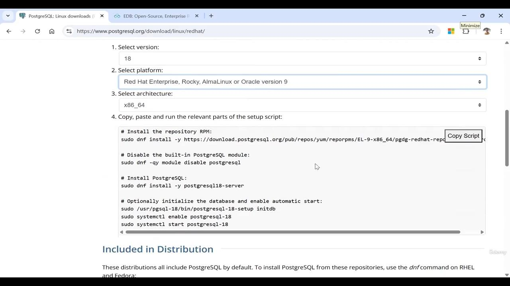
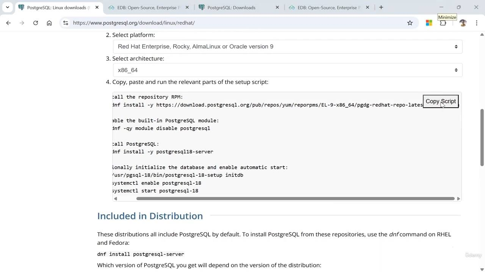
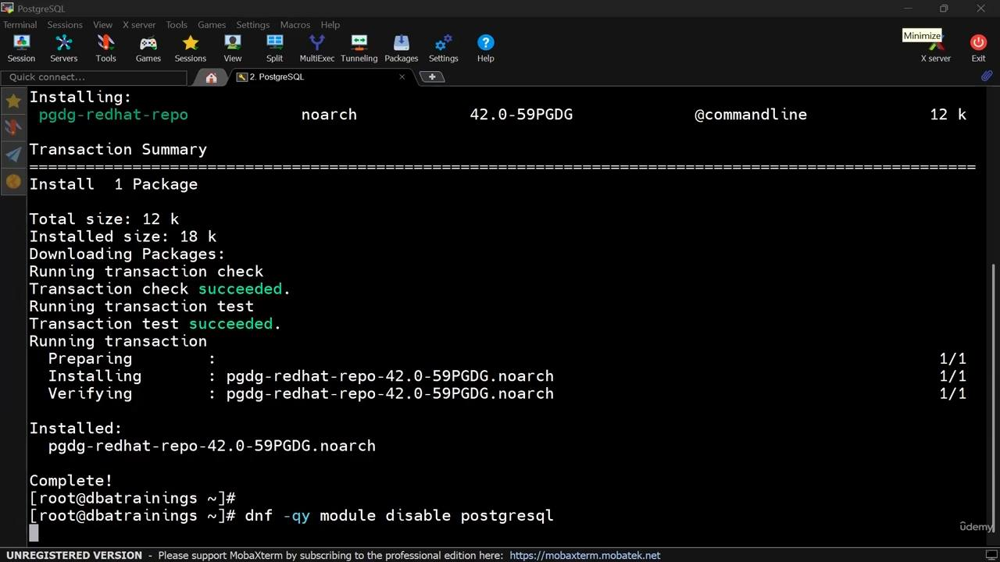
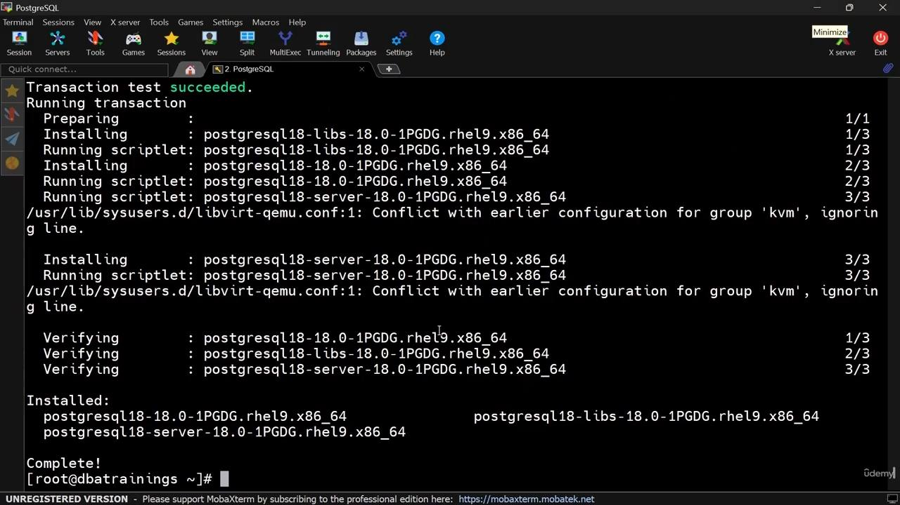
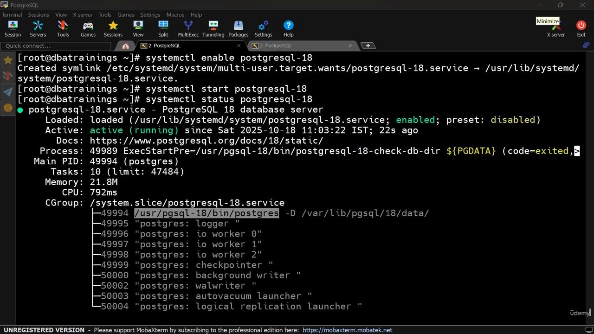
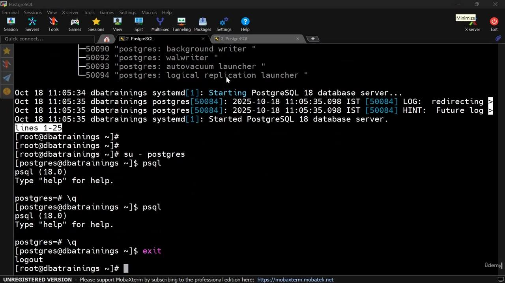
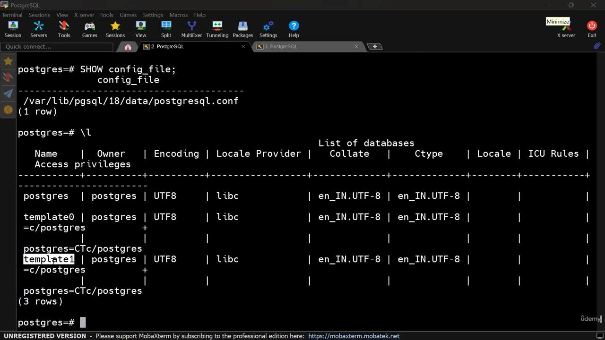
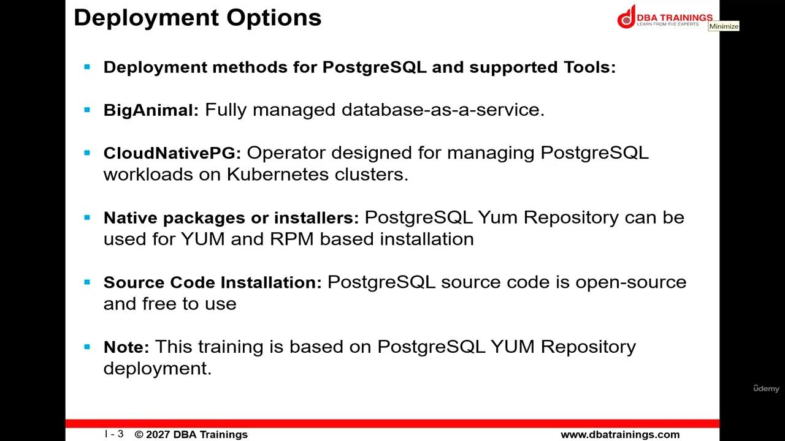

# PostgreSQL 高可用（P1–P4）：从零装出一台能连的 PostgreSQL 18

> 课程：BV1NLj16mEnU ｜ 覆盖 P001–P004
> 读完你能得到的产物：一台 Oracle Linux 9（RHEL 9 系）机器上，用 PGDG YUM 仓库装好的 PostgreSQL 18，`postgresql-18` 服务开机自启，`postgres` 系统用户可登录、可用 `psql` 连上、密码已改、5432 端口在防火墙上放行。

---

## 1. 这一节做什么

这四集不是四个独立知识点，而是一条**从「为什么」走到「装出来」的直线**，中间没有岔路：

- **P001** 是课程说明与学习路径交代。讲师说明了这门课只讲 HA 相关部分，不讲建库建表、备份恢复、PITR、表空间、安全这些完整 DBA 内容；课上演示环境会放在 Azure 上（学员要求多数据中心）。这一集**没有可复现的技术动作**，但交代了一件事：后面所有内容都是在 Linux 上做的，讲师的讲解范围就是 Linux。
- **P002** 是背景与地基。讲了 PostgreSQL 的来历（Berkeley → Postgres95 → PostgreSQL 1996）、当前核心团队、查询内部流程（postmaster → postgres 进程 → parser → traffic cop → rewrite → optimizer → executor）、ACID、安全模型（host based access control）、高可用能力（streaming replication、replication slot、hot backup、pg_basebackup、PITR、pg_upgrade）、以及一堆**你日后写 SQL 会撞上的术语差异**：table/view/index 统一叫 relation，行叫 tuple，列叫 attribute，磁盘上的块叫 page、内存里的叫 buffer，默认 8KB。
- **P003** 是安装方式的横向对比：wizard 图形/交互安装、RPM 手工安装、YUM/APT 仓库安装（自动解决依赖）。同时讲清楚了 OS 用户与权限的规则：安装需要 superuser/admin 权限，安装过程会创建 `postgres` 用户，数据目录归它所有。讲师明确表态：**本课用 YUM 仓库安装**，这是企业里最常用的方式。
- **P004** 是**全程实操**：在 Oracle Linux 9 上，`useradd postgres` → 加 PGDG 仓库 → 禁用系统自带 postgresql module → 确认仓库里有 13~18 各版本 → `dnf install postgresql18-server` → 用 `/usr/pgsql-18/bin/initdb` 初始化集群 → `systemctl enable/start/status/restart postgresql-18` → `su - postgres -c "psql"` 连进去 → 看版本、看配置文件、`\l` 看库、改密码 → 用防火墙放行 5432/80/5500。

所以本文档的可复现边界很明确：**P004 全部可复现，P003 的方法论可复现（同一套命令换版本号即可），P002 是理解性内容，P001 无操作**。后面第 3、4 段就是把 P004 那条命令序列固化成一个能直接跑的脚本。

需要提前说清楚的一件事：讲师在这一段里**没有**配置流复制、没有配置 HBA 规则、没有讲 `pg_hba.conf` 具体怎么写，他只是说"后面讲 HA 的时候会讲"。所以如果你照着本文档做完，得到的是一台**单机可用的 PostgreSQL 18**，不是集群。集群要在后续集数里做。

---

## 2. 讲师原话（带出处）

> "PostgreSQL installation required super user privilege or admin privilege in the Windows." —— p003 [12:53]

> "By default when you are installing the postgres, during the installation there will be a one user created whose name is called postgres and the user will be locked... once installation is done we have to unlock the user postgres, we have to give the password for that." —— p003 [14:16]

> "We are going to install RPM based which is called preferred installation method if you are working on the Linux flavor." —— p003 [32:00]

> "I always recommend to the people to use the latest version... As of now the 17 is there because 18 has just released... 18 will be also good, 17 will be also good." —— p004 [00:58]

> "Whenever we are installing the postgres there is a quite possible the postgres you can get under your operating system which is the older version... I don't want to the old version, that's why I am disabling and I can choose the version as per my choice." —— p004 [08:38]

> "Go to the bin directory and call the PostgreSQL setup and initialize the database. That means it will create the first cluster into my environment." —— p004 [21:03]

> "The first time we need to enable it... systemctl is the OS command in Linux which is controlling the system... after enabling we need to start it." —— p004 [22:47]

> "I am saying here switch the user plus hyphen c means connect to the psql, the both the way you can able to connect." —— p004 [28:02]

> "Postgres is auto-committed by default in the nature. If you don't want auto-committed... you can able to change it as per your need." —— p002 [74:04]

> "Postgres follow the host based access control which is called hba... it control who can connect and from where they can connect." —— p002 [77:46]

---

## 3. 从零复现

### 3.0 环境前提

| 项 | 值 | 说明 |
|---|---|---|
| 操作系统 | Oracle Linux 9（讲师用的是 Oracle VM 上的 Linux 9 虚拟机） | 同 RHEL 9 / Rocky 9 / Alma 9 系的命令完全一致 |
| 账号 | `root`，或有 `sudo` 权限的普通账号 | 讲师原话：安装需要 superuser / admin 权限 |
| 安装方式 | PGDG YUM 仓库 | 讲师明确选定的方式，非源码编译、非图形 wizard |
| 目标版本 | PostgreSQL 18 | 讲师说 18 刚发布，17 也完全可以，把脚本里的 18 换成 17 即可 |
| 默认端口 | 5432；EnterpriseDB 版本是 5444 | 讲师原话 |
| 所需命令 | `useradd` / `passwd` / `dnf` / `systemctl` / `firewall-cmd` / `su` | 讲师要求学员有基础 Unix 命令能力 |

"没网怎么办"这个问题讲师提到了：他把完全不能访问外网的环境叫 **DNG 区**，那种情况下就要走离线包的方式。这一点他在 P003 只是点了一句，没有展开演示，本文档也不编造具体步骤。

### 3.1 步骤 A：创建 postgres 系统用户

讲师在真正装包之前做的第一件事是建用户：

```bash
useradd postgres
passwd postgres
```

这里讲师自己吐槽了一句："用户名和密码都设成一样，不是个好实践，我这是示例"。你在真实环境里请用强密码，并且记下来——**这个密码是操作系统的密码**，不是数据库的密码，两者是两回事，讲师在 P003 [28:08] 专门强调过：OS 层的 postgres 用户和数据库里的 postgres 超级用户**不同密码**，安装完之后数据库那个用户是需要单独设密码的。

> 这一步和 RPM 包的关系：装 `postgresql18-server` 时包本身也会创建 postgres 用户。讲师的做法是**先手工建**。手工建的好处是你能自己掌控家目录和密码。如果你先装了包再建用户会冲突，注意顺序。

### 3.2 步骤 B：添加 PGDG 仓库

讲师没有手敲仓库地址，而是打开 `postgresql.org` 的下载页，按 **Red Hat → 9 → 18** 选好平台和版本，页面直接给出整段脚本，他复制到本地记事本里再用。



这一步的关键认知是讲师在 P003 [07:06] 讲的：**每个 Linux 发行版、每个大版本都有独立的仓库**，CentOS、Oracle Linux、Ubuntu、Debian、Solaris、AIX 各不相同。所以你不能抄别人的命令，必须按自己的 OS 去生成。截图里就是讲师按自己的环境生成的那一段。



### 3.3 步骤 C：禁用系统自带 postgresql module

这是整段实操里最容易被忽略、但讲师反复解释的一步：

```bash
dnf -qy module disable postgresql
```

为什么？讲师原话（p004 [09:38]）："Red Hat Linux 自带 PostgreSQL，而且版本很老。例如 Linux 9 在 2019 年发布时，用的就是 PG 16/17，系统仓库里固定提供的也就是那个老版本。我不想用老版本，我想用 PGDG 仓库里我指定的那个版本，所以把系统自带的模块关掉了。"

关掉之后，`dnf install postgresql18-server` 就只会从 PGDG 仓库取，不会莫名其妙装成系统自带的旧版。



### 3.4 步骤 D：确认仓库里有哪些版本

讲师跑了 `dnf repo list` 然后 `cat` 了 repo 文件，看到 13、14、15、16、17、18 全在里面。这一步是为了**证明版本可选**，也是他回答学员"我要不要用 17"的依据。

他自己也说明：这两条查看命令"不在我发给你们的文档里，我加进来是为了让你们看清楚版本是怎么挂上去的"。

### 3.5 步骤 E：安装 PostgreSQL 18

```bash
dnf install -y postgresql18-server
```

讲师说仓库里同时有 client 工具、开发包、各种语言库（Python/Perl 等）和 server。装 `-server` 会自动带上 client。



### 3.6 步骤 F：初始化集群（initdb）

讲师接下来的动作是：切到 `/usr/pgsql-18/bin` 目录，在那里调用 `initdb`。

> 课里没讲 `initdb` 的完整参数。讲师只说"去 bin 目录调用它，它会创建第一个 cluster"。本文档的脚本里写了 `-D <数据目录>`，这是必须给的（否则它用当前目录）；具体目录请以 `systemctl status postgresql-18` 输出里显示的那行为准。

还有一个坑必须在文档里点明：**`initdb` 不允许以 root 身份运行**。讲师这一段是含糊带过的（他说"安装是用 root 装的，ownership 给了 postgres"），脚本里我按"以 postgres 身份执行"来写。

### 3.7 步骤 G：enable / start / status / restart

讲师的四连：

```bash
systemctl enable  postgresql-18   # 只需第一次
systemctl start   postgresql-18
systemctl status  postgresql-18
systemctl restart postgresql-18
```



讲师看到状态是 `active (running)`、已运行 22 秒、并指出了输出里的 **bin 目录位置**和**数据目录位置**两行。然后他 restart 了一次，状态里变成从 2 秒开始算——他用这个动作证明"服务是被 systemd 管着的，机器重启会自动起来"。

> 输出里的具体字段名请以你机器上的实际输出为准，不同 systemd 小版本的措辞不完全一样。

### 3.8 步骤 H：用 psql 连进去

讲师演示了两种连法：

```bash
su - postgres          # 方式一：先切用户
psql

su - postgres -c "psql" # 方式二：一条命令完成切用户 + 连接
```



进去之后他做了四件事：

1. 确认版本（连接时就直接打印了 18）
2. 看配置文件位置
3. `\l` 列出初始数据库，看到 `postgres`、`template0`、`template1` 三个
4. 修改 postgres 用户密码



关于"看版本"他给了替代方案：不连数据库，直接 `/usr/pgsql-18/bin/psql --version`。他还专门提醒：**客户端工具和服务端版本要对齐**，机器上如果同时装过老版本，要用全路径调用，别用 PATH 里那个旧的。

### 3.9 步骤 I：防火墙放行

讲师的做法是放行端口 5432、80、5500，并加一个 service 名，最后 reload：

```bash
firewall-cmd --permanent --add-port=5432/tcp
firewall-cmd --permanent --add-port=80/tcp
firewall-cmd --permanent --add-port=5500/tcp
firewall-cmd --permanent --add-service=postgresql
firewall-cmd --reload
firewall-cmd --list-all
```

他同时交代了自己的演示机**防火墙根本没开**，这一段是"教你怎么做"，不是"他也这么做了"。真实环境里他说得很明确：这个要去找管网络/安全的人，把端口加到白名单里。

> 课里他只说了"放行端口 / 添加服务 / 重新加载"这几个动作，没有逐字念命令。上面的 `firewall-cmd` 参数是 RHEL 系的标准写法；如果 `--add-service=postgresql` 报找不到，就先 `firewall-cmd --get-services` 查有没有这个 service，没有就只加端口。

### 3.10 部署方式全景（P003，理解即可）



截图里是讲师列的几条路，按他的原话对应关系：

| 方式 | 讲师的说法 | 本课是否使用 |
|---|---|---|
| BigAnimal | EnterpriseDB 自己做的一个 DBaaS 云 | 否 |
| cloud native PG | 面向 Kubernetes 的 operator，各大云都有 | 否 |
| wizard / 交互安装 | 图形或命令行交互，装 Windows/Mac 常用 | 否（他只放了旧截图演示） |
| RPM 手工安装 | 依赖要手工解决 | 否 |
| **YUM/APT 仓库** | 自动解决依赖，企业首选 | **是** |
| 源码安装 | 下载源码自己编译，AWS 的 Aurora 就是这么改出来的 | 否 |

### 3.11 失败时怎么退回去

```bash
systemctl stop postgresql-18
dnf remove -y 'postgresql18*'
rm -rf /var/lib/pgsql/18
rm -f /etc/yum.repos.d/pgdg-redhat-all.repo
userdel -r postgres
```

顺序不能颠倒：先停服务，再卸包，再删数据目录。**先删数据目录再卸包**会让包管理器的 postun 脚本报一堆错。

---

## 4. 完整代码

下面四个文件放在同一个目录里即可。

### 4.1 `env.sh` —— 版本与路径集中定义

```bash
#!/usr/bin/env bash
# env.sh — 集中定义版本号与路径，改版本只改这里
# 用法: source ./env.sh

export PG_MAJOR="18"                                   # 换成 17 / 16 ... 即可
export PG_USER="postgres"                              # OS 用户
export PG_BIN="/usr/pgsql-${PG_MAJOR}/bin"             # 讲师演示的 bin 目录形态
export PGDATA="/var/lib/pgsql/${PG_MAJOR}/data"        # 以 systemctl status 输出为准
export PGPORT="5432"                                   # EDB 版默认是 5444
export PGSERVICE="postgresql-${PG_MAJOR}"
```

### 4.2 `01_install_pg18.sh` —— 安装主脚本

```bash
#!/usr/bin/env bash
# 01_install_pg18.sh
# 在 Oracle Linux 9 / RHEL 9 系上，用 PGDG YUM 仓库安装 PostgreSQL 18
# 必须以 root 或 sudo 执行
set -euo pipefail

source "$(dirname "$0")/env.sh"

echo "==> [1/8] 检查执行身份"
if [[ "$(id -u)" -ne 0 ]]; then
  echo "ERROR: 请用 root 或 sudo 运行本脚本" >&2
  exit 1
fi

echo "==> [2/8] 确认操作系统"
if [[ ! -f /etc/oracle-release && ! -f /etc/redhat-release ]]; then
  echo "ERROR: 本脚本只针对 RHEL 9 系（Oracle Linux / RHEL / Rocky / Alma）" >&2
  exit 1
fi
cat /etc/os-release | head -n 3

echo "==> [3/8] 创建 OS 用户 ${PG_USER}"
if id "${PG_USER}" &>/dev/null; then
  echo "用户 ${PG_USER} 已存在，跳过"
else
  useradd "${PG_USER}"
  echo "已创建用户 ${PG_USER}，请立即设置密码："
  passwd "${PG_USER}"
fi

echo "==> [4/8] 添加 PGDG 仓库（RHEL/Oracle Linux 9）"
if [[ ! -f /etc/yum.repos.d/pgdg-redhat-all.repo ]]; then
  dnf install -y \
    "https://download.postgresql.org/pub/repos/yum/reporpms/EL-9-x86_64/pgdg-redhat-repo-latest.noarch.rpm"
else
  echo "PGDG 仓库已存在，跳过"
fi

echo "==> [5/8] 禁用 OS 自带的 postgresql module"
dnf -qy module disable postgresql || true

echo "==> [6/8] 查看仓库中可用的 PostgreSQL 版本"
dnf -q repo list | grep -i pgdg || true
dnf -q list available "postgresql${PG_MAJOR}-server" || {
  echo "ERROR: 仓库里找不到 postgresql${PG_MAJOR}-server，请检查 PG_MAJOR" >&2
  exit 1
}

echo "==> [7/8] 安装 PostgreSQL ${PG_MAJOR}"
dnf install -y "postgresql${PG_MAJOR}-server" "postgresql${PG_MAJOR}"

echo "==> [8/8] 初始化数据目录"
if [[ -f "${PGDATA}/PG_VERSION" ]]; then
  echo "数据目录 ${PGDATA} 已初始化，跳过 initdb"
else
  install -d -o "${PG_USER}" -g "${PG_USER}" -m 0700 "$(dirname "${PGDATA}")"
  install -d -o "${PG_USER}" -g "${PG_USER}" -m 0700 "${PGDATA}"
  # initdb 不允许以 root 运行，必须切到 postgres 用户
  su - "${PG_USER}" -c "${PG_BIN}/initdb -D ${PGDATA}"
fi

echo "==> 完成。下一步执行 02_start_pg18.sh"
```

### 4.3 `02_start_pg18.sh` —— 启服务、验状态、开防火墙

```bash
#!/usr/bin/env bash
# 02_start_pg18.sh
# 启动 PostgreSQL 服务、验证状态、放行防火墙端口
set -euo pipefail

source "$(dirname "$0")/env.sh"

MARKER="/var/lib/pgsql/${PG_MAJOR}/.enabled"

echo "==> [1/5] enable 服务（只做一次）"
if [[ -f "${MARKER}" ]]; then
  echo "${PGSERVICE} 已经 enable 过，跳过"
else
  systemctl enable "${PGSERVICE}"
  touch "${MARKER}"
fi

echo "==> [2/5] start 服务"
systemctl start "${PGSERVICE}"

echo "==> [3/5] 查看状态"
systemctl status "${PGSERVICE}" --no-pager || true

echo "==> [4/5] 验证端口监听"
ss -lntp | grep ":${PGPORT}" || {
  echo "WARN: ${PGPORT} 没有在监听，检查数据目录与日志" >&2
}

echo "==> [5/5] 防火墙放行"
if systemctl is-active --quiet firewalld; then
  firewall-cmd --permanent --add-port="${PGPORT}/tcp"
  firewall-cmd --permanent --add-port=80/tcp
  firewall-cmd --permanent --add-port=5500/tcp
  firewall-cmd --permanent --add-service=postgresql || \
    echo "WARN: firewalld 中没有 postgresql service，只用端口放行即可"
  firewall-cmd --reload
  firewall-cmd --list-all
else
  echo "firewalld 未运行，跳过（讲师演示机同样没开防火墙）"
fi

echo "==> 完成。下一步执行 03_verify.sh"
```

### 4.4 `03_verify.sh` + `01_bootstrap.sql` —— 连进去验证

```bash
#!/usr/bin/env bash
# 03_verify.sh
set -euo pipefail
source "$(dirname "$0")/env.sh"

echo "==> 客户端与服务端版本"
"${PG_BIN}/psql" --version
su - "${PG_USER}" -c "${PG_BIN}/psql -p ${PGPORT} -Atc 'SELECT version();'"

echo "==> 配置文件位置"
su - "${PG_USER}" -c "${PG_BIN}/psql -p ${PGPORT} -Atc 'SHOW config_file;'"
su - "${PG_USER}" -c "${PG_BIN}/psql -p ${PGPORT} -Atc 'SHOW data_directory;'"

echo "==> 初始数据库列表"
su - "${PG_USER}" -c "${PG_BIN}/psql -p ${PGPORT} -c '\l'"

echo "==> 执行 bootstrap SQL"
su - "${PG_USER}" -c "${PG_BIN}/psql -p ${PGPORT} -f $(dirname "$0")/01_bootstrap.sql"
```

```sql
-- 01_bootstrap.sql
-- 讲师在 P004 只做了两件事：\l 看库、ALTER USER 改密码。
-- 下面这段是可直接执行的完整版本。

\echo '--- 当前数据库与版本 ---'
SELECT version();

\echo '--- 修改 postgres 超级用户密码 ---'
-- 课里用的是弱示例口令，实际请换成强口令
ALTER USER postgres WITH PASSWORD 'ChangeMe_Str0ng!';

\echo '--- 建一个演练库（后续 HA 实验要用） ---'
DROP DATABASE IF EXISTS hadb;
CREATE DATABASE hadb;

\echo '--- 建一张表并验证 auto-commit 行为 ---'
\c hadb
CREATE TABLE IF NOT EXISTS ping (
    id      bigserial PRIMARY KEY,
    note    text        NOT NULL,
    created timestamptz NOT NULL DEFAULT now()
);
INSERT INTO ping(note) VALUES ('first row from bootstrap');
SELECT * FROM ping ORDER BY id;
```

---

## 5. 逐行解释

**`set -euo pipefail`**：出错即停、引用未定义变量报错、管道任一环失败即失败。安装脚本必须这样，否则 `dnf install` 挂了脚本还会继续往下走，最后你得到一台"看起来装完了但服务器起不来"的机器。

**`if [[ "$(id -u)" -ne 0 ]]`**：对应讲师原话"安装需要 superuser / admin 权限"。这是硬门槛——`dnf install` 和 `useradd` 都要 root。

**`useradd "${PG_USER}"` 放在装包之前**：这是讲师的原始顺序（P004 [03:46] 先 `useradd postgres` 再装）。RPM 包的脚本在发现用户已存在时会直接复用，不会报错，所以这个顺序是安全的；反过来的顺序（先装包再建用户）才会出问题。

**`passwd "${PG_USER}"`**：讲师原话——安装时会创建 postgres 用户但**用户是锁定的**，装完要给它设密码。他还特意强调这个密码和数据库里 postgres 用户的密码不是一回事，两个都要设。设完 OS 密码，还要在 psql 里执行一次 `ALTER USER postgres WITH PASSWORD ...`（在 `01_bootstrap.sql` 里）。

**`dnf install ... pgdg-redhat-repo-latest.noarch.rpm`**：这是官网下载页按 Red Hat / 9 / 生成的仓库安装包。讲师演示时是**从页面复制整段脚本再执行**，不是背命令；你也应该这么做，因为 EL-8 和 EL-9、EL-10 的 reporpms 路径不同。

**`dnf -qy module disable postgresql`**：这是整段里最有价值的一行。RHEL 9 自带一个 AppStream 里的 postgresql module，它的版本被钉死在发行版发布时那个版本上。不禁用它，你 `dnf install postgresql18-server` 可能会拿到系统那个老的，或者至少在两套仓库之间产生版本解析歧义。讲师的原话是"我不想用老的，我要自己选版本"。

**`dnf -q list available "postgresql${PG_MAJOR}-server"`**：这是给脚本加的安全阀。讲师在课上是通过 `dnf repo list` + `cat` repo 文件人工确认"13~18 都在里面"的，脚本里用 `list available` 自动确认一次，版本号写错时立刻退出，而不是装到一半失败。

**`initdb -D "${PGDATA}"`**：`initdb` 是"把一堆空文件变成一个可启动的数据库集群"的动作。讲师的说法是"创建第一个 cluster"。这一步之前数据目录里什么都没有，这一步之后里面会出现 `PG_VERSION`、`base/`、`global/`、`pg_wal/` 等，以及 `postgresql.conf`、`pg_hba.conf`、`pg_ident.conf` 三个核心配置文件。

这也是**为什么脚本要判断 `PG_VERSION` 是否已存在**：PGDG 的 RPM 在部分组合下会帮你跑一次初始化，重复 initdb 会报"目录非空"。讲师这一段讲得比较快，没有明确说"包有没有帮你初始化"，所以脚本里做了幂等判断——**这就是"课里没讲但你会撞上"的第一条**。

**`su - "${PG_USER}" -c "..."`**：两个作用，一是切身份（initdb 拒绝 root），二是 `-` 会把环境变量一起切过去。

**`systemctl enable`**：讲师专门讲了"第一次我们需要先启用它"。`enable` 只是建软链接，让开机时自动启动，**它不会立刻启动服务**；`start` 才真正拉起进程。这两步分开是 systemd 的设计，很多人第一次会漏掉 `start` 然后困惑"为什么没有监听"。

**`systemctl status` 里看什么**：讲师在课上指出两行关键信息——**服务的 bin 目录**和**数据目录**。这两个值就是你在 `env.sh` 里该填的 `PG_BIN` 和 `PGDATA`。如果你装的版本不是 18，把 `PG_MAJOR` 改掉即可。

**`systemctl restart` 的意义**：讲师把服务重启，然后指着"从 2 秒开始算"的运行时间说——这说明服务是被 systemd 全权管理的，机器重启后会自动起来，不需要手工干预。这是后面讲高可用的前提：没有 systemd 托管的服务，做自动 failover 会很麻烦。

**`su - postgres -c "psql"`**：讲师演示了两种连法，并说明第二种 `-c` 是"切用户 + 连接一步到位"。这也是写自动化脚本时的标准做法，因为 psql 走的是 peer/本地 socket 认证，以 postgres 身份执行天然通得过。

**`\l`**：讲师用它列出了初始的三个库：`postgres`、`template0`、`template1`。他说"这几个库的用途后面再讲"。简单说：`template1` 是 CREATE DATABASE 的默认模板，`template0` 是干净模板（用于不同编码/排序规则的库），`postgres` 是默认维护库。**不要往 template1 里乱建对象**，否则以后每个新建库都会带上那些对象。

**`SHOW config_file;` / `SHOW data_directory;`**：讲师说"我想看一下配置文件"，然后展示了配置文件内容。他没念具体命令，这里用 `SHOW` 是最稳的——它由服务器自己告诉你文件在哪，不用猜版本路径。

**`ALTER USER postgres WITH PASSWORD ...`**：改的是**数据库层的超级用户密码**，和前面 `passwd postgres` 改的 OS 密码完全无关。两个都要改。

**`firewall-cmd --permanent --add-port=5432/tcp`**：`--permanent` 写进持久配置，必须再 `--reload` 才生效；不加 `--permanent` 是临时规则，重启就没了。讲师最后一步确实是 `reload`，这个顺序不能省。

**关于事务和并发（前端转过来最容易混的地方）**

讲师在 P002 讲了 ACID 和"PostgreSQL 默认使用自动提交；除 Oracle 外，所有数据库都是这样。"。用 Node 的话说：

- 你 `pg` 客户端里执行 `await client.query('INSERT ...')`，**这一句执行完就已经提交了**，没有隐式事务包着。这就是讲师说的 auto-commit。
- 你要"两条语句要么都成要么都不成"，必须自己 `BEGIN` / `COMMIT` / `ROLLBACK`，对应 SQL 的 `BEGIN; ...; COMMIT;`。讲师说的 savepoint 在 Node 里就是 `SAVEPOINT sp1;` + `ROLLBACK TO SAVEPOINT sp1;`。
- 讲师讲 "每个会话都会有一个独立的 postgres 进程"（p002 [30:42]）——**这句话对 Node 有直接后果**：`pg.Pool` 里的每一个连接，在服务端都是一个独立的 postgres 操作系统进程。你把 `max` 设成 200，服务端就真的多 200 个进程。讲师说的 "一个主 postmaster 进程，外加 N 个 postgres 后端进程。" 就是这个结构。这也是为什么 PostgreSQL 的部署文档总在强调连接池和中间件——**它不像 MySQL 那样一个线程扛多连接**。

---

## 6. 复现检查清单

按顺序打勾，任何一条不通过就不要往下走。

- [ ] `id postgres` 有输出，说明 OS 用户存在
- [ ] `/etc/yum.repos.d/pgdg-redhat-all.repo` 文件存在
- [ ] `dnf module list postgresql` 显示 disabled（或该 module 已不存在）
- [ ] `dnf list available postgresql18-server` 有结果
- [ ] `rpm -qa | grep postgresql18` 至少能看到 `postgresql18-server` 和 `postgresql18`
- [ ] `/usr/pgsql-18/bin/psql --version` 输出 18.x
- [ ] `${PGDATA}/PG_VERSION` 文件存在，内容为 `18`
- [ ] `systemctl is-enabled postgresql-18` 返回 `enabled`
- [ ] `systemctl is-active postgresql-18` 返回 `active`
- [ ] `systemctl status postgresql-18` 里能看到 `active (running)`，且能读出 bin 目录与 data 目录两行（**字段名以实际输出为准**）
- [ ] `ss -lntp | grep 5432` 有 `LISTEN`
- [ ] `su - postgres -c "/usr/pgsql-18/bin/psql -c '\l'"` 列出 `postgres` / `template0` / `template1`
- [ ] `psql -c "SELECT version();"` 返回 18.x
- [ ] `psql -c "SHOW config_file;"` 与 `SHOW data_directory;` 返回的路径落在 `/var/lib/pgsql/18/` 下
- [ ] `01_bootstrap.sql` 跑完无报错，`hadb` 库存在，`ping` 表有 1 行
- [ ] 若 firewalld 在运行：`firewall-cmd --list-ports` 能看到 `5432/tcp`
- [ ] 重启机器后再查一次 `systemctl is-active postgresql-18`，仍为 `active`（验证 enable 生效）

---

## 7. 课里没讲但你会撞上

**1）`initdb` 重复执行报 "目录不为空"**
PGDG 的 RPM 在某些版本组合下会在安装后自动初始化数据目录，此时你再手工 `initdb` 就会失败。判断方法：装完包先 `ls ${PGDATA}`，有 `PG_VERSION` 就别再 initdb。本文档脚本已做幂等判断。

**2）`initdb` 报 "不能以 root 身份运行"**
这是硬性限制，不要试着绕过。用 `su - postgres -c "initdb ..."`。

**3）远端连不上，但本机 `psql` 正常**
这是最典型的一撞。默认 `listen_addresses` 只监听 localhost，且 HBA 默认只允许本地连接。讲师在 P002 [77:46] 讲了 HBA 的**概念**（"控制谁能连、从哪儿连"），但**没有在 P004 里演示怎么改**，他说的是后面讲 HA 的时候会涉及。所以这一步你需要自己查官方文档的 `pg_hba.conf` 与 `postgresql.conf` 两个文件——课里没讲具体写法，别指望从这四集里抄到。

**4）Node 应用连不上 / 报认证失败**
PostgreSQL 18 的默认密码加密方式是 scram-sha-256，老的 `pg` 客户端版本可能不支持。升级 `pg` 到较新版本即可。课里没讲客户端驱动相关内容。

**5）SELinux 拦住了非默认端口**
讲师放行了 5432/80/5500 三个端口，但如果 SELinux 是 enforcing 模式，直接改 `port = 5500` 会被拒绝。需要单独给 postgres 打端口标签。课里没讲 SELinux。

**6）`postgres` 用户密码没设，切不过去**
`useradd` 之后如果不 `passwd`，该用户是被锁定的，`su - postgres` 会失败。讲师在 P003 [14:16] 确实说了"用户会被锁定，装完要给它设密码"，但很多人跳过这步直接 su。

**7）`dnf remove` 之后数据目录还在，重装会踩坑**
`dnf remove` 不动 `/var/lib/pgsql/`。重装前要么备份要么清空，否则新装的实例可能启动失败或连到旧数据。

**8）`systemctl enable` 完没 `start`**
这是新手最高频的"装完了但连不上"。`enable` 只管开机自启，不管当下。

**9）多版本共存时的 PATH 陷阱**
讲师在 P004 [32:20] 专门提醒过：机器上可能有老版本客户端，直接敲 `psql` 会用到错的那个。他的做法是**永远用全路径** `/usr/pgsql-18/bin/psql`，或者把该路径前置到 PATH。这也是本文档 `env.sh` 里用 `PG_BIN` 的原因。

**10）这台机器现在只是单机**
再强调一次：P004 做完你得到的是**一台单机 PostgreSQL 18**。流复制（primary/standby）、replication slot、pg_basebackup、PITR、pg_upgrade 讲师都只在 P002 里做了**概念性介绍**，没有任何可执行命令。这些属于后续集数，本文档不做任何编造性的补充。