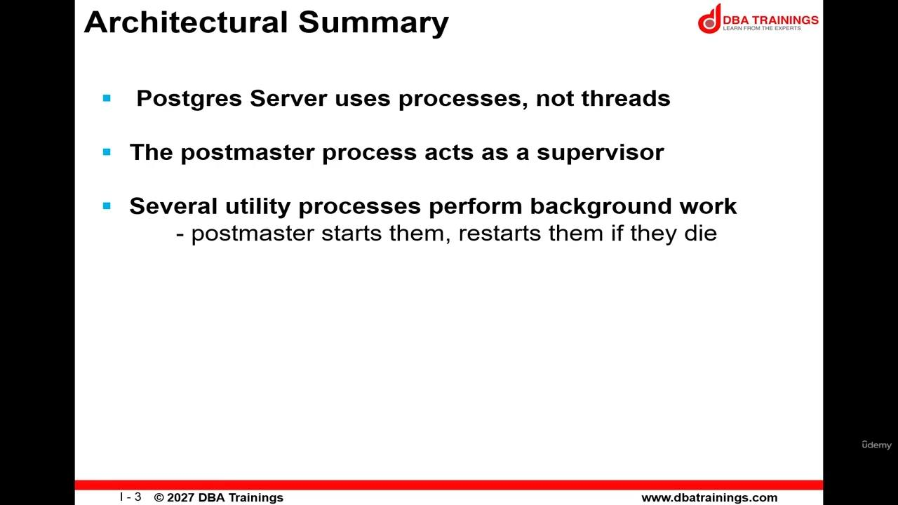
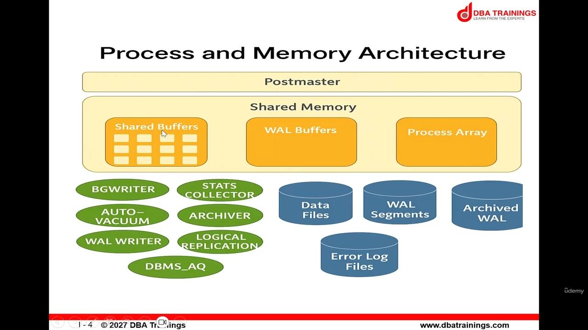
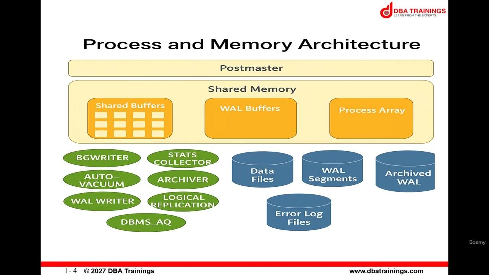
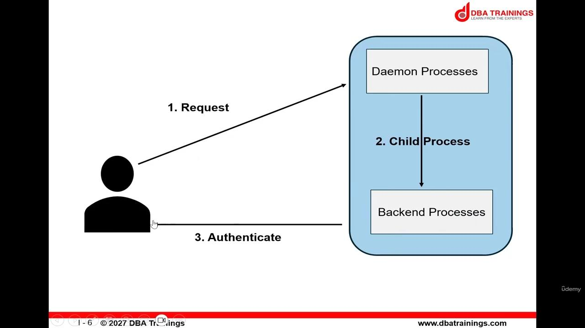
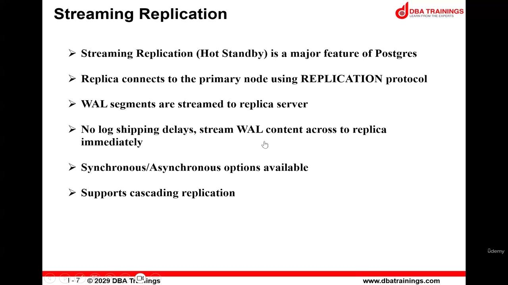
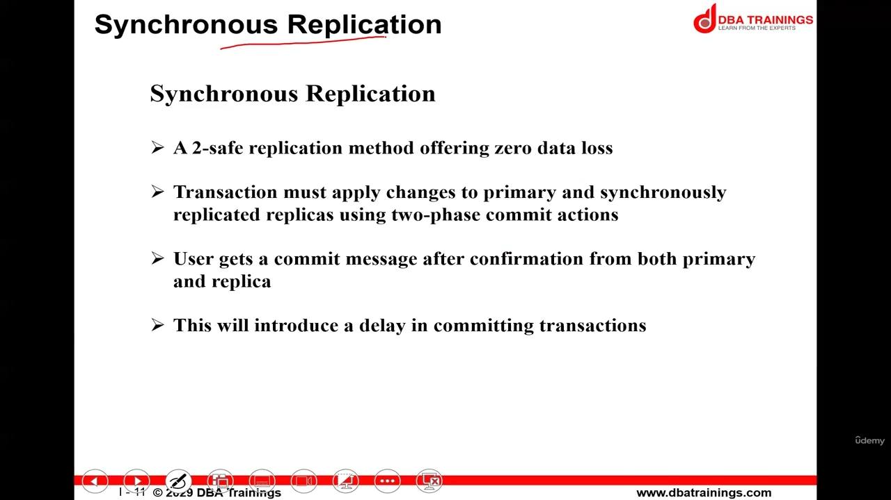
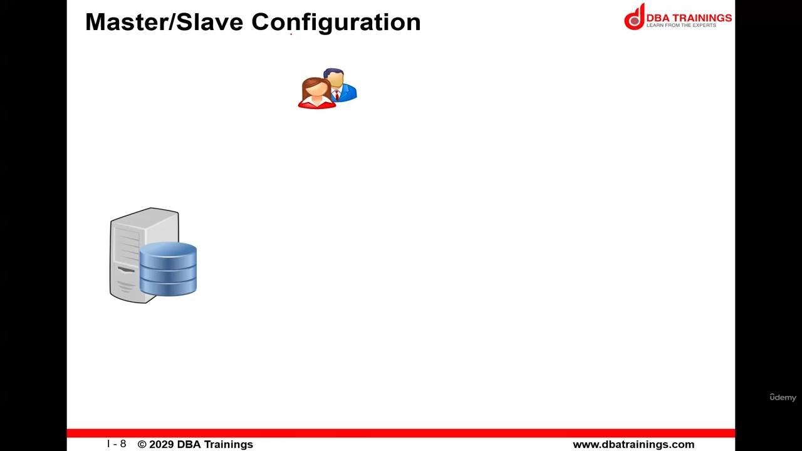

# PostgreSQL 高可用（P005–P008）· 可复现课程文档

> 覆盖章节：P005（系统架构）、P006（复制的概念与收益）、P007（PG 的复制方式与集群管理工具、流复制原理）、P008（同步/异步复制的语义差异）
> 目标读者：前端转 AI 应用工程师，能读 Node、不熟后端运维。

---

## 0. 先讲清楚这份文档的边界（必读）

在动手之前，有两件事必须先说清楚，否则你按下第一条命令后就会困惑。

**第一，课里没有真正敲过命令。** P005 里讲师反复说「practically we will do once we will install it, then we will go for the list of the process, and that time I can show you」——但到 P008 结束，这一段的演示始终没有真正执行下去。讲师在 P005 [86:15] 提到他跑了 `ps -ef | grep postmaster`，也在 [59:59] 提到一张 `ps` 截图，但整段课程里**没有任何一条命令的完整输入与输出**。

**第二，课里讲的是「为什么这样设计」和「有哪些方案」，不是「怎么配」。** 讲义里出现的文件（`postgresql.conf`、`pg_hba.conf`、`pg_ident.conf`、`postgresql.auto.conf`、`postmaster.pid`）和进程（postmaster、bgwriter、checkpointer、autovacuum、walwriter、archiver、wal sender、wal receiver）都是**名字**，没有一条具体参数值、没有一个配置片段。

所以本文档分成两类内容，之后每一处都会标出来：

| 标记 | 含义 |
|---|---|
| **【课内】** | 讲师明确讲过的事实、结论、文件/进程名、默认值 |
| **【课外补齐】** | 课里没讲，但为了让课内概念真的跑起来，按 PostgreSQL 官方工具补的最小步骤 |

**【课外补齐】的部分，不要当成「讲师教过」**。这是本文档作者为了让文档具备可复现性而补的，跟课程内容无关，你以后照着官方文档核对即可。

---

## 1. 这一节做什么

这一段课要交付三样东西，缺一样你就不算学完：

**（一）一套 PostgreSQL 的进程/内存/文件心智模型。**【课内】讲师的说法是：PostgreSQL 是**进程（process）模型**而不是线程（thread）模型，「whatever the process we will talk that you can able to see on the OS level」（—— p005 [04:47]）。这句话是后面所有高可用讨论的地基：因为每个连接是一个独立进程，所以 WAL 发送进程（WAL sender）才能独立存在、独立崩溃、独立重启，流复制才有得谈。

**（二）一张复制方案的选型表。**【课内】P007 把可选项摊开讲了：日志传送（log shipping）、流复制（streaming replication）、逻辑复制（logical replication）、双向复制（bidirectional replication）、EDB 商业方案。讲师没有替你选，「which is best you can decide, I am not in the position to tell you」（—— p007 [09:05]），但他给了一句明确的倾向：**「most use is called streaming replication」**（—— p007 [09:05]）。

**（三）一个能跑的两节点流复制环境，并且能手动切换同步/异步。**【课内 + 课外补齐】这是本文档第三节的全部内容。

**为什么先讲架构再讲高可用？** 讲师自己解释了：

> "一般来说，这部分我们不会在高可用部分里讲，它属于管理部分；不过既然你要求讲系统架构，而且我觉得不了解系统架构就无法清楚理解整个流程，所以还是讲一下。"
> —— p005 [02:52]

这意味着你不是可以跳过 P005 直接看复制的。跳过的人会在第 3 节卡在「为什么复制要单独开一个用户」「为什么 standby 的端口必须不一样」这类问题上。

---

## 2. 讲师原话（关键论点摘录）

下面这些是**课内原话**，我按项目实现逻辑重排了顺序，不是按播放顺序。

**关于进程模型的代价：**

> "这种模型会增强故障隔离能力和稳定性，代价是内存占用会略高一些。"
> —— p005 [05:44]

**关于 postmaster 是什么：**

> "Postmaster 进程充当监督者。换句话说，你可以把它看作 Postgres 进程内部的主控制器。Postmaster 负责初始化和管理局于 Postgres 中的所有其他进程。"
> —— p005 [08:02]

**关于 postmaster 如何看守后台进程（这条对你的运维方式影响最大）：**

> "Postmaster 会负责这件事：它们会检查心跳，如果发现某个进程已经死掉，就会重启它。每 10 秒检查一次。"
> —— p005 [09:29] / [10:25]

**关于 shared_buffers 的默认值和经验法则：**

> "默认情况下，这个大小是 128 MB。安装 Postgres 时，共享缓冲区会自动获得 128 MB 空间。经验法则是，可以把内存的 25% 分配给共享缓冲区。"
> —— p005 [16:14] / [17:12]

**关于集群（cluster）这个词在 PG 里到底指什么（这是最容易看错的一处）：**

> "这里的集群不像机架意义上的集群；集群指的是一个实例，其中包含多个数据库、多个后台进程以及多个工具进程。集群是由一个服务器实例管理的一组数据库。"
> —— p005 [65:44] / [66:13]

**关于同一台机器能不能跑多个集群：**

> "你可以在同一台服务器上运行多个集群。每个集群都需要规避一些事项，比如数据目录位置……数据目录应当分开，端口号也应当分开。"
> —— p005 [67:11]

**关于复制的最小定义：**

> "把数据从一台 PostgreSQL 数据库服务器复制到另一台服务器的过程，称为 PostgreSQL 复制。"
> —— p006 [13:24]

**关于流复制的两个进程：**

> "主服务器会发送预写式日志，所以它有预写式日志发送进程……而副本服务器则有预写式日志接收进程。"
> —— p007 [17:10]

**关于同步复制的代价：**

> "它只有被应用到某个备库上之后才会得到确认……这需要时间，所以性能会稍微慢一些。"
> —— p008 [09:52] / p007 [22:54]

**关于为什么必须有第三个组件（自动故障转移）：**

> "没有复制管理器，复制还能工作吗？能工作。但唯一的缺点是，不会发生自动故障转移。"
> —— p006 [05:15]

**关于开源里推荐的故障转移工具：**

> "repmgr 又是一款开源工具，可简化基于流复制的高可用监控和故障转移的配置。"
> —— p007 [11:56]（RAP manager = repmgr，replication manager）

---

## 3. 从零复现

### 3.1 环境与版本决策

【课内】讲师给的版本线索是：

> "默认安装目录类似这里的 `/usr/pgsql-16`，但在实验环境中你会看到像实验环境 pgsql 17 这样的目录。所以我们使用的是最新的 17 版，18 版一个月前才发布。"
> —— p005 [68:10]

所以**本课程实验用 PostgreSQL 17**，安装路径按 RHEL/Rocky 系 PGDG 仓库的约定落在 `/usr/pgsql-17`。

**【课外补齐】** 安装 PostgreSQL 17（RHEL/Rocky/Alma 系）：

```bash
# 仓库配置（RHEL/Rocky 9 为例）
sudo dnf install -y https://download.postgresql.org/pub/repos/yum/reporpms/EL-9-x86_64/pgdg-redhat-repo-latest.noarch.rpm
sudo dnf -qy module disable postgresql
sudo dnf install -y postgresql17-server postgresql17
# 验证版本
/usr/pgsql-17/bin/postgres --version
```

**部署形态：单机双实例。** 理由直接来自讲师 [67:11] 那句话：多个 cluster 可以跑在同一台 OS 上，只要 data directory 和端口分开。单机双实例是复现成本最低、且完全符合课内描述的做法。生产环境你要换成两台机器 + 真实内网 IP，其余步骤一模一样。

端口规划：

| 角色 | 端口 | 数据目录 | 说明 |
|---|---|---|---|
| primary | 5432 | `/var/lib/pgsql/17/primary` | 课内 [57:34] 明确默认端口 5432 |
| standby | 5433 | `/var/lib/pgsql/17/standby` | 课内 [67:40] 明确每个 cluster 必须独立端口 |
| 归档 | — | `/var/lib/pgsql/17/archive` | 对应课内讲的 archiver 进程 [39:02] |

### 3.2 目录结构

```
postgres-ha-lab/
├── config/
│   ├── postgresql.append.conf     # 追加到 primary 的 postgresql.conf
│   ├── pg_hba.append.conf         # 追加到 primary 的 pg_hba.conf
│   └── repmgr.conf                # 【课外补齐】repmgr 节点配置
├── scripts/
│   ├── 00_env.sh                  # 公共变量，其余脚本 source 它
│   ├── 01_init_primary.sh         # 初始化 primary 集群
│   ├── 02_init_standby.sh         # 用基础备份拉起 standby
│   ├── 03_verify.sh               # 验证数据真的复制过去了
│   ├── 04_toggle_sync.sh          # 异步 → 同步，观察行为差异
│   └── 05_promote.sh              # 手动故障转移
└── README.md
```

```bash
mkdir -p ~/postgres-ha-lab/{config,scripts}
cd ~/postgres-ha-lab
```

### 3.3 第一步：看清进程长什么样（对应 P005 全部内容）

在动手配复制之前，先把你已经起来的 PostgreSQL 进程列一遍，这一步是把课内 [86:15] 那句「we have just used the `ps -ef` and grep postmaster」补上：

```bash
ps -ef | grep -i postgres | grep -v grep
```

**【课外补齐 / 注意】** 你会看到进程名是 `postgres` 而不是 `postmaster`。讲师在 [57:07] 说「you cannot see the postmaster on the OS level... what you find? Post-glace」，这个描述基本正确但容易误解：主进程在 `ps` 里显示为 `postgres`，它派生出的每个后台进程（bgwriter、checkpointer、walwriter 等）和每个客户端连接的后端进程（backend）也都显示为 `postgres`。**区分它们靠的是父进程关系和进程启动参数**，不是进程名。

```bash
# 看清父子关系（PID / PPID / 命令行）
ps -eo pid,ppid,cmd | grep '[p]ostgres'
```

课内 [59:59]–[60:27] 讲师指着截图说「What is the process number? 1385. All the other process you can see 1527, 1566, those all are dependent to 1385」——他讲的正是这个父子关系：一个主进程，其余全是它的子进程。



下面这张是共享内存部分。课内 [16:14] 给了 `shared_buffers` 默认 128MB，[17:12] 给了 25% 内存的经验法则。**【课外补齐】** 想知道你的机器上实际值：

```bash
psql -h 127.0.0.1 -p 5432 -U postgres -d postgres -c "SHOW shared_buffers;"
```



这张是后台进程总览。课内 [21:29] 之后依次点名了 bgwriter、checkpointer、autovacuum、walwriter、stats collector、archiver，以及 [40:01] 的逻辑复制进程。**注意课内没给任何后台进程的调优参数名**，只给了「bgwriter 默认每 10 毫秒写一次」这种口头描述（[26:42]），以及 checkpoint「every 10 seconds」（[55:11]）。这两个数字与官方文档的描述有出入，别拿它们当配置依据，见第 7 节。



### 3.4 第二步：启动 primary（对应 P005 文件布局 + P007 流复制前提）

【课内】讲师在 [80:00] 之后把配置文件点了一遍：`postgresql.conf` 是主配置（「similar like the oracle you have a parameter file or p file」）、`pg_hba.conf` 是**基于主机的认证**（「control which user can connect and from where they can connect」）、`pg_ident.conf` 做 OS 用户到 PG 用户的映射、`postgresql.auto.conf` 承载 `ALTER SYSTEM` 的运行时修改，「if they found any change in auto.conf that will be considered as the final value」。

这个优先级关系直接决定了我们下面怎么改配置：**为了让修改确定生效，我们改 `postgresql.conf`，并且不在 `auto.conf` 里重复设置同一参数。**

**【课外补齐】** 完整初始化脚本见第 4 节 `01_init_primary.sh`。执行：

```bash
cd ~/postgres-ha-lab
chmod +x scripts/*.sh
./scripts/01_init_primary.sh
```

这一步做完会发生：`initdb` 建出 primary 集群 → 追加复制相关配置 → 写 `pg_hba.conf` 放行复制连接 → 启动实例 → 创建复制用户 `replicator` → 建测试库 `shop` 和表 `orders`。

**关于认证的一个课内细节值得单独说：**

> "密码会存储在 Postgres 本身之中。有一张表会以加密方式记录密码。所以并不是说谁都能进去看到它。"
> —— p005 [50:51]

讲师说的那张表是系统目录里的认证表。**【课外补齐 / 重要】** 普通用户查不到它，只有超级用户能读，而且读到的是哈希值不是明文——所以你在实验里看到 `scram-sha-256` 开头的哈希串是正常的，不是你配错了。



### 3.5 第三步：用基础备份拉起 standby（P007 流复制的落地）

【课内】P007 把流复制的数据流讲得很清楚：

> "主服务器会发送预写式日志，所以它有预写式日志发送进程……而副本服务器则有预写式日志接收进程……预写式日志流是持续不断的数据通道，可以把预写式日志记录从主服务器传送到副本服务器。"
> —— p007 [17:10] / [37:41]

也就是说，流复制需要三样东西同时成立：

1. primary 上有一个 **WAL sender** 进程愿意把 WAL 发出去；
2. standby 上有一个 **WAL receiver** 进程知道往哪里连、用什么身份连；
3. standby 的**数据目录起点**必须来自 primary 的一份一致性快照——否则 WAL 接不上。

第 3 点是课内没展开、但你必须做的：standby 不能凭空 `initdb`，必须从 primary 复制一份基线数据。**【课外补齐】** 用 `pg_basebackup` 做这件事，完整脚本见 `02_init_standby.sh`：

```bash
./scripts/02_init_standby.sh
```

脚本做四件事：停掉并清空旧 standby 目录 → `pg_basebackup` 拉一份基线 → 往 standby 的 `postgresql.auto.conf` 写 `port = 5433` 和带 `application_name=standby1` 的 `primary_conninfo` → 创建 `standby.signal` 并启动。

`standby.signal` 这个文件是「我现在是备库、请持续进入恢复模式」的开关。**【课外补齐】** 课里讲了 WAL receiver 这个进程存在，但没讲这个信号文件。



### 3.6 第四步：验证复制真的在跑

**【课外补齐】** 课里没给任何验证命令，但这一步不能省：

```bash
./scripts/03_verify.sh
```

脚本做两件事：在 primary 上 `INSERT` 一行，等一秒，再在 standby（5433）上 `SELECT` 同一张表。**如果 standby 上查到了那行，说明 WAL sender → WAL stream → WAL receiver → replay 这条链路是通的。**

```bash
# 手动看复制连接状态（列名以你实际输出为准）
psql -h 127.0.0.1 -p 5432 -U postgres -d postgres -c "SELECT * FROM pg_stat_replication;"
```

> **字段名说明：** 课内没有提到这个系统视图，上面的 `SELECT *` 会返回一组列（应用名、状态、各类 LSN 位置、延迟等），**具体列名请以你本机实际输出为准**，本文档不替你填。

### 3.7 第五步：把异步切成同步，亲眼看到「变慢」

这是 P008 整段的核心，也是最值得你亲手做一次的实验。

【课内】P008 [02:12] 明确：**流复制默认是异步的**（「streaming replication is the asynchronous by default」）。异步的语义是「primary 提交了就算完，不管 standby 收没收到」，所以讲师说「some data loss is possible」（[04:03]）。同步的语义是「primary 要等到至少一个 standby 确认应用了才给客户端返回提交成功」，代价是「it takes time, performance will be a little bit slower」（p007 [22:54]）。

**【课外补齐】** 切换命令（参数名课里没给，这是 PG 的 GUC）：

```bash
./scripts/04_toggle_sync.sh
```

脚本内部执行：

```sql
ALTER SYSTEM SET synchronous_standby_names = 'standby1';
SELECT pg_reload_conf();
```

注意 `'standby1'` 这个值必须和 standby 侧 `primary_conninfo` 里的 `application_name=standby1` **完全一致**——这就是为什么上一步要特意写那一行。

切完之后再跑一次 `03_verify.sh`，然后在另一个终端里反复插数据并计时，你会明显感到每条 `INSERT` 的响应变长。这就是课内 [12:18] 描述的那个「wait for the acknowledgement」的可观测形态。



### 3.8 第六步：手动故障转移，以及为什么还需要 repmgr

【课外补齐】把 standby 提升为可写的主库：

```bash
./scripts/05_promote.sh   # 内部执行 pg_ctl -D $PGDATA_STANDBY promote
```

【课内】这一步在课里被明确标注为「不够」：

> "没有复制管理器，复制还能工作吗？能工作。但唯一的缺点是，不会发生自动故障转移。"
> —— p006 [05:15]

也就是说：**流复制本身只负责搬数据，不负责决定「谁该接班」。** 半夜主库挂了，`pg_ctl promote` 这条命令没人替你敲。讲师给的方案层级是：

| 工具 | 开源/商业 | 课内定位 |
|---|---|---|
| **repmgr（RAP manager）** | 开源 | 「streaming based replication」的监控与故障转移，「I will recommend you」（p007 [11:56] / [12:25]） |
| EDB Failover Manager | 商业 | 「enterprise grade high availability for enterprise db postgres cluster only」（p007 [10:29]） |
| HARP | 商业/EDB | 路由层，「redirect the client connections to the secondary node」（p007 [10:00]） |
| HAProxy | 开源 | 【课内提及】讲师在 [39:38] 把它和 repmgr、EDB FM 并列提到，用于把新连接导向新主库 |

**【课外补齐】** repmgr 的最小节点配置见第 4 节 `config/repmgr.conf`。**课里只给了工具名和用途，没有任何 repmgr 的配置项、命令或流程**——这里给的是按 repmgr 官方文档补的骨架，你需要自己核对版本差异。



这一帧对应的课内结论很关键：**选新主不是选「最近的」，是选「WAL 最靠前的」**；只有多个副本 WAL 位置相同时，才比较地理位置远近。

> "并不是总先选最近的，系统总会选择已应用序列最新、差距最小的那个。"
> —— p007 [33:56]

这条规则决定了你后面用 repmgr 时必须关注每个节点的 WAL 位点，而不是简单配一个优先级列表。

---

## 4. 完整代码

以下所有文件都可以直接保存运行。目录：`~/postgres-ha-lab/`。

### 4.1 `config/postgresql.append.conf`

追加到 primary 的 `postgresql.conf` 末尾的完整块。

```ini
# ================= postgres-ha-lab BEGIN =================
# ---- 连接 ----
# 【课内】每个 cluster 必须独立端口（p005 [67:40]）
listen_addresses = '*'
port = 5432

# ---- 内存 ----
# 【课内】默认 128MB，经验法则为物理内存的 25%（p005 [16:14] / [17:12]）
shared_buffers = 128MB

# ---- WAL / 复制 ----
wal_level = replica
max_wal_senders = 10
max_replication_slots = 10
wal_keep_size = 512MB

# ---- 归档 ----
# 【课内】archiver 把 WAL 段保留到归档位置，用于备份与恢复（p005 [39:02]）
archive_mode = on
archive_command = 'test ! -f /var/lib/pgsql/17/archive/%f && cp %p /var/lib/pgsql/17/archive/%f'

# ---- 日志 ----
# 【课内】error log 记录 server process 产生的系统消息与错误（p005 [40:30]）
logging_collector = on
log_directory = 'log'
log_filename = 'postgresql-%Y-%m-%d_%H%M%S.log'
log_min_messages = warning

# ---- 同步复制（默认关闭，由 04_toggle_sync.sh 打开）----
synchronous_commit = on
# synchronous_standby_names = 'standby1'
# ================= postgres-ha-lab END =================
```

### 4.2 `config/pg_hba.append.conf`

追加到 primary 的 `pg_hba.conf` 末尾。

```
# ================= postgres-ha-lab BEGIN =================
# 【课内】pg_hba.conf 是 host-based authentication，控制谁从哪能连（p005 [80:27]）
# 物理复制走的是 replication 这个伪库，必须单独放行
host    replication     replicator      127.0.0.1/32            scram-sha-256
host    all             all             127.0.0.1/32            scram-sha-256
host    all             all             ::1/128                 scram-sha-256
# ================= postgres-ha-lab END =================
```

### 4.3 `config/repmgr.conf`（【课外补齐】）

> 课内只给了 repmgr 的名字与定位，**没有给任何配置项**。以下按 repmgr 官方文档的节点配置骨架编写，用于说明「自动故障转移需要哪些信息」，实际部署请核对你的 repmgr 版本。

```ini
node_id=1
node_name=pg1
conninfo='host=127.0.0.1 port=5432 user=repmgr dbname=repmgr connect_timeout=2'
data_directory='/var/lib/pgsql/17/primary'
failover=automatic
promote_command='repmgr standby promote -f /etc/repmgr/17/repmgr.conf'
follow_command='repmgr standby follow -f /etc/repmgr/17/repmgr.conf --upstream-node-id=%n'
log_file='/var/log/repmgr/repmgr.log'
```

standby 节点需要另一份 `node_id=2 / node_name=pg2 / port=5433` 的对应文件。

### 4.4 `scripts/00_env.sh`

```bash
#!/usr/bin/env bash
# 所有脚本共用的环境变量。用法：source scripts/00_env.sh
set -euo pipefail

export PGBIN=/usr/pgsql-17/bin
export PGDATA_PRIMARY=/var/lib/pgsql/17/primary
export PGDATA_STANDBY=/var/lib/pgsql/17/standby
export PGARCHIVE=/var/lib/pgsql/17/archive

export PGPRIMARY_PORT=5432
export PGSTANDBY_PORT=5433

export REPL_USER=replicator
export REPL_PASS='Repl_Passw0rd'
export ADMIN_PASS='Admin_Passw0rd'
export REPL_HOST=127.0.0.1
export STANDBY_APPNAME=standby1

export PGPASSWORD="$ADMIN_PASS"
export PATH="$PGBIN:$PATH"
```

### 4.5 `scripts/01_init_primary.sh`

```bash
#!/usr/bin/env bash
set -euo pipefail
SCRIPT_DIR="$(cd "$(dirname "${BASH_SOURCE[0]}")" && pwd)"
# shellcheck source=00_env.sh
source "${SCRIPT_DIR}/00_env.sh"

echo "==> [1/5] 准备目录"
sudo install -d -o postgres -g postgres -m 700 "$PGDATA_PRIMARY"
sudo install -d -o postgres -g postgres -m 755 "$PGARCHIVE"

echo "==> [2/5] initdb（已存在则跳过）"
if [ ! -f "$PGDATA_PRIMARY/PG_VERSION" ]; then
  PWFILE="$(mktemp)"
  echo "$ADMIN_PASS" > "$PWFILE"
  sudo chmod 600 "$PWFILE"
  sudo -u postgres "$PGBIN/initdb" \
      -D "$PGDATA_PRIMARY" \
      -E UTF8 --locale=C \
      -A scram-sha-256 \
      --pwfile="$PWFILE"
  rm -f "$PWFILE"
else
  echo "    已存在集群，跳过 initdb"
fi

echo "==> [3/5] 追加 postgresql.conf / pg_hba.conf"
sudo -u postgres bash -c "cat >> '$PGDATA_PRIMARY/postgresql.conf'" <<'CONF'
# ================= postgres-ha-lab BEGIN =================
listen_addresses = '*'
port = 5432
shared_buffers = 128MB
wal_level = replica
max_wal_senders = 10
max_replication_slots = 10
wal_keep_size = 512MB
archive_mode = on
archive_command = 'test ! -f /var/lib/pgsql/17/archive/%f && cp %p /var/lib/pgsql/17/archive/%f'
logging_collector = on
log_directory = 'log'
log_filename = 'postgresql-%Y-%m-%d_%H%M%S.log'
log_min_messages = warning
synchronous_commit = on
# ================= postgres-ha-lab END =================
CONF

sudo -u postgres bash -c "cat >> '$PGDATA_PRIMARY/pg_hba.conf'" <<'HBA'
# ================= postgres-ha-lab BEGIN =================
host    replication     replicator      127.0.0.1/32            scram-sha-256
host    all             all             127.0.0.1/32            scram-sha-256
host    all             all             ::1/128                 scram-sha-256
# ================= postgres-ha-lab END =================
HBA

echo "==> [4/5] 启动 primary"
sudo -u postgres mkdir -p "$PGDATA_PRIMARY/log"
sudo -u postgres "$PGBIN/pg_ctl" -D "$PGDATA_PRIMARY" \
    -l "$PGDATA_PRIMARY/log/startup.log" -w start

echo "==> [5/5] 创建复制用户 + 测试库表"
PGPASSWORD="$ADMIN_PASS" "$PGBIN/psql" -h "$REPL_HOST" -p "$PGPRIMARY_PORT" \
  -U postgres -d postgres -v ON_ERROR_STOP=1 <<SQL
DO \$\$
BEGIN
  IF NOT EXISTS (SELECT 1 FROM pg_roles WHERE rolname = '${REPL_USER}') THEN
    CREATE ROLE ${REPL_USER} WITH REPLICATION LOGIN PASSWORD '${REPL_PASS}';
  END IF;
END
\$\$;
SQL

PGPASSWORD="$ADMIN_PASS" "$PGBIN/psql" -h "$REPL_HOST" -p "$PGPRIMARY_PORT" \
  -U postgres -d postgres -v ON_ERROR_STOP=1 <<SQL
SELECT 'CREATE DATABASE shop'
WHERE NOT EXISTS (SELECT FROM pg_database WHERE datname = 'shop')\gexec
SQL

PGPASSWORD="$ADMIN_PASS" "$PGBIN/psql" -h "$REPL_HOST" -p "$PGPRIMARY_PORT" \
  -U postgres -d shop -v ON_ERROR_STOP=1 <<SQL
CREATE TABLE IF NOT EXISTS orders (
  id bigserial PRIMARY KEY,
  note text NOT NULL DEFAULT '',
  created_at timestamptz NOT NULL DEFAULT now()
);
SQL

echo "==> primary 初始化完成"
```

### 4.6 `scripts/02_init_standby.sh`（【课外补齐】）

```bash
#!/usr/bin/env bash
set -euo pipefail
SCRIPT_DIR="$(cd "$(dirname "${BASH_SOURCE[0]}")" && pwd)"
# shellcheck source=00_env.sh
source "${SCRIPT_DIR}/00_env.sh"

echo "==> [1/4] 停止并清空旧 standby 目录"
if [ -f "$PGDATA_STANDBY/PG_VERSION" ]; then
  sudo -u postgres "$PGBIN/pg_ctl" -D "$PGDATA_STANDBY" -m fast stop || true
fi
sudo rm -rf "$PGDATA_STANDBY"
sudo install -d -o postgres -g postgres -m 700 "$PGDATA_STANDBY"

echo "==> [2/4] pg_basebackup 拉取基线"
sudo -u postgres env PGPASSWORD="$REPL_PASS" "$PGBIN/pg_basebackup" \
  -h "$REPL_HOST" -p "$PGPRIMARY_PORT" -U "$REPL_USER" \
  -D "$PGDATA_STANDBY" -X stream -R -c fast -P

echo "==> [3/4] 写入 standby 端口与 primary_conninfo"
sudo -u postgres bash -c "cat >> '$PGDATA_STANDBY/postgresql.auto.conf'" <<EOF
port = 5433
primary_conninfo = 'host=$REPL_HOST port=$PGPRIMARY_PORT user=$REPL_USER password=$REPL_PASS application_name=$STANDBY_APPNAME'
EOF

# pg_basebackup -R 通常会创建 standby.signal；这里显式兜底。
sudo -u postgres touch "$PGDATA_STANDBY/standby.signal"

echo "==> [4/4] 启动 standby"
sudo -u postgres mkdir -p "$PGDATA_STANDBY/log"
sudo -u postgres "$PGBIN/pg_ctl" -D "$PGDATA_STANDBY" \
    -l "$PGDATA_STANDBY/log/startup.log" -w start

echo "==> standby 初始化完成"
```

### 4.7 `scripts/03_verify.sh`（【课外补齐】）

```bash
#!/usr/bin/env bash
set -euo pipefail
SCRIPT_DIR="$(cd "$(dirname "${BASH_SOURCE[0]}")" && pwd)"
# shellcheck source=00_env.sh
source "${SCRIPT_DIR}/00_env.sh"

TS="$(date +%s)"
echo "==> 在 primary 插入 verification row: verify-$TS"
PGPASSWORD="$ADMIN_PASS" "$PGBIN/psql" -h "$REPL_HOST" -p "$PGPRIMARY_PORT" \
  -U postgres -d shop -v ON_ERROR_STOP=1 \
  -c "INSERT INTO orders(note) VALUES ('verify-$TS');"

sleep 1

echo "==> 在 standby 查询同一行"
PGPASSWORD="$ADMIN_PASS" "$PGBIN/psql" -h "$REPL_HOST" -p "$PGSTANDBY_PORT" \
  -U postgres -d shop -v ON_ERROR_STOP=1 \
  -c "SELECT * FROM orders WHERE note = 'verify-$TS';"

echo "==> 查看 pg_stat_replication（列名以实际输出为准）"
PGPASSWORD="$ADMIN_PASS" "$PGBIN/psql" -h "$REPL_HOST" -p "$PGPRIMARY_PORT" \
  -U postgres -d postgres -c "SELECT * FROM pg_stat_replication;"
```

### 4.8 `scripts/04_toggle_sync.sh`（【课外补齐】）

```bash
#!/usr/bin/env bash
set -euo pipefail
SCRIPT_DIR="$(cd "$(dirname "${BASH_SOURCE[0]}")" && pwd)"
# shellcheck source=00_env.sh
source "${SCRIPT_DIR}/00_env.sh"

MODE="${1:-sync}"

if [ "$MODE" = "async" ]; then
  SQL="ALTER SYSTEM RESET synchronous_standby_names; SELECT pg_reload_conf();"
else
  SQL="ALTER SYSTEM SET synchronous_standby_names = '${STANDBY_APPNAME}'; SELECT pg_reload_conf();"
fi

PGPASSWORD="$ADMIN_PASS" "$PGBIN/psql" -h "$REPL_HOST" -p "$PGPRIMARY_PORT" \
  -U postgres -d postgres -v ON_ERROR_STOP=1 -c "$SQL"
```

### 4.9 `scripts/05_promote.sh`（【课外补齐】）

```bash
#!/usr/bin/env bash
set -euo pipefail
SCRIPT_DIR="$(cd "$(dirname "${BASH_SOURCE[0]}")" && pwd)"
# shellcheck source=00_env.sh
source "${SCRIPT_DIR}/00_env.sh"

sudo -u postgres "$PGBIN/pg_ctl" -D "$PGDATA_STANDBY" promote -w
```

---

## 5. 逐命令解释与常见错误排查（【课外补齐】）

这一节把前面出现的命令按执行顺序解释一遍。它不改变课内事实，只是把「这条命令为什么存在、失败时先看哪里」讲清楚。前端同学可以把每条命令当成一次 API 调用：有输入、有预期输出、有错误码。

### 5.1 安装与版本验证

```bash
sudo dnf install -y https://download.postgresql.org/pub/repos/yum/reporpms/EL-9-x86_64/pgdg-redhat-repo-latest.noarch.rpm
sudo dnf -qy module disable postgresql
sudo dnf install -y postgresql17-server postgresql17
/usr/pgsql-17/bin/postgres --version
```

**解释：** 第一条安装 PGDG 仓库配置；第二条禁用系统自带 PostgreSQL 模块，避免包管理把 `postgresql` 解析到旧版本；第三条安装 17 的 server 与 client 包；最后一条直接调用绝对路径的 `postgres` 验证版本。这里用绝对路径，是为了避免 `PATH` 里残留旧版本导致「装的是 17、跑的是 15」。

**常见错误与排查：**

- `dnf` 报仓库/GPG 错误：先确认系统版本与仓库 URL 是否匹配，再检查网络与时间同步。
- 安装后 `postgres --version` 不是 17：用 `which -a postgres` 看是否有旧路径；本文档统一用 `/usr/pgsql-17/bin` 绝对路径。
- `postgresql17-server` 找不到包：确认 `module disable postgresql` 已执行，且仓库配置成功。

### 5.2 进程查看命令

```bash
ps -ef | grep -i postgres | grep -v grep
ps -eo pid,ppid,cmd | grep '[p]ostgres'
```

**解释：** 第一条列出所有含 `postgres` 的进程并排除 `grep` 自身；第二条显式输出 PID、PPID、命令行，用于看父子关系。前端可以用「父进程 = 主进程，子进程 = 后台 worker / 客户端 backend」来理解。课内 [59:59] 讲的就是这层父子关系。

**常见错误与排查：**

- 只看到 `postgres` 看不到 `postmaster`：这是正常现象，主进程在 `ps` 里也可能显示为 `postgres`；靠 PPID 和启动参数区分。
- `grep` 把自己的进程也列出来：加 `grep -v grep` 或用 `[p]ostgres` 写法。
- 看不到后台进程：确认实例真的启动成功，查看 `pg_ctl` 的启动日志和 `$PGDATA/log`。

### 5.3 查看 `shared_buffers`

```bash
psql -h 127.0.0.1 -p 5432 -U postgres -d postgres -c "SHOW shared_buffers;"
```

**解释：** `SHOW` 读取当前会话看到的 GUC 值。课内给了默认 128MB 和 25% 经验法则；这条命令用来核对「实际生效值」。如果改过 `postgresql.conf` 但没重启，`SHOW` 仍可能显示旧值。

**常见错误与排查：**

- 连接被拒：确认实例在 5432 监听，`pg_hba.conf` 放行本机连接。
- 认证失败：确认 `postgres` 用户密码与 `scram-sha-256` 配置一致。
- 值不是预期：区分「配置文件写了」和「实例已重载/重启」；`SHOW` 看的是运行值。

### 5.4 初始化 primary 脚本

```bash
cd ~/postgres-ha-lab
chmod +x scripts/*.sh
./scripts/01_init_primary.sh
```

**解释：** `chmod` 给脚本执行位；`01_init_primary.sh` 内部按 5 步执行：准备目录、`initdb`、追加配置、启动、创建复制用户和测试库表。脚本里的 `set -euo pipefail` 表示任何一步失败就停止，避免「半初始化」继续往下跑。

**常见错误与排查：**

- 目录权限错误：`initdb` 要求数据目录属于 `postgres` 且权限收紧；脚本用 `install -d -o postgres -g postgres -m 700` 处理。
- 端口 5432 被占用：`ss -ltnp | grep 5432` 查占用者；单机双实例必须确保 primary/standby 端口不同。
- `pg_hba.conf` 没放行复制：复制连接走 `replication` 伪库，必须有单独一行；否则后续 `pg_basebackup` 会认证失败。
- 复制用户已存在但密码不对：脚本只建不覆盖；需要手动 `ALTER ROLE` 或清理实验环境。
- `CREATE DATABASE shop` 报已存在：脚本用 `WHERE NOT EXISTS ... \gexec` 避免重复创建。

### 5.5 `pg_basebackup` 与 standby 启动

```bash
./scripts/02_init_standby.sh
```

**解释：** 该脚本先停旧 standby、清空目录，再用 `pg_basebackup` 从 primary 拉一份一致性基线。`-X stream` 表示同时流式传输所需 WAL，`-R` 会写复制连接信息并创建 `standby.signal`，`-c fast` 让 primary 快速切到备份模式，`-P` 显示进度。随后脚本往 `postgresql.auto.conf` 写 `port = 5433` 和 `primary_conninfo`，并显式 `touch standby.signal` 兜底。

**常见错误与排查：**

- `pg_basebackup` 认证失败：确认 `replicator` 角色存在、有 `REPLICATION` 权限、密码正确，且 `pg_hba.conf` 对 `127.0.0.1/32` 放行 `replication`。
- `pg_basebackup` 连不上：确认 primary 的 `listen_addresses`、端口、防火墙。
- standby 起不来：查看 `$PGDATA_STANDBY/log/startup.log`；常见是数据目录权限、端口冲突、`standby.signal` 缺失。
- standby 端口仍是 5432：检查 `postgresql.auto.conf` 是否写入 `port = 5433`，以及是否被其他配置覆盖。
- `application_name` 不一致：同步复制会找不到对应 standby；必须与 `synchronous_standby_names` 完全一致。

### 5.6 验证复制

```bash
./scripts/03_verify.sh
psql -h 127.0.0.1 -p 5432 -U postgres -d postgres -c "SELECT * FROM pg_stat_replication;"
```

**解释：** 验证脚本在 primary 插入一行，等一秒，再到 standby 查同一行。查到就说明 WAL 从 primary 传到 standby 并完成 replay。`pg_stat_replication` 用来观察 primary 看到的复制连接状态；课内没有给这个视图，列名以本机输出为准。

**常见错误与排查：**

- standby 查不到行：先看 `pg_stat_replication` 是否有记录；没有记录通常是 WAL sender 没建立或 `primary_conninfo` 错。
- 有记录但查不到：可能还没 replay 完，稍等再查；或查错库/表/端口。
- `pg_stat_replication` 为空：检查 standby 是否启动、`primary_conninfo` 是否指向正确主机端口、`pg_hba.conf` 是否放行。
- 插入报错：确认 `shop.orders` 存在，且脚本连接的是 primary 5432。

### 5.7 同步/异步切换

```bash
./scripts/04_toggle_sync.sh
./scripts/04_toggle_sync.sh async
```

**解释：** 默认把 `synchronous_standby_names` 设为 `standby1`，让 primary 等待该 standby 确认；传 `async` 则 `ALTER SYSTEM RESET` 恢复异步。`pg_reload_conf()` 让配置重载生效。同步复制会让提交变慢，这正是 P008 要观察的现象。

**常见错误与排查：**

- 切同步后写入卡住：确认 standby 在线、复制连接正常、`application_name` 与 `synchronous_standby_names` 完全一致。
- 切不回来：确认执行了 `ALTER SYSTEM RESET synchronous_standby_names` 并 `pg_reload_conf()`。
- 改完没效果：`ALTER SYSTEM` 写入 `postgresql.auto.conf`；检查是否有更高优先级配置覆盖，以及是否 reload 成功。

### 5.8 手动提升 standby

```bash
./scripts/05_promote.sh
```

**解释：** `pg_ctl promote` 让 standby 退出恢复模式、变成可写主库。这只是手动故障转移；课内 [05:15] 明确说没有 replication manager 就不会自动故障转移。

**常见错误与排查：**

- promote 失败：确认 standby 正在运行且处于恢复模式；查看日志。
- 提升后客户端还连旧端口：应用连接串需要指向新主库；HAProxy/HARP 这类路由层就是解决这个问题的。
- 提升后原 primary 恢复：不要直接把旧 primary 当主库启动，需要按复制工具流程重新加入，避免双主写入。

---

## 6. 与前端的对照理解（【课外补齐】）

这一节不是课内内容，只是帮助前端同学建立类比。类比不是精确等价，但能帮你记住关键差异。

| PostgreSQL 概念 | 前端可类比的概念 | 关键差异 |
|---|---|---|
| postmaster / 主进程 | Node 主进程 / 进程管理器 | PG 每个连接一个进程；Node 通常是单进程事件循环 + 线程池 |
| 后台进程（bgwriter、checkpointer 等） | 定时任务 / GC / 刷盘线程 | PG 的后台进程是 OS 级进程，能在 `ps` 里看到 |
| 客户端 backend | 每个请求的处理上下文 | PG 的 backend 是独立进程，崩溃影响面相对隔离 |
| WAL sender | 日志推送服务 | 只负责把 WAL 发给 standby |
| WAL receiver | 日志接收客户端 | 只负责接收并交给恢复流程 |
| 异步复制 | 发消息不等待 ACK | primary 提交成功不代表 standby 已收到，可能丢数据 |
| 同步复制 | 发消息等待 ACK | primary 要等 standby 确认，延迟变高但一致性更强 |
| repmgr / 自动故障转移 | 健康检查 + 自动切流 | 流复制只搬数据，不决定谁接班 |
| HAProxy / HARP | 网关 / 反向代理 | 把新连接导向新主库，减少应用改连接串 |

一个最直观的对照：**异步复制像前端 `fetch` 后不 `await` 结果就更新 UI；同步复制像 `await` 到服务端确认后再更新 UI。** 前者快，但失败时可能状态不一致；后者稳，但延迟更高。

---

## 7. 检查清单逐条说明（【课外补齐】）

下面这份清单建议你每做完一步就勾一次。每条都说明「为什么查、期望是什么、失败先看哪里」。

1. **版本与路径检查：`/usr/pgsql-17/bin/postgres --version` 输出 17。**
   - 目的：避免装错版本或 `PATH` 指到旧版本。
   - 期望：版本号包含 17。
   - 失败排查：`which -a postgres`、检查 PGDG 仓库、确认 `module disable postgresql`。

2. **端口检查：primary 5432、standby 5433，且不冲突。**
   - 目的：课内 [67:40] 明确每个 cluster 必须独立端口。
   - 期望：`ss -ltnp` 中两个端口分别由对应实例监听。
   - 失败排查：`ss -ltnp | grep -E '5432|5433'`，确认没有旧实例占用。

3. **数据目录权限检查：目录属主为 `postgres`，权限收紧。**
   - 目的：`initdb` 和实例启动对目录权限敏感。
   - 期望：primary/standby 数据目录属主 `postgres`，权限 700。
   - 失败排查：`ls -ld` 查看；用 `install -d -o postgres -g postgres -m 700` 修正。

4. **`postgresql.conf` 检查：`listen_addresses`、`port`、`wal_level`、`max_wal_senders` 等已写入。**
   - 目的：让 primary 能接受连接并允许发送 WAL。
   - 期望：配置块追加在文件末尾，启动日志无语法错误。
   - 失败排查：查看 `$PGDATA/log`；确认没有在 `postgresql.auto.conf` 重复设置冲突值。

5. **`pg_hba.conf` 检查：`replication` 和普通连接均已放行本机。**
   - 目的：复制连接和验证连接都需要认证规则。
   - 期望：`pg_basebackup` 和 `psql` 均能通过认证。
   - 失败排查：认证失败时先看 `pg_hba.conf` 匹配顺序，再看角色密码

## 7. 课里没讲但你会撞上的

| 现象 | 原因 | 怎么办 |
|---|---|---|
| `ps` 里看不到 `postmaster`，只看到 `postgres` | 课里没讲进程名显示与区分方法；【补充】主进程和子进程在 `ps` 中可能都显示为 `postgres`，要靠 PPID 和启动参数区分。 | 用 `ps -eo pid,ppid,cmd` 查看 PID、PPID、命令行，再过滤 `postgres`；不要只按进程名找 `postmaster`。【补充】 |
| `dnf` 安装报仓库/GPG 错误，或安装后 `postgres --version` 不是 17 | 课里没讲 PGDG 仓库、`module disable postgresql`、PATH 残留这些安装排查；【补充】 | 核对仓库 URL 与系统版本；执行 `module disable postgresql`；用 `/usr/pgsql-17/bin/postgres --version` 和 `which -a postgres` 验证。【补充】 |
| `01_init_primary.sh` 初始化失败，提示目录权限错误 | 课里没讲 `initdb` 对数据目录属主和权限的要求；【补充】 | 确认数据目录属主为 `postgres`、权限为 700；用脚本中的 `install -d -o postgres -g postgres -m 700` 修正。【补充】 |
| 5432 端口被占用，primary 起不来 | 课内只讲每个 cluster 端口要分开；具体占用排查课里没讲；【补充】 | 用 `ss -ltnp` 查 5432 占用者；停掉旧实例或调整端口。【补充】 |
| `pg_basebackup` 认证失败 | 课内讲了 `pg_hba.conf` 是 host-based authentication；但 `pg_basebackup`、`replication` 伪库放行、复制角色权限课里没讲；【补充】 | 确认 `replicator` 有 `REPLICATION` 权限且密码正确；`pg_hba.conf` 放行 `host replication replicator 127.0.0.1/32 scram-sha-256`。【补充】 |
| `pg_basebackup` 连不上 primary | 课里没讲 `listen_addresses`、端口监听、防火墙的具体排查；【补充】 | 检查 primary 的 `listen_addresses`、5432 是否监听、防火墙是否放行；确认 `-h`/`-p` 参数正确。【补充】 |
| standby 起不来 | 课里没讲 `standby.signal`、standby 数据目录权限、端口冲突这些启动条件；【补充】 | 查看 `$PGDATA_STANDBY/log/startup.log`；确认 `standby.signal` 存在、目录属主为 `postgres`、5433 未被占用。【补充】 |
| standby 端口仍是 5432 | 课内只讲 cluster 端口要分开；`postgresql.auto.conf` 写 `port = 5433` 以及配置覆盖课里没讲；【补充】 | 检查 `postgresql.auto.conf` 是否写入 `port = 5433`，是否被其他配置覆盖；重载/重启后确认监听端口。【补充】 |
| 切同步后写入卡住 | 课内讲了同步复制要等 standby 确认；但 `synchronous_standby_names` 参数和 `application_name` 匹配课里没讲；【补充】 | 确认 standby 在线、复制连接正常；`synchronous_standby_names` 与 `primary_conninfo` 里的 `application_name=standby1` 完全一致。【补充】 |
| 执行 `04_toggle_sync.sh async` 切不回来 | 课里没讲 `ALTER SYSTEM RESET` 和 `pg_reload_conf()` 的具体用法；【补充】 | 执行 `ALTER SYSTEM RESET synchronous_standby_names; SELECT pg_reload_conf();`，再检查 `postgresql.auto.conf`。【补充】 |
| `01_init_primary.sh` 重跑时复制用户已存在但密码不对 | 课里没讲脚本只建不覆盖；【补充】 | 手动 `ALTER ROLE replicator` 修正密码，或清理实验环境后重跑。【补充】 |
| `pg_stat_replication` 为空，或 standby 查不到刚插入的行 | 课里没讲 `pg_stat_replication`、`primary_conninfo`、WAL receiver 建连排查；【补充】 | 检查 standby 是否启动、`primary_conninfo` 主机/端口/用户/密码是否正确、`pg_hba.conf` 是否放行；有记录但查不到时稍等 replay 或核对库、表、端口。【补充】 |
| 插入验证数据时报 `shop.orders` 不存在 | 课里没讲测试库表创建脚本和连接端口选择；【补充】 | 确认 `01_init_primary.sh` 已创建 `shop.orders`；`03_verify.sh` 连 primary 5432，查询 standby 用 5433。【补充】 |
| `05_promote.sh` 提升失败 | 课内只讲没有 replication manager 不会自动故障转移；`pg_ctl promote` 的前置条件课里没讲；【补充】 | 确认 standby 正在运行且处于恢复模式；查看 standby 日志。【补充】 |
| promote 后客户端还连旧端口，或旧 primary 直接启动造成双主风险 | 课内讲路由层和 repmgr 定位；但切换后连接串调整、旧 primary 重新加入流程课里没讲；【补充】 | 应用连接串指向新主库；旧 primary 不要直接当主库启动，按复制工具流程重新加入。【补充】 |
