# PostgreSQL 高可用实战（P009–P012）：从级联复制原理到 repmgr 主备流复制跑通

> 本文覆盖原课 P009–P012 四段。读完后你手上应该有两个已经在跑的 PostgreSQL 17 实例：192.168.1.102 作为 primary、192.168.1.103 作为 standby，由 repmgr 托管，`repmgr cluster show` 里两行都是 `running`，并且在 primary 上建库建表插数据后，standby 上立刻能查到。

---

## 1. 这一节做什么

P009–P012 是一条完整的施工线，不是四个孤立的知识点。按项目实现逻辑拆开，它们是四个阶段：

| 阶段 | 对应片段 | 交付物 | 性质 |
|---|---|---|---|
| ① 拓扑选型：搞清「级联复制」是什么、什么时候不该用 | P009 | 一张拓扑决策表（单层 vs 级联） | 纯理论，不动手 |
| ② 参数背熟：搭流复制之前先把 primary / standby 两侧的参数认全 | P010 | 一份参数清单，知道哪个参数会导致「commit 永久阻塞」 | 纯理论，不动手 |
| ③ 环境预置：两台机器、主机名、口令、SSH 免密 | P011 | 两机能互 ssh 不输密码 | 动手 |
| ④ 落地：装 repmgr、改配置、注册主库、克隆备库、验证复制 | P012 | 可用的 streaming replication + repmgr 集群 | 动手 |

最终产物是一个「最小可用」的高可用底座：

- 一个 primary（可读写）+ 一个 standby（只读、自动接收 WAL）
- repmgr 记录集群元数据，`repmgr cluster show` 能看到节点状态
- 主库上的 DDL/DML 秒级出现在备库上
- 备库上执行写操作会被拒绝（`read only transaction`），这条现象就是「复制真的生效了」的证据

课里没讲自动 failover 的完整演练（只讲了 `failover=automatic` 这个配置项），也没讲三节点 quorum、witness、连接池切流；这些在本文第 7 节标注为「课里没讲」。

**环境基线**（讲师在 P012 [03:48] 明确给出）：

| 项 | 值 |
|---|---|
| 操作系统 | Oracle Linux 9（讲师说「和 RHEL 9 完全一样，CentOS 也能用」） |
| PostgreSQL | 17 |
| repmgr | 17（讲师特意说明：因为 PG 18 刚发布、repmgr 18 还没出，所以选 17） |
| primary | 192.168.1.102 |
| standby | 192.168.1.103 |
| PG 端口 | 5432（讲师强调：5444 是 EDB 版端口，开源版用 5432） |

> 转写说明：逐字稿里讲师常把 `192.168.1.102` 简读成「102」「1.0.2」，把 `192.168.1.103` 读成「103」。本文统一写完整 IP，你自己敲命令时不要照抄「102」这种简写。

---

## 2. 讲师原话

以下引用保留了讲师的关键判断，中文是我做的转述，英文原句在引号里，方便你回去对时间轴。

**关于级联复制的本质**

> "在级联复制中，像备用节点这样的副本自身也可以作为另一个副本的源。"
> —— p009 [00:27]

意思是：级联复制并不改变「只有一个 primary」这条铁律，它改变的是**下游副本从谁那里取 WAL**。原本 R2、R3 都要连 primary，现在 R2、R3 连 R1，R1 再去连 primary。

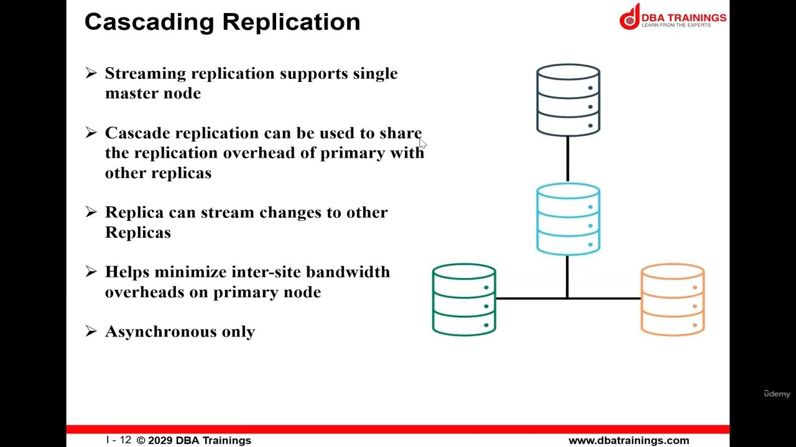

**关于级联复制的两个硬伤**

> "它在这里无法被同步……它将始终保持为仅同步模式。"
> —— p009 [02:23]

这句转写有笔误，讲师的意思恰恰相反：级联复制**只能是异步（asynchronous）**，用不了同步模式。

> "如果这里失败……下游副本就会失去它们的复制源。"
> —— p009 [05:17]

中间那台 R1 挂了，R2、R3 就同时失去复制源——因为它们「不知道谁是真正的 primary」（`because they are not aware about who is the primary for them`）。这就是级联复制必须配合 repmgr 这类工具做拓扑修复的原因。

**关于同步复制的代价**

> "如果同步副本停止响应，那么提交将被永久阻塞，直到有人手动修复。"
> —— p010 [12:23]

这句话请务必记住。开了 `synchronous_commit = on` 之后，备库不响应 = 主库写不进去，业务直接挂死。在 JS/Node 里这相当于你 `await` 了一个永远不会 resolve 的 Promise，请求会一直挂着直到超时。

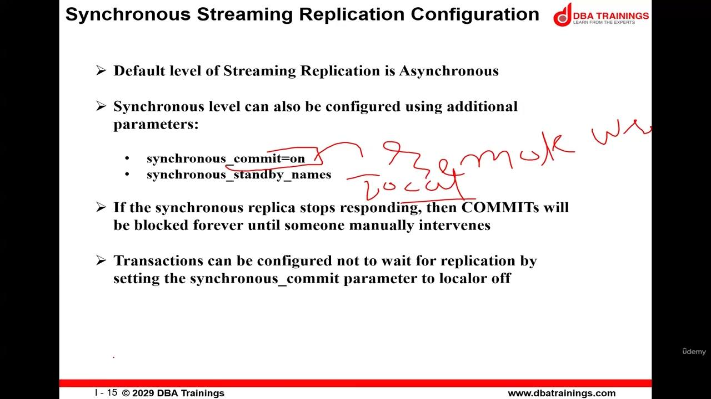

**关于 wal_level 的取值**

> "replica 是默认值……另一个叫 minimal。minimal 是什么？minimal 就是不会记录任何日志。"
> —— p010 [01:52]–[04:43]

讲师用 SQL Server 的 full / bulk-logged / simple 三种恢复模式做类比：`minimal` 只为崩溃恢复，`logical` 才能做表级/条件级复制，`replica` 是物理流复制的默认值，日常就用它。

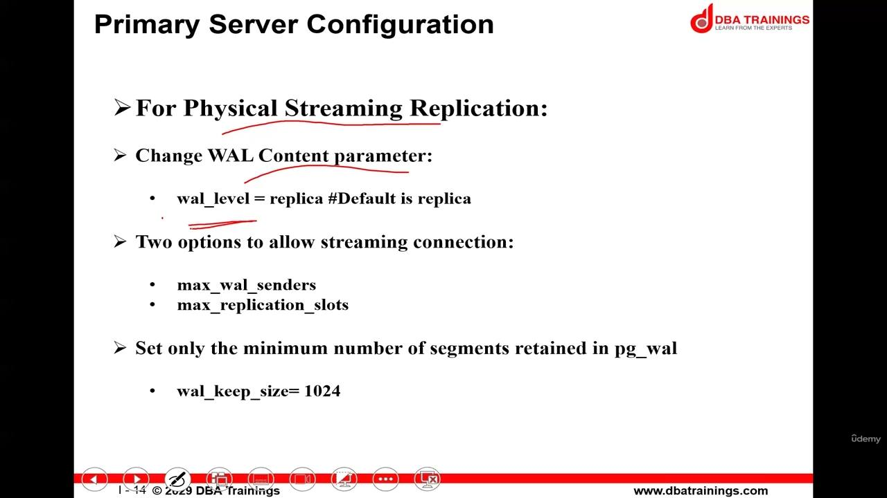

**关于为什么要先备份配置文件**

> "为什么我要复制到临时目录位置……这样万一出了什么问题，我还能回退到之前的系统。"
> —— p012 [10:28]

改 `postgresql.conf` 之前先 `cp` 一份，改崩了直接还原。这个习惯比任何参数都值钱。

**关于为什么选 repmgr**

> "复制管理器是第三方工具，它不属于 PostgreSQL 公司……在开源工具中，我们使用的最佳工具是 repmgr。"
> —— p012 [04:45]

PostgreSQL 本体不带自动 failover，要么用 EDB 的 Failover Manager（商业），要么用开源的 repmgr。本课走开源路线。

**关于备库拒绝写操作**

> "只读事务。这意味着我的从服务器正作为副本工作。我无法在从服务器上执行数据操作。"
> —— p012 [56:15]

这是整节课最有说服力的一帧：报错本身就是成功的证据。

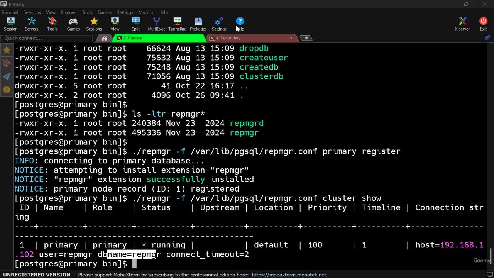

---

## 3. 从零复现

下面按「能在你自己两台虚机上照着敲」的顺序写。每条命令后面给预期现象；如果现象对不上，先看第 6 节检查清单。

### 3.0 目录约定

本文用下面这套路径。PGDG 的 RPM 安装默认就是这些位置，如果你用的是源码编译，把 `17` 换成你的版本号即可。

```
/usr/pgsql-17/bin/                 # 可执行文件（repmgr 也在这里）
/var/lib/pgsql/17/data/            # 数据目录（postgresql.conf、pg_hba.conf 在这里）
/var/lib/pgsql/17/archive/         # WAL 归档目录，需要手动创建
/var/lib/pgsql/repmgr.conf         # repmgr 配置（postgres 用户家目录）
/var/lib/pgsql/repmgr.log          # repmgr 日志
/var/lib/pgsql/backup-conf/        # 本文建议的配置备份目录
```

> 讲师在 P012 是在 postgres 用户家目录（屏幕上只见 `.bash_profile`）里创建 `repmgr.conf` 的，没有报绝对路径。上面写的是同一位置的标准展开，以你实际 `-f` 指向的路径为准。

### 3.1 两台机器与网络

讲师在 P011 [02:50] 确认了前提：**两台机器在同一子网**（`they both are on the same physical subnet`）。不在同一子网也能做，但要走 SSH 隧道或公私网双网卡（`at least the machine need to be connected through the private and public key`）。课堂环境用的是路由器自动分配的地址，所以是 102/103。

```bash
# 两台机器上都执行，记下各自的 IP，后面所有地方都用这个
ip a | grep 'inet '
hostname
```

预期：一台是 `192.168.1.102`，一台是 `192.168.1.103`。**约定 102 做 primary、103 做 standby**，不要中途换。

> 从这一刻起，你有两个终端会话，颜色区分（讲师 P011 [07:37] 用绿/红区分）比记 IP 更可靠。

### 3.2 改主机名（避免两台都叫 primary）

讲师在 P011 [11:27] 发现两台机器主机名相同，因为 103 是从 102 直接克隆出来的。他改了两处：`hostnamectl set-hostname` 和 `/etc/hostname`。

```bash
# 只在 192.168.1.103 上执行
sudo hostnamectl set-hostname secondary

# 校验：两处都要是 secondary
cat /etc/hostname
hostname
```

预期：`/etc/hostname` 和 `hostname` 输出都是 `secondary`。改完关掉会话重连，提示符才会变。

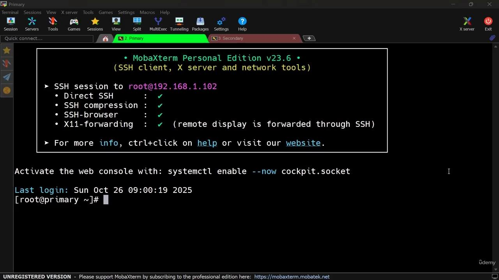

### 3.3 确认 PostgreSQL 已装好并在跑

```bash
# 两台机器都执行
systemctl status postgresql-17 | head -5
psql --version
```

预期：状态是 `active (running)`，版本是 17.x。课里明确说两台机器在克隆之前就已经装好 PostgreSQL 了，所以这一步只是核对——**如果你的机器没装，先按 PostgreSQL 17 的 PGDG 安装流程装好再回来**，安装步骤不在 P009–P012 范围内。

### 3.4 设 postgres 用户口令（两台都设）

讲师在 P011 [14:49] 给两台机器都设了同一个口令，用途是 `ssh-copy-id` 首次认证、以及万一 `pg_hba.conf` 从 `trust` 改成 `md5` 时还能连。

```bash
# 两台都执行
sudo passwd postgres
```

口令请用你自己的，别照抄课堂上的。记下来，后面 `ssh-copy-id` 要用。

### 3.5 配 SSH 免密（只在 primary → standby 生成密钥）

讲师原话（P011 [17:09]）：**密钥只在 primary 上生成**，因为「key won't match」，两边各生成一对是没用的。

```bash
# 1) 在 192.168.1.102 上，切到 postgres 用户
sudo su - postgres

# 2) 生成密钥对，一路回车（默认路径 / 空 passphrase）
ssh-keygen -t rsa -b 4096

# 3) 把公钥推到 standby，这一步要输 postgres 的口令
ssh-copy-id postgres@192.168.1.103
```

预期：

- `ssh-keygen` 输出里出现 `Your identification has been saved in /var/lib/pgsql/.ssh/id_rsa` 和 `Your public key has been saved in ...id_rsa.pub`
- `ssh-copy-id` 会问 `Are you sure you want to continue connecting?`（输 yes）和 `postgres@192.168.1.103's password:`

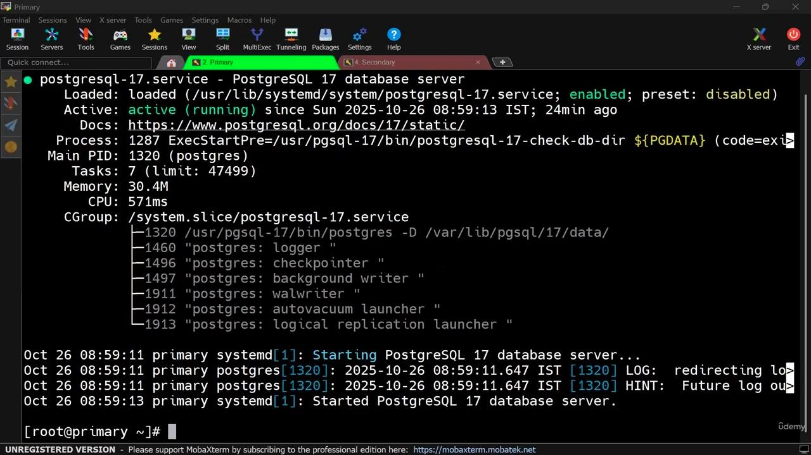

```bash
# 4) 验证方向一：primary -> standby，不应再问密码
ssh postgres@192.168.1.103 hostname
# 预期输出：secondary

# 5) 验证方向二：standby -> primary，首次仍要 yes + 口令
ssh postgres@192.168.1.102 hostname
# 预期输出：primary
```

讲师在 P011 [22:21]–[23:17] 把两个方向都测了。双向都通之后，`scp`/`pg_basebackup` 这类传输就不用再交口令了——这就是为什么要配 SSH。

### 3.6 装 repmgr 17（两台都装）

```bash
# 两台都执行，用 root
sudo dnf install -y repmgr_17

# 校验
/usr/pgsql-17/bin/repmgr --version
```

预期：`repmgr 5.x`（repmgr 的版本号和 PG 大版本号是两套编号，`repmgr_17` 表示「给 PG 17 编译的包」）。

> 课里只说了「从 PostgreSQL 仓库装 repmgr，装出来是 17」，没有念包名。包名用 `dnf search repmgr` 确认，各仓库可能叫 `repmgr_17` 或 `repmgr17`。

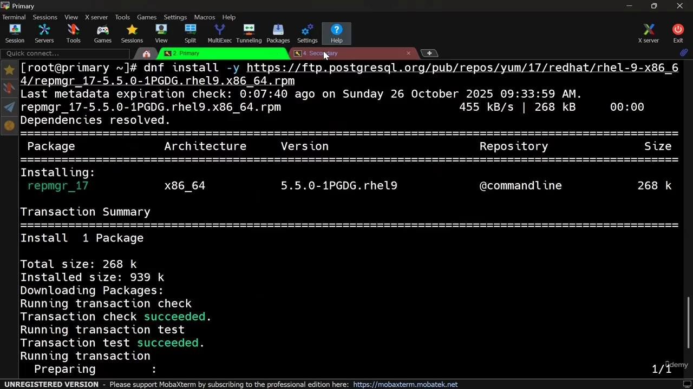

### 3.7 备份配置文件（只在 primary 上做，改之前）

```bash
sudo mkdir -p /var/lib/pgsql/backup-conf
sudo cp /var/lib/pgsql/17/data/postgresql.conf /var/lib/pgsql/backup-conf/postgresql.conf.orig
sudo cp /var/lib/pgsql/17/data/pg_hba.conf    /var/lib/pgsql/backup-conf/pg_hba.conf.orig
sudo chown -R postgres:postgres /var/lib/pgsql/backup-conf
```

讲师 P012 [10:55] 就是干这个，理由是「改崩了能回来」。**这一步不要跳过**——`postgresql.conf` 里一个拼错的参数就能让实例起不来。

### 3.8 改 primary 的 postgresql.conf

按第 4.1 节的完整内容，**追加**到 `/var/lib/pgsql/17/data/postgresql.conf` 末尾（讲师 P012 [11:25] 明确说了他是「不去逐行改现有参数，而是把自定义参数统一加在文件后段」，因为上一条同名参数生效）。

```bash
sudo vi /var/lib/pgsql/17/data/postgresql.conf
# 光标到文件末尾，粘贴第 4.1 节的内容，保存退出
```

同时把归档目录建出来，否则 `archive_mode = on` 会因为写不进归档而不断报错：

```bash
sudo mkdir -p /var/lib/pgsql/17/archive
sudo chown postgres:postgres /var/lib/pgsql/17/archive
```

### 3.9 改 primary 的 pg_hba.conf

按第 4.2 节内容追加到 `/var/lib/pgsql/17/data/pg_hba.conf` 末尾。

```bash
sudo vi /var/lib/pgsql/17/data/pg_hba.conf
```

`pg_hba.conf` 是**按顺序**匹配、第一条命中即生效的。所以新加的规则要么放最前面，要么确认前面的通用 `host all all ... md5` 不会先把你的连接吃掉。

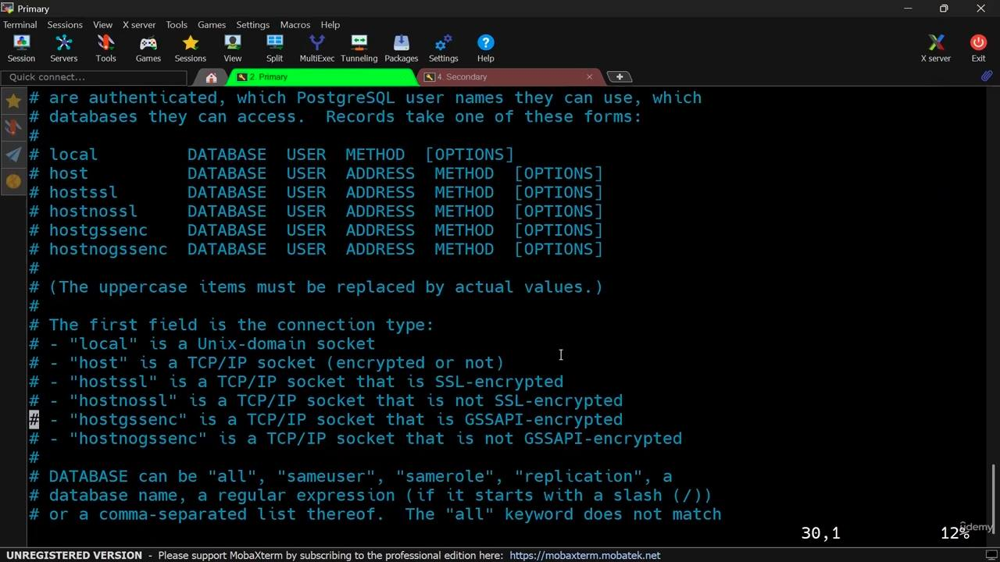

### 3.10 重启 primary 并确认参数没写错

```bash
sudo systemctl restart postgresql-17
sudo systemctl status postgresql-17 | head -5
```

预期：`active (running)`，并且 `Active:` 后面显示的是「几秒前」。讲师 P012 [18:06] 强调过：**参数写错，实例就起不来**，所以重启后的这次 status 就是参数体检。

```bash
# 再确认一下关键参数真的生效了（不是文件里写了就算）
sudo -u postgres psql -c "SHOW wal_level;" \
                      -c "SHOW max_wal_senders;" \
                      -c "SHOW max_replication_slots;" \
                      -c "SHOW shared_preload_libraries;"
```

预期：`replica` / `10` / `10` / `repmgr`。`shared_preload_libraries` 只有重启后才会生效，光 reload 不够。

### 3.11 在 primary 上建 repmgr 用户和库

```bash
sudo -u postgres psql
```

```sql
CREATE USER repmgr WITH REPLICATION SUPERUSER PASSWORD 'repmgr_ChangeMe_123';
CREATE DATABASE repmgr OWNER repmgr;
\q
```

讲师 P012 [20:32] 的原话是：这个用户「必须是 superuser 或者至少有 replication 权限」，否则没法监控和管理复制。他先建用户、再建同名库、再设口令、最后给 superuser。

> 建 `repmgr` 这个库**不是用来存业务数据**的，只是给 repmgr 一个「连接用的落脚点」。讲师 P012 [27:39] 专门解释了学员的这个疑问：`repmgr`「只是连接用途」，真正复制的是**整个实例**。

### 3.12 在 primary 上写 repmgr.conf 并注册

```bash
sudo -u postgres vi /var/lib/pgsql/repmgr.conf
# 粘贴第 4.3 节的完整内容
```

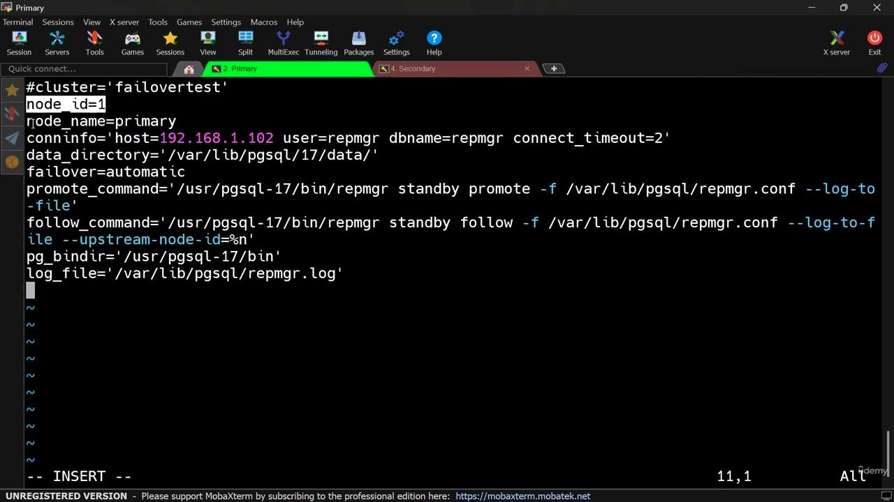

```bash
# 注册主库（讲师是 ./repmgr 相对路径调用的，因为他在 bin 目录下）
/usr/pgsql-17/bin/repmgr -f /var/lib/pgsql/repmgr.conf primary register

# 看集群状态
/usr/pgsql-17/bin/repmgr -f /var/lib/pgsql/repmgr.conf cluster show
```

预期：`cluster show` 出现一行 `primary`，状态 `* running`（星号表示它是当前的 primary）。这一步不用重启数据库，repmgr 只是往 `repmgr` 库里写元数据。

### 3.13 在 standby 上写 repmgr.conf

```bash
# 在 192.168.1.103 上
sudo -u postgres vi /var/lib/pgsql/repmgr.conf
# 粘贴第 4.4 节的内容
```

和 primary 的差异只有三处：`node_id`、`node_name`、`conninfo` 里的 IP。讲师 P012 [35:13] 原话：`Rest all are like the primary only the name I have changed`。

### 3.14 停掉 standby 的 PostgreSQL，把数据目录改名

standby 是从 primary 克隆来的，里面已经有一份**和 primary 同源但已经过时**的数据。repmgr 克隆时会拒绝往非空目录写，所以先挪走。

```bash
# 在 192.168.1.103 上，先以 root 停库（postgres 用户没权限操作 systemctl）
sudo systemctl stop postgresql-17
sudo systemctl status postgresql-17 | head -3
# 预期：inactive (dead)

# 改名前先确认没有残留进程
pgrep -a postgres || echo "no postgres process, safe to rename"

# 改名前
sudo -u postgres mv /var/lib/pgsql/17/data /var/lib/pgsql/17/data.bak
ls -d /var/lib/pgsql/17/*
```

预期：只剩下 `data.bak`（如果之前建过 `archive` 目录，它也会在）。


### 3.15 先 dry-run，再真克隆

讲师 P012 [40:29] 的思路是：**先 `--dry-run` 把配置问题全暴露出来，再动真格**。

```bash
# 在 192.168.1.103 上，postgres 用户
/usr/pgsql-17/bin/repmgr -f /var/lib/pgsql/repmgr.conf \
  -h 192.168.1.102 -U repmgr -d repmgr \
  standby clone --dry-run
```

预期输出（课堂上的实际结果是「一堆报错」，逐条修完才通过）：

- `WARNING: no replication slot ...`（讲师说这是因为 `max_wal_senders` 已经设成 10，所以能建槽，但 dry-run 阶段不建，属于提示）—— **该字段名请以实际输出为准**
- 如果报 `no pg_hba.conf entry for replication`，说明第 4.2 节那两行 `host replication repmgr ...` 没生效或 IP 写错了，回到 primary 修 `pg_hba.conf` 后 `systemctl reload postgresql-17`
- 如果报连不上，先手工验证：`psql "host=192.168.1.102 user=repmgr dbname=repmgr connect_timeout=2"`，能连上再重跑 dry-run

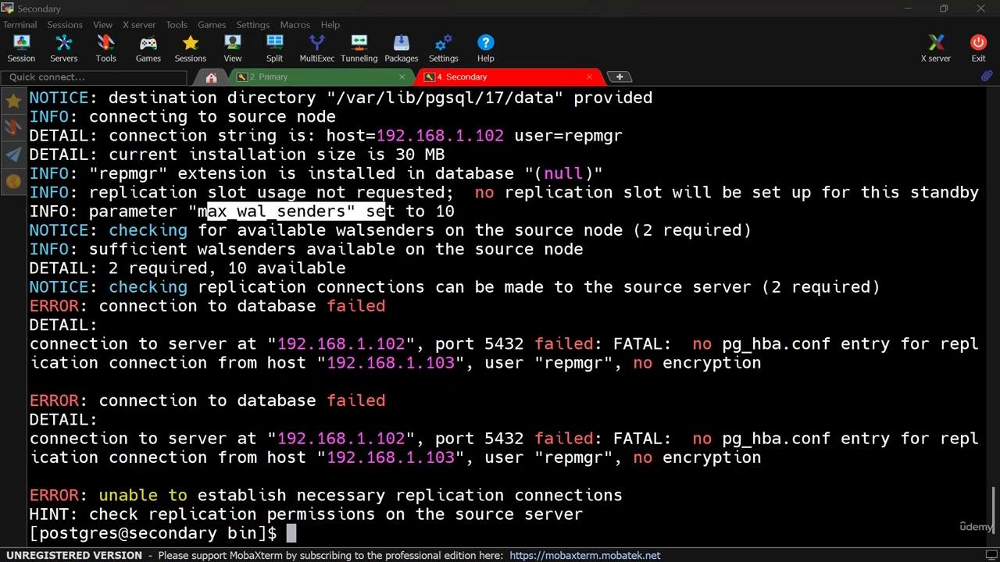

dry-run 通过之后再执行真正的克隆（讲师加了 `--fast-checkpoint`，让 primary 立刻做一次 checkpoint，克隆起点更干净）：

```bash
/usr/pgsql-17/bin/repmgr -f /var/lib/pgsql/repmgr.conf \
  -h 192.168.1.102 -U repmgr -d repmgr \
  standby clone --fast-checkpoint
```

如果报：

```
target data directory appears to be a PostgreSQL data directory
```

说明 `/var/lib/pgsql/17/data` 又存在了（3.14 的改名没生效，或者你重跑过）。处理方式有两种：把目录再挪走，或者加 `--force-overwrite` 强制覆盖。

```bash
# 方式一（讲师的做法：先挪走再重跑）
sudo -u postgres mv /var/lib/pgsql/17/data /var/lib/pgsql/17/data.bak2

# 方式二（覆盖）
/usr/pgsql-17/bin/repmgr -f /var/lib/pgsql/repmgr.conf \
  -h 192.168.1.102 -U repmgr -d repmgr \
  standby clone --fast-checkpoint --force-overwrite
```

> `--force-overwrite` 的准确拼写以 `repmgr standby clone --help` 为准（讲师口述成「hyphen app / force overwrite」，转写有误）。

预期：克隆过程中滚出大量 `pg_basebackup` 的进度信息，结束时输出 `NOTICE: standby clone (using pg_basebackup) complete`，并且 `/var/lib/pgsql/17/data` 重新出现、里面有 `postgresql.auto.conf`、`standby.signal`（repmgr 会替你写好 `primary_conninfo`）。

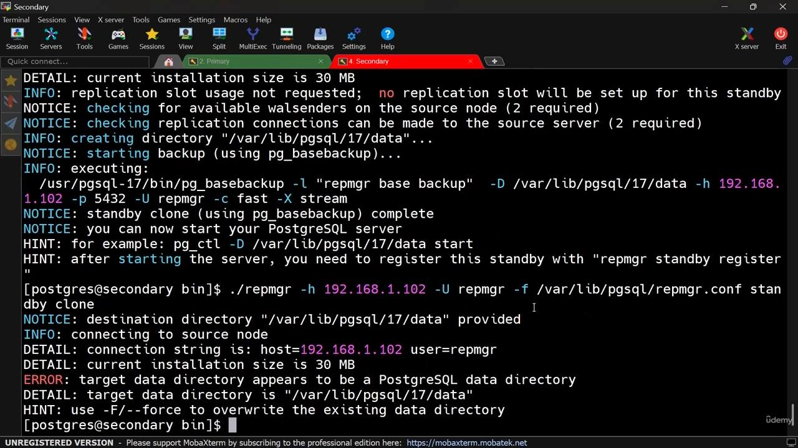

### 3.16 启动 standby 并注册

```bash
# 启动
sudo systemctl start postgresql-17
sudo systemctl status postgresql-17 | head -5
# 预期：active (running)

# 注册为 standby
/usr/pgsql-17/bin/repmgr -f /var/lib/pgsql/repmgr.conf standby register
```

顺序很重要。讲师 P012 [51:04] 特别说明：克隆完屏幕上会提示「要 register 再 start」，但他实际操作是**先 start 再 register**，并且成功了。你就按 start → register 来。

### 3.17 看集群状态

```bash
# 任意一台机器上执行
/usr/pgsql-17/bin/repmgr -f /var/lib/pgsql/repmgr.conf cluster show
```

预期：两行，`primary` 在 192.168.1.102、`standby` 在 192.168.1.103，状态都是 `running`，primary 那一行前面有 `*`（表示当前主库）。


> 上面这帧取自 cluster show 前后的时间点；具体列名（`ID / Name / Role / Status / Upstream` 一类）请以你机器的实际输出为准，本文不臆造字段名。

### 3.18 验证复制真的在工作

按第 4.6 节的 SQL 脚本，在 primary 上跑一遍，再在 standby 上跑对照查询。

```bash
# primary
sudo -u postgres psql -f /var/lib/pgsql/verify-replication.sql

# standby：同样的查询应该看到一模一样的数据
sudo -u postgres psql -c "SELECT * FROM repl_test ORDER BY id;"
```

再在 standby 上试写，验证它确实是只读：

```bash
sudo -u postgres psql -c "CREATE DATABASE should_fail;"
# 预期报错：ERROR: cannot execute CREATE DATABASE in a read-only transaction
```

看到 `read only transaction` 就对了——这就是讲师 P012 [56:15] 演示的那一幕。

---

## 4. 完整代码

以下每个文件都是完整的、可整份保存的，不是片段。

### 4.1 `/var/lib/pgsql/17/data/postgresql.conf`（追加到文件末尾）

```conf
# ============================================================
# PostgreSQL 17 streaming replication - primary side
# 追加到 postgresql.conf 末尾，同名参数以最后出现的为准
# 来源：P010 参数讲解 + P012 课堂实际修改
# ============================================================

# --- 连接 ---
# 讲师原话：star 表示"from any machine the request can be listened"
listen_addresses = '*'
port = 5432

# --- WAL 级别 ---
# replica 是物理流复制的默认值；logical 用于表级/条件级复制；
# minimal 只保留崩溃恢复所需的日志，不能用于复制
wal_level = replica

# --- WAL 发送进程 ---
# 每个 standby 连接占用一个 wal sender，四台备库就要至少 4
max_wal_senders = 10

# --- 复制槽 ---
# 每个副本一个槽，防止副本短暂断连时 WAL 被过早删除
max_replication_slots = 10

# --- WAL 保留缓冲 ---
# 单位 MB。讲师解释为"PG 在 pg_wal 目录里最多保留多少 WAL"
# 1024 表示 1GB。即使开了复制槽，也建议保留这个缓冲
wal_keep_size = 1024

# --- 归档 ---
# 注意：archive_mode 打开后，archive_command 失败会不断重试并堆积 WAL
archive_mode = on
archive_command = 'test ! -f /var/lib/pgsql/17/archive/%f && cp %p /var/lib/pgsql/17/archive/%f'

# --- repmgr 模块 ---
# 必须重启实例才生效，reload 不够
shared_preload_libraries = 'repmgr'

# --- 同步复制（本课讲原理，实操走异步，所以保持默认）---
# synchronous_commit = on            # 等备库确认，零数据丢失，但备库挂了主库写不进去
# synchronous_commit = remote_write  # 等备库把 WAL 写到磁盘，不等 fsync
# synchronous_commit = local         # 只等本地，实际等于异步
# synchronous_commit = off           # 明确关掉同步
# synchronous_standby_names = 'node2'                 # 指定某一个备库
# synchronous_standby_names = 'FIRST 1 (node2, node3)' # 前两个里任意一个确认即可
```

### 4.2 `/var/lib/pgsql/17/data/pg_hba.conf`（追加到文件末尾）

```conf
# ============================================================
# repmgr 引导 + 复制连接
# 追加到 pg_hba.conf 末尾。pg_hba 是按顺序匹配、首条命中即生效，
# 如果前面已经有更宽泛的规则把连接吃掉了，把下面几行移到文件最前面。
# 追加/修改后执行：systemctl reload postgresql-17
# ============================================================

# repmgr 用户从两台机器连接任意库（讲师第一版是只允许 repmgr 库，
# 后来为了让 dry-run 通过改成了 all database）
host    all             repmgr          192.168.1.102/32        trust
host    all             repmgr          192.168.1.103/32        trust

# 复制连接（数据库字段必须是 replication，不能写 all）
host    replication     repmgr          192.168.1.102/32        trust
host    replication     repmgr          192.168.1.103/32        trust

# 如果你把 trust 改成口令认证，用这两行替代：
# host  all          repmgr  192.168.1.102/32  scram-sha-256
# host  all          repmgr  192.168.1.103/32  scram-sha-256
# host  replication  repmgr  192.168.1.102/32  scram-sha-256
# host  replication  repmgr  192.168.1.103/32  scram-sha-256
```

> 说明：上面写的是 `/32` 精确匹配。课堂上是直接写 `192.168.1.102 255.255.255.255` 或等价形式，两种写法等价。

### 4.3 `/var/lib/pgsql/repmgr.conf`（192.168.1.102，primary）

```conf
# ============================================================
# repmgr.conf - primary node
# 位置：/var/lib/pgsql/repmgr.conf（postgres 用户家目录）
# 关键词：node_id / node_name 在集群内必须唯一
# ============================================================

# 讲师解释：每台机器要有唯一 id，类似 Oracle Data Guard 里的唯一实例名
node_id=1
node_name=primary

# 连接串：host 写本机 IP，dbname 写 3.11 建的 repmgr 库
# connect_timeout 2 表示 2 秒连不上就放弃，讲师原话："within that two second
# it won't connect it will be exit"
conninfo='host=192.168.1.102 user=repmgr dbname=repmgr connect_timeout=2'

data_directory='/var/lib/pgsql/17/data'

# failover=automatic：主库不可达时允许自动提升备库
# 注意：这一行只是"允许"，真正触发需要启用 repmgrd 守护进程（本课未做）
failover=automatic

promote_command='/usr/pgsql-17/bin/repmgr standby promote -f /var/lib/pgsql/repmgr.conf'
follow_command='/usr/pgsql-17/bin/repmgr standby follow -f /var/lib/pgsql/repmgr.conf --upstream-node-id=%n'

log_file='/var/lib/pgsql/repmgr.log'
log_level=INFO
```

> 讲师说 primary 和 standby 的 repmgr.conf「只改 node_id / node_name / IP，其余一样」，所以 `promote_command` / `follow_command` 在 primary 上也保留着。真正执行 promote 之前这两行在 primary 上不会用到，但放在文件里能让两份配置保持一致。
>
> `--upstream-node-id=%n` 里的 `%n` 是 repmgr 的占位符，会被替换成上游节点 id。如果你不确定，用 `repmgr standby follow --help` 核对。

### 4.4 `/var/lib/pgsql/repmgr.conf`（192.168.1.103，standby）

```conf
# ============================================================
# repmgr.conf - standby node
# 与 primary 版本只有三处不同：node_id / node_name / conninfo 的 host
# ============================================================

node_id=2
node_name=standby

conninfo='host=192.168.1.103 user=repmgr dbname=repmgr connect_timeout=2'

data_directory='/var/lib/pgsql/17/data'

failover=automatic

promote_command='/usr/pgsql-17/bin/repmgr standby promote -f /var/lib/pgsql/repmgr.conf'
follow_command='/usr/pgsql-17/bin/repmgr standby follow -f /var/lib/pgsql/repmgr.conf --upstream-node-id=%n'

log_file='/var/lib/pgsql/repmgr.log'
log_level=INFO
```

### 4.5 `/var/lib/pgsql/precheck.sh`（两台都跑，装配前自检）

```bash
#!/usr/bin/env bash
# PG streaming replication 装配前自检
# 用法：bash /var/lib/pgsql/precheck.sh <本机IP> <对端IP>
# 例：  bash /var/lib/pgsql/precheck.sh 192.168.1.102 192.168.1.103
set -u

SELF_IP="${1:?usage: precheck.sh <self_ip> <peer_ip>}"
PEER_IP="${2:?usage: precheck.sh <self_ip> <peer_ip>}"
FAIL=0

echo "=== 1. 主机名与 IP ==="
hostname
ip -4 addr show | grep -E 'inet .*('"${SELF_IP}"')' || { echo "[FAIL] 本机找不到 ${SELF_IP}"; FAIL=1; }

echo "=== 2. PostgreSQL 服务 ==="
if systemctl is-active --quiet postgresql-17; then
  echo "[ OK ] postgresql-17 is active"
else
  echo "[FAIL] postgresql-17 is not active"
  FAIL=1
fi

echo "=== 3. repmgr 可执行文件 ==="
if [ -x /usr/pgsql-17/bin/repmgr ]; then
  /usr/pgsql-17/bin/repmgr --version
else
  echo "[FAIL] /usr/pgsql-17/bin/repmgr 不存在，先 dnf install repmgr_17"
  FAIL=1
fi

echo "=== 4. 到对端的 SSH 免密 ==="
if ssh -o BatchMode=yes -o ConnectTimeout=5 "postgres@${PEER_IP}" hostname 2>/dev/null; then
  echo "[ OK ] postgres@${PEER_IP} 免密可达"
else
  echo "[WARN] postgres@${PEER_IP} 免密不通（如果你还没配 ssh-copy-id 属正常）"
fi

echo "=== 5. 关键参数 ==="
sudo -u postgres psql -tAc "SELECT name || ' = ' || setting FROM pg_settings WHERE name IN
  ('wal_level','max_wal_senders','max_replication_slots','wal_keep_size',
   'archive_mode','shared_preload_libraries','hot_standby') ORDER BY name;"

echo "=== 6. 数据目录与归档目录 ==="
ls -d /var/lib/pgsql/17/data 2>/dev/null || { echo "[FAIL] data 目录不存在"; FAIL=1; }
ls -d /var/lib/pgsql/17/archive 2>/dev/null || echo "[WARN] archive 目录不存在（archive_mode=on 会报错）"

echo
if [ "${FAIL}" -eq 0 ]; then
  echo "自检通过，可以继续。"
else
  echo "有 FAIL 项，先修完再继续。"
  exit 1
fi
```

### 4.6 `/var/lib/pgsql/verify-replication.sql`（在 primary 上执行）

```sql
-- 复制验证脚本：在 primary 上执行，然后在 standby 上查同样三张表
-- 1) 建表
DROP TABLE IF EXISTS repl_test;
CREATE TABLE repl_test (
    id      serial PRIMARY KEY,
    note    text        NOT NULL,
    created timestamptz NOT NULL DEFAULT now()
);

-- 2) 插数据
INSERT INTO repl_test (note) VALUES
    ('第一条：验证 streaming replication'),
    ('第二条：验证 standby 只读');

-- 3) 在 primary 上查，记下结果
SELECT id, note FROM repl_test ORDER BY id;

-- 4) 记录当前 WAL 位置，方便在 standby 上对比
SELECT pg_current_wal_lsn() AS primary_lsn;
```

在 standby 上对照：

```sql
-- standby 上执行
SELECT id, note FROM repl_test ORDER BY id;          -- 应与 primary 一致
SELECT pg_is_in_recovery();                          -- 期望 t（在恢复中 = 是备库）
SELECT pg_last_wal_replay_lsn() AS standby_lsn;      -- 与 primary_lsn 应当很接近
```

### 4.7 `/var/lib/pgsql/setup-standby.sh`（只在 192.168.1.103 上跑，整段可保存执行）

```bash
#!/usr/bin/env bash
# standby 一键装配：停库 -> 改名 -> dry-run -> clone -> 启动 -> 注册
# 只在 192.168.1.103 上以 root 执行
# 用法：sudo bash /var/lib/pgsql/setup-standby.sh
set -euo pipefail

PRIMARY_IP="192.168.1.102"
REPMGR_CONF="/var/lib/pgsql/repmgr.conf"
PGDATA="/var/lib/pgsql/17/data"
BACKUP_TAG="bak.$(date +%Y%m%d%H%M%S)"

echo ">>> [1/6] 停掉本机 PostgreSQL"
systemctl stop postgresql-17
systemctl status postgresql-17 --no-pager | head -3 || true

echo ">>> [2/6] 把现有 data 目录改名（克隆目标必须为空）"
if [ -d "${PGDATA}" ]; then
  sudo -u postgres mv "${PGDATA}" "${PGDATA}.${BACKUP_TAG}"
  echo "    已改名为 ${PGDATA}.${BACKUP_TAG}"
else
  echo "    ${PGDATA} 不存在，跳过"
fi

echo ">>> [3/6] dry-run 探测配置"
sudo -u postgres /usr/pgsql-17/bin/repmgr -f "${REPMGR_CONF}" \
  -h "${PRIMARY_IP}" -U repmgr -d repmgr \
  standby clone --dry-run || {
    echo "[FAIL] dry-run 未通过。常见原因："
    echo "  - primary 的 pg_hba.conf 缺 host replication repmgr <103>/32"
    echo "  - primary 的 pg_hba.conf 改了但没 reload"
    echo "  - psql -h ${PRIMARY_IP} -U repmgr -d repmgr 连不上"
    exit 1
  }

echo ">>> [4/6] 正式克隆（pg_basebackup）"
sudo -u postgres /usr/pgsql-17/bin/repmgr -f "${REPMGR_CONF}" \
  -h "${PRIMARY_IP}" -U repmgr -d repmgr \
  standby clone --fast-checkpoint

echo ">>> [5/6] 启动 standby"
systemctl start postgresql-17
sleep 2
systemctl is-active postgresql-17

echo ">>> [6/6] 注册 standby 并查看集群"
sudo -u postgres /usr/pgsql-17/bin/repmgr -f "${REPMGR_CONF}" standby register
sudo -u postgres /usr/pgsql-17/bin/repmgr -f "${REPMGR_CONF}" cluster show

echo ">>> 完成。去 primary 上执行 verify-replication.sql 验证数据同步。"
```

---

## 5. 逐行解释

**`listen_addresses = '*'`** —— 讲师在 P012 [12:22] 特意解释过：`star means from any machine the request can be listened`。生产环境更保险的写法是 `listen_addresses = '192.168.1.102'`，只监听内网那块网卡；`*` 只是课堂图省事。

**`wal_level = replica`** —— 这是物理流复制的门槛值。选 `minimal` 连崩溃恢复都够用但**不能复制**；选 `logical` 可以做「只复制某张表、带 where 条件」的逻辑复制（讲师在 P010 [04:17] 说 `I want only particular table ... that case I can use logical`）。日常物理 HA 就用 `replica`。

**`max_wal_senders = 10`** —— 一个 standby 占一个 wal sender 进程。讲师的说法是「四台备库就用 4」。课堂里 dry-run 输出显示这个值是 10，所以本文沿用 10。这个值设成 0 会直接禁掉复制。

**`max_replication_slots = 10`** —— 每个复制槽能保证「副本短暂断连时 WAL 不被提前删掉」。讲师的原话是 `prevent premature WAL file deletion`。但它有代价：槽消费不掉的 WAL 会一直堆在磁盘上，把盘写满。

**`wal_keep_size = 1024`** —— 单位是 MB（讲师说 `this is called in mb by default`），1024 就是 1GB。即使开了复制槽，讲师也建议留着它当「安全缓冲」（`wal_keep_size is still a safety buffer`）。

**`archive_mode = on` + `archive_command`** —— 讲师只说「Archive mode on 和 Archive command 那个」，没念出具体命令。上面给的 `test ! -f ... && cp ...` 是 PostgreSQL 文档里的最简写法：目标文件已存在就不重复拷，避免覆盖。生产上通常换成 `pgBackRest archive-p

## 6. 复现检查清单

- [ ] **两台机器 IP 与主机名对得上**：在两台机器上分别执行 `ip a | grep 'inet '` 和 `hostname`，应看到 102 那台主机名为 `primary`、103 那台为 `secondary`；如果两台 `hostname` 都还是 `primary`，说明 3.2 的改名没做或没重连会话。
- [ ] **PostgreSQL 17 在两台机器上都是 active**：两台执行 `systemctl status postgresql-17 | head -5`，`Active:` 行应为 `active (running)`；版本用 `psql --version` 核对为 17.x。
- [ ] **postgres 用户口令已设**：两台执行 `sudo passwd postgres` 能进入改密流程（或已设过），记下口令，后面 `ssh-copy-id` 首次认证要用。
- [ ] **SSH 免密双向可达**：在 primary 上以 postgres 用户执行 `ssh postgres@192.168.1.103 hostname`，应直接输出 `secondary` 且不问密码；反向 `ssh postgres@192.168.1.102 hostname` 应输出 `primary`（首次可能要 yes + 口令，第二次起免密）。
- [ ] **repmgr 已装且可执行**：两台执行 `/usr/pgsql-17/bin/repmgr --version`，应输出 `repmgr 5.x`；若提示文件不存在，回到 3.6 用 `dnf search repmgr` 确认包名后重装。
- [ ] **配置文件已备份**：primary 上 `ls -l /var/lib/pgsql/backup-conf/`，应看到 `postgresql.conf.orig` 和 `pg_hba.conf.orig` 两个文件，属主为 postgres。
- [ ] **归档目录存在且属主正确**：primary 上 `ls -ld /var/lib/pgsql/17/archive`，应存在且属主 `postgres:postgres`；不存在则 `archive_mode = on` 会持续报错。
- [ ] **primary 重启后参数真的生效**：primary 上执行 `sudo -u postgres psql -c "SHOW wal_level;" -c "SHOW max_wal_senders;" -c "SHOW max_replication_slots;" -c "SHOW shared_preload_libraries;"`，应依次看到 `replica` / `10` / `10` / `repmgr`。`shared_preload_libraries` 只有重启才生效，reload 不够。
- [ ] **repmgr 用户和库已建**：primary 上 `sudo -u postgres psql -c "\du repmgr"` 应看到该角色带 `Replication` 和 `Superuser` 属性；`\l repmgr` 应看到同名库，属主 repmgr。
- [ ] **primary 注册成功**：primary 上 `repmgr -f /var/lib/pgsql/repmgr.conf cluster show`，应出现一行 `primary`，状态 `* running`（星号表示当前主库）。
- [ ] **standby 的 data 目录已挪走**：103 上 `ls -d /var/lib/pgsql/17/*`，克隆前应只剩 `data.bak`（或 `data.bak.<时间戳>`），没有 `data`；若 `data` 又出现，说明改名没生效或重跑过克隆。
- [ ] **dry-run 通过**：103 上执行 3.15 的 `standby clone --dry-run`，不应再出现 `no pg_hba.conf entry for replication` 或连接失败；若报错，先在 primary 上 `psql "host=192.168.1.102 user=repmgr dbname=repmgr connect_timeout=2"` 手工验证能连上，再回查 `pg_hba.conf` 是否 reload。
- [ ] **克隆完成标志**：正式 `standby clone --fast-checkpoint` 结束时输出 `NOTICE: standby clone (using pg_basebackup) complete`，且 `/var/lib/pgsql/17/data` 重新出现，里面有 `standby.signal` 和 `postgresql.auto.conf`。
- [ ] **standby 启动并注册成功**：103 上 `systemctl status postgresql-17` 为 `active (running)`，`repmgr ... standby register` 无报错。
- [ ] **cluster show 两行都 running**：任意一台执行 `repmgr -f /var/lib/pgsql/repmgr.conf cluster show`，应看到 primary（192.168.1.102）和 standby（192.168.1.103）两行，状态都是 `running`，primary 行前有 `*`。
- [ ] **数据真的同步了**：primary 上跑 `verify-replication.sql` 后，在 standby 上 `SELECT * FROM repl_test ORDER BY id;` 应看到与 primary 完全一致的两行；`SELECT pg_is_in_recovery();` 应返回 `t`。
- [ ] **standby 确实只读**：standby 上执行 `CREATE DATABASE should_fail;`，应报 `ERROR: cannot execute CREATE DATABASE in a read-only transaction`——看到这条报错就是复制生效的证据。

## 7. 课里没讲但你会撞上的

| 现象 | 原因 | 怎么办 |
|---|---|---|
| `standby clone` 报 `target data directory appears to be a PostgreSQL data directory` | 103 上 `/var/lib/pgsql/17/data` 又存在了（3.14 改名没生效，或你重跑过克隆） | 把目录再挪走（`mv data data.bak2`）后重跑；或加 `--force-overwrite` 强制覆盖。准确拼写以 `repmgr standby clone --help` 为准（课里没讲 `--force-overwrite` 的准确写法，讲师口述转写有误） |
| dry-run 报 `no pg_hba.conf entry for replication` | primary 的 `pg_hba.conf` 缺 `host replication repmgr 192.168.1.103/32` 那行，或改了没 reload，或 IP 写错 | 回 primary 补规则后 `systemctl reload postgresql-17`；先用 `psql "host=192.168.1.102 user=repmgr dbname=repmgr connect_timeout=2"` 手工验证能连上再重跑 dry-run（课里没讲具体排查顺序，属补充） |
| `systemctl restart postgresql-17` 后实例起不来 | `postgresql.conf` 里参数拼错或值非法（讲师 P012 [18:06] 强调过「参数写错实例就起不来」，但没讲怎么定位） | 用备份还原：`cp /var/lib/pgsql/backup-conf/postgresql.conf.orig /var/lib/pgsql/17/data/postgresql.conf` 后重启；或 `journalctl -u postgresql-17 -n 50` 看报错行（课里没讲 journalctl 定位，属补充） |
| `archive_mode = on` 后日志里不断刷归档失败 | `/var/lib/pgsql/17/archive` 目录不存在或属主不是 postgres | `mkdir -p` 建目录并 `chown postgres:postgres`；确认 `archive_command` 里的路径与实际目录一致（课里没讲归档失败的排查，属补充） |
| `shared_preload_libraries` 显示为空，repmgr 相关功能异常 | 只做了 `reload` 没做 `restart`，该参数必须重启才生效 | `systemctl restart postgresql-17` 后再 `SHOW shared_preload_libraries;` 确认是 `repmgr`（课里 P012 提过要重启，但没讲「reload 不够」这个坑，属补充） |
| 两台机器 `hostname` 都还是 `primary`，命令敲错机器 | 103 是从 102 克隆的，主机名没改或改了没重连会话 | `hostnamectl set-hostname secondary` 并核对 `/etc/hostname`，关掉会话重连后提示符才变（课里 P011 [11:27] 讲过改法，但没讲「必须重连才生效」，属补充） |
| `ssh postgres@192.168.1.103 hostname` 仍问密码 | 密钥只在 primary 生成、`ssh-copy-id` 没成功，或两台各生成了一对密钥（讲师说「key won't match」） | 只在 primary 上 `ssh-keygen`，再 `ssh-copy-id postgres@192.168.1.103`；两台都生成过就先删掉 103 上的 `.ssh` 重来（课里没讲「两台都生成会失败」的清理步骤，属补充） |
| `cluster show` 只有 primary 一行，standby 没出现 | `standby register` 没执行，或执行时连不上 primary 的 repmgr 库 | 在 103 上重跑 `repmgr -f /var/lib/pgsql/repmgr.conf standby register`；先确认 `psql "host=192.168.1.102 user=repmgr dbname=repmgr"` 能连（课里没讲注册失败的排查，属补充） |
| standby 上查询报 `relation "repl_test" does not exist` | 复制还没追上，或 `verify-replication.sql` 还没在 primary 上跑 | 先在 primary 上跑 `verify-replication.sql`，等一两秒再在 standby 上查；用 `SELECT pg_last_wal_replay_lsn();` 对比 primary 的 `pg_current_wal_lsn()` 看差距（课里没讲 lag 排查，属补充） |
| `failover=automatic` 配了但主库挂了备库没自动提升 | 该配置只是「允许」自动 failover，真正触发需要启用 `repmgrd` 守护进程，本课没做 | 课里没讲 `repmgrd` 的启用与 failover 演练；本文只到「两行 running」为止，自动切换需另学（课里没讲） |
| 三节点 quorum / witness / 连接池切流没配 | 本课只做两节点最小可用集群 | 课里没讲三节点 quorum、witness、连接池切流，属后续内容（课里没讲） |
