# Postgres Sharding 实战复现：从单机 Postgres 到分片前夜（P001–P004）

本文只覆盖课程 P001–P004。先说清楚范围：这四集**还没有开始写分片路由、压测脚本、订单表结构和 Citus 迁移**，它们做的是后面所有实验的地基——在一台笔记本上用 Docker 起一个可控的 Postgres 实验室，并通过终端、`psql` 和 pgAdmin 三个入口确认它真的可用。读完并照着做，你应该得到：

- 一个 Docker 网络 `qcnet`；
- 一个 Postgres 17 容器 `ordersdb`，限制 1 GB 内存，并固定到你指定的一颗 CPU 核；
- Postgres 的 `5432` 端口只暴露在 Docker 网络内部，不发布到宿主机；
- 一个 pgAdmin 容器，只绑定在 `127.0.0.1:5050`；
- 一个新建数据库 `kiranaloop`；
- 会用 `docker ps`、`docker logs`、`pg_isready`、`psql` 和 pgAdmin 查询工具验证连接。

---

## 1. 这一节做什么

课程用一个虚构的印度杂货即时配送公司 **Kirana Loop** 做例子。顾客点“支付”时，checkout service 要同时做两件事：往 `orders` 表插入一行订单，并更新该顾客的订单计数。公司里还有多个读取方：订单历史页读单个顾客的订单，seller app 读单个卖家的订单，运营看板看最新订单，财务按月读全量数据。这些读取方会从不同方向拉扯数据库设计。

P001 先解释 sharding 是什么：把一张表的行拆到多台机器上，每一部分叫一个 shard；每个 shard 本身是一个完整数据库，表结构相同，只是行不同。它解决的是**写扩展**和**数据容量**问题，不是读扩展的万能药。P002 把真实公司常见的数据库周边工具串起来：OLTP 与分析系统分离、WAL、replica、备份与 point-in-time recovery、连接池、缓存，以及“索引 → 缓存 → 读副本 → 更大的机器 → 单机分区 → 分片”的阶梯。P003 开始落地：Docker 容器、Docker Desktop、VS Code、资源要求、创建网络、启动 Postgres。P004 做三路验证，并启动 pgAdmin 从浏览器连进同一个 Postgres。

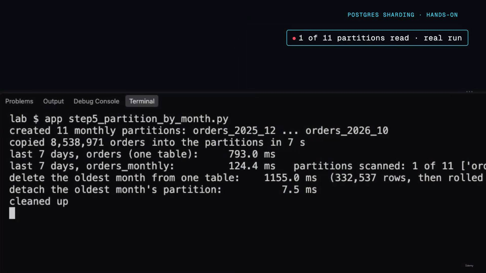

分片不是免费的。P001 明确说，一旦数据分散到多台机器，原本简单的事会变难：查“所有人”的问题要问每个 shard；一个特别热的行仍然只在一个 shard 上，仍可能压垮一台机器；每个 app server 要连接每个 shard；如果 shard key 选错，加一个 shard 可能搬走大量数据；跨两个 shard 的修改、重复的订单号、多机备份和升级都会成为新问题。所以课程的态度是：先爬便宜的阶梯，爬完还不够，再分片。

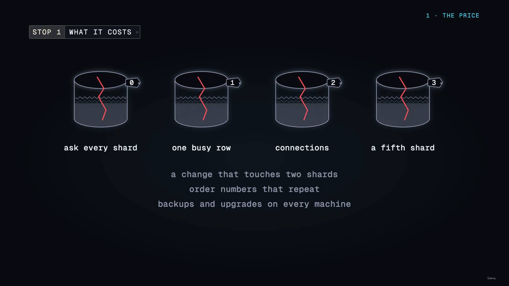

P002 的阶梯图很重要。索引让慢查询变快，但不增加写容量；缓存挡掉重复读，但不能替你接订单；读副本分担读并提供 failover，但每个副本仍要重放每一笔写；更大的机器什么都好一点，但仍是一台机器、一个日志、一个故障点；单机分区把大表拆小，方便删旧数据、优化部分查询，但仍是同一台机器；最后才是 sharding，它增加写容量和数据空间，但其他一切都变难。后面课程会按这个阶梯逐步测量，而 P003–P004 只完成第 0 步：把单机 Postgres 实验室搭起来。

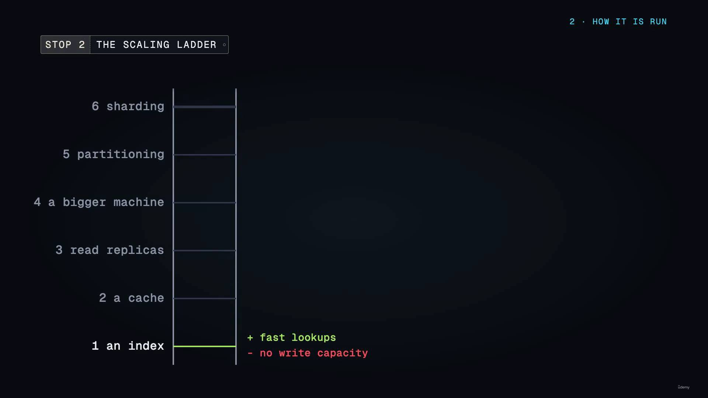

---

## 2. 讲师原话（带页码与时间）

> “Sharding means splitting the rows of a database across several machines so that each machine holds only part of the data. Each part is called a shard. A shard is a complete database of its own.”
>
> —— p001 [01:22]

> “A replica repeats every write. It cannot accept its own, so replicas multiply reading. They never multiply writing.”
>
> —— p002 [02:15]

> “A container is a sealed box with one program and everything that program needs. A container starts from an image which is the recipe for the box.”
>
> —— p003 [00:52]

> “Docker network create and the name QCnet. Docker prints a long ID. That means the network exists.”
>
> —— p003 [05:11]

> “Docker run starts a container. Dash D runs it in the background. Its name is orders DB and it joins our network. CPU set CPUs equals to keeps it on processor code number 2, and memory equals 1G gives it 1 gigabyte.”
>
> —— p003 [05:11] 之后

> “Docker PS lists the running containers, orders DBs there, and its status says up. The port's column says 5, 4, 3, 2. That door is open only inside our Docker network. It is not published to the laptop, so nothing outside can reach it.”
>
> —— p004 [00:00]

> “PgAdmin is a free web app for Postgres and we run it as one more container.”
>
> —— p004 [03:11]

---

## 3. 从零复现

### 3.1 准备环境

你需要三样东西：

1. **Docker Desktop**：安装后必须启动，不只是安装。终端里 `docker version` 能看到版本号，才说明 Docker daemon 在跑。
2. **VS Code**：课程用它创建和编辑文件。你也可以用别的编辑器，但后面课程会按 VS Code 的文件树操作。
3. **资源**：在 Docker Desktop 设置里给 Docker 约 8 GB 内存，并留约 10 GB 磁盘空间。课程给每个数据库容器限制 1 CPU 核和 1 GB 内存，是为了在笔记本上也能看到瓶颈。

Windows 用户注意：讲师要求用 **WSL2** 安装 Docker Desktop，然后在 Ubuntu 终端里输入命令，不要用 PowerShell。文件要保存为 Linux 换行符，VS Code 底部应显示 **LF**；如果 shell 脚本是 CRLF，运行会出问题。

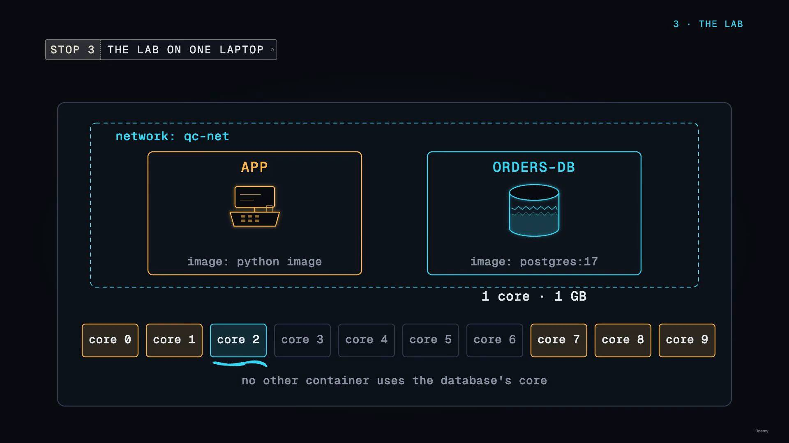

课程说本地不需要装 Python，因为后面 Python 文件都在容器里跑，容器自带 Python。但 P001–P004 还没有出现 Python 文件，这一段只搭基础设施。

### 3.2 创建项目目录

在终端里：

```bash
mkdir -p ~/postgres-sharding-lab
cd ~/postgres-sharding-lab
```

如果你有 VS Code 的 `code` 命令：

```bash
code .
```

没有的话，打开 VS Code，选择 **File → Open Folder**，选中 `~/postgres-sharding-lab`。P003 展示的最终项目里会有 `Dockerfile`、`Dockerfile.pool`、`pool/` 目录，以及 step1 到 step12 的 step 文件；这些文件的内容不在 P001–P004 里，本文不会凭空写。本文只创建本段真正用到的东西。

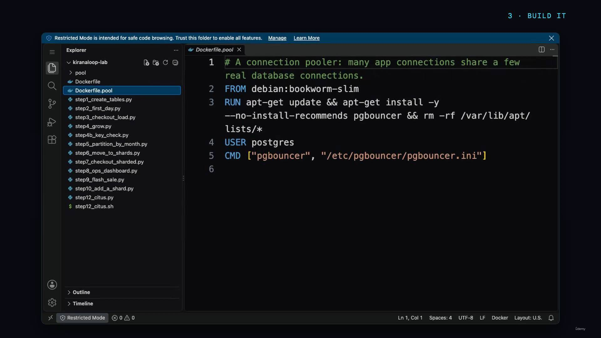

### 3.3 检查 Docker 是否真的在跑

```bash
docker version
docker info
```

`docker version` 如果能看到版本号，说明 Docker 引擎在跑。如果看到类似“cannot connect to the Docker daemon”，说明 Docker Desktop 没启动；启动后等一分钟再试。`docker info` 会显示 Docker 可用的 CPU 和内存；你的数字和讲师不同是正常的。

课程按 10 颗 CPU、编号 0–9 来写命令，数据库固定到 2 号核。如果你的机器核数更少，就换成一个存在的编号。不要和后面要启动的 app 容器共用同一颗核；P001–P004 里 app 容器还没出现，但你要为后面留好。

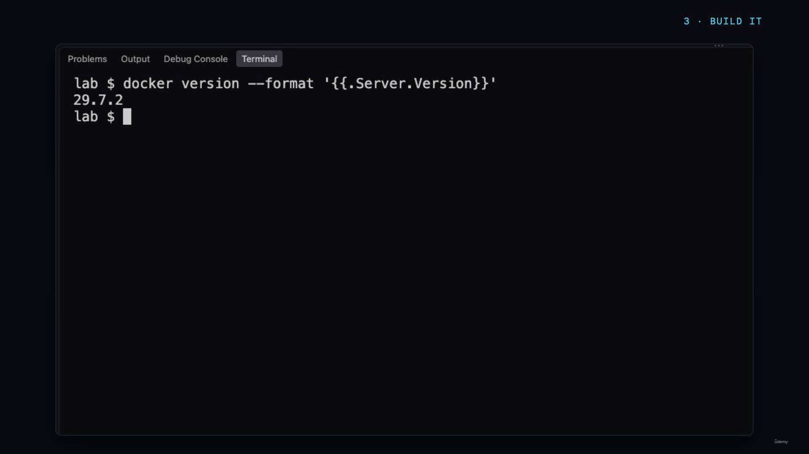

### 3.4 创建 Docker 网络

容器之间要能按名字互相找到，所以先建一个私有网络：

```bash
docker network create qcnet
```

Docker 会打印一长串 ID，表示网络创建成功。本文统一用小写 `qcnet`。Docker 名称大小写敏感，如果你按截图写成 `QCnet`，后面所有命令都要一致替换。

如果提示网络已存在，不用重复创建；可以直接用：

```bash
docker network inspect qcnet
```

### 3.5 启动 Postgres 17 容器

逐字稿里的命令拆开是：后台运行、命名 `ordersdb`、加入 `qcnet`、固定 CPU 核 2、限制 1 GB 内存、设置密码 `lab`、使用 `postgres:17` 镜像。

```bash
docker run -d \
  --name ordersdb \
  --network qcnet \
  --cpuset-cpus=2 \
  --memory=1g \
  -e POSTGRES_PASSWORD=lab \
  postgres:17
```

说明：

- `-d`：后台运行。
- `--name ordersdb`：容器名。后面 pgAdmin 里 host 要填这个名字。
- `--network qcnet`：加入刚才创建的网络。
- `--cpuset-cpus=2`：只允许使用 2 号 CPU 核。若你的机器没有 2 号核，改成 `--cpuset-cpus=1` 或 `0`，但不要和 app 共用。
- `--memory=1g`：限制 1 GB 内存。
- `-e POSTGRES_PASSWORD=lab`：设置 Postgres 密码。课程明确说这只适合笔记本实验，真实服务器绝不能这么干。
- `postgres:17`：Postgres 17 镜像。

注意：这里**没有** `-p 5432:5432`。所以宿主机的 `localhost:5432` 连不进去，这是故意的。数据库端口只在 Docker 网络内部开放。后面要用 `docker exec` 进去，或者让同一网络里的 pgAdmin 连。

### 3.6 三路验证 Postgres

第一路，看容器是否在跑：

```bash
docker ps
```

你应该看到 `ordersdb`，状态是 `Up`，端口相关信息里会出现 `5432/tcp`，但没有把 5432 发布到宿主机的映射。

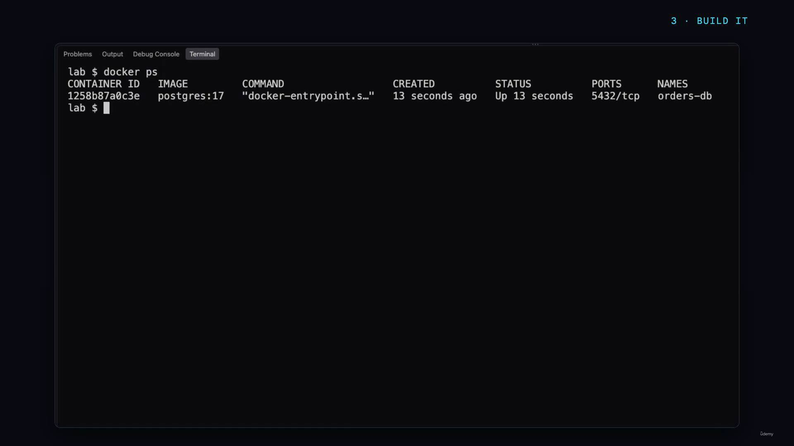

第二路，看启动日志：

```bash
docker logs ordersdb 2>&1 | grep "ready to accept connections"
```

Postgres 把日志写到错误流，所以 `2>&1` 把错误流并到正常输出，再用 `grep` 只保留包含 `ready to accept connections` 的行。第一次启动可能要几秒，如果暂时没输出，等一会儿再跑。看到这行就说明数据库准备接受连接。

第三路，用容器内的 `pg_isready`：

```bash
docker exec ordersdb pg_isready -U postgres
```

这个工具只检查一件事：服务器是否接受连接。看到 `accepting connections` 就表示可用；实际输出以你的终端为准。

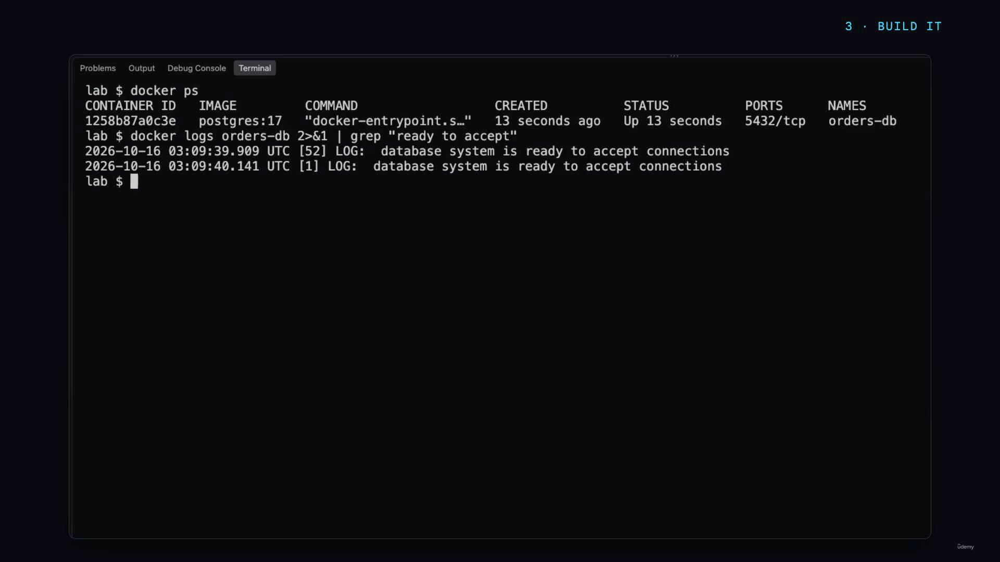

### 3.7 进入 psql 并创建 kiranaloop

进入容器里的 `psql`：

```bash
docker exec -it ordersdb psql -U postgres
```

- `docker exec`：在容器里执行程序。
- `-it`：保持交互，让你能输入。
- `psql -U postgres`：以 `postgres` 用户进入 Postgres 命令行。

提示符会变成类似 `postgres=#`。然后执行：

```sql
SELECT version();
```

`psql` 里分号表示一条命令结束。它会返回 Postgres 版本。

列出数据库：

```sql
\l
```

你会看到默认的 `postgres`，以及模板数据库。课程里还创建了自己的数据库：

```sql
CREATE DATABASE kiranaloop;
```

切换到新数据库：

```sql
\c kiranaloop
```

列出表：

```sql
\dt
```

课程里这时会提示没有找到 relation。`relation` 是 Postgres 对表的叫法，所以这是正常的：数据库是空的。

退出：

```sql
\q
```

逐字稿里还提醒：后面的 Python 文件仍然使用默认数据库 `postgres`，这样数据库 URL 末尾短一些；创建 `kiranaloop` 只是为了演示如何建自己的库。这一点很关键，不要以为后面所有实验都自动切到 `kiranaloop`。

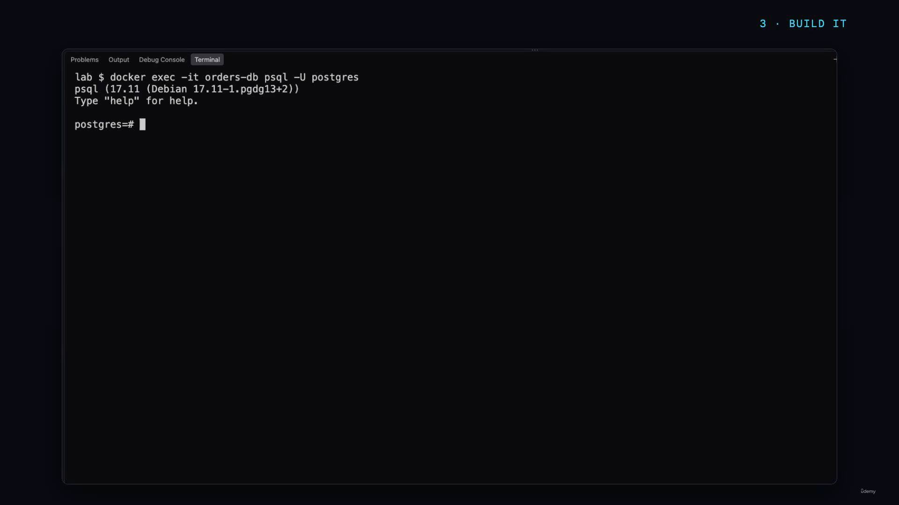

### 3.8 启动 pgAdmin 并从浏览器连接

pgAdmin 作为另一个容器运行。逐字稿没有把镜像名和环境变量完整念清楚；本文采用 pgAdmin 官方镜像 `dpage/pgadmin4`。如果你的截图里镜像名不同，以截图为准。

```bash
docker run -d \
  --name pgadmin \
  --network qcnet \
  -p 127.0.0.1:5050:80 \
  -e PGADMIN_DEFAULT_EMAIL=admin@example.com \
  -e PGADMIN_DEFAULT_PASSWORD=lab \
  -e PGADMIN_CONFIG_SERVER_MODE=False \
  dpage/pgadmin4
```

解释：

- `-p 127.0.0.1:5050:80`：只把容器的 80 端口发布到本机回环地址的 5050。不要写成 `0.0.0.0:5050:80`，更不要把数据库端口公开发布。
- `PGADMIN_DEFAULT_EMAIL` 和 `PGADMIN_DEFAULT_PASSWORD`：pgAdmin 镜像要求的登录信息，这里只是示例。
- `PGADMIN_CONFIG_SERVER_MODE=False`：关闭服务器模式登录页，适合本机实验。
- 第一次运行会下载镜像，需要等一分钟左右。

打开浏览器访问：

```text
http://localhost:5050
```

登录后选择 **Add New Server**：

- General 标签：Name 填 `ordersDB`（显示名，可自定义）。
- Connection 标签：
  - Host：`ordersdb`，这是 Postgres 容器在 `qcnet` 网络里的名字。
  - Port：`5432`。
  - Username：`postgres`。
  - Password：`lab`。

保存后，左侧树会出现服务器。展开 Databases，应看到 `kiranaloop` 和 `postgres`。在 `kiranaloop` 上打开 Query Tool，执行：

```sql
SELECT version();
```

它会返回和 `psql` 里一样的版本信息。终端和浏览器只是两个入口，连的是同一个 Postgres 服务器。

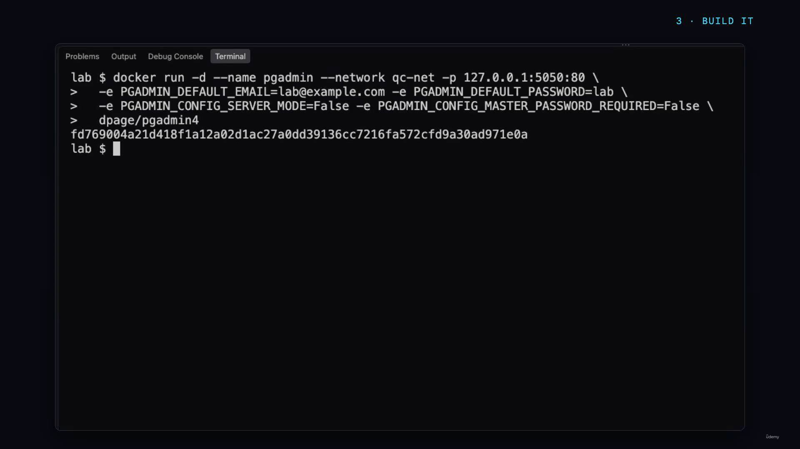

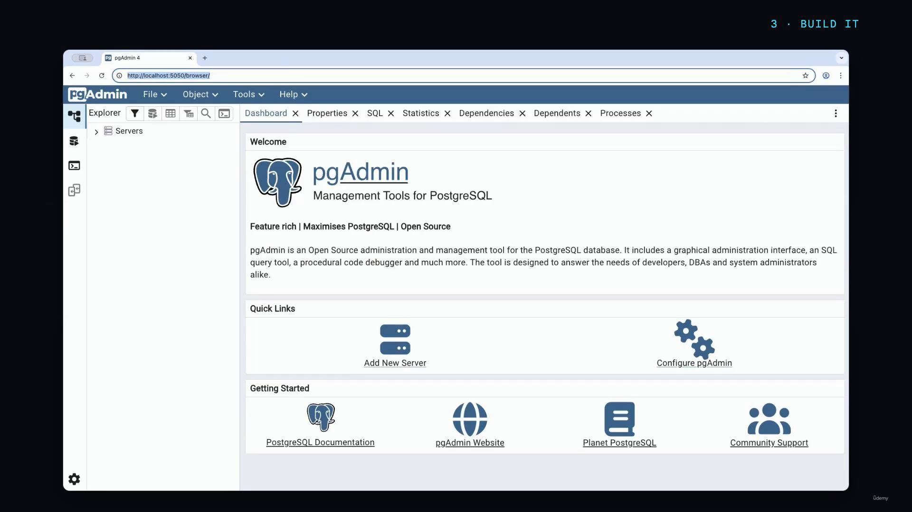

---

## 4. 完整代码

目录结构如下。P001–P004 只创建这三个文件就够了；课程后面才出现的 `Dockerfile`、`Dockerfile.pool`、`pool/` 和 step 文件不在这里编造。

```text
postgres-sharding-lab/
├── start-lab.sh
├── verify-lab.sh
└── sql/
    └── 00_check.sql
```

### 4.1 `start-lab.sh`

保存到项目根目录，然后 `chmod +x start-lab.sh`。

```bash
#!/usr/bin/env bash
set -euo pipefail

NETWORK="${NETWORK:-qcnet}"
DB_CONTAINER="${DB_CONTAINER:-ordersdb}"
PGADMIN_CONTAINER="${PGADMIN_CONTAINER:-pgadmin}"
DB_CPU="${DB_CPU:-2}"
PGADMIN_EMAIL="${PGADMIN_EMAIL:-admin@example.com}"
PGADMIN_PASSWORD="${PGADMIN_PASSWORD:-lab}"

if ! docker network inspect "$NETWORK" >/dev/null 2>&1; then
  docker network create "$NETWORK"
fi

if docker ps -a --format '{{.Names}}' | grep -qx "$DB_CONTAINER"; then
  docker start "$DB_CONTAINER" >/dev/null
else
  docker run -d \
    --name "$DB_CONTAINER" \
    --network "$NETWORK" \
    --cpuset-cpus="$DB_CPU" \
    --memory=1g \
    -e POSTGRES_PASSWORD=lab \
    postgres:17
fi

echo "waiting for postgres..."
for _ in $(seq 1 30); do
  if docker exec "$DB_CONTAINER" pg_isready -U postgres >/dev/null 2>&1; then
    echo "postgres is ready"
    break
  fi
  sleep 1
done

if ! docker exec "$DB_CONTAINER" pg_isready -U postgres >/dev/null 2>&1; then
  echo "postgres did not become ready in 30s" >&2
  exit 1
fi

if docker ps -a --format '{{.Names}}' | grep -qx "$PGADMIN_CONTAINER"; then
  docker start "$PGADMIN_CONTAINER" >/dev/null
else
  docker run -d \
    --name "$PGADMIN_CONTAINER" \
    --network "$NETWORK" \
    -p 127.0.0.1:5050:80 \
    -e "PGADMIN_DEFAULT_EMAIL=$PGADMIN_EMAIL" \
    -e "PGADMIN_DEFAULT_PASSWORD=$PGADMIN_PASSWORD" \
    -e "PGADMIN_CONFIG_SERVER_MODE=False" \
    dpage/pgadmin4
fi

echo "open http://localhost:5050"
```

如果你的机器没有 2 号 CPU 核，用环境变量覆盖：

```bash
DB_CPU=1 ./start-lab.sh
```

### 4.2 `verify-lab.sh`

```bash
#!/usr/bin/env bash
set -euo pipefail

DB_CONTAINER="${DB_CONTAINER:-ordersdb}"
PGADMIN_CONTAINER="${PGADMIN_CONTAINER:-pgadmin}"

docker ps --filter "name=$DB_CONTAINER"
docker ps --filter "name=$PGADMIN_CONTAINER"

echo "--- postgres log check ---"
docker logs "$DB_CONTAINER" 2>&1 | grep "ready to accept connections"

echo "--- pg_isready ---"
docker exec "$DB_CONTAINER" pg_isready -U postgres

echo "--- psql version ---"
docker exec "$DB_CONTAINER" psql -U postgres -c "SELECT version();"

echo "--- list databases ---"
docker exec "$DB_CONTAINER" psql -U postgres -c "\l"
```

### 4.3 `sql/00_check.sql`

```sql
-- 第一次运行时执行；如果 kiranaloop 已存在，CREATE DATABASE 会报错，跳过这一行即可。
SELECT version();
\l
CREATE DATABASE kiranaloop;
\c kiranaloop
\dt
```

执行：

```bash
docker exec -i ordersdb psql -U postgres < sql/00_check.sql
```

注意：`\l`、`\c`、`\dt` 是 `psql` 的元命令，不是 SQL 标准语法。它们只在 `psql` 里有效。

---

## 5. 逐行解释

`set -euo pipefail` 是 shell 的安全带：任何命令失败就退出，未定义变量报错，管道中任意一段失败也失败。这样启动脚本不会“看起来跑完了，其实数据库没起来”。

`docker network inspect "$NETWORK"` 用来判断网络是否已存在。成立就不创建，避免重复执行时报 “network with name qcnet already exists”。

`docker ps -a --format '{{.Names}}' | grep -qx "$DB_CONTAINER"` 判断同名容器是否存在。存在就 `docker start`，不存在才 `docker run`。这样脚本可以重复执行：第一次创建，第二次只启动。

`docker run` 里的 `--cpuset-cpus` 和 `--memory` 是课程刻意给数据库“小机器”的方式。P001 说得很清楚：给每个数据库一个小机器，是为了让限制在笔记本上也能出现。你的数值会不同，但形状一样。

`pg_isready` 只检查服务器是否接受连接，不检查表、不检查权限、不检查数据库是否存在。它适合启动等待循环，不适合验证业务数据。

`psql` 里的 `\l` 列出数据库，`\c kiranaloop` 切换数据库，`\dt` 列当前数据库的表，`\q` 退出。`SELECT version();` 是普通 SQL，必须带分号。

pgAdmin 的 Host 填 `ordersdb`，不是 `localhost`。因为 pgAdmin 容器和 Postgres 容器在同一个 Docker 网络里，Docker 网络内的 DNS 能解析容器名；而从宿主机直接连 `localhost:5432` 是不通的，因为课程没有发布 5432 端口。

在 JS/Node 里，连接数据库通常也会用连接池，例如 `pg.Pool` 复用有限连接；但 P001–P004 没有写 Node 代码，也没有讲事务和锁。这里只需要建立“连接数是有限资源”的直觉。

---

## 6. 复现检查清单

- [ ] `docker version` 能看到版本号；没有 “cannot connect to the Docker daemon”。
- [ ] `docker info` 能看到 Docker 可用的 CPU 和内存；数字与讲师不同没关系。
- [ ] `docker network inspect qcnet` 成功。
- [ ] `docker ps` 里 `ordersdb` 状态为 `Up`。
- [ ] `docker ps` 里 `ordersdb` 出现 `5432/tcp`，但没有发布到宿主机；不要尝试从宿主机 `psql -h localhost -p 5432`。
- [ ] `docker logs ordersdb 2>&1 | grep "ready to accept connections"` 能看到启动完成日志。
- [ ] `docker exec ordersdb pg_isready -U postgres` 显示接受连接。
- [ ] `docker exec -it ordersdb psql -U postgres` 能进入 `psql`。
- [ ] `SELECT version();` 返回 Postgres 版本。
- [ ] `\l` 能看到数据库列表。
- [ ] `CREATE DATABASE kiranaloop;` 成功；如果已存在，跳到下一步。
- [ ] `\c kiranaloop` 后提示符显示新数据库名。
- [ ] `\dt` 提示没有 relation，这是正常的空库。
- [ ] 浏览器打开 `http://localhost:5050` 能进入 pgAdmin。
- [ ] pgAdmin 里 Host 填 `ordersdb`、Port `5432`、User `postgres`、Password `lab` 能保存。
- [ ] 在 pgAdmin 的 Query Tool 对 `kiranaloop` 执行 `SELECT version();` 成功。

---

## 7. 课里没讲但你会撞上的

1. **P001–P004 没有分片代码。** 这四集只到单机 Postgres 和 pgAdmin。分片路由、订单表、压测、闪购、Citus 都在后面的章节；不要在本段找 router 文件。
2. **pgAdmin 镜像名在逐字稿里没有完整念出。** 本文用官方 `dpage/pgadmin4`；如果截图里的镜像名不同，以截图为准。环境变量名也可能随镜像版本变化，报错时先看镜像文档和容器日志。
3. **`--cpuset-cpus=2` 可能失败。** 如果你的 Docker Desktop 只分配了 1–2 颗 CPU，2 号核可能不存在。用 `DB_CPU=1 ./start-lab.sh` 或 `DB_CPU=0`。课程要求数据库不要和 app 共用核；app 容器后面才出现，到时给 app 换另一颗。
4. **`docker network create qcnet` 第二次会报已存在。** 用本文的 `start-lab.sh` 会自动判断；手动执行时用 `docker network inspect qcnet` 检查即可。
5. **`CREATE DATABASE kiranaloop;` 重复执行会报错。** 这是正常的。先 `\l` 看是否已存在；已存在就直接 `\c kiranaloop`。不要在生产库上随便 `DROP DATABASE`。
6. **pgAdmin 的 Host 必须和 Postgres 容器名一致。** 本文用 `ordersdb`。如果你把容器改名，pgAdmin 里也要改；不要填 `localhost`，因为 pgAdmin 在另一个容器里。
7. **宿主机连不上 5432 是设计如此。** 课程没有发布 Postgres 端口。所有操作要么 `docker exec` 进去，要么通过 `qcnet` 里的 pgAdmin。不要把 5432 发布到公网。
8. **Windows 的 CRLF 会让 shell 脚本失败。** 在 VS Code 底部把换行符切成 LF；否则 `start-lab.sh` 可能报 `bad interpreter` 或奇怪语法错误。
9. **`docker logs ... | grep` 第一次可能没输出。** Postgres 首次启动要几秒，等一会儿再跑；本文脚本用 `pg_isready` 做了 30 秒等待。
10. **5050 端口被占用。** 如果你本机已有程序占 5050，把 `-p 127.0.0.1:5050:80` 改成 `-p 127.0.0.1:5051:80`，浏览器访问 `http://localhost:5051`；已经创建过 `pgadmin` 容器的话，需要先删除旧容器再重建。
11. **`lab` 密码和 `PGADMIN_CONFIG_SERVER_MODE=False` 只适合本机实验。** 真实环境要换强密码、限制网络、开启认证，绝不能把数据库端口裸奔到公网。
12. **Docker Desktop 资源不够会表现得很奇怪。** 课程建议约 8 GB 内存和约 10 GB 磁盘；如果 pgAdmin 或 Postgres 起不来，先看 Docker Desktop 的资源设置和磁盘剩余空间。