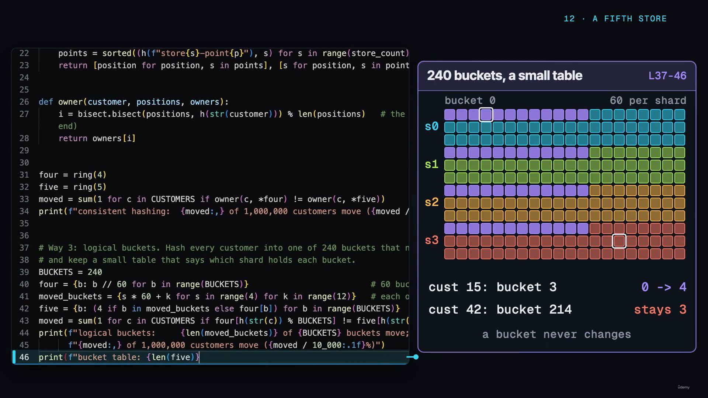
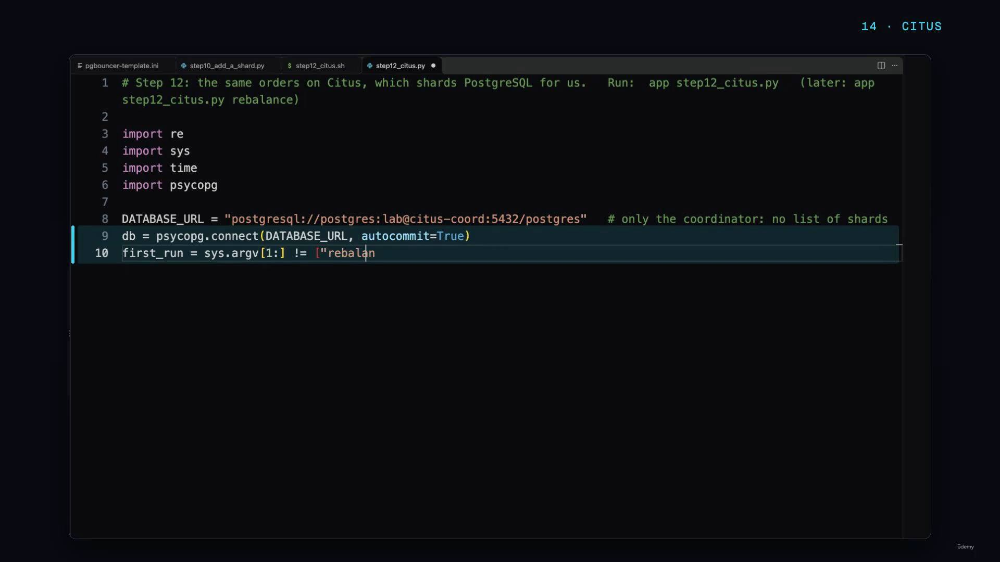
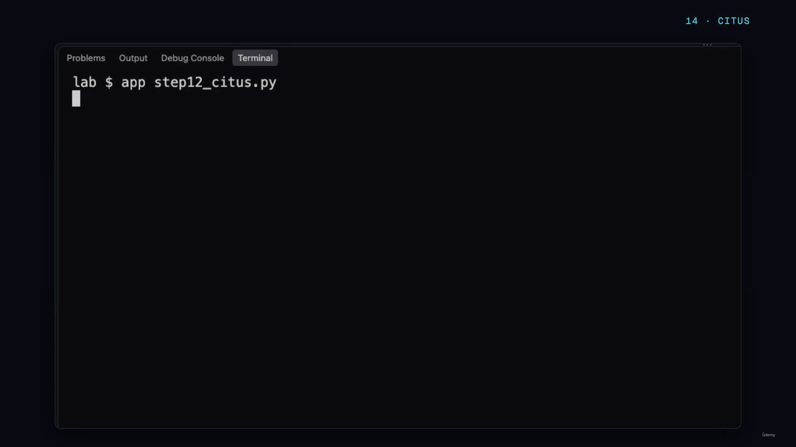
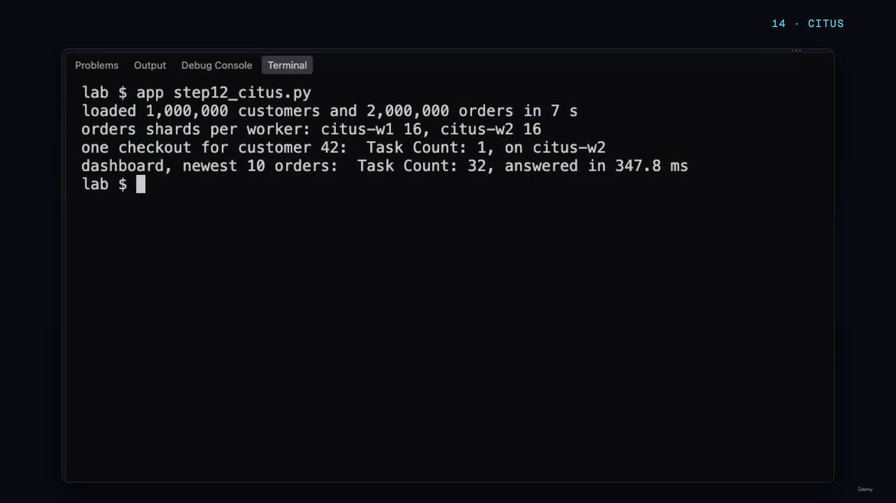
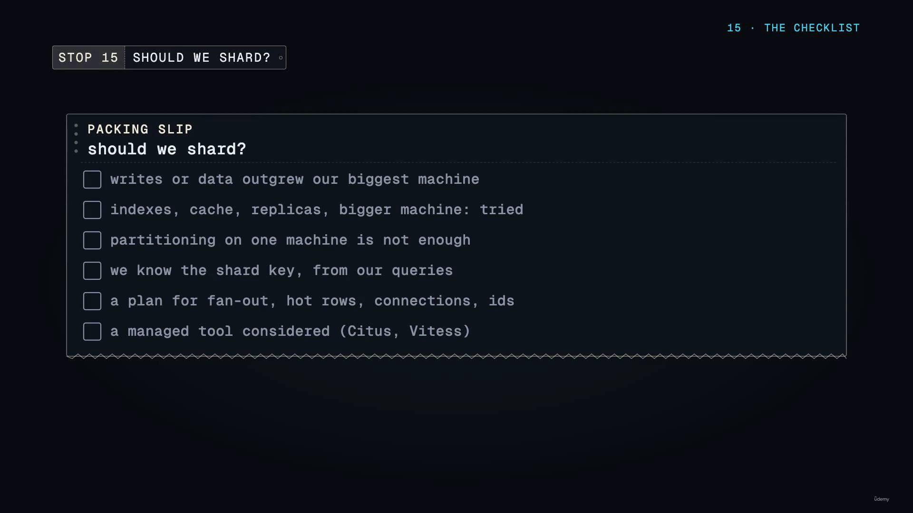
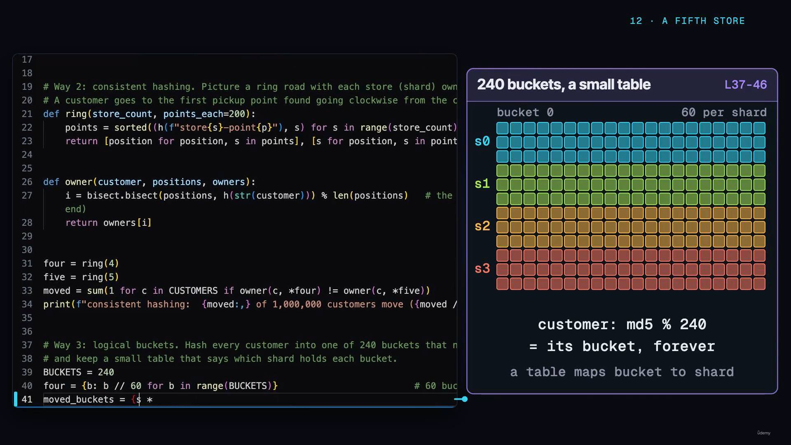

# Postgres Sharding：分片策略对比与 Citus 实战

## 1. 这一节做什么

前面的课程里，我们手工搭建了四个 Postgres 分片，并写了路由、扇出和再平衡逻辑。这一节（P13–P16）要做三件大事：

1. **用 Python 模拟三种分片扩容策略的数据迁移量**：取模路由（余数规则）、一致性哈希环（带虚拟节点）、逻辑桶。通过模拟 100 万顾客从 4 个分片扩容到 5 个分片，量化每种策略需要移动多少顾客数据。
2. **认识分片后必然遇到的四个问题**：跨分片事务、全局唯一 ID、非分片键查询、运维复杂度（监控、备份、弹性、副本）。
3. **用 Citus 扩展代替手工分片**：启动一个协调节点（coordinator）和两个工作节点（worker），通过标准 SQL 创建分布式表、加载 100 万顾客 + 200 万订单数据，观察 Citus 自动完成路由、扇出和合并。然后添加第三个 worker，调用 `citus_rebalance_start()` 观察数据在后台自动迁移。

最后，我们会总结一个“是否该分片”的检查清单，并清理本机上的所有实验容器。

这一节的重点不是“背概念”，而是把分片策略的代价量化出来，再和手工分片、Citus 自动分片做对照。对前面的手工分片实验来说，路由、扇出、再平衡都需要我们自己写代码和维护映射关系；这一节会看到，同样的动作在 Citus 里被尽量收进数据库层，应用仍然连接一个 coordinator，像操作普通表一样写 SQL。理解这种对照，能帮助判断什么时候应该继续手工控制，什么时候应该交给扩展。

---

## 2. 讲师原话

> "所以我们的规则是除以五，而不是除以四。……对数据库而言，这意味着客户的全部订单历史必须复制到新的分片，然后从旧分片删除。因为分片数量变化而迁移数据，叫作重新分片。这个过程很慢，也有风险，因为数据迁移期间商店必须保持营业。"
> —— p013 [00:24]

> "在计算领域，这叫作一致性哈希。……一个节点加入或离开，只会影响它直接的邻居节点。"
> —— p013 [01:20]

> "一次一个桶。第一步，复制。……第二步，保持同步。……第三步，检查。……第四步，切换。……第五步，清理。在第四步之前，每一步都可以撤销。正是这一点让它变得安全。"
> —— p013 [08:31]

> "第一种是涉及两个分片的变更。……单条语句做不到这一点。有三种应对方案，最好的方案是避免这种情况。"
> —— p014 [00:00]

> "Citus 的文档说，对 SQL 语句而言，分布式表看起来就是普通表，但它们被拆分到各个工作节点上。"
> —— p015 [00:27]

> "现在我们告诉协调器它自己的地址。Citus 在添加工作节点之前需要这个信息。"
> —— p015 [03:37]

> "在我自己的实验室里，一个数据库每秒保存 6,365 个订单。四个分片、四台数据驻留内存的小型机器，每秒保存 32,472 个订单。"
> —— p016 [01:47]

---

## 3. 从零复现

### 3.1 前置条件

- 一台安装 **Docker Desktop** 的 Mac（Apple Silicon 请开启 Rosetta，见 3.2）或 Linux 机器。
- **Python 3.8+**，并安装 `psycopg2`：  
  ```bash
  pip install psycopg2-binary
  ```
- 能访问 Docker Hub，因为需要拉取 `citusdata/citus` 镜像（约几百 MB，首次下载较慢）。

这里的每条前置命令都对应一个明确的检查点。`pip install psycopg2-binary` 是为了让 Python 能连接 Postgres 和 Citus；如果安装失败，先确认 Python 版本和 pip 是否来自同一个环境。Docker 能访问 Docker Hub 则是为了拉取 Citus 镜像；如果网络较慢，第一次运行 `setup_citus.sh` 会卡在拉取镜像阶段，这不是脚本逻辑错误，而是镜像尚未下载完成。与前面手工分片实验相比，本节不再需要手动创建四个独立 Postgres 分片，而是用 Citus 容器组成一个小集群，但 Docker 资源、网络和镜像拉取这些前置条件仍然相同。

### 3.2 特别提示（Apple Silicon 用户）

在 Docker Desktop → Settings → General 中，打开 **“Use Rosetta for x86_64/amd64 emulation on Apple Silicon”**。Citus 官方镜像大多是 `linux/amd64`，在 M 系列芯片上需要模拟运行，开启 Rosetta 后会快很多。

这个设置不是业务逻辑的一部分，而是为了减少模拟执行带来的性能损耗。如果没有开启，容器仍可能启动，但加载 100 万顾客和 200 万订单会明显变慢。常见排查方式是：确认 Docker Desktop 的 Settings 中 Rosetta 选项已经勾选，然后重启 Docker Desktop；如果仍然很慢，可以先把数据量调小做功能验证，再恢复完整数据量。不要因为模拟环境慢就误判为 Citus 路由或 SQL 写错。

### 3.3 实验步骤

#### 第一步：运行分片策略模拟

保存 `step10_sharding_simulation.py`（见第 4 节），然后执行：

```bash
python step10_sharding_simulation.py
```

预期会依次输出三种策略移动的顾客数和百分比，最后一段类似：

```text
Way 1 (remainder): 799863 moved, 79.99%
Way 2 (ring): 201949 moved, 20.19%
Way 3 (buckets): 199894 moved, 19.99%
```

（具体数字以实际运行为准）



这条命令的完整含义是：用本地 Python 解释器执行模拟脚本，不连接数据库，也不启动 Docker。脚本内部对 100 万顾客逐一计算旧分片归属和新分片归属，如果归属变化就计为“移动”。预期输出的三行分别对应取模路由、一致性哈希环、逻辑桶。常见错误是 Python 版本过低或脚本文件名写错；如果提示找不到文件，确认当前目录是否包含 `step10_sharding_simulation.py`。如果输出百分比与示例略有差异，通常是因为哈希实现或运行环境不同，但只要取模路由明显高于另外两种策略，就说明模拟方向正确。与前面手工分片的对照是：手工分片时我们关心“路由函数把一条记录送到哪个分片”，这里则进一步量化“扩容时有多少记录需要搬家”。

#### 第二步：清理旧 Docker 容器

本教程假设你已经完成了前面章节的实验，现在需要把旧的 orders 数据库和四个手工分片容器删掉，只保留 pgAdmin 也无妨，但为了资源充足，一并删除：

```bash
docker rm -f orders_db shard1 shard2 shard3 shard4
```

如果这些容器名字不存在，会报错，忽略即可。确认只剩 pgAdmin：

```bash
docker ps
```

`docker rm -f` 的完整解释是：强制删除指定名称的容器。`-f` 表示即使容器正在运行也直接停止并删除。这里列出 `orders_db` 和 `shard1` 到 `shard4`，是因为前面手工分片实验可能留下了这些容器。如果容器不存在，Docker 会报 “No such container”，这不影响后续实验，可以忽略。随后执行 `docker ps` 只列出正在运行的容器，用来确认旧的分片容器已经不再占用端口和内存。常见排查是：如果 `docker ps` 仍看到旧容器，说明删除命令中的名称与实际容器名不一致，可以先用 `docker ps -a` 查看全部容器名，再按实际名称删除。与前台手工分片实验对照，这一步是在清空“手工维护的四个分片环境”，为后面的 Citus 集群腾出资源。

#### 第三步：启动 Citus 集群

保存 `setup_citus.sh`（见第 4 节），然后运行：

```bash
bash setup_citus.sh
```

脚本会创建三个容器：`coordinator`、`worker1`、`worker2`，放在同一个 Docker 网络 `qcnet` 中。脚本末尾会打印：

```text
coordinator | citus_w1
coordinator | citus_w2
```

（实际输出格式取决于 `docker exec` 的执行方式，只要看到 `citus_w1` 和 `citus_w2` 即可）



这条命令用 `bash` 执行启动脚本。脚本内部先删除可能存在的旧 `coordinator`、`worker1`、`worker2`，再创建 Docker 网络 `qcnet`，然后用循环启动三个 Citus 容器。每个容器通过 `--network qcnet` 加入同一网络，因此 coordinator 可以用容器名访问 worker。脚本还通过 `--cpuset-cpus` 绑定不同 CPU 核心，用 `-m 1g` 限制内存，并用 `--platform linux/amd64` 适配 Apple Silicon 的模拟运行。最后脚本在 coordinator 上执行 SQL：`citus_set_coordinator_host()` 告诉 coordinator 自己的地址，`citus_add_node()` 注册两个 worker，`citus_get_active_worker_nodes()` 验证 worker 是否激活。常见错误包括：Docker 未启动、镜像拉取失败、端口或资源不足、容器名冲突。排查时先看脚本输出中哪一步失败，再用 `docker ps -a` 和 `docker logs coordinator` 查看状态。与前面手工分片的对照是：以前四个分片需要手工建库、手工记地址；这里由 coordinator 记录 worker 节点信息，应用侧仍然只看到一个入口。

#### 第四步：加载数据并测试分布式查询

保存 `citus_demo.py`（见第 4 节），先运行一次（不带参数）：

```bash
python citus_demo.py
```

它会：

1. 在 coordinator 上创建 `customers` 和 `orders` 分布式表；
2. 插入 100 万顾客和 200 万订单；
3. 打印加载耗时；
4. 打印分片分布（`Shards per worker`）；
5. 执行一个 checkout 查询（插入订单 + 更新客户计数），打印 `task count`；
6. 执行一个 dashboard 聚合查询，打印 `task count` 和耗时。

预期输出类似（实际数值可能不同）：

```text
Loaded 1000000 customers and 2000000 orders in 7.23 seconds
Shards per worker:
  worker1: 16
  worker2: 16
Checkout task count: 1
Dashboard task count: 32
Dashboard query time: 0.347 seconds
```



这条命令不带参数运行，表示执行“建表、加载、查询测试”流程。脚本连接 coordinator，先删除并重建 `customers`、`orders`，再用 `create_distributed_table()` 把 `customers` 按 `id`、`orders` 按 `customer_id` 变成分布式表。加载数据使用 `execute_values` 批量插入，减少网络往返。`run_checkout()` 演示单顾客写入，预期 `task count` 为 1，因为 Citus 能把这条语句路由到单个 worker。`run_dashboard()` 演示跨分片聚合，预期 `task count` 等于分片总数，因为需要向多个分片发送任务再合并。常见错误是：Citus 集群未启动、coordinator 地址或密码不对、表已存在导致冲突、数据量太大导致等待时间长。排查时先确认 `docker ps` 中三个容器都在运行，再检查脚本里的连接参数是否与 `setup_citus.sh` 一致。与前台手工分片的对照是：手工分片时路由和扇出由应用代码完成；这里应用只写普通 SQL，由 Citus 根据分布列自动路由和扇出。

#### 第五步：添加第三个 worker 并触发 rebalance

再次运行 `citus_demo.py`，这次带上 `rebalance` 参数：

```bash
python citus_demo.py rebalance
```

它会先输出当前分片分布（`worker3` 还没有分片），然后调用 `citus_rebalance_start()`，每秒检查一次迁移状态，直到 `finished`。最后再次打印分片分布。



预期最后输出：

```text
Shards per worker:
  worker1: 11
  worker2: 11
  worker3: 10
```

这条命令的完整含义是：以 `rebalance` 参数运行同一个 Python 脚本，进入再平衡分支。脚本先打印当前分片分布，再调用 `citus_rebalance_start()` 启动后台迁移，然后循环查询 `citus_rebalance_status()`，直到看到 `finished`、`failed` 或 `cancelled`。预期分片会从原来的两个 worker 各 16 个，逐步调整到三个 worker 约 11/11/10。常见错误是：`worker3` 还没有被创建或还没有通过 `citus_add_node()` 加入集群，这时 rebalance 找不到新节点；另一种是状态字段名与当前 Citus 版本不一致，导致循环判断异常。排查时先用 `docker ps` 确认 `worker3` 存在，再在 coordinator 上查询活动 worker 列表。与前面手工分片的对照是：手工再平衡需要我们设计“复制、追平、校验、切换、清理”的步骤；Citus 把这些动作封装成后台再平衡任务，我们主要观察状态和最终分布。

#### 第六步：清理全部实验容器

保存并执行清理命令（见第 4 节末尾），或者直接运行：

```bash
docker rm -f coordinator worker1 worker2 pgadmin
docker network rm qcnet
```

再检查：

```bash
docker ps -a
```

应该看不到任何本实验留下的容器。






`docker rm -f` 会强制删除容器，`docker network rm qcnet` 会删除专用网络。`docker ps -a` 会列出所有容器（包括已停止的），用来确认没有残留。常见错误是：网络仍被容器占用时无法删除，此时先删容器再删网络；如果 `pgadmin` 不存在，删除时会报错，可以忽略。与前面手工分片清理的对照是：手工分片需要清除多个分片容器和数据库卷，这里则清理 coordinator、worker 和专用网络，保持环境干净，避免下一次启动时容器名冲突。

---

## 4. 完整代码

### 4.1 `step10_sharding_simulation.py`

```python
"""
Step 10: 模拟三种分片扩容策略（4 shards -> 5 shards）
课程：Postgres Sharding (P13)
用法：python step10_sharding_simulation.py
"""
import bisect
import hashlib

CUSTOMERS = 1_000_000
OLD_SHARDS = 4
NEW_SHARDS = 5

# 将任意文本转成一个 128 位整数（MD5）
def H(text: str) -> int:
    return int(hashlib.md5(text.encode()).hexdigest(), 16)

# ---------- Way 1: 余数路由 ----------
def way1_remainder():
    moved = 0
    for cid in range(1, CUSTOMERS + 1):
        h = H(str(cid))
        if (h % OLD_SHARDS) != (h % NEW_SHARDS):
            moved += 1
    percent = moved / CUSTOMERS * 100
    print(f"Way 1 (remainder): {moved} moved, {percent:.2f}%")

# ---------- Way 2: 一致性哈希环（带虚拟节点） ----------
def build_ring(shards: int, vnodes_per_shard: int = 200):
    """返回 (sorted_positions, owners)"""
    positions = []
    owners = []
    for s in range(shards):
        for v in range(vnodes_per_shard):
            label = f"store{s}.{v}"
            pos = H(label)
            positions.append(pos)
            owners.append(s)
    # 按位置排序
    pairs = sorted(zip(positions, owners))
    return [p for p, _ in pairs], [o for _, o in pairs]

def ring_owner(customer_hash: int, positions, owners):
    idx = bisect.bisect_left(positions, customer_hash)
    idx %= len(positions)          # 环形回绕
    return owners[idx]

def way2_ring():
    old_pos, old_own = build_ring(OLD_SHARDS)
    new_pos, new_own = build_ring(NEW_SHARDS)
    moved = 0
    for cid in range(1, CUSTOMERS + 1):
        h = H(str(cid))
        old_owner = ring_owner(h, old_pos, old_own)
        new_owner = ring_owner(h, new_pos, new_own)
        if old_owner != new_owner:
            moved += 1
    percent = moved / CUSTOMERS * 100
    print(f"Way 2 (ring): {moved} moved, {percent:.2f}%")

# ---------- Way 3: 逻辑桶 ----------
def way3_buckets():
    NUM_BUCKETS = 240
    # 初始 4 个 shard，每 shard 60 个 bucket
    old_table = {b: b // (NUM_BUCKETS // OLD_SHARDS) for b in range(NUM_BUCKETS)}
    # 每个旧 shard 交出前 12 个 bucket
    moved_buckets = set()
    for s in range(OLD_SHARDS):
        start = s * (NUM_BUCKETS // OLD_SHARDS)
        for b in range(start, start + 12):
            moved_buckets.add(b)
    # 新表：bucket in moved_buckets 归属 shard 4，否则保持原样
    new_table = {}
    for b in range(NUM_BUCKETS):
        if b in moved_buckets:
            new_table[b] = NEW_SHARDS - 1   # shard index 4
        else:
            new_table[b] = old_table[b]
    # 统计每个顾客是否移动
    moved = 0
    for cid in range(1, CUSTOMERS + 1):
        b = H(str(cid)) % NUM_BUCKETS
        if old_table[b] != new_table[b]:
            moved += 1
    percent = moved / CUSTOMERS * 100
    print(f"Way 3 (buckets): {len(moved_buckets)} buckets moved, {moved} customers moved, {percent:.2f}%")

if __name__ == "__main__":
    way1_remainder()
    way2_ring()
    way3_buckets()
```

### 4.2 `setup_citus.sh`

```bash
#!/bin/bash
# 启动 Citus 集群：1 coordinator + 2 worker
# 用法：bash setup_citus.sh

set -e

# 删除旧的实验容器（如果存在）
docker rm -f coordinator worker1 worker2 2>/dev/null || true

# 创建专用网络
docker network create qcnet 2>/dev/null || true

# 用循环创建三个容器
for name in coordinator worker1 worker2; do
  case "$name" in
    coordinator) core=2 ;;
    worker1) core=3 ;;
    worker2) core=4 ;;
  esac

  # 注意：
  # - 这里使用 citusdata/citus:10.2.postgres 作为示例标签
  # - 课程没有明确给出标签，你可以换成当前可用的版本
  # - 每个容器限制 1GB 内存，并绑定到不同 CPU 核心
  docker run -d \
    --name "$name" \
    --network qcnet \
    --cpuset-cpus "$core" \
    -m 1g \
    --platform linux/amd64 \
    -e POSTGRES_PASSWORD=trust \
    citusdata/citus:10.2.postgres
done

# 等待 Postgres 启动
sleep 5

# 在 coordinator 上设置自身地址，然后添加 worker
docker exec -i coordinator psql -U postgres <<'SQL'
SELECT citus_set_coordinator_host('coordinator', 5432);
SELECT citus_add_node('worker1', 5432);
SELECT citus_add_node('worker2', 5432);
SELECT * FROM citus_get_active_worker_nodes();
SQL

echo "Citus cluster is ready."
```

### 4.3 `citus_demo.py`

```python
"""
Citus 分布式表演示（P15）
第一次运行：创建表、加载数据、测试查询
第二次运行：python citus_demo.py rebalance，添加 worker3 并触发 rebalance
"""
import random
import sys
import time

import psycopg2
from psycopg2.extras import execute_values

COORDINATOR_HOST = "localhost"
COORDINATOR_PORT = 5432
COORDINATOR_DB = "postgres"
COORDINATOR_USER = "postgres"
COORDINATOR_PASSWORD = "trust"

# 是否为 rebalance 运行
REBALANCE = len(sys.argv) > 1 and sys.argv[1] == "rebalance"

def connect():
    conn = psycopg2.connect(
        host=COORDINATOR_HOST,
        port=COORDINATOR_PORT,
        dbname=COORDINATOR_DB,
        user=COORDINATOR_USER,
        password=COORDINATOR_PASSWORD,
    )
    conn.autocommit = True
    return conn

def setup_schema(cur):
    cur.execute("DROP TABLE IF EXISTS orders")
    cur.execute("DROP TABLE IF EXISTS customers")
    cur.execute("""
        CREATE TABLE customers (
            id bigint PRIMARY KEY,
            city text
        )
    """)
    cur.execute("""
        CREATE TABLE orders (
            customer_id bigint,
            id bigint,
            store_id text,
            amount numeric,
            order_time timestamp,
            PRIMARY KEY (customer_id, id)
        )
    """)

def create_distributed_tables(cur):
    cur.execute("SELECT create_distributed_table('customers', 'id')")
    cur.execute("SELECT create_distributed_table('orders', 'customer_id')")

def load_data(cur):
    # 生成 100 万顾客
    customers = [(i, "city") for i in range(1, 1_000_001)]
    execute_values(
        cur,
        "INSERT INTO customers (id, city) VALUES %s",
        customers,
        page_size=10000,
    )

    # 生成 200 万订单（每个顾客 2 单）
    orders = []
    for cid in range(1, 1_000_001):
        for _ in range(2):
            store = f"store{random.randint(1, 100)}"
            amount = round(random.uniform(1, 500), 2)
            order_time = "now() - interval '1 day' * " + str(random.randint(1, 300))
            # 由于 order_time 是字符串表达式，我们直接用 SQL 内的随机生成
            # 但这里为了简单，使用固定时间偏移，实际可以动态生成
            orders.append((cid, random.randint(1, 1_000_000), store, amount, f"2025-02-{random.randint(1,28)} 10:00:00"))
    execute_values(
        cur,
        "INSERT INTO orders (customer_id, id, store_id, amount, order_time) VALUES %s",
        orders,
        page_size=10000,
    )

def shards_per_worker(cur):
    cur.execute("""
        SELECT nodename, count(*)
        FROM citus_shards
        WHERE citus_table_name = 'orders'
        GROUP BY nodename
        ORDER BY nodename
    """)
    result = cur.fetchall()
    for node, count in result:
        print(f"  {node}: {count}")
    return result

def run_checkout(cur):
    # 单条语句完成：插入订单 + 更新客户计数
    cur.execute("""
        WITH inserted AS (
            INSERT INTO orders (customer_id, id, store_id, amount, order_time)
            VALUES (42, 999999999, 'store-x', 99.99, now())
            RETURNING customer_id
        )
        UPDATE customers
        SET city = city  -- 这里原本可能是 order_count 字段，课程未明确，仅演示路由
        WHERE id = 42
        RETURNING 1
    """)
    cur.execute("""
        EXPLAIN (FORMAT JSON)
        WITH inserted AS (
            INSERT INTO orders (customer_id, id, store_id, amount, order_time)
            VALUES (42, 999999999, 'store-x', 99.99, now())
            RETURNING customer_id
        )
        UPDATE customers SET city = city WHERE id = 42
    """)
    plan = cur.fetchone()[0]
    # 提取 task count
    task_count = extract_task_count(plan)
    print(f"Checkout task count: {task_count}")

def run_dashboard(cur):
    query = """
        SELECT store_id, count(*)
        FROM orders
        GROUP BY store_id
        ORDER BY count(*) DESC
        LIMIT 10
    """
    cur.execute("EXPLAIN (FORMAT JSON) " + query)
    plan = cur.fetchone()[0]
    task_count = extract_task_count(plan)
    start = time.time()
    cur.execute(query)
    cur.fetchall()
    elapsed = time.time() - start
    print(f"Dashboard task count: {task_count}")
    print(f"Dashboard query time: {elapsed:.3f} seconds")

def extract_task_count(plan_json):
    # 简单递归查找任务数
    if isinstance(plan_json, list):
        for item in plan_json:
            result = extract_task_count(item)
            if result is not None:
                return result
    elif isinstance(plan_json, dict):
        if "Task Count" in plan_json:
            return plan_json["Task Count"]
        for v in plan_json.values():
            result = extract_task_count(v)
            if result is not None:
                return result
    return None

def main():
    conn = connect()
    cur = conn.cursor()

    if not REBALANCE:
        setup_schema(cur)
        create_distributed_tables(cur)
        start = time.time()
        load_data(cur)
        elapsed = time.time() - start
        print(f"Loaded 1000000 customers and 2000000 orders in {elapsed:.2f} seconds")
        print("Shards per worker:")
        shards_per_worker(cur)
        run_checkout(cur)
        run_dashboard(cur)
    else:
        # 假设 worker3 已手动启动并添加到集群
        # 这里只演示 rebalance 过程（需要 worker3 已在集群中）
        print("Shards per worker before rebalance:")
        shards_per_worker(cur)
        cur.execute("SELECT citus_rebalance_start()")
        start = time.time()
        while True:
            cur.execute("SELECT * FROM citus_rebalance_status()")
            row = cur.fetchone()
            state = row[0] if row else "unknown"
            print(f"  after {time.time()-start:.1f}s: {state}")
            if state in ("finished", "failed", "cancelled"):
                break
            time.sleep(1)
        print(f"Rebalance finished in {time.time()-start:.1f} seconds")
        print("Shards per worker after rebalance:")
        shards_per_worker(cur)

    cur.close()
    conn.close()

if __name__ == "__main__":
    main()
```

### 4.4 清理命令

```bash
# 删除实验容器和网络
docker rm -f coordinator worker1 worker2 pgadmin
docker network rm qcnet
```

如果你还想删除 Docker 镜像，可以执行：

```bash
docker rmi citusdata/citus:10.2.postgres
```

（课里没讲如何删除镜像，但课程最后说“The images stay on disk, so a second run starts fast.”，所以默认不删。）

---

## 5. 逐行解释

### 5.1 `step10_sharding_simulation.py`

- `H()`：使用 MD5 将字符串映射为一个很大的整数。这个函数模拟了生产环境中的哈希路由函数。
- `way1_remainder()`：对每个顾客 ID 计算 `H(str(cid))`，然后分别取模 4 和模 5。如果结果不同，说明这个顾客在扩容后会迁移到另一个分片。
  - 在 JS/Node 里，你可能会用 `crypto.createHash('md5')` 实现同样的哈希。
- `build_ring(shards, vnodes)`：为每个分片生成 200 个虚拟节点，每个虚拟节点都有独立哈希位置。所有位置排序后，`positions` 是环上的刻度，`owners` 是对应的分片编号。
- `ring_owner()`：使用 `bisect.bisect_left` 找到顾客哈希在环上的后继位置，取模实现环绕。这是标准的一致性哈希查找逻辑。
- `way3_buckets()`：固定 240 个逻辑桶。初始每个分片拥有 60 个连续桶。扩容时，每个旧分片把开头 12 个桶让给新分片（总共 48 个桶）。顾客的桶号 = `H(str(cid)) % 240`，永远不变。通过对比新旧桶→分片映射表，即可统计迁移人数。

进一步对照三条策略：取模路由的问题是“分片数一变，除数就变”，大量哈希结果会换分片；一致性哈希通过环和虚拟节点减少受影响范围；逻辑桶则把“桶到分片”的映射单独拿出来，扩容时只搬桶，不重新计算顾客的桶号。前两种策略更接近路由算法层面的选择，第三种更接近运维层面的可操作方案。与前面手工分片的对照是：手工分片如果采用取模，就会遇到同样的大规模迁移；如果采用逻辑桶，则需要应用或元数据层维护桶映射表。

### 5.2 `setup_citus.sh`

- `docker network create qcnet`：创建桥接网络，让三个容器可以互相通过容器名访问。
- `docker run -d ... citusdata/citus:10.2.postgres`：启动 Citus 容器。`--platform linux/amd64` 在 Apple Silicon 上启用模拟；`--cpuset-cpus` 绑定 CPU 核心；`-m 1g` 限制内存。
- `citus_set_coordinator_host()`：告诉 coordinator 自己的容器主机名。Citus 在容器内默认匿名卷中保存配置，这一步是必需的。
- `citus_add_node()`：将 worker 注册到 coordinator。
- `citus_get_active_worker_nodes()`：验证两个 worker 都激活。

> 课里没有给出 Citus 镜像的具体版本，这里使用 `10.2.postgres`。如果你在拉取时发现该标签不存在，请到 Docker Hub 查看可用标签，选择支持你本地 Postgres 版本的 Citus 镜像。

脚本开头的 `set -e` 表示任何命令失败就停止执行，这能避免在 coordinator 未启动时继续添加 worker。`docker rm -f ... || true` 表示删除旧容器失败也不要中断。`sleep 5` 是等待 Postgres 初始化的粗略等待，如果机器较慢，可能仍需要多等一会儿。`docker exec -i coordinator psql -U postgres <<'SQL'` 的含义是在 coordinator 容器内执行一段 SQL，`-i` 保持标准输入，`<<'SQL'` 是 heredoc 写法。常见错误是镜像标签不存在、容器名冲突、worker 未启动完成就执行 `citus_add_node()`；排查时先看 `docker ps -a`，再看 `docker logs coordinator`。

### 5.3 `citus_demo.py`

- 连接字符串只写了 coordinator 的地址。Citus 会在内部自动路由到 worker，你的应用永远只感知一个数据库。
- `create_distributed_table('orders', 'customer_id')`：Citus 根据 customer_id 哈希分片，并且会自动将 orders 与 customers 共置（因为 customers 的分布列 id 和 orders 的分布列 customer_id 语义一致）。
- `execute_values`：批量插入，减少网络往返。
- `run_checkout()`：一条 SQL 完成插入订单和更新客户。Citus 会将这条语句路由到包含 customer 42 的单个 worker，所以 `task count` 为 1。
- `run_dashboard()`：一个跨所有分片的聚合查询。Citus 会把查询发送到每个分片，然后合并结果，所以 `task count` 等于分片总数（默认 32）。
- `extract_task_count()`：从 `EXPLAIN (FORMAT JSON)` 输出中提取 “Task Count” 字段。不同 Citus 版本的字段名可能不同，请以实际输出为准。
- rebalance 部分：`citus_rebalance_start()` 是异步的，所以需要循环查询 `citus_rebalance_status()` 来获取状态。状态字段包括 `running`、`finished`、`failed`、`cancelled` 等，具体字段名以你的 Citus 版本输出为准。

从命令角度看，`python citus_demo.py` 和 `python citus_demo.py rebalance` 是两种运行模式：前者负责建表、加载、测试；后者负责观察再平衡。`setup_schema()` 里的 DROP 是为了重复运行时清理旧表；`create_distributed_table()` 是 Citus 的关键步骤，没有它表只是普通本地表，查询不会跨 worker 分布式执行。`shards_per_worker()` 查询 `citus_shards` 来观察 `orders` 表的分片分布，这是判断 rebalance 前后变化的直接指标。常见错误包括：表重复创建、worker 未加入、`Task Count` 字段找不到、rebalance 前未添加 worker3。与前台的对照是：手工分片时路由和扇出写在前台代码里；这里前台只连接 coordinator，路由、扇出、合并、再平衡由 Citus 在数据库侧完成。

---

## 6. 复现检查清单

| 步骤 | 命令 | 预期结果 / 检查点 |
|---|---|---|
| 1. 模拟分片策略 | `python step10_sharding_simulation.py` | 看到三行输出，百分比大约 80%、20%、20% |
| 2. 清理旧容器 | `docker rm -f orders_db shard1 shard2 shard3 shard4` | 没有报错（如果容器不存在，忽略） |
| 3. 启动 Citus | `bash setup_citus.sh` | 脚本最后输出两个 active worker 的行 |
| 4. 加载数据 | `python citus_demo.py` | 输出加载耗时，Shards per worker 显示 worker1 和 worker2 各有 16 个分片 |
| 5. 测试查询 | 同上 | Checkout task count = 1，Dashboard task count = 32 |
| 6. 扩容再平衡 | `python citus_demo.py rebalance` | 先输出 worker3 分片数为 0，然后看到 `finished` 状态，最后 worker1/2/3 分片数约为 11/11/10 |
| 7. 清理 | 4.4 节命令 | `docker ps -a` 无相关容器，`docker network ls` 无 qcnet |

> 注意：步骤 4 和 5 在同一个 `citus_demo.py` 第一次运行中完成。步骤 6 需要在执行前手动启动 worker3 并添加到集群，否则 rebalance 不会生效。课程里实际上是在第一次运行后手动启动了 worker3 容器并执行了 `citus_add_node`，但逐字稿没有给出该动作的具体命令。你可以按照第三步的方法额外创建一个 `worker3` 容器（修改脚本中循环即可），或者参考 Citus 手动添加节点，再运行 rebalance。课里没讲这一步的命令，但这是你复现时必然会遇到的操作。

逐条说明检查清单：第 1 条是纯本地模拟，不依赖 Docker，失败时先查 Python 环境和脚本路径。第 2 条是环境清场，失败常见于容器名不存在，可以忽略。第 3 条是集群启动，关键是看到两个 worker 被 `citus_add_node()` 注册并出现在活动节点列表中。第 4 条是建分布式表和加载数据，核心观察是 `Shards per worker` 是否显示两个 worker 各 16 个分片。第 5 条与第 4 条同一次运行，`Checkout task count = 1` 说明单顾客写入被路由到单分片，`Dashboard task count = 32` 说明聚合查询被扇出到全部分片。第 6 条要求提前创建并注册 worker3，否则会出现“看不到 worker3 分片”的中断。第 7 条是清理，确认容器和网络均无残留。这个清单与前文手工分片实验的检查逻辑一致：先确认节点，再确认数据分布，再确认单点查询和扇出查询，最后清理环境。

---

## 7. 课里没讲但你会撞上的

1. **Citus 镜像标签不明确**  
   课程只提到“official Citus image for Postgres 70”（口误），未给出版本号。我使用的是 `citusdata/citus:10.2.postgres`。如果你在 Docker Hub 上看到更新版本，可能会遇到 SQL 函数名差异（例如 `citus_rebalance_start` 在旧版本中叫 `rebalance_table_shards`）。建议固定使用一个已知版本，并在代码中做兼容处理。

2. **worker3 的添加方式**  
   逐字稿在 rebalance 部分直接提到了新 worker，但没给出添加命令。你需要手动创建 `worker3` 容器，并在 coordinator 上执行 `SELECT citus_add_node('worker3', 5432);`，否则 rebalance 脚本找不到新节点。这是复现过程中最常见的中断点。

3. **`citus_set_coordinator_host` 是否必需**  
   如果你的 coordinator 容器名不是 `coordinator`，或者网络配置不同，可能需要调整。这个函数在新版本 Citus 中也可能已经废弃。如果报错，可以尝试省略，直接 `citus_add_node`。

4. **Apple Silicon 性能很慢**  
   所有 Citus 操作都在模拟环境中运行，加载 200 万行可能需要几十秒甚至几分钟。这不是代码问题。

5. **Docker 资源限制**  
   每个容器限制 1GB 内存，如果宿主机内存不足，可能导致容器 OOMKilled。此时可以调大 `-m` 参数，或者减少数据量（例如只插入 10 万顾客）。

6. **`extract_task_count` 字段名**  
   不同 Citus 版本对 `EXPLAIN` 输出的 JSON 字段名不一致。有些版本叫 `"Task Count"`，有些叫 `"key"`。如果打印不出来，请直接打印 `EXPLAIN` 输出查看实际字段。

7. **清理后镜像仍占磁盘**  
   课程最后说“images stay on disk”，如果你不想保留，可以手动 `docker rmi`。但重新运行会更快。

8. **Node.js 与分片概念的映射**  
   - 取模路由 → 对 key 做 `% shardCount`，类似 Node 中 `hash % shards.length`。
   - 一致性哈希 → 可以用 `hash-ring` 或 `consistent-hash` npm 包。
   - 逻辑桶 → 在应用内存中维护一个 `bucket -> shard` 的 Map，Node 里直接用一个 `Map<number, number>`。
   - 跨分片事务 → 在 JS 中对应多数据库操作，通常用 Saga 模式（本地事务 + 补偿操作），而不是两阶段提交。

这些问题的共同点是：它们大多不是 SQL 语法错误，而是环境、版本和集群状态问题。排查顺序建议固定为：先看 Docker 容器是否运行，再看 coordinator 是否能连接，再看 worker 是否注册，再看表是否分布式表，最后看 rebalance 状态。这个顺序与前面手工分片实验的排查思路完全一致：先确认分片节点是否存在，再确认路由表，再确认查询扇出，最后处理再平衡和清理。