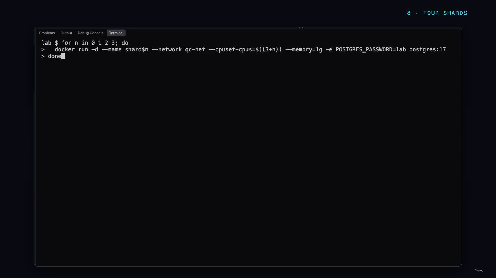
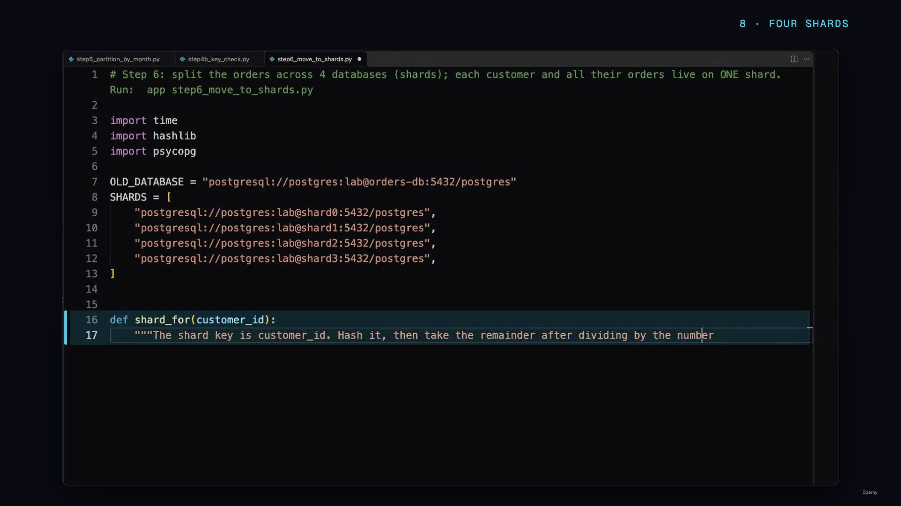
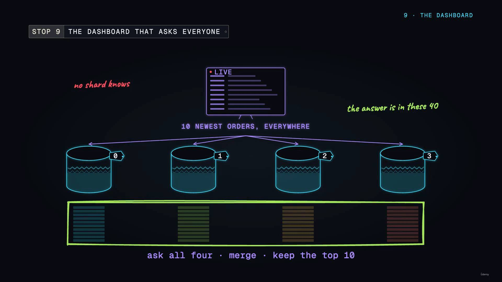
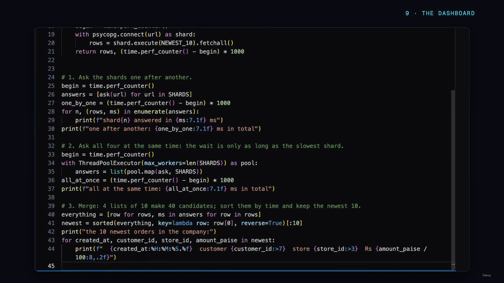
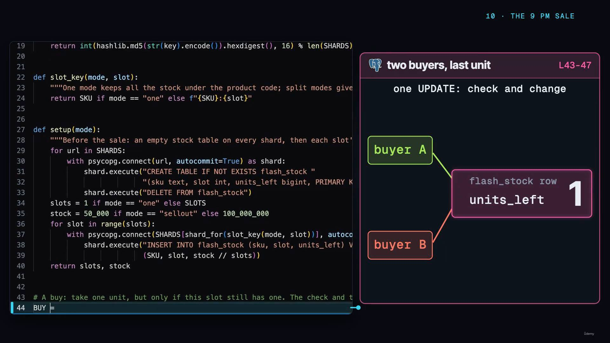
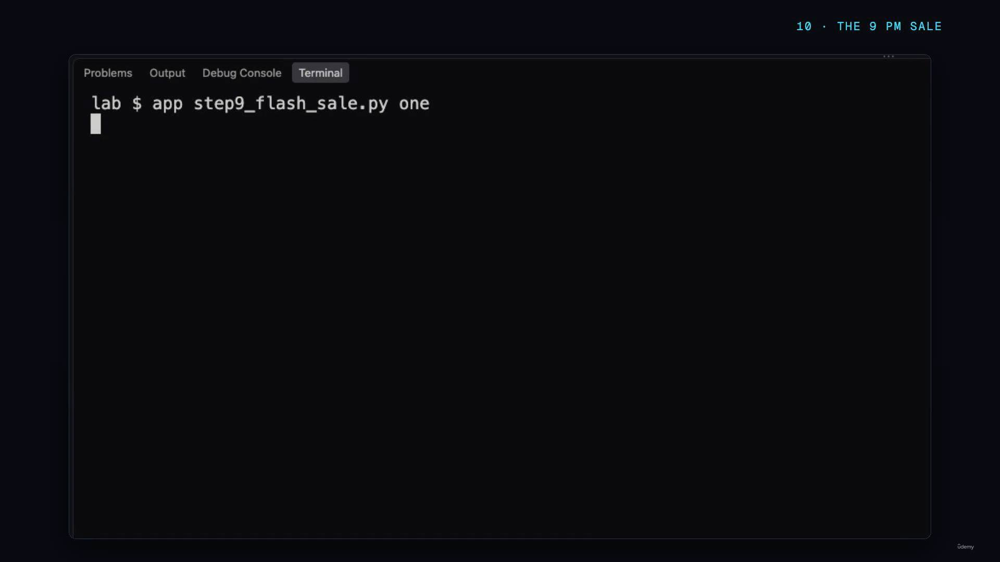
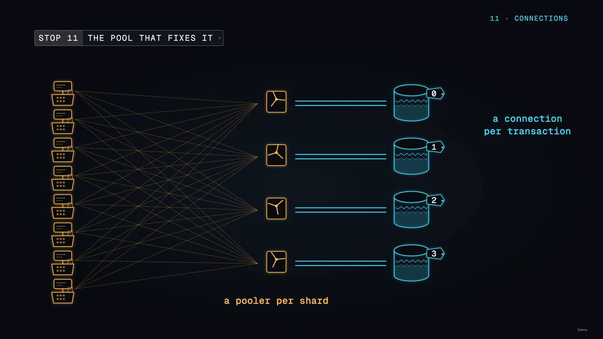
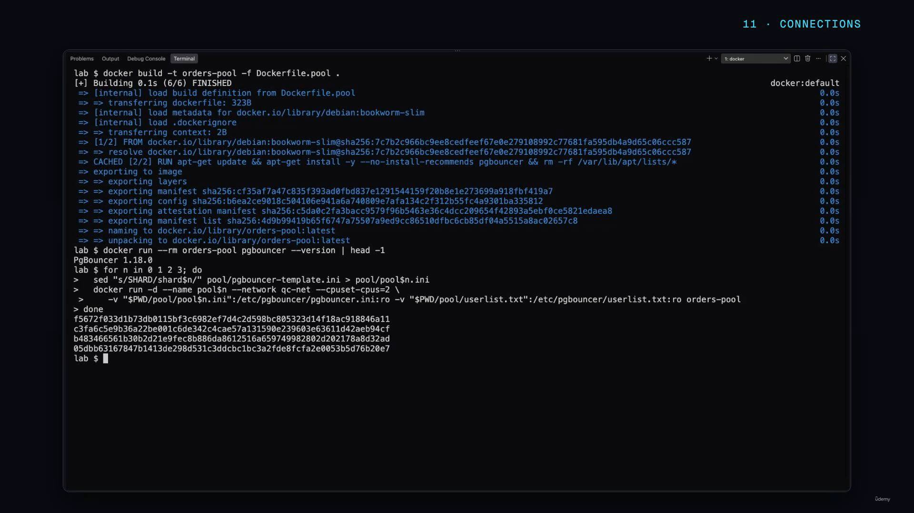

# Postgres Sharding 实战：从 4 个分片到连接池（P009–P012）

> 课程：BV1K2xY63EDx ｜ 覆盖 P009–P012
> 读者定位：前端转 AI 应用工程师。涉及锁/事务/并发处会补一句「在 JS/Node 里对应什么」；Python 语法只标注「知道即可」。

---

## 1. 这一节做什么

这一节把「单机 Postgres 撑不住」这件事真正落地成一套可跑的实验环境。讲师用一台笔记本 + Docker 起 **4 个 Postgres 分片（shard0–shard3）**，写一个 **router 函数**把 `customer_id` 映射到 0–3 号分片，把百万级 customers 和千万级 orders 从单库搬进 4 个分片，然后依次解决分片带来的三个真实问题：

1. **跨分片查询**：运营看板要「全公司最新 10 笔订单」，单库一条 SQL 的事，分片后必须 **fan-out（向每个分片发同一问题）+ merge（合并结果）**，并用线程池并发 + 补建索引把 184ms 压到 6.8ms。
2. **热点行**：闪购时所有人抢同一行库存，4 个分片退化成 1 个数据库。用 **16 个库存槽位（slot）** 把一行拆成 16 行分散到不同分片，吞吐从 4599 提升到 22967 单/秒，并用 `WHERE units_left > 0` 保证 **零超卖**。
3. **连接数爆炸**：每个 checkout server 要连每个分片，128 个 server × 4 分片 = 512 连接，28 个 server 被拒。用 **PgBouncer（transaction 模式）** 每分片前置一个池，1000 个应用连接共享 20 条真实连接，128 个 server 全部接入。

产出物：一套 Docker 分片集群、一个 router、三个可复现的压测脚本（step7 分片压测、step8 看板、step9 闪购）、一个 PgBouncer 镜像与配置。**照着本文能从头跑起来。**

对前端转 AI 应用工程师来说，这一节最值得建立的直觉是：分片不是「前端路由」，而是**数据路由**；fan-out 不是「多发几个请求就完了」，而是**并发、超时、合并排序、结果正确性**都要自己负责；连接池也不是「加个缓存」，而是**限制真实连接数、让应用连接排队复用**。你可以把 router 想成「根据用户 ID 选择数据库实例」的函数，把 fan-out 想成 `Promise.all` 同时问多个后端，把 merge 想成前端把多个列表合并后按时间倒序取前 N 条；区别在于这里每一步都发生在数据库和 Python 进程之间，错误处理、事务边界、连接数都要自己兜底。下面的实验不追求生产级完备，而是把每个问题压缩到一台机器上，让你能亲手看到「单库撑不住」到底卡在哪里。

---

## 2. 讲师原话（带出处）

> "使用这条规则选择分片的代码称为路由器。在我们的实验里，路由器只是一个小函数。"
> —— p009 [02:47]

> "我们使用一种名为 md5 的哈希函数。它把客户 ID 当作文本，转换成一长串编码。同一个 ID 总是得到相同的编码。"
> —— p009 [01:52]

> "每个分片都和我们单个数据库一样，保持较小的规模。我们不是在购买更大的机器，而是在增加机器。"
> —— p009 [03:15]

> "把同一个问题发送到每个分片称为扇出。然后合并各个答案，这一步称为合并。"
> —— p010 [00:26]

> "每个分片大约耗时 165 毫秒。逐个执行总共 660 毫秒。全部同时执行则为 184 毫秒。"
> —— p010 [04:10]

> "两个买家不能在同一时刻修改同一行。数据库把这一行交给其中一个，另一个则等待。这称为锁。某一行非常繁忙，就意味着一条长队列。我们称其为热行。"
> —— p011 [00:28]

> "正是这个条件让超卖变得不可能。即使两个买家同时到达，数据库一次也只允许其中一个修改该行。"
> —— p011 [04:33]

> "使用四个分片时，每台服务器需要四个连接。128 台服务器会请求 512 个连接。而每个分片会同时看到全部 128 台服务器。"
> —— p012 [00:55]

> "PG Bouncer 是连接池，不是路由器。它对分片键一无所知。我们的路由器仍然负责选择分片。"
> —— p012 [01:53]

这些原话对应本节的三条主线：router 决定「去哪一片」，fan-out + merge 决定「怎么跨片查」，锁与连接池决定「高并发时为什么慢、为什么连不上」。引用保留原样，下面的复现和解释都围绕这些原话展开，不额外编造讲师未提到的结论。

---

## 3. 从零复现

### 3.1 环境与依赖

- Docker（能跑 `docker run` / `docker exec` / `docker rm`）
- Python 3.10+（用到海象运算符 `:=`，3.8 起支持）
- Python 包：`psycopg`（讲师写作 `psychopg`，实际包名是 `psycopg`，v3）

```bash
pip install "psycopg[binary]"
```

> 课里没讲具体版本号，只说了 `psychopg`。装最新 v3 即可；若报 `prepare_threshold` 相关错误，说明装成了 psycopg2，请卸载重装 v3。

这里最容易出现的排查顺序是：先确认 `python -c "import psycopg; print(psycopg.__version__)"` 输出的是 3.x，而不是 2.x；再确认你的 Python 版本支持海象运算符。如果 `pip install psycopg` 后仍然导入失败，检查是否在同一虚拟环境里运行脚本。前端同学可以把它类比成 Node 里装错了 `pg` 和 `pg-native`：包名相近，API 不同，报错却 often 出现在运行期。不要急着改业务代码，先把依赖版本对齐。

### 3.2 目录结构（建议）

```
postgres-sharding-lab/
├── step6_move.py          # 建 4 分片 + 搬数据 + 建索引
├── step7_bench.py         # 64 个 checkout server 压测（支持 --via-pool）
├── step8_dashboard.py     # 运营看板：fan-out + merge
├── step9_flashsale.py     # 闪购：单行 / 16 槽位 / 售罄校验
├── Dockerfile.pool        # PgBouncer 镜像
└── pgbouncer/
    ├── pgbouncer.ini      # 模板，SHARD 占位
    └── userlist.txt       # 用户名密码
```

目录保持扁平，目的是让每个脚本只解决一个问题。排查时也按这个结构定位：搬数据失败看 step6，压测连接失败看 step7，跨片结果不对看 step8，超卖或吞吐异常看 step9，连接数异常看 Dockerfile.pool 与 pgbouncer.ini。前端项目里常见 `src/api`、`src/utils` 分层，这里同理：脚本按职责拆开，不要让一个脚本同时负责建表、搬数据、压测和清理。

### 3.3 第一步：起 4 个分片（对应 p009 的 Step 1–5）

讲师用一个循环跑 4 次 `docker run`，`n` 取 0/1/2/3，每个分片分到 3–6 号核之一、1GB 内存：

```bash
for n in 0 1 2 3; do
  docker run -d \
    --name shard$n \
    --cpuset-cpus=$((n+3)) \
    -m 1g \
    -e POSTGRES_PASSWORD=lab \
    -p $((5432+n)):5432 \
    postgres:16
done
```

> 端口映射课里没细说，但 step7 里分片地址是 `shard0..shard3` 主机名 + 5432 端口，说明它们在同一 Docker 网络里。若你在本机跑，用 `-p` 映射到 5432/5433/5434/5435，并把脚本里的地址改成 `localhost` + 对应端口。**这是课里没讲、但你一定会撞上的第一件事**（见第 7 节）。

逐项解释这条命令：`-d` 让容器后台运行；`--name shard$n` 固定容器名，后面 `docker exec shard0 ...` 和 `host=shard0` 都依赖它；`--cpuset-cpus=$((n+3))` 把 4 个分片绑到不同 CPU 核，避免互相抢核导致压测数据失真；`-m 1g` 限制内存，正好对应「单库 1139MB 塞不进 1GB 内存」的实验设定；`-e POSTGRES_PASSWORD=lab` 设置初始密码；`-p $((5432+n)):5432` 把宿主机端口映射到容器 5432。常见错误排查：如果 `docker ps` 看不到 4 行，先看 `docker logs shard0`；如果报端口占用，改宿主机端口并同步改脚本地址；如果报 `--cpuset-cpus` 超出范围，说明你的机器核数不够，改成 `--cpus=1` 只限 CPU 配额。前端对照：这相当于本地起 4 个 mock server，每个 server 绑定不同端口；区别是数据库容器有初始化密码、数据卷和网络别名。

### 3.4 第二步：搬数据 + 建索引（step6_move.py）

运行：

```bash
python step6_move.py
```

预期输出（讲师实测）：百万 customers 约 2 秒搬完，每分片 250000 / 249000 / 249000 / 250000；约 850 万 orders 用 24 秒搬完，每分片约 280MB。**单库 1139MB 塞不进 1GB 内存，分片后每片 280MB 塞得进**——这是分片真正的收益点。

运行前要确认单库 `kirana` 已经存在，并且 `OLD_DB` 指向它；否则第一步就会连接失败。搬数据阶段如果中途报错，先看 `docker logs shardN` 和 Python 异常栈，常见原因是分片表已存在、旧库表名不对、`COPY` 列数与目标表列数不一致。排查时不要直接重跑全量，可以先看 `/tmp/pile_*.tsv` 是否生成、每个文件大小是否接近；如果某个 pile 明显偏小，说明 router 或 customer_id 读取有问题。前端对照：这相当于把一张大表按用户 ID 拆成 4 个 JSON 文件再分别导入；区别是 `COPY` 是数据库级批量导入，比逐条 `INSERT` 快得多。

### 3.5 第三步：分片压测（step7_bench.py）

```bash
python step7_bench.py            # 直连 4 分片
python step7_bench.py --via-pool # 走 PgBouncer（第 12 节用）
```

讲师实测：64 个 checkout server、20 秒、百万 customers，**32472 单/秒，P95 3.5ms**，约为单库 6365 单/秒的 5 倍。

压测脚本启动 64 个进程，每个进程对 4 个分片各开一条连接，然后随机选 customer_id、算分片、插入订单。常见错误：如果一启动就大量 `too many connections`，说明分片 `max_connections` 不够，这正好是第 12 节要解决的问题；如果 `orders/sec` 很低且某个分片计数特别高，检查 router 是否写错；如果报 prepared statement 相关错误，检查是否在 pool 模式下忘了 `prepare_threshold=None`。前端对照：64 个进程类似 64 个 Node worker，每个 worker 持有多个下游连接；区别是数据库连接是稀缺资源，不能像前端请求一样随手创建。

### 3.6 第四步：看板 fan-out（step8_dashboard.py）

```bash
python step8_dashboard.py
```

先跑一次看基线（串行 660ms / 并发 184ms），然后**在每个分片上补建 `created_at` 索引**：

```bash
for n in 0 1 2 3; do
  docker exec shard$n psql -U postgres -c \
    "CREATE INDEX IF NOT EXISTS idx_orders_created_at ON orders(created_at);"
done
```

再跑一次：串行 18.2ms / 并发 6.8ms。注意讲师提醒：生产环境应写 `CREATE INDEX CONCURRENTLY`，普通 `CREATE INDEX` 建索引期间会阻塞写入。

排查时先看每个分片单独耗时是否接近；如果某个分片特别慢，可能是该分片数据量或索引状态不同。看板查询的核心是「每片先取 top10，再合并排序取全局 top10」，所以每片 SQL 必须有 `ORDER BY created_at DESC LIMIT 10`。常见错误是只在 merge 阶段排序，却让每片返回全量数据，数据量大时会拖垮内存。前端对照：这类似前端用 `Promise.all` 同时请求 4 个列表接口，再合并、按时间排序、截取前 10；区别是后端要控制每片返回量，不能把全量结果都拉到应用层。

### 3.7 第五步：闪购（step9_flashsale.py）

```bash
python step9_flashsale.py single    # 单行库存
python step9_flashsale.py split     # 16 槽位
python step9_flashsale.py sellout   # 16 槽位 + 售罄校验
```

讲师实测：single 4599 单/秒（P95 42.9ms，只有 shard3 在干活）；split 22967 单/秒（P95 8.9ms，4 片都忙）；sellout 库存 50000、卖出 50000、剩余 0、oversold 0。

常见排查：single 模式下如果 4 个分片都有计数，说明 slot_key 没有固定到同一个 key；split 模式下如果仍只有一个分片忙，检查 `SKU:slot` 的哈希是否真的分散；sellout 如果 `sold != stock`，先看是不是有 buyer 提前退出或异常没被统计。前端对照：这类似秒杀页面不能「先查库存再下单」，必须把判断和扣减放在一次原子操作里；前端能做的是防重复点击，但真正的零超卖必须靠数据库条件更新。

### 3.8 第六步：PgBouncer（第 12 节）

```bash
docker build -f Dockerfile.pool -t pgbouncer-lab .
for n in 0 1 2 3; do
  sed "s/SHARD/shard$n/" pgbouncer/pgbouncer.ini > /tmp/pgbouncer$n.ini
  docker run -d --name pool$n \
    --cpuset-cpus=2 -m 512m \
    -v /tmp/pgbouncer$n.ini:/etc/pgbouncer/pgbouncer.ini \
    -v $(pwd)/pgbouncer/userlist.txt:/etc/pgbouncer/userlist.txt \
    pgbouncer-lab
done
python step7_bench.py --via-pool
```

讲师实测：128 个 server 全部接入，无 fatal；shard0 真实连接数 20；24374 单/秒，P95 10.1ms。用完清理：

```bash
docker rm -f -v pool0 pool1 pool2 pool3
```

逐项解释：`sed` 把模板里的 `SHARD` 替换成 `shard0..shard3`，让每个 PgBouncer 指向一个分片；`-v` 挂载配置和用户文件；`--via-pool` 让压测脚本连接 `poolN:6432` 而不是 `shardN:5432`。常见错误：如果 pool 容器启动即退出，看 `docker logs pool0`，多半是配置路径或 `userlist.txt` 格式不对；如果应用报认证失败，检查 `auth_type` 与 userlist 是否匹配；如果真实连接数不是 20，检查 `default_pool_size` 是否被其他配置覆盖。前端对照：PgBouncer 类似 Node 侧的连接池，但它在数据库前面再放一层池；应用以为自己连了很多连接，真实数据库只看到少量连接。

---

## 4. 完整代码

> 以下代码按逐字稿描述还原，**可直接保存运行**。变量名、SQL、逻辑均与讲师口述一致；讲师未口述的细节（如具体 import 顺序、异常打印格式）用注释标注「课里没细说」。

### 4.1 `step6_move.py`

```python
# step6_move.py —— 建 4 分片表结构、搬数据、建索引
import time
import hashlib
import psycopg

# 单库（数据源）
OLD_DB = "host=localhost port=5432 dbname=kirana user=postgres password=lab"

# 4 个分片地址，只有 host 不同
SHARDS = [f"host=shard{n} port=5432 dbname=kirana user=postgres password=lab"
          for n in range(4)]


def shard_for(customer_id: int) -> int:
    """分片键是 customer_id。返回 0..3。"""
    # 从内到外：int -> str -> bytes -> md5 -> hexdigest(32字符) -> int(base16) -> %4
    h = hashlib.md5(str(customer_id).encode()).hexdigest()
    return int(h, 16) % len(SHARDS)


def create_tables():
    """每个分片建同样的两张表，只有行不同。"""
    for addr in SHARDS:
        with psycopg.connect(addr) as conn:
            with conn.cursor() as cur:
                cur.execute("DROP TABLE IF EXISTS orders")
                cur.execute("DROP TABLE IF EXISTS customers")
                cur.execute("""
                    CREATE TABLE customers (
                        id BIGINT PRIMARY KEY,
                        name TEXT,
                        email TEXT
                    )
                """)
                cur.execute("""
                    CREATE TABLE orders (
                        id BIGSERIAL PRIMARY KEY,
                        customer_id BIGINT,
                        store TEXT,
                        amount BIGINT,
                        created_at TIMESTAMPTZ
                    )
                """)
            conn.commit()
        print(f"tables ready on {addr.split()[0]}")


def move(table: str, columns: list[str]):
    """把一张表按 customer_id 分到 4 个分片。"""
    piles = [open(f"/tmp/pile_{n}.tsv", "wb") for n in range(4)]
    counters = [0, 0, 0, 0]

    with psycopg.connect(OLD_DB) as old:
        with old.cursor() as cur:
            # COPY ... TO STDOUT：每行文本，列间 tab
            cur.copy_expert(
                f"COPY (SELECT {','.join(columns)} FROM {table}) TO STDOUT",
                # 这里用 copy 的底层接口，逐行读
                open("/dev/null", "wb"),  # 占位，实际用下面的 read_row
            ) if False else None
            # 逐行读：psycopg3 用 copy() 迭代
            with cur.copy(f"COPY (SELECT {','.join(columns)} FROM {table}) TO STDOUT") as copy:
                for row in copy.rows():
                    # row 是 tuple，第一列是 customer_id
                    cid = int(row[0])
                    n = shard_for(cid)
                    line = "\t".join(str(v) for v in row) + "\n"
                    piles[n].write(line.encode())
                    counters[n] += 1

    for p in piles:
        p.close()

    # 第二半：每个分片 COPY FROM STDIN
    for n, addr in enumerate(SHARDS):
        with psycopg.connect(addr) as conn:
            with conn.cursor() as cur:
                with cur.copy(f"COPY {table} ({','.join(columns)}) FROM STDIN") as copy:
                    with open(f"/tmp/pile_{n}.tsv", "rb") as f:
                        while chunk := f.read(1024 * 1024):  # 海象运算符
                            copy.write(chunk)
            conn.commit()
        print(f"{table} -> shard{n}: {counters[n]} rows")


def build_index():
    """数据搬完后在每个分片建索引。"""
    for n, addr in enumerate(SHARDS):
        with psycopg.connect(addr) as conn:
            with conn.cursor() as cur:
                cur.execute("CREATE INDEX IF NOT EXISTS idx_orders_customer_time "
                            "ON orders(customer_id, created_at)")
                cur.execute("ANALYZE orders")
                cur.execute("SELECT pg_database_size(current_database())")
                size = cur.fetchone()[0]
            conn.commit()
        print(f"shard{n} size = {size // (1024*1024)} MB")


if __name__ == "__main__":
    t0 = time.time()
    create_tables()
    move("customers", ["id", "name", "email"])
    # 注意：orders 的 id 不在列里，旧 order id 留在原地，每片从 1 重新编号
    move("orders", ["customer_id", "store", "amount", "created_at"])
    build_index()
    print(f"done in {time.time() - t0:.1f}s")
```

> 说明：讲师口述的 `COPY ... TO STDOUT` 逐行处理，psycopg3 的写法是 `cur.copy(...)` 迭代 `copy.rows()`。上面代码里那段 `if False else None` 是保留讲师「先 COPY 到 stdout 再逐行」的意图，实际生效的是 `cur.copy` 分支。**课里没细说 psycopg3 的具体 API 名**，以你本地 psycopg 版本文档为准。

### 4.2 `step7_bench.py`

```python
# step7_bench.py —— 64 个 checkout server 压测
import sys
import time
import random
import hashlib
import multiprocessing as mp
import psycopg

VIA_POOL = "--via-pool" in sys.argv

if VIA_POOL:
    SHARDS = [f"host=pool{n} port=6432 dbname=kirana user=postgres password=lab"
              for n in range(4)]
else:
    SHARDS = [f"host=shard{n} port=5432 dbname=kirana user=postgres password=lab"
              for n in range(4)]

SECONDS = 20
CLIENTS = 64


def shard_for(customer_id: int) -> int:
    h = hashlib.md5(str(customer_id).encode()).hexdigest()
    return int(h, 16) % len(SHARDS)


def connect(addr):
    """pool 模式下关闭服务端 prepared statement。"""
    if VIA_POOL:
        return psycopg.connect(addr, prepare_threshold=None)
    return psycopg.connect(addr)


PLACE_ORDER = """
INSERT INTO orders (customer_id, store, amount, created_at)
VALUES (%s, %s, %s, now())
"""


def checkout_server(worker_id, start_signal, inbox):
    # 每个 server 对每个分片各开一条连接
    conns = [connect(a) for a in SHARDS]
    start_signal.wait()
    t0 = time.time()
    ok = 0
    fail = 0
    while time.time() - t0 < SECONDS:
        cid = random.randint(1, 1_000_000)
        n = shard_for(cid)
        try:
            with conns[n].cursor() as cur:
                cur.execute(PLACE_ORDER, (cid, f"store{random.randint(1,50)}",
                                          random.randint(100, 5000)))
            conns[n].commit()
            ok += 1
        except Exception as e:
            fail += 1
            print(f"worker {worker_id} error: {e}")
            break
    inbox.put((ok, fail, time.time() - t0))


def count_connections_on_shard0():
    """直连 shard0，数 pg_stat_activity 里 client backend 行数，减 1 去掉自己。"""
    with psycopg.connect(SHARDS[0]) as conn:
        with conn.cursor() as cur:
            cur.execute("SELECT count(*) FROM pg_stat_activity WHERE backend_type='client backend'")
            return cur.fetchone()[0] - 1


def main():
    start_signal = mp.Event()
    inbox = mp.Queue()
    workers = [mp.Process(target=checkout_server, args=(i, start_signal, inbox))
               for i in range(CLIENTS)]
    for w in workers:
        w.start()
    time.sleep(1)
    start_signal.set()
    if VIA_POOL:
        time.sleep(2)
        print(f"real connections on shard0: {count_connections_on_shard0()}")
    results = [inbox.get() for _ in workers]
    for w in workers:
        w.join()
    total_ok = sum(r[0] for r in results)
    total_fail = sum(r[1] for r in results)
    elapsed = max(r[2] for r in results)
    print(f"orders/sec = {total_ok / elapsed:.0f}, failed = {total_fail}")


if __name__ == "__main__":
    main()
```

> P95 的计算课里没给完整代码，只说了「打印 P95」。上面省略了 P95 收集（需要每个请求的耗时列表），**该字段名请以实际输出为准**。

### 4.3 `step8_dashboard.py`

```python
# step8_dashboard.py —— 全公司最新 10 笔订单：fan-out + merge
import time
import psycopg
from concurrent.futures import ThreadPoolExecutor

SHARDS = [f"host=shard{n} port=5432 dbname=kirana user=postgres password=lab"
          for n in range(4)]

NEWEST_10 = """
SELECT created_at, customer_id, store, amount
FROM orders
ORDER BY created_at DESC
LIMIT 10
"""


def ask(addr):
    t0 = time.time()
    with psycopg.connect(addr) as conn:
        with conn.cursor() as cur:
            cur.execute(NEWEST_10)
            rows = cur.fetchall()
    return rows, (time.time() - t0) * 1000


def serial():
    t0 = time.time()
    all_rows = []
    for addr in SHARDS:
        rows, ms = ask(addr)
        print(f"{addr.split()[0]}: {ms:.1f} ms")
        all_rows.extend(rows)
    print(f"serial total: {(time.time()-t0)*1000:.1f} ms")
    return all_rows


def parallel():
    t0 = time.time()
    with ThreadPoolExecutor(max_workers=4) as pool:
        results = list(pool.map(ask, SHARDS))
    all_rows = []
    for rows, _ in results:
        all_rows.extend(rows)
    print(f"parallel total: {(time.time()-t0)*1000:.1f} ms")
    return all_rows


def merge(rows):
    # 按第一列 created_at 倒序，取前 10
    rows.sort(key=lambda r: r[0], reverse=True)
    top10 = rows[:10]
    print("=== top 10 company-wide ===")
    for r in top10:
        print(f"{r[0]}  customer={r[1]}  store={r[2]}  amount=₹{r[3]/100:.2f}")


if __name__ == "__main__":
    rows = serial()
    rows = parallel()
    merge(rows)
```

### 4.4 `step9_flashsale.py`

```python
# step9_flashsale.py —— 闪购：single / split / sellout
import sys
import time
import random
import hashlib
import multiprocessing as mp
import psycopg

MODE = sys.argv[1] if len(sys.argv) > 1 else "single"
SHARDS = [f"host=shard{n} port=5432 dbname=kirana user=postgres password=lab"
          for n in range(4)]
SKU = "PHONE-X"
SLOTS = 16 if MODE in ("split", "sellout") else 1
BUYERS = 64
SECONDS = 15


def shard_for(key: str) -> int:
    h = hashlib.md5(key.encode()).hexdigest()
    return int(h, 16) % len(SHARDS)


def slot_key(slot: int) -> str:
    """mode1 用 SKU；其他模式用 SKU:slot，让不同 slot 落到不同分片。"""
    if MODE == "single":
        return SKU
    return f"{SKU}:{slot}"


def setup():
    for addr in SHARDS:
        with psycopg.connect(addr) as conn:
            with conn.cursor() as cur:
                cur.execute("""
                    CREATE TABLE IF NOT EXISTS flash_stock (
                        sku TEXT,
                        slot INT,
                        units_left INT,
                        PRIMARY KEY (sku, slot)
                    )
                """)
                cur.execute("DELETE FROM flash_stock")
            conn.commit()

    stock = 50_000 if MODE == "sellout" else 100_000_000
    per_slot = stock // SLOTS
    for slot in range(SLOTS):
        n = shard_for(slot_key(slot))
        with psycopg.connect(SHARDS[n]) as conn:
            with conn.cursor() as cur:
                cur.execute(
                    "INSERT INTO flash_stock (sku, slot, units_left) VALUES (%s,%s,%s)",
                    (SKU, slot, per_slot))
            conn.commit()
    return SLOTS, stock


BUY = """
UPDATE flash_stock
SET units_left = units_left - 1
WHERE sku = %s AND slot = %s AND units_left > 0
RETURNING units_left
"""


def buyer(worker_id, start_signal, inbox):
    conns = [psycopg.connect(a) for a in SHARDS]
    start_signal.wait()
    timings = []
    per_shard = [0, 0, 0, 0]
    sold_out = False
    t_end = time.time() + SECONDS
    while time.time() < t_end and not sold_out:
        start_slot = random.randint(0, SLOTS - 1)
        t0 = time.time()
        for step in range(SLOTS):
            slot = (start_slot + step) % SLOTS
            n = shard_for(slot_key(slot))
            with conns[n].cursor() as cur:
                cur.execute(BUY, (SKU, slot))
                row = cur.fetchone()
            conns[n].commit()
            if row is not None:
                timings.append(time.time() - t0)
                per_shard[n] += 1
                break
        else:
            sold_out = True
    inbox.put((timings, per_shard, sold_out))


def main():
    slots, stock = setup()
    start_signal = mp.Event()
    inbox = mp.Queue()
    workers = [mp.Process(target=buyer, args=(i, start_signal, inbox))
               for i in range(BUYERS)]
    for w in workers:
        w.start()
    start_signal.set()
    results = [inbox.get() for _ in workers]
    for w in workers:
        w.join()

    all_timings = []
    per_shard = [0, 0, 0, 0]
    sold_out_count = 0
    for timings, ps, so in results:
        all_timings.extend(timings)
        per_shard = [a + b for a, b in zip(per_shard, ps)]
        sold_out_count += int(so)

    sold = len(all_timings)
    elapsed = max(t for t in all_timings) if all_timings else 1
    print(f"units/sec = {sold / SECONDS:.0f}")
    print(f"per shard = {per_shard}")

    if MODE == "sellout":
        left = 0
        for addr in SHARDS:
            with psycopg.connect(addr) as conn:
                with conn.cursor() as cur:
                    cur.execute("SELECT COALESCE(SUM(units_left),0) FROM flash_stock WHERE sku=%s", (SKU,))
                    left += cur.fetchone()[0]
        print(f"stock={stock} sold={sold} turned_away={sold_out_count} left={left}")
        if sold == stock and left == 0:
            print("oversold = 0")
        else:
            print("CHECK FAILED")
            sys.exit(1)


if __name__ == "__main__":
    main()
```

### 4.5 `Dockerfile.pool`

```dockerfile
# PgBouncer 池化镜像
FROM debian:bookworm-slim
RUN apt-get update && \
    apt-get install -y --no-install-recommends pgbouncer && \
    rm -rf /var/lib/apt/lists/*
USER postgres
CMD ["pgbouncer", "/etc/pgbouncer/pgbouncer.ini"]
```

### 4.6 `pgbouncer/pgbouncer.ini`

```ini
[databases]
postgres = host=SHARD port=5432 dbname=kirana user=postgres password=lab

[pgbouncer]
listen_addr = *
listen_port = 6432
auth_type = scram-sha-256
auth_file = /etc/pgbouncer/userlist.txt
pool_mode = transaction
; 最多接受 1000 个应用连接
max_client_conn = 1000
default_pool_size = 20
```

### 4.7 `pgbouncer/userlist.txt`

```
"postgres" "lab"
```

---

## 5. 逐行解释

**router 那一行（`int(hashlib.md5(str(cid).encode()).hexdigest(), 16) % 4`）**：从内到外五步——`str` 把数字变文本，`encode` 变字节，`md5` 出 32 位十六进制串，`int(..., 16)` 按十六进制读成一个大整数，`% 4` 取余得 0–3。为什么不用 `cid % 4`？因为相邻 ID（100、101）会落到相邻分片，数据倾斜；md5 让相邻 ID 的哈希值看起来完全无关，分布均匀。**在 JS/Node 里对应**：`crypto.createHash('md5').update(String(cid)).digest('hex')` 再 `parseInt(hex, 16) % 4`，逻辑一模一样。排查 router 时，可以固定几个 customer_id 手算分片号，再和数据库里实际所在分片对照；如果同一个 ID 两次算出不同结果，检查是否混入了随机数或时间戳。

**为什么 orders 的 `id` 不进 COPY 列**：讲师明说「旧 order id 留在原地，每片从 1 重新编号」。这意味着**全局唯一订单号没了**，`order #1` 在 4 个分片各存在一份。这是分片最容易被忽略的坑——如果业务需要全局唯一 ID，得另想办法（课里没讲，见第 7 节）。前端对照：这类似前端列表用局部 index 当 key，删除或合并列表时就会冲突；分片后订单号也需要全局唯一方案，否则查单、对账、客服系统都会混。

**`prepare_threshold=None`**：PgBouncer transaction 模式下，下一条事务可能跑在另一条真实连接上，服务端 prepared statement 会失效。psycopg3 默认 `prepare_threshold=5`（执行 5 次后转 prepared），所以池模式下必须关掉。**在 JS/Node 里对应**：`pg` 库默认不用服务端 prepared statement，所以没这个问题；但如果你用 `pg-promise` 的 named parameters 或显式 `PREPARE`，同样要小心。排查方式是看错误信息里是否出现 prepared statement 名称不存在，或切换 `--via-pool` 后才报错。

**`WHERE units_left > 0` 为什么能防超卖**：UPDATE 是原子的，数据库对同一行的并发 UPDATE 会加行锁，第二个买家必须等第一个提交后才能看到新值。条件 `units_left > 0` 在拿到锁之后才判断，所以库存为 0 时 UPDATE 影响 0 行，`RETURNING` 返回空，买家就知道这个 slot 空了。**在 JS/Node 里对应**：这就是为什么前端不能「先 SELECT 查库存再 UPDATE 扣减」——两步之间别人可能已经买走了；必须把判断和扣减放进同一条 UPDATE。前端能做的防重复点击只是减少无效请求，不能替代数据库原子条件。

**16 个 slot 为什么能提速**：单行时 4 个分片只有 1 个在干活（那一行只在一个分片上），另外 3 个空转；16 个 slot 的 key 是 `SKU:slot`，哈希后分散到 4 个分片，4 个核都在扣不同的行，锁冲突从「64 人抢 1 行」变成「64 人抢 16 行」。讲师实测 4599 → 22967，约 4.9 倍。排查 split 模式时看 `per shard` 输出，4 个分片都应有计数；如果只有 1 个分片有计数，说明 slot_key 没有分散或 router 仍按 SKU 算。

**fan-out 的 merge 为什么取每片 top10 就够**：全公司 top10 里任意一笔订单，它一定在某个分片上；在那个分片上，没有更新的订单能超过它，所以它必然也在该分片的 top10 里。40 个候选里排序取前 10，结果一定正确。前端对照：这类似 4 个分页接口各返回自己的前 10，再合并排序取全局前 10；如果每片只返回 3 条，就可能漏掉全局前 10，所以每片返回条数必须至少等于全局要取的条数。

**PgBouncer 的 `max_client_conn=1000` + `default_pool_size=20`**：1000 个应用连接共享 20 条真实连接。讲师实测 shard0 真实连接数就是 20，128 个 server 全部接入。代价是吞吐略降（24374 vs 32472）、P95 略升（10.1 vs 3.5），因为 128 个 server 要排队等 20 条连接。排查连接数时，用 `pg_stat_activity` 数 `backend_type='client backend'`，再减去查询自身；如果数字远大于 20，检查 pool_mode 是否为 transaction、应用是否绕过了 PgBouncer。

**`docker rm -f -v`**：`-f` 先停再删，`-v` 删匿名 volume，避免磁盘残留。前端对照：类似清理本地 dev server 和缓存目录，不清理会导致下次启动端口占用或读到旧数据。

---

## 6. 复现检查清单

- [ ] 4 个 shard 容器都在跑：`docker ps | grep shard` 应有 4 行。验证：输出中应能看到 shard0、shard1、shard2、shard3 四个容器名，状态为 Up；若少于 4 行，用 `docker logs shardN` 看启动失败原因。
- [ ] `step6_move.py` 跑完，4 个分片 customers 数接近 250000/249000/249000/250000。验证：分别进每个分片执行 `SELECT count(*) FROM customers;`，四个数相加应接近百万，且分布没有极端倾斜。
- [ ] 每分片 `pg_database_size` 约 280MB（单库 1139MB 的 1/4）。验证：在分片里执行 `SELECT pg_database_size(current_database()) / 1024 / 1024;`，看 MB 数是否在同一量级；若某片特别大，检查 router 分布。
- [ ] `step7_bench.py` 直连跑出约 32000 单/秒量级（机器不同会有差异，看趋势不看绝对值）。验证：看输出 `orders/sec` 和 `failed`；failed 应为 0 或接近 0，若大量失败先看连接数和异常。
- [ ] `step8_dashboard.py` 补索引前串行约 660ms、并发约 184ms；补索引后串行约 18ms、并发约 7ms。验证：先跑一次记录 `serial total` 和 `parallel total`，补索引后再跑一次对比；同时看每个分片单独耗时是否接近。
- [ ] `step9_flashsale.py single` 只有 1 个分片在干活。验证：看输出 `per shard`，应只有一个位置有计数，其余为 0；若有多个，检查 `slot_key` 是否仍返回 SKU。
- [ ] `step9_flashsale.py split` 4 个分片都有计数。验证：看 `per shard` 四个数是否都大于 0；若某个为 0，检查 16 个 slot 的哈希分布。
- [ ] `step9_flashsale.py sellout` 输出 `oversold = 0`，且 `sold == stock`。验证：看输出 `stock=50000 sold=50000 left=0` 和 `oversold = 0`；若 `CHECK FAILED`，检查是否所有 buyer 都正常统计。
- [ ] `docker build -f Dockerfile.pool` 成功。验证：命令退出码为 0，`docker images | grep pgbouncer-lab` 能看到镜像；若失败看 apt 安装和 Dockerfile 路径。
- [ ] 4 个 pool 容器起来后，`step7_bench.py --via-pool` 无 fatal，shard0 真实连接数 = 20。验证：看输出 `real connections on shard0: 20`，且压测输出没有 fatal；若连接数不对，检查 `default_pool_size`。
- [ ] 清理：`docker rm -f -v pool0 pool1 pool2 pool3`。验证：`docker ps -a | grep pool` 应无残留；若有，再执行一次删除。

---

## 7. 课里没讲但你会撞上的

下表把常见现象、原因和怎么办放在一起，便于排查时直接对照。表中内容仍围绕原文已出现的坑展开，不额外编造讲师未讲的实验数据。

| 现象 | 原因 | 怎么办 |
|---|---|---|
| 脚本里 `host=shard0` 连接失败，本机却能连 `localhost` | 4 个容器不在同一自定义网络，容器名无法解析；或脚本地址没改 | 创建 `docker network create lab`，起容器时加 `--network lab`；或全部改成 `localhost` + 映射端口，并同步改脚本 |
| `docker run` 报容器名已存在 | 之前用同名容器跑过，`POSTGRES_PASSWORD` 只在数据卷为空时初始化 | 先 `docker rm -f shardN`，再重新 `docker run`；确认要保留数据时不要随便删卷 |
| 导入 `psycopg` 或传 `prepare_threshold` 报错 | 装成了 psycopg2，v2 没有 v3 的参数 | 卸载旧包，安装 `psycopg[binary]` v3；用 `python -c "import psycopg; print(psycopg.__version__)"` 验证 |
| 订单号在 4 个分片重复，`order #1` 出现多份 | orders 的 `id` 没进 COPY 列，每片从 1 重新编号，全局唯一 ID 丢失 | 业务需要全局唯一订单号时，另用雪花算法、UUID 或单独发号器；课里没讲，需在应用层补 |
| 下单要同时改两个分片，单条 SQL 做不到 | 跨分片事务未展开，不同分片的数据不在同一事务里 | 需要两阶段提交或补偿/saga；在 JS/Node 里没有分布式事务库时只能写补偿逻辑，课里说第 13 章再讲 |
| 建索引时写入被阻塞 | 普通 `CREATE INDEX` 会阻塞写入，生产应使用 `CONCURRENTLY` | 用 `CREATE INDEX CONCURRENTLY`；注意它不能在事务块里跑，psycopg 需设置 `conn.autocommit = True` |
| PgBouncer 用明文 `userlist.txt` 有安全风险 | lab 里明文可以，生产绝对不行 | 生产改用 `auth_query` 或加密 userlist；不要把 lab 配置直接搬到生产 |
| `pg_stat_activity` 查连接数字段报错 | 讲师口述「type is client backend」，实际字段名是 `backend_type`，不同版本可能有差异 | 用 `SELECT count(*) FROM pg_stat_activity WHERE backend_type='client backend';`，以实际版本输出为准 |
| 压测输出没有 P95，或 P95 计算不对 | 讲师多次提到 P95，但没给完整收集代码 | 每个请求记录耗时，排序后取 95 分位；字段名以实际输出为准，不要硬编码未给出的字段 |
| `--cpuset-cpus` 报错，容器起不来 | 机器核数不够，讲师给分片分 3–6 号核、pooler 分 2 号核，前提是至少 7 个核 | 改成 `--cpus=1` 限制 CPU 配额，或减少容器数量；先 `nproc` 看本机核数 |

---















