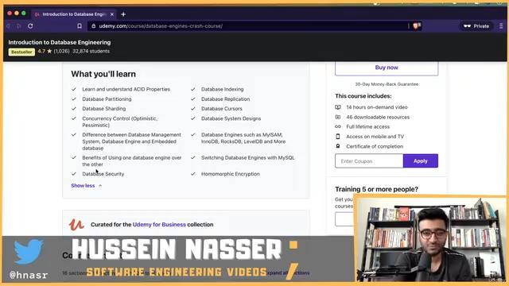
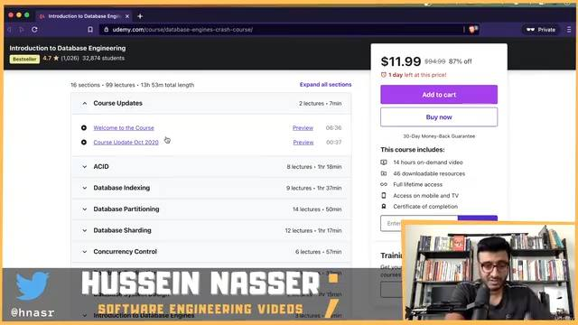
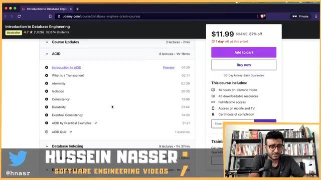
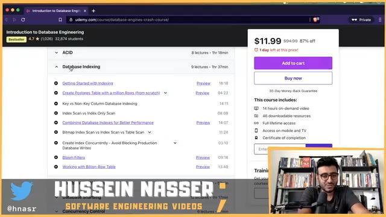
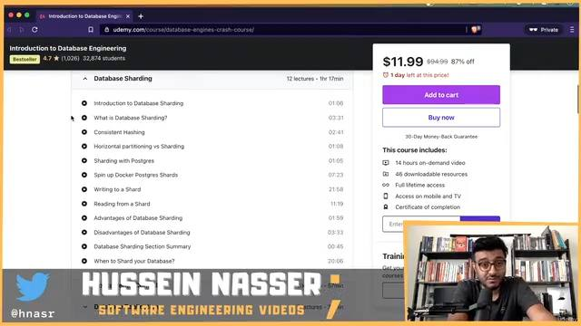
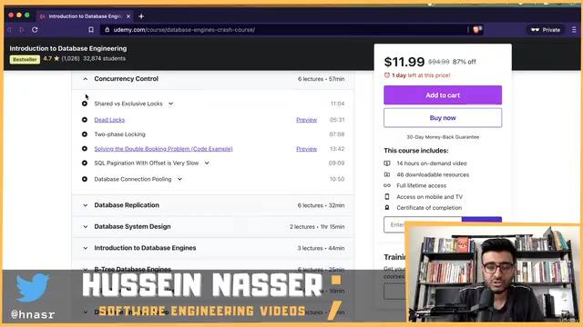

# 1. 这一节做什么

这四节课（P001–P004）不是数据库工程的实操课，也不是“从零写一个数据库”的项目课。它们的作用是**课程导论、内容更新说明、学习路线说明和课程定位说明**。讲师的逐字稿里没有出现任何数据库安装命令、SQL 建表语句、Postgres 启动命令、Docker 配置、项目源码或可执行的业务系统。因此，如果严格按“课程里有什么项目就复现什么项目”的标准，P001–P004 **没有可复现的数据库项目**。这一点必须先说清楚，不能为了凑文档编一个课程里不存在的项目。

这四节真正能复现的产物，是**为后续数据库工程学习建立一套可管理的学习工作区**：把 P001–P004 的主题、讲师原话锚点、待查问题、进度状态、术语表固定下来，方便你在进入后续 ACID、索引、并发控制、分区、分片、复制、数据库引擎等内容时持续记录。下面的代码不是讲师课程里的代码，而是为了把“课程导论信息”变成可重复执行的学习工作区而补的辅助脚本。课里没有讲这个脚本，也没有讲 Node.js；它只是面向“前端转 AI 应用工程师”的读者，用 Node 内置模块做一个最小可运行工具。

P001 里讲师明确说，这门课不是教你 Postgres 或 MySQL 的“操作课”，而是讲数据库系统的抽象、第一性原理和系统设计判断。P003 展示了课程内容目录：ACID、数据库索引、分区、分片、并发控制、锁、死锁、两阶段锁定、隔离、数据库复制、数据库引擎、游标、数据库安全、同态加密、分布式事务等。P004 又补充了课程更名、数据库内部原理章节、月度问答、ACID 重录和旧讲座归档。所以本文的复现目标是：**建立一份能跟着课程推进的学习工作区，并把 P001–P004 的信息结构化保存**。



# 2. 讲师原话（带「—— pNNN [MM:SS]」）

P001 里讲师说明课程不是纯实操课：

> "所以我设计这门课程时，并不是把它做成那种需要你跟着一步步做的、有点无聊枯燥的实操课，对吧？"
> —— p001 [00:58]

P001 里讲师列出课程主题范围：

> "你会学习索引，学习数据库的并发控制，学习分区，学习分片。"
> —— p001 [01:27]

P001 里讲师强调不是教 Postgres/MySQL 操作：

> "你不会专门去学 Postgres 或 MySQL。我得实话实说，因为它们非常容易上手。"
> —— p001 [03:45]

P002 里讲师说明新增了 Postgres 实践内容：

> "我新增了一整套约一小时的数据库实践内容，全部都有使用 Postgres 的实际示例。"
> —— p002 [00:06]

P003 里讲师展示课程内容并说明 ACID 独立成节：

> "关于 ACID，我专门为所有 ACID 视频创建了这一节……我相信每位工程师都应该理解这些内容。"
> —— p003 [01:24]

P003 里讲师说明分区和分片的关系：

> "分区。显然，这是数据库管理系统中另一个被低估的功能……分区是一个既重要又强大的概念。"
> —— p003 [02:20]

P003 里讲师说明复制用于水平扩展：

> "数据库复制，也是另一个被低估的功能：你有一个主数据库，还有其他副本可以承接这些读请求，然后你可以直接访问它们。"
> —— p003 [03:14]

P004 里讲师解释课程为什么改名：

> "实际上最先改动的是课程标题。之前有一些误解，以为这门课程其实是入门课……现在不再用“入门”这个词了，因为它会让人觉得这门课是给初学者准备的。"
> —— p004 [00:25]

P004 里讲师说明新增“数据库内部原理”章节：

> "我在开头新增了几个小节，放在非常靠前的位置，就在 ACID 部分之后。这些内容大致是理解数据库内部原理。"
> —— p004 [04:06]

P004 里讲师说明 ACID 重录：

> "所有 ACID 内容都涵盖原子性、一致性、隔离性和持久性。这些内容大约是两年前录制的，所以我把它们更新了。"
> —— p004 [07:06]



# 3. 从零复现

## 3.1 复现边界

本文复现的是“课程学习工作区”，不是课程里的数据库系统。原因很直接：P001–P004 的逐字稿里没有任何可执行数据库命令、建表语句、连接字符串、端口、用户名、密码、镜像名或源码文件。课里没有讲的东西，本文不补成“讲师项目”。所以你不会在本文里看到“启动 Postgres 容器”“创建 users 表”“运行某条 SQL”这种伪复现内容。

你需要准备：

- Node.js 18 或更高版本。本文脚本只使用 Node 内置模块，不需要 npm 安装第三方依赖。
- 一个终端。Windows 可用 PowerShell 或 Git Bash；macOS/Linux 用 bash/zsh 均可。
- 一个文本编辑器，例如 VS Code。
- 可选：把课程文档里的截图放到你能访问的路径。本文脚本不依赖图片文件，图片只用于课程文档阅读。

目录结构如下：

```text
db-eng-course/
├── package.json
├── scripts/
│   └── init-course-workspace.mjs
└── course-notes/
    ├── README.md
    ├── glossary.md
    ├── progress.json
    ├── p001.md
    ├── p002.md
    ├── p003.md
    └── p004.md
```

## 3.2 创建项目目录

在终端执行：

```bash
mkdir -p db-eng-course/scripts
cd db-eng-course
```

如果你在 Windows PowerShell 里，`mkdir -p` 可能不可用，可以分开执行：

```powershell
mkdir db-eng-course
cd db-eng-course
mkdir scripts
```

## 3.3 保存两个文件

把第 4 节的 `package.json` 保存到项目根目录的 `package.json`。把第 4 节的 `init-course-workspace.mjs` 保存到 `scripts/init-course-workspace.mjs`。不要改文件名，不要改路径，脚本里的 npm 命令依赖这个路径。

## 3.4 初始化工作区

执行：

```bash
npm run init
```

等价于：

```bash
node scripts/init-course-workspace.mjs
```

脚本会创建 `course-notes/` 目录，并生成 P001–P004 的笔记文件、术语表、进度文件和 README。已经存在的文件不会覆盖，避免你写了笔记后重跑被冲掉。

## 3.5 校验工作区

执行：

```bash
npm run verify
```

等价于：

```bash
node scripts/init-course-workspace.mjs --verify
```

它会检查所有必需文件是否存在，并解析 `progress.json`，确认课程条目数量和脚本内置条目数量一致。成功时会输出类似：

```text
verify ok: 7 files
```

这个输出是本文脚本自己的输出，不是课程里的终端输出。课里没有展示这类命令。

## 3.6 如何用它配合 P001–P004 学习

建议顺序：

1. 先读 `course-notes/p001.md`，把 P001 的课程定位、七个主题地图、适合人群写进“我的笔记”。
2. 读 `course-notes/p002.md`，记录 P002 提到的“新增数据库复制、列索引/键与非键索引、约一小时 Postgres 实践”这些更新点。注意：P002 只说了新增，没有在 P001–P004 逐字稿里展示具体 Postgres 命令。
3. 读 `course-notes/p003.md`，把 ACID、索引、分区、分片、并发控制、复制、数据库引擎、游标、数据库安全、同态加密、分布式事务等主题当作后续学习目录。
4. 读 `course-notes/p004.md`，记录课程更名、数据库内部原理章节、月度问答、ACID 重录和旧讲座归档。
5. 每学完一个后续章节，只改 `progress.json` 里对应条目的 `status` 和 `notes`，不要重跑覆盖。重跑 `npm run init` 时已有文件会跳过。



# 4. 完整代码

## 4.1 `package.json`

```json
{
  "name": "db-eng-course-workspace",
  "version": "1.0.0",
  "private": true,
  "type": "module",
  "engines": {
    "node": ">=18"
  },
  "scripts": {
    "init": "node scripts/init-course-workspace.mjs",
    "verify": "node scripts/init-course-workspace.mjs --verify"
  }
}
```

## 4.2 `scripts/init-course-workspace.mjs`

```js
import { mkdir, writeFile, readFile, access } from 'node:fs/promises';
import path from 'node:path';

const root = process.cwd();
const notesDir = path.join(root, 'course-notes');

const lessons = [
  {
    id: 'p001',
    title: '课程导论与学习路径',
    focus:
      '课程定位、适合人群、ACID、索引、并发控制、分区、分片、数据库引擎、系统设计等主题地图。',
    quote:
      'I built this course not as a practical hands-on... It teaches the system, the abstractions and the fundamentals.',
    status: 'not-started',
    notes: ''
  },
  {
    id: 'p002',
    title: '课程更新：复制、索引与 Postgres 实践',
    focus:
      '新增数据库复制章节、列索引/键与非键索引，以及约一小时使用 Postgres 的实践内容。',
    quote:
      'I have added a new section explicitly discussing database replication... All of these have actual examples using Postgres.',
    status: 'not-started',
    notes: ''
  },
  {
    id: 'p003',
    title: '课程重组与内容目录',
    focus:
      'ACID、数据库索引、分区、分片、并发控制、锁、死锁、两阶段锁定、隔离、数据库复制、数据库引擎、游标、数据库安全、同态加密、分布式事务。',
    quote:
      'Let us go through the stuff that I recently added. Here is the course content.',
    status: 'not-started',
    notes: ''
  },
  {
    id: 'p004',
    title: '课程更名、内部原理章节与问答更新',
    focus:
      '课程从 Introduction 更名为 Fundamentals；新增 Understanding the Database Internals；新增月度问答；ACID 重录；旧讲座归档。',
    quote:
      'The first thing that changed actually was the title of the course... fundamentals of database engineering.',
    status: 'not-started',
    notes: ''
  }
];

const readme = `# Fundamentals of Database Engineering 学习工作区

这个工作区由 \`scripts/init-course-workspace.mjs\` 生成，用于整理 P001–P004 的课程导论与更新信息。

## 重要说明

- P001–P004 没有可执行的数据库项目。
- 这里没有 Postgres 安装、SQL 建表、Docker 配置或业务系统源码。
- 本工作区是学习记录工具，不是讲师课程代码。
- 课里没讲的内容，不要假装它讲了。

## 命令

\`\`\`bash
npm run init
npm run verify
\`\`\`

## 文件说明

- \`p001.md\` 到 \`p004.md\`：每节课的笔记模板。
- \`glossary.md\`：术语表。
- \`progress.json\`：课程进度与笔记状态。
`;

const glossary = `# 术语表

## ACID

P001 与 P003 提到 Atomicity、Consistency、Isolation、Durability。P001–P004 没有展开每条定义的具体 SQL 示例，后续章节再补。

## Indexing / 索引

P001 提到会讲索引，P003 提到数据库索引章节会继续增加内容。

## Partitioning / 分区

P003 提到分区是被低估的 DMMS 能力，和分片一样重要。

## Sharding / 分片

P003 提到分片是更主流、更常见的 buzzword，课程尝试从零讲清楚它是什么。

## Concurrency Control / 并发控制

P003 提到并发控制、锁、死锁、两阶段锁定、隔离。

## Replication / 复制

P002 和 P003 提到数据库复制：主数据库与副本，副本可以承担读请求，用于水平扩展。

## Database Engine / 数据库引擎

P003 提到 B3 引擎、LSM3 引擎等数据库引擎内容，并说这些是数据库底层的执行机制。

## Cursor / 游标

P003 提到数据库游标，包括 stateful 与 stateless、client side 与 server side cursor，以及 Python 示例。

## Homomorphic Encryption / 同态加密

P003 提到同态加密：在加密数据上执行搜索或操作。讲师说它还在早期研究阶段。

## Distributed Transactions / 分布式事务

P003 提到 Postgres、MySQL 分布式事务讨论。
`;

async function writeIfMissing(filePath, content) {
  try {
    await writeFile(filePath, content, { flag: 'wx' });
    console.log(`created ${path.relative(root, filePath)}`);
  } catch (error) {
    if (error && error.code === 'EEXIST') {
      console.log(`skip existing ${path.relative(root, filePath)}`);
      return;
    }
    throw error;
  }
}

async function init() {
  await mkdir(notesDir, { recursive: true });

  for (const lesson of lessons) {
    const content = `# ${lesson.id} ${lesson.title}

- 主题：${lesson.focus}
- 讲师原话锚点：${lesson.quote}
- 当前状态：${lesson.status}

## 我的笔记

## 待查问题

## 可复现检查

- [ ] 我确认这节课没有可直接复现的数据库项目
- [ ] 我已把课里出现的主题记录到 glossary.md
- [ ] 我已区分“课里讲了”和“课里没讲”
`;

    await writeIfMissing(path.join(notesDir, `${lesson.id}.md`), content);
  }

  await writeIfMissing(path.join(notesDir, 'README.md'), readme);
  await writeIfMissing(path.join(notesDir, 'glossary.md'), glossary);

  const progress = {
    version: 1,
    generatedAt: new Date().toISOString(),
    lessons: lessons.map((lesson) => ({
      id: lesson.id,
      title: lesson.title,
      status: lesson.status,
      notes: lesson.notes,
      focus: lesson.focus,
      quote: lesson.quote
    }))
  };

  await writeIfMissing(
    path.join(notesDir, 'progress.json'),
    `${JSON.stringify(progress, null, 2)}\n`
  );

  console.log('done: course-notes workspace is ready');
}

async function verify() {
  const requiredFiles = [
    'README.md',
    'glossary.md',
    'progress.json',
    ...lessons.map((lesson) => `${lesson.id}.md`)
  ];

  for (const fileName of requiredFiles) {
    await access(path.join(notesDir, fileName));
  }

  const raw = await readFile(path.join(notesDir, 'progress.json'), 'utf8');
  const data = JSON.parse(raw);

  if (!Array.isArray(data.lessons)) {
    throw new Error('progress.json: lessons 必须是数组');
  }

  if (data.lessons.length !== lessons.length) {
    throw new Error(
      `progress.json: lessons 数量不一致，期望 ${lessons.length}，实际 ${data.lessons.length}`
    );
  }

  const expectedIds = lessons.map((lesson) => lesson.id).join(',');
  const actualIds = data.lessons.map((lesson) => lesson.id).join(',');

  if (expectedIds !== actualIds) {
    throw new Error(
      `progress.json: 课程 ID 顺序不一致，期望 ${expectedIds}，实际 ${actualIds}`
    );
  }

  console.log(`verify ok: ${requiredFiles.length} files`);
}

const isVerify = process.argv.includes('--verify');

if (isVerify) {
  await verify();
} else {
  await init();
}
```



# 5. 逐行解释

`package.json` 里最关键的是 `"type": "module"`。它让 `.mjs` 文件按 ES Module 执行，脚本里可以直接写 `import`。如果你的 Node 版本低于 18，`import`、顶层 `await`、`node:fs/promises` 的行为可能不一致，所以 `engines` 写了 `>=18`。`scripts.init` 和 `scripts.verify` 只是命令别名，避免每次手敲长路径。

`init-course-workspace.mjs` 第一段：

```js
import { mkdir, writeFile, readFile, access } from 'node:fs/promises';
import path from 'node:path';
```

这里没有用第三方库。`mkdir` 用来创建目录，`writeFile` 写文件，`readFile` 读 `progress.json`，`access` 检查文件是否存在。`path` 用来拼路径，避免手写 `/` 或 `\` 导致跨平台问题。

```js
const root = process.cwd();
const notesDir = path.join(root, 'course-notes');
```

`process.cwd()` 是当前执行 npm 命令的目录。你必须在 `db-eng-course/` 根目录执行 `npm run init`，否则它会在别的目录下创建 `course-notes/`。这是故意的：让工作区跟着项目目录走。

`lessons` 数组是 P001–P004 的结构化索引。每个对象有 `id`、`title`、`focus`、`quote`、`status`、`notes`。`focus` 是从逐字稿里能确认的主题，不是额外编造的功能。`quote` 用的是逐字稿里的短句或近义压缩，用于你回溯讲师原话。`status` 初始为 `not-started`，后续你手动改成 `in-progress` 或 `done` 都可以，脚本不强制枚举。

`readme`、`glossary` 是两个模板字符串。它们会在初始化时写入 `course-notes/`。`README.md` 里明确写了“P001–P004 没有可执行的数据库项目”，这是防止你以后误以为这里应该有一个数据库服务。`glossary.md` 只收录逐字稿中出现过的术语，并对 P001–P004 没有展开的部分标注“后续章节再补”。

```js
async function writeIfMissing(filePath, content) {
  try {
    await writeFile(filePath, content, { flag: 'wx' });
```

`flag: 'wx'` 是关键。它表示“只在文件不存在时创建”。如果文件已存在，Node 会抛出 `EEXIST`。这样你写了笔记后重跑 `npm run init`，不会被空模板覆盖。`catch` 里只吞掉 `EEXIST`，其他错误继续抛出，避免把磁盘权限问题伪装成成功。

`init()` 先 `mkdir(notesDir, { recursive: true })`。`recursive: true` 等价于 `mkdir -p`，父目录不存在也能创建。然后循环 `lessons`，为每个 P 生成一个 Markdown 文件。文件内容包含主题、讲师原话锚点、当前状态、我的笔记、待查问题、可复现检查。这个结构适合前端读者：你不需要后端项目脚手架，只需要把问题记录清楚。

`progress` 对象是 `progress.json` 的内容。它包含 `version`、`generatedAt`、`lessons`。`generatedAt` 是脚本运行时间，不是课程时间，不要拿它当课程更新时间。`lessons` 里保留了 `focus` 和 `quote`，方便你以后用脚本做检索或生成周报。`JSON.stringify(progress, null, 2)` 格式化输出，`+ '\n'` 保证文件末尾有换行，避免一些编辑器提示。

`verify()` 先定义 `requiredFiles`，包括 README、术语表、进度文件和四个 P 文件。然后逐个 `access`。如果缺文件，会抛出错误，命令以非零状态退出。接着读 `progress.json`，`JSON.parse` 解析。这里检查三件事：`lessons` 是数组、数量等于内置数量、ID 顺序一致。为什么要检查顺序？因为后续你可能手动改 JSON，顺序错乱会导致你按 P 编号查进度时对不上。检查通过后输出 `verify ok: 7 files`。这个 7 是 `README.md`、`glossary.md`、`progress.json`、`p001.md`、`p002.md`、`p003.md`、`p004.md` 的总数。

最后：

```js
const isVerify = process.argv.includes('--verify');

if (isVerify) {
  await verify();
} else {
  await init();
}
```

`process.argv` 是命令行参数数组。`npm run verify` 实际执行 `node scripts/init-course-workspace.mjs --verify`，所以 `isVerify` 为真。`npm run init` 没有 `--verify`，走初始化分支。顶层 `await` 能成立，是因为 `package.json` 里 `type: module` 且 Node 18+。



# 6. 复现检查清单

按下面顺序逐项检查。任何一项失败，都不要继续往下猜。

- [ ] 当前目录是 `db-eng-course/`，不是父目录。执行 `pwd`（macOS/Linux）或 `Get-Location`（PowerShell）确认。
- [ ] `package.json` 在项目根目录，不在 `scripts/` 里。
- [ ] `scripts/init-course-workspace.mjs` 文件名完全一致，包括 `.mjs`。
- [ ] `node -v` 输出 `v18` 或更高。低于 18 请升级 Node，不要改脚本硬跑。
- [ ] `npm run init` 成功结束，退出码为 0。
- [ ] 终端出现 `created course-notes/README.md`、`created course-notes/p001.md` 等创建日志。
- [ ] 终端最后出现 `done: course-notes workspace is ready`。
- [ ] `course-notes/` 下存在 `README.md`、`glossary.md`、`progress.json`、`p001.md`、`p002.md`、`p003.md`、`p004.md` 共 7 个文件。
- [ ] 打开 `progress.json`，能看到 `lessons` 数组里有 `p001`、`p002`、`p003`、`p004` 四个条目。
- [ ] 再执行一次 `npm run init`，已存在文件应显示 `skip existing`，不应覆盖你写过的笔记。
- [ ] `npm run verify` 输出 `verify ok: 7 files`。
- [ ] 如果你手动改坏了 `progress.json`，`npm run verify` 应报错；这是预期行为，不是脚本坏了。
- [ ] 本文没有要求你启动 Postgres、MySQL、Docker 或任何数据库服务。若你启动了，那不属于 P001–P004 的复现内容。
- [ ] 本文代码只使用 Node 内置模块。若 `npm install` 提示需要联网装包，说明你改动了 `package.json` 或跑错目录。



# 7. 课里没讲但你会撞上的

第一，**P001–P004 没有数据库安装步骤**。逐字稿里没有出现 Postgres 的安装命令、端口、用户名、密码、连接字符串、数据库名、建表语句。P002 只说了“新增了使用 Postgres 的实践内容”，但没有在 P001–P004 的逐字稿里展示这些实践的具体命令。所以你不能从这四节复现出一个可连接的数据库。你需要等后续具体章节，或者另找 Postgres 入门材料。本文不替讲师补命令。

第二，**没有项目源码、没有业务表结构、没有 API**。P001 讲的是课程定位，P003 讲的是课程目录，P004 讲的是课程更新。这里面没有“用户表”“订单表”“短链接系统”的代码。P003 提到 YouTube 上的 Twitter 系统设计、短 URL 系统设计作为免费视频内容，但 P001–P004 逐字稿没有给出这些系统的建表语句或源码。因此本文不能写“照着创建 users 表”这类内容，否则就是编造。

第三，**“ACID”在 P001–P004 只是被点名，没有被完整展开**。P001 说会详细讲 Atomicity、Consistency、Isolation、Durability，P003 说 ACID 独立成节，P004 说 ACID 重录了。但 P001–P004 逐字稿没有给出 ACID 的具体 SQL 示例、事务隔离级别矩阵或锁等待实验。你在本文里只能记录术语和章节位置，不能把 ACID 实验写成“课程已讲”。

第四，**“索引”在 P001–P004 没有具体 B-tree 结构图或 `EXPLAIN` 输出**。P001 说会讲索引，P003 说数据库索引章节会继续增加内容，P004 说数据库内部原理要放在索引之前。逐字稿没有展示 `CREATE INDEX`、`EXPLAIN ANALYZE` 或执行计划字段。本文不写这些命令。后续你学索引时，如果看到 `EXPLAIN` 输出里的字段名，请以你实际运行的 Postgres 版本输出为准，不要拿本文当字段字典。

第五，**“分区”和“分片”在 P001–P004 没有建表语法**。P003 只讲了概念重要性：分区被低估，分片是主流 buzzword，课程尝试从零讲清楚。它没有给 `PARTITION BY`、分片键、路由规则或中间件配置。本文因此不写分区 DDL。你在后续章节真正做分区实验时，再按那一节的逐字稿和截图补命令。

第六，**“复制”在 P001–P004 没有主从配置**。P002 说新增数据库复制章节，P003 说主数据库和副本、副本承担读请求、用于水平扩展。逐字稿没有给 `postgresql.conf`、`pg_basebackup`、复制槽、连接串或故障切换命令。本文不写这些，避免把“课程提到复制”误写成“课程给了复制配置”。

第七，**“数据库引擎”在 P003 的转写里有 B3、LSM3 这类词**。逐字稿原文是语音转写，可能出现识别误差。本文只按逐字稿保留“数据库引擎、B3 引擎、LSM3 引擎”这些说法，不擅自改写成你熟悉的 B+Tree、LSM-Tree 等术语。你后续看视频画面和字幕时，以课程实际显示为准。

第八，**前端转 AI 应用工程师会遇到“Node 脚本能跑，但数据库项目不能跑”的落差**。这很正常：P001–P004 是元信息，不是数据库实验。你可以把本文工作区当作“课程索引”，把每节课的待查问题记下来。等进入后续 ACID、索引、并发控制章节，再按那些章节的逐字稿补数据库环境。不要因为本文没有 Postgres 就认为课程没用；讲师在 P001 明确说这门课讲的是系统、抽象和第一性原理，不是 Postgres/MySQL 操作课。

第九，**Node 版本和终端差异**。本文用 `node:fs/promises`、顶层 `await`、`"type": "module"`。Node 18 以下可能报错。Windows 的 `mkdir -p` 与 PowerShell 的 `mkdir` 行为不同；如果你在 PowerShell 里失败，直接用编辑器创建目录和文件即可，不必纠结命令。`npm run init` 的输出文字是本文脚本的输出，不是讲师终端输出；不要把它当成课程里的字段名或命令输出。


