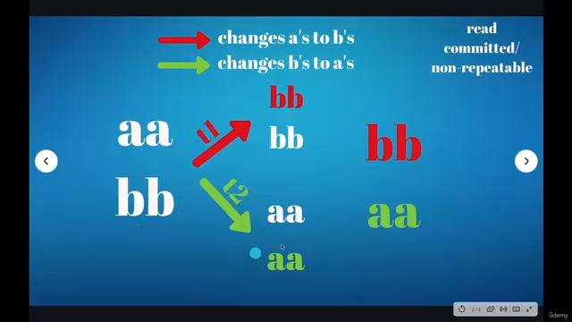
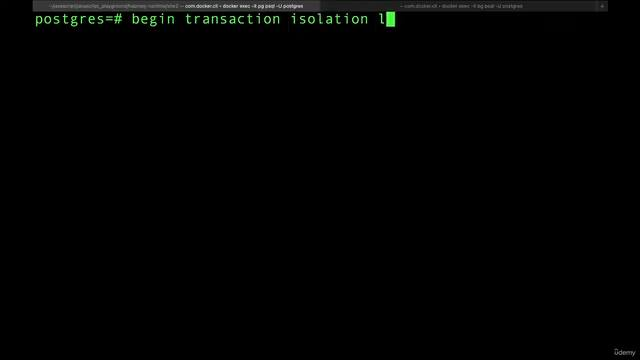
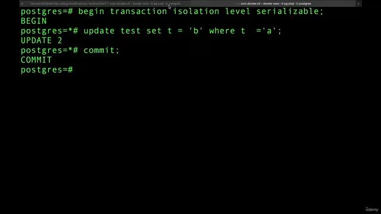
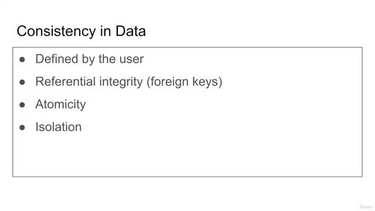
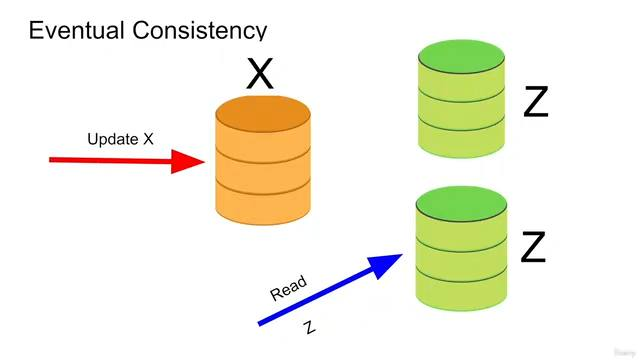
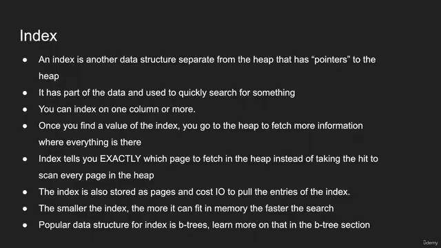
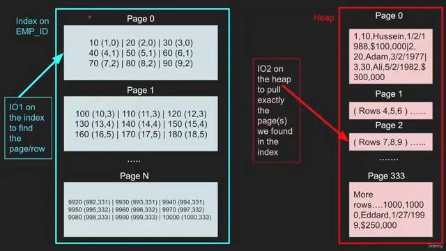
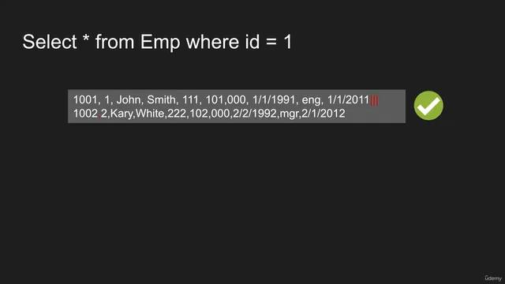
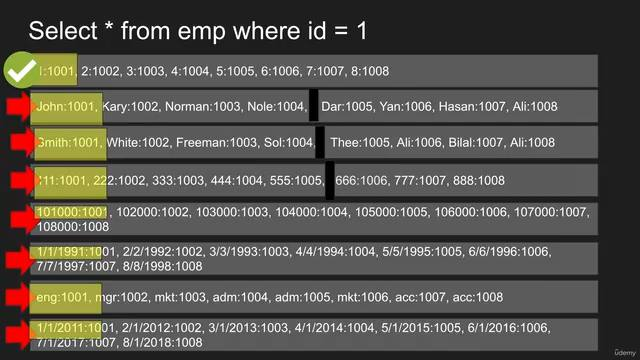

# 数据库工程基础 P13–P16：隔离级别、一致性与存储结构复盘

## 1. 这一节做什么

这四节课不是教你搭一个 Web 服务，而是把数据库工程师最常挂在嘴边的几个词拆开：**事务隔离级别**、**一致性**、**表在磁盘上的存储结构**、**行存储与列存储**。

讲师在 P13 里用一张只有一列 `field` 的 `test` 表，在 Postgres 终端里演示了两个并发事务的经典行为：

- 两个事务都工作在 `REPEATABLE READ`（可重复读）下时，它们各自修改不同的行，最终都能提交成功，但结果看起来像把整张表“对调”了；
- 两个事务都工作在 `SERIALIZABLE`（可串行化）下时，第二个事务提交时被 Postgres 拒绝，报错 `could not serialize access due to read/write dependencies among transactions`。

后面的 P14、P15、P16 不再有终端操作，而是用 PPT 解释：一致性要分“数据一致性”和“读一致性”两种；磁盘 IO 的最小单位是 page；一张表可以按行存，也可以按列存，各有各的适用场景。

本文档把四节课合成一个**可以亲自跑起来的实验**：在 Docker 里启动一个 Postgres，自动复现 P13 的两个隔离级别场景，并用实验输出反推 P14–P16 的概念。你不需要本地预装 Postgres，只需要 Docker 和一个终端。

这里要特别说明：本文档的目标不是把 P13–P16 改造成另一门课，而是保持原有实验事实不变，把命令为什么这样写、出错时先看什么、结果和前台开发经验如何对应讲清楚。所有代码块、引用和图片都保留；新增内容主要用于解释、排错和检查，不替代视频原意。



## 2. 讲师原话

> 「I've searched the web and there are very, very, very little resources talking about this. So I wanted to make a video to talk about the difference between them.」—— p013 [00:17]

> 「Could not serialize access due to read/write dependencies among transactions. The transaction might succeed if retried.」—— p013 [06:17]

> 「Consistency is the property of having expected results in the view of the data or during reads while working with a database system.」—— p014 [00:00]

> 「Whenever you have a cache, you're inconsistent because you will remain inconsistent unless you update the cache.」—— p014 [09:52]

> 「An IO is an operation that reads requests to disk. We try to minimize this as much as possible. This is the currency of a database.」—— p015 [05:49]

> 「Select star whether raw storage and column storage do not do select star.」—— p016 [24:23]

## 3. 从零复现

先说明：P13 视频里讲师在终端把 `REPEATABLE READ` 和 `non-repeatable read` 两个词说混了，他最后说 “both of them are repeatable read”。本文档统一使用 `REPEATABLE READ` 来复现他的行为。P14–P16 没有终端实操，所以下面的复现围绕 P13 展开。

需要的东西：

- Docker（20.10+，或 Docker Desktop）
- Bash（macOS / Linux 自带；Windows 用 WSL2 或 Git Bash）

### 3.1 创建项目目录

```bash
mkdir -p db-fundamentals
cd db-fundamentals
```

`mkdir -p` 的作用是创建目录；如果目录已经存在，`-p` 不会报错，而是继续往下执行。后面的 `cd` 进入这个目录，保证接下来保存的 `docker-compose.yml`、`init.sql` 和几个脚本都在同一层。这里的“同一层”很重要，因为 `docker-compose.yml` 里写了 `./init.sql`，这是相对于 `docker-compose.yml` 所在目录的路径；如果你在别的目录执行，或者文件放错位置，初始化 SQL 就不会按预期挂载进容器。

常见错误是目录建了但没进去，导致文件散落在上一级目录；排查时用 `pwd` 看当前路径，用 `ls` 看当前目录下是否有 `docker-compose.yml` 和 `init.sql`。对前台开发者来说，这类似启动前端项目前必须先进入项目根目录，否则 `package.json`、`.env`、静态资源路径都会对不上。

### 3.2 把第 4 节的代码文件全部保存到当前目录

目录结构如下：

```text
db-fundamentals/
├── docker-compose.yml
├── init.sql
├── run_all.sh
├── session1_repeatable.sh
├── session2_repeatable.sh
├── session1_serializable.sh
└── session2_serializable.sh
```

这些文件分别承担不同职责：`docker-compose.yml` 负责启动容器；`init.sql` 负责第一次启动时建表和插入初始数据；`run_all.sh` 负责编排两个场景；四个 `session*.sh` 分别代表两个隔离级别下的两个并发会话。缺一个文件，脚本就会在执行到对应位置时报“文件不存在”或“表不存在”。排查时不要只看报错行，要先用 `ls -la` 确认七个文件是否齐全。

### 3.3 启动 Postgres

```bash
docker compose up -d
```

这条命令让 Docker Compose 按照 `docker-compose.yml` 启动服务，`-d` 表示后台运行。首次运行会拉取 `postgres:16-alpine` 镜像。容器第一次启动时，会自动执行 `init.sql`，建好 `test` 表并写入四行数据：`A, A, B, B`。这里的“第一次启动”是镜像初始化机制：只有当容器使用全新的数据目录时，`/docker-entrypoint-initdb.d/` 下的脚本才会执行。如果你已经启动过同名容器，再次 `up -d` 通常不会重新执行初始化 SQL。

常见错误有三类：第一，Docker 没启动，命令会提示无法连接 Docker daemon；第二，`5432` 端口被本机已有 Postgres 占用，容器可能启动失败或端口映射失败；第三，之前已经创建过同名容器，`init.sql` 不会重跑，导致你看到的是旧数据。排查顺序是：`docker ps` 看容器是否在运行，`docker logs db-fundamentals` 看启动日志，必要时 `docker compose down -v` 清理容器和卷后重新启动。注意 `down -v` 会删除数据，只适合一次性实验环境。

### 3.4 一键跑完两个隔离级别演示

```bash
bash run_all.sh
```

你会看到两类输出：

- 场景 A（`REPEATABLE READ`）：T1 把 `A` 改成 `B`，T2 把 `B` 改成 `A`，两个事务都提交成功，没有出现序列化失败；
- 场景 B（`SERIALIZABLE`）：T1 提交成功，T2 提交时被 Postgres 拒绝，出现 `could not serialize access`。

如果中途想重置表，手动执行：

```bash
docker exec -i -e PGPASSWORD=demo db-fundamentals psql -U demo -d demo -c "TRUNCATE test; INSERT INTO test (field) VALUES ('A'), ('A'), ('B'), ('B');"
```

这条重置命令通过 `docker exec -i` 进入容器并执行 `psql`。`-e PGPASSWORD=demo` 把密码作为环境变量传给 `psql`，避免交互式输入；`-U demo -d demo` 指定用户名和数据库；`-c` 表示直接执行后面的 SQL 字符串。SQL 先 `TRUNCATE test` 清空表，再重新插入四行 `A, A, B, B`。常见错误是容器名写错、数据库名写错、密码不对，或者表还没初始化；排查时先执行一个最简单的 `SELECT 1;`，确认能连进数据库，再执行重置 SQL。



## 4. 完整代码

### 4.1 `docker-compose.yml`

```yaml
services:
  postgres:
    image: postgres:16-alpine
    container_name: db-fundamentals
    environment:
      POSTGRES_USER: demo
      POSTGRES_PASSWORD: demo
      POSTGRES_DB: demo
    ports:
      - "5432:5432"
    volumes:
      - ./init.sql:/docker-entrypoint-initdb.d/init.sql:ro
```

### 4.2 `init.sql`

```sql
DROP TABLE IF EXISTS test;
CREATE TABLE test (
    field text
);

INSERT INTO test (field) VALUES
    ('A'),
    ('A'),
    ('B'),
    ('B');
```

### 4.3 `run_all.sh`

```bash
#!/usr/bin/env bash
set -uo pipefail

reset_table() {
  docker exec -i -e PGPASSWORD=demo db-fundamentals psql -U demo -d demo -X -v ON_ERROR_STOP=1 <<'SQL'
TRUNCATE test;
INSERT INTO test (field) VALUES ('A'), ('A'), ('B'), ('B');
SQL
}

echo "=============================================="
echo "场景 A：两个 REPEATABLE READ 事务并发"
echo "=============================================="
reset_table

bash session1_repeatable.sh < /dev/null &
P1=$!
sleep 1
bash session2_repeatable.sh < /dev/null &
P2=$!
wait "$P1" || true
wait "$P2" || true

echo
echo "=============================================="
echo "场景 B：两个 SERIALIZABLE 事务并发"
echo "=============================================="
reset_table

bash session1_serializable.sh < /dev/null &
P3=$!
sleep 1
bash session2_serializable.sh < /dev/null &
P4=$!
wait "$P3" || true
wait "$P4" || true

echo
echo "场景 B 结束后的表内容（理论上应为四行 B，以实际输出为准）："
docker exec -i -e PGPASSWORD=demo db-fundamentals psql -U demo -d demo -X -c "SELECT * FROM test;"
```

### 4.4 `session1_repeatable.sh`

```bash
#!/usr/bin/env bash
set -uo pipefail

PSQL=(docker exec -i -e PGPASSWORD=demo db-fundamentals psql -U demo -d demo -X -v ON_ERROR_STOP=1)

{
  echo "BEGIN TRANSACTION ISOLATION LEVEL REPEATABLE READ;"
  echo "UPDATE test SET field = 'B' WHERE field = 'A';"
  echo "SELECT 'T1 snapshot:' AS info, * FROM test;"
  sleep 4
  echo "COMMIT;"
  echo "SELECT 'T1 after commit:' AS info, * FROM test;"
} | "${PSQL[@]}"
```

### 4.5 `session2_repeatable.sh`

```bash
#!/usr/bin/env bash
set -uo pipefail

PSQL=(docker exec -i -e PGPASSWORD=demo db-fundamentals psql -U demo -d demo -X -v ON_ERROR_STOP=1)

{
  sleep 2
  echo "BEGIN TRANSACTION ISOLATION LEVEL REPEATABLE READ;"
  echo "UPDATE test SET field = 'A' WHERE field = 'B';"
  echo "SELECT 'T2 snapshot:' AS info, * FROM test;"
  sleep 4
  echo "COMMIT;"
  echo "SELECT 'T2 after commit:' AS info, * FROM test;"
} | "${PSQL[@]}"
```

### 4.6 `session1_serializable.sh`

```bash
#!/usr/bin/env bash
set -uo pipefail

PSQL=(docker exec -i -e PGPASSWORD=demo db-fundamentals psql -U demo -d demo -X -v ON_ERROR_STOP=1)

{
  echo "BEGIN TRANSACTION ISOLATION LEVEL SERIALIZABLE;"
  echo "UPDATE test SET field = 'B' WHERE field = 'A';"
  echo "SELECT 'T1 snapshot:' AS info, * FROM test;"
  sleep 4
  echo "COMMIT;"
  echo "SELECT 'T1 after commit:' AS info, * FROM test;"
} | "${PSQL[@]}"
```

### 4.7 `session2_serializable.sh`

```bash
#!/usr/bin/env bash
set -uo pipefail

PSQL=(docker exec -i -e PGPASSWORD=demo db-fundamentals psql -U demo -d demo -X -v ON_ERROR_STOP=1)

{
  sleep 2
  echo "BEGIN TRANSACTION ISOLATION LEVEL SERIALIZABLE;"
  echo "UPDATE test SET field = 'A' WHERE field = 'B';"
  echo "SELECT 'T2 snapshot:' AS info, * FROM test;"
  sleep 4
  echo "COMMIT;"
  echo "SELECT 'T2 after commit (should not print if failed):' AS info, * FROM test;"
} | "${PSQL[@]}"
```

## 5. 逐行解释

### 5.1 Docker 与初始化

`docker-compose.yml` 里最关键的三个环境变量 `POSTGRES_USER`、`POSTGRES_PASSWORD`、`POSTGRES_DB` 是官方 `postgres` 镜像的约定：容器第一次启动时会创建这个用户和数据库，然后执行挂在 `/docker-entrypoint-initdb.d/` 下的 `.sql` 文件。`container_name: db-fundamentals` 是固定容器名，后面的 `docker exec -i ... psql` 都依赖它。**这些是 Docker/Postgres 镜像的机制，不是讲师在视频里讲的内容。**

`ports` 里的 `"5432:5432"` 表示宿主机端口映射到容器端口。左边是宿主机端口，右边是容器内 Postgres 默认端口。对前台开发者来说，这类似把本地开发服务器端口映射出来：容器内部服务监听某个端口，宿主机通过映射端口访问。`volumes` 里的 `./init.sql:/docker-entrypoint-initdb.d/init.sql:ro` 把当前目录的 `init.sql` 只读挂载到容器初始化目录，`ro` 表示只读。这样 `init.sql` 只作为初始化脚本被读取，不会被容器写回宿主机。

`init.sql` 做的事和 P13 开头一样：一张只有一列 `field` 的表，塞进 `A, A, B, B` 四行。讲师在视频里说 “we have AA here as values and BB here”，就是这张表。`DROP TABLE IF EXISTS test;` 让脚本可重复执行；`CREATE TABLE test (field text);` 建表；`INSERT INTO test (field) VALUES ...` 插入四行。常见错误是修改了 `init.sql` 后没有重新创建容器，结果旧表仍然存在；排查时先看容器日志里有没有执行初始化脚本的记录，必要时用全新的容器和卷重来。

### 5.2 两个 REPEATABLE READ 会话

`session1_repeatable.sh` 的核心思路：把 SQL 语句一行行 echo 到管道，交给 `docker exec -i ... psql` 执行。为什么不用 `psql -c`？因为 `psql -c` 执行完就断开连接，事务会被回滚；用管道保持标准输入打开，事务才能跨多条 SQL 存活。`sleep 4` 是在管道的发送过程中等待，模拟“两个事务同时在跑”。

`#!/usr/bin/env bash` 指定用 Bash 执行脚本；`set -uo pipefail` 中，`-u` 让未定义变量报错，`-o pipefail` 让管道中任意一段失败时整体返回失败。`PSQL=(...)` 是 Bash 数组，把 `docker exec ... psql ...` 这组命令拆成多个参数保存，后面 `${PSQL[@]}` 展开执行。`-X` 让 psql 不读取用户配置文件，避免本机 `psqlrc` 干扰实验；`-v ON_ERROR_STOP=1` 让 SQL 出错时停止，避免错误被吞掉。

时间线：

- `run_all.sh` 启动 session1，T1 立刻 `BEGIN`，把 `A → B`；
- 1 秒后 session2 启动，T2 在 2 秒时 `BEGIN`，把 `B → A`；
- 第 4 秒 T1 `COMMIT`，第 6 秒 T2 `COMMIT`。

由于 T1 改的是前两行（A），T2 改的是后两行（B），它们没有修改同一行，所以 `REPEATABLE READ` 下两个事务都不会被阻拦，都能提交。你在视频里看到讲师说 “they did not step on each other's toes”，就是这个结果。最终表内容理论上会变成 `BBAA`，但以你实际跑出来的输出为准。

**前端读者的 JS 类比**：你可以把两个事务想象成两个 `async` 函数同时在改一个数组。`REPEATABLE READ` 像这两个函数各自持有进入时的数组快照，只要它们不写同一个下标，最后不会冲突；但如果它们基于旧快照做了“整体重排”，合并结果可能不符合任何一次连续执行。

这里常见的错误是：把两个会话写在同一个 `psql` 连接里，结果它们变成串行执行，看不出并发；或者用 `psql -c` 分别执行 `BEGIN` 和 `COMMIT`，每条命令都是新连接，事务无法保持。排查时观察输出里是否出现了两个事务的 `BEGIN` 和各自快照；如果只有一个连接，说明脚本编排没有按预期并发启动。

### 5.3 两个 SERIALIZABLE 会话

`session2_serializable.sh` 唯一的不同是把隔离级别换成 `SERIALIZABLE`。时间线没有变，但 Postgres 的 SSI（可串行化快照隔离）会跟踪事务之间的读写依赖。T1 写了 `field = 'A'` 的行，T2 读了 `field = 'B'` 的行，这两个谓词在 T1 提交后发生了重叠（T1 把 A 变成 B，直接撞进 T2 的读集合），所以 T2 在 `COMMIT` 时被判定为 “pivot”，返回：

```text
ERROR:  could not serialize access due to read/write dependencies among transactions
```

这一步和 P13 视频里完全一致。Postgres 已经替 T2 回滚，表停留在 T1 提交后的状态——理论上四行全是 `B`。

**前端读者的 JS 类比**：`SERIALIZABLE` 像是在两个异步任务结束时要检查“如果把它们按任意顺序重放，结果是否等价于某一个顺序”。Postgres 发现做不到，就直接 reject 其中一个任务，业务代码必须 catch 住并重试。视频里讲师说 “you have to be prepared as an engineer or developer to retry the transaction in case of these failures”。

常见错误是看到报错就以为脚本写坏了。实际上这个报错是实验要复现的现象，不是脚本语法错误。排查时要区分两类失败：如果是 `psql: error: connection to server ... failed`，那是容器或连接问题；如果是 `could not serialize access due to read/write dependencies among transactions`，那是隔离级别检测到的并发冲突，属于预期结果。前者要查 Docker 和端口，后者要确认你确实运行的是 `SERIALIZABLE` 场景。



### 5.4 从输出反推 P14：两种一致性

当你看到场景 B 的报错，就能理解 P14 说的“一致性”必须分两种：

- **数据一致性**：如果表 A 存了图片点赞数，表 B 存了点赞用户明细，那么 A 里的数字必须等于 B 里的记录数。这由外键、原子性、隔离性保证。P14 里讲师说 “consistency in the data is defined by the user”，意思是你的表结构设计决定什么叫一致。
- **读一致性**：事务提交后，另一个事务立刻读，能不能读到最新值？在单机 Postgres 里可以，但在主从架构里，从库复制有延迟，就会读到旧值。P14 的结论是：只要引入缓存或从库，系统就是“最终一致”的，不管它是不是关系型数据库。

对前台开发者来说，“数据一致性”类似前端状态里 `list.length` 和列表渲染出的条目数必须对得上；“读一致性”类似你刚提交表单后立刻刷新页面，有时看到旧数据，因为读请求打到了缓存或另一个只读副本。排查这类问题时，不能只说“后端有 bug”，要先确认数据源：写到了哪里、读的是哪里、中间有没有缓存或复制延迟。





### 5.5 从输出反推 P15：为什么 IO 是数据库的通货

场景 B 里 T2 的 `UPDATE` 要找到所有 `field = 'B'` 的行。P15 说，数据库读磁盘的最小单位是 `page`（Postgres 默认 8KB），不是单行。即使你只需要一个字段，一次 `IO` 也会把整页数据从磁盘搬到内存。表在磁盘上的无序集合叫 `heap`；索引是另一个按 `B+ 树` 组织的数据结构，它告诉你某条 rowId 在哪个 page，从而减少扫描的页数。我们的实验表只有四行，全部装在一个 page 里，所以感受不到差异；但如果有一千万行，`WHERE field = 'B'` 就可能要扫几万个 page。

这里的常见错误是把“只查一列”理解成“只读一列的磁盘数据”。在行存储里，一次 page IO 往往把整页包含多行的数据读进来，所以查询成本取决于访问了多少 page，而不是 SELECT 里写了几列。排查慢查询时，要看执行计划里扫描了多少页、是否走索引、返回行数和实际访问页数是否匹配。前台开发者可以把 page 类比成接口分页：你只要一条数据，但后端可能仍然按页取了一批；真正要看的是“取了几页”，而不是“最终展示了几条”。





### 5.6 从输出反推 P16：行存储 vs 列存储

P16 把同样的 `employee` 表分别按行存和列存放到磁盘上。行存适合“取出整行”的 OLTP 事务，列存适合“只算某一列总和”的 OLAP 分析。你刚才跑的实验表是行存，Postgres 默认就是行存，所以 `UPDATE` 改一行只需要改这一行的 page；而列存要同时维护很多列块，写入慢、读取单列快。对前台开发者来说，行存像接口直接返回一个完整对象，列存像只请求某一个字段做统计；前者适合详情页，后者适合报表和聚合。

常见错误是以为列存一定比行存快。实际上要看查询模式：如果每次都要 `SELECT *` 取整行，列存需要跨多个列块拼装，反而不如行存；如果只统计一列或少数几列，列存减少无关列 IO 的优势才明显。排查存储选型问题时，先列出真实查询：是点查详情、事务更新，还是批量聚合分析；不要只凭“列存新”就下结论。





## 6. 复现检查清单

- [ ] 执行 `docker compose up -d` 后，`docker ps` 能看到容器 `db-fundamentals` 处于运行状态。
- [ ] 执行 `docker exec -i -e PGPASSWORD=demo db-fundamentals psql -U demo -d demo -c "SELECT * FROM test;"`，能看到四行：`A, A, B, B`。
- [ ] 执行 `bash run_all.sh`，场景 A 的日志里有两段 `T1 snapshot:` / `T2 snapshot:`，且没有出现 `could not serialize access`。
- [ ] 场景 B 的日志里，T2 的 `COMMIT` 附近出现 `could not serialize access due to read/write dependencies among transactions`。
- [ ] 场景 B 结束后，`SELECT * FROM test;` 返回四行 `B`（如果时序有偏差，以你实际输出为准）。
- [ ] 如果你想手动复现而不是用脚本：开两个终端，先跑 T1 的 `BEGIN...UPDATE`，再跑 T2 的 `BEGIN...UPDATE`，最后依次 `COMMIT`。在 `SERIALIZABLE` 下，第二个 `COMMIT` 会报错。

逐条说明如下：

1. 第一条检查 Docker 是否真的把容器跑起来了。`docker ps` 只显示运行中的容器；如果看不到 `db-fundamentals`，先用 `docker ps -a` 看是否退出了，再用 `docker logs db-fundamentals` 看退出原因。常见原因是端口冲突、镜像拉取失败、Docker 没有启动。
2. 第二条检查初始化是否成功。四行 `A, A, B, B` 是后续实验的基础；如果表不存在，说明 `init.sql` 没执行，通常是容器不是第一次启动或挂载路径不对。如果数据不是四行，先用第 3.4 节的重置命令恢复。
3. 第三条检查 `REPEATABLE READ` 场景。你要看到两个会话各自输出快照，并且没有序列化失败。若没有并发输出，检查 `run_all.sh` 是否真的用 `&` 启动了两个后台进程，以及 `sleep` 是否给了重叠时间。
4. 第四条检查 `SERIALIZABLE` 场景。这个报错是预期现象；如果没出现，先确认脚本里隔离级别写的是 `SERIALIZABLE`，再确认两个事务确实并发重叠。若只看到连接错误，则不是隔离级别问题，而是环境问题。
5. 第五条检查最终表状态。理论上 T1 提交后四行都是 `B`，T2 被回滚；但由于脚本睡眠和调度有时序差异，实际输出可能有偏差。检查时以日志中的 `COMMIT` 和报错为准，不要只凭最终四行判断实验是否成功。
6. 第六条是手动复现路径。开两个终端时，关键不是命令多，而是要保持两个会话各自的事务连接不中断。每个终端里先 `BEGIN`，再 `UPDATE`，最后 `COMMIT`；不要在中间退出 `psql`，否则事务会结束，无法复现并发依赖。

## 7. 课里没讲但你会撞上的

- **本地没有 `psql` 怎么办**：本文档的所有脚本都通过 `docker exec` 进入容器执行 `psql`，所以宿主机不需要安装 PostgreSQL 客户端。讲师在视频里直接打开终端，那是他本机装有 Postgres。
- **5432 端口被占用**：如果你本机已经跑着另一个 Postgres，`docker compose up -d` 会报端口冲突。把 `docker-compose.yml` 里的 `ports` 改成 `"5433:5432"` 即可。脚本仍然走 `docker exec`，所以不受影响；但如果你手动用 `psql -h localhost -p 5433`，就需要改端口号。
- **报错文案随 PostgreSQL 版本不同**：视频里是 `could not serialize access due to read/write dependencies among transactions`，Postgres 16 可能会在这一行后面追加 `Reason code: canceled on identification as a pivot during commit attempt. The transaction might succeed if retried.`。这些都是同一个错误，不用焦虑。
- **`SERIALIZABLE` 只是让数据库检测冲突，业务层必须重试**：P13 提到 “The transaction might succeed if retried”，但没有写重试代码。真实项目里你要在应用层捕获这个错误的 SQLSTATE（Postgres 里是 `40001`，课里没讲）并重新执行整个事务。
- **`REPEATABLE READ` 不等于没有并发异常**：Postgres 的 `REPEATABLE READ` 在“两个事务更新同一行”时，后提交的事务会等待前一个事务提交，但快照仍然是旧的。本文档的实验故意让两个事务更新不同行，所以都能提交成功。
- **P15 / P16 没有配套命令**：讲师没有在终端里演示 page 大小、堆扫描或行/列存储。如果你想自己看页大小，可以用 `SHOW block_size;`（结果是 8KB），想分析 SQL 是否走索引可以用 `EXPLAIN`。这些命令不是课里内容，是排错时的补充手段。
- **Windows 用户跑 Bash 脚本**：`docker exec` 在 PowerShell 下可用，但 `bash run_all.sh` 需要 WSL 或 Git Bash。如果你在 PowerShell 里直接复制脚本，管道和 `sleep` 行为会不一样，建议统一用 WSL 执行。
- **容器重复使用时 `init.sql` 不会再次执行**：如果你之前启动过同名的 `db-fundamentals` 容器，`docker compose up -d` 不会重建容器，`init.sql` 也不会重新执行。如果报“表不存在”，先 `docker compose down -v` 删除容器和卷，再重新 `up -d`。这会清空容器里的所有数据，别在生产环境这么干。
- **不要在生产库跑这些实验**：`TRUNCATE`、`SERIALIZABLE` 依赖检测都会产生锁和开销；用一次性 Docker 容器最安全。

补充排查时可以按这个顺序走：先 `docker ps` 确认容器在跑；再 `docker logs db-fundamentals` 看启动和初始化日志；然后进容器执行 `SELECT * FROM test;` 确认数据；最后再跑 `bash run_all.sh`。这个顺序和前台排错类似：先确认服务起来了，再确认数据接口通了，最后才去看业务交互和并发时序。只要把环境、数据、时序三层分开，P13 的两个场景就不容易看混。