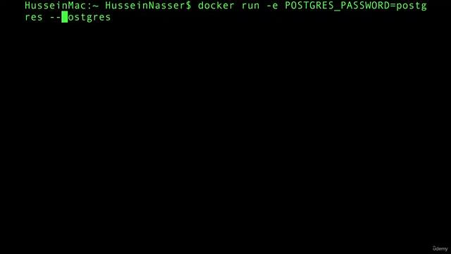
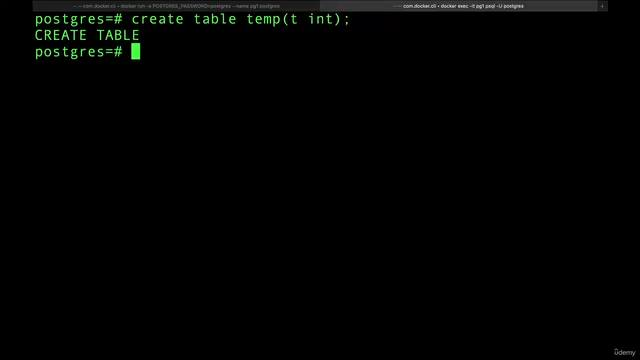
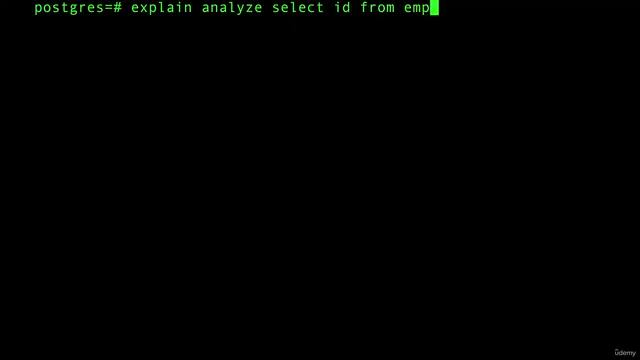
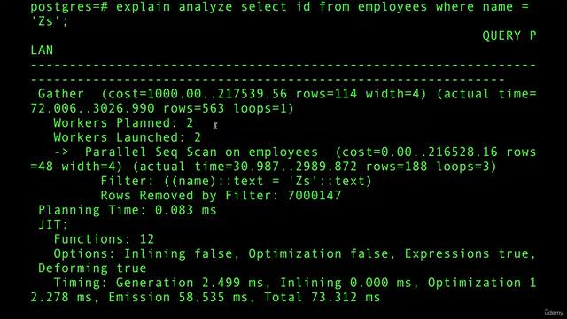
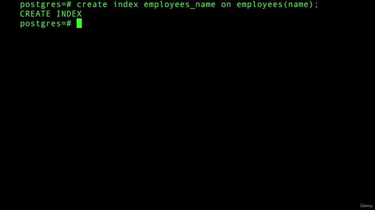
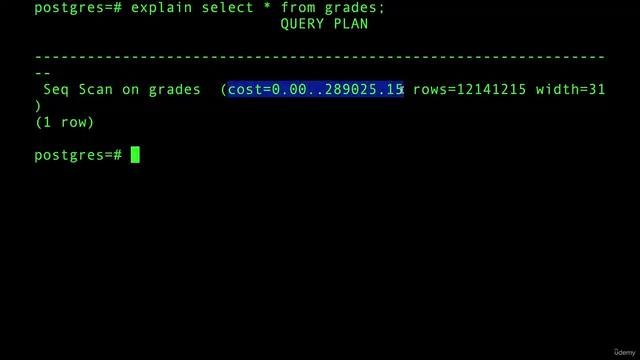
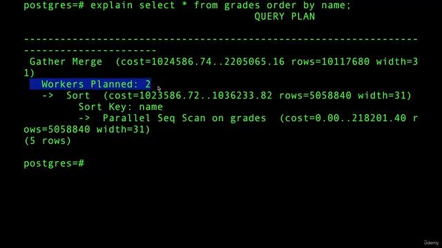
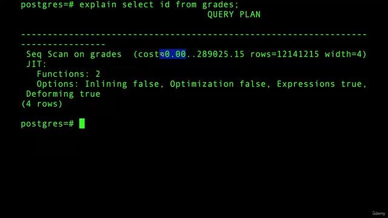

# 课程复现文档：Postgres 主键/二级索引、百万行造数、索引实验与 EXPLAIN 读法

## 1. 这一节做什么

这一节不是一个前端页面项目，而是一个**可直接在 Docker 里跑起来的 PostgreSQL 数据库实验环境**。覆盖 P17–P20 后，你会得到一个可以反复练习的库：

- 用 `postgres:13` 容器启动一个 PostgreSQL 实例，容器名 `pg1`，密码环境变量 `POSTGRES_PASSWORD=postgres`。
- 用 `generate_series` + `random()` 造一百万行温度数据，对应 P18 的“百万行表怎么来”。
- 建 `employees` 表，观察主键查询、无索引 `name` 查询、`LIKE '%ZS%'`、创建 `employees_name` 索引后的执行计划变化，对应 P19。
- 建 `grades` 表，观察 `EXPLAIN` 里的 `Seq Scan`、排序、`width`、`Index Scan`、`Index Only Scan`，对应 P20。
- 用 P17 的“主键/聚簇索引 vs 二级索引”理论解释你在 `EXPLAIN` 里看到的“先扫索引、再回堆表”现象。

重要说明：P19 里讲师使用的 `employees` 表约 1100 万行，P20 的 `grades` 表讲到 2 亿多行。为了让普通电脑能在几分钟内跑完，下面的脚本默认造 **100 万行**。你可以把 SQL 里的 `1000000` 改成 `11000000` 或更大来接近课程规模；但数据量越大，插入、建索引和查询越慢，执行计划的具体耗时也会不同。课里没有给出 `employees` 和 `grades` 的完整建表/造数 SQL，下面这部分是**为复现补的最小脚本**，不是讲师逐字稿原话。


---

## 2. 讲师原话（带出处）

P17 先解释为什么主键不只是“唯一”：

> “In order to explain what a primary key is, we really need to first explain the concept of the table spaces or the heap.”
>
> —— p017 [01:26]

> “when we add the concept of a primary key, what we do to the table is we do something called clustering.”
>
> —— p017 [02:46]

> “The secondary key is having the table as a jumbled mess, but having an additional outside structure that is your key, that is your index.”
>
> —— p017 [07:54]

P18 的目标很直接：用 Docker + Postgres 造百万行数据。

> “I'm going to use Docker to spin up a Postgres instance, create a table, create a million row.”
>
> —— p018 [00:23]

> “the trick here is to do a select and from … generate series.”
>
> —— p018 [02:19]

P19 开始做索引实验：

> “Every primary key has an index by default. And it's a B3 index.”
>
> —— p019 [03:03]

> “the name column does not have an index. And that means the only way to actually search through the name … is to actually go one by one and do a sequential scan.”
>
> —— p019 [09:24]

> “I'm going to create an index on … employees name on employees and it is on the name column.”
>
> —— p019 [12:16]

> “Back to the slow query … because we could not scan the index … you're asking for an expression.”
>
> —— p019 [14:35]

P20 讲 `EXPLAIN` 怎么读：

> “explaining the select star, the worst query you can ever do.”
>
> —— p020 [00:54]

> “This is called a sequential scan. And this is equivalent to a full table scan in other databases.”
>
> —— p020 [01:24]

> “The first number means how many millisecond it took me to fetch the first page.”
>
> —— p020 [01:54]

> “the second number is essentially the total amount of time that it thinks.”
>
> —— p020 [02:23]

---

## 3. 从零复现

### 3.1 目录结构

在任意空目录下建立：

```text
db-course-lab/
├── 00_start.sh
├── 01_p18_temp.sql
├── 02_p19_employees.sql
├── 03_p19_index.sql
├── 04_p20_grades.sql
├── 05_p20_explain.sql
└── run_all.sh
```

依赖只有一个：本机安装 Docker。PostgreSQL 版本使用课程里说的 `postgres:13`。不需要 Node、不需要 Java、不需要额外数据库客户端；所有 `psql` 命令都在容器内执行。

环境变量与命名：

- 容器名：`pg1`
- 镜像：`postgres:13`
- 超级用户：`postgres`
- 密码环境变量：`POSTGRES_PASSWORD=postgres`
- 默认数据库：`postgres`
- 不映射宿主机端口。课程 P18 说明不需要暴露端口，而是 `docker exec` 进容器执行 `psql`。

### 3.2 启动 Postgres 容器

进入 `db-course-lab/` 后执行：

```bash
chmod +x 00_start.sh run_all.sh
./00_start.sh
```

如果你想手动照课程命令执行，也可以：

```bash
docker rm -f pg1 >/dev/null 2>&1 || true
docker run --name pg1 -e POSTGRES_PASSWORD=postgres -d postgres:13
```

检查容器：

```bash
docker ps
```

进入容器里的 `psql`：

```bash
docker exec -it pg1 psql -U postgres
```



### 3.3 跑 P18：百万行温度数据

执行：

```bash
docker exec -i pg1 psql -U postgres -v ON_ERROR_STOP=1 < 01_p18_temp.sql
```

你会看到类似：

- `SELECT t FROM temp LIMIT 10;` 返回 10 个随机整数。
- `SELECT count(*) AS temp_rows FROM temp;` 返回 `1000000`。



### 3.4 跑 P19：employees 造数与索引实验

先造 `employees`：

```bash
docker exec -i pg1 psql -U postgres -v ON_ERROR_STOP=1 < 02_p19_employees.sql
```

检查行数：

```bash
docker exec -it pg1 psql -U postgres -c "SELECT count(*) FROM employees;"
```

默认会插入 100 万条批量随机 name，再额外插入 4 条用于 `name = 'ZS'` / `LIKE '%ZS%'` 的测试数据，所以总数是 `1000004`。课里 `employees` 约 1100 万行；你要接近课程规模，把 `02_p19_employees.sql` 里的 `1000000` 改大即可。

然后跑索引实验：

```bash
docker exec -i pg1 psql -U postgres -v ON_ERROR_STOP=1 < 03_p19_index.sql
```

观察重点：

- 按主键 `id = 2000` / `id = 5000` 查询时，通常走索引。
- 在创建 `employees_name` 之前，`WHERE name = 'ZS'` 和 `WHERE name LIKE '%ZS%'` 通常走 `Seq Scan` 或 `Parallel Seq Scan`。
- 创建 `employees_name` 后，`WHERE name = 'ZS'` 通常会变成 `Bitmap Heap Scan` / `Index Scan` 一类计划。
- 即使创建了 `name` 索引，`LIKE '%ZS%'` 仍然可能回到顺序扫描，因为前置 `%` 让普通 B-tree 很难直接定位。讲师在 P19 强调的就是这个坑。







### 3.5 跑 P20：grades 表与 EXPLAIN

造 `grades`：

```bash
docker exec -i pg1 psql -U postgres -v ON_ERROR_STOP=1 < 04_p20_grades.sql
```

跑 `EXPLAIN`：

```bash
docker exec -i pg1 psql -U postgres -v ON_ERROR_STOP=1 < 05_p20_explain.sql
```

注意 P20 用的是 `EXPLAIN`，不是 `EXPLAIN ANALYZE`。`EXPLAIN` 只让规划器给出估算计划，不真正执行查询；P19 用的 `EXPLAIN ANALYZE` 会真正执行并返回实际耗时。两者不要混。







### 3.6 交互式检查

```bash
docker exec -it pg1 psql -U postgres
```

在 `psql` 里：

```sql
\dt
\d employees
\d grades
\di
SELECT count(*) FROM temp;
SELECT count(*) FROM employees;
SELECT count(*) FROM grades;
```

退出：

```sql
\q
```

### 3.7 常见错误与排查（复现向）

下面这些是复现 Docker/Postgres 实验时常见的排查点。它们是通用操作层面的建议，**不是讲师逐字稿内容**；课程真正强调的是 P17–P20 的主键、二级索引、造数和 `EXPLAIN` 读法。

1. **容器名冲突**：如果 `docker run` 报容器名 `pg1` 已存在，说明之前已经有同名容器。`00_start.sh` 里先用 `docker rm -f pg1` 删除旧容器，所以会删掉旧容器里的数据。课程没有讲 volume 持久化，重复实验时不要把重要数据只放在这个容器里。
2. **容器没起来**：`docker ps` 看不到 `pg1` 时，先用 `docker ps -a` 看它是否退出，再用 `docker logs pg1` 看日志。常见原因是镜像还没拉取完成、Docker Desktop 没启动、磁盘空间不足。
3. **数据库还没就绪**：容器处于 running 不等于 Postgres 已经能接受连接。`00_start.sh` 用 `pg_isready -U postgres` 做等待检查，这是复现脚本加的；手动执行 `docker run` 后马上跑 SQL 可能遇到连接失败。
4. **SQL 文件路径不对**：`docker exec -i pg1 psql ... < 01_p18_temp.sql` 里的 `<` 是宿主机 shell 的输入重定向，所以你必须先 `cd` 到 `db-course-lab/`，或者写完整路径。报 `No such file or directory` 时先检查当前目录和文件名。
5. **重复执行报错**：`01`、`02`、`04` 都用了 `DROP TABLE IF EXISTS`，`03` 用了 `DROP INDEX IF EXISTS`，目的是让脚本可重复跑。如果你自己改写 SQL 删掉了这些语句，第二次执行可能遇到表已存在、索引已存在。`03` 里建索引前会删 `employees_name`，所以默认不会因为重复索引报错。
6. **`psql` 报 `ON_ERROR_STOP` 相关行为**：`-v ON_ERROR_STOP=1` 表示 SQL 出错就停止。排查时这是好事，能避免错误后继续插入脏数据；但如果你只想看某一条语句的结果，可以进入交互式 `psql` 单独执行。
7. **`EXPLAIN` 和 `EXPLAIN ANALYZE` 混用**：`EXPLAIN` 只估算，不执行；`EXPLAIN ANALYZE` 会真正执行并给出实际时间。P20 用 `EXPLAIN`，P19 用 `EXPLAIN ANALYZE`，不要因为输出里没有 `actual time` 就以为命令坏了。
8. **`LIKE '%ZS%'` 建索引后仍然慢**：这是预期现象，不是脚本失败。前置 `%` 让普通 B-tree 无法按前缀定位。讲师在 P19 用这个例子说明“有索引也可能不走索引”。如果要支持前后模糊匹配，需要 trigram/全文检索等方案，课里没讲。
9. **`cost` 数字和课程不同**：`cost`、`rows`、`width` 会随数据量、统计信息、Postgres 版本、硬件和配置变化。不要背固定数字，重点看节点类型、估算行数、宽度、是否排序、是否回表。
10. **数据量改大后卡住**：把 `1000000` 改成 `11000000` 或更大后，插入、`CREATE INDEX`、`ANALYZE` 都会变慢，磁盘占用也会上升。普通电脑建议先用默认 100 万行跑通，再逐步加大。
11. **容器内没有宿主机端口映射**：本实验不映射 `5432`，所以不能在宿主机直接 `psql -h localhost`。课程 P18 走的是 `docker exec` 进容器执行 `psql`。真实前端/后端项目如何连数据库不是本节内容。
12. **删容器等于删库**：`docker rm -f pg1` 会删除容器内数据。课程没有讲持久化 volume；要保留数据需要自己加 `-v`，但这不是讲师原话，也不在本节实验要求内。

---

## 4. 完整代码

下面每个文件都可直接保存运行。

### 4.1 `00_start.sh`

```bash
#!/usr/bin/env bash
set -euo pipefail

CONTAINER_NAME="pg1"
POSTGRES_PASSWORD_VALUE="postgres"
POSTGRES_IMAGE="postgres:13"

docker rm -f "$CONTAINER_NAME" >/dev/null 2>&1 || true

docker run \
  --name "$CONTAINER_NAME" \
  -e POSTGRES_PASSWORD="$POSTGRES_PASSWORD_VALUE" \
  -d "$POSTGRES_IMAGE"

for i in {1..30}; do
  if docker exec "$CONTAINER_NAME" pg_isready -U postgres >/dev/null 2>&1; then
    echo "Postgres is ready: container=$CONTAINER_NAME image=$POSTGRES_IMAGE"
    exit 0
  fi
  sleep 1
done

echo "Postgres did not become ready in 30s" >&2
docker logs "$CONTAINER_NAME" >&2 || true
exit 1
```

### 4.2 `01_p18_temp.sql`

```sql
DROP TABLE IF EXISTS temp;

CREATE TABLE temp (
  t integer
);

INSERT INTO temp (t)
SELECT (random() * 100)::int
FROM generate_series(1, 1000000);

SELECT t FROM temp LIMIT 10;

SELECT count(*) AS temp_rows FROM temp;
```

### 4.3 `02_p19_employees.sql`

```sql
DROP TABLE IF EXISTS employees;

CREATE TABLE employees (
  id integer GENERATED ALWAYS AS IDENTITY PRIMARY KEY,
  name text NOT NULL
);

INSERT INTO employees (name)
SELECT
  'name_' || s.g || '_' || substr(md5(random()::text), 1, 12)
FROM generate_series(1, 1000000) AS s(g);

INSERT INTO employees (name) VALUES
  ('ZS'),
  ('AZS'),
  ('ZSX'),
  ('abcZSxyz');

ANALYZE employees;
```

### 4.4 `03_p19_index.sql`

```sql
DROP INDEX IF EXISTS employees_name;

EXPLAIN ANALYZE
SELECT id FROM employees WHERE id = 2000;

EXPLAIN ANALYZE
SELECT id FROM employees WHERE id = 5000;

EXPLAIN ANALYZE
SELECT name FROM employees WHERE id = 5000;

EXPLAIN ANALYZE
SELECT id FROM employees WHERE name = 'ZS';

EXPLAIN ANALYZE
SELECT id FROM employees WHERE name LIKE '%ZS%';

CREATE INDEX employees_name ON employees (name);

ANALYZE employees;

EXPLAIN ANALYZE
SELECT id FROM employees WHERE name = 'ZS';

EXPLAIN ANALYZE
SELECT id FROM employees WHERE name LIKE '%ZS%';
```

### 4.5 `04_p20_grades.sql`

```sql
DROP TABLE IF EXISTS grades;

CREATE TABLE grades (
  id integer GENERATED ALWAYS AS IDENTITY PRIMARY KEY,
  g double precision NOT NULL,
  name text NOT NULL
);

INSERT INTO grades (g, name)
SELECT
  (random() * 100)::double precision,
  'student_' || s.g || '_' || substr(md5(random()::text), 1, 10)
FROM generate_series(1, 1000000) AS s(g);

CREATE INDEX grades_g_idx ON grades (g);

ANALYZE grades;
```

### 4.6 `05_p20_explain.sql`

```sql
EXPLAIN
SELECT * FROM grades;

EXPLAIN
SELECT * FROM grades ORDER BY g;

EXPLAIN
SELECT * FROM grades ORDER BY name;

EXPLAIN
SELECT id FROM grades;

EXPLAIN
SELECT name FROM grades;

EXPLAIN
SELECT g FROM grades;

EXPLAIN
SELECT * FROM grades WHERE id = 10;

EXPLAIN
SELECT id FROM grades WHERE id = 10;
```

### 4.7 `run_all.sh`

```bash
#!/usr/bin/env bash
set -euo pipefail

docker exec -i pg1 psql -U postgres -v ON_ERROR_STOP=1 < 01_p18_temp.sql
docker exec -i pg1 psql -U postgres -v ON_ERROR_STOP=1 < 02_p19_employees.sql
docker exec -i pg1 psql -U postgres -v ON_ERROR_STOP=1 < 03_p19_index.sql
docker exec -i pg1 psql -U postgres -v ON_ERROR_STOP=1 < 04_p20_grades.sql
docker exec -i pg1 psql -U postgres -v ON_ERROR_STOP=1 < 05_p20_explain.sql
```

---

## 5. 逐行解释

### 5.1 `00_start.sh`：容器启动与就绪检查

- `set -euo pipefail`：任何命令失败就退出，避免容器没起来还继续跑 SQL。`-e` 表示遇到非零退出码立即停止；`-u` 表示引用未定义变量时报错；`pipefail` 表示管道中任一命令失败都算失败。这样排错时不会“看起来跑完了，其实中间已经失败”。
- `CONTAINER_NAME="pg1"`：课程 P18 里给容器起名 `pg1`，后面所有 `docker exec` 都用这个名字。把它写成变量是为了减少重复字符串，改名字时只改一处。
- `POSTGRES_PASSWORD_VALUE="postgres"`：对应课程里的环境变量 `POSTGRES_PASSWORD`，值用 `postgres`。这是官方镜像初始化超级用户密码用的环境变量，不是登录后的 SQL 密码表。
- `POSTGRES_IMAGE="postgres:13"`：固定镜像版本。课程使用 `postgres:13`，固定版本能避免拉到新版本后执行计划细节发生变化。
- `docker rm -f pg1`：重复实验时先删旧容器；这会删除旧容器里的数据，因为课里没有讲 volume 持久化。`-f` 表示即使容器正在运行也强制删除。
- `docker run --name pg1 -e POSTGRES_PASSWORD=postgres -d postgres:13`：后台启动 Postgres 13。`--name` 指定容器名；`-e` 设置环境变量；`-d` 表示 detach 后台运行。课程 P18 说不暴露端口，所以这里没有 `-p`。
- `pg_isready -U postgres`：等待数据库可用。这个检查是本复现脚本加的，不是讲师逐字稿内容；不加的话你紧接着跑 SQL 可能遇到“数据库还没起来”。`pg_isready` 只检查能否接受连接，不执行你的业务 SQL。
- `for i in {1..30}`：最多等待约 30 秒。每次 sleep 1 秒，适合普通电脑第一次启动镜像。
- `docker logs`：超时后打印日志，方便排查。容器启动失败、初始化密码失败、磁盘满等都可以先看日志。

### 5.2 `01_p18_temp.sql`：百万行温度表

- `DROP TABLE IF EXISTS temp;`：保证脚本可重复执行。第一次跑表不存在也不报错；第二次跑会先删旧表。
- `CREATE TABLE temp (t integer);`：课程 P18 建的温度表，只有一个整数字段。这里不设主键、不设索引，正好用于观察“普通堆表”的行为。
- `INSERT INTO temp (t) SELECT ... FROM generate_series(1, 1000000);`：核心技巧。`generate_series` 生成 1 到 100 万的序列，用来“驱动”插入次数。它本身不是数据源表，而是一个集合返回函数，每一行都会触发一次 `SELECT` 表达式计算。
- `(random() * 100)::int`：`random()` 返回 0 到 1 之间的小数，乘 100 后转成整数，得到 0–100 左右的温度值。课程里说“除以 100 或乘 100 后转整数”，这里按乘法实现。`::int` 是 PostgreSQL 的类型转换写法。
- `SELECT t FROM temp LIMIT 10;`：看前 10 行，确认数据是随机的。`LIMIT 10` 只取 10 行，不代表表里只有 10 行。
- `SELECT count(*) AS temp_rows FROM temp;`：确认行数。默认应为 1000000。`AS temp_rows` 只是给输出列起别名，方便阅读。

### 5.3 `02_p19_employees.sql`：employees 造数

- `DROP TABLE IF EXISTS employees;`：让脚本可重复执行，避免第二次跑时表已存在。
- `id integer GENERATED ALWAYS AS IDENTITY PRIMARY KEY`：自增主键。课程 P19 说 `id` 是 integer、not null、自动递增、主键、默认有索引。这里用 identity 实现自增，`PRIMARY KEY` 会创建唯一约束和默认 B-tree 索引。`GENERATED ALWAYS` 表示通常由数据库生成，不要手动插值。
- `name text NOT NULL`：课程里 `name` 没有索引，只是一堆字符串。`NOT NULL` 表示名字不能为空，但不等同于索引。
- `INSERT INTO employees (name) SELECT ... FROM generate_series(1, 1000000) AS s(g);`：批量插入 100 万行。`s(g)` 是给序列列起别名，避免列名歧义。这里只插入 `name`，`id` 由 identity 自动生成。
- `'name_' || s.g || '_' || substr(md5(random()::text), 1, 12)`：生成随机字符串 name。课里没有给出具体造 name 的 SQL，这是复现补的；讲师只说“花了时间生成随机字符串”。`||` 是字符串拼接，`md5` 生成 32 位十六进制串，`substr(..., 1, 12)` 截取前 12 位。
- `INSERT INTO employees (name) VALUES ('ZS'), ('AZS'), ('ZSX'), ('abcZSxyz');`：插入可控样本，方便复现 P19 的 `name = 'ZS'` 和 `LIKE '%ZS%'`。不让查询永远返回 0 行。`'AZS'`、`'ZSX'`、`'abcZSxyz'` 用于观察前后模糊匹配会命中更多行。
- `ANALYZE employees;`：更新统计信息。课里没有展开讲 `ANALYZE`，但如果不更新统计，`EXPLAIN` 的估算行数可能很离谱。统计信息帮助规划器判断该走顺序扫描还是索引扫描。

### 5.4 `03_p19_index.sql`：索引前后对比

- `DROP INDEX IF EXISTS employees_name;`：让脚本可重复跑。第一次跑时索引不存在也不报错；第二次跑会先删旧索引再重建。
- `EXPLAIN ANALYZE SELECT id FROM employees WHERE id = 2000;`：P19 的第一类查询。`EXPLAIN ANALYZE` 会真正执行 SQL，并返回计划与实际耗时。按主键查，通常走索引。这里只选 `id`，主键索引本身就能提供 `id`，有可能减少回表。
- `EXPLAIN ANALYZE SELECT id FROM employees WHERE id = 5000;`：第二个主键样本，用来确认不是偶然只对 2000 走索引。执行计划通常与上一条类似。
- `EXPLAIN ANALYZE SELECT name FROM employees WHERE id = 5000;`：虽然过滤条件还是主键，但要返回 `name`，通常需要回到堆表/表数据里取 `name`。这就是 P17/P19 一再强调的“索引里没有的列要回表”。如果只查 `id`，索引可能够用；查 `name` 就要额外取列。
- `EXPLAIN ANALYZE SELECT id FROM employees WHERE name = 'ZS';`：在没建 `name` 索引前，通常只能顺序扫描。因为 `name` 没有索引，规划器只能一行一行检查 `name` 是否等于 `ZS`。
- `EXPLAIN ANALYZE SELECT id FROM employees WHERE name LIKE '%ZS%';`：前置 `%` 是重点。普通 B-tree 无法按前缀定位，所以即使有 `name` 索引，也可能仍然顺序扫描。`%ZS%` 表示 `ZS` 可以出现在任意位置。
- `CREATE INDEX employees_name ON employees (name);`：P19 的核心动作。给 `name` 建 B-tree 索引。建索引会扫描表并写入索引结构，数据量大时会花时间。
- `ANALYZE employees;`：建完索引后更新统计，让规划器知道新索引和分布。`CREATE INDEX` 后通常建议确认统计信息是否足够；本实验显式执行 `ANALYZE` 便于稳定观察。
- 最后两条 `EXPLAIN ANALYZE`：再跑同样的 `name = 'ZS'` 和 `LIKE '%ZS%'`。等值查询通常会改善；`LIKE '%ZS%'` 仍可能很慢。实际节点名可能是 `Bitmap Heap Scan`、`Index Scan`、`Seq Scan`、`Parallel Seq Scan` 等，具体以你的 Postgres 输出为准。不要因为节点名和课程截图不完全一样就认为复现失败。

### 5.5 `04_p20_grades.sql`：grades 表

- `DROP TABLE IF EXISTS grades;`：让脚本可重复执行。
- `id integer GENERATED ALWAYS AS IDENTITY PRIMARY KEY`：P20 的 `grades.id`，主键，默认有索引。`id` 是整数，后面 P20 解释 `width` 时会用到“integer 是 4 字节”这一事实。
- `g double precision NOT NULL`：课程 P20 说 `g` 是 grade，后面解释 `width` 时提到 double 是 8 字节。这里用 `double precision`。`NOT NULL` 表示分数不能为空。
- `name text NOT NULL`：学生名字，P20 明确说 `name` 没有索引。注意这里只建了 `g` 的索引，没有建 `name` 索引。
- 批量插入 100 万行。`g` 用 `random() * 100` 造浮点分数，`name` 用随机字符串。`s(g)` 里的别名让 `s.g` 可用。
- `CREATE INDEX grades_g_idx ON grades (g);`：P20 说 `g` 上有索引，所以 `ORDER BY g` 时可能直接利用索引顺序，减少排序成本。索引名 `grades_g_idx` 只是本复现命名。
- `ANALYZE grades;`：更新统计，保证 `EXPLAIN` 的 `rows` 估算有意义。没有统计信息时，规划器可能对行数估计不准。

### 5.6 `05_p20_explain.sql`：读 EXPLAIN

- `EXPLAIN SELECT * FROM grades;`：最坏查询之一。没有过滤条件，通常 `Seq Scan`，也就是其他数据库说的 full table scan。输出里重点看 `cost`、`rows`、`width`。`cost` 两个数：第一个偏启动成本，第二个偏总成本；讲师在 P20 里用“毫秒”口语化解释，但实际 PostgreSQL 的 cost 是规划器估算单位，不是严格毫秒，具体以输出为准。
- `EXPLAIN SELECT * FROM grades ORDER BY g;`：因为 `g` 有索引，可能走索引顺序，排序成本较小。实际是否走索引取决于规划器对行数、成本、选择性的估计。
- `EXPLAIN SELECT * FROM grades ORDER BY name;`：`name` 没索引，通常要排序，启动成本会变高。你会看到 `Sort` 或并行相关节点；读计划时从内层往外层、从下往上看。
- `EXPLAIN SELECT id FROM grades;`：只返回 `id`，`width` 通常很小。P20 里讲师解释 integer 是 4 字节。`width` 是每行平均宽度的估算，不代表磁盘上唯一占用。
- `EXPLAIN SELECT name FROM grades;`：返回 text，`width` 会比只选 id 大。讲师提醒：返回越宽，网络传输和 TCP 包压力越大，所以不要无脑 `SELECT *`。这里 `name` 是变长 text，宽度估算通常大于整数。
- `EXPLAIN SELECT g FROM grades;`：`g` 是 double，宽度通常比 integer 大。对照 `id` 的 4 字节和 double 的 8 字节，可以帮助理解 `width` 的差异。
- `EXPLAIN SELECT * FROM grades WHERE id = 10;`：主键过滤，通常会走索引，然后回表取整行。因为 `SELECT *` 需要所有列，索引本身不一定包含所有列。
- `EXPLAIN SELECT id FROM grades WHERE id = 10;`：只取主键列，可能出现 `Index Only Scan`，比回表更省。是否出现 `Index Only Scan` 还取决于可见性映射等因素，不保证每次完全一样。

### 5.7 和前台/JS/Node 的对照

这一节没有 Node 代码，也没有前端页面。课里也没讲 Node 连接池、事务、锁。下面只是帮助有前端背景的人建立对照，**不是讲师逐字稿内容**。

- 浏览器 `Network` 面板看到一个接口很慢，只说明“这次请求慢”，不能直接判断是数据库慢。数据库侧对应的是 `EXPLAIN` / `EXPLAIN ANALYZE` 里的执行计划：是 `Seq Scan`、`Index Scan`，还是多了 `Sort`。
- 前端列表页常见的 `SELECT *` 对应 `EXPLAIN` 里的 `width` 较大。前端只需要 `id`、`name` 时，后端却查回所有列，会增加传输和处理成本。P20 用 `SELECT *` 和只选 `id` 做对照，就是为了说明“返回列越宽，成本越高”。
- 前端搜索框如果做 `%关键词%` 模糊搜索，数据库侧类似 `LIKE '%ZS%'`。P19 说明普通 B-tree 索引对前置 `%` 不擅长，所以“建了 name 索引”不等于“所有 name 搜索都变快”。
- 详情页 `/user/:id` 类似 `WHERE id = 10` 的主键查询，通常可利用主键索引。按姓名查 `WHERE name = 'ZS'` 则要看 `name` 上有没有索引；没有索引就可能顺序扫描。
- 前端 `Array.find`、`Map`、对象缓存是应用层查找；数据库索引是数据库内部的 B-tree 结构。你以后用 Node 的 `pg` 客户端，做的事只是把同样的 SQL 文本发给 Postgres，然后把 `EXPLAIN` 返回的文本行打印出来；索引仍然是数据库内部的 B-tree 结构，不是 Node 里的 `Map` 或缓存。
- 本实验没有映射宿主机端口，前端不能直接连 `pg1` 容器。真实项目通常由后端服务连数据库，前端只调后端 API。课程没有讲前端直连数据库，也不建议把数据库密码放到浏览器。
- 锁/事务/并发不是本节内容，课里没讲；在 JS/Node 里对应的 `BEGIN` / `COMMIT` / 行锁等，需要另找课程或文档。不要因为本节学了索引，就以为已经覆盖生产环境的全部数据库问题。

---

## 6. 复现检查清单

- [ ] `docker ps` 能看到容器 `pg1`，镜像是 `postgres:13`。
  - 说明：看到 `Up` 状态说明容器进程在跑；镜像列应包含 `postgres:13`。如果看不到，用 `docker ps -a` 看是否退出，再用 `docker logs pg1` 查原因。
- [ ] `docker exec -it pg1 psql -U postgres` 能进入 psql。
  - 说明：进入后提示符通常类似 `postgres=#`。如果报连接失败，先确认容器是否 running、是否还在初始化。`-it` 表示交互式终端，适合手动敲 SQL。
- [ ] `01_p18_temp.sql` 跑完，`SELECT count(*) FROM temp;` 返回 `1000000`。
  - 说明：这是 P18 百万行造数的核心验证。返回行数不对时，检查 SQL 文件里的 `generate_series(1, 1000000)` 是否被改过，或是否重复执行导致多次插入；本脚本先 `DROP TABLE`，正常重复执行不会累加。
- [ ] `SELECT t FROM temp LIMIT 10;` 返回 10 个整数，不是空表。
  - 说明：这验证插入表达式确实生成了数据。返回空表通常说明插入失败或表被清空；返回整数范围大致在 0–100 左右是 `random() * 100` 的预期。
- [ ] `02_p19_employees.sql` 跑完，`SELECT count(*) FROM employees;` 默认返回 `1000004`。
  - 说明：100 万条批量随机 name 加 4 条可控样本，所以总数是 1000004。若你改了 `1000000`，总数应相应变化；若少了 4，检查最后的 `INSERT ... VALUES` 是否执行。
- [ ] `03_p19_index.sql` 能完整跑完，没有因为重复索引报错。
  - 说明：脚本开头 `DROP INDEX IF EXISTS employees_name` 会先清掉旧索引。若仍报重复索引，检查是否手动建过同名索引，或 SQL 文件是否被改乱。
- [ ] 建索引前，`name = 'ZS'` 的计划里能看到顺序扫描/并行顺序扫描；建索引后计划发生变化。
  - 说明：建索引前 `name` 没索引，通常只能 `Seq Scan` 或 `Parallel Seq Scan`。建 `employees_name` 后，等值查询通常出现 `Index Scan` / `Bitmap Heap Scan` 等。计划节点名可能因数据量和配置不同而不同。
- [ ] `LIKE '%ZS%'` 即使建了 `employees_name` 索引，仍可能顺序扫描；这是预期现象。
  - 说明：前置 `%` 让普通 B-tree 无法按前缀定位。这里不是让你“修到一定走索引”，而是观察 P19 讲的坑。若你的计划偶尔用上索引，也以实际输出为准，不要背死结论。
- [ ] `04_p20_grades.sql` 跑完，`SELECT count(*) FROM grades;` 返回 `1000000`。
  - 说明：这是 P20 表的数据量验证。若改了插入行数，以你改的数为准。还要确认 `CREATE INDEX grades_g_idx` 和 `ANALYZE` 没有报错。
- [ ] `05_p20_explain.sql` 能输出多条计划；至少能看到 `Seq Scan`、`Index Scan`/`Index Only Scan`、`Sort` 中的若干节点。
  - 说明：`EXPLAIN` 不执行查询，只输出估算计划。不同 Postgres 版本、数据量、统计信息下节点可能不同；看到其中若干类节点就说明实验跑通，不必逐字一致。
- [ ] 你知道 `EXPLAIN` 只估算，`EXPLAIN ANALYZE` 会真正执行。
  - 说明：P20 用 `EXPLAIN`，P19 用 `EXPLAIN ANALYZE`。前者没有 `actual time`，后者有实际执行时间和行数；不要把两者混为一谈。
- [ ] 你知道 `cost`、`rows`、`width` 的具体数字会随数据量、统计信息、Postgres 版本变化，不能背固定值。
  - 说明：`cost` 是规划器估算单位；`rows` 是估算行数；`width` 是平均行宽估算。重点看节点类型、是否排序、是否回表、宽度相对大小，而不是死记数字。

---

## 7. 课里没讲但你会撞上的

1. **容器没有映射端口**。课程 P18 明确走 `docker exec` 进容器，不暴露宿主机端口。所以你不能在宿主机直接 `psql -h localhost`。要从宿主机连，需要加 `-p 5432:5432`，但课里没讲这个配置。

2. **`docker rm -f pg1` 会删数据**。本复现脚本每次启动都会删旧容器。课程没讲 volume 持久化；如果你要保留数据，需要自己加 `-v`，课里没讲。

3. **数据量改大后会很慢**。`generate_series(1, 1000000)` 是 100 万行；改成 1100 万或 2 亿会明显变慢，还会占磁盘。课程里 P19/P20 的大表是讲师环境里的规模，不代表你本机必须一次造到那么大。

4. **`CREATE INDEX` 默认会阻塞写入**。课程只演示“创建索引后查询变快”，没有讲生产环境在线建索引。真实项目里大表建索引要考虑低峰期或 `CONCURRENTLY`，但 `CONCURRENTLY` 课里没讲，不要当成讲师原话。

5. **`LIKE '%ZS%'` 用不上普通 B-tree 的前缀定位**。讲师在 P19 用这个例子说明“有索引也可能不走索引”。如果业务真的要做前后模糊匹配，需要 trigram/全文检索等方案，课里没讲。

6. **`EXPLAIN` 的 `cost` 不是严格毫秒**。P20 讲师为了直观，用毫秒口径解释 cost；实际 PostgreSQL 的 cost 是规划器估算单位。你复现时数字不同是正常的，重点看节点类型、`rows` 估算、`width` 和是否出现 `Sort`/`Seq Scan` 等节点，而不是把某一组数字当成标准答案。