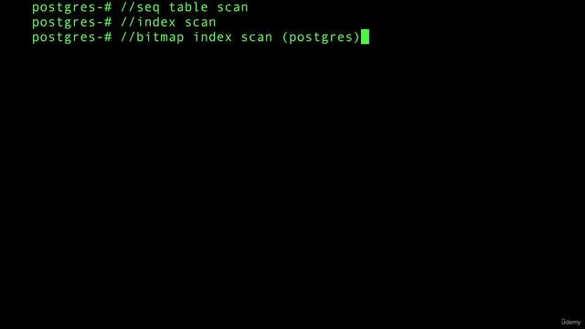
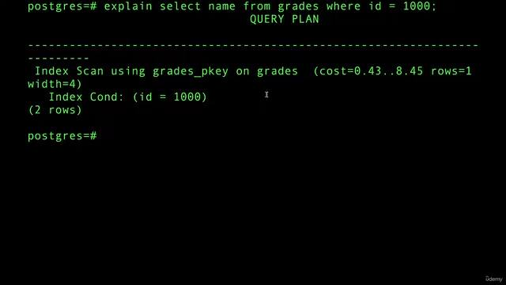
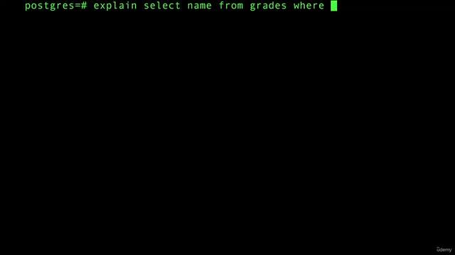
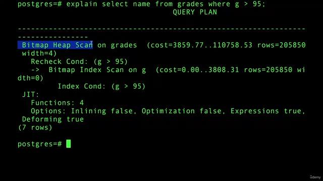
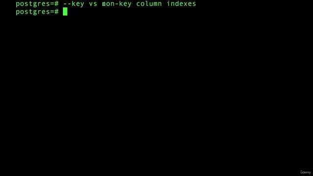
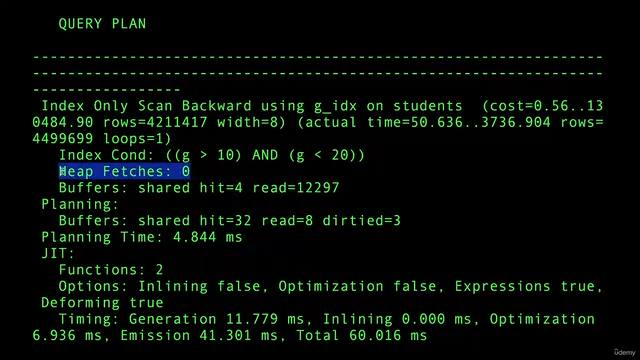
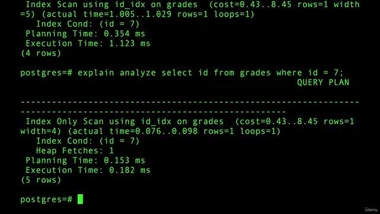
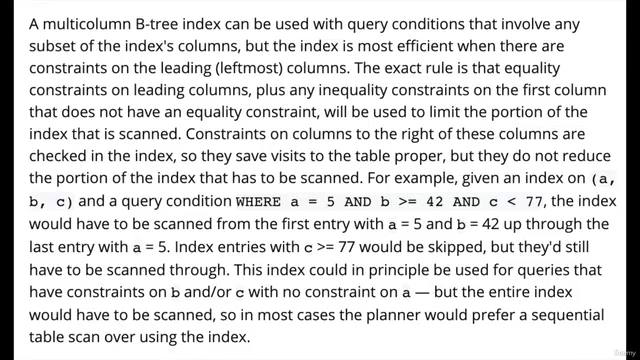
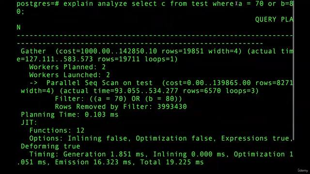

# Fundamentals of Database Engineering P21–P24：Postgres 索引执行计划复现实验

> 读者目标：用 Docker 起一个 PostgreSQL，按本文 SQL 建表、灌数据、跑 `EXPLAIN (ANALYZE, BUFFERS)`，亲眼看到 sequential scan、index scan、bitmap index scan、index only scan、composite index 的差别。  
> 说明：课程逐字稿只给了字段和查询思路，没有给完整建表 SQL。下面代码是**按逐字稿字段重建的最小可运行版本**，不是讲师原文件；凡是逐字稿没讲的，我会明确写“课里没讲”。

本文除了复现代码，还会逐条解释命令的用途、预期现象、常见错误和排查方式，并把数据库执行计划和前台/应用开发中常见的 ORM 查询、接口慢查询、分页排序等问题做对照。需要强调：执行计划会受 PostgreSQL 版本、数据量、统计信息、缓存、机器内存、并行度影响，本文给出的是“常见预期”，不是唯一正确答案。你本机输出只要节点名和关键字段能对应上，就达到了实验目的。

---

## 1. 这一节做什么

P21–P24 不是讲应用框架，而是讲“数据库到底怎么用索引把行捞出来”。四节连起来是一条完整的排查链：

1. **P21：三种扫描方式**  
   同一张 `grades` 表，查 `id = 1000` 时走主键索引；查 `id < 100` 时走 index scan；查 `id > 100` 时因为几乎要返回全表，Postgres 改走 sequential scan；查 `g > 95` 这种“行数不少但又不至于全表”的条件时，走 bitmap index scan，再 bitmap heap scan 回表。多个索引还能各建 bitmap 再 AND。

2. **P22：key column 与 non-key column**  
   普通索引只存 key；查询如果还要 `SELECT` 别的列，就得回表。Postgres 支持 `INCLUDE`，把非搜索列塞进索引，让查询变成 index only scan。但索引会变大，可能放不进内存，这是代价。

3. **P23：index scan 与 index only scan 的分界**  
   查 `id = 7` 并 `SELECT name`：如果索引只有 `id`，必须回表取 `name`；如果索引是 `(id) INCLUDE (name)`，数据库只读索引就够。判断标志是执行计划里出现 `Index Only Scan`，并且 `Heap Fetches: 0`。

4. **P24：单列索引、复合索引、AND/OR 的最佳实践**  
   `(a)` 和 `(b)` 两个单列索引，AND 可以 bitmap AND；复合索引 `(a,b)` 能服务 `a` 和 `a AND b`，但**不能直接服务只查 `b`**，因为 B-tree 复合索引有最左前缀规则；OR 经常让优化器放弃索引，除非它能用两个索引分别建 bitmap 再 OR。

本文的产物是一个 `db-index-lab` 目录：`docker-compose.yml`、`init.sql`、`queries.sql`。你按顺序执行命令即可复现。课里用的是 `psql`，没有 Node 应用代码；前端同学可以把它理解成“在数据库客户端里看 ORM 最终发出去的 SQL 执行计划”。

从前台/应用开发视角看，这一节解决的是三个常见问题：接口为什么慢、ORM 生成的 SQL 到底走了什么索引、为什么加了索引却没有按预期生效。前台看到的是一次 HTTP 请求，数据库看到的是解析后的 SQL、统计信息、访问路径和回表成本。`EXPLAIN` 就是把这两端连起来的证据。课程没有讲应用代码，所以本文只做“SQL 层与前台排查”的对照，不虚构具体框架实现。

---

## 2. 讲师原话：先把判断标准钉死

讲师一开始就明确，这不是看查询结果，而是看数据库准备怎么做：

> "我准备执行一次 explain，因为我并不关心结果，只想知道当我要执行这条查询时，Postgres 准备做什么。"
> —— p021 [01:23]



讲到 index scan 回表时，他说每个索引项找到后还要跳到 heap 取行：

> "对于它找到的每个值，它会定位到该行所在的页，然后回到堆中取出那一页……这称为随机访问。"
> —— p021 [03:17]



bitmap 的核心不是“更快”，而是“先把要访问的页收集起来，再一次跳堆”：

> "当我找到一个满足该条件的值时……我不会直接跳到表，而是会在那个位图上设置一个位。"
> —— p021 [07:29]



多个索引可以各建 bitmap，再合并：

> "你可以扫描多个索引，构建这些位图，对它们做按位与，得到一张漂亮的位图，然后再跳到堆。"
> —— p021 [09:24]



P22 把 non-key column 讲清楚了：它不用于搜索，只用于覆盖查询：

> "你实际上可以创建一个索引并设置非键列，把一些列包含在索引中；这些列不是为了搜索，而是为了包含。"
> —— p022 [00:28]



index only scan 的判断标志，讲师直接点出 `heapfetches`：

> "在这次仅索引扫描中，我们完全不需要访问堆。堆抓取次数等于零。"
> —— p022 [13:02]



P23 用 `id = 7` 对比“要不要回表”：

> "数据库需要访问表吗？答案是不需要，因为 ID 就在那里……执行计划现在显示为仅索引扫描。"
> —— p023 [03:51]



P24 讲复合索引最左前缀，话说得很重：

> "当过滤条件不是最左侧列时，你不能使用这个复合索引……你不能使用 B。"
> —— p024 [08:31]



OR 也不是永远能用索引：

> "或者顺序不对时，就无法保证。你不能使用任何索引。"
> —— p024 [10:17]



---

## 3. 从零复现

### 3.1 环境与目录

本文用 **PostgreSQL 16 官方 Docker 镜像**。课程没有指定版本；如果你用 PG 15/17，执行计划可能变化，但实验思路不变。

```text
db-index-lab/
├── docker-compose.yml
├── init.sql
└── queries.sql
```

依赖版本：

- Docker Engine / Docker Desktop：能运行 `docker compose` 即可。
- 镜像：`postgres:16`。
- 客户端：容器内自带 `psql`，不需要本机装 PostgreSQL。

### 3.2 启动数据库

在 `db-index-lab/` 下执行：

```bash
docker compose down -v
docker compose up -d
docker compose logs -f db
```

看到 `database system is ready to accept connections` 后，`Ctrl+C` 退出日志。`init.sql` 会在数据卷第一次初始化时自动执行。若你已经启动过旧数据卷，必须 `down -v` 清掉，否则初始化脚本不会重跑。

检查行数：

```bash
docker compose exec db psql -U lab -d indexlab -c "select count(*) from students;"
docker compose exec db psql -U lab -d indexlab -c "select count(*) from grades_scan;"
docker compose exec db psql -U lab -d indexlab -c "select count(*) from grades_only;"
docker compose exec db psql -U lab -d indexlab -c "select count(*) from test;"
```

默认每个表 200 万行。课程演示里有 500 万、1000 万、5000 万行；把 `init.sql` 里的 `\set rows 2000000` 改大即可，但机器内存和磁盘要跟上。课里特别提醒 Docker 要给足共享内存、要 `vacuum`：

> "如果你使用 Docker 运行这个容器，请确保为它分配充足的共享内存，并执行 vacuum。"
> —— p022 [02:16]

这些启动命令的完整含义和常见错误如下：

- `docker compose down -v`：停止并删除本目录 `docker-compose.yml` 定义的容器、网络，同时删除命名卷 `pgdata`。`-v` 是删除数据卷，所以会清空数据库。它常用于“保证 `init.sql` 重新执行”。常见错误是误以为它只是停止容器，结果数据全没；在真实项目里不要随便对生产数据卷执行。若提示没有容器可删，通常无害，继续即可。
- `docker compose up -d`：后台启动服务。第一次启动时，PostgreSQL 镜像会初始化数据目录并执行 `/docker-entrypoint-initdb.d/` 下的脚本。常见错误是端口 `5432` 已被本机 PostgreSQL 占用，日志会报 `port is already allocated`；可停止本机 PostgreSQL 或改 `ports` 映射。另一个常见错误是 `init.sql` 语法错，导致初始化失败，容器退出；用 `docker compose logs db` 查第一条错误。
- `docker compose logs -f db`：跟随容器日志。`Ctrl+C` 只退出日志跟随，不会停止数据库。若一直看不到 `database system is ready to accept connections`，先检查 `shm_size`、`shared_buffers` 是否过大，再检查初始化 SQL 是否报错。
- `docker compose exec db psql ... -c "select count(*) ..."`：在运行中的 `db` 容器里执行一条 SQL。若报 `relation "students" does not exist`，通常是初始化没跑或旧数据卷还在；若报 role/database 不存在，检查 `POSTGRES_USER`、`POSTGRES_DB` 与命令里的 `-U lab -d indexlab` 是否一致。行数不是 200 万时，检查是否改过 `\set rows`，或是否用了旧卷。
- `docker compose exec db psql ... -f /work/queries.sql`：把 SQL 文件交给容器内的 `psql` 执行。文件能挂载到 `/work/queries.sql` 才能读到；若报 `No such file or directory`，检查 `volumes` 里 `./queries.sql:/work/queries.sql:ro` 是否写对、当前目录是否是 `db-index-lab/`。`queries.sql` 开头有 `\set ON_ERROR_STOP on`，任何 SQL 报错都会停；这比静默跳过错误更适合实验排查。

### 3.3 跑全部实验

```bash
docker compose exec db psql -U lab -d indexlab -f /work/queries.sql
```

`queries.sql` 里每个实验前都有 `\echo`，输出会标明 P021/P022/P023/P024。重点看 `EXPLAIN (ANALYZE, BUFFERS)` 的计划节点名、`Index Cond`、`Recheck Cond`、`Heap Fetches`、`Rows Removed by Filter`、`shared hit` 等。字段名请以你本机实际输出为准；本文只使用逐字稿里出现过或代码块里能看到的字段。

跑全部实验时，不要只看最终时间。`EXPLAIN (ANALYZE, BUFFERS)` 会真的执行查询，所以 `ANALYZE` 不是“分析一下”，而是“执行并收集实际运行信息”。重点观察：扫描节点是 `Seq Scan`、`Index Scan`、`Bitmap Index Scan`、`Bitmap Heap Scan` 还是 `Index Only Scan`；过滤条件在 `Index Cond` 还是 `Filter`；有没有 `Rows Removed by Filter`；index only scan 的 `Heap Fetches` 是否为 0；`BUFFERS` 里 `shared hit` 和 `shared read` 的比例。常见错误是把 `EXPLAIN` 和 `EXPLAIN ANALYZE` 混为一谈：前者只给计划不执行，后者会执行，重查询上乱用 `ANALYZE` 可能造成压力。

### 3.4 手动逐条观察

进入交互式 psql：

```bash
docker compose exec db psql -U lab -d indexlab
```

在 psql 里：

```sql
\timing on
EXPLAIN (ANALYZE, BUFFERS)
SELECT name FROM grades_scan WHERE id = 1000;
```

你应看到类似“用主键索引找 id，再回 heap 取 name”的计划。然后依次执行：

```sql
EXPLAIN (ANALYZE, BUFFERS)
SELECT name FROM grades_scan WHERE id < 100;

EXPLAIN (ANALYZE, BUFFERS)
SELECT name FROM grades_scan WHERE id > 100;

EXPLAIN (ANALYZE, BUFFERS)
SELECT id, g FROM grades_scan WHERE g > 95;

EXPLAIN (ANALYZE, BUFFERS)
SELECT id, g FROM grades_scan WHERE g > 95 AND id < 10000;
```

P022 的查询是：

```sql
EXPLAIN (ANALYZE, BUFFERS)
SELECT id, g
FROM students
WHERE g > 80 AND g < 95
ORDER BY g DESC;
```

P023 的查询是：

```sql
EXPLAIN (ANALYZE, BUFFERS)
SELECT name FROM grades_only WHERE id = 7;

EXPLAIN (ANALYZE, BUFFERS)
SELECT id FROM grades_only WHERE id = 7;

EXPLAIN (ANALYZE, BUFFERS)
SELECT name FROM grades_only WHERE id = 7;

EXPLAIN (ANALYZE, BUFFERS)
SELECT grade FROM grades_only WHERE id = 7;
```

P024 的查询在 `queries.sql` 里按“两个单列索引 → 复合索引 → 复合索引加 B 单列索引”三段执行。每改一次索引，都要重新 `ANALYZE`，必要时 `VACUUM (VERBOSE, ANALYZE)`。

手动执行时，`\timing on` 只是打开 psql 的语句耗时显示，不等于执行计划里的节点耗时；真正看成本要看 `EXPLAIN` 的 `actual time`、`rows`、`loops` 和 `BUFFERS`。`id = 1000` 这种等值查询常见是 `Index Scan` 或 `Index Only Scan`；`id < 100` 返回行少，常见是 `Index Scan`；`id > 100` 几乎覆盖全表，常见是 `Seq Scan` 或 `Parallel Seq Scan`；`g > 95` 常见 `Bitmap Index Scan` + `Bitmap Heap Scan`。如果没出现这些节点，先确认表行数、索引是否真的建了、统计信息是否最新、查询是否被缓存或数据分布恰好让优化器选了别的路径。

---

## 4. 完整代码

### 4.1 `docker-compose.yml`

```yaml
services:
  db:
    image: postgres:16
    container_name: index-lab-db
    environment:
      POSTGRES_USER: lab
      POSTGRES_PASSWORD: labpass
      POSTGRES_DB: indexlab
    ports:
      - "5432:5432"
    shm_size: "1gb"
    command:
      - "postgres"
      - "-c"
      - "shared_buffers=512MB"
      - "-c"
      - "work_mem=64MB"
      - "-c"
      - "maintenance_work_mem=256MB"
    volumes:
      - ./init.sql:/docker-entrypoint-initdb.d/001-init.sql:ro
      - ./queries.sql:/work/queries.sql:ro
      - pgdata:/var/lib/postgresql/data

volumes:
  pgdata:
```

### 4.2 `init.sql`

```sql
\set ON_ERROR_STOP on
\set rows 2000000
\timing on

DROP TABLE IF EXISTS grades_scan CASCADE;
DROP TABLE IF EXISTS grades_only CASCADE;
DROP TABLE IF EXISTS students CASCADE;
DROP TABLE IF EXISTS test CASCADE;

-- P21：sequential scan / index scan / bitmap index scan
CREATE TABLE grades_scan (
    id serial PRIMARY KEY,
    name text NOT NULL,
    g integer NOT NULL CHECK (g >= 0 AND g <= 100)
);

INSERT INTO grades_scan (name, g)
SELECT 'student_' || i, (random() * 100)::integer
FROM generate_series(1, :rows) AS s(i);

CREATE INDEX g_id_incl_idx ON grades_scan (g) INCLUDE (id);
ANALYZE grades_scan;
VACUUM (VERBOSE, ANALYZE) grades_scan;

-- P23：index scan vs index only scan
CREATE TABLE grades_only (
    id integer NOT NULL,
    grade integer NOT NULL CHECK (grade >= 0 AND grade <= 100),
    name text NOT NULL
);

INSERT INTO grades_only (id, grade, name)
SELECT i, (random() * 100)::integer, 'student_' || i
FROM generate_series(1, :rows) AS s(i);

ANALYZE grades_only;
VACUUM (VERBOSE, ANALYZE) grades_only;

-- P22：key column vs non-key included column
CREATE TABLE students (
    id serial PRIMARY KEY,
    name text NOT NULL,
    g integer NOT NULL CHECK (g >= 0 AND g <= 100),
    payload text NOT NULL
);

INSERT INTO students (name, g, payload)
SELECT
    'student_' || i,
    (random() * 100)::integer,
    md5(i::text) || md5((i + 1)::text) || md5((i + 2)::text)
FROM generate_series(1, :rows) AS s(i);

ANALYZE students;
VACUUM (VERBOSE, ANALYZE) students;

-- P24：composite index / 单列索引 / AND OR
CREATE TABLE test (
    a integer NOT NULL,
    b integer NOT NULL,
    c integer NOT NULL
);

INSERT INTO test (a, b, c)
SELECT
    (random() * 1000)::integer,
    (random() * 1000)::integer,
    (random() * 1000)::integer
FROM generate_series(1, :rows) AS s(i);

ANALYZE test;
VACUUM (VERBOSE, ANALYZE) test;

\echo 'init.sql done'
```

### 4.3 `queries.sql`

```sql
\set ON_ERROR_STOP on
\timing on

-- =====================================================
-- P21：sequential scan / index scan / bitmap scan
-- =====================================================
\echo 'P021-1 id = 1000：预期走主键索引，再回 heap 取 name'
EXPLAIN (ANALYZE, BUFFERS)
SELECT name FROM grades_scan WHERE id = 1000;

\echo 'P021-2 id < 100：范围小，观察 index scan'
EXPLAIN (ANALYZE, BUFFERS)
SELECT name FROM grades_scan WHERE id < 100;

\echo 'P021-3 id > 100：几乎全表，观察 sequential scan'
EXPLAIN (ANALYZE, BUFFERS)
SELECT name FROM grades_scan WHERE id > 100;

\echo 'P021-4 g > 95：观察 bitmap index scan + bitmap heap scan'
EXPLAIN (ANALYZE, BUFFERS)
SELECT id, g FROM grades_scan WHERE g > 95;

\echo 'P021-5 g > 95 AND id < 10000：观察两个索引 bitmap 合并'
EXPLAIN (ANALYZE, BUFFERS)
SELECT id, g FROM grades_scan WHERE g > 95 AND id < 10000;

-- =====================================================
-- P22：key column vs non-key included column
-- =====================================================
DROP INDEX IF EXISTS g_idx;
DROP INDEX IF EXISTS g_id_incl_idx;

\echo 'P022-0 无 g 索引：观察 parallel seq scan / sort / Rows Removed by Filter'
EXPLAIN (ANALYZE, BUFFERS)
SELECT id, g
FROM students
WHERE g > 80 AND g < 95
ORDER BY g DESC;

CREATE INDEX g_idx ON students (g);
ANALYZE students;

\echo 'P022-1 单列 g 索引：仍要回表取 id'
EXPLAIN (ANALYZE, BUFFERS)
SELECT id, g
FROM students
WHERE g > 80 AND g < 95
ORDER BY g DESC;

DROP INDEX g_idx;
CREATE INDEX g_id_incl_idx ON students (g) INCLUDE (id);
ANALYZE students;
VACUUM (VERBOSE, ANALYZE) students;

\echo 'P022-2 include id 后：观察 Index Only Scan 与 Heap Fetches'
EXPLAIN (ANALYZE, BUFFERS)
SELECT id, g
FROM students
WHERE g > 80 AND g < 95
ORDER BY g DESC;

\echo 'P022-3 加 LIMIT 1000：计划可能变化'
EXPLAIN (ANALYZE, BUFFERS)
SELECT id, g
FROM students
WHERE g > 80 AND g < 95
ORDER BY g DESC
LIMIT 1000;

-- =====================================================
-- P23：index scan vs index only scan
-- =====================================================
DROP INDEX IF EXISTS id_index;
DROP INDEX IF EXISTS id_name_incl_idx;

\echo 'P023-0 无索引：观察 parallel seq scan'
EXPLAIN (ANALYZE, BUFFERS)
SELECT name FROM grades_only WHERE id = 7;

CREATE INDEX id_index ON grades_only (id);
ANALYZE grades_only;

\echo 'P023-1 普通 id 索引 + SELECT name：index scan 回表'
EXPLAIN (ANALYZE, BUFFERS)
SELECT name FROM grades_only WHERE id = 7;

\echo 'P023-2 普通 id 索引 + SELECT id：观察 index only scan'
EXPLAIN (ANALYZE, BUFFERS)
SELECT id FROM grades_only WHERE id = 7;

DROP INDEX id_index;
CREATE INDEX id_name_incl_idx ON grades_only (id) INCLUDE (name);
ANALYZE grades_only;
VACUUM (VERBOSE, ANALYZE) grades_only;

\echo 'P023-3 include name 后 + SELECT name：观察 index only scan'
EXPLAIN (ANALYZE, BUFFERS)
SELECT name FROM grades_only WHERE id = 7;

\echo 'P023-4 取 grade：grade 不在索引里，退回 index scan'
EXPLAIN (ANALYZE, BUFFERS)
SELECT grade FROM grades_only WHERE id = 7;

-- =====================================================
-- P24：单列索引 / 复合索引 / AND OR
-- =====================================================
DROP INDEX IF EXISTS test_a_idx;
DROP INDEX IF EXISTS test_b_idx;
DROP INDEX IF EXISTS test_ab_idx;

\echo 'P024-1 两个单列索引：a、b、a AND b、a OR b'
CREATE INDEX test_a_idx ON test (a);
CREATE INDEX test_b_idx ON test (b);
ANALYZE test;

EXPLAIN (ANALYZE, BUFFERS)
SELECT c FROM test WHERE a = 70;

EXPLAIN (ANALYZE, BUFFERS)
SELECT c FROM test WHERE a = 70 LIMIT 2;

EXPLAIN (ANALYZE, BUFFERS)
SELECT c FROM test WHERE b = 100;

EXPLAIN (ANALYZE, BUFFERS)
SELECT c FROM test WHERE a = 100 AND b = 100;

EXPLAIN (ANALYZE, BUFFERS)
SELECT c FROM test WHERE a = 100 OR b = 100;

DROP INDEX test_a_idx;
DROP INDEX test_b_idx;

\echo 'P024-2 复合索引 (a,b)：查 a 可以，查 b 不行'
CREATE INDEX test_ab_idx ON test (a, b);
ANALYZE test;

EXPLAIN (ANALYZE, BUFFERS)
SELECT c FROM test WHERE a = 70;

EXPLAIN (ANALYZE, BUFFERS)
SELECT c FROM test WHERE b = 100;

EXPLAIN (ANALYZE, BUFFERS)
SELECT c FROM test WHERE a = 70 AND b = 80;

EXPLAIN (ANALYZE, BUFFERS)
SELECT c FROM test WHERE a = 70 OR b = 80;

EXPLAIN (ANALYZE, BUFFERS)
SELECT c FROM test WHERE a = 70 OR b = 80 LIMIT 1;

\echo 'P024-3 复合索引 (a,b) + B 单列索引：OR 可以尝试 bitmap OR'
CREATE INDEX test_b_idx ON test (b);
ANALYZE test;

EXPLAIN (ANALYZE, BUFFERS)
SELECT c FROM test WHERE a = 70 OR b = 80;

\echo 'queries.sql done'
```

---

## 5. 逐行解释：为什么这样写

### 5.1 `docker-compose.yml`

- `image: postgres:16`：固定主版本，避免“昨天能跑今天不能跑”。课程没指定版本，本文选择 16 作为复现基线。
- `POSTGRES_USER` / `POSTGRES_PASSWORD` / `POSTGRES_DB`：容器初始化时创建用户、密码、数据库。后面 `psql -U lab -d indexlab` 要用同一组值。
- `shm_size: "1gb"`：Docker 容器共享内存。讲师提醒 Docker 要给足共享内存；如果你把 `shared_buffers` 调大但 `shm_size` 太小，Postgres 可能起不来。
- `shared_buffers=512MB`：Postgres 自己的共享缓冲。不是越大越好，本文只是给一个能观察 `shared hit` 的配置。机器小就降到 `256MB`。
- `work_mem=64MB`：排序、bitmap 等操作的内存上限。`ORDER BY g DESC` 可能用到。
- `maintenance_work_mem=256MB`：建索引、VACUUM 用。建大索引时如果太小会慢。
- 挂载 `init.sql` 到 `/docker-entrypoint-initdb.d/001-init.sql`：只在数据卷第一次初始化时执行。
- 挂载 `queries.sql` 到 `/work/queries.sql`：方便 `psql -f /work/queries.sql`。
- `pgdata` 命名卷：持久化数据。重跑初始化必须 `docker compose down -v`。

### 5.2 `init.sql`

- `\set rows 2000000`：本文默认 200 万行。课程演示有 5000 万行；行数越大，bitmap 和 index only scan 的差异越明显，但灌数据时间也越长。
- `grades_scan`：P21 专用表。`id serial PRIMARY KEY` 自带主键索引；`g_id_incl_idx ON grades_scan(g) INCLUDE(id)` 对应讲师说的“grade 索引里包含非 key 的 id”。注意这张表**不要**给 `name` 建覆盖索引，否则 P21 的“回表取 name”就看不到了。
- `grades_only`：P23 专用表。初始故意不加索引，用来观察 sequential scan；后面在 `queries.sql` 里动态创建 `id_index` 和 `id_name_incl_idx`。
- `students`：P22 专用表。`payload` 是为了让表更“胖”，回表成本更明显。`g` 上初始不加索引，后面动态建。
- `test`：P24 专用表。`a,b,c` 三个整数，`c` 用来制造“索引里没有、必须回表”的列。
- `ANALYZE`：让优化器有统计信息。没有统计信息，计划可能乱选。
- `VACUUM (VERBOSE, ANALYZE)`：更新 visibility map。index only scan 能不能做到 `Heap Fetches: 0`，和 visibility map 是否新鲜强相关。讲师在 P22 明确说：如果 `heapfetches` 大于 0，原因之一就是没 vacuum、visibility map 不同步。

### 5.3 `queries.sql` 的关键点

- `EXPLAIN (ANALYZE, BUFFERS)`：`ANALYZE` 会真执行查询，`BUFFERS` 会显示缓存命中/磁盘读。P22 里讲师用 `shared hit` 解释“为什么第二次快”，就是缓存。
- `SELECT name FROM grades_scan WHERE id = 1000`：主键索引找到行指针后，还要回 heap 取 `name`。计划里通常会出现 `Index Scan`、`Index Cond: (id = 1000)`。字段名以实际输出为准。
- `WHERE id > 100`：优化器知道这会返回绝大多数行，于是可能直接 `Seq Scan`。这就是“索引不是永远更快”。
- `WHERE g > 95`：返回行数不少但又不是全表，优化器可能选 `Bitmap Index Scan` 建位图，再 `Bitmap Heap Scan` 回表，并做 `Recheck Cond`。为什么还要 recheck？因为一个 page 里可能混着不满足条件的行。
- `WHERE g > 95 AND id < 10000`：两个索引各建 bitmap，再 AND。讲师原话是“scan multiple indexes, build those bitmaps, and them together”。
- `SELECT id, g FROM students WHERE g > 80 AND g < 95 ORDER BY g DESC`：没有 `g` 索引时，可能 `Parallel Seq Scan` + `Sort`，并出现 `Rows Removed by Filter`。有 `g` 索引后，可能用 index scan backward（因为 `ORDER BY g DESC`）。加 `INCLUDE (id)` 后，目标是不回表，出现 `Index Only Scan`。
- `SELECT name FROM grades_only WHERE id = 7`：只有 `id` 索引时，`name` 不在索引里，必须回表；`id INCLUDE name` 后，`name` 在索引里，可能 `Index Only Scan`，并看到 `Heap Fetches: 0`。
- P24 复合索引 `(a,b)`：B-tree 按 `a` 再按 `b` 排序。所以 `WHERE a = 70` 能用；`WHERE a = 70 AND b = 80` 最好；`WHERE b = 100` 不能用这个复合索引，因为没有左前缀 `a`。这就是讲师反复强调的“left hand side”。
- `OR`：`a = 100 OR b = 100` 在只有复合索引 `(a,b)` 时，往往退化成全表扫描；如果额外有 `b` 单列索引，优化器才可能对两个索引分别 bitmap 再 OR。
- `LIMIT`：`LIMIT 2`、`LIMIT 1` 会改变优化器判断。P24 里讲师演示了“只取两行时，不一定要建 bitmap，直接 index scan 更划算”。

### 5.4 运行命令逐条解释与排查

1. **`docker compose down -v`**：完整解释是停止并移除容器、网络和卷。它解决“初始化脚本不重跑”的问题。常见错误是没有意识到 `-v` 会删数据；排查时先看 `docker compose ps`、`docker volume ls`，确认自己在实验目录，不要把真实数据目录当成实验目录。
2. **`docker compose up -d`**：启动数据库并让初始化脚本在首次启动时执行。常见错误是端口冲突、镜像拉取失败、`init.sql` 报错导致容器退出。排查顺序是 `docker compose ps` 看容器状态，`docker compose logs db` 看错误，再检查 `ports` 和 `volumes` 挂载路径。
3. **`docker compose logs -f db`**：查看启动日志。出现 `database system is ready to accept connections` 说明 PostgreSQL 正常监听；出现 `could not resize shared memory segment` 或权限错误，通常与共享内存、磁盘、权限有关。`Ctrl+C` 只是退出日志，不是停库。
4. **四个 `select count(*)` 命令**：用于确认初始化数据和表都在。若报 relation 不存在，说明 `init.sql` 没执行或旧卷没清；若行数为 0，说明插入失败；若行数不是 2000000，确认是否修改过 `\set rows`。注意 `count(*)` 本身可能走全表扫描，这里只用于核对数据量，不作为索引实验结论。
5. **`docker compose exec db psql ... -f /work/queries.sql`**：按脚本跑完整实验。`ON_ERROR_STOP on` 让第一条 SQL 错误就停下，便于定位；`\echo` 用于标记当前实验；`\timing on` 显示语句耗时。若脚本中途停住，向上找最近的 `ERROR`，不要只看最后的 `done` 是否出现。
6. **`\timing on`**：psql 的计时开关，只显示每条语句的总耗时，不解释计划节点。它适合快速看“有没有明显变慢”，但不能代替 `EXPLAIN`。常见误区是只看耗时，不看扫描方式和回表次数。
7. **`EXPLAIN (ANALYZE, BUFFERS)`**：完整解释是让 PostgreSQL 执行查询并输出实际计划、实际行数、循环次数、缓冲读写。常见错误是在生产库对重查询直接跑 `ANALYZE`，会真的执行；排查慢查询时先在只读/测试环境跑，或用不带 `ANALYZE` 的 `EXPLAIN` 先看预估计划。
8. **P21 的 `id = 1000`**：预期通过主键索引定位，再回表取 `name`。若看到 `Seq Scan`，先检查表是否太小、统计信息是否缺失、索引是否被删掉。小表本来就可能全表扫描，优化器认为回表不划算。
9. **P21 的 `id < 100`**：预期范围小，常见 `Index Scan`。若返回行数很少但走了全表扫描，检查 `ANALYZE` 是否执行、表行数是否很小、查询是否被其他条件影响。
10. **P21 的 `id > 100`**：预期几乎返回全表，常见 `Seq Scan` 或 `Parallel Seq Scan`。这不是“索引失效”，而是优化器判断顺序扫更便宜。若你改了数据分布，比如让 `id > 100` 只匹配几行，计划变化是正常的。
11. **P21 的 `g > 95`**：预期可能出现 `Bitmap Index Scan` 和 `Bitmap Heap Scan`。bitmap 先收集要访问的页，再回表；不用 bitmap 时也可能直接 index scan。看到 `Recheck Cond` 不要慌，它是 bitmap heap scan 常见字段，用于确认页内行是否满足条件。
12. **P21 的 `g > 95 AND id < 10000`**：预期可能两个索引各建 bitmap 后 AND。若没有合并，可能是数据分布、统计信息或成本让优化器认为单索引/全表更便宜。
13. **P22 无 `g` 索引的查询**：预期可能 `Parallel Seq Scan`、`Sort`，并可能看到 `Rows Removed by Filter`。这能说明过滤是在扫描后发生的。若没看到 `Rows Removed by Filter`，说明过滤条件下推方式或计划不同，以实际输出为准。
14. **P22 建 `g_idx` 后**：预期计划变化，可能使用索引处理 `g > 80 AND g < 95`，并可能利用索引排序。仍要回表取 `id`，除非索引覆盖了 `id`。常见错误是建了索引但没 `ANALYZE`，统计信息仍旧旧。
15. **P22 建 `g_id_incl_idx` 后**：预期目标是 `Index Only Scan`，并看到 `Heap Fetches`。`Heap Fetches: 0` 表示不需要回 heap；若大于 0，先 `VACUUM (VERBOSE, ANALYZE) students;` 再跑。课里明确提醒 vacuum 和 visibility map。
16. **P22 加 `LIMIT 1000`**：`LIMIT` 会让优化器更倾向于“按顺序取够行数就停”，计划可能从 bitmap/排序变成 index scan 或以索引满足排序。它说明分页参数会影响计划，前台分页接口的慢查询经常与此有关。
17. **P23 无索引 `SELECT name ... id = 7`**：预期 `Parallel Seq Scan` 或 `Seq Scan`。这是基线，证明没有索引时数据库只能扫表。小表时也可能不并行，以实际输出为准。
18. **P23 普通 `id` 索引 + `SELECT name`**：预期 `Index Scan` 回表取 `name`。若出现 `Index Only Scan`，检查是不是表太小或索引意外包含了 `name`；按本文 SQL，普通 `id` 索引不包含 `name`。
19. **P23 普通 `id` 索引 + `SELECT id`**：预期 `Index Only Scan`，因为查询列和条件列都在索引里。若 `Heap Fetches` 不为 0，说明仍需回表确认可见性，先 vacuum/analyze。
20. **P23 `INCLUDE(name)` 后 `SELECT name`**：预期 `Index Only Scan`。若没有，检查索引名是否建对、旧索引是否还在、是否执行了 `ANALYZE` 和 `VACUUM`。
21. **P23 `SELECT grade`**：`grade` 不在 `(id) INCLUDE (name)` 索引里，预期退回 `Index Scan` 回表。若仍显示 index only scan，说明你本机索引定义或查询列与本文不同。
22. **P24 两个单列索引**：预期 `a`、`b` 单条件各自可用索引；`a AND b` 可能 bitmap AND；`a OR b` 可能 bitmap OR，也可能全表扫描。常见错误是只看“有没有索引”，不看优化器是否愿意合并。
23. **P24 复合索引 `(a,b)` 查 `a`**：预期可用，因为 `a` 是最左前缀。查 `a AND b` 预期可用。查 `b` 预期不能直接使用该复合索引，常见全表扫描或其它索引。若查 `b` 也用了该复合索引，检查是否有额外索引或数据分布导致特殊计划。
24. **P24 `OR`**：只有复合索引 `(a,b)` 时，`a = 70 OR b = 80` 往往不能直接用该复合索引服务两个分支，常见全表扫描。加 B 单列索引后，才可能分别 bitmap 再 OR。`LIMIT 1` 可能让优化器走索引快速找到一行就停，计划会变，这是正常现象。
25. **每次改索引后的 `ANALYZE`**：索引变化后统计信息要更新，否则优化器可能仍按旧成本选择。需要 index only scan 时还要 `VACUUM`，因为 visibility map 影响 `Heap Fetches`。
26. **`DROP INDEX IF EXISTS`**：用于重复实验前清理旧索引，避免“上一次的索引还在”导致计划误判。常见错误是手工建了同名索引但没删，或者脚本中途失败后状态残留；用 `\di` 或查系统表确认索引状态。

---

## 6. 复现检查清单

按下面顺序打勾，任何一项不满足都先别继续：

- [ ] `docker compose up -d` 后，`docker compose logs db` 出现 `database system is ready to accept connections`。
- [ ] `select count(*) from students;` 返回 `2000000`（或你改的 `\set rows` 值）。
- [ ] `grades_scan`、`grades_only`、`students`、`test` 四张表都存在。
- [ ] P21 第一条 `id = 1000` 的计划里出现索引访问，并且不是 `Seq Scan`。
- [ ] P21 `id > 100` 的计划里出现 `Seq Scan` 或 `Parallel Seq Scan`（行数越大越明显）。
- [ ] P21 `g > 95` 的计划里出现 `Bitmap Index Scan` 和 `Bitmap Heap Scan` 之一或两者；若你的数据分布导致直接 index scan，也算正常，优化器有自主权。
- [ ] P22 无 `g` 索引时能看到 `Rows Removed by Filter` 或 `Sort`；建 `g_idx` 后计划变化。
- [ ] P22 建 `g_id_incl_idx` 并 `VACUUM` 后，计划里出现 `Index Only Scan`，且 `Heap Fetches` 尽量为 0；若不为 0，先 `VACUUM (VERBOSE, ANALYZE) students;` 再跑。
- [ ] P23 `SELECT id FROM grades_only WHERE id = 7` 出现 `Index Only Scan`。
- [ ] P23 `SELECT name FROM grades_only WHERE id = 7` 在 `INCLUDE(name)` 后出现 `Index Only Scan`。
- [ ] P23 `SELECT grade FROM grades_only WHERE id = 7` 不再是 index only scan，因为 `grade` 不在索引里。
- [ ] P24 复合索引 `(a,b)` 下，`WHERE a = 70` 能用索引；`WHERE b = 100` 不能用该复合索引，通常变成全表扫描。
- [ ] P24 `WHERE a = 70 AND b = 80` 明显快于 OR；OR 在只有复合索引时可能全表扫描。
- [ ] 每次改索引后都执行了 `ANALYZE`；需要 index only scan 时执行了 `VACUUM`。
- [ ] 重跑实验前用 `docker compose down -v` 清数据卷，否则 `init.sql` 不会重新执行。

逐条说明如下：

1. **看到 ready 日志**：这是数据库完成初始化并开始接受连接的信号。没有它，后面的 `psql` 都会失败。若日志停在初始化脚本错误，先修 `init.sql`；若停在共享内存/权限错误，检查 `shm_size`、Docker 内存和卷权限。
2. **`students` 行数正确**：行数是后续成本判断的基础。行数太小，优化器可能偏爱全表扫描；行数太大，灌数据和查询都更慢。返回 0 或报错，先查初始化脚本是否执行。
3. **四张表都存在**：`grades_scan` 对应 P21，`grades_only` 对应 P23，`students` 对应 P22，`test` 对应 P24。缺表通常意味着初始化没跑完、脚本中途报错或连错数据库。
4. **P21 `id = 1000` 有索引访问**：主键等值查询是最容易看到索引的场景。若看到 `Seq Scan`，先确认表行数是否过小、主键索引是否被删、统计信息是否缺失。
5. **P21 `id > 100` 走全表**：这不是异常，而是“返回行太多，顺序扫更便宜”的预期。若你的数据分布让 `id > 100` 只命中少量行，走索引也合理；检查数据分布而不是硬背计划。
6. **P21 `g > 95` 出现 bitmap 或 index scan**：bitmap 是“先收集页再回表”的路径，index scan 是“逐项回表”的路径。两者都可能，取决于行数、页分布和成本。只要能看到索引参与，实验目的就达到。
7. **P22 无索引时看 `Rows Removed by Filter` 或 `Sort`**：这说明查询先扫描再过滤或排序。若没有这些字段，可能是并行计划或数据分布不同；重点看“计划是否变化”，不要只盯一个字段。
8. **P22 `Index Only Scan` 且 `Heap Fetches` 尽量为 0**：index only scan 表示只读索引；`Heap Fetches` 表示还要回 heap 的次数。大于 0 常见原因是 visibility map 不够新，先 `VACUUM (VERBOSE, ANALYZE)`。
9. **P23 `SELECT id` 出现 index only scan**：查询列 `id` 和条件列 `id` 都在索引中，不需要回表。若没有，检查索引是否只有 `id`、是否执行了 `ANALYZE`。
10. **P23 `INCLUDE(name)` 后 `SELECT name` 出现 index only scan**：`name` 被放进索引的非 key 部分，因此可以覆盖查询。若没有，检查索引是否真的包含 `name`，旧索引是否残留。
11. **P23 `SELECT grade` 不再是 index only scan**：`grade` 不在 `(id) INCLUDE (name)` 里，必须回表。若仍是 index only scan，说明索引定义与本实验不一致。
12. **P24 `(a,b)` 下 `a = 70` 能用，`b = 100` 不能直接用**：这是最左前缀规则。复合 B-tree 先按 `a` 排序，只给 `b` 条件时无法从索引左侧定位。若 `b = 100` 也用了 `(a,b)`，检查是否存在额外索引或查询被改写。
13. **P24 `AND` 明显好于 `OR`**：`a AND b` 可以同时利用复合索引或 bitmap AND；`OR` 要让两个分支都能用索引才可能 bitmap OR。只有复合索引时 OR 常退化为全表扫描，这不是“索引没建”，而是条件形态不同。
14. **改索引后 `ANALYZE`，需要覆盖扫描时 `VACUUM`**：`ANALYZE` 更新统计信息，让优化器知道数据分布；`VACUUM` 更新 visibility map，让 index only scan 少回表。两者目的不同，不能互相替代。
15. **重跑前 `down -v`**：初始化脚本只在数据卷为空时执行。不删卷就重跑，可能看到旧表、旧索引、旧数据，导致计划与本次 SQL 不一致。这是实验环境最常见的“玄学”来源之一。

---

## 7. 课里没讲但你会撞上的

1. **课程没有给完整 DDL。**  
   逐字稿只描述了 `grades`、`students`、`test` 的字段和索引思路。本文的 `init.sql` 是按字段重建的，不是讲师原 SQL 文件。你如果拿到课程资源里的 SQL，以资源为准；本文用于“照着跑起来”。

2. **PostgreSQL 版本会影响计划。**  
   课里没指定版本。PG 15/16/17 的优化器、并行度、默认参数都可能不同。你看到 `Seq Scan` 而别人看到 `Bitmap Heap Scan`，不一定是错，可能是统计信息、行数、缓存、版本不同。

3. **Docker Desktop 在 Mac 上的内存限制。**  
   课里提到 Docker 要给足共享内存，但没讲 macOS 默认 VM 内存。你如果 `shared_buffers=512MB` 起不来，先降到 `256MB`，或调大 Docker Desktop 的 Memory。`shm_size` 和 `shared_buffers` 不是同一个东西，但都别超过机器承受范围。

4. **`VACUUM` 不能在事务块里跑。**  
   这是本文补充，不是讲师原话。PostgreSQL 的 `VACUUM` 不能在事务块中执行；如果你先 `BEGIN` 再 `VACUUM`，会报错。实验时直接执行 `VACUUM (VERBOSE, ANALYZE) 表名;`，不要包在显式事务里。

5. **端口冲突和身份认证错误。**  
   本机如果已经有 PostgreSQL 占用 `5432`，Docker 启动会失败。另一个常见错误是容器初始化时用的用户名/数据库名与连接命令不一致，出现 `role "lab" does not exist` 或 `database "indexlab" does not exist`。排查时先看 `docker-compose.yml` 的 `POSTGRES_USER`、`POSTGRES_DB`，再看 `psql -U lab -d indexlab` 是否一致。

6. **表太小导致计划不符合预期。**  
   本文默认 200 万行，但如果你把行数改得很小，优化器可能认为全表扫描比索引更便宜。这不是代码错，而是成本模型的选择。排查先看 `select count(*)`，再看 `ANALYZE` 是否执行。

7. **统计信息陈旧。**  
   建索引、灌数据后不执行 `ANALYZE`，优化器可能不知道数据分布，计划会乱选。排查方式是重新 `ANALYZE 表名;`，再跑 `EXPLAIN`。本文在关键位置都放了 `ANALYZE`，就是为了减少这种干扰。

8. **`Heap Fetches` 不为 0。**  
   index only scan 仍可能因为 visibility map 不新鲜而回表。先 `VACUUM (VERBOSE, ANALYZE) 表名;`，再重新执行查询。若仍不为 0，检查是否有并发写入、表是否刚大批量更新，或版本/参数差异。

9. **`EXPLAIN ANALYZE` 会执行写操作和重查询。**  
   本文都是 `SELECT`，风险较小；但真实排查时不要把 `EXPLAIN (ANALYZE, BUFFERS)` 随意套在 `INSERT/UPDATE/DELETE` 或非常重的查询上。课里没讲生产使用规范，这是本文补充的排查常识。

10. **OR、LIMIT、排序会改变计划。**  
   同一个表，`OR` 可能全表扫描，`LIMIT 1` 可能让优化器走索引快速取一行，`ORDER BY` 可能让优化器选择索引排序或额外 Sort。前台分页、搜索、排序接口经常因为这些形态变化而出现“有时快有时慢”。不要只拿一条 SQL 的计划推断所有接口。

---

## 8. 与前台/应用开发的对照

这一节是本文补充，不是讲师原话，用于把数据库实验映射到前台/后端排查。

1. **接口慢，不等于数据库一定要加索引。**  
   前台看到的是接口耗时，数据库只是链路中的一段。先用日志确认慢在 SQL、网络、序列化还是应用逻辑，再用 `EXPLAIN` 看 SQL 计划。若 SQL 本身很快，加索引不会解决前台问题。

2. **ORM 最终还是会生成 SQL。**  
   无论用 Node、Java、Python 还是其它框架，ORM 的 `findById`、`where`、`orderBy`、`limit` 最终都会变成 SQL。把 ORM 生成的 SQL 拿到 `psql` 里跑 `EXPLAIN`，是排查索引问题最直接的方式。课里没有应用代码，所以本文不虚构 ORM 配置。

3. **`SELECT *` 会破坏覆盖索引。**  
   前台接口如果只需要 `id`、`name`，就不要 `SELECT *`。`SELECT *` 会把很多不在索引里的列带出来，导致必须回表。P22/P23 的 index only scan 能成立，是因为查询列被索引覆盖；应用层只取必要字段，才有机会利用覆盖索引。

4. **`INCLUDE` 是覆盖索引，不是免费午餐。**  
   `INCLUDE` 可以让查询只读索引，但索引会变大、写入维护成本会增加。前台高频只读查询可以评估；写多读少的表要谨慎。课里强调索引可能放不进内存，就是这个代价。

5. **复合索引要按查询条件设计最左前缀。**  
   如果前台经常按 `a` 查、也按 `a AND b` 查，`(a,b)` 可能合适；如果主要按 `b` 查，`(a,b)` 不能直接服务，需要单独 `b` 索引或调整索引顺序。不要只看“有没有索引”，要看查询条件的左前缀。

6. **AND 和 OR 的索引表现不同。**  
   `a AND b` 可能利用复合索引或 bitmap AND；`a OR b` 要让两个分支都能走索引才可能 bitmap OR，否则容易全表扫描。前台多条件筛选中，OR 条件往往更难优化，需要结合真实查询计划判断。

7. **排序和分页会影响计划。**  
   `ORDER BY g DESC` 可能利用索引排序，`LIMIT` 可能让优化器选择“取够就停”的路径。前台分页接口的页码、页大小、排序字段都会影响 SQL 形态。不要用第一页的计划推断深分页的计划。

8. **数据库缓存和前台缓存不是一回事。**  
   `BUFFERS` 里的 `shared hit` 表示 PostgreSQL 共享缓冲命中，不是浏览器缓存或 Redis 缓存。前台缓存命中不代表数据库不查；数据库缓存命中也不代表 SQL 计划一定好。排查时要分清层次。

9. **索引是否生效要看计划和数据分布。**  
   前台加了索引但接口没变快，可能因为查询返回行太多、统计信息不准、类型转换导致条件不可索引、或者 OR/函数包裹让索引失效。本文实验只覆盖基础形态，真实项目还要检查隐式类型转换、函数索引、部分索引等，但这些课里没讲，本文不展开。

10. **实验环境和生产环境要分开。**  
   本文用 Docker 实验库，可以随便 `down -v`、建删索引。生产环境不要随便 `EXPLAIN ANALYZE` 重查询，不要随便删卷，也不要在业务高峰期建大索引。排查顺序应是测试库复现、看计划、评估索引、灰度验证。

---

## 9. 最后小结

P21–P24 的核心不是背节点名，而是建立一条判断链：查询条件是什么、返回行大概多少、索引是否覆盖查询列、复合索引是否满足最左前缀、优化器是否愿意走 bitmap、index only scan 的 `Heap Fetches` 是否为 0。你按本文跑完，至少应该能回答：

- 为什么 `id = 1000` 容易走索引，而 `id > 100` 可能走全表；
- 为什么 bitmap 要先建位图再回表，多个索引还能 bitmap AND；
- 为什么普通索引要回表，`INCLUDE` 后可能变成 index only scan；
- 为什么 `(a,b)` 能服务 `a` 和 `a AND b`，却不能直接服务只查 `b`；
- 为什么 OR 经常让优化器放弃索引，`LIMIT` 又会改变计划；
- 为什么每次改索引后要 `ANALYZE`，需要覆盖扫描时还要 `VACUUM`。

复现时请保留本文已有的引用、图片和代码块；如果你修改了行数、参数或版本，计划变化是正常的，以本机 `EXPLAIN (ANALYZE, BUFF