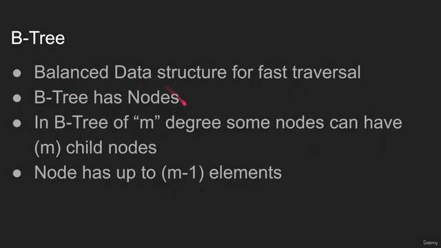
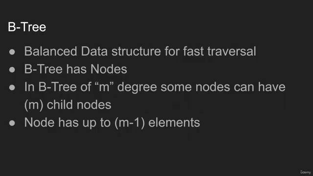

# Fundamentals of Database Engineering：P29–P32 索引、随机 UUID 与 B+ 树复现实验

> 说明：P29–P32 的逐字稿是原理讲解，没有给出可克隆的项目仓库，也没有终端命令。为了让读者能“照着跑起来”，下面我把课程概念落成一个最小可运行实验：Docker 启动 MySQL 8.0.36，Node.js 20 写入两张表，一张用随机 16 字节主键模拟 UUID v4 的随机性，一张用单调递增 16 字节主键模拟有序 ID/ULID 的时间有序性，然后用 `information_schema` 和 `@@innodb_page_size` 观察索引与页大小。  
> **这不是讲师原课代码**；凡逐字稿没讲、由我为复现而补上的工具和命令，我会在第 7 节明确标注，避免把补充内容安到讲师头上。

---

## 1. 这一节做什么

这一节要解决的核心问题是：**为什么把随机 UUID v4 当作数据库主键/索引键，会让写入变慢？为什么有序 ID 对 B+ 树更友好？**

P29 先讲随机 UUID v4 对索引的影响：UUID 最终会被当成数字/字节比较，索引页必须有序；随机插入会让叶页不断分裂、搬移、更新页之间的引用，还会让共享缓冲池频繁换入换出，产生 IO thrashing。P30–P32 把视角拉回 B 树/B+ 树：全表扫描为什么要一页一页读、B 树节点和页的关系、degree、key/value、root/internal/leaf、二级索引的数据指针差异，以及 MySQL InnoDB 约 16K 页、Postgres 默认 8K 页这些生产系统事实。

本节最终交付一个可运行实验：

- 用 Docker Compose 启动 MySQL 8.0.36；
- 用 Node.js 20 + `mysql2` 写入两张结构相同的表；
- `items_random.id` 用 `crypto.randomBytes(16)` 生成随机 16 字节；
- `items_ordered.id` 用“毫秒时间戳 + 递增序号”生成单调递增 16 字节；
- 用 `npm run stats` 查看 InnoDB 页大小、两张表的行数、`information_schema.tables` 里的 `data_length` / `index_length`；
- 通过调整写入行数，观察随机主键与有序主键在索引写入上的差异趋势。


P30 开头讲师明确说，学校里的 B 树数学和真实生产数据库之间有很大距离：

> "关于 B 树和 B+ 树，以及 B 树向 B+ 树的演进，特别是在生产数据库系统这一背景下。"
> —— p030 [00:54]

所以这个实验不追求复刻某个“标准答案”，而是把“随机键导致页分裂/缓冲池抖动”这件事变成一个你能亲手跑、亲手加行数、亲手看统计值的工程练习。

---

## 2. 讲师原话（带「—— pNNN [MM:SS]」）

下面这些原话是本文实验设计的直接依据。引用保留英文原句，后面用中文解释。

> "这里的影响主要落在插入和写入上，对读取的影响相对较小。而且即便是读取，也可能受到影响。"
> —— p029 [00:29]

讲师说随机 UUID 主要影响插入和写入，读也可能受影响，但取决于 workload。本文实验因此把重点放在“写入 5 万/20 万行”的插入路径，而不是做复杂查询。

> "随机性通常会对插入造成不利影响，但具体如何影响、影响在哪里，只有在你插入或更新索引时才真正体现出来。"
> —— p029 [02:50]

关键不是“UUID 本身慢”，而是“随机性在更新索引时伤害你”。如果 UUID 字段没有索引，Postgres 默认不会聚簇排序，问题会小很多；但 MySQL InnoDB 的主键本身就是聚簇索引，所以主键随机性会直接作用在表数据组织上。

> "索引必须是有序的。"
> —— p029 [03:48]

索引条目必须有序，否则索引没有意义。随机键插入时，数据库要找到“中间位置”插入，可能触发 page split。

> "你必须做一件叫页分裂的事……这是索引里可能发生的最糟糕的情况。"
> —— p029 [06:10]

讲师用 10、90、80、45、70、60 这些数字在白板上演示叶页分裂。页分裂不是“复制一个数组”这么简单，它还涉及页号、磁盘偏移、页之间引用、父节点/内部节点更新。

> "共享缓冲池，字面意义上就是一块共享内存区域。"
> —— p029 [14:10]

随机插入会不断把不同页拉进 buffer pool；buffer pool 满了就要 flush 旧页，如果下一次又需要旧页，就会反复 fetch/flush，讲师称为 thrashing IO。

> "Postgres 的默认值始终是 8KB……我认为 MySQL 的 InnoDB 是 16KB。"
> —— p031 [01:25]

逐字稿这里写成 “AndroidDB”，结合上下文应是 InnoDB。课程这里讲的是页大小：Postgres 默认约 8K，MySQL InnoDB 约 16K。本文 Docker 里显式设置 `--innodb-page-size=16384`。

> "一棵 B 树有一组节点……而一棵 B 树有一个度，我们默认把这个度称为 M。"
> —— p032 [00:25]

B 树由节点组成，节点有 degree M。生产中“节点”通常对应一个磁盘页，而不是大学课本里 degree=3 的玩具例子。

> "在数据库里，节点就等于磁盘页。"
> —— p032 [04:04]

逐字稿的 “desk page” 应为 disk page。这个观点直接决定了实验观察方式：我们不去数“节点对象”，而是看 InnoDB 页大小、表数据长度、索引长度。





---

## 3. 从零复现

### 3.1 你需要准备什么

- Node.js 20 或更高版本；
- Docker Desktop / Docker Engine，带 Compose v2；
- 能访问 `localhost:3306`；
- 一个空目录，例如 `db-index-uuid-lab`。

版本固定如下，避免“我跑出来不一样”：

- MySQL 镜像：`mysql:8.0.36`
- Node.js：`20.x`
- `mysql2`：`3.11.3`
- `dotenv`：`16.4.5`

### 3.2 目录结构

最终目录必须是这样：

```text
db-index-uuid-lab/
├─ docker-compose.yml
├─ package.json
├─ .env.example
├─ sql/
│  └─ 001_schema.sql
└─ src/
   ├─ db.js
   ├─ init.js
   ├─ insert-random.js
   ├─ insert-ordered.js
   ├─ stats.js
   └─ reset.js
```

### 3.3 启动步骤

在空目录中依次执行：

```bash
mkdir db-index-uuid-lab
cd db-index-uuid-lab
mkdir -p sql src
```

把第 4 节的 9 个文件原样保存到对应路径。然后：

```bash
cp .env.example .env
npm install
docker compose up -d
docker compose ps
```

等到 MySQL 容器状态变成 `healthy`。第一次启动时，`sql/001_schema.sql` 会通过 `/docker-entrypoint-initdb.d` 自动执行；即使你删了数据卷，重新 `docker compose up -d` 也会重新建表。为了保险，再执行一次幂等的初始化脚本：

```bash
npm run init
```

然后跑随机主键插入：

```bash
npm run insert:random
```

再跑有序主键插入：

```bash
npm run insert:ordered
```

最后看统计：

```bash
npm run stats
```

如果你想加大数据量，在 macOS/Linux 下可以这样：

```bash
INSERT_ROWS=200000 npm run insert:random
INSERT_ROWS=200000 npm run insert:ordered
npm run stats
```

PowerShell 下这样写：

```powershell
$env:INSERT_ROWS="200000"
npm run insert:random
npm run insert:ordered
npm run stats
```

重置两张表：

```bash
npm run reset
```

彻底重置数据库（包括数据卷）：

```bash
docker compose down -v
docker compose up -d
npm run init
```

#### 3.3.1 每条命令的完整解释与常见错误排查

这一小节把上面出现过的命令逐条展开。这里的目标不是让你“背命令”，而是让你知道每条命令改变了什么、成功时应该看到什么、失败时先查什么。所有命令都是复现实验层补充，不是 P29–P32 逐字稿里的原命令。

1. **`node -v`**  
   作用：确认本机 Node.js 版本。本文代码使用 ESM、顶层 `await` 和 `node:` 内置模块，建议 Node.js 20.x。成功时应看到 `v20.x` 或更高。  
   常见错误：命令不存在，说明 Node.js 未安装或未进 PATH；版本过低可能在 `import`、`node:fs/promises` 或顶层 `await` 上报错。排查：重新安装 Node.js 20 LTS，重开终端，再执行 `node -v` 和 `npm -v`。

2. **`docker compose version`**  
   作用：确认 Docker Compose v2 可用。本文使用 `docker compose` 而不是旧式 `docker-compose`。成功时输出 Compose 版本。  
   常见错误：`docker: command not found` 表示 Docker 未安装；`docker compose is not a docker command` 表示 Compose 插件缺失或版本太旧。排查：启动 Docker Desktop，或安装 Compose v2 插件；必要时检查 `docker info` 是否能连上 Docker daemon。

3. **`mkdir db-index-uuid-lab`**  
   作用：创建实验根目录。成功时无输出。  
   常见错误：目录已存在会报 `File exists`。这不是严重错误，可以 `cd db-index-uuid-lab` 继续，或换一个目录名。若权限不足，换到有写权限的目录，不要用管理员权限硬写系统目录。

4. **`cd db-index-uuid-lab`**  
   作用：进入实验目录。后续所有相对路径都以此为基准。  
   常见错误：`No such file or directory` 说明第 3 步没成功或当前目录不对。排查：`pwd` 看当前位置，`ls` 看目录是否存在。

5. **`mkdir -p sql src`**  
   作用：创建 `sql/` 和 `src/` 两个子目录。`-p` 表示父目录不存在时一起创建，目录已存在也不报错。  
   常见错误：权限不足或路径拼错。排查：确认当前在 `db-index-uuid-lab` 下，执行 `ls` 应看到 `sql`、`src`。

6. **`cp .env.example .env`**  
   作用：复制环境变量模板。代码通过 `dotenv` 读取 `.env`，连接 MySQL。  
   常见错误：`No such file or directory` 说明 `.env.example` 还没保存到根目录；Windows 原生 CMD 没有 `cp`，可用 PowerShell 的 `Copy-Item .env.example .env`，或 Git Bash/WSL。  
   排查：确认 `.env` 中 `MYSQL_HOST=127.0.0.1`、`MYSQL_PORT=3306`、`MYSQL_USER=dblab`、`MYSQL_PASSWORD=dblabpass`、`MYSQL_DATABASE=dblab` 与 `docker-compose.yml` 一致。

7. **`npm install`**  
   作用：按 `package.json` 安装 `mysql2` 和 `dotenv`，生成 `node_modules` 和锁文件。成功时通常输出依赖安装结果。  
   常见错误：网络失败、代理错误、Node 版本不匹配、`package.json` 未保存或 JSON 语法错误。排查：先 `npm config get registry`，再确认 `package.json` 完整；必要时删除 `node_modules` 和锁文件后重试。不要把生产密钥写进 `package.json`。

8. **`docker compose up -d`**  
   作用：后台启动 `mysql` 服务。`-d` 是 detached，容器在后台运行。首次启动会拉取 `mysql:8.0.36`，并通过 `/docker-entrypoint-initdb.d` 执行 `sql/001_schema.sql`。  
   常见错误：Docker daemon 未启动会报无法连接；`3306` 被占用会报端口绑定失败；镜像拉取失败要查网络；数据卷里已有旧初始化状态时，初始化 SQL 不会重复执行。排查：`docker compose ps`、`docker compose logs mysql`；如确认是旧卷导致密码/表状态不一致，可用 `docker compose down -v` 后重建，但这会删除数据卷。

9. **`docker compose ps`**  
   作用：查看服务状态和健康检查。成功时应看到 MySQL 服务为 `running`，健康状态最终为 `healthy`。  
   常见错误：一直 `starting` 或 `unhealthy`。排查：看 `docker compose logs mysql`；常见原因包括初始化未完成、端口冲突、密码/卷残留、健康检查命令连不上。不要在未 `healthy` 时急着重跑 `npm run init`，否则可能得到连接拒绝。

10. **`npm run init`**  
    作用：执行 `src/init.js`，读取 `sql/001_schema.sql` 并建表。建表语句是 `CREATE TABLE IF NOT EXISTS`，所以重复执行是幂等的。成功输出 `schema ready`。  
    常见错误：`ECONNREFUSED` 表示 MySQL 未就绪；`ER_ACCESS_DENIED_ERROR` 表示用户/密码不匹配；`ER_BAD_DB_ERROR` 表示数据库不存在；SQL 语法错误通常是文件未按原样保存。排查：先看 `docker compose ps`，再核对 `.env`，最后看 MySQL 日志。

11. **`npm run insert:random`**  
    作用：清空 `items_random`，按 `INSERT_ROWS` 和 `INSERT_BATCH` 分批插入随机 16 字节主键行。每 5000 行打印进度，最后输出 `items_random row_count=...`。  
    常见错误：连接失败、表不存在、`INSERT_ROWS` 不是正整数、批量 SQL 过大、重复执行时脚本会自动 `TRUNCATE`。排查：先跑 `npm run init`；确认环境变量是整数；把 `INSERT_BATCH` 调小到 500；不要并发跑同一张表的同一脚本，否则行数会互相覆盖。

12. **`npm run insert:ordered`**  
    作用：清空 `items_ordered`，插入“时间戳 + 递增序号”的单调 16 字节主键。最后输出 `items_ordered row_count=...`。  
    常见错误：与随机脚本类似。另一个注意点是：这不是标准 ULID 实现，只是本文用于对比的单调 16 字节键；如果你并发运行多个有序插入进程，后 8 字节序号可能重复，导致主键冲突。排查：串行执行；必要时先 `npm run reset`。

13. **`npm run stats`**  
    作用：查询 `@@innodb_page_size`、`information_schema.tables` 的 `data_length`/`index_length`，以及两张表 `COUNT(*)`。成功时打印三组表格。  
    常见错误：连接失败、表不存在、统计值为 0 或很小。`index_length` 很小是正常的，因为本实验只建主键、没有二级索引；统计值是估算值，不是精确字节数。排查：确认两张表都已插入；可再跑一次 `stats`；必要时执行 `ANALYZE TABLE`，但不要拿单次数字当绝对结论。

14. **`INSERT_ROWS=200000 npm run insert:random` 与 `INSERT_ROWS=200000 npm run insert:ordered`**  
    作用：在 macOS/Linux 的 shell 中临时设置环境变量，只对当前命令生效。这样不改 `.env` 也能加大数据量。  
    常见错误：Windows CMD 不支持这种前置赋值；PowerShell 要用 `$env:INSERT_ROWS="200000"`。排查：`echo $INSERT_ROWS`（PowerShell 用 `$env:INSERT_ROWS`）确认变量是否生效；脚本会校验必须为正整数。

15. **`npm run reset`**  
    作用：执行 `src/reset.js`，`TRUNCATE` 两张实验表。速度比逐行删除快，但会清空数据。  
    常见错误：连接失败、表不存在。生产库不要执行；本命令只用于实验重置。排查：确认当前 `.env` 指向实验库 `dblab`，不是别的库。

16. **`docker compose down -v`**  
    作用：停止并删除容器，同时删除 Compose 中声明的数据卷 `dblab_mysql_data`。`-v` 是删除卷的关键。  
    常见错误：误删数据卷不可恢复；如果有其他服务复用同一卷也会受影响。排查：执行前 `docker compose ps` 和 `docker volume ls` 确认；只想停容器不要删卷时用 `docker compose down`，不要加 `-v`。

17. **`docker compose up -d` 后再 `npm run init`**  
    作用：用全新数据卷重新初始化 MySQL，再幂等建表。第一次启动时初始化 SQL 也会执行，`npm run init` 是保险。  
    常见错误：刚 `up -d` 就立刻 `init`，MySQL 还没 healthy 会连接失败。排查：等 `docker compose ps` 显示 healthy，或看日志出现 ready for connections。

#### 3.3.2 与前台的对照（命令/输出层 vs 原理层）

为避免歧义，这里把“前台”理解为读者在命令行、脚本和统计输出这一层实际看到的东西；“后台/原理层”指 P29–P32 讲的索引、页、页分裂、缓冲池等概念。对照如下：

| 前台操作/输出 | 原理层对照 |
|---|---|
| `docker compose up -d` 后 `@@innodb_page_size=16384` | 对应 P31 的页大小事实：InnoDB 约 16K，Postgres 默认约 8K；B 树节点在生产中通常对应磁盘页。 |
| `crypto.randomBytes(16)` 生成 `items_random.id` | 对应 P29：随机性会伤害索引插入；随机键让目标叶页在索引中跳来跳去。 |
| `orderedKey()` 用时间戳+序号生成 `items_ordered.id` | 对应 P29：有序插入更接近索引尾部，减少随机页访问和页分裂压力。 |
| `PRIMARY KEY (id)` 且 `id BINARY(16)` | 对应 P32：InnoDB 主键是聚簇索引，表数据按主键组织；16 字节固定长度便于两张表只比较“随机/有序”一个变量。 |
| `npm run stats` 的 `data_length` / `index_length` | 对应 P32：用页/表空间占用趋势观察索引组织；但它们是估算值，不能当精确字节数。 |
| `COUNT(*)` 与批量插入进度 | 对应 P31：全表扫描按页读取；`COUNT(*)` 不是本实验重点，重点是理解页是 IO 单位。 |
| `TRUNCATE` 后分批 `INSERT` | 对应 P29：大量随机插入是在制造页分裂和 buffer pool 压力，不需要手动画页分裂。 |
| 没有二级索引 | 对应 P32：二级索引数据指针差异本实验不直接观察；若再加 UUID 二级索引，随机性会沿“二级索引 -> 主键”继续放大。 |

### 3.4 这个实验怎么观察“页分裂/随机写入”

你不需要看到 InnoDB 内部页分裂的每一帧。可操作的观察方式是：

1. 固定 `INSERT_ROWS=50000`，分别插入随机表和有序表；
2. 执行 `npm run stats`，记录 `data_length`、`index_length`；
3. 把 `INSERT_ROWS` 提高到 200000，重复；
4. 观察随机表的索引/数据长度增长趋势是否更“碎”、是否更容易出现更大页占用；
5. 如果你有 MySQL 客户端，可额外执行 `SHOW TABLE STATUS LIKE 'items_random';` 和 `SHOW TABLE STATUS LIKE 'items_ordered';`，但字段名和值以你实际 MySQL 输出为准。

注意：`information_schema.tables` 的 `data_length` / `index_length` 是统计估算值，不是精确到字节的实时值；不同版本、是否 `ANALYZE TABLE`、buffer pool 状态都会影响结果。实验结论应看“趋势”，不要拿单次数字当绝对结论。


---

## 4. 完整代码

下面每个文件都是完整文件，直接保存即可，不要加省略号。

### 4.1 `docker-compose.yml`

```yaml
services:
  mysql:
    image: mysql:8.0.36
    container_name: db-index-uuid-lab-mysql
    command: --innodb-page-size=16384
    environment:
      MYSQL_ROOT_PASSWORD: rootpass
      MYSQL_DATABASE: dblab
      MYSQL_USER: dblab
      MYSQL_PASSWORD: dblabpass
    ports:
      - "3306:3306"
    volumes:
      - ./sql:/docker-entrypoint-initdb.d:ro
      - dblab_mysql_data:/var/lib/mysql
    healthcheck:
      test: ["CMD", "mysqladmin", "ping", "-h", "localhost", "-uroot", "-prootpass"]
      interval: 5s
      timeout: 5s
      retries: 20

volumes:
  dblab_mysql_data:
```

### 4.2 `package.json`

```json
{
  "name": "db-index-uuid-lab",
  "version": "1.0.0",
  "private": true,
  "type": "module",
  "scripts": {
    "init": "node src/init.js",
    "insert:random": "node src/insert-random.js",
    "insert:ordered": "node src/insert-ordered.js",
    "stats": "node src/stats.js",
    "reset": "node src/reset.js"
  },
  "dependencies": {
    "dotenv": "16.4.5",
    "mysql2": "3.11.3"
  }
}
```

### 4.3 `.env.example`

```dotenv
MYSQL_HOST=127.0.0.1
MYSQL_PORT=3306
MYSQL_USER=dblab
MYSQL_PASSWORD=dblabpass
MYSQL_DATABASE=dblab
INSERT_ROWS=50000
INSERT_BATCH=500
```

复制成 `.env` 后再运行：

```bash
cp .env.example .env
```

### 4.4 `sql/001_schema.sql`

```sql
CREATE TABLE IF NOT EXISTS items_random (
  id BINARY(16) NOT NULL,
  payload VARCHAR(255) NOT NULL,
  created_at TIMESTAMP(6) NOT NULL DEFAULT CURRENT_TIMESTAMP(6),
  PRIMARY KEY (id)
) ENGINE=InnoDB DEFAULT CHARSET=utf8mb4 COLLATE=utf8mb4_0900_ai_ci;

CREATE TABLE IF NOT EXISTS items_ordered (
  id BINARY(16) NOT NULL,
  payload VARCHAR(255) NOT NULL,
  created_at TIMESTAMP(6) NOT NULL DEFAULT CURRENT_TIMESTAMP(6),
  PRIMARY KEY (id)
) ENGINE=InnoDB DEFAULT CHARSET=utf8mb4 COLLATE=utf8mb4_0900_ai_ci;
```

### 4.5 `src/db.js`

```javascript
import 'dotenv/config';
import mysql from 'mysql2/promise';

export const dbConfig = {
  host: process.env.MYSQL_HOST ?? '127.0.0.1',
  port: Number(process.env.MYSQL_PORT ?? '3306'),
  user: process.env.MYSQL_USER ?? 'dblab',
  password: process.env.MYSQL_PASSWORD ?? 'dblabpass',
  database: process.env.MYSQL_DATABASE ?? 'dblab',
};

export function createPool() {
  return mysql.createPool({
    ...dbConfig,
    waitForConnections: true,
    connectionLimit: 4,
    queueLimit: 0,
  });
}
```

### 4.6 `src/init.js`

```javascript
import fs from 'node:fs/promises';
import mysql from 'mysql2/promise';
import { dbConfig } from './db.js';

const schemaUrl = new URL('../sql/001_schema.sql', import.meta.url);
const schema = await fs.readFile(schemaUrl, 'utf8');

const connection = await mysql.createConnection({
  ...dbConfig,
  multipleStatements: true,
});

try {
  await connection.query(schema);
  console.log('schema ready');
} finally {
  await connection.end();
}
```

### 4.7 `src/insert-random.js`

```javascript
import crypto from 'node:crypto';
import { createPool } from './db.js';

const TOTAL = Number(process.env.INSERT_ROWS ?? '50000');
const BATCH = Number(process.env.INSERT_BATCH ?? '500');

async function main() {
  if (!Number.isInteger(TOTAL) || TOTAL <= 0) {
    throw new Error('INSERT_ROWS must be a positive integer');
  }
  if (!Number.isInteger(BATCH) || BATCH <= 0) {
    throw new Error('INSERT_BATCH must be a positive integer');
  }

  const pool = createPool();
  const connection = await pool.getConnection();

  try {
    await connection.query('TRUNCATE TABLE items_random');

    for (let start = 0; start < TOTAL; start += BATCH) {
      const rowsThisBatch = Math.min(BATCH, TOTAL - start);
      const placeholders = [];
      const params = [];

      for (let i = 0; i < rowsThisBatch; i++) {
        placeholders.push('(?, ?)');
        params.push(crypto.randomBytes(16));
        params.push(`payload-${start + i}`);
      }

      const sql = `INSERT INTO items_random (id, payload) VALUES ${placeholders.join(',')}`;
      await connection.query(sql, params);

      const inserted = start + rowsThisBatch;
      if (inserted % 5000 === 0 || inserted === TOTAL) {
        console.log(`items_random inserted ${inserted}/${TOTAL}`);
      }
    }

    const [rows] = await connection.query(
      'SELECT COUNT(*) AS row_count FROM items_random'
    );
    console.log(`items_random row_count=${rows[0].row_count}`);
  } finally {
    connection.release();
    await pool.end();
  }
}

main().catch((error) => {
  console.error(error);
  process.exitCode = 1;
});
```

### 4.8 `src/insert-ordered.js`

```javascript
import { createPool } from './db.js';

const TOTAL = Number(process.env.INSERT_ROWS ?? '50000');
const BATCH = Number(process.env.INSERT_BATCH ?? '500');

const BASE_TIMESTAMP = BigInt(Date.now());

function orderedKey(sequence) {
  const buffer = Buffer.alloc(16);
  buffer.writeBigUInt64BE(BASE_TIMESTAMP, 0);
  buffer.writeBigUInt64BE(BigInt(sequence), 8);
  return buffer;
}

async function main() {
  if (!Number.isInteger(TOTAL) || TOTAL <= 0) {
    throw new Error('INSERT_ROWS must be a positive integer');
  }
  if (!Number.isInteger(BATCH) || BATCH <= 0) {
    throw new Error('INSERT_BATCH must be a positive integer');
  }

  const pool = createPool();
  const connection = await pool.getConnection();

  try {
    await connection.query('TRUNCATE TABLE items_ordered');

    for (let start = 0; start < TOTAL; start += BATCH) {
      const rowsThisBatch = Math.min(BATCH, TOTAL - start);
      const placeholders = [];
      const params = [];

      for (let i = 0; i < rowsThisBatch; i++) {
        placeholders.push('(?, ?)');
        params.push(orderedKey(start + i));
        params.push(`payload-${start + i}`);
      }

      const sql = `INSERT INTO items_ordered (id, payload) VALUES ${placeholders.join(',')}`;
      await connection.query(sql, params);

      const inserted = start + rowsThisBatch;
      if (inserted % 5000 === 0 || inserted === TOTAL) {
        console.log(`items_ordered inserted ${inserted}/${TOTAL}`);
      }
    }

    const [rows] = await connection.query(
      'SELECT COUNT(*) AS row_count FROM items_ordered'
    );
    console.log(`items_ordered row_count=${rows[0].row_count}`);
  } finally {
    connection.release();
    await pool.end();
  }
}

main().catch((error) => {
  console.error(error);
  process.exitCode = 1;
});
```

### 4.9 `src/stats.js`

```javascript
import { createPool } from './db.js';

const pool = createPool();

try {
  const [pageRows] = await pool.query(
    'SELECT @@innodb_page_size AS innodb_page_size'
  );

  const [tableRows] = await pool.query(`
    SELECT table_name, data_length, index_length
    FROM information_schema.tables
    WHERE table_schema = DATABASE()
      AND table_name IN ('items_random', 'items_ordered')
    ORDER BY table_name
  `);

  const [countRows] = await pool.query(`
    SELECT 'items_random' AS table_name, COUNT(*) AS row_count FROM items_random
    UNION ALL
    SELECT 'items_ordered' AS table_name, COUNT(*) AS row_count FROM items_ordered
  `);

  console.log('innodb_page_size:');
  console.table(pageRows);

  console.log('information_schema.tables:');
  console.table(tableRows);

  console.log('row counts:');
  console.table(countRows);
} finally {
  await pool.end();
}
```

### 4.10 `src/reset.js`

```javascript
import { createPool } from './db.js';

const pool = createPool();

try {
  await pool.query('TRUNCATE TABLE items_random');
  await pool.query('TRUNCATE TABLE items_ordered');
  console.log('items_random and items_ordered truncated');
} finally {
  await pool.end();
}
```


---

## 5. 逐行解释

### 5.1 `docker-compose.yml`：把“页大小”固定成课程里的 InnoDB 16K

`image: mysql:8.0.36` 固定 MySQL 版本，避免不同版本默认值影响观察。`command: --innodb-page-size=16384` 对应课程里说的 “InnoDB MySQL is 16k”。`volumes` 里把 `./sql` 挂到 `/docker-entrypoint-initdb.d:ro`，MySQL 容器第一次初始化时会自动执行 `001_schema.sql`。`healthcheck` 用 `mysqladmin ping` 判断容器是否可连接，避免你 `npm run init` 跑在 MySQL 还没启动完成的时候。

### 5.2 `package.json`：`type: module` 让 Node 直接跑 ESM

`"type": "module"` 让 `import` 语法直接可用，不需要 Babel。`scripts` 把每个实验步骤固定成命令，读者不需要记复杂参数。`mysql2` 是 MySQL 的 Node 驱动，`dotenv` 读取 `.env`。

### 5.3 `sql/001_schema.sql`：两张表故意结构相同

`items_random` 和 `items_ordered` 都是：

```sql
id BINARY(16) NOT NULL,
payload VARCHAR(255) NOT NULL,
created_at TIMESTAMP(6) NOT NULL DEFAULT CURRENT_TIMESTAMP(6),
PRIMARY KEY (id)
```

这样做的原因是：如果随机表用 `CHAR(36)`、有序表用 `BIGINT`，你观察到的差异会混入“字段类型不同”的因素。这里两张表都用 16 字节二进制主键，只改变“键的生成方式”，对比更干净。`BINARY(16)` 正好对应 UUID v4 的 128 位字节长度。`PRIMARY KEY (id)` 在 InnoDB 中意味着聚簇索引：表数据按主键组织，随机主键会让插入位置随机跳。

### 5.4 `src/db.js`：连接池与 `.env`

`import 'dotenv/config'` 在模块加载时读取 `.env`。`dbConfig` 里的字段名就是环境变量名：`MYSQL_HOST`、`MYSQL_PORT`、`MYSQL_USER`、`MYSQL_PASSWORD`、`MYSQL_DATABASE`。`createPool()` 返回连接池，`connectionLimit: 4` 表示最多 4 条连接；本实验是顺序批量插入，不需要高并发。

### 5.5 `src/init.js`：幂等建表

`fs.readFile(schemaUrl, 'utf8')` 读取 SQL 文件。`multipleStatements: true` 允许一次执行包含多条 `CREATE TABLE` 的 SQL。`CREATE TABLE IF NOT EXISTS` 保证重复执行不报错。注意：`init.js` 只是建表，不会清空数据；清空用 `npm run reset`。

### 5.6 `src/insert-random.js`：随机 16 字节主键

核心是：

```javascript
params.push(crypto.randomBytes(16));
```

`crypto.randomBytes(16)` 生成 16 字节随机 Buffer，MySQL 驱动会把它写成 `BINARY(16)`。这模拟 UUID v4 的“完全随机、相邻 UUID 在数值上相距很远”的特性。脚本先 `TRUNCATE TABLE items_random`，然后按 `BATCH` 分批构造：

```sql
INSERT INTO items_random (id, payload) VALUES (?, ?), (?, ?), ...
```

分批是为了避免单条 SQL 过大。每 5000 行打印一次进度。最后用 `SELECT COUNT(*) AS row_count` 确认行数。

### 5.7 `src/insert-ordered.js`：单调递增 16 字节主键

核心是：

```javascript
buffer.writeBigUInt64BE(BASE_TIMESTAMP, 0);
buffer.writeBigUInt64BE(BigInt(sequence), 8);
```

前 8 字节写当前毫秒时间戳，后 8 字节写递增序号。这样生成的 16 字节 Buffer 按字节比较是单调递增的，插入位置总是靠近索引尾部，模拟“有序 ID/时间有序键”。**注意：这不是标准 ULID 实现**，只是本文为了对比随机性而写的单调 16 字节键；课程里提到 Shopify 转向 ULID，但课里没有给 ULID 生成代码。

### 5.8 `src/stats.js`：看页大小和表统计

`SELECT @@innodb_page_size AS innodb_page_size` 读取 InnoDB 页大小。`information_schema.tables` 查询 `data_length` 和 `index_length`。`data_length` 可以粗略理解为表数据/聚簇索引占用，`index_length` 是二级索引占用；本实验没有建二级索引，所以 `index_length` 可能很小或为 0，具体以实际输出为准。`COUNT(*)` 用于确认两张表写入行数一致。

### 5.9 `src/reset.js`：清空实验表

`TRUNCATE TABLE` 会快速清空表并重置自增计数器（本实验没有自增列）。生产环境不要随手跑；这里只用于实验重置。

### 5.10 和课程概念的对应关系

- **叶页有序**：`PRIMARY KEY (id)` 让 InnoDB 按 `id` 组织聚簇索引；随机 `id` 会让插入位置在叶页之间跳。
- **page split**：当目标叶页没有空间时，InnoDB 需要分裂页、搬移条目、更新页引用和上层节点。你不需要手动触发，随机插入大量行就是在制造这种压力。
- **buffer pool / thrashing**：随机插入会触碰更多不同页；buffer pool 有限，旧页被换出后可能又被随机插入需要，造成反复 IO。课程 p029 [14:10] 讲的就是这个。
- **全表扫描**：P31 讲全表扫描要一页一页读。实验里的 `COUNT(*)` 不是重点，重点是理解“页是 IO 单位”。
- **B 树节点 = 磁盘页**：P32 讲 node 约等于 disk page；所以观察 InnoDB 页大小比背 degree 公式更有生产意义。
- **二级索引数据指针**：课程说 MySQL InnoDB 的二级索引指向主键，Postgres 的二级索引指向 tuple。本实验只建主键，没有建二级索引；但你要知道，如果给 UUID 字段再建二级索引，随机性会通过“二级索引 -> 主键”的路径继续放大。

关于锁/事务：这个实验的每条 `connection.query` 默认是自动提交，相当于一次独立事务。Node 的单线程只保护 JS 内存，不保护数据库行；如果你要多条语句原子执行，需要用 `beginTransaction()`、`commit()`、`rollback()`。这和 Java 里 `setAutoCommit(false)` 的概念类似，知道即可。


---

## 6. 复现检查清单

按顺序检查，任何一项不通过先解决再继续：

- [ ] `node -v` 输出 `v20.x` 或更高。
- [ ] `docker compose version` 可用。
- [ ] `docker compose up -d` 后 `docker compose ps` 中 MySQL 状态为 `healthy`。
- [ ] `.env` 已从 `.env.example` 复制，且 `MYSQL_DATABASE=dblab`。
- [ ] `npm install` 成功，`node_modules/mysql2` 存在。
- [ ] `npm run init` 输出 `schema ready`。
- [ ] `npm run insert:random` 最后输出 `items_random row_count=50000`（默认值）。
- [ ] `npm run insert:ordered` 最后输出 `items_ordered row_count=50000`。
- [ ] `npm run stats` 能打印 `innodb_page_size`，默认应为 `16384`；若你改过 Docker 配置，以实际为准。
- [ ] `npm run stats` 中两张表 `row_count` 相同。
- [ ] 把 `INSERT_ROWS` 改为 `200000` 后重复，两个脚本都能完成，不出现 `max_allowed_packet` 或超时错误。
- [ ] 若结果差异不明显，先不要下结论；把行数加到 50 万，或重复运行多次，观察趋势。
- [ ] 实验结束后如要彻底清理，执行 `docker compose down -v`，注意这会删除数据卷。

### 6.1 检查清单逐条说明

1. **`node -v` 输出 `v20.x` 或更高。**  
   目的：确认运行环境符合代码要求。本文使用 ESM、顶层 `await` 和 `node:crypto`、`node:fs/promises`。不通过时，先修 Node 版本，不要先怀疑数据库。若你已经用低版本跑出语法错误，升级 Node 后重新 `npm install`。

2. **`docker compose version` 可用。**  
   目的：确认你用的不是旧式 `docker-compose`，并且 Compose 插件已安装。不通过时，先启动 Docker Desktop，再检查 `docker info`。如果 `docker info` 也失败，说明 Docker daemon 没连上，后面的 `up -d` 一定失败。

3. **`docker compose up -d` 后 `docker compose ps` 中 MySQL 状态为 `healthy`。**  
   目的：确认 MySQL 已经完成启动和初始化。`running` 不等于可连接，健康检查通过才更稳。不通过时看 `docker compose logs mysql`；若是第一次启动，给它一点时间；若是旧卷导致密码或表状态异常，考虑 `down -v` 重建，但要知道这会删除卷。

4. **`.env` 已从 `.env.example` 复制，且 `MYSQL_DATABASE=dblab`。**  
   目的：让 Node 脚本和 Compose 使用同一套连接信息。不通过时，检查 `.env` 是否在项目根目录、变量名是否拼对、密码是否与 `docker-compose.yml` 一致。注意 `.env` 是本地文件，不要提交真实密钥。

5. **`npm install` 成功，`node_modules/mysql2` 存在。**  
   目的：确认依赖装好。不通过时先看 npm 报错是网络、代理还是 `package.json` 语法。你可以用 `ls node_modules/mysql2`（PowerShell 用 `Test-Path node_modules/mysql2`）确认。不要在没有依赖时直接跑脚本。

6. **`npm run init` 输出 `schema ready`。**  
   目的：确认两张表存在且 SQL 可执行。不通过时按错误类型查：连接拒绝 -> MySQL 未就绪；认证失败 -> 用户/密码不一致；数据库不存在 -> `MYSQL_DATABASE` 不一致；SQL 语法错误 -> 文件没按原样保存。`init.js` 是幂等的，修好后可以重复跑。

7. **`npm run insert:random` 最后输出 `items_random row_count=50000`（默认值）。**  
   目的：确认随机表插入完成且行数正确。不通过时看进度停在哪一批、是否包过大、是否连接中断。脚本会先 `TRUNCATE`，所以重复跑不会累加；如果你改了 `INSERT_ROWS`，输出应对应你设置的值。

8. **`npm run insert:ordered` 最后输出 `items_ordered row_count=50000`。**  
   目的：确认有序表插入完成。不通过时除了查连接和包大小，还要注意不要并发跑两个有序插入进程，否则后 8 字节序号可能重复导致主键冲突。串行执行最稳。

9. **`npm run stats` 能打印 `innodb_page_size`，默认应为 `16384`；若你改过 Docker 配置，以实际为准。**  
   目的：确认页大小观察点存在。若输出不是 16384，先检查 `docker-compose.yml` 的 `command` 是否保存、容器是否用新配置重建。注意：`innodb_page_size` 是实例级参数，改了之后通常需要重建实例/卷才稳妥，具体以实际 MySQL 行为为准。

10. **`npm run stats` 中两张表 `row_count` 相同。**  
    目的：保证对比公平。若不同，说明某个插入脚本没跑完、被中断，或你只跑了其中一张表。先 `npm run reset`，再按相同 `INSERT_ROWS` 串行重跑两张表。不要在一张 5 万、一张 20 万的情况下直接比统计值。

11. **把 `INSERT_ROWS` 改为 `200000` 后重复，两个脚本都能完成，不出现 `max_allowed_packet` 或超时错误。**  
    目的：验证实验在更大数据量下仍可执行。若出现包过大或连接中断，先把 `INSERT_BATCH` 调回 500 或 1000；如确需调大，再按实际 MySQL 配置检查 `max_allowed_packet`。这是复现层工程问题，不是课程原话。

12. **若结果差异不明显，先不要下结论；把行数加到 50 万，或重复运行多次，观察趋势。**  
    目的：避免把统计估算、缓存状态、硬件差异误判成结论。`data_length`/`index_length` 不是精确字节数；小数据量下差异可能被噪声盖住。应固定变量、重复实验、看趋势，而不是拿一次输出做绝对判断。

13. **实验结束后如要彻底清理，执行 `docker compose down -v`，注意这会删除数据卷。**  
    目的：清理容器和 `dblab_mysql_data` 卷。`-v` 会删卷，数据不可恢复；如果还想保留数据，只用 `docker compose down`，不要加 `-v`。清理后下次 `up -d` 会重新初始化，再跑 `npm run init` 即可。


---

## 7. 课里没讲但你会撞上的

这一节专门标注“原课没讲、但复现时会遇到”的内容，避免把补充内容误认为讲师原话。

1. **Docker、Node.js、`mysql2`、`dotenv` 都不是这四讲逐字稿里的内容。**  
   逐字稿是数据库索引原理讲解，没有给项目仓库和启动命令。本文用这些工具只是为了把概念变成可运行实验。

2. **MySQL 的 `UUID()` 不是 UUID v4。**  
   MySQL 自带 `UUID()` 生成的是 v1 风格值；本实验不用它，而是用 `crypto.randomBytes(16)` 直接生成随机 16 字节，避免把“MySQL UUID()”误当成“UUID v4”。

3. **`BINARY(16)` 和 `CHAR(36)` 的 UUID 存储不同。**  
   本实验统一用 `BINARY(16)`，是为了让两张表只差“随机/有序”一个变量。真实项目里如果你用 `CHAR(36)`，索引条目更大，页能放的条目更少，页分裂行为还会受字段长度影响。

4. **`information_schema.tables` 的 `data_length` / `index_length` 是估算值。**  
   它们不是精确到字节的实时统计。你可能会看到两次运行数字不完全一样；应看趋势，而不是拿单次数字做绝对判断。必要时可执行 `ANALYZE TABLE`，但本实验不强制。

5. **`TRUNCATE TABLE` 会清空表。**  
   `npm run reset`、`insert-random.js`、`insert-ordered.js` 都会清空对应表。不要在生产库执行这些脚本。

6. **批量插入大小受 `max_allowed_packet` 影响。**  
   默认 `INSERT_BATCH=500` 通常没问题；如果你把 batch 调到几万，可能撞到 MySQL 包大小限制。课程没有给 Node.js/mysql2 的批量写入参数，这是复现层需要知道的工程细节。遇到包过大或连接中断时，先把 `INSERT_BATCH` 调回 500 或 1000；如确需调大，再按实际 MySQL 配置调整 `max_allowed_packet`，并确认容器配置已重启生效。

---

## 8. 常见错误与排查汇总

这一节把复现时最容易遇到的问题集中列出。具体报错文本以你的 Node.js、Docker、MySQL 实际输出为准；不要只凭错误名猜，先看完整堆栈和容器日志。

1. **Docker daemon 未启动**  
   现象：`docker compose up -d` 或 `docker info` 报无法连接 Docker daemon。  
   排查：启动 Docker Desktop / Docker Engine；Windows/macOS 等托盘图标稳定后再试；Linux 检查 `systemctl status docker`。这不是数据库问题，先把 Docker 修好。

2. **3306 端口被占用**  
   现象：`docker compose up -d` 报端口绑定失败，或容器启动后退出。  
   排查：本机可能已有 MySQL 或其他容器占用 3306。停掉占用进程，或把 `docker-compose.yml` 的 `ports` 改成 `"3307:3306"`，同时把 `.env` 的 `MYSQL_PORT` 改成 `3307`。改端口后要重新 `up -d`。

3. **MySQL 一直不 healthy**  
   现象：`docker compose ps` 长时间 `starting`/`unhealthy`。  
   排查：`docker compose logs mysql` 看初始化日志；第一次启动要等初始化完成；旧数据卷可能保留了旧密码或旧表状态。确认要重建时用 `docker compose down -v`，但注意删卷。

4. **认证失败**  
   现象：Node 报访问被拒绝，或 `npm run init` 连不上。  
   排查：`.env` 的 `MYSQL_USER`/`MYSQL_PASSWORD` 必须与 `docker-compose.yml` 的 `MYSQL_USER`/`MYSQL_PASSWORD` 一致。注意 `MYSQL_ROOT