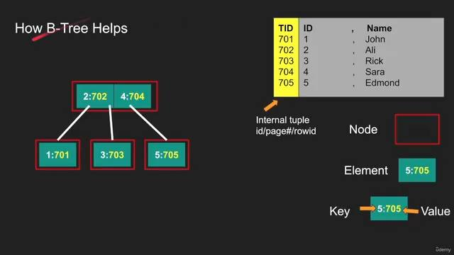
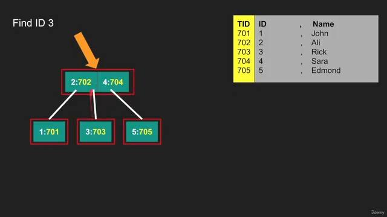
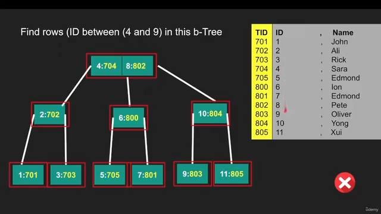
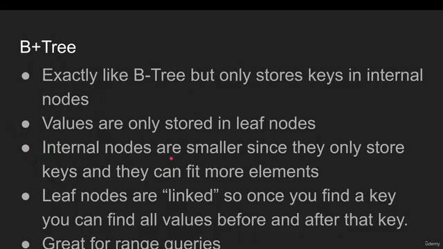
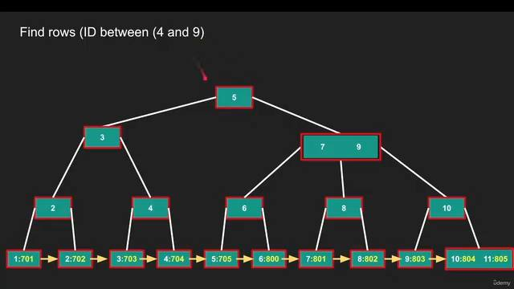
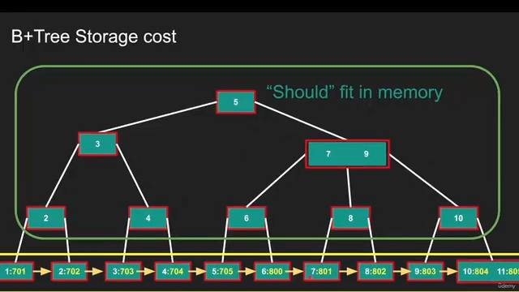

# Fundamentals of Database Engineering：B 树 vs B+ 树（P33–P36）复现文档

> 覆盖 P33–P36。逐字稿里把 B-tree 识别成了 “B3”，把 B+ tree 识别成了 “B plus three”，下文统一写 **B 树** 和 **B+ 树**。  
> 这四节基本是白板/图示讲解，**课里没有给出可运行的工程代码**；讲师提到他用 JavaScript 做了插入动画，但动画源码没有出现在逐字稿里。因此本文第 4 节的代码会明确标注为「课里没有代码，以下为示意」，用来复现容量估算和 range query 读页次数对比。

---

## 1. 这一节做什么

这一节要解决的不是“背下来 B 树和 B+ 树的定义”，而是把数据库索引还原成**磁盘页上的物理结构**，然后回答三个工程问题：

1. 为什么 B 树的每个节点都存 key 和 value，会导致一页装不下多少元素，进而导致更多 IO？
2. 为什么 B+ 树把 value 全部赶到叶子节点、内部节点只留 key，就能让内部节点更容易常驻内存？
3. 为什么 B+ 树的叶子链表能让 `WHERE id BETWEEN 4 AND 9` 这类 range query 从“反复从根下降”变成“下降一次 + 顺序扫叶子”？

最终产物是四样东西：

| 产物 | 用途 |
|---|---|
| 一张 B 树 / B+ 树结构对照表 | 画图时不出错：孩子数、key 数、value 放在哪 |
| 一份 range query 读页记录 | 直观看到 B 树“跳来跳去”，B+ 树“顺着叶子走” |
| 一个零依赖 Node.js 估算脚本 | 改参数就能算 fanout、树高、最大行数、range 读页 |
| 一份复现检查清单 | 确认自己真的理解了，而不是看懂了 |

读者是前端转 AI 应用工程师，不要求会后端。下面涉及“页”“IO”“指针”的地方，都会尽量用 JS/Node 里能类比的东西解释；涉及锁/事务的地方会明确说“本节没讲”。

---

## 2. 讲师原话（带出处）

下面不是逐字照抄，而是把讲师的关键表述按原文顺序摘出来，并标注出处。引用里的“我”“你”都是讲师口吻。

- 关于 B 树节点里到底存什么：  
  “每个元素有两个东西：一个 key，也就是你搜索的东西；一个 value，也就是直接指向那一行的 tuple。key-value 也可以叫 data pointer。”  
  —— p033 [01:13]

- 关于为什么很多教材画 B 树时只画 key：  
  “我怪这篇论文的作者……他们最初只画了 key，虽然 value 或 data pointer 在里面，但他们选择不画。图里有一句话证明这一点：value pointer 没有展示。为什么，我也不知道。所有论文、所有书都不谈这个，他们只画 key，这把 B 树和 B+ 树搞混了。”  
  —— p033 [01:39]

- 关于“key 和 value 存在于 B 树所有节点”这件事为什么重要：  
  “这就是为什么我要反复强调这一点：在 B 树结构里，key 和 value 存在于所有节点。这对内存效率很重要。”  
  —— p033 [02:27]

- 关于节点元素数和孩子数的关系：  
  “这个节点有三个孩子。因为它有三个孩子，它应该有多少个元素？三减一，只有两个。所以如果它有 M 个元素，它就有 M 减一个……如果它有 K 个孩子，就有 K 减一个元素。”  
  —— p033 [00:48]

- 关于搜索 ID=3 的过程：  
  “我先读这个节点，它几乎是磁盘上的一个单次 IO。然后我问：ID 3 在哪里？3 在 2 和 4 之间。所以我排除了这边和这边，只把指针——页指针或者叫 child pointer——拉到这一行。”  
  —— p033 [03:58]

- 关于 B 树的第一个限制：  
  “B 树的第一个问题是：所有节点里的元素都同时存 key 和 value。因为每个节点都存 key 和 value，所以你只能存这么多元素。”  
  —— p034 [00:00]

- 关于 value 大小对索引的影响：  
  “这些 value 可能高达 64 位，或者有人存 GUID。所以你在 UUID 或字符串上建索引时要三思，因为那玩意儿就存在这里。”  
  —— p034 [01:22]

- 关于 range query 为什么慢：  
  “B 树的另一个限制是 range query 很慢，因为随机访问。你要给我 1 到 5 之间的所有值，我就得跳来跳去找 1、找 2、找 3、找 4、找 5。我得做五次不同的遍历。”  
  —— p034 [02:50]

- 关于 B+ 树的核心改动：  
  “B+ 树和 B 树一模一样，但内部节点只存 key，根节点也一样。value 只存在叶子节点，这一点非常关键。”  
  —— p035 [00:00]

- 关于叶子链表：  
  “叶子节点是链接起来的。每个叶子节点指向下一个叶子节点。一旦你找到一个 key，你就找到了它后面的一切和前面的一切。这对 range query 帮助太大了。”  
  —— p035 [01:28]

- 关于 B+ 树 range query 的例子：  
  “找 4 到 9 之间的所有行。找到 4，然后你找到 4、5、6、7、8、9。如果幸运，所有这些只是一次 IO，因为这只是五个元素。”  
  —— p035 [04:50]

- 关于 DBMS 实现：  
  “MySQL 的 InnoDB 和 PostgreSQL 都有这个 leaf pointer，指向 B+ 树叶子节点的下一个叶子。MongoDB 的 WiredTiger 也是基于 B+ 树的引擎。”  
  —— p036 [00:30]

- 关于内存：  
  “一个节点正好放进一个 DBMS 页，大多数 DBMS 都这么做。内部节点现在更小，可以很容易放进内存，做快速遍历。”  
  —— p036 [01:49]

---

## 3. 从零复现

这一节没有代码可跑，所以我们复现的是**讲师的推导过程**。你拿一张纸、一支笔，按下面 8 步走一遍，就能把四节内容串起来。

### 3.1 先固定三个单位：页、条目、指针

数据库读磁盘不是按“行”读，而是按“页”读。讲师反复说“一个节点就是一个页”“一次 IO 读一个节点”。所以先写下：

| 概念 | 本节里的含义 | 前端类比 |
|---|---|---|
| 页 page | 磁盘 IO 的最小单位，也是 B 树节点的物理载体 | 一次网络请求返回的一批数据 |
| 条目 entry | 节点里的一个元素 | 数组里的一个对象 |
| key | 你搜索的值，比如 `id` | `WHERE id = 3` 里的 3 |
| value / data pointer | 指向真实行数据的指针，有时叫 tuple ID、RID、row ID | 不是行本身，是“行在哪”的地址 |
| child pointer | 指向子节点的页指针 | 树结构里的 `left` / `right`，但指向磁盘页 |

讲师在 p033 [00:00] 说，表里可以加一列内部 tuple ID，有人叫 RID、row ID；页号有时为了简单会直接烤进 tuple ID 里。这个 ID 是物理的，不是逻辑主键。你画图时可以先写 `id | name | RID`，其中 RID 就是 value。



### 3.2 画一棵 degree=3 的 B 树

degree 3 的意思是：一个节点最多 3 个孩子，最多 2 个元素。讲师在 p033 [05:34] 的动画里就是每次插入 1 到 11，degree 为 3，能明显看到根分裂。

先画根节点：

```text
根页: [2 | v2]  [4 | v4]
        /          |          \
   子页 A      子页 B       子页 C
```

这里根有 2 个 key，所以有 3 个孩子。记住讲师的规则：**K 个孩子 → K-1 个 key**。

在 B 树里，根节点、内部节点、叶子节点都存 `key + value`。value 就是指向真实行的 data pointer。讲师在 p033 [04:23] 还补了一句：节点里还有 child pointer，它也占空间，只是很多图不画。

### 3.3 搜索 ID=3，数一数读了几页

从根开始：

1. 读根页，看到 key 是 2 和 4。
2. 3 大于 2、小于 4，所以走中间的孩子指针。
3. 读子页 B，找到 3 和它的 value。
4. 用 value 找到真实行。

所以搜索 3 读了 **2 个页**：根页 + 子页。讲师的原话是“读这个节点，问 3 在哪里，3 在 2 和 4 之间，排除两边，拉 child pointer 过去”。这就是 B 树查找的基本动作。



### 3.4 用同一棵树做 range query：找 4 到 9

这是关键。B 树里，4 到 9 虽然逻辑上相邻，但物理上可能散在不同页。按讲师 p034 [04:34] 的讲法：

- 找 4：可能运气好，在根或近处就命中。
- 找 5：5 在 4 和 8 之间，要跳到某个 child pointer，再读一页；5 又小于 6，可能再跳一次。讲师口述这里出现了 “one IO, two IO, three IO”。
- 找 6：可能刚才读过的页还在内存里，省一次 IO；但如果被 LRU 淘汰，就要重新读。
- 找 7、8、9：继续从根附近往下跳，或者从当前页再跳。

讲师用了一个很重的词：**thrash the index**，意思是“把索引页来回折腾”。你可以在纸上画箭头：4 → 根 → 子页；5 → 根 → 另一个子页 → 再一个页；6 → 回到刚才的页；7 → 又跳走；8 → 再跳；9 → 再跳。箭头越乱，说明 range query 越不适合 B 树。



### 3.5 把 B 树改成 B+ 树：内部只留 key

现在做三处改动：

1. **内部节点和根节点只存 key + child pointer**，不再存 value。
2. **所有 value 只存在叶子节点**。
3. **叶子节点之间加 next leaf pointer**，把叶子串成有序链表。

画出来大概是这样（degree 3 的示意，不是讲师原图）：

```text
内部根: [5]
        /        \
内部: [3]       内部: [7 | 9]
     /   \        /    |    \
叶子: [1]→[2]→[3]→[4]→[5]→[6]→[7]→[8]→[9]→[10]→[11]
每个叶子条目: key + value
每个叶子页: 末尾有 next leaf pointer
```

注意两件事：

- **key 会重复**。比如 5、3、7、9 在内部节点出现，也在叶子出现。讲师在 p035 [02:49] 说，这是必须的，因为叶子节点要包含所有你需要的东西，包括 value；重复是 B+ 树的成本，但实践证明这个成本很小。
- **叶子链表是 range query 的关键**。找到 4 之后，不需要回根，直接沿 next leaf pointer 读 5、6、7、8、9。



### 3.6 再做一次 range query：找 4 到 9

从根开始找 4：

1. 读根页 `[5]`，4 小于 5，走左孩子。
2. 读内部页 `[3]`，4 大于 3，走右孩子。
3. 到达叶子页，找到 4。
4. 然后**不再回根**，沿 next leaf pointer 扫 5、6、7、8、9。

如果 4 到 9 都在同一个叶子页里，那么整个过程只需要“树高”次页读，加一次叶子页读。讲师说“如果幸运，所有这些只是一次 IO，因为这只是五个元素”。他还补了一句：真实数据库一页能放 400、500 个元素，取决于 data pointer 类型；如果 key 是 4 字节 short integer，能放很多；如果是 GUID、UUID、String 或 Blob，就放不了多少，索引 Blob 尤其糟糕。



### 3.7 把“页容量”算出来

现在进入工程估算。讲师没有给具体页大小和字段大小，所以下面参数是**示意假设**，不是课程数字。你可以在脚本里改。

假设：

| 参数 | 值 | 说明 |
|---|---:|---|
| 页大小 | 8192 B | 课里只说“页很大”，没给具体值 |
| 页头预留 | 96 B | 示意，真实页头大小课里没讲 |
| key 大小 | 8 B | 比如 bigint |
| value / data pointer | 6 B | 页内指针的示意大小 |
| child pointer | 6 B | 讲师说 child pointer 也占空间 |
| next leaf pointer | 6 B | 每个叶子页预留一次 |

B 树每个条目 = key + value + child pointer = 8 + 6 + 6 = 20 B。  
每页可放条目 = floor((8192 - 96) / 20) = **404**。  
fanout = 条目数 + 1 = **405**。  
树高 3 时最大行数 ≈ 404 × 405² = **66,266,100**。

B+ 树内部条目 = key + child pointer = 14 B。  
内部每页条目 = floor(8096 / 14) = **578**，fanout = **579**。  
叶子条目 = key + value = 14 B；每页还要预留 6 B 给 next leaf pointer。  
叶子每页条目 = floor((8096 - 6) / 14) = **577**。  
树高 3 时最大行数 ≈ 577 × 579² = **193,434,057**。

同样是 3 层，B+ 树能覆盖的行数大约是 B 树的 2.9 倍。原因不是 B+ 树“更聪明”，而是**内部节点更瘦**，同样一页能塞更多 key，fanout 更大。



### 3.8 得出决策表

| 问题 | B 树 | B+ 树 |
|---|---|---|
| value 存在哪 | 所有节点 | 只在叶子 |
| 内部节点大小 | 大，key + value + child pointer | 小，key + child pointer |
| 一页能放多少 key | 少 | 多 |
| 内部节点能否常驻内存 | 较难，尤其 UUID/字符串索引 | 更容易 |
| range query | 多次从根下降，可能 thrash index | 下降到叶子后沿链表顺序扫 |
| 点查 | 可能在内部节点提前命中，少一次 IO | 通常要走到叶子 |
| 典型实现 | 课里提到 Postgres 采用“节点存 value”的讲法 | 讲师称 MySQL InnoDB、PostgreSQL 有 leaf pointer，MongoDB WiredTiger 基于 B+ 树 |

> 注意：最后一行是**讲师原话的转述**。Postgres 内部页是否真的存 value、WiredTiger 的具体实现细节，课里没有展开；生产使用请以官方文档和你用的版本为准。

---

## 4. 完整代码

> **课里没有代码，以下为示意。**  
> 讲师只提到他用 JavaScript 做了插入 1 到 11 的动画，但动画源码没有出现在逐字稿里。下面这个脚本不是讲师给的，而是把第 3.7 节的容量估算和 range 读页对比写成可运行文件，方便你改参数验证结论。

### 4.1 目录结构

```text
bplus-vs-btree/
└── index-cost.js
```

Node.js 18+，零依赖。

### 4.2 完整文件：`index-cost.js`

```js
#!/usr/bin/env node
'use strict';

/**
 * B 树 vs B+ 树：页容量与 range query 读页次数估算
 *
 * 重要：这是示意脚本，不是课程代码。
 * 课里没有给出页大小、页头大小、指针大小等具体参数。
 * 下面参数只是为了让你能改着玩，观察 fanout 和树高的变化。
 */

const PAGE_SIZE = 8192;          // 假设页大小 8 KB
const PAGE_HEADER = 96;          // 假设每页预留 96 B 页头

const KEY_SIZE = 8;              // 假设 key 是 8 B，例如 bigint
const VALUE_SIZE = 6;            // 假设 value / data pointer 是 6 B
const CHILD_PTR_SIZE = 6;        // 假设 child pointer 是 6 B
const LEAF_NEXT_PTR_SIZE = 6;    // B+ 树每个叶子页预留 6 B 给 next leaf pointer

/**
 * 计算一页能放多少个条目。
 * reservedPerPage 用于 B+ 树叶子页预留 next leaf pointer。
 */
function entriesPerPage(entrySize, reservedPerPage = 0) {
  const usable = PAGE_SIZE - PAGE_HEADER - reservedPerPage;
  return Math.max(1, Math.floor(usable / entrySize));
}

/**
 * 估算树高为 height 时最多能存多少行。
 * 根和内部层每层 fanout = entriesPerInternal + 1。
 * 最底层叶子每页 entriesPerLeaf 行。
 */
function maxRows({ entriesPerInternal, entriesPerLeaf, height }) {
  const fanout = entriesPerInternal + 1;
  return entriesPerLeaf * Math.pow(fanout, height - 1);
}

/**
 * B 树 range query 的简化最坏情况：
 * 每个 key 都从根独立下降一次，每次读 height 页。
 */
function btreeRangePages(keyCount, height) {
  return keyCount * height;
}

/**
 * B+ 树 range query 的简化模型：
 * 先下降到叶子读 height 页；
 * 然后沿 next leaf pointer 顺序扫，第一页已经在查找时读过了。
 */
function bplusRangePages(keyCount, height, entriesPerLeaf) {
  const leafPages = Math.ceil(keyCount / entriesPerLeaf);
  return height + Math.max(0, leafPages - 1);
}

function fmt(n) {
  return n.toLocaleString('en-US');
}

function main() {
  // B 树：每个条目都带 key + value + child pointer
  const btreeEntrySize = KEY_SIZE + VALUE_SIZE + CHILD_PTR_SIZE;
  const btreeEntries = entriesPerPage(btreeEntrySize);
  const btreeHeight = 3;
  const btreeRows = maxRows({
    entriesPerInternal: btreeEntries,
    entriesPerLeaf: btreeEntries,
    height: btreeHeight,
  });

  // B+ 树：内部节点只有 key + child pointer
  const bplusInternalEntrySize = KEY_SIZE + CHILD_PTR_SIZE;
  const bplusInternalEntries = entriesPerPage(bplusInternalEntrySize);

  // B+ 树叶子节点：key + value，并且每页预留一个 next leaf pointer
  const bplusLeafEntries = entriesPerPage(
    KEY_SIZE + VALUE_SIZE,
    LEAF_NEXT_PTR_SIZE
  );

  const bplusHeight = 3;
  const bplusRows = maxRows({
    entriesPerInternal: bplusInternalEntries,
    entriesPerLeaf: bplusLeafEntries,
    height: bplusHeight,
  });

  // 找 4,5,6,7,8,9 共 6 个 key
  const rangeKeys = 6;

  console.log('假设参数（课里没有给这些具体数字，下面是示意）');
  console.log({
    PAGE_SIZE,
    PAGE_HEADER,
    KEY_SIZE,
    VALUE_SIZE,
    CHILD_PTR_SIZE,
    LEAF_NEXT_PTR_SIZE,
  });
  console.log('');

  console.log('| 结构 | 每页条目（内部/叶子） | fanout | 树高 | 最大行数 | range 4..9 读页 |');
  console.log('|---|---:|---:|---:|---:|---:|');

  console.log(
    `| B 树 | ${btreeEntries}/${btreeEntries} | ${btreeEntries + 1} | ${btreeHeight} | ${fmt(btreeRows)} | ${btreeRangePages(rangeKeys, btreeHeight)} |`
  );

  console.log(
    `| B+ 树 | ${bplusInternalEntries}/${bplusLeafEntries} | ${bplusInternalEntries + 1} | ${bplusHeight} | ${fmt(bplusRows)} | ${bplusRangePages(rangeKeys, bplusHeight, bplusLeafEntries)} |`
  );

  console.log('');
  console.log('说明：');
  console.log('1. 这些数字随 PAGE_SIZE / KEY_SIZE / VALUE_SIZE 变化，不是生产容量承诺。');
  console.log('2. B 树 range 读页按“每个 key 都从根独立下降”计，是最坏情况简化。');
  console.log('3. B+ 树 range 读页按“下降到叶子 + 顺序扫叶子”计，第一页已在查找时读入。');
}

main();
```

### 4.3 运行命令

```bash
mkdir -p bplus-vs-btree
cd bplus-vs-btree
# 把上面的代码保存为 index-cost.js
node index-cost.js
```

### 4.4 示例输出（数字由上面的参数算出）

```text
| 结构 | 每页条目（内部/叶子） | fanout | 树高 | 最大行数 | range 4..9 读页 |
|---|---:|---:|---:|---:|---:|
| B 树 | 404/404 | 405 | 3 | 66,266,100 | 18 |
| B+ 树 | 578/577 | 579 | 3 | 193,434,057 | 3 |
```

你改 `KEY_SIZE` 为 16（模拟 UUID）或 `VALUE_SIZE` 为 16，再跑一次，会看到 fanout 明显下降。这就是讲师说的“在 UUID 或字符串上建索引要三思”。

### 4.5 设计决策表（本文整理，不是逐字稿原文）

| 决策点 | 选 B 树的理由 | 选 B+ 树的理由 |
|---|---|---|
| 点查多、range 少 | B 树可能在内部节点提前命中，少读一层 | 仍要走到叶子，点查不一定占优 |
| range 多 | 不推荐，讲师说会多次遍历、thrash index | 叶子链表顺序扫，明显更合适 |
| 索引字段很大（UUID/字符串） | 内部节点也存 value，更胖，更难放内存 | 内部节点只存 key，更瘦，更容易放内存 |
| 想让内部节点常驻内存 | 较难 | 更容易，讲师在 p036 [01:49] 明确讲 |
| 典型 DBMS | 课里提到 Postgres 采用“节点存 value”的讲法 | 讲师称 MySQL InnoDB、PostgreSQL 有 leaf pointer，MongoDB WiredTiger 基于 B+ 树 |

> 再次提醒：这张表是**按本节逻辑整理的**，不是讲师给出的完整选型指南。课里没有讲“什么时候必须选 B 树”，也没有讲具体数据库版本差异。

### 4.6 组件职责表

| 组件 | 职责 | 在 B 树里 | 在 B+ 树里 |
|---|---|---|---|
| 根节点 | 遍历入口 | 存 key + value + child pointer | 只存 key + child pointer |
| 内部节点 | 路由到子页 | 存 key + value + child pointer | 只存 key + child pointer |
| 叶子节点 | 最终存放行指针 | 存 key + value | 存 key + value，并有 next leaf pointer |
| child pointer | 指向子页 | 有 | 有 |
| data pointer / value | 指向真实行 | 所有节点都有 | 只在叶子 |
| leaf pointer | 指向下一个叶子页 | 没有 | 有，range query 的关键 |

---

## 5. 逐行解释

### 5.1 脚本关键行解释

| 代码 | 为什么这样写 | 不这样会怎样 |
|---|---|---|
| `PAGE_SIZE = 8192` | 用一个具体页大小才能算容量。课里只说页很大，没给数值，所以这是示意值 | 不设页大小就无法把“一页放多少条目”算出来 |
| `PAGE_HEADER = 96` | 页不是全部空间都能放条目，要预留页头。真实页头大小课里没讲 | 不预留会把容量算得偏大 |
| `KEY_SIZE = 8` | 模拟 bigint 主键 | 改成 16 或 36 可以模拟 UUID/字符串，fanout 会下降 |
| `VALUE_SIZE = 6` | 模拟 data pointer。讲师说 value 可能到 64 位，也可能存 GUID | 如果把 value 设得很大，B 树每页条目会明显变少 |
| `CHILD_PTR_SIZE = 6` | 讲师在 p033 [04:23] 说节点里还有 child pointer，它也占空间 | 忽略 child pointer 会高估 B 树 fanout |
| `LEAF_NEXT_PTR_SIZE = 6` | B+ 树叶子页要预留 next leaf pointer。p036 [00:30] 说这是额外成本 | 不预留会稍微高估 B+ 树叶子容量 |
| `entriesPerPage` 里的 `Math.floor` | 页里不能放“半个条目” | 用四舍五入会算出不存在的容量 |
| `maxRows` 里的 `fanout = entriesPerInternal + 1` | K 个 key 对应 K+1 个孩子，这是 B 树不变量 | 直接用条目数当 fanout 会低估容量 |
| `Math.pow(fanout, height - 1)` | 根到叶子共 height 层，根下面有 height-1 层 fanout | 层数写错会得到完全不同的数量级 |
| `btreeRangePages = keyCount * height` | 简化最坏情况：每个 key 都从根重新下降 | 这是简化模型，不是讲师的精确 IO 计数；讲师的例子有缓存命中，实际可能少一些 |
| `bplusRangePages` 里 `height + leafPages - 1` | 先下降到叶子读 height 页，第一页叶子已经读过了，所以减 1 | 不减 1 会多算一页 |
| `toLocaleString('en-US')` | 让大数字带千分位，方便读 | 不加也能跑，只是数字难读 |

### 5.2 概念逐条解释

**tuple ID / RID / row ID 是什么？**  
讲师在 p033 [00:00] 说，表里可以加一列内部 tuple ID，有人叫 RID、row ID。它不是逻辑主键，是物理地址。B 树的 value 通常就是这种“行在哪里”的指针。你把它想成 JS 里的数组下标或对象引用即可，但它指向磁盘页，不是内存对象。

**为什么 K 个孩子只有 K-1 个 key？**  
因为 key 是分隔符。两个 key 之间夹一个孩子，两端各一个孩子。3 个孩子需要 2 个分隔 key；4 个孩子需要 3 个分隔 key。讲师在 p033 [00:48] 用“3 个孩子 → 2 个元素”讲得很清楚。画图时如果画出 3 个孩子 3 个 key，就多了一个没有区间归属的 key。

**为什么 B 树

## 6. 复现检查清单

- [ ] 文件和目录：验证：在 `bplus-vs-btree` 目录下执行 `ls`，确认存在 `index-cost.js`；再执行 `node index-cost.js`。应该看到：命令正常结束，没有 `Cannot find module` 或语法错误堆栈，终端出现“假设参数（课里没有给这些具体数字，下面是示意）”。
- [ ] 默认参数打印：验证：看脚本输出的参数对象。应该看到：`PAGE_SIZE: 8192`、`PAGE_HEADER: 96`、`KEY_SIZE: 8`、`VALUE_SIZE: 6`、`CHILD_PTR_SIZE: 6`、`LEAF_NEXT_PTR_SIZE: 6`；同时知道这些是示意参数，课里没给具体数字。
- [ ] 输出表头：验证：看终端表格第一行。应该看到：`| 结构 | 每页条目（内部/叶子） | fanout | 树高 | 最大行数 | range 4..9 读页 |`。
- [ ] B 树默认结果：验证：用 4.2 的默认参数运行，检查 B 树那一行。应该看到：`404/404`、`fanout 405`、`树高 3`、`最大行数 66,266,100`、`range 4..9 读页 18`。
- [ ] B+ 树默认结果：验证：同一次运行中检查 B+ 树那一行。应该看到：`578/577`、`fanout 579`、`树高 3`、`最大行数 193,434,057`、`range 4..9 读页 3`。
- [ ] fanout 公式：验证：对照输出手算 `fanout = 每页条目 + 1`。应该看到：B 树 `404 + 1 = 405`，B+ 树 `578 + 1 = 579`；理解 K 个 key 对应 K+1 个孩子这条不变量。
- [ ] 最大行数公式：验证：按脚本公式手算 `entriesPerLeaf * fanout^(height-1)`。应该看到：B 树 `404 * 405^2 = 66,266,100`，B+ 树 `577 * 579^2 = 193,434,057`，与输出一致。
- [ ] B+ 树叶子预留 next leaf pointer：验证：看 B+ 树内部条目 `578` 和叶子条目 `577` 的差异，并对照 `LEAF_NEXT_PTR_SIZE = 6`。应该看到：叶子页因为预留了 `6 B`，每页条目比内部页少；这正是脚本里 next leaf pointer 的成本。
- [ ] range 读页公式：验证：按默认参数手算 B 树 `6 * 3 = 18`；B+ 树 `ceil(6 / 577) = 1`，`3 + 1 - 1 = 3`。应该看到：输出分别是 `18` 和 `3`；同时读脚本说明第 2、3 条，知道 B 树是最坏情况简化，B+ 树第一页叶子已在查找时读入。
- [ ] 改 `KEY_SIZE = 16` 再跑：验证：把 `KEY_SIZE` 改成 `16`，重新执行 `node index-cost.js`。应该看到：B 树每页条目/fanout 不再等于默认的 `404/405`，B+ 树相关条目也变化；与文档 4.4 中“模拟 UUID/字符串后 fanout 明显下降”的提示一致。
- [ ] 改 `VALUE_SIZE = 16` 再跑：验证：恢复 `KEY_SIZE = 8`，把 `VALUE_SIZE` 改成 `16`。应该看到：B 树每页条目下降，B+ 树叶子条目/最大行数下降；但 B+ 树内部每页条目和 fanout 仍是 `578/579`，因为 B+ 树内部节点只存 key + child pointer，不存 value。
- [ ] 不把示例数字当生产容量：验证：读脚本注释和输出后的“说明”1–3 条。应该看到：脚本明确写了“这些数字随参数变化，不是生产容量承诺”；你能指出页大小、页头、指针大小在课里没有给具体值。
- [ ] 零依赖运行：验证：不创建 `package.json`、不执行 `npm install`，直接运行 `node index-cost.js`。应该看到：脚本仍能输出结果；这符合文档“Node.js 18+，零依赖”的设定。

## 7. 课里没讲但你会撞上的

| 现象 | 原因 | 怎么办 |
|---|---|---|
| `node index-cost.js` 报找不到文件或模块 | 补充（课里没讲）：文件没有放在 `bplus-vs-btree` 目录，或保存时文件名不是 `index-cost.js` | 先确认当前目录和文件名，按 4.3 保存为 `index-cost.js`，再在正确目录执行 `node index-cost.js` |
| Windows CMD 执行 `mkdir -p` 报错 | 补充（课里没讲）：4.3 用的是 Unix shell 风格的建目录命令，课里没讲 Windows 下怎么写 | 课里没讲具体 Windows 命令；手动建 `bplus-vs-btree` 目录，或改用你系统对应的建目录方式，确认进入目录后再保存脚本 |
| `node` 命令不存在，或版本不符合文档要求 | 补充（课里没讲）：课里没讲 Node.js 安装；文档要求 Node.js 18+ | 先执行 `node -v` 确认环境；按文档要求准备 Node.js 18+ 后再运行 |
| 运行后没有任何输出 | 补充（课里没讲）：复制代码时漏了文件末尾的 `main();`，或文件没保存 | 检查 `index-cost.js` 末尾是否有 `main();`，保存后重新执行；应该看到“假设参数”和表格 |
| 输出数字和 4.4 示例不一致 | 补充（课里没讲）：改过顶部参数，或没有照抄默认参数；文档里的页大小、页头、指针大小本来就是示意值，课里没给具体数字 | 恢复 4.2 的默认参数再跑；如果故意改参数，按公式看相对趋势，不要拿 4.4 当唯一正确答案 |
| 只改 `VALUE_SIZE = 16` 后，B+ 树内部 fanout 没下降，以为脚本错了 | 课里讲了 B+ 树内部节点只存 key；补充（课里没讲）：如何读这个脚本的输出。`VALUE_SIZE` 不影响 B+ 树内部条目，只影响 B 树条目和 B+ 树叶子条目 | 看 B 树那一行、B+ 树的叶子条目和最大行数；不要只盯 B+ 树内部 fanout |
| 把 B 树 range `18` 当成讲师的精确 IO 计数，或把 B+ 树 `3` 当成额外扫叶子的页数 | 补充（课里没讲）：精确 IO 计数。脚本是简化模型：B 树按每个 key 都从根独立下降计最坏情况；B+ 树按先下降读 `height` 页、第一页叶子已在查找时读入计 | 回到 3.6、5.1 和脚本说明第 2、3 条，把这些数字只当趋势对比，不要当生产 IO 预测 |
| 把参数改得特别大后，每页条目变成 `1`，容量看起来不现实 | 补充（课里没讲）：`entriesPerPage` 里有 `Math.max(1, ...)`，条目过大时脚本仍返回至少 1 个条目，这是脚本保护，不是真实数据库容量 | 参数保持在页大小合理范围内；不要把极端参数下的 `1` 当成真实 DBMS 页容量 |
| 期待脚本自动插入、分裂、删除或自动算树高 | 补充（课里没讲）：脚本只做容量估算和 range 读页对比，`btreeHeight` 和 `bplusHeight` 固定为 3；课里没有给插入动画源码 | 把树高当输入手动改；插入/分裂按第 3 节手画结构，或自己另写实现 |
| 在空目录执行 `npm install` 报错 | 补充（课里没讲）：这个脚本零依赖，没有 `package.json`，课里没讲 npm 流程 | 不要执行 `npm install`；直接运行 `node index-cost.js` |
| 脚本算出的 fanout/容量和真实数据库对不上 | 补充（课里没讲）：脚本把 child pointer 按每个条目计入，未精确建模 K 个 key 对应 K+1 个孩子、页头等真实页内布局；课里没讲这些布局细节 | 把脚本输出当近似和趋势；生产容量以官方文档和实测为准，不要把它当精确页格式模拟 |
| 把估算结果当成生产容量承诺 | 补充（课里没讲）：页大小、页头大小、key/value/指针大小、真实页内布局课里都没给具体值，脚本参数是示意 | 只用它比较“B 树更胖、B+ 树内部更瘦、range 沿叶子更省”的趋势；生产选型另查官方文档和实测 |
