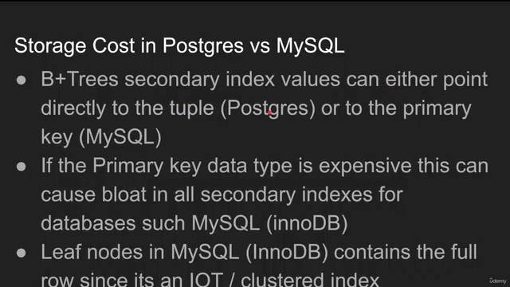
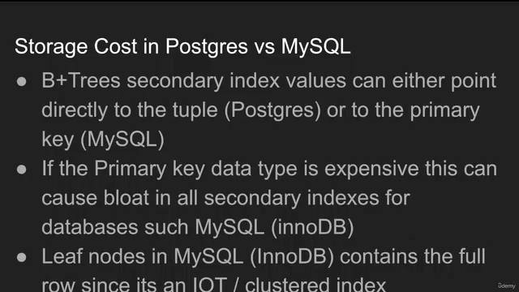
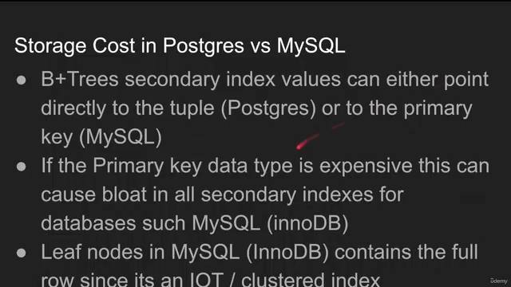
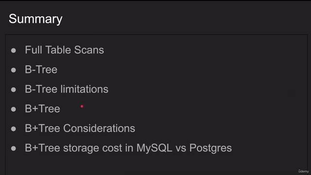
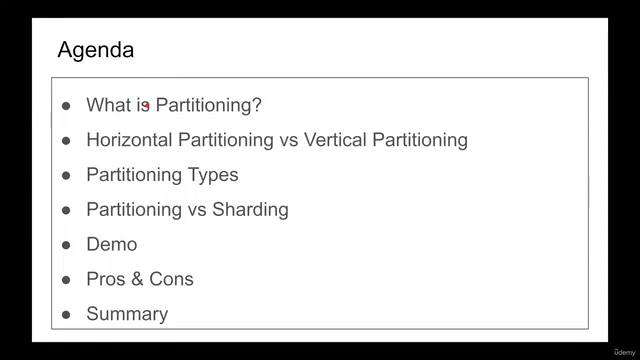
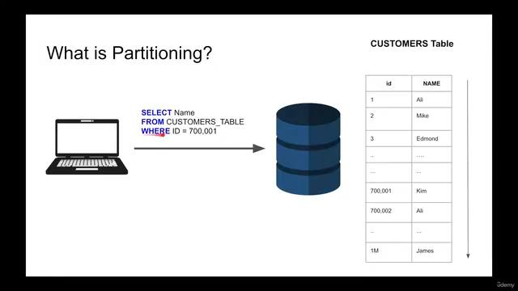
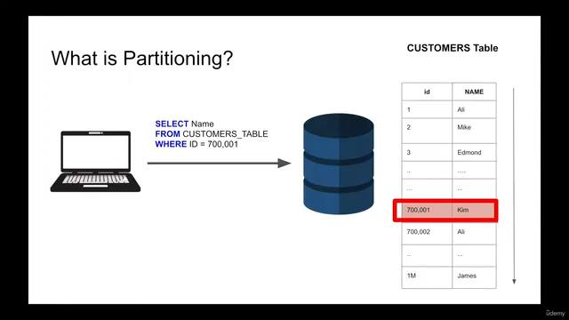
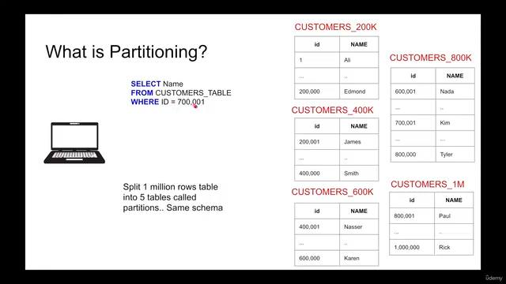
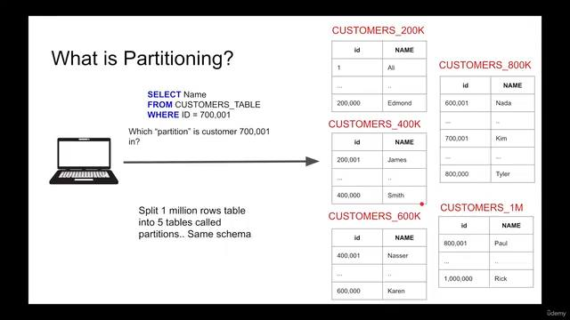

# 1. 这一节做什么

这一节覆盖 `P37–P40`，目标不是背 B+ 树定义，而是把两条工程结论跑成可观察的实验：

1. **先理解索引的存储成本**：Postgres 的二级索引可以直接指向 tuple；MySQL 的二级索引指向主键。于是当主键很大，例如 GUID/UUID，MySQL 的每个二级索引都会被主键值“撑大”，可能放不进内存。讲师还用 MySQL/RedB 的 clustered index / index organized table 说明：叶子节点可能包含整行。
2. **再做分区实验**：把一张很大的 `customers` 表按 `id` 范围拆成多个分区；父表本身不存实际数据，只保存分区元数据。查询 `WHERE id = ...` 时，数据库先根据范围元数据定位到某个分区，再在该分区里走索引或扫描，从而避免每次都面对整张大表。

最终复现出来的项目是一个 **PostgreSQL 分区表 demo**：  
- `customers` 是父表；
- `customers_200k`、`customers_400k`、`customers_600k`、`customers_800k`、`customers_1000k` 是 5 个分区；
- 插入 1,000,000 行；
- 查询 `id = 700001`，它应落到 `customers_800k` 分区；
- 用 `EXPLAIN (ANALYZE, BUFFERS)` 观察分区裁剪；
- 再给一个 Node.js 脚本，用 `pg` 连接池执行同样的查询。

> 说明：`P39` 里讲师说会演示 10 million rows，但 `P40` 的具体拆法是 1 million 拆 5 份、每份 200k。下面按 `P40` 的可验证例子落地。想扩到 10M 需要同步改分区边界，见第 7 节。

阅读这一节时，建议把“实验目标”和“工程结论”分开看：实验目标是把表建出来、把数据灌进去、把查询计划打出来；工程结论是理解为什么分区能减少每次查询需要面对的数据范围，以及为什么索引和主键类型会影响存储成本。本文所有新增解释都是围绕复现实验展开的补充说明，不替代讲师原话；涉及课程没有展开的部分，会明确标注为“复现补充”或“课里没讲但你会撞上的”。

---

# 2. 讲师原话（带「—— pNNN [MM:SS]」）

> “Partitioning or database partitioning is a technique where you split up a huge table into multiple tables and let the database decide which table or which partition to hit based on the where clause.”
>
> —— p039 [00:00]

这句话就是整个 demo 的定义：拆表，不是应用层手动拆，而是让数据库根据 `WHERE` 条件决定命中哪个分区。

> “While the MySQL secondary indexes points to the primary key.”
>
> —— p037 [00:54]

讲师在对比 Postgres 和 MySQL 的二级索引：Postgres 的例子是指向 tuple，MySQL 是指向主键。这个差异会直接影响索引大小。

> “If the primary key is large ... any secondary key unfortunately will point to the primary key ... secondary indexes will be so large.”
>
> —— p037 [01:21] / p037 [01:50]

所以用 GUID/UUID 当主键要非常小心：主键越大，MySQL 的每个二级索引都可能被放大。

> “Leaf nodes in MySQL and RedB contains the full row since it's an index organized table or a clustered index too.”
>
> —— p037 [03:30]

这里讲的是 clustered index / index organized table：索引的叶子节点本身就带整行数据。讲师口述的 `RedB` 按原话保留；课程没有展开它的实现细节。

> “We're going to name them customers 200k customers 400k customers 600k customers 800k and customers 1 million.”
>
> —— p040 [01:26]

这是 `P40` 的具体分区命名方式。下面的 SQL 就按这个思路拆成 5 个分区。

> “customer table is just almost like a parent or inheritance. It doesn't have any data. That actual data exists on these table.”
>
> —— p040 [01:54]

父表像“入口/元数据表”，真实数据在分区里。PostgreSQL 的声明式分区正是这个效果。

> “The quickest way to query a table with a billion rows is to avoid querying a table with a billion rows.”
>
> —— p040 [02:52]

分区的核心不是让单行查询变魔法，而是尽量避免每次都面对整张大表。









---

# 3. 从零复现

## 3.1 环境与目录

课程没有指定 PostgreSQL 版本。为了让读者能直接跑，下面固定使用：

- Docker Compose
- 镜像：`postgres:16-alpine`
- Node.js：`>=20.6`，因为脚本使用 `node --env-file=.env`
- npm 包：`pg@8.13.1`

> 这些版本是本复现实验的最小环境，不是讲师在课里指定的版本。课里没讲 Docker/Node 版本。

目录结构：

```text
pg-partition-demo/
├── docker-compose.yml
├── package.json
├── .env.example
├── query.mjs
└── sql/
    ├── 01_schema.sql
    └── 02_seed.sql
```

创建目录：

```bash
mkdir -p pg-partition-demo/sql
cd pg-partition-demo
```

**命令解释：**

- `mkdir -p pg-partition-demo/sql`：创建项目目录以及它下面的 `sql/` 子目录。`-p` 的作用是“父目录不存在就一起创建”，并且如果目录已经存在也不会报错。这样你不需要先 `mkdir pg-partition-demo` 再 `mkdir pg-partition-demo/sql`。
- `cd pg-partition-demo`：进入项目根目录。后续的 `docker compose`、`npm install`、`cp .env.example .env` 都应该在这个目录下执行，因为 `docker-compose.yml`、`package.json` 都在这里。

**常见错误与排查：**

- 如果提示 `Permission denied`，说明当前用户没有在目标位置创建目录的权限。可以换到有权限的目录，例如 `cd ~` 后再执行，或者用有权限的用户执行。
- 如果 `cd pg-partition-demo` 提示 `No such file or directory`，先确认上一条 `mkdir` 是否成功，再用 `pwd` 和 `ls` 查看当前目录。
- 如果目录已经存在，`mkdir -p` 不会报错，这是正常行为；继续把第 4 节的文件放进去即可。

把第 4 节的 6 个文件分别保存到对应路径。

## 3.2 启动 PostgreSQL

```bash
docker compose up -d
```

**命令解释：**

- `docker compose up`：根据当前目录的 `docker-compose.yml` 创建并启动服务。
- `-d`：detached 模式，让容器在后台运行，不占用当前终端。第一次执行时 Docker 会拉取 `postgres:16-alpine` 镜像，然后创建容器和数据卷。
- 因为 `docker-compose.yml` 把 `./sql` 挂载到了 `/docker-entrypoint-initdb.d:ro`，所以 PostgreSQL 容器第一次初始化数据目录时，会按文件名顺序执行 `sql/01_schema.sql` 和 `sql/02_seed.sql`。`ro` 表示只读挂载，容器不会修改你本地的 SQL 文件。

第一次启动时，`sql/01_schema.sql` 和 `sql/02_seed.sql` 会按文件名顺序执行。因为要插入 1,000,000 行，可能需要几十秒到几分钟。看日志：

```bash
docker compose logs -f postgres
```

**命令解释：**

- `docker compose logs`：查看某个服务的日志。
- `-f`：follow，持续跟踪日志输出，类似 `tail -f`。
- `postgres`：这是 `docker-compose.yml` 里定义的服务名。注意这里用的是服务名，不是容器名；容器名是 `pg-partition-demo`。

等到日志出现数据库已准备好、初始化脚本执行完，再按 `Ctrl+C` 退出日志跟踪。`Ctrl+C` 只是退出日志跟踪，不会停止后台容器。

**常见错误与排查：**

- 如果提示 `Cannot connect to the Docker daemon`，说明 Docker Desktop 或 Docker 服务没有启动。先启动 Docker，再执行 `docker compose up -d`。
- 如果提示端口 `5432` 已被占用，说明本机已经有 PostgreSQL 或其他服务占用了 5432。可以把 `docker-compose.yml` 里的 `"5432:5432"` 改成 `"5433:5432"`，同时把 `.env` 里的 `PGPORT` 改成 `5433`。这是修改宿主机端口，不改变容器内 PostgreSQL 的 5432 端口。
- 如果日志里出现 SQL 报错，例如 `relation "customers" does not exist` 或分区边界错误，先检查 `sql/01_schema.sql` 和 `sql/02_seed.sql` 是否保存到了正确路径，以及文件名顺序是否正确。Docker 初始化脚本只在数据卷为空时执行；如果之前已经初始化过，需要按 3.5 节重置。
- 如果 `docker compose logs -f postgres` 一直没有看到初始化完成，不要急着查询。1,000,000 行插入需要时间，尤其是机器较慢时。可以另开一个终端执行 `docker compose ps` 看容器状态。

检查容器：

```bash
docker compose ps
```

**命令解释：**

- `docker compose ps`：列出当前 Compose 项目里的容器、状态、端口映射等信息。你应看到 `postgres` 服务处于 `running` 或 `Up` 状态。
- 如果状态是 `exited`，说明容器启动后退出了，需要看日志排查。

检查行数：

```bash
docker compose exec postgres psql -U postgres -d appdb \
  -c "SELECT count(*) AS total FROM customers;"
```

**命令解释：**

- `docker compose exec postgres`：在正在运行的 `postgres` 服务容器里执行命令。
- `psql`：PostgreSQL 的交互式客户端。
- `-U postgres`：用 `postgres` 用户连接。这个用户是 `docker-compose.yml` 里 `POSTGRES_USER` 设置的。
- `-d appdb`：连接 `appdb` 数据库，对应 `POSTGRES_DB`。
- `-c "..."`：执行一条 SQL 后退出，不进入交互式 shell。
- `SELECT count(*) AS total FROM customers;`：统计父表 `customers` 的总行数。由于父表是分区表，查询父表会汇总所有分区。

预期：

```text
 total
---------
 1000000
(1 row)
```

检查每个分区的行数：

```bash
docker compose exec postgres psql -U postgres -d appdb \
  -c "SELECT tableoid::regclass AS partition_name, count(*) AS rows FROM customers GROUP BY 1 ORDER BY 1;"
```

**命令解释：**

- `tableoid`：PostgreSQL 的系统列，表示这一行来自哪个物理表。对分区表来说，它能告诉你这一行实际落在哪个分区。
- `tableoid::regclass`：把内部 OID 转成可读的表名，例如 `customers_800k`。
- `count(*) AS rows`：统计每个分区的行数。
- `GROUP BY 1`：按查询结果的第一列分组，也就是按 `partition_name` 分组。
- `ORDER BY 1`：按第一列排序，方便查看。

预期能看到 5 个分区，每个约 200000 行。具体输出格式以你的 psql 为准。

**常见错误与排查：**

- 如果提示 `relation "customers" does not exist`，说明初始化 SQL 没有执行成功，或者你连错了数据库。先执行 `docker compose logs postgres` 看初始化日志，再确认 `-d appdb` 是否正确。
- 如果行数不是 1000000，先看是不是初始化还没结束。可以等一会儿再查；如果仍然不对，执行 `docker compose down -v` 后重新 `docker compose up -d`。
- 如果分区行数不是每个 200000，检查 `01_schema.sql` 里的 `FROM ... TO ...` 边界是否被改动过。这个 demo 的边界是左闭右开，具体见 5.1 节。

## 3.3 观察分区裁剪

执行：

```bash
docker compose exec postgres psql -U postgres -d appdb \
  -c "EXPLAIN (ANALYZE, BUFFERS) SELECT name FROM customers WHERE id = 700001;"
```

**命令解释：**

- `EXPLAIN`：显示 PostgreSQL 为这条 SQL 生成的执行计划。
- `ANALYZE`：不仅显示计划，还会真正执行这条 SQL，并把实际耗时、实际行数等运行时信息加入计划。对 `SELECT` 来说这是安全的；对写操作要谨慎。
- `BUFFERS`：显示缓冲区使用情况，例如命中多少块、读了多少块。它可以帮助你观察查询是否真的只碰了少量数据。
- `SELECT name FROM customers WHERE id = 700001;`：查询 `id = 700001` 的 `name`。按照分区边界，这个 `id` 应该落在 `customers_800k` 分区。

你应看到执行计划里只涉及 `customers_800k` 这个分区，而不是 5 个分区全扫。  
`EXPLAIN` 的输出字段名在不同 PostgreSQL 版本中可能不同，**不要背字段名，以实际输出为准**。

**常见错误与排查：**

- 如果执行计划里出现了所有 5 个分区，先确认查询条件是不是直接写在 `id` 上。如果写成 `WHERE id + 0 = 700001` 或 `WHERE some_function(id) = 700001`，优化器可能无法做分区裁剪。
- 如果提示 `there is no partition for the row`，这不是查询报错，而是插入时才会遇到的错误；查询 `id = 700001` 本身在边界内，不应出现这个错误。
- 如果 `EXPLAIN` 报语法错误，检查引号是否被 shell 吃掉。上面的命令用双引号包住整条 SQL，SQL 内部没有再嵌套双引号，通常没问题。
- 如果使用 Node 脚本里的参数化查询 `$1`，执行计划可能显示运行时裁剪信息，例如 `Subplans Removed`。不同版本显示方式不同，核心是看实际扫描的分区数量，以实际输出为准。









## 3.4 用 Node.js 查询

安装依赖：

```bash
npm install
```

**命令解释：**

- `npm install`：读取 `package.json` 里的依赖并安装。这个项目只依赖 `pg@8.13.1`。
- 安装完成后会生成 `node_modules/` 和 `package-lock.json`。`node_modules/` 不需要提交到版本库。

复制环境变量文件：

```bash
cp .env.example .env
```

**命令解释：**

- `cp .env.example .env`：把示例环境变量复制成实际的 `.env` 文件。`query.mjs` 通过 `node --env-file=.env` 读取它。
- 如果你在 Windows 的 PowerShell 里，`cp` 可能不可用，可以用 `Copy-Item .env.example .env`，或者手动创建 `.env` 并填入同样内容。

执行查询：

```bash
npm run query -- 700001
```

**命令解释：**

- `npm run query`：执行 `package.json` 里 `scripts.query` 定义的命令，即 `node --env-file=.env query.mjs`。
- `--`：npm 的参数分隔符。它后面的 `700001` 会作为命令行参数传给 `query.mjs`，在脚本里对应 `process.argv[2]`。
- 脚本会先打印 `EXPLAIN` 计划，再打印查询结果。由于 seed 里把 `id = 700001` 的 `name` 设成了 `Kim`，结果里应能看到 `Kim`。

**常见错误与排查：**

- 如果提示 `ECONNREFUSED`，说明 Node 连不上 PostgreSQL。先确认 `docker compose ps` 里容器是 `Up`，再确认 `.env` 里的 `PGHOST`、`PGPORT` 是否正确。如果你改过宿主机端口，`.env` 里的 `PGPORT` 也要同步改。
- 如果提示 `password authentication failed`，检查 `.env` 里的 `PGUSER`、`PGPASSWORD`、`PGDATABASE` 是否和 `docker-compose.yml` 一致。本 demo 默认是 `postgres/postgres/appdb`。
- 如果提示 `Cannot find module 'pg'`，说明 `npm install` 没有成功，或者你在错误的目录执行。回到项目根目录重新执行 `npm install`。
- 如果提示 `node: bad option: --env-file`，说明 Node 版本低于 20.6。可以升级 Node，或者把 `package.json` 的 `query` 脚本改成 `node query.mjs`，然后在 shell 里手动 `export` 环境变量。



## 3.5 重置实验

如果修改了 SQL，需要重新初始化数据库。因为 Docker 的初始化脚本只在数据卷为空时运行：

```bash
docker compose down -v
docker compose up -d
```

**命令解释：**

- `docker compose down`：停止并删除当前 Compose 项目里的容器和网络。
- `-v`：同时删除 `docker-compose.yml` 里声明的数据卷 `pgdata`。这一步会清空数据库数据，所以 1,000,000 行会重新插入。
- 再执行 `docker compose up -d` 会重新创建容器和数据卷，并再次执行 `/docker-entrypoint-initdb.d` 里的初始化 SQL。

`-v` 会删除数据卷，1,000,000 行会重新插入。

**常见错误与排查：**

- 如果你只执行了 `docker compose down` 而没有 `-v`，数据卷还在，初始化 SQL 不会重新执行。修改 SQL 后一定要带 `-v`。
- 如果你不想删除整个数据卷，也可以进入 `psql` 手动 `DROP TABLE` 再重新执行 SQL，但这不属于本 demo 的标准重置流程。
- 重置后第一次查询仍然要等初始化完成。不要 `up -d` 后立刻查行数，先看日志或等一会儿。

---

# 4. 完整代码

## 4.1 `docker-compose.yml`

```yaml
services:
  postgres:
    image: postgres:16-alpine
    container_name: pg-partition-demo
    environment:
      POSTGRES_USER: postgres
      POSTGRES_PASSWORD: postgres
      POSTGRES_DB: appdb
    ports:
      - "5432:5432"
    volumes:
      - ./sql:/docker-entrypoint-initdb.d:ro
      - pgdata:/var/lib/postgresql/data

volumes:
  pgdata:
```

## 4.2 `sql/01_schema.sql`

```sql
-- 01_schema.sql
DROP TABLE IF EXISTS customers CASCADE;

CREATE TABLE customers (
    id          bigint      NOT NULL,
    name        text        NOT NULL,
    email       text        NOT NULL,
    created_at  timestamptz NOT NULL DEFAULT now(),
    PRIMARY KEY (id)
) PARTITION BY RANGE (id);

CREATE TABLE customers_200k
    PARTITION OF customers
    FOR VALUES FROM (1) TO (200001);

CREATE TABLE customers_400k
    PARTITION OF customers
    FOR VALUES FROM (200001) TO (400001);

CREATE TABLE customers_600k
    PARTITION OF customers
    FOR VALUES FROM (400001) TO (600001);

CREATE TABLE customers_800k
    PARTITION OF customers
    FOR VALUES FROM (600001) TO (800001);

CREATE TABLE customers_1000k
    PARTITION OF customers
    FOR VALUES FROM (800001) TO (1000001);
```

## 4.3 `sql/02_seed.sql`

```sql
-- 02_seed.sql
INSERT INTO customers (id, name, email, created_at)
SELECT
    g AS id,
    CASE WHEN g = 700001 THEN 'Kim' ELSE 'customer_' || g END AS name,
    'user' || g || '@example.com' AS email,
    now() AS created_at
FROM generate_series(1, 1000000) AS g;

ANALYZE customers;
```

## 4.4 `package.json`

```json
{
  "name": "pg-partition-demo",
  "private": true,
  "type": "module",
  "engines": {
    "node": ">=20.6"
  },
  "scripts": {
    "query": "node --env-file=.env query.mjs"
  },
  "dependencies": {
    "pg": "8.13.1"
  }
}
```

## 4.5 `.env.example`

```text
PGHOST=localhost
PGPORT=5432
PGUSER=postgres
PGPASSWORD=postgres
PGDATABASE=appdb
```

## 4.6 `query.mjs`

```js
import pg from "pg";

const { Pool } = pg;

const pool = new Pool({
  host: process.env.PGHOST ?? "localhost",
  port: Number(process.env.PGPORT ?? 5432),
  user: process.env.PGUSER ?? "postgres",
  password: process.env.PGPASSWORD ?? "postgres",
  database: process.env.PGDATABASE ?? "appdb",
});

const id = Number(process.argv[2] ?? 700001);

try {
  const explain = await pool.query(
    "EXPLAIN (ANALYZE, BUFFERS) SELECT name FROM customers WHERE id = $1",
    [id]
  );

  console.log("EXPLAIN:");
  for (const row of explain.rows) {
    console.log(Object.values(row)[0]);
  }

  const result = await pool.query(
    "SELECT name FROM customers WHERE id = $1",
    [id]
  );

  console.log("RESULT:");
  console.log(result.rows);
} finally {
  await pool.end();
}
```

---

# 5. 逐行解释

## 5.1 分区 DDL 的关键点

```sql
CREATE TABLE customers (
    id bigint NOT NULL,
    name text NOT NULL,
    email text NOT NULL,
    created_at timestamptz NOT NULL DEFAULT now(),
    PRIMARY KEY (id)
) PARTITION BY RANGE (id);
```

- `DROP TABLE IF EXISTS customers CASCADE;`：如果 `customers` 已经存在，就先删除它。`CASCADE` 会一并删除依赖它的对象，例如分区。这个语句让初始化脚本可以重复执行，不会因为表已存在而失败。
- `id bigint NOT NULL`：`id` 是 64 位整数，足够容纳 1,000,000 以及未来更大的范围。`NOT NULL` 表示插入时不能为空。
- `name text NOT NULL`：客户名字，不能为空。
- `email text NOT NULL`：客户邮箱，不能为空。
- `created_at timestamptz NOT NULL DEFAULT now()`：创建时间，带时区。`DEFAULT now()` 表示不显式传值时使用当前时间。
- `PRIMARY KEY (id)`：主键是 `id`。在 PostgreSQL 声明式分区里，分区表的唯一约束必须包含分区键；这里分区键就是 `id`，所以主键可以只写 `id`。
- `PARTITION BY RANGE (id)`：告诉 PostgreSQL 按 `id` 的范围做水平分区。父表 `customers` 本身不保存具体行，具体行进入子分区。对应讲师说的 “parent or inheritance. It doesn't have any data.”

```sql
CREATE TABLE customers_800k
    PARTITION OF customers
    FOR VALUES FROM (600001) TO (800001);
```

- `CREATE TABLE customers_800k`：创建一个名为 `customers_800k` 的分区表。
- `PARTITION OF customers`：声明它是 `customers` 的分区，不是独立表。插入到父表的数据会被路由到匹配的分区。
- `FROM (600001) TO (800001)`：范围是左闭右开，包含 `600001` 到 `800000`。所以 `700001` 会落到 `customers_800k`。
- 这与 `P40` 里“700001 位于 600 和 800 之间”的讲解一致。

其余分区同理：

- `customers_200k`：`1` 到 `200000`。
- `customers_400k`：`200001` 到 `400000`。
- `customers_600k`：`400001` 到 `600000`。
- `customers_800k`：`600001` 到 `800000`。
- `customers_1000k`：`800001` 到 `1000000`。

注意边界是左闭右开，所以 `200001` 属于 `customers_400k`，不属于 `customers_200k`。如果插入 `id = 0` 或 `id > 1000000`，会因为没有匹配分区而报错。

## 5.2 seed 数据

```sql
INSERT INTO customers (id, name, email, created_at)
SELECT
    g AS id,
    CASE WHEN g = 700001 THEN 'Kim' ELSE 'customer_' || g END AS name,
    'user' || g || '@example.com' AS email,
    now() AS created_at
FROM generate_series(1, 1000000) AS g;

ANALYZE customers;
```

- `INSERT INTO customers (...)`：向父表插入数据。PostgreSQL 会根据 `id` 自动路由到对应分区。
- `SELECT ... FROM generate_series(1, 1000000) AS g`：生成 1 到 1,000,000 的整数，每一行作为一条插入数据。
- `g AS id`：把生成的整数作为 `id`。
- `CASE WHEN g = 700001 THEN 'Kim' ELSE 'customer_' || g END AS name`：当 `g = 700001` 时名字是 `Kim`，其他行是 `customer_<id>`。这是为了复现讲师在 `P40` 里查询到 `Kim` 的例子。
- `'user' || g || '@example.com' AS email`：生成类似 `user700001@example.com` 的邮箱。
- `now() AS created_at`：所有行使用同一个当前时间。对本 demo 来说这没问题，因为重点是分区裁剪，不是时间分布。
- `ANALYZE customers;`：让优化器收集统计信息。没有统计信息时，执行计划可能不够典型；`ANALYZE` 后更容易观察索引和分区裁剪。

## 5.3 Node 脚本

```js
const pool = new Pool({ ... });
```

- `Pool` 是连接池。在 Node 里相当于复用一组数据库连接，避免每次查询都重新建立连接。
- `process.env.PGHOST ?? "localhost"`：如果环境变量没设置，就用默认值。这样 `.env` 缺失时也能连本地默认库。
- `process.env.PGPORT ?? 5432`：端口默认 5432，并用 `Number(...)` 转成数字。
- `process.argv[2]`：读取命令行参数，例如 `npm run query -- 700001` 里的 `700001`。如果没有传，默认用 `700001`。

```js
"EXPLAIN (ANALYZE, BUFFERS) SELECT name FROM customers WHERE id = $1"
```

- `$1` 是参数化查询占位符，`pg` 会把 `id` 作为参数传入，不要用字符串拼接 SQL。参数化可以避免 SQL 注入，也让数据库有机会复用执行计划。
- `EXPLAIN (ANALYZE, BUFFERS)` 会实际执行查询并返回执行计划。`ANALYZE` 会真的跑语句，所以不要在生产环境随便对写操作使用。
- `BUFFERS` 会给出缓冲区使用信息；具体输出字段以实际版本为准。

```js
console.log(Object.values(row)[0]);
```

- `EXPLAIN` 返回的行对象结构随版本可能不同；这里只取每行第一个值打印，避免依赖具体字段名。
- 如果你看到的是 `QUERY PLAN` 字段，也可以直接 `console.log(row["QUERY PLAN"])`，但不同版本字段名可能不同，所以示例用了更通用的写法。

## 5.4 与前台/应用层的对照

这里的“前台”指调用数据库的应用侧；本 demo 中就是 Node.js 脚本。若你的项目是 Web 前端，前端不应直接连 PostgreSQL，而是通过后端 API；后端再连数据库。对照关系可以这样理解：

| 数据库侧/实验命令 | 应用侧/Node 脚本 | 说明 |
| --- | --- | --- |
| `WHERE id = 700001` | `$1` 绑定 `id` | 应用侧用参数化查询传值，不拼 SQL 字符串 |
| `EXPLAIN (ANALYZE, BUFFERS)` | `pool.query("EXPLAIN ...")` | 应用侧也可以打印执行计划，用于排查慢查询 |
| `customers_800k` 分区 | 查询结果 `Kim` | 分区裁剪后只落到目标分区，再返回目标行 |
| `docker compose exec ... psql` | `npm run query -- 700001` | 前者是手动验证，后者是应用侧复现 |

应用侧最需要注意的是：不要把 `id` 直接拼进 SQL 字符串。使用 `$1` 既安全，也不会阻止 PostgreSQL 根据参数值做分区裁剪。实际是否裁剪、何时裁剪，以 `EXPLAIN` 输出为准。

---

# 6. 复现检查清单

- [ ] 已创建 `pg-partition-demo/` 目录，并放入 6 个文件。  
  说明：6 个文件分别是 `docker-compose.yml`、`package.json`、`.env.example`、`query.mjs`、`sql/01_schema.sql`、`sql/02_seed.sql`。目录结构要和第 3.1 节一致，否则 `docker compose` 或 `npm run query` 会找不到文件。

- [ ] `docker compose up -d` 成功，`docker compose ps` 能看到 PostgreSQL 容器。  
  说明：`up -d` 成功只代表容器启动命令被接受，还要用 `ps` 确认状态是 `Up`。如果状态是 `Exited`，看 `docker compose logs postgres`。

- [ ] `docker compose logs postgres` 中没有初始化 SQL 报错。  
  说明：初始化 SQL 只在数据卷为空时执行。如果日志里有 `ERROR`，先解决 SQL 错误，再执行 `docker compose down -v` 重新初始化。

- [ ] `SELECT count(*) FROM customers;` 返回 `1000000`。  
  说明：这个查询统计父表总行数。如果返回 0，说明 seed 没执行；如果报错 `relation does not exist`，说明 schema 没执行或连错数据库。

- [ ] 分区行数查询能看到 5 个分区，每个约 `200000` 行。  
  说明：用 `tableoid::regclass` 分组统计。每个分区应正好 200000 行；如果边界被改过，行数可能不同，但总和仍应是 1000000。

- [ ] `EXPLAIN (ANALYZE, BUFFERS) SELECT name FROM customers WHERE id = 700001;` 只命中 `customers_800k` 分区。  
  说明：这是分区裁剪的核心观察点。如果看到所有分区，先检查查询条件是否直接作用在 `id` 上，以及分区边界是否正确。

- [ ] `npm install` 成功，`pg` 版本为 `8.13.1`。  
  说明：`package.json` 里固定了 `pg@8.13.1`。如果安装失败，先检查网络和 npm registry；如果版本不对，删除 `node_modules` 和 `package-lock.json` 后重装。

- [ ] `cp .env.example .env` 后，`npm run query -- 700001` 能连接数据库。  
  说明：`.env` 提供连接参数。如果连接失败，先检查 `PGHOST`、`PGPORT`、`PGUSER`、`PGPASSWORD`、`PGDATABASE` 是否和容器配置一致。

- [ ] Node 脚本输出查询结果中包含 `Kim`。  
  说明：seed 里把 `id = 700001` 的 `name` 设成了 `Kim`。如果结果不是 `Kim`，检查 seed 是否执行、查询的 `id` 是否真的是 `700001`。

- [ ] 修改 SQL 后知道用 `docker compose down -v` 重新初始化。  
  说明：Docker 初始化脚本只在数据卷为空时运行。只 `down` 不带 `-v` 不会清空数据卷，修改后的 SQL 不会自动重新执行。

---

# 7. 课里没讲但你会撞上的

1. **课程没给完整 SQL**  
   `P39–P40` 讲的是思路和分区命名，逐字稿里没有完整 `CREATE TABLE`。上面的 DDL 是按讲师的“父表 + 5 个范围分区 + 1M 行”复现的，不是逐字抄课程。  
   **常见错误与排查**：如果你照抄课程片段发现缺字段，不要以为课程漏了关键业务逻辑；本 demo 只需要 `id`、`name`、`email`、`created_at` 这几个字段来演示分区和查询。字段类型可以按你的实际项目调整，但分区键和主键约束要一起考虑。

2. **课程没指定 PostgreSQL 版本**  
   这里用 `postgres:16-alpine`。不同版本的 `EXPLAIN` 输出字段名可能不同，所以文档里不写死字段名。看到实际输出即可。  
   **常见错误与排查**：如果你用 PostgreSQL 11 或更早版本，声明式分区的行为和输出可能不同。建议直接用 16；如果必须用旧版本，先确认 `PARTITION BY RANGE` 和 `PARTITION OF` 的支持情况。

3. **Docker 初始化脚本只跑一次**  
   如果你改了 `sql/01_schema.sql` 或 `sql/02_seed.sql`，但数据卷已经存在，脚本不会重新执行。必须：
   ```bash
   docker compose down -v
   docker compose up -d
   ```
   **常见错误与排查**：如果你改了 SQL 但查询结果没变，先想“数据卷是不是还在”。`down -v` 会删数据，执行前确认你不需要保留旧数据。

4. **1,000,000 行插入需要时间**  
   第一次 `docker compose up -d` 后不要立刻查询，先看日志或等初始化完成。若机器较慢，可能几分钟。  
   **常见错误与排查**：如果查询时行数只有一部分，可能初始化还在进行。看 `docker compose logs -f postgres`，等出现初始化完成再查。不要反复 `down -v`，除非你确定初始化失败了。

5. **分区边界是左闭右开**  
   `FROM (600001) TO (800001)` 包含 `600001`，不包含 `800001`。如果插入 `id = 0` 或 `id > 1000000`，会因为没有匹配分区而报错。要扩到 10M，必须增加分区或改边界。  
   **常见错误与排查**：报错 `no partition of relation "customers" found for row` 时，检查插入的 `id` 是否落在所有分区边界内。扩到 10M 时，不能只改 seed 的 `generate_series`，还要同步增加分区或调整最后一个分区的 `TO` 值。

6. **PostgreSQL 分区表的唯一约束必须包含分区键**  
   本 demo 的 `PRIMARY KEY (id)` 没问题，因为分区键就是 `id`。如果你以后想加 `UNIQUE(email)`，在 PostgreSQL 声明式分区里不能单独 `UNIQUE(email)`，除非约束里包含分区键。这一点课里没讲。  
   **常见错误与排查**：如果你执行 `ALTER TABLE customers ADD UNIQUE (email);` 报错，说明唯一约束没有包含分区键。可以改成 `UNIQUE (id, email)`，或者重新设计分区键。不要为了加唯一约束而随意改分区键，先想清楚业务唯一性。

7. **`EXPLAIN ANALYZE` 会真的执行查询**  
   对 `SELECT` 没问题；对 `INSERT/UPDATE/DELETE` 要小心。生产环境不要随手对写语句跑 `ANALYZE`。  
   **常见错误与排查**：如果你在写操作上跑 `EXPLAIN ANALYZE`，数据可能真的被修改。排查写语句时，可以先用 `EXPLAIN` 不带 `ANALYZE` 看计划，或者放在事务里回滚。

8. **Node 的 `--env-file` 需要 Node >= 20.6**  
   如果你的 Node 更老，可以不用 `--env-file`，改为手动导出环境变量，或把 `package.json` 的 `query` 脚本改成 `node query.mjs`，然后在 shell 里 `export` 变量。  
   **常见错误与排查**：报错 `bad option: --env-file` 时，先 `node -v` 看版本。低于 20.6 就升级，或者改脚本。Windows PowerShell 设置环境变量的语法和 `export` 不同，可以用 `$env:PGHOST="localhost"` 这种方式。

9. **课程没有展开 partitioning vs sharding 的完整对比**  
   `P39` 只说会讨论 partitioning 与 sharding 的区别，但这段逐字稿没有给出 sharding 的具体实现。不要把这套单机 PostgreSQL 分区实验当成 sharding。分区仍然是同一个数据库实例里的表拆分；sharding 是跨节点拆分，课里没讲。  
   **常见错误与排查**：如果你把分区当成“分布式扩展”，可能会误判容量和故障域。本 demo 只验证单实例内的分区裁剪，不验证跨节点路由、副本、分片键迁移等 sharding 问题。

10. **课程没有展开 vertical partitioning 和其他分区类型**  
    `P39` 提到 horizontal/vertical partitioning 和“partitioning types”，但具体类型没有在 `P37–P40` 的逐字稿里展开。本 demo 只落地了 PostgreSQL 的 RANGE 分区。  
    **常见错误与排查**：不要因为本 demo 用了 RANGE，就以为所有分区都长这样。PostgreSQL 还支持 LIST、HASH 等分区方式；本 demo 不展开，是因为课程这段只落地了 RANGE 示例。

11. **P37 的 MySQL 结论不能直接套到 PostgreSQL**  
    `P37` 讲的是 MySQL 二级索引指向主键、GUID/UUID 主键导致二级索引膨胀；本 demo 是 PostgreSQL，主键用 `bigint`，没有复现 MySQL 的索引膨胀实验。若要做 MySQL 对比，需要另起 MySQL 容器和表结构，课里没给这部分 SQL。  
    **常见错误与排查**：如果你在 PostgreSQL 里观察不到“二级索引被主键撑大”的同样现象，不要怀疑实验做错了。两个数据库的索引组织方式不同，本 demo 的重点是 PostgreSQL 分区裁剪，不是复现 MySQL 的索引膨胀。

---

# 8. 常见错误与排查总表

| 现象 | 可能原因 | 排查与处理 |
| --- | --- | --- |
| `Cannot connect to the Docker daemon` | Docker 没启动 | 启动 Docker Desktop 或 Docker 服务后重试 |
| `port is already allocated` | 宿主机 5432 被占用 | 改 `docker-compose.yml` 的宿主机端口，例如 `"5433:5432"`，同步改 `.env` 的 `PGPORT` |
| `relation "customers" does not exist` | 初始化 SQL 没执行、连错库、容器没初始化完 | 看 `docker compose logs postgres`；确认 `-d appdb`；必要时 `down -v` 重来 |
| 查询行数不是 1000000 | 初始化未完成或 seed 失败 | 等日志完成；检查 `02_seed.sql`；`down -v` 重新初始化 |
| 执行计划扫描所有分区 | 查询条件没有直接作用在分区键上，或边界不对 | 用 `WHERE id = 700001`；检查 `\d+ customers` 的分区边界 |
| `no partition of relation "customers" found for row` | 插入的 `id` 超出所有分区范围 | 检查分区边界；扩到 10M 时同步增加分区 |
| `password authentication failed` | `.env` 用户/密码/库名不对 | 对照 `docker-compose.yml` 的 `POSTGRES_*` 配置 |
| `ECONNREFUSED` | Node 连不上数据库 | 确认容器 `Up`；确认 `PGHOST`、`PGPORT`；改过端口要同步 |
| `Cannot find module 'pg'` | 没安装依赖或目录不对 | 在项目根目录执行 `npm install` |
| `bad option: --env-file` | Node 版本低于 20.6 | 升级 Node，或改脚本并手动设置环境变量 |
| 改了 SQL 但结果没变 | 数据卷还在，初始化脚本没重跑 | 执行 `docker compose down -v` 再 `up -d` |

---

# 9. 与前台/应用层的对照

本 demo 的“前台”可以理解为调用数据库的应用侧。实际项目里，浏览器前端不应该直接连接 PostgreSQL；前端调用后端 API，后端再通过连接池访问数据库。把本 demo 的 SQL 和 Node 脚本对照起来，可以这样看：

1. **查询条件对照**：SQL 里写 `WHERE id = 700001`，Node 脚本里写 `WHERE id = $1` 并传 `[id]`。两者表达的是同一个查询，只是应用侧用参数化方式传值。
2. **执行计划对照**：在 `psql` 里用 `EXPLAIN (ANALYZE, BUFFERS)` 观察分区裁剪；在 Node 脚本里用 `pool.query("EXPLAIN ...")` 也能拿到执行计划。区别是前者手动执行，后者由应用代码执行。
3. **结果对照**：`psql` 里查询 `id = 700001` 应返回 `Kim`；Node 脚本也应返回 `Kim`。如果一边有一边没有，先检查是不是连了不同的数据库或不同的容器。
4. **错误对照**：`psql` 里的连接错误、SQL 错误，在 Node 里通常会以异常形式抛出。排查时先看 Node 的报错信息，再回到 `psql` 用同样条件验证，能快速判断是数据库问题还是应用配置问题。
5. **安全对照**：应用侧不要拼接 SQL 字符串。使用 `$1` 占位符既安全，也不会阻止 PostgreSQL 根据参数值做分区裁剪；实际是否裁剪以 `EXPLAIN` 输出为准。

如果你要把这个 demo 接到 Web 前端，推荐链路是：前端请求后端接口，例如 `GET /customers/700001`；后端用 `pg` 连接池执行参数化查询；数据库根据 `id` 做分区裁剪；后端把结果返回前端。这样前端不需要知道分区细节，分区仍然是数据库内部的优化手段。