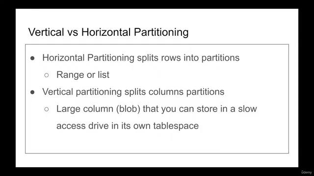
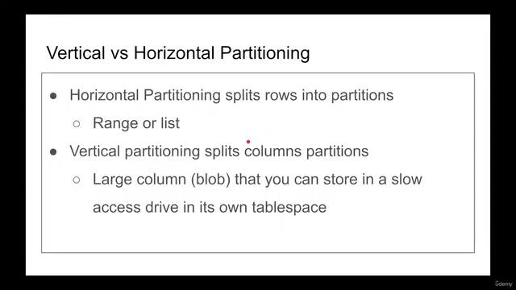
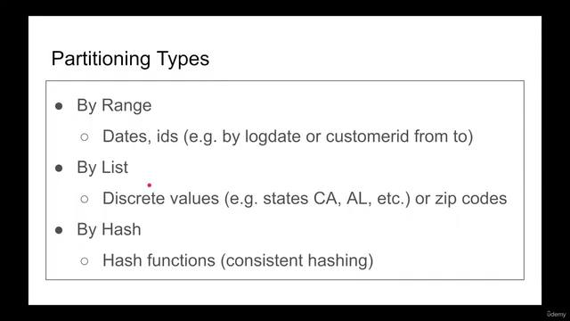
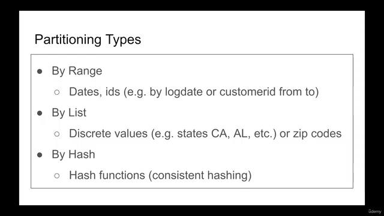
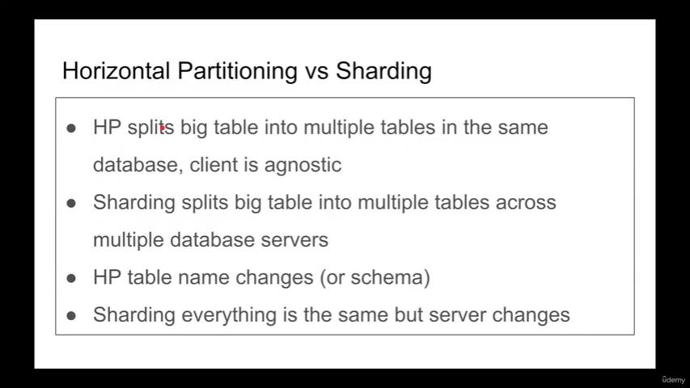
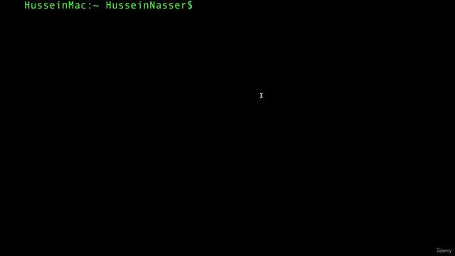
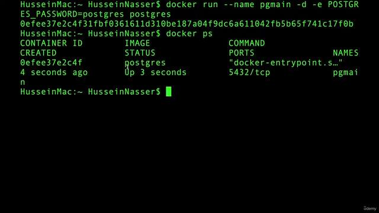
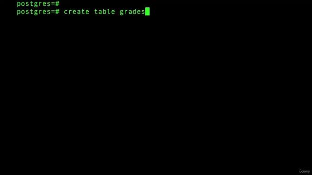
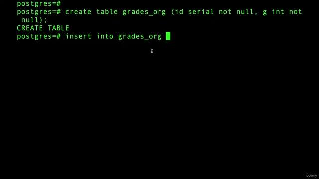

# Fundamentals of Database Engineering：PostgreSQL 分区演示（P041–P044）复现文档

> 复现范围：P041–P044。  
> 课程原始演示使用 Docker + PostgreSQL，演示目标是：启动 PostgreSQL、创建 `grades_original` 表、插入约 1000 万行、创建索引、查看表结构；P044 开头还提到后续要创建分区表并做查询解释。  
> 说明：逐字稿中 P044 实际展示到 `\d grades_original` 左右，**没有给出完整分区 DDL**。因此本文第 3、4 节先完整复现逐字稿里出现的操作；第 7 节额外给出一个明确标注为「课里没讲、为补全实验」的 PostgreSQL 原生分区脚本，不把它冒充成讲师原话。

---

## 1. 这一节做什么

这一节围绕「大表怎么拆」展开，核心不是背概念，而是先把 PostgreSQL 跑起来，用一张约 1000 万行的 `grades_original` 表感受大表、索引和后续分区实验的前置条件。

P041 先区分两种拆分方向：

- **水平分区 / horizontal partitioning**：按行切。比如客户 ID 从 1 到 10000 在一个分区，从 10001 到 20000 在另一个分区。概念上像是把整张表横向切成几块。
- **垂直分区 / vertical partitioning**：按列切。比如把很少查询的大字段，例如 blob/document，拆到另一张表或另一个表空间，让常用的短列继续留在快速存储上。



P042 继续讲常见的分区策略：

- **按范围 range**：例如 IoT 设备按年份、季度、月份写入日志；旧年份分区可以整体迁移到慢速归档存储。
- **按列表 list**：例如按州、国家、邮编分区；California 客户进一个分区，Alabama 客户进另一个分区。
- **按哈希 hash**：用哈希函数把值分散到不同分区；讲师提到 Cassandra 常用这种方式，也提到代理层用 IP hash 决定后端。




P043 则把 **partitioning 和 sharding** 讲清楚：

- Partitioning：还是同一个数据库，大表在数据库内部被拆成多个分区；客户端写普通 SQL，不关心命中哪个分区。
- Sharding：拆到不同数据库服务器上；客户端或代理通常要知道/决定访问哪个分片。讲师明确说不喜欢 sharding 里「client aware of the shard」这一点。







P044 进入 Demo：用 Docker 启动 PostgreSQL，进入容器里的 `psql`，创建 `grades_original`，插入约 1000 万行，再创建索引并查看表结构。逐字稿中讲师说：

> "我们会使用 Docker，启动一个漂亮的 Postgres 实例，然后往那张表里插入大约 1000 万行……"
> —— p044 [00:00]

> "这里的要求很简单，只要有 Docker 就够了，因为我会启动一个 Postgres 实例……"
> —— p044 [00:28]



本文的落地目标：你在一个空目录里保存下面几个文件，执行 `./run.sh`，就能启动 `pg_main` 容器、进入 `psql`、创建 `grades_original`、插入 1000 万行、创建索引，并看到 `\d grades_original` 的表结构。然后再按需执行补充分区脚本。

为了让复现更可控，下面会把「容器启动」「SQL 文件执行」「psql 元命令」「补充分区脚本」分别拆开说明。每一段都会说明命令目的、执行后的预期结果、常见错误和排查方式。需要特别强调：本文中的「前台/Node 对照」只是帮助前端转数据库的同学建立类比，不是讲师在 P041–P044 里的原话；课程里没有系统讲 Node 连接池、迁移工具或前端分片路由。

---

## 2. 讲师原话（带页码与时间）

下面只摘录和复现最相关的原话，不按页码流水账排列，而是按「概念 → Demo」组织。

关于水平分区：

> "水平分区就是像我们刚才讨论的那样，按行来拆分分区……"
> —— p041 [00:00]

> "所以我们是按行拆分，差不多就是水平方向。"
> —— p041 [00:00]

关于垂直分区：

> "另一方面，垂直分区就是真正从上到下垂直拆分。你本质上做的是拆分列……"
> —— p041 [00:55]

> "这很有用，比如你有一个很大的列，里面存的是二进制大对象，而你几乎不会查询那个二进制大对象文档……"
> —— p041 [00:55]

关于 range 与 list：

> "你可以按日志日期分区……比如 2012 年数据、2013 年数据、2020 年数据，每年一个分区……"
> —— p042 [00:00]

> "按列表分区，就是指定一组值，比如州，例如加利福尼亚……"
> —— p042 [00:58]

关于 partition 与 sharding：

> "水平分区，或者直接叫分区，是把大表拆成同一个数据库里的多张表。"
> —— p043 [00:00]

> "分片则不同，它也会把大表拆成多张表。不过，这些表位于完全不同的服务器上。"
> —— p043 [00:28]

> "所以仔细想想，客户端是知道分片的……"
> —— p043 [01:54]

关于 Demo：

> "我们会使用 Docker，启动一个漂亮的 Postgres 实例，然后插入大约 1000 万行……"
> —— p044 [00:00]

> "这里的要求很简单，只要有 Docker 就够了……"
> —— p044 [00:28]

> "各位，我要创建一张表。建表语句是 create table grades……ID serial……grade integer not null。"
> —— p044 [01:58] 至 p044 [02:56]

> "我要往这张表里插入大约 1000 万行……insert into grades_original……"
> —— p044 [02:56]

> "那么现在，我们在这张表上创建一个索引。"
> —— p044 [04:54]





---

## 3. 从零复现

### 3.1 环境与目录

你需要：

- 已安装 Docker。
- 一个可写目录，例如 `db-partition-demo`。
- 本文为了可重复实验，把镜像锁定为 `postgres:16`。注意：**讲师逐字稿里用的是 `postgres` 镜像，没有讲具体 tag**；`postgres:16` 是本文为复现稳定性补的版本选择，不是讲师原话。若你坚持完全照原句，可以把 `postgres:16` 改成 `postgres`，但会拉取当时最新的 latest。

目录结构如下：

```text
db-partition-demo/
├── run.sh
├── demo.sql
└── partition_extra.sql
```

`partition_extra.sql` 是 P044 开头提到、但逐字稿没有完整展示的分区补全实验，属于「课里没讲、但你做完整实验会需要」的脚本。

### 3.2 启动与执行

在 `db-partition-demo` 目录下创建下面三个文件后执行：

```bash
chmod +x run.sh
./run.sh
```

`run.sh` 会做这些事，下面逐条说明目的和排查点：

1. 删除旧的 `pg_main` 容器，避免容器名冲突。  
   目的：Docker 不允许两个同名容器同时存在；如果你上次实验没清理，`docker run --name pg_main` 会直接失败。排查：如果删除失败，先看 `docker ps -a | grep pg_main` 是否还有残留容器，必要时手动 `docker rm -f pg_main`。

2. 启动 `postgres:16`，容器名为 `pg_main`。  
   目的：得到一台本地 PostgreSQL 实例。排查：如果 Docker 守护进程没启动，会报 `Cannot connect to the Docker daemon`；先启动 Docker Desktop 或系统服务。

3. 设置环境变量 `POSTGRES_PASSWORD=postgres`。  
   目的：官方 PostgreSQL 镜像首次初始化时必须知道超级用户密码。排查：如果漏掉这个环境变量，容器日志通常会提示未指定超级用户密码；用 `docker logs pg_main` 查看。

4. 等待 PostgreSQL 可用。  
   目的：容器启动不等于数据库已经能接受连接，首次初始化要建数据目录、启动进程。排查：如果循环 30 秒仍未就绪，检查 `docker logs pg_main`，常见原因是资源不足、镜像启动失败、磁盘空间不足。

5. 把 `demo.sql` 复制进容器。  
   目的：避免在 `psql` 里手敲长 SQL，也避免宿主机路径和容器路径混淆。排查：如果 `docker cp` 报找不到文件，检查 `SCRIPT_DIR` 是否定位正确，以及 `demo.sql` 是否真的在当前脚本同目录。

6. 用 `psql -U postgres` 执行 `demo.sql`。  
   目的：复现建表、插入 1000 万行、建索引、查看表结构。排查：如果 SQL 中途失败，先看 `demo.sql` 第一行 `\set ON_ERROR_STOP on` 是否让 psql 立即停止；再根据报错行号检查 SQL 文件是否复制完整。

7. 执行完后保留一个交互式 `psql`，方便你继续敲命令。  
   目的：让你能继续执行 `SELECT count(*)`、`\d`、`\i /tmp/partition_extra.sql` 等实验命令。排查：如果脚本在 CI 或非交互终端里卡住，是因为最后一行等待输入；删掉最后一行 `docker exec -it ... psql -U postgres` 即可只执行不回交互。

### 3.3 如果你要完全按讲师的手动方式做

讲师的顺序本质是：

```bash
docker run --name pg_main -d -e POSTGRES_PASSWORD=postgres postgres
docker ps
docker exec -it pg_main bash
psql -U postgres
```

进入 `psql` 后执行建表、插入、建索引。讲师没有暴露 PostgreSQL 端口，因为他直接 `bash` 进容器，在容器内部运行 SQL。本文的 `run.sh` 也沿用这个思路，不暴露 `5432` 端口。

逐条解释这四条命令：

- `docker run --name pg_main -d -e POSTGRES_PASSWORD=postgres postgres`：创建并后台启动容器。`--name` 固定名字，`-d` 后台运行，`-e` 设置密码，最后的 `postgres` 是镜像。常见错误：容器名重复、密码环境变量缺失、镜像拉取失败。排查：`docker ps -a` 看容器状态，`docker logs pg_main` 看启动日志。
- `docker ps`：只列出正在运行的容器。目的：确认 `pg_main` 处于 `Up` 状态。常见错误：看不到容器，说明启动失败或已退出；用 `docker ps -a` 查看退出状态。
- `docker exec -it pg_main bash`：进入容器内的 bash。`-it` 分配交互终端。常见错误：容器没运行时会报 no running container；先确认 `docker ps`。
- `psql -U postgres`：以 `postgres` 用户进入 PostgreSQL 交互客户端。常见错误：数据库尚未就绪时会连接失败；等待几秒或看日志。进入后提示符通常变成 `postgres=#`，此时再执行 SQL。



> 上图选用 p044 03:25 附近的插入演示画面；alt 中保留帧号和时间，方便对照截图清单。

---

## 4. 完整代码

### 4.1 `run.sh`

保存为 `db-partition-demo/run.sh`：

```bash
#!/usr/bin/env bash
set -euo pipefail

CONTAINER="pg_main"
IMAGE="postgres:16"
SCRIPT_DIR="$(cd "$(dirname "${BASH_SOURCE[0]}")" && pwd)"

# 1. 清理旧容器，避免 "container name already in use"
docker rm -f "$CONTAINER" >/dev/null 2>&1 || true

# 2. 启动 PostgreSQL。讲师没有暴露端口；这里同样不映射 5432。
docker run \
  --name "$CONTAINER" \
  -d \
  -e POSTGRES_PASSWORD=postgres \
  "$IMAGE"

# 3. 等待数据库启动。pg_isready 是 PostgreSQL 镜像自带工具。
for i in $(seq 1 30); do
  if docker exec "$CONTAINER" pg_isready -U postgres >/dev/null 2>&1; then
    break
  fi
  sleep 1
done

# 4. 把 SQL 文件复制进容器
docker cp "$SCRIPT_DIR/demo.sql" "$CONTAINER:/tmp/demo.sql"

# 5. 执行建表、插入、建索引、查看表结构
docker exec -it "$CONTAINER" psql -U postgres -f /tmp/demo.sql

# 6. 保留一个交互式 psql，方便继续实验
docker exec -it "$CONTAINER" psql -U postgres
```

如果你只想执行脚本、不进入交互式 `psql`，删掉最后一行 `docker exec -it ... psql -U postgres` 即可。

### 4.2 `demo.sql`

保存为 `db-partition-demo/demo.sql`：

```sql
\set ON_ERROR_STOP on

DROP TABLE IF EXISTS grades_original;

CREATE TABLE grades_original (
  id serial NOT NULL,
  g integer NOT NULL
);

INSERT INTO grades_original (g)
SELECT floor(random() * 100)::integer
FROM generate_series(1, 10000000);

CREATE INDEX grades_original_index
ON grades_original (g);

\d grades_original
```

说明：逐字稿里讲师口述的插入表达式是 `floor(random() * 100)`，并强调先插入、后建索引。本文在复现稿里加了 `::integer` 显式类型转换，原因是不同 PostgreSQL 版本/严格类型检查下，`double precision` 直接插入 `integer` 可能报类型错误。这个 `::integer` 属于复现修正，不是讲师逐字稿明确展示的写法。

### 4.3 `partition_extra.sql`（课里没讲，补全实验用）

逐字稿 P044 开头说「create table partitions and join the partitions to the master table」，但后续逐字稿没有展开完整 DDL。下面是一个可运行的 PostgreSQL 原生 range 分区补全脚本，**不是讲师原话**，只是为了让你的实验能继续往前走。

保存为 `db-partition-demo/partition_extra.sql`：

```sql
\set ON_ERROR_STOP on

DROP TABLE IF EXISTS grades CASCADE;

CREATE TABLE grades (
  id integer NOT NULL,
  g integer NOT NULL
) PARTITION BY RANGE (g);

CREATE TABLE grades_p0 (
  id integer NOT NULL,
  g integer NOT NULL
);

CREATE TABLE grades_p1 (
  id integer NOT NULL,
  g integer NOT NULL
);

CREATE TABLE grades_p2 (
  id integer NOT NULL,
  g integer NOT NULL
);

CREATE TABLE grades_p3 (
  id integer NOT NULL,
  g integer NOT NULL
);

ALTER TABLE grades ATTACH PARTITION grades_p0 FOR VALUES FROM (0) TO (25);
ALTER TABLE grades ATTACH PARTITION grades_p1 FOR VALUES FROM (25) TO (50);
ALTER TABLE grades ATTACH PARTITION grades_p2 FOR VALUES FROM (50) TO (75);
ALTER TABLE grades ATTACH PARTITION grades_p3 FOR VALUES FROM (75) TO (100);

INSERT INTO grades (id, g)
SELECT id, g FROM grades_original;

SELECT count(*) AS total_rows FROM grades;
SELECT count(*) AS p0_rows FROM grades_p0;
SELECT count(*) AS p1_rows FROM grades_p1;
SELECT count(*) AS p2_rows FROM grades_p2;
SELECT count(*) AS p3_rows FROM grades_p3;

EXPLAIN (COSTS OFF)
SELECT count(*) FROM grades WHERE g >= 0 AND g < 25;
```

执行方式：先让 `run.sh` 跑完 `demo.sql`，然后在交互式 `psql` 中执行：

```sql
\i /tmp/partition_extra.sql
```

但要注意：`run.sh` 只把 `demo.sql` 复制到了容器 `/tmp/demo.sql`，没有复制 `partition_extra.sql`。所以你需要再执行一次复制：

```bash
docker cp ./partition_extra.sql pg_main:/tmp/partition_extra.sql
```

然后进入 `psql`：

```bash
docker exec -it pg_main psql -U postgres
```

在 `psql` 里：

```sql
\i /tmp/partition_extra.sql
```

---

## 5. 逐行解释

这一节在原逐行解释基础上补充每条命令的目的、预期结果、常见错误与排查。前端同学可以把这里的对照理解为类比：Docker 容器类似本地开发服务进程，SQL 文件类似 migration 脚本，`psql` 类似数据库客户端，`\d` 类似 schema introspection，分区透明类似查询层不需要改调用方。

### 5.1 `run.sh`

```bash
set -euo pipefail
```

让脚本在命令失败、未定义变量、管道失败时尽早退出。前端同学可以把它理解成 Node 脚本里「不要吞错误，出错就退出」。常见错误：如果漏掉这一行，前面的 `docker cp` 失败后脚本可能继续执行 `psql`，最后表现为「SQL 文件不存在」而不是「复制失败」。排查：看脚本是否在第一条失败命令处停止；必要时手动执行每一步。

```bash
CONTAINER="pg_main"
IMAGE="postgres:16"
```

固定容器名和镜像。讲师在 P044 里说容器名可以叫 `PG main`，逐字稿中写的是 `pg_main`。这里集中定义变量，是为了后面所有命令复用同一个容器名，避免手写不一致。常见错误：容器名大小写或下划线不一致，导致 `docker cp`、`docker exec` 找不到容器。排查：`docker ps -a` 看实际容器名。

```bash
docker rm -f "$CONTAINER" >/dev/null 2>&1 || true
```

如果之前已经跑过，先删掉旧容器。否则 `docker run --name pg_main` 会因容器名重复失败。`-f` 表示强制删除正在运行的容器，`|| true` 表示即使没有旧容器也不让脚本退出。常见错误：如果 Docker 权限不足，删除会失败，但 `|| true` 会吞掉错误，后面可能表现为容器名冲突。排查：去掉 `|| true` 手动执行一次，看具体报错；或执行 `docker ps -a` 确认旧容器是否真的被删除。

```bash
docker run \
  --name "$CONTAINER" \
  -d \
  -e POSTGRES_PASSWORD=postgres \
  "$IMAGE"
```

这是讲师 Demo 的核心启动命令：

- `--name pg_main`：容器名。
- `-d`：后台运行，这样终端还能继续用。
- `-e POSTGRES_PASSWORD=postgres`：PostgreSQL 镜像要求设置密码环境变量。讲师明确说这是 `postgres password` 的要求。
- 最后的 `postgres:16` 是镜像名；讲师原命令是 `postgres`。

常见错误一：Docker 守护进程未运行，报 `Cannot connect to the Docker daemon`。排查：启动 Docker Desktop，或检查 `docker info`。  
常见错误二：镜像拉取失败，报网络或认证错误。排查：`docker pull postgres:16` 单独执行看网络。  
常见错误三：漏掉 `POSTGRES_PASSWORD`，容器启动后退出。排查：`docker logs pg_main` 查看初始化日志。  
常见错误四：容器名冲突。排查：确认前一步删除是否成功。

```bash
for i in $(seq 1 30); do
  if docker exec "$CONTAINER" pg_isready -U postgres >/dev/null 2>&1; then
    break
  fi
  sleep 1
done
```

等待数据库就绪。`pg_isready` 不在讲师逐字稿里，是复现脚本为了稳定性加上的。它只检查数据库是否接受连接，不执行 SQL。常见错误：如果 30 秒内始终不 ready，脚本仍会继续，后面 `psql` 可能连接失败。排查：`docker logs pg_main` 看是否还在初始化、是否磁盘满、是否内存不足；在 Docker Desktop 里适当增加资源。前台对照：类似前端启动开发服务器后轮询 `/health`，但这里轮询的是 PostgreSQL 的就绪检查工具。

```bash
docker cp "$SCRIPT_DIR/demo.sql" "$CONTAINER:/tmp/demo.sql"
docker exec -it "$CONTAINER" psql -U postgres -f /tmp/demo.sql
```

把 SQL 文件复制进容器并执行。`psql -U postgres` 对应讲师进入容器后执行的那句。`-f` 表示从文件执行，`-it` 让交互式终端可用；如果只跑文件，严格说 `-it` 不是必须，但保留它可以看见输出。常见错误：`docker cp` 的源文件路径不对，报 `No such file or directory`；排查：在宿主机执行 `ls "$SCRIPT_DIR/demo.sql"`。另一个常见错误：SQL 执行到一半报错，因为 `\set ON_ERROR_STOP on` 立即停止；排查：看 psql 输出的错误行，必要时进入容器 `docker exec -it pg_main bash` 后查看 `/tmp/demo.sql` 是否存在。

```bash
docker exec -it "$CONTAINER" psql -U postgres
```

保留一个交互式 `psql`，方便继续实验。常见错误：在 CI、后台脚本或非交互终端里，这一行会等待标准输入，表现为「脚本不结束」。排查：如果不需要交互，删掉这一行；如果需要在脚本里执行后续 SQL，改用 `psql -f` 或 `psql -c`。

### 5.2 `demo.sql`

```sql
DROP TABLE IF EXISTS grades_original;
```

重复实验时先删旧表。讲师没有在逐字稿里展示这句，但重复跑实验时需要它。`IF EXISTS` 避免第一次执行时因为表不存在而报错。常见错误：如果你在别的 schema 或别的数据库里执行，可能删错对象；本 Demo 使用默认 `postgres` 数据库和默认 schema。排查：执行前用 `\dt` 看当前表；执行后用 `\d grades_original` 确认新表结构。

```sql
CREATE TABLE grades_original (
  id serial NOT NULL,
  g integer NOT NULL
);
```

对应讲师说的：

- `id serial`：自增序列。每插入一行自动生成序列值。
- `g integer not null`：成绩列，整数，不允许空。
- 讲师还强调「Everything should be not null」，因为分区和约束实验里空值会让逻辑更麻烦。

常见错误：把 `serial` 写成 `serial4` 或 `bigserial` 不是错误，但类型宽度不同；本 Demo 按讲师口述用 `serial`。另一个常见错误：漏掉 `NOT NULL`，后续插入空值会成功，但不符合本实验约束。排查：`\d grades_original` 看列约束。

```sql
INSERT INTO grades_original (g)
SELECT floor(random() * 100)::integer
FROM generate_series(1, 10000000);
```

讲师口述的逻辑是：

- `random()` 生成 0 到 1 之间的随机小数。
- 乘 100 得到 0 到 99.x。
- `floor()` 取整，得到 0 到 99。
- `generate_series(1, 10000000)` 生成 1000 万行，用来批量插入。
- 插入时必须指定 `g` 列；`id` 由 `serial` 自动生成。讲师在 P044 里专门纠正过：忘了指定列会出错，后来改成 `insert into ... (g)`。

常见错误：忘记写 `(g)`，直接 `INSERT INTO grades_original SELECT ...`，列数或类型不匹配。排查：看报错是否提示列数不匹配；改成显式列名。另一个常见错误：`floor(random() * 100)` 返回浮点类型，严格环境下插入 `integer` 可能报类型错误；本文加 `::integer` 就是复现补丁。排查：如果报 `column "g" is of type integer but expression is of type double precision`，加显式转换。插入耗时长不是错误，1000 万行在本地可能需要几十秒到几分钟；排查是否卡住可以看 `docker stats` 或另开 psql 执行 `SELECT count(*)`，但插入未提交时计数可能看不到完整结果。

```sql
CREATE INDEX grades_original_index
ON grades_original (g);
```

讲师说先插入再建索引，因为插入过程中维护索引更慢。这个顺序和逐字稿一致。常见错误：重复执行时索引名已存在；本脚本前面 `DROP TABLE` 会连带删除索引，所以正常不会冲突。若你单独重跑这一句而不删表，会报索引已存在。排查：`\d grades_original` 看索引是否已创建；或 `DROP INDEX grades_original_index;` 后重建。

```sql
\d grades_original
```

这是 `psql` 的元命令，不是 SQL。它会显示表结构。执行后你应该看到 `id` 和 `g` 两列；具体输出格式以你本机实际 `psql` 输出为准。常见错误：在非 psql 客户端里执行 `\d` 会报语法错误；它只能在 psql 里用。排查：确认提示符是 `postgres=#` 或类似 psql 提示符；如果通过 `psql -f` 执行，psql 也支持元命令，但其他数据库客户端不一定支持。

### 5.3 `partition_extra.sql`

```sql
DROP TABLE IF EXISTS grades CASCADE;
```

删除旧的父表。`CASCADE` 会连带删除依赖对象，避免旧分区表残留。常见错误：如果你不想删除已有数据，不要执行这一句；本脚本是补全实验，会重建 `grades`。排查：执行前用 `\d grades` 确认是否已有同名表。

```sql
CREATE TABLE grades (
  id integer NOT NULL,
  g integer NOT NULL
) PARTITION BY RANGE (g);
```

创建按 `g` 范围分区的父表。注意这里 `id` 没有再写 `serial`，因为我们是把 `grades_original` 已有数据复制过来；分区实验重点是路由，不是重新生成 ID。常见错误：分区键类型和子表分区键类型不一致，`ATTACH PARTITION` 会失败。排查：确保父表和所有子表的 `g` 都是 `integer`。

```sql
CREATE TABLE grades_p0 (...);
...
ALTER TABLE grades ATTACH PARTITION grades_p0 FOR VALUES FROM (0) TO (25);
```

创建四个普通子表，再把它们挂到父表上。`FROM (0) TO (25)` 表示包含 0、不包含 25。四个区间覆盖 0–99。常见错误：区间重叠或未覆盖插入值。如果插入的 `g` 不在任何分区范围，PostgreSQL 会报 `no partition of relation "grades" found for row`。本脚本的 `g` 来自 `floor(random()*100)::integer`，范围是 0–99，因此覆盖完整。排查：检查 `ATTACH` 的边界是否连续且不重叠。

```sql
INSERT INTO grades (id, g)
SELECT id, g FROM grades_original;
```

向父表插入数据，PostgreSQL 根据 `g` 自动路由到 `grades_p0` 到 `grades_p3`。常见错误：`grades_original` 不存在或为空，说明前面 `demo.sql` 没跑完；排查：先执行 `SELECT count(*) FROM grades_original;`。另一个常见错误：父表列顺序或类型与 SELECT 不一致；本脚本显式写 `(id, g)` 并 `SELECT id, g`，通常没问题。

```sql
SELECT count(*) AS total_rows FROM grades;
SELECT count(*) AS p0_rows FROM grades_p0;
...
```

验证总行数和各分区行数。理论上每个分区大约 250 万行，但随机分布不会刚好相等。常见错误：只查父表能看到总行数，但误以为数据还在父表物理存储里；PostgreSQL 分区表的数据实际在子分区中，父表是逻辑入口。排查：分别查子表计数，确认路由生效。

```sql
EXPLAIN (COSTS OFF)
SELECT count(*) FROM grades WHERE g >= 0 AND g < 25;
```

观察查询计划。分区裁剪是否生效、具体计划长什么样，以你实际 PostgreSQL 输出为准；本文不虚构计划字段。常见错误：把 `EXPLAIN` 当成 `EXPLAIN ANALYZE`，前者只显示计划不执行，后者会实际执行并给耗时。排查：如果你只想看计划，用 `EXPLAIN`；想验证真实耗时，再用 `EXPLAIN ANALYZE`。前台对照：类似前端用开发者工具查看请求实际走了哪个接口，但这里查看的是数据库计划。

---

## 6. 复现检查清单

下面在原清单基础上逐条说明「怎么检查、预期是什么、失败先看哪里」。

- [ ] `docker --version` 能正常输出版本。  
  说明：这是确认 Docker CLI 存在。若报 `command not found`，先安装 Docker；若报守护进程错误，先启动 Docker 服务。前台对照：类似执行 `node --version` 确认本机有 Node。

- [ ] 当前目录有 `run.sh`、`demo.sql`，可选有 `partition_extra.sql`。  
  说明：`run.sh` 用 `SCRIPT_DIR` 定位 `demo.sql`，所以脚本和 SQL 最好放在同一目录。检查命令：`ls -l run.sh demo.sql partition_extra.sql`。若缺少 `demo.sql`，`docker cp` 会失败。

- [ ] `chmod +x run.sh` 已执行。  
  说明：给脚本可执行权限。若直接 `./run.sh` 报 `Permission denied`，重新执行 `chmod +x run.sh`。前台对照：类似给 shell 脚本加执行位。

- [ ] `./run.sh` 没有报容器名冲突；如果冲突，脚本会先删除旧的 `pg_main`。  
  说明：脚本第一步会 `docker rm -f pg_main`。若仍冲突，检查是否有权限删除或容器名是否被其他项目占用。排查：`docker ps -a | grep pg_main`。

- [ ] `docker ps` 能看到 `pg_main` 正在运行。  
  说明：预期状态是 `Up`。若看不到，用 `docker ps -a` 看是否已退出，再用 `docker logs pg_main` 看退出原因。常见原因是密码环境变量缺失、镜像启动失败、资源不足。

- [ ] `run.sh` 执行 `demo.sql` 后，`psql` 中能看到 `grades_original` 表结构，包含 `id` 和 `g`。  
  说明：`\d grades_original` 会显示列、类型、约束和索引。若提示表不存在，说明 `demo.sql` 没执行成功或连到了别的数据库。排查：确认 `psql -U postgres` 连的是默认 `postgres` 数据库，检查 `demo.sql` 是否被复制到 `/tmp/demo.sql`。

- [ ] 插入完成后，1000 万行数据存在。你可以在 `psql` 中执行 `SELECT count(*) FROM grades_original;` 验证。  
  说明：预期计数为 `10000000`。若数字明显偏小，可能插入被中断或仍在执行；若报错，先看插入语句报错。注意：插入正在执行时另开查询可能看到旧快照，等插入事务完成后再查更稳。

- [ ] 索引 `grades_original_index` 已创建。可以在 `psql` 中用 `\d grades_original` 查看索引信息；具体字段以实际输出为准。  
  说明：预期能看到 `grades_original_index` 和列 `g`。若没有，检查 `CREATE INDEX` 是否执行成功；若报索引已存在，说明你单独重跑过而没有删表。

- [ ] 如果你想做补全分区实验，执行 `docker cp ./partition_extra.sql pg_main:/tmp/partition_extra.sql`，再在 `psql` 中执行 `\i /tmp/partition_extra.sql`。  
  说明：`run.sh` 不会自动复制这个文件，所以必须手动复制。若 `\i` 报文件不存在，先确认 `docker cp` 成功，再在 psql 里执行 `\! ls /tmp/partition_extra.sql` 检查容器内文件。

- [ ] 分区脚本执行后，`grades` 总行数与 `grades_original` 一致。  
  说明：用 `SELECT count(*) FROM grades;` 和 `SELECT count(*) FROM grades_original;` 对比。若不一致，检查插入是否中途报错，或是否重复执行导致重复插入。`DROP TABLE ... CASCADE` 后重建可以重置实验。

- [ ] `EXPLAIN` 能正常返回计划；不要强行套用网上的字段名，以你本机输出为准。  
  说明：`EXPLAIN (COSTS OFF)` 只显示计划，不执行。若报错，检查表名、列名和分区是否已建好。计划中是否出现分区裁剪，以实际 PostgreSQL 版本输出为准；本文不虚构具体计划文本。

---

## 7. 课里没讲但你会撞上的

### 7.1 镜像版本没有锁定

讲师用的是 `postgres`，没有说 tag。你如果直接 `docker run ... postgres`，会拉取 latest，不同时间可能版本不同。本文用 `postgres:16` 是为了可重复。想完全照讲师命令，就把 `IMAGE="postgres:16"` 改成 `IMAGE="postgres"`。常见排查：`docker image ls postgres` 看本地有哪些 tag；`docker inspect pg_main` 看实际用的镜像。

### 7.2 插入 1000 万行可能很慢

逐字稿里讲师直接插入 1000 万行，实际耗时取决于机器磁盘、Docker 资源、PostgreSQL 配置。不要在前面加索引，讲师明确说先插入再建索引，否则维护索引会更慢。1000 万行在本地笔记本上可能需要几十秒到几分钟，属于正常现象。排查：`docker stats pg_main` 看 CPU/内存/IO；如果 Docker Desktop 资源限制太低，适当调大。前台对照：类似前端批量导入大文件，耗时不是接口坏了，而是数据量本身大。

### 7.3 `floor(random() * 100)` 的类型问题

逐字稿口述是 `floor(random() * 100)`，本文写成 `floor(random() * 100)::integer`。原因是 `floor()` 返回浮点类型，不同环境向 `integer` 列插入时可能触发类型检查错误。这个显式转换是复现补丁，不是讲师原话。如果你照讲师原句跑失败，就加 `::integer`。排查：看报错是否提到 `double precision` 和 `integer` 类型不匹配。

### 7.4 `serial` 是什么

`serial` 是 PostgreSQL 的伪类型，实际会创建序列并给列加默认值。Java 同学可以把它理解成数据库侧的 auto increment；前端/Node 同学可以理解成不需要手动传主键，数据库自动生成。注意：讲师只说 `id serial`，没有讲 sequence 的细节。常见排查：`\d grades_original` 看 `id` 的默认值是否是 `nextval(...)`。

### 7.5 分区 DDL 逐字稿没给全

P044 开头提到「create table partitions and join the partitions to the master table」，但逐字稿后续没有展示完整分区 SQL。所以本文的 `partition_extra.sql` 是补全实验，不是讲师逐字稿原文。你如果在课程视频里看到不同写法，以视频画面为准。排查：如果补全脚本报错，先确认它是在 `demo.sql` 成功之后执行，且 `grades_original` 存在。

### 7.6 Partitioning 和 Sharding 对客户端的影响

这是 P043 的重点：

- Partitioning：客户端写同一条 SQL，数据库内部决定命中哪个分区。Node 里你用 `pg` 的 `pool.query('SELECT ... WHERE g = 10')` 不需要改。
- Sharding：请求可能被路由到不同数据库服务器，客户端或代理层通常要知道分片。讲师明确说 sharding 里 client aware 是个大问题。

前台对照：分区更像前端调用同一个 API，后端内部按用户 ID 路由到不同表；分片更像前端或网关需要知道请求应该打到哪台后端服务器。这个类比只帮助理解，不是课程原话。

### 7.7 事务与并发

本 Demo 的 `INSERT` 是一条 SQL。在 `psql` 默认自动提交模式下，它是一条语句级事务；在 Node 的 `pg` 里，`pool.query` 默认也是自动提交。若你要在 Node 里包显式事务，会写成：

```js
const client = await pool.connect();
try {
  await client.query('BEGIN');
  await client.query('INSERT INTO ...');
  await client.query('COMMIT');
} catch (e) {
  await client.query('ROLLBACK');
  throw e;
} finally {
  client.release();
}
```

但这不是讲师 P041–P044 的内容，只是前端转 Node 时常见的对应关系。课程里没有讲锁、事务隔离级别或并发控制细节。排查：如果 Node 里连接不释放，连接池会耗尽；确保 `finally` 里 `client.release()`。

---

## 8. 常见错误与排查汇总（复现补充）

这一节把前面散落的排查点集中起来，方便出错时快速定位。它不是讲师原话，而是复现文档的补充。

1. **Docker 命令找不到或连不上守护进程**。  
   现象：`docker --version` 正常但 `docker ps` 报 `Cannot connect to the Docker daemon`。  
   排查：启动 Docker Desktop；Linux 上检查 `systemctl status docker`；确认当前用户有权限访问 Docker socket。

2. **容器启动后立刻退出**。  
   现象：`docker ps` 看不到 `pg_main`，`docker ps -a` 显示 `Exited`。  
   排查：`docker logs pg_main`。常见原因是 `POSTGRES_PASSWORD` 未设置、数据目录权限问题、镜像初始化失败。

3. **`pg_isready` 一直不成功**。  
   现象：脚本等待 30 秒后仍继续，随后 `psql` 连接失败。  
   排查：看容器日志是否还在初始化；Docker Desktop 资源是否过低；磁盘是否满。也可以手动 `docker exec pg_main pg_isready -U postgres` 看输出。

4. **`docker cp` 报文件不存在**。  
   现象：`No such file or directory`。  
   排查：确认 `demo.sql` 与 `run.sh` 在同一目录；`run.sh` 用 `SCRIPT_DIR` 定位，执行时不一定要求当前目录是项目目录，但文件必须放在脚本同目录。

5. **`psql -f` 执行 SQL 报错**。  
   现象：某一行 SQL 报语法或类型错误，因为 `ON_ERROR_STOP on` 立即停止。  
   排查：看错误行号；进入容器 `docker exec -it pg_main bash`，用 `cat /tmp/demo.sql` 确认文件内容；检查 PostgreSQL 版本是否和预期一致。

6. **插入 1000 万行很慢或看似卡住**。  
   现象：终端长时间没有返回。  
   排查：另开终端 `docker stats pg_main`；确认没有同时在建索引；检查磁盘空间。不要误以为需要 Ctrl+C，先给足时间。

7. **`\d` 命令报错**。  
   现象：`\d: command not found` 或语法错误。  
   排查：`\d` 只能在 psql 里用；确认你已进入 `psql -U postgres`，而不是宿主机 shell 或其他数据库客户端。

8. **补充分区插入报 `no partition of relation ... found for row`**。  
   现象：插入的 `g` 不在任何分区范围。  
   排查：检查 `FOR VALUES FROM ... TO ...` 是否连续覆盖 0–99；本实验的 `g` 来自随机 0–99，理论上安全。若你改过数据范围，需要调整分区边界。

9. **`\i /tmp/partition_extra.sql` 报文件不存在**。  
   现象：psql 提示无法打开文件。  
   排查：先执行 `docker cp ./partition_extra.sql pg_main:/tmp/partition_extra.sql`；再在 psql 中 `\! ls /tmp/partition_extra.sql` 检查容器内路径。

10. **查询计划不符合预期**。  
    现象：`EXPLAIN` 输出没有出现你期望的分区裁剪字样。  
    排查：确认查询条件确实能裁剪；确认 PostgreSQL 版本；不要强行套用网上字段名。本文只要求能正常返回计划，不虚构具体计划内容。

---

## 9. 前后台对照汇总（复现补充）

下面把「前台/Node 视角」和「本 Demo 的 PostgreSQL 操作」做一次集中对照，方便前端同学理解每一步在工程里的位置。再次强调：这是复现文档的类比，不是讲师 P041–P044 的原话。

- **Docker 启动 PostgreSQL** ≈ 启动本地开发依赖服务。前端通常用 `npm run dev` 启动 Node 服务；这里用 `docker run` 启动数据库容器。  
- **`POSTGRES_PASSWORD` 环境变量** ≈ 本地开发用的环境变量配置。实际项目不应把密码硬编码进脚本，但本 Demo 为了复现简单直接写 `postgres`。  
- **`demo.sql`** ≈ 数据库 migration 或 seed 脚本。前端项目里常用 migration 建表、用 seed 插测试数据；这里用一个 SQL 文件完成建表、插入、建索引。  
- **`psql`** ≈ 数据库客户端或 ORM 的底层连接。Node 里可能用 `pg`、Prisma、TypeORM；本 Demo 直接用 psql 看原始输出。  
- **`\d grades_original`** ≈ schema introspection。类似于查看 migration 后的表结构，确认列、约束、索引是否存在。  
- **`CREATE INDEX`** ≈ 给查询加索引优化。前端调用查询接口时不一定感知索引，但数据库执行计划会受影响。  
- **Partitioning 对客户端透明** ≈ 调用同一个 API，后端内部路由。客户端不需要知道数据落在哪个分区。  
- **Sharding 需要客户端/代理感知** ≈ 前端或网关需要知道请求打到哪台服务器。讲师在 P043 里明确说 sharding 的 client aware 是个问题。  
- **`EXPLAIN`** ≈ 查看请求实际执行路径。类似前端开发者工具看请求走了哪个接口、命中了哪个缓存；这里看数据库是否做了分区裁剪。

以上对照只用于帮助理解，不改变课程原意：P041–P044 的核心仍然是水平/垂直分区、range/list/hash 策略、partitioning 与 sharding 的区别，以及用 Docker + PostgreSQL 复现 `grades_original` 大表实验。