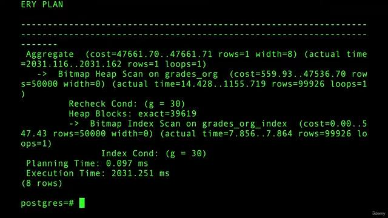
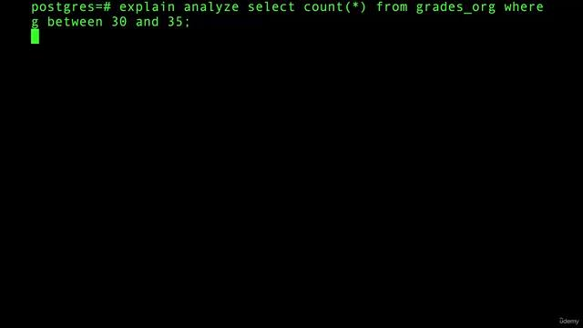
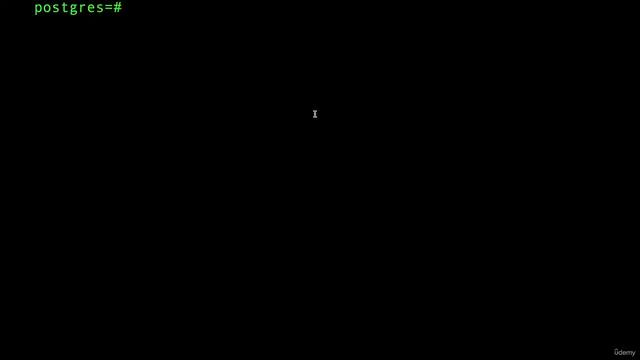
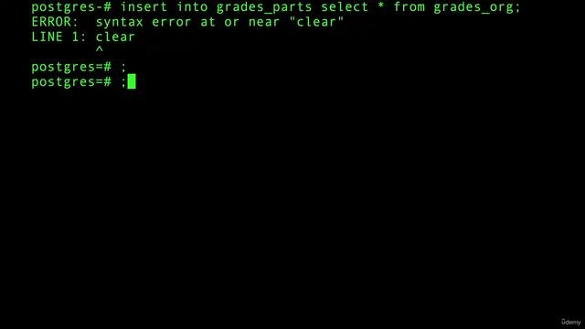
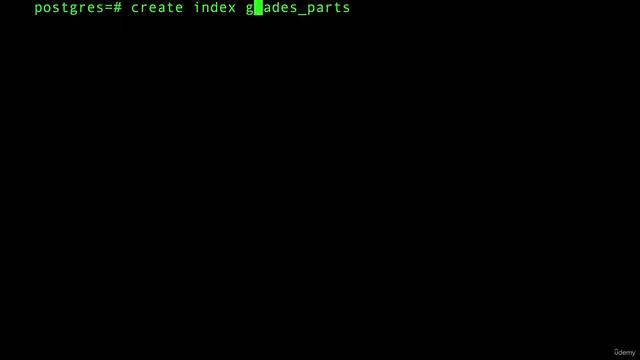
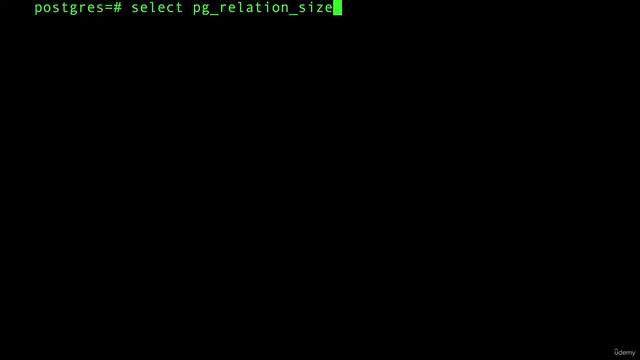
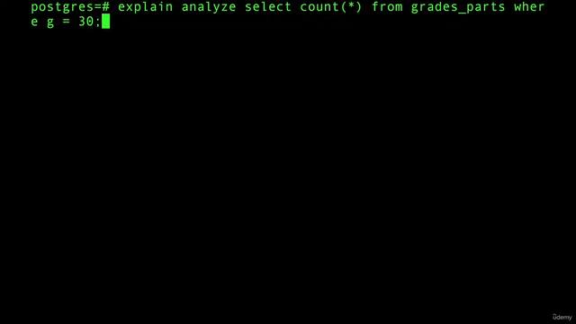
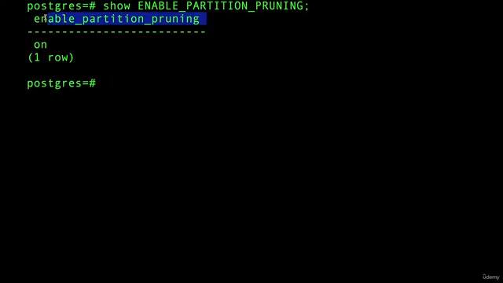

# PostgreSQL 表分区实战：从 1000 万行大表到 4 个分区

> 对应课程：Fundamentals of Database Engineering（BV1zNtU63Eqf）P045–P048
> 读者定位：前端转 AI 应用工程师，SQL 会写 `SELECT`，但没系统碰过「执行计划 / 表分区」。

---

## 1. 这一节做什么

这一节干一件很具体的事：**把一张 1000 万行的大表，改造成一张按 `g` 字段范围分区的表，然后用 `EXPLAIN ANALYZE` 实测分区到底有没有变快，最后确认一个开关（`enable_partition_pruning`）有没有打开。**

下面这些不是「知识点」，是你跑完之后机器上真实存在的东西：

1. 一张 1000 万行的普通表 `grades_original`，`g` 字段上有一个索引。
2. 用同一份数据，建一张分区主表 `grades_parts`，声明 `PARTITION BY RANGE (g)`。
3. 手工创建 4 个子表 `g0_35` / `g35_60` / `g60_80` / `g80_100`，再逐个 `ATTACH PARTITION` 挂到主表上。
4. 一条 `INSERT INTO grades_parts SELECT * FROM grades_original`，让 Postgres 自己按 `g` 的值把 1000 万行分发到 4 个分区里。
5. 只在主表上 `CREATE INDEX` 一次，4 个子分区自动获得同名索引（PG 11+ 的行为）。
6. 用 `pg_relation_size()` 对比原始大索引和各分区小索引的体积。
7. 用 `SET enable_partition_pruning = off/on` 对比「扫 4 个分区」和「只扫 1 个分区」的差别。

**这一节最重要的结论（讲师反复强调）**：分区本身不会自动变快。在你的开发机上（内存充足、索引能全部塞进内存），分区版查询和原始大表查询耗时几乎一样。分区真正省下来的是**索引体积**——查一个大索引 vs 查一个小索引；只有当你限制内存 / 限制 IO、大索引塞不进内存时，差距才会显现。而一旦 `enable_partition_pruning` 被关掉，分区不但没好处，还会更慢，因为每张分区表都要扫一遍。

换一种更工程化的说法：这一节不是让你背「分区表语法」，而是让你亲手经历一次「大表拆分 -> 数据路由 -> 索引级联 -> 执行计划验证 -> 参数开关验证」的完整闭环。每一步都有可观察的输出：行数、边界值、索引名、体积、执行计划节点。只要这些输出对得上，你就不是「看懂了」，而是「复现成功」了。

**在 JS/Node 里对应什么**：分区裁剪（partition pruning）约等于你在 Node 里把一个大数组按 key 拆成多个 `Map`，查询某个 key 时直接 `map.get(key)`，而不是 `array.filter(...)` 遍历全部。而 `enable_partition_pruning = off` 就相当于你明明知道要去哪个 Map 找，却还是把 4 个 Map 全遍历了一遍——纯粹是浪费。再进一步说，`ATTACH PARTITION` 类似你先建好几个空桶，再告诉路由器「0 到 35 放这个桶、35 到 60 放那个桶」；`INSERT INTO ... SELECT ...` 则是让数据库按规则把数据倒进对应桶里。你不需要在应用层写 `if (g < 35) ... else if ...`，路由由数据库完成。

---

## 2. 讲师原话（带时间戳）

先看原始表的查询表现：

> "现在，如果我执行 `select count(*) from grades_original where g = 30`，会返回多少行？大约有 10,000 行的 g 值为 30。然后我们来做这门课里那个挺花哨的东西，叫 `explain analyze`；它会解释数据库是怎么得出这个结果的，并告诉你花了多长时间。"
> —— p045 [00:00]

> "所以执行这条查询花了两秒，也就是 2000 毫秒，而生成计划花了大约 0.97 毫秒。这里用了**位图索引扫描**。也就是说，我们从索引里挑选、手工挑出这些值，然后回到表里取数据，对吧？有时这种方式有效，有时实际上会变慢。"
> —— p045 [00:29]

换成范围查询后：

> "现在，如果我执行 `where g between 30 and 35`，这就是另一种查询了，对吧？这是一个范围查询。所以它会稍微慢一点。正如我们看到的，执行大约花了三秒。而这一次，数据库仍然决定采用**并行索引扫描**，然后跳回索引并计算这些值。"
> —— p045 [00:59]

开始建分区表：

> "要做分区，我们得先创建主表，表名叫 `grades_parts`。这里的诀窍是，还是一样：`serial not null`，然后是 `grade integer not null`。但你必须写上 **`partition by range`**。在这种情况下，范围列就是 `g`，`g` 会按范围来分。"
> —— p046 [00:00]

> "就这样，我们把它创建好了。现在，**所有范围、所有分区都得由你自己创建。数据库不会替你完成这件事。**"
> —— p046 [00:26]

挂分区的语法：

> "要做到这一点，我执行 `alter table`……当然是对 `grades_parts` 这张分区表操作，对吧？`Attach partition g0_35`，也就是那张子表，`for values`：这张子表允许哪些值？`For values from zero to 35`。"
> —— p046 [01:53]

灌数据时数据库会自己分发：

> "我会执行 `insert into grades_parts select * from grades_original`……但它是逐行插入的。而美妙的地方在于，**每当你往这张表插入一行，数据库都会根据 G 的值决定这一行进入哪个分区。** 如果 G 是 20，哦，20 在 0 和 35 之间，所以它会进入 `g0_35`，以此类推。"
> —— p047 [00:00]

在父表上建索引会级联到子分区：

> "我相信在 Postgres 11 之前……这是唯一的做法。**从 Postgres 11 及以上版本开始，你只需要在分区表上创建它**，也就是 `grades_parts`。……在主表或父分区表上创建索引这个动作，**会在所有分区上创建相同的索引**，这非常非常强大。"
> —— p047 [02:26]

为什么分区后没更快：

> "查询仍然花了一秒，是的。这和原表相比不算什么。……我这里的 Mac 有 16 GB 内存，而 Docker 容器没有限制。……没有内存瓶颈，也没有输入输出瓶颈。**如果我把容器限制到 500 MB 左右，而索引大到无法完全放进内存，那你就会开始看到差别了。**"
> —— p048 [00:28]

对比索引体积：

> "希望我还记得这条查询：`select relname`……还有一个叫 **`pg_relation_size`** 的函数。这个函数会返回关系的大小……它接受 oid，也就是对象 ID。然后我还会 `select` 关系名，从 **`pg_class`** 这张表里查，并用完全相同的表达式做 **`order by`**：`pg_relation_size(oid) desc`，因为我想让最大的排在最前面。"
> —— p048 [01:22]

> "所以原始索引大约是 **69 MB**。这是一个很大的索引，69 MB。……但各位看这个，单个索引要小得多。单个索引，也就是 `g0_35`，它是第一个分区，只有 **24 MB**。所以这差不多只有三分之一大小。"
> —— p048 [03:04]

最后一个开关，也是这一节最该记住的一句：

> "Postgres 里有一个特性，我希望你确保它是开启的。它叫 **`enable_partition_pruning`**。……如果它关掉，然后我执行 `explain analyze`……**它会命中分区一、命中分区二、命中分区三，还会命中分区四。** 我完全不明白为什么一开始要有这个选项。……**所以一定要确保这个功能，也就是分区裁剪，始终处于启用状态。否则，你就无法利用这个特性。**"
> —— p048 [03:43] / [04:42] / [05:10]

---

## 3. 从零复现

### 3.1 环境准备

**课里没讲具体用什么版本、怎么装。** 下面是本节补的最小可用环境。课程演示用的是 Docker 里的 Postgres，讲师在 p048 [00:28] 明确说过「the Docker container doesn't have a limit」——这一点后面第 7 节会专门讲它对实验结果的影响。

```bash
docker run -d \
  --name pg-course \
  -e POSTGRES_PASSWORD=postgres \
  -e POSTGRES_DB=lab \
  -p 5432:5432 \
  postgres:16
```

检查容器起来了：

```bash
docker ps
docker exec -it pg-course psql -U postgres -d lab -c "select version();"
```

> **版本说明**：`postgres:16` 是本节的建议版本。课里没指定版本号，但 p047 [02:26] 明确提到「从 Postgres 11 开始才能在父表上建索引并自动级联到子分区」，所以**必须 PG 11 以上**，否则第 3.7 步需要手动给每个子分区建索引。

这里每个命令都要能解释清楚：`docker run -d` 是后台启动容器；`--name pg-course` 给容器起固定名字，后面 `docker exec` 才能稳定引用；`-e POSTGRES_PASSWORD=postgres` 设置超级用户密码；`-e POSTGRES_DB=lab` 让容器初始化时创建 `lab` 数据库；`-p 5432:5432` 把宿主机 5432 映射到容器 5432，方便你本机用 GUI 工具连接；最后的 `postgres:16` 是镜像和标签。`docker exec -it ... psql` 是在运行中的容器里开一个交互式 `psql`。常见错误是宿主机 5432 已被别的 Postgres 占用，这时 `docker run` 会报端口绑定失败，可以换成 `-p 5433:5432`，后续连接端口也要跟着改。

### 3.2 目录结构

```
db-partition-lab/
├── 01_build.sql      # 建表 + 灌数据 + 建分区 + 建索引
└── 02_explain.sql    # 所有验证 / 对比查询
```

两个文件都要完整保存，内容见第 4 节。

目录本身没有魔法，但建议你把「建数据」和「验证查询」分开。原因很实际：建表脚本会 `DROP TABLE` 并灌 1000 万行，跑一次要等；验证脚本可以反复执行，不会破坏数据。前端同学可以把它类比成 `seed.ts` 和 `verify.ts` 的分工：前者初始化数据库，后者只读验证。这样你调 `EXPLAIN` 时不会每次都重灌数据。

### 3.3 跑建表脚本

```bash
docker cp 01_build.sql pg-course:/tmp/01_build.sql
docker exec -it pg-course psql -U postgres -d lab -f /tmp/01_build.sql
```

1000 万行插入 + 建索引，笔者的机器上大约 1–3 分钟。看到最后一行输出 `BUILD_DONE` 就成功了。

`docker cp` 是把宿主机当前目录的 SQL 文件复制进容器；`psql -f` 是让 psql 执行文件中的 SQL。常见错误是当前目录不对，`docker cp` 报 `no such file or directory`；或者容器名不是 `pg-course`，`docker exec` 报 `No such container`。如果中途报错，psql 默认会在出错语句处停止并返回非零状态，修复后重新跑整个 `01_build.sql` 即可，因为脚本开头有 `DROP TABLE IF EXISTS`。如果你的机器内存较小，灌数据时容器可能被 OOM kill，这时先用 `docker stats pg-course` 观察内存，再决定是否分批灌数据或增加 Docker 内存。

### 3.4 第一步：原始表的基线表现

进交互式 psql：

```bash
docker exec -it pg-course psql -U postgres -d lab
```

先跑讲师的第一个查询：

```sql
SELECT count(*) FROM grades_original WHERE g = 30;
```

再加执行计划：

```sql
EXPLAIN ANALYZE
SELECT count(*) FROM grades_original WHERE g = 30;
```



这里你要在输出里找到两样东西：

- **Execution Time 那一行**：讲师的是 2000ms 量级，你的数字会不一样，别慌。
- **计划节点里有没有 `Bitmap Index Scan`**：讲师在 p045 [00:29] 说的是「we used bitmap index scan，意思是我们从索引里挑出这些值，再去表里取行」。如果你看到的是 `Seq Scan`，说明统计信息不准，先跑一次 `ANALYZE grades_original;` 再重试。

`EXPLAIN` 和 `EXPLAIN ANALYZE` 的区别要分清：`EXPLAIN` 只让规划器给出计划，不执行 SQL；`EXPLAIN ANALYZE` 会真的执行 SQL，并把实际耗时、实际行数附在计划节点上。因此验证性能必须用 `EXPLAIN ANALYZE`，但如果你只想看「会不会裁剪到某个分区」，用 `EXPLAIN` 也够，而且不会真的扫数据。常见错误是拿 `EXPLAIN` 的输出找 `Execution Time`，找不到就以为命令错了；其实那是 `EXPLAIN ANALYZE` 才有的字段。

再跑范围查询：

```sql
EXPLAIN ANALYZE
SELECT count(*) FROM grades_original WHERE g BETWEEN 30 AND 35;
```



> **数字对不上的原因**：讲师在 p045 [00:00] 说 `g = 30` 大概命中 10,000 行。但我们这个脚本生成的是均匀分布，1000 万行除以 100 个取值，每个值约 100,000 行。讲师那张表大概率是倾斜的（他在 p047 [02:26] 后面吐槽过「0 到 35 是热门分数，大家都在挂科」）。**行数不一样，耗时就不一样，这是正常的**，别因此怀疑自己敲错了。想看倾斜效果，见第 7 节。

前端对照：这就像你用 `Array.prototype.filter` 和 `Map.get` 做对比。原始表只有一个大索引，等价于一个巨大的 `Map`；范围查询 `BETWEEN` 等价于你要在 `Map` 里连续取一段 key，数据库可能选择 `Bitmap Index Scan` 或 `Parallel Index Scan`。你不用纠结具体节点名，只要知道它是在「走索引」而不是「全表扫」即可。

### 3.5 第二步：建分区主表

```sql
DROP TABLE IF EXISTS grades_parts CASCADE;

CREATE TABLE grades_parts (
    id  bigserial,
    g   integer NOT NULL
) PARTITION BY RANGE (g);
```


注意 `PARTITION BY RANGE (g)` 这一行，**建表的这一刻就要写**。p046 [00:00] 讲师原话是「you have to create this table with partition in mind」——你不能先建普通表再改成分区表，只能重建。

跑到这里你会发现主表是**空的**，因为它只是一个「虚拟的模板」，数据全在子表里。这一点很重要，后面第 3.9 步看体积时会用到。

常见错误有两个：一是忘了写 `PARTITION BY RANGE (g)`，后面执行 `ATTACH PARTITION` 会报错，因为普通表不能挂分区；二是 `DROP TABLE ... CASCADE` 忘了写，如果之前已经建过子分区，删除主表时可能因为依赖关系失败。`CASCADE` 会连带删除依赖对象，实验环境可以这样用，生产环境要谨慎。与前端对照，主表更像一个「路由入口 / 接口定义」，不是实际存数据的数组；真正存数据的是四个子表。

### 3.6 第三步：手工建 4 个子分区并挂上去

p046 [00:26] 讲师原话：「**You're responsible to create all the ranges, all the partition yourself. The database is not gonna do this for you.**」Postgres 不会自动帮你切分区间，你得手动建。

建 4 张和主表结构一样的普通表：

```sql
CREATE TABLE g0_35   (LIKE grades_parts);
CREATE TABLE g35_60  (LIKE grades_parts);
CREATE TABLE g60_80  (LIKE grades_parts);
CREATE TABLE g80_100 (LIKE grades_parts);
```

> **表名说明**：讲师口播的表名在自动字幕里被识别成了 `g0035` / `g8 100` 这种形式。这里统一写成 `g0_35` / `g35_60` / `g60_80` / `g80_100`，四个子表名你怎么叫都行——**只要后面 `ATTACH` 和查询时用的是同一套名字**。

此时它们是 4 张普通空表，结构和主表一样（`id` + `g`），**没有索引**。讲师在 p046 [03:17] 特意强调过这一点：「there are no indexes in this table nor on the grade」。

逐个挂到主表上：

```sql
ALTER TABLE grades_parts ATTACH PARTITION g0_35   FOR VALUES FROM (0)  TO (35);
ALTER TABLE grades_parts ATTACH PARTITION g35_60  FOR VALUES FROM (35) TO (60);
ALTER TABLE grades_parts ATTACH PARTITION g60_80  FOR VALUES FROM (60) TO (80);
ALTER TABLE grades_parts ATTACH PARTITION g80_100 FOR VALUES FROM (80) TO (100);
```



**区间是左闭右开**：`FROM (0) TO (35)` 表示 `g >= 0 AND g < 35`，所以 `g0_35` 里最大的 `g` 是 **34**。讲师在 p047 [01:28] 验证过这一点：「the maximum value of `g0_35` is actually 34」；同理 `g35_60` 的最大值是 **59**（p047 [02:16]：「I bet 59. Exactly.」）。

`ATTACH PARTITION` 的完整含义是：把一张已经存在的普通表登记为 `grades_parts` 的某个范围分区，并声明该子表允许承载的键值范围。区间不能重叠，也不能留下未覆盖的洞；如果你写 `FROM (35) TO (60)` 和另一个 `FROM (30) TO (40)`，Postgres 会报分区范围重叠。常见错误是忘记 `FROM/TO` 的括号或写反顺序；`FROM (60) TO (35)` 会报无效范围。另一个常见错误是子表里已有超出声明范围的数据，`ATTACH` 时会失败；实验脚本里子表是空的，所以不会遇到，但生产中给已有表挂分区时要先检查数据边界。前端对照：这就像你给路由表注册四个路径前缀，前缀不能重叠，否则请求不知道该进哪个 handler。

### 3.7 第四步：一次性灌入 1000 万行

```sql
INSERT INTO grades_parts SELECT * FROM grades_original;
```



这一步是整节最爽的地方——**你没有写任何路由逻辑**。p047 [00:29] 讲师原话：「**Every time you insert a row on this table, the database will decide which partition that row goes to based on the value of G.**」`g = 20` 自动进 `g0_35`，`g = 70` 自动进 `g60_80`。

跑完后验证：

```sql
SELECT count(*) FROM grades_parts;                          -- 应该和 grades_original 一致
SELECT max(g) FROM grades_parts;                            -- 应该是 99
SELECT count(*), min(g), max(g) FROM g0_35;                 -- max 应该是 34
SELECT count(*), min(g), max(g) FROM g35_60;                -- max 应该是 59
SELECT count(*), min(g), max(g) FROM g60_80;                -- max 应该是 79
SELECT count(*), min(g), max(g) FROM g80_100;               -- max 应该是 99
```

> **p047 [00:58] 的一个小插曲值得注意**：讲师在这里第一次敲 `INSERT` 时语法错了，说了「Oh, that's wrong. Just a different syntax.」——如果你也报错，大概率是列顺序或列数不匹配。`SELECT *` 依赖**两张表的列顺序完全一致**，`grades_original` 是 `(id, g)`，`grades_parts` 也必须是 `(id, g)`，顺序不能反。

如果你插入时看到 `no partition of relation "grades_parts" found for row`，说明某行 `g` 落在了四个区间之外，比如 `g = 100` 或负数。检查生成数据的表达式是否产生了 100，或者是否漏了某个区间。`INSERT INTO ... SELECT` 是批量插入，Postgres 会逐行决定目标分区；1000 万行不算小，执行期间可以用 `docker stats` 看容器资源。前端对照：这类似批量写入时有一个「按 key 分片」的中间层，应用层不用手动 `switch`，但你必须保证分片规则覆盖所有 key。

### 3.8 第五步：只在父表上建一次索引

```sql
CREATE INDEX grades_parts_g_idx ON grades_parts (g);
```



**这是 PG 11+ 才有的能力**。p047 [02:26] 讲师原话：「From Postgres 11 and above, you only have to create it on the partition table … it will create the same index on all the partitions.」

验证级联是否生效：

```sql
\d g0_35
\d g35_60
\d g60_80
\d g80_100
```

每张子表应该都能看到 `g` 列上的索引。**子分区上的索引名是 Postgres 自动生成的，不是 `grades_parts_g_idx`**，具体名字以你的 `\d` 实际输出为准，不要照抄。

> 如果你的 Postgres 是 10 或更早，这一步不会级联，你需要对 4 张子表各执行一次 `CREATE INDEX ... ON g0_35(g);` 等。

常见错误：在父表上建索引后只 `\d grades_parts` 看主表，发现主表没有索引就以为失败。实际上分区主表本身不存数据，索引会落到各子分区上；用 `\d g0_35` 或查询 `pg_index` 才能确认。另一个错误是子表在 `ATTACH` 之前已经建了索引，名字冲突或重复；实验脚本是先挂后建，按顺序执行即可。前端对照：这类似你在「接口层」声明一个索引策略，底层每个分片自动生成对应索引；你不需要逐个分片写 DDL。

### 3.9 第六步：对比索引体积

讲师在 p048 [01:22] 用的查询，原话是「`select relname` … `pg_relation_size` … from `pg_class` … order by `pg_relation_size(oid) desc`」，完整写法：

```sql
SELECT
    relname,
    pg_relation_size(oid) AS size_bytes,
    pg_size_pretty(pg_relation_size(oid)) AS size_pretty
FROM pg_class
ORDER BY pg_relation_size(oid) DESC
LIMIT 30;
```



`pg_relation_size` 返回的是**字节数**，讲师在 p048 [01:40] 现场换算过：「so you divide it by 10,000, 100,000, so you get this in megabyte」。用 `pg_size_pretty` 可以直接拿到人类可读的 MB/GB，省得自己算。

你要重点对比的两组数字（讲师实测值）：
- `grades_original` 约 **362 MB**，它的索引约 **69 MB**
- `g0_35` 这张分区表约 **126 MB**，它的分区索引约 **24 MB**

**结论：单分区索引比原始大索引小 3 倍左右。** 讲师原话（p048 [03:43]）：「the individual index, which is the `g0_35`, that's the first partition, is only 24 megabytes. So it's like what, three times smaller.」

常见错误：`pg_class` 里包含索引、表、序列、视图等各种关系，你按体积倒序会看到一堆对象；不要只盯着第一行，先用 `relname` 找到 `grades_original`、`grades_original_g_idx`、`g0_35` 及其索引名。另一个错误是看主表 `grades_parts` 的体积，它本身几乎没有数据，看到 0 或很小是正常的，数据在子表里。前端对照：这就像你比较「一个大 JSON 文件」和「四个小 JSON 文件」的索引文件大小；查询某个 key 时，小索引更容易被缓存。

### 3.10 第七步：查分区表

```sql
EXPLAIN ANALYZE
SELECT count(*) FROM grades_parts WHERE g = 30;
```



你应该在计划里看到：**只有 `g0_35` 这一个子表参与**，`g35_60` / `g60_80` / `g80_100` 完全不出现。这就是分区裁剪生效了。

**但耗时不一定会比 3.4 步快**。讲师在 p048 [00:28] 坦白了：「This is not much compared to the original table」。原因下一节马上讲。

常见错误：如果你在 `WHERE` 里对分区键做了表达式，比如 `WHERE g + 0 = 30`，分区裁剪可能无法在规划阶段识别，计划里会出现所有分区。正确做法是让分区键以裸列形式出现在条件里，例如 `WHERE g = 30` 或 `WHERE g BETWEEN 30 AND 35`。前端对照：这类似 `Map.get(key)` 必须用原始 key，如果你先 `key.toString()` 再查，路由层可能无法命中正确的分片。

### 3.11 第八步：关掉 pruning，看灾难现场

先看默认值：

```sql
SHOW enable_partition_pruning;
```

应该是 `on`。

现在手动关掉：

```sql
SET enable_partition_pruning = off;

EXPLAIN
SELECT count(*) FROM grades_parts WHERE g = 30;
```



讲师在 p048 [04:42] 原话：「**It hit partition one, it hit partition two, it hit partition three, and it hit partition four.**」——明明 `g = 30` 只可能在 `g0_35` 里，但因为裁剪被关掉，4 个分区全扫一遍。**整个分区设计直接废掉，还倒贴。**

立刻打开：

```sql
SET enable_partition_pruning = on;

EXPLAIN
SELECT count(*) FROM grades_parts WHERE g = 30;
```

计划里又只剩 1 个分区了。

> **注意**：`SET` 只对当前 session 生效，退出 psql 就恢复默认。生产环境请确认 `SHOW enable_partition_pruning;` 在**新建的每个连接**上都是 `on`——怎么确认？课里没讲，见第 7 节。

常见错误：在连接池里执行一次 `SET enable_partition_pruning = on`，以为全局生效；实际上连接池可能复用旧连接或新建连接，参数是 session 级。更稳妥的是在数据库/角色级别设置默认值，或在连接池初始化 SQL 中统一设置，并用 `SHOW` 验证。前端对照：这类似某个 feature flag 只存在单个请求的上下文里，你在这个请求打开，不代表下一个请求也打开。

---

## 4. 完整代码

### `01_build.sql`

```sql
-- ============================================================
-- 01_build.sql
-- 目的：建 1000 万行原始表 -> 建分区表 -> 灌数据 -> 建索引
-- 执行：psql -U postgres -d lab -f 01_build.sql
-- ============================================================

\timing on

-- ---------- 1. 原始表：1000 万行，g 取值 0..99 ----------
DROP TABLE IF EXISTS grades_original;

CREATE TABLE grades_original (
    id  bigserial    NOT NULL,
    g   integer      NOT NULL
);

INSERT INTO grades_original (g)
SELECT (random() * 99.999)::int
FROM generate_series(1, 10000000);

-- g 列上的索引：让 p045 的 bitmap index scan 能复现
CREATE INDEX grades_original_g_idx ON grades_original (g);

-- 刷新统计信息，否则 EXPLAIN 可能选错计划
ANALYZE grades_original;

-- ---------- 2. 分区主表（此时是空的） ----------
DROP TABLE IF EXISTS grades_parts CASCADE;

CREATE TABLE grades_parts (
    id  bigserial    NOT NULL,
    g   integer      NOT NULL
) PARTITION BY RANGE (g);

-- ---------- 3. 手工创建 4 个子表 ----------
CREATE TABLE g0_35   (LIKE grades_parts);
CREATE TABLE g35_60  (LIKE grades_parts);
CREATE TABLE g60_80  (LIKE grades_parts);
CREATE TABLE g80_100 (LIKE grades_parts);

-- ---------- 4. 挂到主表上（左闭右开） ----------
ALTER TABLE grades_parts ATTACH PARTITION g0_35   FOR VALUES FROM (0)  TO (35);
ALTER TABLE grades_parts ATTACH PARTITION g35_60  FOR VALUES FROM (35) TO (60);
ALTER TABLE grades_parts ATTACH PARTITION g60_80  FOR VALUES FROM (60) TO (80);
ALTER TABLE grades_parts ATTACH PARTITION g80_100 FOR VALUES FROM (80) TO (100);

-- ---------- 5. 一次性灌入 1000 万行，DB 自动路由 ----------
INSERT INTO grades_parts SELECT * FROM grades_original;

-- ---------- 6. 只在父表建一次索引（PG 11+ 自动级联） ----------
CREATE INDEX grades_parts_g_idx ON grades_parts (g);

ANALYZE grades_parts;

\echo 'BUILD_DONE'
```

### `02_explain.sql`

```sql
-- ============================================================
-- 02_explain.sql
-- 目的：对比执行计划、对比索引体积、验证 partition pruning
-- 执行：psql -U postgres -d lab -f 02_explain.sql
-- ============================================================

\timing on

-- ---------- A. 原始表的基线（对应 p045） ----------
\echo '=== A1. 等值查询：grades_original where g = 30 ==='
EXPLAIN ANALYZE
SELECT count(*) FROM grades_original WHERE g = 30;

\echo '=== A2. 范围查询：grades_original where g between 30 and 35 ==='
EXPLAIN ANALYZE
SELECT count(*) FROM grades_original WHERE g BETWEEN 30 AND 35;

-- ---------- B. 结果正确性校验（对应 p047） ----------
\echo '=== B1. 总行数 / 最大 g ==='
SELECT count(*) FROM grades_original;
SELECT count(*) FROM grades_parts;
SELECT max(g) FROM grades_parts;

\echo '=== B2. 每个分区的行数与边界（左闭右开） ==='
SELECT 'g0_35'   AS part, count(*), min(g), max(g) FROM g0_35
UNION ALL
SELECT 'g35_60'  AS part, count(*), min(g), max(g) FROM g35_60
UNION ALL
SELECT 'g60_80'  AS part, count(*), min(g), max(g) FROM g60_80
UNION ALL
SELECT 'g80_100' AS part, count(*), min(g), max(g) FROM g80_100;

-- ---------- C. 索引是否级联到子分区（对应 p047 [03:04]） ----------
\echo '=== C1. 子分区上的索引 ==='
SELECT
    c.relname           AS index_name,
    t.relname           AS table_name
FROM pg_index i
JOIN pg_class c ON c.oid = i.indexrelid
JOIN pg_class t ON t.oid = i.indrelid
WHERE t.relname IN ('grades_original', 'grades_parts',
                    'g0_35', 'g35_60', 'g60_80', 'g80_100')
ORDER BY t.relname, c.relname;

-- ---------- D. 体积对比（对应 p048 [01:22]） ----------
\echo '=== D1. 所有关系按体积倒序 ==='
SELECT
    relname,
    pg_relation_size(oid)                            AS size_bytes,
    pg_size_pretty(pg_relation_size(oid))            AS size_pretty
FROM pg_class
ORDER BY pg_relation_size(oid) DESC
LIMIT 30;

-- ---------- E. 分区裁剪：ON（对应 p048 [00:11]） ----------
\echo '=== E1. pruning = on，只应命中 g0_35 ==='
SET enable_partition_pruning = on;
SHOW enable_partition_pruning;

EXPLAIN ANALYZE
SELECT count(*) FROM grades_parts WHERE g = 30;

-- ---------- F. 分区裁剪：OFF（对应 p048 [04:42]） ----------
\echo '=== F1. pruning = off，应命中全部 4 个分区 ==='
SET enable_partition_pruning = off;
SHOW enable_partition_pruning;

EXPLAIN
SELECT count(*) FROM grades_parts WHERE g = 30;

-- ---------- G. 恢复默认 ----------
\echo '=== G1. 恢复 pruning = on ==='
SET enable_partition_pruning = on;
SHOW enable_partition_pruning;

\echo 'EXPLAIN_DONE'
```

---

## 5. 逐行解释

### 原始表部分

- **`id bigserial NOT NULL`**：`bigserial` 是 Postgres 的「自增 64 位整数」语法糖，等价于 `bigint` + 序列默认值。课堂上讲师说的是 `serial`（32 位），这里用 `bigserial` 是为了 1000 万行时更宽裕，也避免和后面 `grades_parts` 的类型不一致。**知道即可**，不影响本节结论。
- **`g integer NOT NULL`**：这就是分区键，范围 0–99。
- **`generate_series(1, 10000000)`**：Postgres 内置的生成序列函数，`SELECT * FROM generate_series(1, 10000000)` 会返回 1000 万行。这是灌测试数据最省事的方式，不需要外部脚本。
- **`(random() * 99.999)::int`**：`random()` 返回 `[0,1)` 的浮点数，乘以 99.999 再取整，就得到 `0..99` 的均匀整数。**注意这里写 99.999 而不是 100**，因为 `random()` 不会返回 1.0，但保险起见留一点余量，避免理论上的边界值 100 导致 `g80_100` 分区没有对应数据。
- **`CREATE INDEX ... ON grades_original (g)`**：单列 B-Tree 索引。有了这个索引，`WHERE g = 30` 才能走 `Bitmap Index Scan`（p045 [00:29] 讲师演示的计划）。如果没索引，就会走 `Seq Scan` 全表扫。
- **`ANALYZE`**：刷新表的统计信息。**这一步非常关键**——Postgres 的查询规划器（planner）依赖统计信息来估算「这个条件大概命中多少行」，从而决定用索引还是全表扫。刚灌完数据没 `ANALYZE` 时，规划器可能因为不知道数据分布而做出错误的计划选择。

### 分区表部分

- **`PARTITION BY RANGE (g)`**：声明这是一张分区表，分区键是 `g`，分区方式是「范围」。**必须在建表时写**，不能后期改。这句话意味着：`grades_parts` 本身不存储任何数据，它只是一个「入口 / 路由表」。
- **`CREATE TABLE g0_35 (LIKE grades_parts)`**：`LIKE` 会复制列定义（列名、类型、NOT NULL 约束），但默认不会复制索引；所以刚建出来是普通空表，需要后面 `ATTACH` 和 `CREATE INDEX`。`LIKE` 也不会复制分区属性，子表是普通表，挂上去之后才成为分区。常见错误是以为 `LIKE` 连索引一起复制，结果在 `EXPLAIN` 里看到子表没走索引；用 `\d g0_35` 确认即可。
- **`ALTER TABLE grades_parts ATTACH PARTITION ...`**：把子表挂到主表上，并声明该子表的键值范围。`FROM` 包含，`TO` 不包含，所以 `g0_35` 的最大值是 34。常见错误是区间重叠或漏区间；`ATTACH` 时 Postgres 会校验边界。前端对照：这相当于给路由器注册分片规则，规则必须完整覆盖所有可能 key。
- **`INSERT INTO grades_parts SELECT * FROM grades_original`**：把原始表数据灌入分区主表。因为 `grades_parts` 是分区表，Postgres 会按 `g` 的值把每行路由到对应子表。这里依赖两张表列顺序一致，否则 `SELECT *` 会错位或报类型错误。常见错误是 `grades_original` 有额外列，或者 `grades_parts` 列顺序不同；生产中建议显式写列名 `INSERT INTO grades_parts (id, g) SELECT id, g FROM ...`。
- **`CREATE INDEX grades_parts_g_idx ON grades_parts (g)`**：在父表上建索引。PG 11+ 会自动在每个子分区上创建对应索引；PG 10 及以下需要手动给每个子表建。常见错误是版本不够却以为级联失败，或者只看主表看不到索引。验证方法是 `\d g0_35` 或查询 `pg_index`。
- **`ANALYZE grades_parts`**：刷新分区表统计信息。分区表的数据在子表里，`ANALYZE` 父表会收集子表统计信息，帮助规划器估算行数。常见错误是灌完数据直接 `EXPLAIN`，发现计划不理想；先 `ANALYZE` 再测。

### 验证查询部分

- **`\timing on`**：psql 元命令，打开每条 SQL 的实际耗时显示。它不等于 `EXPLAIN ANALYZE` 的节点耗时，但能让你快速看整条语句花了多久。
- **`EXPLAIN ANALYZE SELECT count(*) ...`**：真正执行查询并输出计划。重点看 `Execution Time`、实际行数、扫描了哪些分区。常见错误是只看总耗时，不看计划节点；分区裁剪要看计划里出现了哪些子表。
- **`SHOW enable_partition_pruning`**：查看当前 session 的参数值。默认通常是 `on`。`SET` 只影响当前 session，连接池环境下要在每个连接上确认。
- **`pg_relation_size(oid)`**：返回关系（表或索引）的磁盘字节数。`pg_size_pretty` 把它转成 `KB/MB/GB`。`pg_class` 里 `oid` 是对象 ID，`relname` 是对象名。常见错误是拿主表体积当数据总量；分区表的数据在子表里。
- **`pg_index` 联查 `pg_class`**：通过 `indexrelid` 和 `indrelid` 找到索引与表的对应关系，用来确认四个子分区是否都有 `g` 上的索引。常见错误是只用 `\d` 看主表；主表不存数据，索引在子表上。
- **`UNION ALL` 校验分区边界**：分别统计四个子表的 `count(*)`、`min(g)`、`max(g)`。期望 `g0_35` 的 `max` 是 34，`g35_60` 的 `max` 是 59，`g60_80` 的 `max` 是 79，`g80_100` 的 `max` 是 99。如果某个分区为空，检查生成数据是否覆盖了该区间。
- **`SET enable_partition_pruning = off/on`**：关闭/打开分区裁剪。关闭后 `EXPLAIN` 应看到四个分区都参与；打开后只剩 `g0_35`。常见错误是只执行 `SET off` 不恢复，后续查询都受影响；脚本最后恢复 `on`。

---

## 6. 复现检查清单

- [ ] **环境版本 ≥ PostgreSQL 11**：执行 `SELECT version();`，输出中版本号至少是 11。验证方式：看 `version()` 字符串；如果是 10 或更早，第 3.8 步必须手动给四个子表建索引。
- [ ] **`grades_original` 行数是 1000 万**：执行 `SELECT count(*) FROM grades_original;`，期望 `10000000`。如果少了，检查 `generate_series(1, 10000000)` 是否被改动。
- [ ] **`grades_original` 有 `g` 索引**：执行 `\d grades_original`，应看到 `grades_original_g_idx` 或类似索引。验证方式：`\d` 输出底部索引列表；没有索引则 `Bitmap Index Scan` 可能不复现。
- [ ] **`grades_parts` 是分区表**：执行 `\d+ grades_parts`，应看到 `Partition key: RANGE (g)`，并列出四个分区。验证方式：`\d+` 输出中的分区信息；如果只看到普通表，说明建表时漏了 `PARTITION BY RANGE (g)`。
- [ ] **四个子分区边界正确**：执行第 4 节 `02_explain.sql` 的 B2 查询，期望 `g0_35.max=34`、`g35_60.max=59`、`g60_80.max=79`、`g80_100.max=99`。验证方式：看 `min/max`；若 `max` 是 35，说明误以为 `TO` 是闭区间。
- [ ] **总行数一致**：`SELECT count(*) FROM grades_original;` 与 `SELECT count(*) FROM grades_parts;` 结果应一致。验证方式：两个查询并排跑；不一致说明插入失败或区间漏数据。
- [ ] **索引级联到子分区**：执行 `\d g0_35`、`\d g35_60`、`\d g60_80`、`\d g80_100`，每张子表都应看到 `g` 上的索引。验证方式：`\d` 输出；或跑第 4 节 C1 的 `pg_index` 查询，应返回多个索引行。
- [ ] **索引体积对比成立**：执行第 4 节 D1 查询，找到原始索引和 `g0_35` 索引，确认单分区索引明显小于原始大索引。验证方式：看 `size_pretty`；数字不必与讲师完全一致，趋势应对。
- [ ] **pruning 默认开启**：执行 `SHOW enable_partition_pruning;`，期望 `on`。验证方式：`SHOW` 输出；若为 `off`，先 `SET enable_partition_pruning = on;`。
- [ ] **pruning 开启时只命中一个分区**：执行 `EXPLAIN SELECT count(*) FROM grades_parts WHERE g = 30;`，计划中只应出现 `g0_35`。验证方式：看计划里的 `Append` 或 `Scan` 节点涉及的表名；出现四个子表说明裁剪未生效。
- [ ] **pruning 关闭时命中四个分区**：先 `SET enable_partition_pruning = off;`，再执行同样的 `EXPLAIN`，计划中应出现四个子表。验证方式：看计划节点；验证完记得 `SET ... = on;`。
- [ ] **恢复 pruning 开启**：执行 `SET enable_partition_pruning = on;` 并 `SHOW enable_partition_pruning;` 确认是 `on`。验证方式：`SHOW` 输出；避免后续实验被关闭状态污染。

---

## 7. 课里没讲但你会撞上的（表格：现象 / 原因 / 怎么办）

| 现象 | 原因 | 怎么办 |
|---|---|---|
| 分区后查询耗时和原始表差不多，甚至偶尔更慢 | 开发机内存充足，索引能全部缓存，没有内存/IO 瓶颈；讲师在 p048 [00:28] 明确说 Docker 容器没限制，因此分区优势不明显 | 先接受这个结果，不要误以为分区没用；要观察差异，可限制 Docker 内存（例如 `--memory=500m`）后重测，或重点看索引体积和执行计划是否裁剪 |
| 关掉 `enable_partition_pruning` 后查询扫了全部 4 个分区 | 分区裁剪被关闭，规划器不再根据 `g = 30` 排除其他分区 | 执行 `SHOW enable_partition_pruning;` 确认；用 `SET enable_partition_pruning = on;` 恢复；连接池环境要在每个连接初始化时设置并验证 |
| `INSERT INTO grades_parts ...` 报 `no partition of relation "grades_parts" found for row` | 某行 `g` 落在四个 `FROM/TO` 区间之外，例如 `g = 100` 或负数 | 检查数据生成表达式；确认区间覆盖 `0..100` 且左闭右开；必要时增加一个兜底分区或修正数据范围 |
| `ATTACH PARTITION` 报分区范围重叠或无效范围 | 子表声明区间与其他分区重叠，或 `FROM` 大于等于 `TO` | 重新检查四个区间：`[0,35)`、`[35,60)`、`[60,80)`、`[80,100)`；确保不重叠且顺序正确 |
| 子分区上没有索引，`\d g0_35` 看不到 `g` 索引 | PostgreSQL 版本低于 11，父表建索引不会级联；或者索引建在了错误对象上 | 确认 `SELECT version();`；PG 11+ 重新在父表建索引；PG 10 及以下对四个子表分别 `CREATE INDEX ... ON g0_35(g);` |
| `EXPLAIN` 里看到 `Seq Scan` 而不是索引扫描 | 表太小、统计信息不准、或查询条件选择性不高，规划器认为全表扫更便宜 | 先 `ANALYZE grades_original;` / `ANALYZE grades_parts;`；确认 `WHERE` 条件直接用分区键裸列；不要只凭一次计划下结论 |
| 看 `pg_relation_size(grades_parts)` 发现主表很小或为 0 | 分区主表本身不存数据，数据在子分区里 | 查询 `g0_35`、`g35_60`、`g60_80`、`g80_100` 及其索引的体积；主表小是正常现象 |
| 执行 `SET enable_partition_pruning = on` 后，另一个连接仍然是 `off` | `SET` 只对当前 session 生效，连接池可能复用或新建连接 | 在连接池初始化 SQL 中统一设置，或在数据库/角色级别设置默认值；每个新连接用 `SHOW` 验证 |
| `CREATE TABLE g0_35 (LIKE grades_parts)` 后以为索引也复制了 | `LIKE` 默认复制列定义，不复制索引；分区属性也不会复制 | 先 `ATTACH` 成子分区，再在父表上 `CREATE INDEX` 让 PG 11+ 级联；或手动给子表建索引 |
| 用 `EXPLAIN` 找 `Execution Time` 找不到 | `EXPLAIN` 不执行 SQL，只有 `EXPLAIN ANALYZE` 才输出实际执行时间 | 想看实际耗时用 `EXPLAIN ANALYZE`；只想看裁剪计划用 `EXPLAIN` 即可 |
| 查询条件写成 `WHERE g + 0 = 30` 后计划里出现所有分区 | 对分区键做表达式后，规划器在规划阶段可能无法做分区裁剪 | 尽量让分区键以裸列形式出现，例如 `WHERE g = 30`；必要时调整查询或使用可裁剪的表达式 |
| Docker 容器内存太小，灌 1000 万行时容器被杀 | 1000 万行插入和建索引需要一定内存/磁盘；`docker run` 未限制时使用宿主机资源，限制过小则可能 OOM | 用 `docker stats pg-course` 观察；适当增加 Docker 内存，或分批灌数据；实验环境不建议把内存限制得过低 |