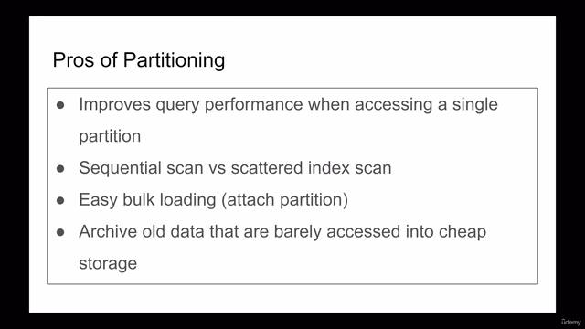
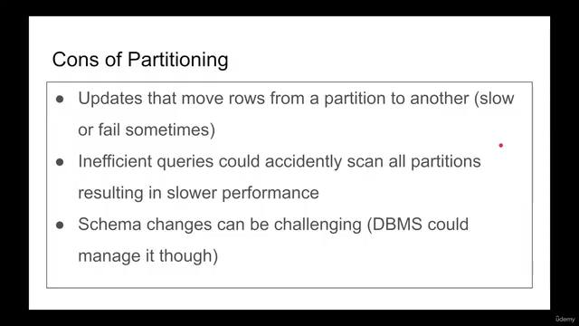
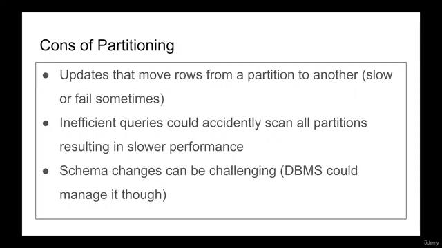
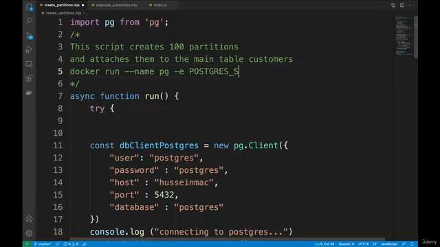
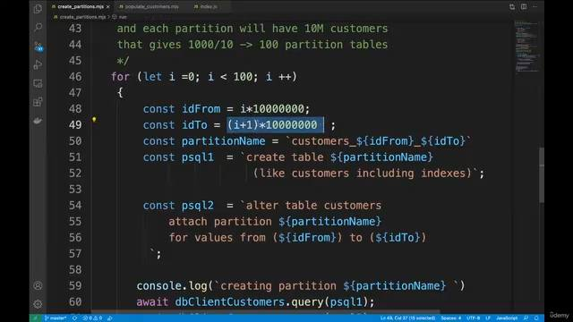

# 课程文档：用 Node.js 自动创建 PostgreSQL 分区表（P49–P52）

> 课程：Fundamentals of Database Engineering（BV1zNtU63Eqf）
> 覆盖集数：P49–P52
> 面向读者：前端转 AI 应用工程师。全程只需要 Node.js 和一个 Docker 容器，不需要任何后端框架知识。

---

## 1. 这一节做什么

这一节解决的是一个非常具体的工程问题：**当一张表的行数要到十亿级别时，怎么把它在物理上拆成 100 张小表，但写代码的时候你仍然只操作一张表。**

讲师先讲了分区的「利」与「弊」（P49、P50），然后给了**一份可以直接跑的自动化脚本**（P52），把「手工写 100 条 `CREATE TABLE` 和 100 条 `ATTACH PARTITION`」这件事交给 Node.js 循环去做。

学完这一节你应该能拿到三个结果：

1. 一个跑在 Docker 里的 PostgreSQL 实例；
2. 一个叫 `customers` 的**分区父表**，它下面挂着 100 个按 `id` 范围切分的子表；
3. 一个 `populate_customers.js`，能往父表里灌 1000 万行数据，你完全不需要知道数据落到了哪个分区里。

这四集里讲师**没有**讲分片（sharding）的实现、没有讲 `tablespace` 的具体语法、也没有演示 MySQL 的 CSV 存储引擎怎么用——这些只在 P49–P51 的口头总结里出现过。本文会明确指出哪些内容属于「课里没讲」。

---

## 2. 讲师原话

先看讲师为什么说分区值得做。

> 「分区的优点很漂亮，因为它能提升查询性能……只要数据量大到你的内存或者 IO 撑不住，你就会开始感受到差别，因为你要往磁盘上打、要撞 IO。」
> —— p049 [00:00]

> 「只要我知道怎么命中那一个分区，这才是关键。」
> —— p049 [00:56]

> 「轻松批量加载。你可以先建一张表，然后立刻把它挂到分区表上……前提是约束（constraint）和检查（check）都校验通过。」
> —— p049 [02:21]


然后是批量加载这一条，讲师在 P49 花了整整一分钟讲它：



接着是「弊」——这一块最容易在真实项目里踩坑：

> 「在分区之间移动行的 UPDATE 其实是很慢的。在一个大表里更新一行，你就走过去更新它，完事。但在分区里，如果这次更新让这一行从 A 分区跑到 B 分区……这个更新动作实际上变成了『删除 + 插入到另一张表』。」
> —— p050 [00:00]



> 「低效查询可能会意外扫全部 100 个分区，这时候它比只有一张大表还慢。」
> —— p050 [01:25]



> 「Schema 变更是有挑战的。DBMS 通常会帮你管，比如在父表上加索引，所有子分区都会拿到这个索引……但有时候它不总是有效。」
> —— p050 [02:21]

P51 是纯口头总结，提到了水平分区 vs 垂直分区、range / hash 分区类型、以及分区（partitioning）和分片（sharding）的区别——**这一集没有动手内容**。

真正的实现全在 P52：

> 「客户表，我打算支持 10 亿客户……每个分区放 1000 万，结果就是 100 个分区。」
> —— p052 [00:28]

> 「我写的是 JavaScript，但你可以用任何语言，甚至 PL/pgSQL。我不想给你引入一门新的语言……用 Node.js 写，非常可读。」
> —— p052 [01:22]

---

## 3. 从零复现

### 3.1 前置环境

| 组件 | 版本 | 说明 |
|---|---|---|
| Node.js | ≥ 18（你本机已有的版本就行） | 讲师没指定 Node 版本，用 LTS 即可 |
| Docker | 任意近期版本 | 用官方 `postgres` 镜像 |
| PostgreSQL | `postgres` 镜像（未锁版本，见第 7 节） | 跑在宿主机 5432 端口 |

目录结构（全部文件都在一个平面目录里，和讲师演示一致）：

```
pg-partition-demo/
├── package.json
├── create_partitions.js
└── populate_customers.js
```

### 3.2 第一步：启动 PostgreSQL 容器

讲师在 P52 现场敲的就是这一行：

```bash
docker run --name pgpart \
  -e POSTGRES_PASSWORD=password \
  -p 5432:5432 \
  -d \
  postgres
```

四个参数分别对应：

- `--name pgpart`：容器名。讲师后面进容器时用的就是这个（他在视频里说过 `docker exec -it pgpart`），所以你就用 `pgpart`，别改。
- `-e POSTGRES_PASSWORD=password`：官方镜像必须设置 `POSTGRES_PASSWORD`，否则会初始化失败。密码就是字面量 `password`。
- `-p 5432:5432`：把容器里的 5432 端口映射到宿主机，Node 脚本才能连得上。
- `-d`：后台运行。

> 讲师原话里补了一句：「我一般不会在确认语法没问题之前就加 `-d`」（p052 [02:18]）。你自己试的时候可以先把 `-d` 去掉，看它是不是一启动就退出了，确认 OK 再加。

确认容器在跑：

```bash
docker ps --filter name=pgpart
```



### 3.3 第二步：初始化 Node 项目

```bash
mkdir pg-partition-demo && cd pg-partition-demo
npm init -y
npm install pg
```

只装一个依赖：`pg`，也就是讲师说的「install the pg library which will allow you to connect to postgres」（p052 [06:40]）。**课里没有指定 `pg` 的版本号**，本文用的 `^8.x` 是当前主版本；如果你装完 `pg` 之后报连接错误，先 `npm ls pg` 看看实际装的是哪个版本。

### 3.4 第三步：跑创建分区脚本

```bash
node create_partitions.js
```

脚本会做这么几件事（按顺序）：

1. 用 `postgres` 这个默认库连一次，执行 `CREATE DATABASE customers`；
2. 断开，改连 `customers` 库；
3. 建父表 `customers`，声明按 `id` 做 RANGE 分区；
4. 循环 100 次，每次建一个子表 `customers_<from>_<to>`，然后 `ALTER TABLE customers ATTACH PARTITION ...` 挂上去。

这一步不用等太久，100 张空表大概几十秒。



### 3.5 第四步：灌数据

```bash
node populate_customers.js
```

脚本对着**父表** `customers` 做 `INSERT`，PostgreSQL 会自动按 `id` 把每行路由到对应的子分区。你不需要在代码里判断 `id` 落在哪一段——这正是讲师说的「the database will do its magic based on the id」（p052 [07:39]）。

1000 万行在本机可能是几分钟量级，取决于你的 SSD。中途想确认进度，另开一个终端跑 3.6 的查询。

### 3.6 第五步：进容器验证

```bash
docker exec -it pgpart psql -U postgres -d customers
```

这条命令是讲师在 P52 里逐字打出来的（p052 [08:35]）。进去之后：

```sql
-- 最大 id，用来确认数据灌进去了
SELECT max(id) FROM customers;

-- 看父表结构，输出里会有 Partition key: RANGE (id)
\d customers

-- 看父表下面挂的所有子分区
\d+ customers
```

`\d+ customers` 会打印出一长串 `customers_0_10000000`、`customers_10000000_20000000` 这样的表名——讲师原话是「it's going to show you all the beautiful partitions」（p052 [09:32]）。

你也可以直接查某一个子表，因为「这些在这一点上就是普通表」（p052 [09:32]）：

```sql
SELECT count(*) FROM customers_0_10000000;
```

---

## 4. 完整代码

### 4.1 `package.json`

```json
{
  "name": "pg-partition-demo",
  "version": "1.0.0",
  "private": true,
  "scripts": {
    "partitions": "node create_partitions.js",
    "populate": "node populate_customers.js"
  },
  "dependencies": {
    "pg": "^8.11.5"
  }
}
```

### 4.2 `create_partitions.js`

```js
// create_partitions.js
// 用法：node create_partitions.js
// 前置：docker run --name pgpart -e POSTGRES_PASSWORD=password -p 5432:5432 -d postgres

const { Client } = require('pg');

const CONFIG = {
  host: 'localhost',
  port: 5432,
  user: 'postgres',
  password: process.env.PGPASSWORD || 'password',
};

// 目标：10 亿客户，每个分区 1000 万 => 100 个分区
const PARTITION_SIZE = 10_000_000;
const PARTITION_COUNT = 100;

async function main() {
  // ---------- 阶段 1：在默认库里创建 customers 数据库 ----------
  const root = new Client({ ...CONFIG, database: 'postgres' });
  await root.connect();

  // ⚠️ 危险操作，默认注释掉。
  // 取消注释后每次运行都会先删库，讲师的原话是
  // "be careful not to hit this script against an existing database that has a customer table"
  // await root.query('DROP DATABASE IF EXISTS customers');

  await root.query('CREATE DATABASE customers');
  await root.end();

  // ---------- 阶段 2：连到新库，建父表 ----------
  const db = new Client({ ...CONFIG, database: 'customers' });
  await db.connect();

  await db.query(`
    CREATE TABLE customers (
      id   INT  NOT NULL,
      name TEXT,
      PRIMARY KEY (id)
    ) PARTITION BY RANGE (id);
  `);

  // ---------- 阶段 3：循环建 100 个子分区并挂载 ----------
  for (let i = 0; i < PARTITION_COUNT; i++) {
    const from = i * PARTITION_SIZE;
    const to = (i + 1) * PARTITION_SIZE;
    const tableName = `customers_${from}_${to}`;

    // 3.1 建子表，结构和父表一致
    await db.query(`
      CREATE TABLE ${tableName} (
        id   INT  NOT NULL,
        name TEXT,
        PRIMARY KEY (id)
      );
    `);

    // 3.2 把子表挂到父表上，声明它负责的 id 区间
    // 注意：RANGE 分区的上界 TO 是开区间，所以实际能被收进这张表的最大 id 是 to - 1
    await db.query(`
      ALTER TABLE customers
      ATTACH PARTITION ${tableName}
      FOR VALUES FROM (${from}) TO (${to});
    `);

    if (i % 10 === 0) {
      console.log(`created partition ${tableName}`);
    }
  }

  await db.end();
  console.log(`done. created ${PARTITION_COUNT} partitions under customers.`);
}

main().catch((err) => {
  console.error(err);
  process.exit(1);
});
```

### 4.3 `populate_customers.js`

```js
// populate_customers.js
// 用法：node populate_customers.js
// 前置：create_partitions.js 已经跑成功

const { Client } = require('pg');

const CONFIG = {
  host: 'localhost',
  port: 5432,
  user: 'postgres',
  password: process.env.PGPASSWORD || 'password',
  database: 'customers',
};

const TOTAL_ROWS = 10_000_000; // 1000 万行
const BATCH_SIZE = 5_000;      // 每批 5000 行 = 10000 个绑定参数

async function main() {
  const db = new Client(CONFIG);
  await db.connect();

  const batches = Math.ceil(TOTAL_ROWS / BATCH_SIZE);

  for (let b = 0; b < batches; b++) {
    const placeholders = [];
    const params = [];

    for (let i = 0; i < BATCH_SIZE; i++) {
      const id = b * BATCH_SIZE + i;
      if (id >= TOTAL_ROWS) break;
      // 每行需要 2 个占位符：id 和 name
      placeholders.push(`($${params.length + 1}, $${params.length + 2})`);
      params.push(id, `customer_${id}`);
    }
    if (placeholders.length === 0) break;

    // 关键点：目标表永远是父表 customers，不带任何分区名
    await db.query(
      `INSERT INTO customers (id, name) VALUES ${placeholders.join(', ')}`,
      params
    );

    if (b % 20 === 0) {
      console.log(`inserted ${Math.min((b + 1) * BATCH_SIZE, TOTAL_ROWS)} rows`);
    }
  }

  const { rows } = await db.query('SELECT max(id) AS max_id FROM customers');
  console.log('done. max(id) =', rows[0].max_id);

  await db.end();
}

main().catch((err) => {
  console.error(err);
  process.exit(1);
});
```

---

## 5. 逐行解释

### 5.1 `create_partitions.js` 的两个连接为什么不能合并

阶段 1 连的是 `postgres` 这个**系统自带的默认库**，因为 `CREATE DATABASE` 不能在你想创建的那个库里面执行——你连都连不上去。这是讲师脚本里的第一个动作：「Create partition will first connect to the Postgres database... then we'll connect to that Postgres database through the client. You're going to create a new database」（p052 [03:17]）。

阶段 2 换成 `database: 'customers'`，此时新库已经存在。所以文件里 `new Client()` 出现了两次，`await root.end()` 出现在两次之间——这不是啰嗦，是必须的。

### 5.2 父表定义里的 `PARTITION BY RANGE (id)`

```sql
CREATE TABLE customers (
  id   INT  NOT NULL,
  name TEXT,
  PRIMARY KEY (id)
) PARTITION BY RANGE (id);
```

`PARTITION BY RANGE (id)` 是整段的开关，没有它，后面所有 `ATTACH PARTITION` 都无从谈起。讲师对这张表的描述是「两个字段，`ID` 和 `name`，为了简单起见」并且「it's going to be partitioned by range」（p052 [04:16]）。

`PRIMARY KEY (id)` 有一个约束值得注意：PostgreSQL 要求分区表的唯一约束**必须包含分区键**。这里分区键正好就是 `id`，所以 `PRIMARY KEY (id)` 合法。如果你以后把分区键改成 `(id, created_at)`，主键也必须跟着变，否则建表会直接报错。

**在 JS / Node 里对应什么：** 父表 + `PARTITION BY` 有点像前端里的一张「路由表」。你手里有个 `id`，不用自己 `if (id < 1e7) {...} else if (...)`，数据库按范围自己路由过去。父表本身不存数据，只存「哪些 id 段归谁管」这份元信息。

### 5.3 循环边界的算法

```js
const PARTITION_SIZE = 10_000_000;
const PARTITION_COUNT = 100;

for (let i = 0; i < PARTITION_COUNT; i++) {
  const from = i * PARTITION_SIZE;
  const to   = (i + 1) * PARTITION_SIZE;
  ...
}
```

- `i = 0` → `from = 0`, `to = 10_000_000`
- `i = 1` → `from = 10_000_000`, `to = 20_000_000`
- ……
- `i = 99` → `from = 990_000_000`, `to = 1_000_000_000`

100 个分区 × 每区 1000 万 = 10 亿，正好覆盖 `id ∈ [0, 1_000_000_000)`。

讲师对这段的描述是：「I did a little bit of a quick loop here to loop to create 100 partitions，each is going to have 10 million rows」（p052 [04:16]），并且明确说了「this is very simple programming, nothing fancy」（p052 [04:46]）。

### 5.4 为什么 `TO` 是开区间

```sql
FOR VALUES FROM (0) TO (10000000)
```

这里的 `[FROM, TO)` 是**左闭右开**。也就是说 0 到 9,999,999 进这张表，10,000,000 进下一张。讲师在 p052 [05:45] 特别提醒过这一点：「pay attention to the TO is actually minus one」，他说的意思就是上界要减一才是这张表真正能接受的最后一个 id。代码里不需要你手动减一，因为分区定义本身就用的是开区间语义，你只要知道 `to` 这个数字本身不会被收进来就行。

### 5.5 `ATTACH PARTITION` 是这套方案的灵魂

```sql
ALTER TABLE customers
ATTACH PARTITION customers_0_10000000
FOR VALUES FROM (0) TO (10000000);
```

如果只建子表不 ATTACH，那 100 张表就是 100 张互不相干的普通表，往 `customers` 插数据会报「no partition of relation found for row」。挂载成功之后，父表才知道「`id < 10000000` 的往 `customers_0_10000000` 里送」。

讲师在 P49 讲 bulk loading 时也提到了这个动作的另一面价值：你可以**先离线把 CSV 导进一张普通表**，确认数据没问题，再 `ATTACH` 上去，这就是「easy bulk loading」（p049 [02:21]）。课程里他提到了 MySQL 可以用 CSV 当作存储引擎直接挂成表（p049 [03:20]），但**PostgreSQL 没有这条路**，所以 P52 的脚本走的是「建空表 + ATTACH」的路线。

### 5.6 子表为什么要重复写一遍列定义

```sql
CREATE TABLE ${tableName} (
  id   INT  NOT NULL,
  name TEXT,
  PRIMARY KEY (id)
);
```

因为在 `ATTACH` 之前，它还是一张独立的表，得有自己的定义，而且要满足两个条件：

1. 列集合和父表**完全一致**（顺序无所谓，但类型必须完全一致，`INT` 不能写成 `BIGINT`）；
2. 有和父表一致的约束（这里就是 `PRIMARY KEY (id)`）。

不满足就会在 `ATTACH` 那一步被拒绝。讲师的说法是「you cannot just attach a valid partition」（p049 [02:51]），并且在 p052 [05:15] 说「make it exactly look like the customers in terms of indexing」。

> 如果你以后给父表加字段（schema 变更），这正是 P50 里讲师说「schema changes are challenging」的地方——子表也得跟着改，或者依赖 DBMS 自动传播。

### 5.7 `populate_customers.js` 里为什么要分批

```js
const BATCH_SIZE = 5_000;
```

一次性拼 1000 万个 `VALUES (...)` 是不现实的：SQL 字符串会大到爆，而且 PostgreSQL 的扩展查询协议对**单条语句的绑定参数个数上限是 65535**。每行 2 个参数，所以 `BATCH_SIZE` 最多 32767 左右。`5000` 是一个保守且够快的取值。

这个细节**课里没讲**——讲师只说了「I wrote here a small script that creates a 10 million customers in one shot, in a loop」（p052 [07:39]），没讲每次批量插入多少行。上面这个分批数是本文补的工程细节。

### 5.8 `INSERT INTO customers` 不带分区名

```js
await db.query(
  `INSERT INTO customers (id, name) VALUES ${placeholders.join(', ')}`,
  params
);
```

这一行是整套代码的收尾点。你从头到尾只操作 `customers`，从不让 Node 端知道有 100 张子表存在。讲师原话：「that you only need to target the customers table. That's it. And the database will do its magic based on the id」（p052 [07:39]）。

**在 JS / Node 里对应什么：** 就像你有一个 `Map`，key 是区间，value 是数组；`insert(item)` 时按 `item.id` 算出 key 再 `map.get(key).push(item)`。区别在于这件事由数据库在做，你不用写这段路由代码，也不会有并发写同一张 Map 的问题（数据库自己用锁处理——这部分**课里没讲**，属于后端事务范畴，你知道「由 DB 保证」就够了）。

---

## 6. 复现检查清单

按顺序勾，每一步都对上了再往下走。

- [ ] `docker ps` 能看到名叫 `pgpart` 的容器，状态是 `Up`。
- [ ] `docker logs pgpart` 里没有 `Database directory appears to contain a database; Skipping initialization` 之外的重启循环。
- [ ] `npm ls pg` 能打印出一个 `pg@8.x.x`。
- [ ] `node create_partitions.js` 退出码为 0，终端最后一行是 `done. created 100 partitions under customers.`。
- [ ] `docker exec -it pgpart psql -U postgres -d customers -c "\d customers"` 的输出里能找到 `Partition key: RANGE (id)`。
- [ ] `docker exec -it pgpart psql -U postgres -d customers -c "\d+ customers"` 的输出里能找到 `customers_0_10000000`、`customers_10000000_20000000`、……、`customers_990000000_1000000000` 这一组名字。
- [ ] `node populate_customers.js` 跑完，最后一行打印的 `max(id)` 等于 `9999999`（注：不同批次的插入顺序可能让终端进度日志看起来跳跃，最终 `max` 以实际输出为准）。
- [ ] `SELECT count(*) FROM customers_0_10000000;` 返回的行数不为 0，说明数据真的被路由到了第一个分区。
- [ ] `SELECT count(*) FROM customers;` 的数字约等于你插入的总行数（父表查询会跨所有分区汇总）。

---

## 7. 课里没讲但你会撞上的

### 7.1 `CREATE DATABASE` 第二次跑就报错

`CREATE DATABASE customers` 不是幂等的，第二次运行脚本会抛 `database "customers" already exists`。

讲师的做法是把 `DROP DATABASE` 那一行留在脚本里但是**注释掉**，并且明确警告：「be careful not to hit this script against an existing database that has a customer table... I just added it so if you want to run it multiple times, uncomment this code」（p052 [03:47]）。所以：

- 想重跑？先把那行 `DROP DATABASE IF EXISTS customers` 取消注释，跑完**记得再注释回去**；
- 或者手动 `docker exec -it pgpart psql -U postgres -c "DROP DATABASE customers;"`。

### 7.2 端口 5432 被本机 PostgreSQL 占了

如果你本机本来就装了 PostgreSQL，`docker run -p 5432:5432` 会报 `port is already allocated`。改法：把宿主机端口换掉，例如 `-p 5433:5432`，然后同步改两个脚本里的 `port: 5432` → `port: 5433`。**这一步课里没讲**，因为讲师用的是干净的机器。

### 7.3 容器名冲突

`--name pgpart` 被占用会报 `Conflict. The container name "/pgpart" is already in use`。先 `docker rm -f pgpart` 再重来。注意 `docker rm -f` 会连数据一起删掉，需要重新跑 `create_partitions.js`。

### 7.4 `ATTACH` 时报类型不匹配

最常见的两类错误：

- `column "id" ... cannot be ...`：父表写 `INT`，子表写成了 `BIGINT` 或 `SERIAL`。必须完全一致。
- `partition constraint is violated by some row`：如果你不是建空表再 ATTACH，而是先插了数据再 ATTACH，且数据里存在超出 `FROM/TO` 区间的 `id`，就会报这个。P49 里讲师特意强调过批量加载的前置条件是「the constraint and the checks are all valid」（p049 [02:51]）。

### 7.5 `INSERT` 一条就把父表打崩

如果你忘了写 `FOR VALUES` 或者区间算错，插入时会出现 `no partition of relation "customers" found for row`。说明这一行 `id` 落在了所有分区的并集之外。注意 `[0, 1000000000)` 这个并集是连续的，正常不该出现；出现了就一定是循环的 `from` 算错了。

### 7.6 `tablespace` 那一段没有演示

P49 [04:18] 讲师讲「把 2001 年的老分区扔到便宜慢速硬盘上的 tablespace 里」，非常有用，但**他只在口头上说了，没有给命令**。要真用的话，`CREATE TABLESPACE`、`ALTER TABLE ... SET TABLESPACE` 这套语法需要你自己查 PostgreSQL 官方文档——本课程没有覆盖。

### 7.7 MySQL 的 CSV 存储引擎只提了一嘴

P49 [03:20] 讲师提到 MySQL / MariaDB 可以把 CSV 文件直接当存储引擎挂成一张表，「if you have like a 300 million CSVs, you point your table to that CSV and you have a table that you can query immediately」。这句话的语境是「这是 MySQL 相对 Postgres 的**一个**优势」，**课里没有给任何 MySQL 代码或命令**。本节的复现路径完全走 PostgreSQL，不涉及这一节。

### 7.8 性能提升在你笔记本上看不出来

这一点讲师自己就交代了：「we didn't really notice much of my demo because I'm using a laptop and I want a docker container... I wasn't either memory bound or IO bound in my case」（p049 [00:00]）。所以按本文跑完，你的查询速度**不会**比单表快多少——这不代表分区没用，而是说明数据量还没到那个坎。要看到效果，得让表的体量超过内存，或者超过你 IO 的承受能力。

### 7.9 高并发写入下的锁行为

P52 的脚本是**单连接、串行 await**，每次 `await db.query()` 都等上一句结束才发下一句，所以你永远不会看到锁冲突。一旦改成 `Promise.all` 并发插入，就会碰到分区级锁、`deadlock detected` 这类问题——**这部分课里没讲**，属于事务与并发章节，本系列其他集数会覆盖。作为前端，你只要先记住一件事：**这里能串行就串行，别为了「看起来更快」而放飞 Promise。**

---

**一句话收尾：** 分区的价值不在建表那一下，而在于「父表暴露单一接口、子表在物理上可按范围 / 哈希 / 分区键切分、查询时数据库能做分区裁剪」。本节课给你的脚本，就是把「建 100 张表并挂载」这件事从手工劳动变成一行 `node create_partitions.js`。