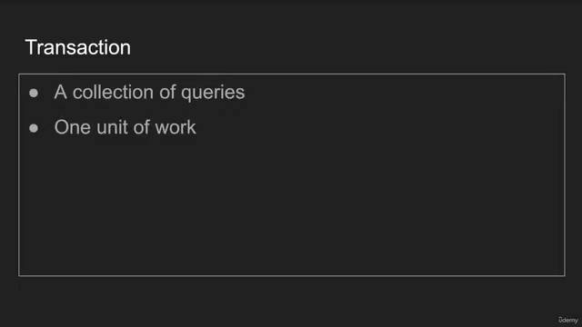
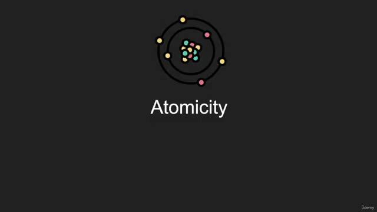
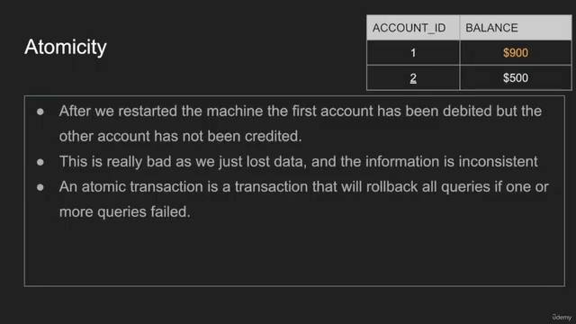
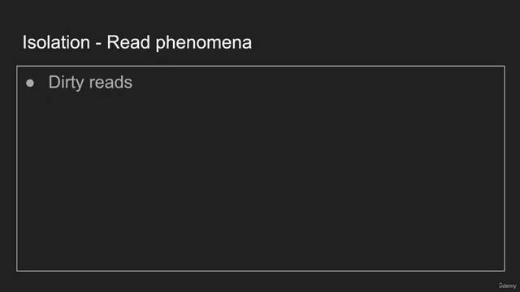
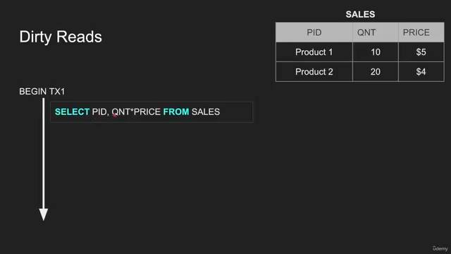
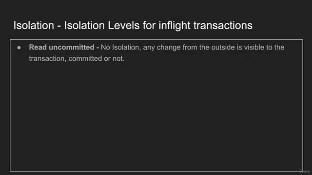
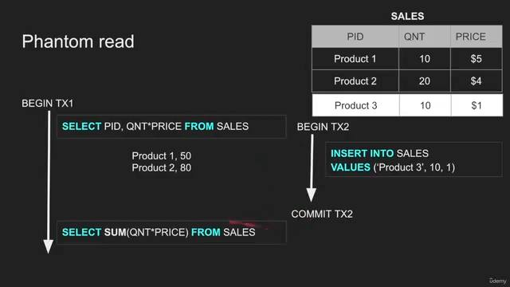
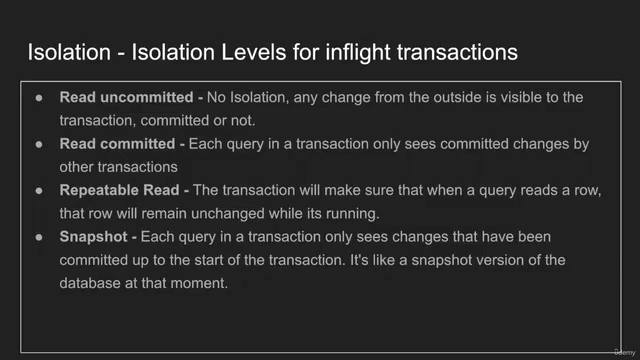

## 1. 这一节做什么

这一篇对应课程 **P5–P8**：ACID 总览、数据库事务、原子性（Atomicity）、隔离性（Isolation）。讲师的主线不是带你搭一个后端项目，而是用转账、销售报表、并发读写这些例子，讲清楚：

- 事务是什么：一组 SQL 被当作一个不可拆的工作单元；
- 原子性是什么：事务里任何一条语句失败，已成功的语句也要回滚；数据库崩溃时，未提交事务也要在恢复时回滚；
- 隔离性是什么：并发事务之间能不能看到彼此未提交/已提交的修改；
- 脏读、不可重复读、幻读、丢失更新分别怎么发生；
- `READ UNCOMMITTED`、`READ COMMITTED`、`REPEATABLE READ`、`SNAPSHOT`、`SERIALIZABLE` 这些隔离级别想解决什么问题；
- 悲观锁、乐观并发控制、行锁/表锁、`SELECT FOR UPDATE` 的基本思路。

**必须先说明：这门课的 P5–P8 逐字稿里没有提供项目仓库、`package.json`、Docker 配置、建表脚本或启动命令。** 讲师讲的是数据库工程原理和 SQL 示例。为了满足“读者照着文档能把东西跑起来”，下面我会基于逐字稿里明确出现的 `account` 表、`sales` 表、转账 SQL、销售汇总 SQL，补一个**最小可复现实验台**：用 Docker 启动 PostgreSQL，建表、插入数据，然后逐项复现原子性回滚、读已提交、可重复读、幻读、丢失更新。

下面的 Docker、PostgreSQL 版本、目录结构、启动命令，是**文档作者为复现课程概念补的**，不是讲师原话。文中会明确标注哪些是课里讲的、哪些是我补的。


---

## 2. 讲师原话（带「—— pNNN [MM:SS]」）

讲师先给 ACID 下定义：

> "原子性、一致性、隔离性和持久性是关系型数据库系统的四项关键特性。"
> —— p005 [00:00]

然后他把事务定义为“一组被当作一个工作单元的 SQL 查询”：

> "事务本质上就是一组 SQL 查询，它们被视为一个工作单元。"
> —— p006 [00:00]

在转账例子里，讲师强调不是一条 SQL 就能完成，而是读余额、扣款、加款等多条语句组成一个事务：

> "所以是读取、更新、更新。这个事务由三条不同的查询组成。"
> —— p006 [01:46]

讲到原子性时，讲师的定义非常直接：

> "实际上，事务中的所有查询都必须成功。"
> —— p007 [00:26]

并且他特别提到崩溃场景：不是用户主动失败，而是数据库中途挂了，恢复后也要把未提交事务清理掉：

> "如果在提交之前数据库宕机了，那你实际上并没有提交该事务。事务中所有已经成功的查询都应该回滚。"
> —— p007 [02:18]

隔离性部分，讲师先提出核心问题：正在执行的事务能不能看到其他事务的修改？

> "我正在执行的事务，能否看到其他同样正在执行的事务所做的更改？"
> —— p008 [00:58]

他列出的第一个读现象是脏读：读到了别人还没提交、可能回滚的数据：

> "脏读是指，你作为正在执行的事务，读到了其他事务已经写入但尚未真正提交的数据。"
> —— p008 [02:24]

讲到隔离级别时，他说 `READ COMMITTED` 是很多数据库常用的级别，每个查询只能看到其他事务已经提交的修改：

> "事务中的每条查询只能看到其他事务已提交的更改。"
> —— p008 [20:56]

关于 `SNAPSHOT`，讲师解释为事务开始时的一个数据库版本视图：

> "事务中的每条查询只能看到截至该事务开始时已经提交的更改。这就像那一时刻整个数据库的一个快照。"
> —— p008 [23:44]

最后他总结隔离级别不是“越高越无脑选”，而是要理解每种读现象和成本：

> "每种数据库管理系统实现隔离级别的方式都不一样。不必过度纠结这些隔离级别，只要理解它们确实存在即可。"
> —— p008 [25:34]



---

## 3. 从零复现

### 3.1 复现目标

我们要做一个最小实验台，能跑出下面这些结果：

1. `account` 表：`id`、`balance`，初始 `1 -> 1000`、`2 -> 500`；
2. `sales` 表：`product_id`、`quantity`、`price`，初始商品 1 卖 10 件、单价 5；商品 2 卖 20 件、单价 4；
3. 跑一个故意失败的事务，验证前面的扣款也被回滚；
4. 用两个终端跑并发事务，验证 `READ COMMITTED` 下“提交后可见”；
5. 用 `REPEATABLE READ` 验证同一事务内重复读结果不变；
6. 用范围查询 + 另一个事务插入新行，复现幻读；
7. 用“先读再写”的两个事务复现丢失更新；
8. 可选：在事务未提交时杀掉数据库容器，再启动，验证未提交修改没有落库。

### 3.2 前置环境

你需要：

- Docker Engine 或 Docker Desktop；
- Docker Compose v2，命令是 `docker compose`，不是老的 `docker-compose`；
- 一个终端；
- 不需要本机安装 PostgreSQL，所有 `psql` 都在容器里执行。

本文使用的镜像版本是：

```text
postgres:16-alpine
```

这个版本是文档作者补的，课程里没有指定版本。

### 3.3 目录结构

在任意空目录下创建：

```text
acid-lab/
├── docker-compose.yml
├── init.sql
└── experiments/
    ├── 00_reset.sql
    ├── 01_atomicity_fail.sql
    ├── 02_read_committed_A.sql
    ├── 02_read_committed_B.sql
    ├── 03_repeatable_read_A.sql
    ├── 03_repeatable_read_B.sql
    ├── 04_phantom_A.sql
    ├── 04_phantom_B.sql
    ├── 05_lost_update_A.sql
    └── 05_lost_update_B.sql
```

所有文件内容在下一节“完整代码”里给全，直接保存即可。

### 3.4 启动数据库

进入 `acid-lab/`：

```bash
docker compose up -d
```

查看容器状态：

```bash
docker compose ps
```

进入 `psql`：

```bash
docker compose exec db psql -U postgres -d acid_lab
```

进入后先确认表存在：

```sql
\dt
```

你应该看到 `account` 和 `sales`。

查初始数据：

```sql
SELECT id, balance FROM account ORDER BY id;
SELECT product_id, quantity, price FROM sales ORDER BY product_id;
```

预期：

```text
account:
 id | balance
----+---------
  1 | 1000.00
  2 |  500.00

sales:
 product_id | quantity | price
------------+----------+-------
          1 |       10 |  5.00
          2 |       20 |  4.00
```

如果你修改了 `init.sql`，但数据库没有变化，是因为 PostgreSQL 的初始化脚本只在数据卷第一次创建时执行。重置命令：

```bash
docker compose down -v
docker compose up -d
```

`down -v` 会删除数据卷，下一次启动会重新执行 `init.sql`。

### 3.5 复现原子性：一条 SQL 失败，前面成功的也要回滚

先重置数据：

```bash
docker compose exec db psql -U postgres -d acid_lab -f /experiments/00_reset.sql
```

执行原子性实验：

```bash
docker compose exec db psql -U postgres -d acid_lab -f /experiments/01_atomicity_fail.sql
```

这个脚本会：

1. `BEGIN;`
2. 查账户 1 余额；
3. 扣 100，账户 1 变成 900；
4. 再扣 5000，故意让余额变负数，违反 `CHECK (balance >= 0)`；
5. 执行 `ROLLBACK;`
6. 再查账户余额。

预期结果是：第二条 `UPDATE` 报约束错误，类似“违反 check constraint”，具体错误文本以你的 PostgreSQL 实际输出为准；最后账户 1 仍然是 `1000.00`，账户 2 仍然是 `500.00`。**前面的 `-100` 不会留下。**



原子性不是“最后一条失败就只撤销最后一条”，而是整个事务单元回滚。讲师在 p007 里用转账例子讲得很清楚：如果扣款成功、加款没成功、数据库又崩了，就会看到账户 1 少了 100、账户 2 没加 100 的不一致状态。原子性要避免的就是这种半成品状态。



### 3.6 复现 READ COMMITTED：别人提交后，我下一次查询能看见

重置：

```bash
docker compose exec db psql -U postgres -d acid_lab -f /experiments/00_reset.sql
```

开两个终端。

终端 A 执行：

```bash
docker compose exec db psql -U postgres -d acid_lab -f /experiments/02_read_committed_A.sql
```

它会先查一次 `sales`，然后 `pg_sleep(30)` 停 30 秒，再查一次。

在 A 睡眠期间，终端 B 执行：

```bash
docker compose exec db psql -U postgres -d acid_lab -f /experiments/02_read_committed_B.sql
```

B 会把商品 1 的数量加 5 并提交。

A 第二次查询应该能看到商品 1 数量从 `10` 变成 `15`。这就是 `READ COMMITTED` 的典型行为：A 的第一个查询看不到 B 未提交的修改；B 提交后，A 的后续查询可以看到新值。



### 3.7 复现 REPEATABLE READ：同一事务内重复读不变

重置后开两个终端。

终端 A：

```bash
docker compose exec db psql -U postgres -d acid_lab -f /experiments/03_repeatable_read_A.sql
```

终端 B 在 A 睡眠期间执行：

```bash
docker compose exec db psql -U postgres -d acid_lab -f /experiments/03_repeatable_read_B.sql
```

B 同样把商品 1 加 5 并提交。A 第二次查询仍然是事务开始时的视图，商品 1 数量仍为 `10`。这就是 `REPEATABLE READ` 想解决的问题：同一事务里重复读同一个值，不应该因为别人提交而变化。

这里要注意：讲师在 p008 里说 PostgreSQL 的 `REPEATABLE READ` 实际是 snapshot 思路，所以它和某些数据库的 `REPEATABLE READ` 行为不完全一样。本文实验以 PostgreSQL 实际行为为准。

### 3.8 复现幻读：范围查询里“冒出新行”

重置后开两个终端。

终端 A：

```bash
docker compose exec db psql -U postgres -d acid_lab -f /experiments/04_phantom_A.sql
```

A 用范围查询统计 `product_id BETWEEN 1 AND 100` 的行数和总额，然后睡眠 30 秒。

终端 B 在 A 睡眠期间执行：

```bash
docker compose exec db psql -U postgres -d acid_lab -f /experiments/04_phantom_B.sql
```

B 插入商品 3：数量 10，单价 1，然后提交。

A 第二次范围查询会看到新行，总额从 `130` 变成 `140`。这不是脏读，因为 B 已经提交；也不是严格意义上的“重复读同一行”，因为 A 第一次根本没读到商品 3。它是在范围查询里“凭空出现”的新行，所以叫幻读。



### 3.9 复现丢失更新：两个事务都基于旧值写回

重置后开两个终端。

终端 A：

```bash
docker compose exec db psql -U postgres -d acid_lab -f /experiments/05_lost_update_A.sql
```

A 先读商品 1 数量 `10`，睡眠 30 秒，然后按“读到的 10 + 10”写回 `20`。

终端 B 在 A 睡眠期间执行：

```bash
docker compose exec db psql -U postgres -d acid_lab -f /experiments/05_lost_update_B.sql
```

B 也读商品 1 数量 `10`，然后按“10 + 5”写回 `15` 并提交。

A 醒来后写回 `20` 并提交。最终数量是 `20`，B 的 `+5` 被覆盖，相当于丢了。这个实验故意用“应用层先读、再计算、再写回”的方式复现丢失更新。如果写成 `UPDATE sales SET quantity = quantity + 5`，数据库会在行锁下基于最新值累加，行为不同；这点在“课里没讲但你会撞上”里会解释。



### 3.10 可选：事务未提交时杀数据库，验证恢复回滚

这个实验用于对应 p007 的“数据库崩溃”场景。

重置后，终端 A 进入交互式 `psql`：

```bash
docker compose exec db psql -U postgres -d acid_lab
```

执行：

```sql
BEGIN;
UPDATE account SET balance = balance - 100 WHERE id = 1;
SELECT id, balance FROM account ORDER BY id;
```

此时事务没有提交，账户 1 显示 `900`。

另开终端 B，杀掉数据库容器：

```bash
docker compose kill db
docker compose start db
```

等容器起来后查询：

```bash
docker compose exec db psql -U postgres -d acid_lab -c "SELECT id, balance FROM account ORDER BY id;"
```

预期账户 1 回到 `1000`。未提交的扣款不应该持久化。实际等待时间、恢复日志输出以你的环境为准。

---

## 4. 完整代码

### 4.1 `docker-compose.yml`

```yaml
services:
  db:
    image: postgres:16-alpine
    container_name: acid-lab-db
    environment:
      POSTGRES_USER: postgres
      POSTGRES_PASSWORD: postgres
      POSTGRES_DB: acid_lab
    ports:
      - "5432:5432"
    volumes:
      - ./init.sql:/docker-entrypoint-initdb.d/01-init.sql:ro
      - ./experiments:/experiments:ro
      - acid_lab_pgdata:/var/lib/postgresql/data
    healthcheck:
      test: ["CMD-SHELL", "pg_isready -U postgres -d acid_lab"]
      interval: 5s
      timeout: 5s
      retries: 10

volumes:
  acid_lab_pgdata:
```

### 4.2 `init.sql`

```sql
DROP TABLE IF EXISTS sales;
DROP TABLE IF EXISTS account;

CREATE TABLE account (
  id integer PRIMARY KEY,
  balance numeric(12,2) NOT NULL,
  CONSTRAINT account_balance_nonnegative CHECK (balance >= 0)
);

CREATE TABLE sales (
  product_id integer PRIMARY KEY,
  quantity integer NOT NULL CHECK (quantity >= 0),
  price numeric(12,2) NOT NULL CHECK (price >= 0)
);

INSERT INTO account (id, balance) VALUES
  (1, 1000.00),
  (2, 500.00);

INSERT INTO sales (product_id, quantity, price) VALUES
  (1, 10, 5.00),
  (2, 20, 4.00);
```

### 4.3 `experiments/00_reset.sql`

```sql
TRUNCATE TABLE sales;
TRUNCATE TABLE account;

INSERT INTO account (id, balance) VALUES
  (1, 1000.00),
  (2, 500.00);

INSERT INTO sales (product_id, quantity, price) VALUES
  (1, 10, 5.00),
  (2, 20, 4.00);
```

### 4.4 `experiments/01_atomicity_fail.sql`

```sql
\set ON_ERROR_STOP off

BEGIN;

SELECT balance AS before_balance
FROM account
WHERE id = 1;

UPDATE account
SET balance = balance - 100
WHERE id = 1;

UPDATE account
SET balance = balance - 5000
WHERE id = 1;

ROLLBACK;

SELECT id, balance
FROM account
ORDER BY id;
```

### 4.5 `experiments/02_read_committed_A.sql`

```sql
BEGIN;

SET TRANSACTION ISOLATION LEVEL READ COMMITTED;

SELECT product_id, quantity, price
FROM sales
ORDER BY product_id;

SELECT pg_sleep(30);

SELECT product_id, quantity, price
FROM sales
ORDER BY product_id;

COMMIT;
```

### 4.6 `experiments/02_read_committed_B.sql`

```sql
BEGIN;

UPDATE sales
SET quantity = quantity + 5
WHERE product_id = 1;

COMMIT;
```

### 4.7 `experiments/03_repeatable_read_A.sql`

```sql
BEGIN;

SET TRANSACTION ISOLATION LEVEL REPEATABLE READ;

SELECT product_id, quantity, price
FROM sales
ORDER BY product_id;

SELECT pg_sleep(30);

SELECT product_id, quantity, price
FROM sales
ORDER BY product_id;

COMMIT;
```

### 4.8 `experiments/03_repeatable_read_B.sql`

```sql
BEGIN;

UPDATE sales
SET quantity = quantity + 5
WHERE product_id = 1;

COMMIT;
```

### 4.9 `experiments/04_phantom_A.sql`

```sql
BEGIN;

SET TRANSACTION ISOLATION LEVEL READ COMMITTED;

SELECT
  COUNT(*) AS row_count,
  COALESCE(SUM(quantity * price), 0) AS total
FROM sales
WHERE product_id BETWEEN 1 AND 100;

SELECT pg_sleep(30);

SELECT
  COUNT(*) AS row_count,
  COALESCE(SUM(quantity * price), 0) AS total
FROM sales
WHERE product_id BETWEEN 1 AND 100;

COMMIT;
```

### 4.10 `experiments/04_phantom_B.sql`

```sql
BEGIN;

INSERT INTO sales (product_id, quantity, price)
VALUES (3, 10, 1.00);

COMMIT;
```

### 4.11 `experiments/05_lost_update_A.sql`

```sql
BEGIN;

SET TRANSACTION ISOLATION LEVEL READ COMMITTED;

SELECT quantity
FROM sales
WHERE product_id = 1;

SELECT pg_sleep(30);

UPDATE sales
SET quantity = 20
WHERE product_id = 1;

COMMIT;

SELECT quantity
FROM sales
WHERE product_id = 1;
```

### 4.12 `experiments/05_lost_update_B.sql`

```sql
BEGIN;

SELECT quantity
FROM sales
WHERE product_id = 1;

UPDATE sales
SET quantity = 15
WHERE product_id = 1;

COMMIT;

SELECT quantity
FROM sales
WHERE product_id = 1;
```

---

## 5. 逐行解释

### 5.1 Docker Compose 在做什么

`image: postgres:16-alpine` 指定使用 PostgreSQL 16 的 Alpine 镜像。课程没有指定数据库版本，这里只是复现实验用。

`POSTGRES_USER`、`POSTGRES_PASSWORD`、`POSTGRES_DB` 是 PostgreSQL 官方镜像认识的环境变量，分别创建用户名、密码、数据库名。`POSTGRES_DB=acid_lab` 对应后面所有 `psql -d acid_lab` 命令。

`ports: "5432:5432"` 把容器 5432 映射到宿主机 5432。如果你本机已经装了 PostgreSQL，可能端口冲突，改成 `"5433:5432"` 即可，文档里的容器内命令不受影响。

`./init.sql:/docker-entrypoint-initdb.d/01-init.sql:ro` 把初始化 SQL 挂到 PostgreSQL 官方镜像的初始化目录。**这个脚本只在数据卷为空时执行一次**。你改了 `init.sql` 后如果容器已经有数据，不会自动重跑。

`./experiments:/experiments:ro` 把实验 SQL 挂进容器，方便用 `psql -f /experiments/xxx.sql` 执行。

`acid_lab_pgdata` 是命名数据卷，用来持久化数据库文件。执行 `docker compose down` 不会删除数据；执行 `docker compose down -v` 才会删除。

`healthcheck` 用 `pg_isready` 检查数据库是否可连接。`docker compose ps` 看到 `healthy` 后再执行 SQL 更稳。

### 5.2 `init.sql` 为什么用 `numeric` 而不是 `float`

金额和价格用了 `numeric(12,2)`。在 JavaScript/Node 里，`0.1 + 0.2` 不是精确等于 `0.3`，金额直接走 `Number` 容易出精度问题。数据库里用 `numeric`，Node 里通常用字符串接收，再用 `decimal.js`、`big.js` 或数据库驱动返回的字符串处理。这是前端转 AI 应用工程师很容易踩的坑。

`account` 表：

- `id integer PRIMARY KEY`：账户 ID；
- `balance numeric(12,2) NOT NULL`：余额，不允许空；
- `CONSTRAINT account_balance_nonnegative CHECK (balance >= 0)`：余额不能为负。这个约束是原子性实验里故意触发失败的地方。

`sales` 表：

- `product_id integer PRIMARY KEY`：商品 ID；
- `quantity integer`：数量；
- `price numeric(12,2)`：单价。

这里的表名、字段名来自逐字稿里讲师反复提到的 `account`、`balance`、`sales`、`product ID`、`quantity`、`price`、`price` 这些概念。具体 SQL 写法是文档作者补的。

### 5.3 原子性脚本逐行看

`\set ON_ERROR_STOP off` 是 `psql` 的元命令，意思是“遇到错误不要立刻退出脚本”。这样第二条 `UPDATE` 失败后，脚本还能继续执行 `ROLLBACK`。如果你用 Node 的 `pg` 客户端，就不需要这个，因为你会用 `try/catch/finally` 手动 `ROLLBACK`。

`BEGIN;` 开启事务。对应 Node 里：

```js
await client.query('BEGIN');
```

但注意：在 Node 连接池里，`BEGIN`、后续 SQL、`COMMIT/ROLLBACK` 必须使用**同一个连接**。如果你用 `pool.query()` 随便取连接，事务可能跑到不同连接上，这是生产中非常常见的错误。

第一条 `SELECT balance AS before_balance` 只是观察初始余额。

第一条 `UPDATE account SET balance = balance - 100 WHERE id = 1;` 让账户 1 变成 900。此时事务还没提交。

第二条 `UPDATE ... balance = balance - 5000` 会触发 `CHECK (balance >= 0)` 失败。按照原子性，前面那条 `-100` 也不能留下。

`ROLLBACK;` 显式回滚。实际生产中，如果某条 SQL 报错，应用层应该捕获异常并执行 `ROLLBACK`。在 Node 里类似：

```js
try {
  await client.query('BEGIN');
  await client.query('UPDATE account SET balance = balance - 100 WHERE id = 1');
  await client.query('UPDATE account SET balance = balance - 5000 WHERE id = 1');
  await client.query('COMMIT');
} catch (err) {
  await client.query('ROLLBACK');
  throw err;
}
```

最后 `SELECT id, balance FROM account ORDER BY id;` 验证账户 1 还是 1000。这里体现的就是讲师 p007 说的“所有查询必须成功；一个失败，整个事务回滚”。

### 5.4 `READ COMMITTED` 脚本逐行看

`SET TRANSACTION ISOLATION LEVEL READ COMMITTED;` 设置当前事务的隔离级别。它必须在事务开始后、第一条查询前设置。

A 脚本先查一次 `sales`，然后 `pg_sleep(30)`。`pg_sleep` 是 PostgreSQL 的睡眠函数，用来人为制造并发窗口。它不是课程里的业务代码，只是实验工具。

B 脚本执行 `UPDATE sales SET quantity = quantity + 5 WHERE product_id = 1;` 并提交。这里用的是“基于数据库当前值加 5”，不是应用层先读再写，所以它本身不会丢更新；它只是制造一个已提交修改。

A 醒来后的第二次 `SELECT` 在 `READ COMMITTED` 下会看到 B 已提交的新值。讲师 p008 说 `READ COMMITTED` 下“每个查询只看到已提交修改”，这个实验就是验证这句话。

### 5.5 `REPEATABLE READ` 脚本逐行看

A 脚本把隔离级别换成 `REPEATABLE READ`。在 PostgreSQL 里，事务开始后第一次查询会建立快照，后续查询继续用这个快照。B 提交了 `+5`，但 A 第二次查询仍然看到旧值。

讲师在 p008 里说 PostgreSQL 的 `REPEATABLE READ` 实际接近 snapshot isolation，所以它能避免不可重复读，也能避免很多幻读场景。这个实验帮助你建立直觉：**隔离级别不是 SQL 语法装饰，它直接改变“你能看见哪个版本的数据”。**

在 JS/Node 里，隔离级别通常通过数据库驱动设置，例如在事务里执行 `SET TRANSACTION ISOLATION LEVEL ...`。但要注意连接池：同一事务必须同一连接。

### 5.6 幻读脚本逐行看

A 脚本用范围条件 `WHERE product_id BETWEEN 1 AND 100` 统计行数和总额。第一次统计时只有商品 1、2，总额是 `10 * 5 + 20 * 4 = 130`。

B 插入商品 3：`10 * 1 = 10`，提交。

A 第二次统计在 `READ COMMITTED` 下会看到商品 3，总额变成 `140`。A 第一次并没有读到商品 3，所以它不是“同一行值变了”，而是“范围里多了一行”。这就是讲师在 p008 里说的 phantom read：你没法给一个还没读到的行加锁。



### 5.7 丢失更新脚本逐行看

A 先读数量 10，然后睡眠。B 也读数量 10，把数量写成 15 并提交。A 醒来后按自己读到的旧值计算 `10 + 10 = 20`，写回 20。B 的 `+5` 被覆盖。

这个实验故意使用“应用层读-算-写”的方式。它对应前端/Node 里常见的错误：

```js
const row = await getQuantity();
const next = row.quantity + 10;
await updateQuantity(next);
```

如果两个请求同时这样写，就可能互相覆盖。解决办法之一是数据库行锁，例如 `SELECT ... FOR UPDATE`；或者乐观并发控制，例如加 `version` 字段，更新时 `WHERE version = ?`，失败就重试。讲师在 p008 里提到行级锁、`SELECT FOR UPDATE`、乐观并发控制，但没有展开成完整项目代码。



---

## 6. 复现检查清单

按下面顺序检查，能跑通就说明实验台和课程概念对上了。

- [ ] `docker compose up -d` 成功，`docker compose ps` 显示容器在运行。
- [ ] `docker compose exec db psql -U postgres -d acid_lab -c "\dt"` 能看到 `account` 和 `sales`。
- [ ] 初始 `account`：`1 -> 1000.00`、`2 -> 500.00`。
- [ ] 初始 `sales`：商品 1 数量 10 单价 5；商品 2 数量 20 单价 4。
- [ ] 执行 `01_atomicity_fail.sql` 后，第二条 `UPDATE` 报约束错误；最终账户 1 仍为 `1000.00`。
- [ ] `02_read_committed_A.sql` 和 `02_read_committed_B.sql` 并发执行时，A 第二次查询能看到商品 1 数量变成 15。
- [ ] `03_repeatable_read_A.sql` 和 `03_repeatable_read_B.sql` 并发执行时，A 第二次查询仍看到商品 1 数量为 10。
- [ ] `04_phantom_A.sql` 和 `04_phantom_B.sql` 并发执行时，A 第二次统计总额变成 140。
- [ ] `05_lost_update_A.sql` 和 `05_lost_update_B.sql` 并发执行后，商品 1 最终数量是 20，B 的 15 被覆盖。
- [ ] 每次实验前执行 `00_reset.sql`，数据回到初始值。
- [ ] 修改 `init.sql` 后执行 `docker compose down -v && docker compose up -d`，新初始化生效。
- [ ] 可选崩溃实验：事务未提交时 `docker compose kill db`，再 `start`，未提交扣款被回滚。

---

## 7. 课里没讲但你会撞上的

1. **课程没有项目仓库、依赖清单、Docker 配置、启动命令。**  
   P5–P8 是原理课，讲师用幻灯片和 SQL 例子讲概念。本文的 Docker/PostgreSQL 实验台是文档作者补的复现环境。不要把本文的 `docker-compose.yml` 当成讲师提供的项目文件。

2. **`init.sql` 只在数据卷第一次创建时执行。**  
   这是 PostgreSQL 官方镜像的行为，课程没讲。你改了建表语句却看不到变化时，先执行 `docker compose down -v`。`down -v` 会删数据，实验环境可以这么干，生产不要。

3. **`READ UNCOMMITTED` 在 PostgreSQL 里不是你想的“脏读开关”。**  
   讲师在 p008 说 `READ UNCOMMITTED` 可能产生脏读，并说不同数据库实现不同。实际用 PostgreSQL 做实验时，`READ UNCOMMITTED` 的行为要以你使用的版本为准，不要假设它一定能读出别人未提交的数据。本文没有把脏读做成必跑实验，就是为了避免把数据库实现差异写成课程结论。

4. **默认隔离级别不要靠猜。**  
   讲师说很多数据库常用 `READ COMMITTED`，但你应该在实际环境里查。PostgreSQL 可以用 `SHOW default_transaction_isolation;` 查看。课程没有演示这条命令，这是排错时常用的。

5. **Node 连接池会坑事务。**  
   如果你用 `pg` 的 `pool.query()` 连续执行 `BEGIN`、`UPDATE`、`COMMIT`，它们可能不在同一个连接上。事务必须绑定同一个 client。这个坑课程没讲，但前端转 Node 后端一定会遇到。

6. **长事务的回滚可能很慢。**  
   讲师在 p007 提到自己见过回滚超过一小时的场景，尤其是长事务。实验里 `pg_sleep(30)` 只是制造并发窗口；生产里不要把大量业务逻辑包在长事务里。长事务还会占锁、拖慢清理。

7. **丢失更新不是“数据库一定会帮你挡”。**  
   本文的丢失更新实验用“先读再写”复现。现实代码里，如果你在 Node 里先 `SELECT` 再 `UPDATE`，并发请求就可能覆盖。常见处理是行锁 `SELECT ... FOR UPDATE`、乐观锁版本号、或把计算放进一条原子 `UPDATE` 里。讲师提过这些方向，但没有给完整 Node 实现。

8.