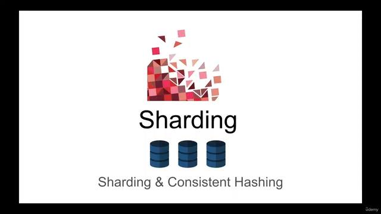
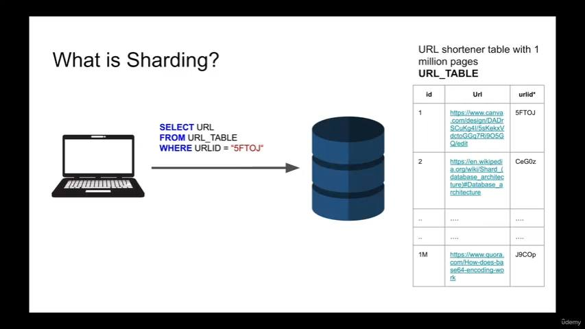
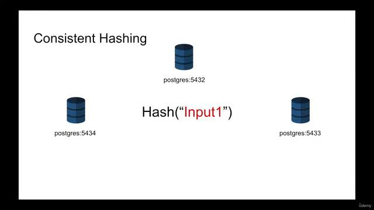
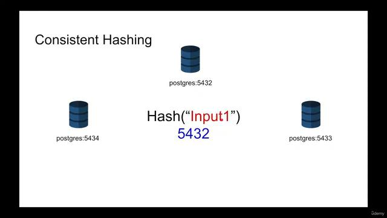
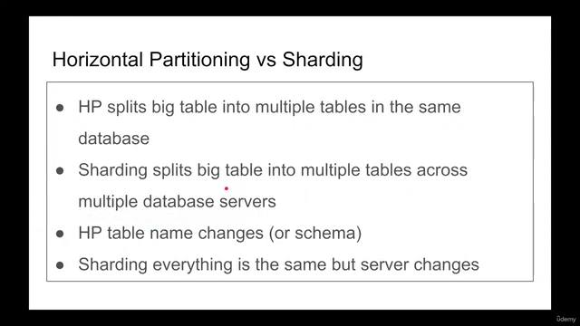

# 数据库分片（Sharding）与 Node.js + Postgres 实现

## 1. 这一节做什么

本课程片段（P53–P56）讲的是**数据库分片（Database Sharding）**：把一张大表按行拆分到多台数据库实例上，从而加快查询、扩展系统。为了讲清分片，课程先介绍了**一致哈希（consistent hashing）**，用来解决“一个字符串到底该去哪个数据库”的问题；随后区分了**水平分区（horizontal partitioning）**和**分片（sharding）**；最后用 Node.js + 多个 Postgres 实例做了一个 URL 短链（URL shortener）的读写示例。

这个主题对前端转 AI 应用工程师的人来说很重要：当你做的应用需要保存大量用户数据、特征数据、埋点数据时，单台数据库迟早会成为瓶颈。分片不是“后端才需要懂”的知识，而是所有需要水平扩展的系统都要面对的问题。本文档会按“从零复现”的方式，把课程里提到的示例做成一个你能直接跑起来的项目。

**课程范围说明**：本视频里讲师并没有给出完整的项目代码，只有概念、示意图和少量伪代码。因此本文档中的完整代码是**按课程描述补全的可运行版本**，凡是课程没讲到的实现细节，我都会明确标注“课程没讲”，你可以放心区分哪些是讲师原话、哪些是为了复现而补的。



## 2. 讲师原话

以下是本 4P 片段中的关键原话，保留英文并标注出处：

- “Database sharding is a process of segmenting the data into partitions that are spread on multiple database instances. This is essentially to speed up query and scale the system.” —— p053 [00:00]
- “Your pain point is one server and querying becomes slower and slower the more data you have. Because guess what? You're going to have indexes and those indexes are going to grow large and as your tables grow large and that kind of slow down your queries.” —— p054 [00:18]
- “You partition your table row based on certain field, certain column, we called partition key or short key. And we throw those rows on multiple tables uniquely.” —— p054 [01:39]
- “So one implementation would be just, hey, make this input into some software number ... do a modulo ... which is the remainder of three because I have three nodes.” —— p055 [01:40]
- “Horizontal partitioning splits this big table into the same database, but another table ... Sharding in the other has splits the same table into a cross multiple server.” —— p056 [00:00]

这些原话对应到实现上就是：

1. 分片就是把数据“切碎”放到多台数据库；
2. 单库单表数据越多、索引越大，查询越慢；
3. 分片键（partition key / shard key）决定一行数据去哪张表/哪个库；
4. 字符串型分片键需要靠哈希 + 取模来决定目标节点；
5. 水平分区是“同一台数据库里的多个表”，分片是“多台数据库里的同名表”。

这里再补一个理解顺序：讲师先讲“问题”，也就是单库数据变大后索引变大、查询变慢；再讲“手段”，也就是按某个字段把行拆开；最后讲“路由”，也就是程序如何知道某一行应该去哪个分片。对前端读者来说，可以把它理解成“路由表”从页面 URL 换成了数据行：页面路由决定渲染哪个组件，分片路由决定查询哪个数据库。



## 3. 从零复现

### 3.1 整体思路

我们要做一个最简单的 URL 短链系统：

- 用户提交一个长 URL，系统生成一个短码（code）；
- 短码作为**分片键**，通过哈希取模决定它落在 3 个 Postgres 实例中的哪一个；
- 创建时，把 `(code, url)` 插入对应分片；
- 读取时，拿着短码再次哈希取模，只连接对应分片查询。

这个系统很好地体现了课程里的分片思想：**不是查询所有数据库，而是先算出“数据一定在哪个库”，然后只查那一个库。**

整个流程可以拆成四步来看：第一步，接收输入；第二步，由输入得到分片键；第三步，用分片键计算目标节点；第四步，只对该节点执行 SQL。课程里的示例重点在第 2 到第 4 步，本文档的代码也围绕这条链路展开。对前端来说，这很像“根据路由参数请求对应接口”，区别是这里请求的是数据库连接池，并且目标节点是由哈希函数计算出来的。


### 3.2 环境要求

运行本文档的代码需要：

- Node.js 18 或更高版本（建议 20 LTS）
- Docker 与 Docker Compose
- 终端环境：macOS/Linux/WSL 均可

前端读者不用怕 Docker：这里的 `docker-compose.yml` 只是用声明式配置同时启动 3 个 Postgres 容器，相当于“一键开 3 个数据库服务”。它和前端项目里用 `npm run dev` 启动开发服务器有点类似，只不过这里启动的不是前端构建工具，而是三个独立的数据库进程。Node.js 18+ 的要求主要与 `pg` 依赖、现代 Node 运行时和内置 `crypto` 的使用有关；Docker Compose 则负责把三个 Postgres 实例隔离开，避免你手工安装三套数据库。

### 3.3 目录结构

请在本地新建一个目录，名字随意，本文档以 `url-sharder/` 为例：

```
url-sharder/
├── docker-compose.yml
├── package.json
├── hash.js
├── db.js
└── app.js
```

这个目录结构刻意保持很小：`docker-compose.yml` 负责基础设施，`package.json` 负责依赖，`hash.js` 负责分片路由，`db.js` 负责连接池和建表，`app.js` 负责命令行入口。这样拆分的目的是让“分片逻辑”和“业务逻辑”分开：以后你要把短链服务换成别的业务，只需要改 `app.js` 的读写逻辑，分片路由仍然可以复用。

### 3.4 启动三个 Postgres 分片

课程里假设有 3 个数据库实例，但没有说怎么启动。复现时我们用 Docker Compose 启动 3 个 Postgres 15 容器：

- 第一个分片：宿主机端口 `5432`
- 第二个分片：宿主机端口 `5433`
- 第三个分片：宿主机端口 `5434`

每个容器的数据库名都是 `urlshortener`，用户名/密码都是 `postgres/postgres`。这就是课程里说的“sharding：数据库表名一样，数据库服务器改变”。

这里需要特别解释端口映射：容器里的 Postgres 默认监听 `5432`，但三个容器不能都把宿主机的 `5432` 占住，所以第二个和第三个容器分别映射到宿主机的 `5433` 和 `5434`。Node.js 代码里看到的 `localhost:5432`、`localhost:5433`、`localhost:5434`，实际上对应三个不同容器中的数据库。表名一样、库名一样，但服务器实例不同，这正是分片和“同一台库里建多张表”的关键区别。

### 3.5 实现一致哈希

课程里讲了一种最直白的实现：把输入字符串转换成数字（例如把字符的 ASCII/Unicode 编码加起来），然后对节点数取模。比如有 3 个节点，`10 % 3 = 1`，就去第 2 个节点（端口 5433）。

我们要复现的哈希逻辑如下：

- `toNumber(code)`：把 `code` 每个字符的 `charCodeAt(i)` 加起来；
- `getNode(code)`：`toNumber(code) % 3`，得到 0/1/2；
- 用一个数组 `[5432, 5433, 5434]` 按下标取端口。

注意：这个“取模哈希”只是课程用来讲原理的极简版本，并不是生产环境里的真正一致哈希环。真正的一致哈希会在节点变化时只迁移少量数据，课程也说了“I'm not saying that it is [the only implementation]”。

从实现细节看，`toNumber` 是确定性的：同一个字符串每次都会得到同一个数字。`getNode` 也是确定性的：只要节点数量和端口数组不变，同一个短码每次都会路由到同一个端口。这一点非常重要，因为写入和读取必须使用同一套路由规则；如果写入时落在 5433，读取时却算到了 5434，就会查不到数据。前端读者可以把 `getNode` 类比成一个纯函数：相同输入永远得到相同输出，不依赖时间、随机数或外部状态。




### 3.6 数据库连接与建表

每个分片都建同一张表：

```sql
CREATE TABLE IF NOT EXISTS urls (
  id BIGSERIAL PRIMARY KEY,
  code TEXT NOT NULL UNIQUE,
  url TEXT NOT NULL,
  created_at TIMESTAMPTZ NOT NULL DEFAULT NOW()
);
```

表名相同，服务器不同——这就是课程里“sharding vs horizontal partitioning”的关键区别。水平分区可能会写成 `customers_west`、`customers_east` 这样不同的表名，但还在同一台库；分片则是表名不变，数据库实例变了。

这张表里 `code` 加了 `UNIQUE` 约束，是为了保证同一个分片内短码不重复。`id` 使用 `BIGSERIAL`，表示由 Postgres 自增生成。`created_at` 使用 `TIMESTAMPTZ`，会带时区信息，适合记录创建时间。对前端读者来说，可以把这段 SQL 理解成“数据库里的类型定义 + 约束”：`TEXT` 类似字符串，`NOT NULL` 类似必填，`UNIQUE` 类似不能重复，`DEFAULT NOW()` 类似自动填入当前时间。

### 3.7 运行命令

进入项目目录后依次执行：

```bash
cd url-sharder
docker compose up -d
npm install pg
node app.js create https://example.com
```

看到输出里的 `code` 后，再执行：

```bash
node app.js get <你的code>
```

如果一切正常，你就能看到一个短码从 Postgres 分片里查回了原始 URL。

### 3.8 运行命令逐条解释、常见错误与排查

下面把 3.7 节出现的每条命令拆开解释。这里的排查建议是通用工程经验，不是课程原话；课程只演示了概念和少量伪代码，没有逐条讲这些命令的报错处理。

1. `cd url-sharder`

   完整解释：`cd` 是 change directory，把当前终端的工作目录切换到 `url-sharder`。后续的 `docker compose`、`npm install`、`node app.js` 都默认以当前目录为基准，所以必须先进入项目根目录。

   常见错误与排查：如果提示 `No such file or directory`，说明当前目录下没有 `url-sharder` 文件夹，或者你还没有创建它。可以先执行 `pwd` 查看当前路径，再执行 `ls` 查看目录内容。若是从别的目录进入，需要确认路径是否正确。前端对照：这相当于在编辑器里打开正确的项目根目录；目录不对，后面的 `package.json` 和代码文件都会找不到。

2. `docker compose up -d`

   完整解释：`docker compose up` 会根据 `docker-compose.yml` 创建并启动服务；`-d` 表示 detached，也就是后台运行，不占用当前终端。这里会启动 `shard1`、`shard2`、`shard3` 三个 Postgres 容器。

   常见错误与排查：如果提示 `docker: command not found`，说明 Docker 没有安装或没有加入 PATH；如果提示 `Cannot connect to the Docker daemon`，说明 Docker 服务没有启动；如果提示 `port is already allocated`，说明宿主机端口 5432/5433/5434 被占用，需要用 `lsof -i :5432` 或系统对应的端口查看命令确认，并修改 `docker-compose.yml` 与 `hash.js` 中的端口；如果提示容器名冲突，可以先执行 `docker compose down` 清理旧容器。前端对照：这类似启动前端 dev server，但这里启动的是三个数据库服务；后台运行时终端不会持续输出日志，需要时可用 `docker compose logs` 查看。

3. `npm install pg`

   完整解释：`npm install pg` 会安装 Node.js 的 PostgreSQL 客户端库 `pg`。本文档代码通过 `require('pg')` 使用它提供的 `Pool` 连接池。安装完成后，依赖会出现在 `node_modules` 中，并记录到 `package.json` 的依赖里。

   常见错误与排查：如果提示 `npm: command not found`，说明 Node.js/npm 没有正确安装；如果安装很慢或失败，先检查网络和 npm registry；如果提示权限问题，不要急着手工改系统目录权限，优先检查是否在项目目录内、是否误用了全局安装。前端对照：这和前端项目里 `npm install axios` 类似，都是安装一个运行时依赖；区别是 `pg` 负责数据库连接，不负责浏览器请求。

4. `node app.js create https://example.com`

   完整解释：`node` 启动 Node.js 进程，`app.js` 是入口文件，`create` 是自定义命令，后面的 `https://example.com` 是要缩短的长 URL。程序会先建表，再生成短码，计算短码所属分片，最后向对应 Postgres 实例执行 `INSERT`。

   常见错误与排查：如果提示 `ECONNREFUSED`，通常是 Postgres 容器还没启动完成，先执行 `docker compose ps` 确认三个服务处于运行状态，再稍等几秒重试；如果提示认证失败，检查 `db.js` 中的用户名、密码、数据库名是否与 `docker-compose.yml` 一致；如果 URL 中包含 `&` 等 shell 特殊字符，建议用引号包住 URL，例如 `node app.js create "https://example.com?a=1&b=2"`。前端对照：这相当于前端表单提交一个长链接，后端创建短码并写入数据库；只是这里的“后端”是一个命令行脚本。

5. `node app.js get <你的code>`

   完整解释：`get` 命令表示按短码读取原始 URL。程序会用同一个 `getNode(code)` 计算分片，只连接那个分片执行 `SELECT`。这就是分片读取的核心：不广播查询，不扫全部库。

   常见错误与排查：如果提示 `Code ... not found`，先确认短码是否输入正确、是否由同一个项目的 `create` 命令生成；如果曾经修改过 `PORTS` 数组或端口映射，旧数据可能落在当前路由算不到的分片里；如果连接失败，仍然先检查容器状态和端口。前端对照：这类似前端访问 `GET /:code` 查询短链详情；区别是服务端在查询前先做了一次分片路由。

6. `node -e "const h=require('./hash'); console.log(h.getNode('abc')); console.log(h.getNode('def'));"`

   完整解释：`node -e` 允许直接在命令行执行一段 JavaScript。这里加载 `hash.js`，打印 `abc` 和 `def` 被路由到的端口。它用于验证哈希函数是否稳定：多次执行同一段命令，同一个字符串的输出端口应该不变。

   常见错误与排查：如果提示 `Cannot find module './hash'`，说明当前目录不是 `url-sharder`，或者 `hash.js` 没有保存到正确位置；如果输出与预期不同，检查 `PORTS` 数组是否被修改。前端对照：这相当于在浏览器控制台里调用一个纯函数做快速验证，不启动完整应用。

7. `docker compose exec shard1 psql -U postgres -d urlshortener -c "SELECT code, url FROM urls;"`

   完整解释：`docker compose exec` 在正在运行的容器里执行命令；`shard1` 是服务名；`psql` 是 PostgreSQL 命令行客户端；`-U postgres` 指定用户；`-d urlshortener` 指定数据库；`-c` 后面是要执行的 SQL。这条命令用于直接查看第一个分片里的数据。

   常见错误与排查：如果提示服务未运行，先执行 `docker compose ps`；如果提示数据库不存在，检查 `POSTGRES_DB` 是否设置为 `urlshortener`；如果表不存在，先运行一次 `node app.js create ...` 触发 `createSchema()`。前端对照：这类似直接打开数据库管理工具查看某张表，只不过这里是在容器内用命令行查看。

## 4. 完整代码

### 4.1 `docker-compose.yml`

```yaml
version: '3.8'

services:
  shard1:
    image: postgres:15-alpine
    container_name: url-sharder-shard1
    environment:
      POSTGRES_USER: postgres
      POSTGRES_PASSWORD: postgres
      POSTGRES_DB: urlshortener
    ports:
      - "5432:5432"
    volumes:
      - pgdata1:/var/lib/postgresql/data

  shard2:
    image: postgres:15-alpine
    container_name: url-sharder-shard2
    environment:
      POSTGRES_USER: postgres
      POSTGRES_PASSWORD: postgres
      POSTGRES_DB: urlshortener
    ports:
      - "5433:5432"
    volumes:
      - pgdata2:/var/lib/postgresql/data

  shard3:
    image: postgres:15-alpine
    container_name: url-sharder-shard3
    environment:
      POSTGRES_USER: postgres
      POSTGRES_PASSWORD: postgres
      POSTGRES_DB: urlshortener
    ports:
      - "5434:5432"
    volumes:
      - pgdata3:/var/lib/postgresql/data

volumes:
  pgdata1:
  pgdata2:
  pgdata3:
```

### 4.2 `package.json`

```json
{
  "name": "url-sharder",
  "version": "1.0.0",
  "private": true,
  "type": "commonjs",
  "dependencies": {
    "pg": "^8.11.3"
  }
}
```

### 4.3 `hash.js`

```js
const PORTS = [5432, 5433, 5434];

// 把字符串转成数字：把每个字符的 Unicode 编码加起来
function toNumber(input) {
  let sum = 0;
  for (let i = 0; i < input.length; i += 1) {
    sum += input.charCodeAt(i);
  }
  return sum;
}

// 对节点数取模，返回端口号
function getNode(code) {
  const index = toNumber(code) % PORTS.length;
  return PORTS[index];
}

// 如果需要知道是第几个分片，也可以用这个函数
function getNodeIndex(code) {
  return toNumber(code) % PORTS.length;
}

module.exports = { PORTS, getNode, getNodeIndex };
```

### 4.4 `db.js`

```js
const { Pool } = require('pg');
const { PORTS, getNode } = require('./hash');

// 为每个分片创建一个连接池
const pools = {};
for (const port of PORTS) {
  pools[port] = new Pool({
    host: 'localhost',
    port,
    user: 'postgres',
    password: 'postgres',
    database: 'urlshortener'
  });
}

// 在每个分片上建表（表名一样，服务器不同）
async function createSchema() {
  for (const port of PORTS) {
    await pools[port].query(`
      CREATE TABLE IF NOT EXISTS urls (
        id BIGSERIAL PRIMARY KEY,
        code TEXT NOT NULL UNIQUE,
        url TEXT NOT NULL,
        created_at TIMESTAMPTZ NOT NULL DEFAULT NOW()
      )
    `);
    console.log(`Schema ready on :${port}`);
  }
}

// 根据 code 决定连接哪个分片
function getPool(code) {
  const port = getNode(code);
  return pools[port];
}

// 关闭所有连接池，让 Node 进程能正常退出
async function closeAll() {
  await Promise.all(PORTS.map((port) => pools[port].end()));
}

module.exports = { pools, createSchema, getPool, closeAll };
```

### 4.5 `app.js`

```js
const crypto = require('crypto');
const { createSchema, getPool, closeAll } = require('./db');
const { getNode } = require('./hash');

// 由原始 URL 生成短码。课程没讲生成方式，这里用 SHA-1 的前 8 位作为短码
function makeCode(longUrl) {
  return crypto.createHash('sha1').update(longUrl).digest('hex').slice(0, 8);
}

// 写入：算出短码，算出短码在哪个分片，插到那个分片
async function createShortUrl(longUrl) {
  const code = makeCode(longUrl);
  const pool = getPool(code);
  await pool.query(
    `INSERT INTO urls (code, url) VALUES ($1, $2)
     ON CONFLICT (code) DO NOTHING`,
    [code, longUrl]
  );
  console.log(`Created/Found code=${code} -> port=${getNode(code)}`);
  return code;
}

// 读取：只查 code 所在的分片
async function getLongUrl(code) {
  const pool = getPool(code);
  const { rows } = await pool.query(
    'SELECT url FROM urls WHERE code = $1',
    [code]
  );
  if (rows.length === 0) {
    console.log(`Code ${code} not found`);
    return null;
  }
  console.log(`Code ${code} -> ${rows[0].url}`);
  return rows[0].url;
}

async function main() {
  const [command, arg] = process.argv.slice(2);

  if (!command) {
    console.log('Usage: node app.js <create|get> <url-or-code>');
    return;
  }

  await createSchema();

  try {
    if (command === 'create') {
      if (!arg) {
        throw new Error('create 需要 URL 参数，例如：node app.js create https://example.com');
      }
      await createShortUrl(arg);
    } else if (command === 'get') {
      if (!arg) {
        throw new Error('get 需要 code 参数，例如：node app.js get a1b2c3d4');
      }
      await getLongUrl(arg);
    } else {
      throw new Error(`Unknown command: ${command}`);
    }
  } finally {
    await closeAll();
  }
}

main().catch((err) => {
  console.error(err);
  process.exit(1);
});
```

### 4.6 与前端开发经验的对照

为了帮助前端读者建立直觉，这里把本文档里的几个关键概念和前端经验做一个对照。注意：类比只是为了理解，不是等价替换。

| 本文档概念 | 前端经验里的近似物 | 说明 |
| --- | --- | --- |
| `getNode(code)` | 路由匹配函数 | 输入一个短码，输出一个目标分片；类似输入 URL 路径，输出对应页面组件 |
| `PORTS` 数组 | 路由表 | 数组下标对应分片，类似前端路由表里路径对应组件 |
| `getPool(code)` | 带参数的请求客户端 | 根据短码选择连接池，类似根据参数选择请求哪个 API |
| `Pool` 连接池 | HTTP 连接复用 | 避免每次查询都新建连接，类似避免每次请求都重新建立 TCP 连接 |
| `createSchema()` | 应用启动时的初始化 | 启动时确保表结构存在，类似前端应用启动时加载配置 |
| `INSERT INTO urls` | 提交表单/调用 POST 接口 | 写入一条短链记录 |
| `SELECT url FROM urls WHERE code = $1` | 调用 GET 详情接口 | 按短码读取一条记录 |
| `docker compose up -d` | 启动本地开发环境 | 一键启动依赖服务，只不过这里是三个数据库实例 |

需要强调的是：分片路由发生在前端看不到的服务端。前端只负责提交长 URL 或访问短码，后端根据分片键决定数据库实例。对前端工程师来说，理解这一点有助于设计 API 时避免“把所有数据都查一遍再返回”的低效实现。

## 5. 逐行解释

### 5.1 `docker-compose.yml`

三个 service 分别叫 `shard1`、`shard2`、`shard3`。每个 service 都使用同一个 Postgres 镜像，环境变量里设置用户、密码、数据库名。

关键点是端口映射：

- `"5432:5432"` 表示容器内 Postgres 默认端口 5432 暴露到宿主机 5432；
- `"5433:5432"` 表示同一个容器端口 5432 暴露到宿主机 5433；
- `"5434:5432"` 同理。

这样 Node.js 就能通过 `localhost:5432`、`localhost:5433`、`localhost:5434` 访问三个互相独立的数据库实例。

`volumes: pgdata1:/var/lib/postgresql/data` 是为了让数据持久化，否则容器删除后数据就丢了。这不是课程内容，但复现时一定会遇到。

### 5.2 `hash.js`

- `toNumber(input)`：把输入字符串的每个字符的 Unicode 码点累加。比如 `"abc"` 会得到 `97 + 98 + 99 = 294`。
- `getNode(code)`：用 `294 % 3 = 0` 得到下标 0，返回 `PORTS[0]` 即 `5432`。
- 相同输入永远得到相同输出，这就满足了课程里“每次提交 input one 字符串，它都会去同一个数据库”的要求。

前端读者可以把 `getNode` 类比成 JavaScript 里的一个纯函数：同样的参数永远返回同样的值。

### 5.3 `db.js`

- `Pool` 是 `pg` 库提供的连接池。它不会每查一次就建立一条新连接，而是维护一组可复用的连接。在 Node.js 里，连接池能有效避免频繁创建 TCP 连接的开销。
- `createSchema()` 遍历 `PORTS`，在三个分片分别执行 `CREATE TABLE IF NOT EXISTS urls ...`。这里特意让三个库的表结构保持一致。
- `getPool(code)` 是分片路由的核心：先通过 `getNode(code)` 拿到端口，再从 `pools` 里取对应连接池。这样业务层不需要知道分片细节。
- `closeAll()` 在命令行脚本结束时关闭所有连接池。如果不关闭，Node.js 事件循环会因为 pg 连接池没有释放而一直挂起，进程无法退出。

### 5.4 `app.js`

- `makeCode(longUrl)`：课程里没讲短码怎么生成，这里用 Node.js 内置 `crypto` 的 SHA-1 哈希取前 8 位十六进制字符。同一个 URL 总是生成同一个短码，所以重复创建不会新增数据。
- `createShortUrl(longUrl)`：先 `makeCode`，再 `getPool(code)` 得到目标分片，执行 `INSERT`。`ON CONFLICT (code) DO NOTHING` 是 Postgres 的“存在就跳过”写法，用来避免短码冲突时数据被覆盖。
- `getLongUrl(code)`：直接用传入的 code 路由到分片查询。这里只会查询一个数据库，不会向三个库都发请求，这正是分片的主要优势。
- `main()`：从 `process.argv` 读取命令。`node app.js create https://example.com` 中 `process.argv` 是 `['node', 'app.js', 'create', 'https://example.com']`，所以 `slice(2)` 得到 `['create', 'https://example.com']`。

在并发/事务方面，前端读者可以理解为：这里的每次写入只涉及一个分片，Postgres 的单行插入本身是原子的，不依赖跨分片事务。如果以后要同时更新多个分片，课程没讲，你也需要自己设计分布式事务或最终一致性方案。



## 6. 复现检查清单

你可以按下面的步骤逐项检查，确保项目真的跑起来了：

1. **检查环境**：
   ```bash
   node -v
   docker --version
   docker compose version
   ```
   Node.js 需要 v18+，Docker Compose 需要可用。

2. **创建目录和文件**：
   ```bash
   mkdir url-sharder && cd url-sharder
   ```
   把第 4 节的 5 个文件保存到对应文件名。

3. **安装依赖**：
   ```bash
   npm install pg
   ```

4. **启动三个 Postgres 分片**：
   ```bash
   docker compose up -d
   ```
   等待几秒后检查：
   ```bash
   docker compose ps
   ```
   三个 service 都应该是 `running`。

5. **测试哈希模块（可选）**：
   ```bash
   node -e "const h=require('./hash'); console.log(h.getNode('abc')); console.log(h.getNode('def'));"
   ```
   每次运行同一个字符串，输出端口应该不变。

6. **创建短链**：
   ```bash
   node app.js create https://www.example.com
   ```
   预期输出类似：
   ```
   Schema ready on :5432
   Schema ready on :5433
   Schema ready on :5434
   Created/Found code=xxxxxxxx -> port=5433
   ```

7. **读取短链**：
   ```bash
   node app.js get xxxxxxxx
   ```
   预期输出：
   ```
   Code xxxxxxxx -> https://www.example.com
   ```

8. **验证数据确实分散到不同分片**：
   多创建几条不同的 URL，然后分别查三个库：
   ```bash
   docker compose exec shard1 psql -U postgres -d urlshortener -c "SELECT code, url FROM urls;"
   docker compose exec shard2 psql -U postgres -d urlshortener -c "SELECT code, url FROM urls;"
   docker compose exec shard3 psql -U postgres -d urlshortener -c "SELECT code, url FROM urls;"
   ```
   如果发现不同短码落在不同库，说明分片路由生效了。

### 6.1 检查清单逐条说明

下面把上面的检查清单逐条展开，说明“为什么要做”“做到什么程度算通过”“常见错误是什么”。

1. **检查环境**：`node -v` 用于确认 Node.js 版本，建议 v18 以上；`docker --version` 用于确认 Docker CLI 已安装；`docker compose version` 用于确认 Compose 子命令可用。常见错误是只安装了旧版 `docker-compose` 而不是 `docker compose`，本文档命令使用后者。若 `node -v` 报错，先安装 Node.js；若 Docker 命令报错，先启动 Docker Desktop 或 Docker 服务。

2. **创建目录和文件**：`mkdir url-sharder && cd url-sharder` 会新建目录并立即进入。这里的 `&&` 表示前一条命令成功后才执行后一条。常见错误是目录已存在导致 `mkdir` 报错，此时可以去掉 `mkdir`，直接 `cd url-sharder`。保存文件时要确认文件名和路径与目录结构一致，尤其是 `hash.js`、`db.js`、`app.js` 不能放错层级。

3. **安装依赖**：`npm install pg` 用于安装 PostgreSQL 客户端。通过标准是命令结束无报错，并且项目下出现 `node_modules`。常见错误包括网络失败、npm 源不可用、在错误目录执行导致找不到 `package.json`。前端对照：这就像给项目安装一个运行时依赖，安装完成后代码才能 `require('pg')`。

4. **启动三个 Postgres 分片**：`docker compose up -d` 会后台启动三个服务。`docker compose ps` 用于查看状态，理想状态是三个 service 都是 `running` 或 `Up`。常见错误是端口被占用、Docker 服务未启动、镜像拉取失败。若状态不是运行中，可以用 `docker compose logs shard1` 查看具体日志。注意 Postgres 容器启动后还需要几秒初始化，刚启动就运行 Node 脚本可能遇到连接拒绝。

5. **测试哈希模块**：这条命令用于验证 `hash.js` 是否能被加载，以及同一个字符串是否稳定映射到同一个端口。通过标准是多次执行时 `abc` 和 `def` 的输出不变。常见错误是当前目录不对，导致 `require('./hash')` 找不到模块；或者 `hash.js` 中的 `PORTS` 被改动，导致输出与预期端口不同。

6. **创建短链**：`node app.js create https://www.example.com` 会触发建表、生成短码、路由分片、插入数据。通过标准是看到 `Schema ready on :5432`、`:5433`、`:5434`，以及 `Created/Found code=... -> port=...`。常见错误是数据库未就绪导致 `ECONNREFUSED`，或认证信息不一致导致连接失败。若 URL 中含有 shell 特殊字符，建议给 URL 加引号。

7. **读取短链**：`node app.js get xxxxxxxx` 会用同一个短码重新计算分片并查询。通过标准是输出原始 URL。常见错误是短码输入错误、短码不是当前项目生成的、曾经改过端口或 `PORTS` 数组导致路由变化。若提示 not found，可以先用第 8 条命令直接查三个分片，确认数据到底在哪个库。

8. **验证数据分散**：三条 `docker compose exec ... psql ...` 命令分别进入三个容器执行查询。通过标准是不同短码出现在不同分片的 `urls` 表里。这里要注意：只创建一两条 URL 时，不一定三个分片都有数据，这是正常的哈希分布现象，不代表失败；多创建几条不同 URL 再观察更可靠。常见错误是容器名写错、服务未运行、数据库名或用户名写错。

## 7. 课里没讲但你会撞上的

1. **课程没有给出完整代码**：逐字稿只讲了概念和伪代码，本文档的代码是补全的。如果你只看视频，会发现“照着敲”无从下手。

2. **课程里的“一致哈希”是极简版**：这里用的是字符串 ASCII 码求和 + 取模，不是生产级的哈希环。真正的一致哈希（如 Cassandra 的 ring）需要虚拟节点，以便节点增减时只迁移少量数据。课程里也说了“I'm not saying that it is [the only implementation]”。

3. **Postgres 分片不是自动的**：你需要自己在应用层决定数据去哪台库。课程没有讲分片后怎么做跨分片查询、聚合、事务；如果需要统计全部分片的数据，只能并行查多个库后合并，这个课程没讲。

4. **Docker 启动后立刻连接可能失败**：Postgres 容器初始化需要几秒，如果运行 `node app.js` 时报 `ECONNREFUSED`，先执行 `docker compose ps` 等服务起来再试。

5. **端口冲突很常见**：如果本机已经有其他 PostgreSQL 占用了 5432/5433/5434，需要修改 `docker-compose.yml` 和 `hash.js` 中的端口，并保持两边一致。

6. **连接池必须关闭**：命令行脚本如果不调用 `pool.end()`，Node 进程会一直挂着不退出。本文档已经在 `db.js` 里用 `closeAll()` 处理了。

7. **短码生成方式课程没讲**：这里用 SHA-1 前 8 位。理论上不同 URL 可能哈希碰撞，导致后写入的短链被忽略。真实 URL 短链服务一般会用全局唯一 ID（如雪花算法）或加随机后缀，课程里没有涉及。

8. **分片键的选择很关键**：课程提了一下可以用 `zip_code`、用户 ID 区间、字符串哈希，但没有展开。如果你选了一个不均匀的分片键，数据会倾斜到某个库，分片效果会大打折扣。这个部分需要你额外查阅资料。

补充一个排错顺序建议：先确认 Node 和 Docker 命令可用，再确认三个 Postgres 容器处于运行状态，然后确认 `hash.js` 的路由稳定，最后再运行 `create` 和 `get`。如果 `create` 成功但 `get` 失败，优先检查短码是否完全一致、`PORTS` 是否被改动、数据是否写到了别的分片。如果三个分片里都查不到数据，问题通常在建表或写入阶段，而不是读取阶段。这个排错顺序不是课程原话，但可以帮你避免一开始就陷入细节。