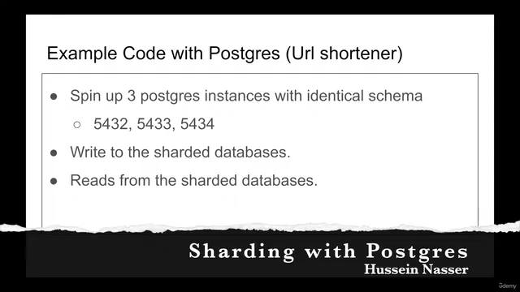
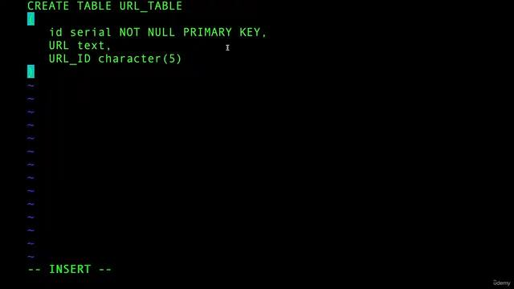
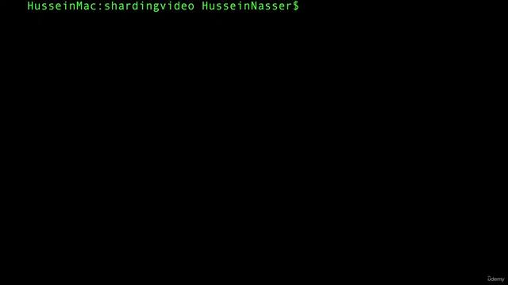
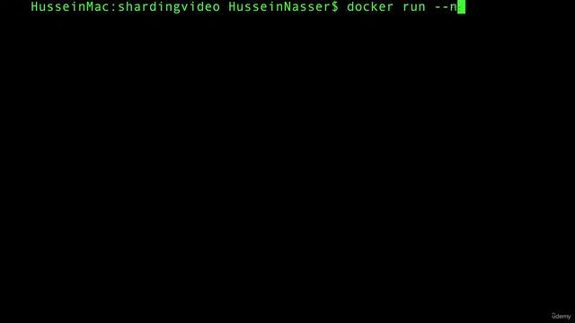
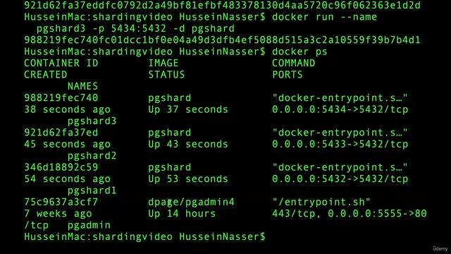

# 用三个 Postgres 分片 + 一致性哈希做一个 URL 短链服务

> 对应课程：Fundamentals of Database Engineering（BV1zNtU63Eqf）P57–P60
> 技术栈：Docker / PostgreSQL / Node.js / Express / pg / hashring
> 读完这份文档，你应该能在自己的机器上跑出「写入时分片、读取时按同一个短码回到同一个分片」的完整闭环。

---

## 1. 这一节做什么

这节课不是讲「什么是分片」的概念课，而是一次**完整的手工搭建**。讲师从零开始，做了下面这几件事，一件不落：

1. 写一个 `init.sql`，里面只有一条建表语句，建的是未来承载短链的 `url_table`；
2. 写一个 `Dockerfile`，`FROM postgres`，然后把 `init.sql` 拷进镜像里的 `/docker-entrypoint-initdb.d/` 目录——这样**每次启动容器，Postgres 镜像都会自动执行这段 SQL**，不需要手动连进去建表；
3. `docker build` 出一个自定义镜像 `pgshard`，然后基于它 `docker run` 出三个容器，分别映射到宿主机的 5432 / 5433 / 5434 端口，这就是三个分片（shard）；
4. 用 pgAdmin 把三个分片连上看一眼，确认三张表结构完全一样、都是空的；
5. 在 Node.js 里用 `express` + `pg` 写一个服务，暴露两个接口：
   - `POST /?url=<长链接>`：把长链接做 sha256 → base64 → 取前 5 个字符当短码，然后用**一致性哈希环**根据短码决定写哪个分片；
   - `GET /:urlId`：拿短码，**用同一个哈希环**算出当初写进了哪个分片，然后去那个分片查回来。

**为什么读取时不用再算一次哈希？** 因为 `urlId` 本身就是哈希出来的结果。讲师在 P060 [01:18] 讲得很直白：「我们不需要再哈希，因为哈希我们已经有啦」——环只负责回答一个问题：这个 key 属于哪个节点。

**给前端同学的类比**：你可以把三个分片想成三个独立的 `Map`，而 `hr.get(urlId)` 就是那个「决定这个 key 放进哪个 Map」的函数。区别在于，它不像 `hash % 3` 那样在加节点时把所有 key 都打乱，一致性哈希只让相邻的一段 key 迁移。至于「加节点会怎样」，讲师在 P060 [10:44] 专门警告过，见第 7 节。

**这一节的验收标准**（跑通这三条就算过）：

- `POST` 一个百度/维基的长链接，返回一个 5 字符的短码，并且告诉你它落到了 5432 / 5433 / 5434 哪一个；
- 用这个短码 `GET`，能原样拿回长链接；
- 随便造 20 条链接后，三个分片的 `url_table` 里都有数据，而不是全挤在一个分片。



---

## 2. 讲师原话

下面几句是这节课的「骨架」，其余都是围绕它们展开的操作细节。

> "我们要构建并启动三个跑在这些地址上的 Postgres 实例——4、5、4、3、2、5、4、3、3，还有 5、4、3、4，对吧？每启动一个 Docker 实例，我们都会用一张表来初始化数据库。"
> —— p057 [00:00]
> 中文意思：起三个 Postgres 实例，端口 5432 / 5433 / 5434，每个实例在启动时就把表建好。

> "我想把刚写的 init.sql 文件复制到一个叫 Docker entry point initdb.d 的特殊目录里。它的作用基本上是：你把它复制进去，然后启动容器，Docker 里的 Postgres 镜像就会说，哦，这里有个 SQL 文件，我来执行它。"
> —— p058 [02:16]
> 中文意思：只要把 SQL 文件放进 `/docker-entrypoint-initdb.d/`，容器启动时 Postgres 镜像会自动执行它。

> "我们需要对那个东西做一致性哈希。把它哈希一下来得到一个端口。怎么做呢？这就是我们讲过的一致性哈希，各位。"
> —— p059 [04:58]
> 中文意思：写入前要对 URL 做一致性哈希，用结果决定打到哪个端口。

> "那个 hash ring……我们只需要问节点：嘿，hash ring，我有个输入叫 URL ID，从三个节点里给我一个，它就会施展魔法。"
> —— p059 [14:20]
> 中文意思：读的时候把短码丢给哈希环，环会告诉你该去哪个分片。

> "显然，那个 hash ring 的东西，也就是一致性哈希，并没有给我相同的值。所以它又蠢又没用，对吧？只是实现有缺陷。于是我又找了个叫 hash ring 的库，终于是一个正确的实现。"
> —— p060 [05:49]
> 中文意思：他一开始用的 `consistent-hash` 这个包有 bug，同一个 key 每次给出的节点不一样，一致性哈希就彻底失去意义了；换成了 `hashring` 才正常。**这一段是整节课最重要的坑，你复现时直接上 `hashring`。**

> "增加分片不是件容易的事。你不能随便加一个新分片，因为你得非常小心自己在做什么……我一加新分片，就会重新分布，所有东西都会跑到 F 上。"
> —— p060 [10:44]
> 中文意思：加新分片不是一个简单操作，加进去之后 key 会重新分布，搞不好数据全乱。重新分片（re-sharding）是另一个话题。

---

## 3. 从零复现

### 3.1 前置条件

| 需要什么 | 说明 |
| --- | --- |
| Docker Desktop（macOS / Windows）或 docker engine（Linux） | 用来跑三个 Postgres 容器 |
| Node.js | 讲师只说了「装好 Node.js 和 VS Code」，**具体版本课里没讲**；`hashring` 和 `pg` 用当前 LTS 都能跑 |
| VS Code | 可选，任何编辑器都行 |
| pgAdmin | 可选。讲师明确说「怎么起 pgAdmin 我在另一个视频讲了，这里不复述」，你完全可以用 `psql` 代替 |

前置条件这一块不需要想得太复杂：Docker 负责提供三个独立的 Postgres 进程，Node.js 负责写应用服务，pgAdmin 或 `psql` 只负责「看数据库里到底有没有表、有没有数据」。如果你不想装 pgAdmin，完全不影响复现，因为后面所有验证都可以用 `docker exec ... psql ...` 完成。

### 3.2 目录结构

讲师用了**两个独立目录**：一个放数据库侧的文件，一个放 Node 代码。我们照抄这个结构：

```
sharding-video/           # 数据库侧（讲师在 p058 [00:29] 提到的 "sharding video" 目录）
├── init.sql              # 建表语句
└── Dockerfile            # 基于官方 postgres 镜像，把 init.sql 塞进初始化目录

sharding/                 # 应用侧（讲师在 p059 [00:00] 新建的 "sharding" 目录）
├── index.js              # 全部服务端逻辑
└── package.json          # npm init 生成
```

> 讲师并没有把这两个目录合并成一个，也没有用 docker-compose。我们就按他的方式来，最后想合并成 compose 文件也可以，但那属于「课里没讲」的部分。

这里要特别强调：`sharding-video/` 是给 `docker build` 用的构建上下文，`sharding/` 是给 Node.js 跑服务用的应用目录。两者不要混在一起，否则你排查问题时会分不清「是镜像里没有 SQL」还是「Node 代码连错了端口」。

### 3.3 第一步：写 init.sql 和 Dockerfile

```bash
mkdir -p ~/sharding-video
cd ~/sharding-video
```

把下面第 4 节的 `init.sql` 和 `Dockerfile` 两份文件存进这个目录。

命令解释：

- `mkdir -p ~/sharding-video`：创建数据库侧目录；`-p` 表示如果目录已经存在也不报错，并且可以自动创建父目录。
- `cd ~/sharding-video`：进入这个目录，后面 `docker build .` 的 `.` 指的就是这里。

常见错误与排查：

- 如果你在错误的目录执行 `docker build`，会报找不到 `Dockerfile` 或构建上下文不对。先 `pwd` 确认自己在 `sharding-video`。
- `init.sql` 文件名要和 `Dockerfile` 里的 `COPY init.sql ...` 对上；如果你改名了，`Dockerfile` 也要同步改。
- 文件保存后可以用 `ls -l` 确认 `init.sql` 和 `Dockerfile` 都在当前目录。




### 3.4 第二步：构建自定义镜像

```bash
cd ~/sharding-video
docker build -t pgshard .
```

注意最后的那个 `.` 不能少——它表示「用当前目录作为构建上下文」。讲师在 P058 [03:38] 特意强调过「that's very important」。

命令解释：

- `docker build`：根据当前目录的 `Dockerfile` 构建镜像。
- `-t pgshard`：给镜像打一个名字叫 `pgshard`，后面 `docker run` 会用到。
- `.`：构建上下文是当前目录，`Dockerfile` 里的 `COPY init.sql ...` 才能找到文件。

常见错误与排查：

- 报 `unable to prepare context: path ... not found`：说明你不在 `sharding-video` 目录，或者路径写错了。
- 报 `COPY failed: file not found`：说明 `init.sql` 不在构建上下文里，检查文件名和大小写。
- 构建很慢或拉取镜像失败：先确认 Docker Desktop 已经启动，网络能拉取 `postgres` 镜像。



### 3.5 第三步：起三个分片容器

```bash
docker run --name pgshard1 -p 5432:5432 -e POSTGRES_PASSWORD=postgres -d pgshard
docker run --name pgshard2 -p 5433:5432 -e POSTGRES_PASSWORD=postgres -d pgshard
docker run --name pgshard3 -p 5434:5432 -e POSTGRES_PASSWORD=postgres -d pgshard
```

逐字解释一遍这三个参数：

- `--name pgshard1`：给容器起名字，后面 `docker exec` 要用；
- `-p 5432:5432`：**宿主机端口:容器端口**。容器里的 Postgres 永远监听 5432，我们靠宿主机端口区分三个实例。第二、三条分别是 `5433:5432` 和 `5434:5432`；
- `-d`：detach，后台跑，不占用终端。

> ⚠️ **`-e POSTGRES_PASSWORD=postgres` 这一条逐字稿里没有出现。**
> 讲师的原命令只有 `docker run --name pgshard1 -p 5432:5432 -d pgshard`。但现在的官方 `postgres` 镜像在初始化空数据目录时，如果既没有 `POSTGRES_PASSWORD` 也没有 `POSTGRES_HOST_AUTH_METHOD`，会直接报错退出。你复现时**必须**补上这个环境变量，否则 `docker ps` 里什么都看不到。后面我们会用 `postgres/postgres` 这个账号密码连库，跟讲师在 pgAdmin 里填的完全一致。

常见错误与排查：

- `docker ps` 看不到容器：先 `docker ps -a` 看容器是不是退出了，再 `docker logs pgshard1` 看日志。最常见原因就是没有设置 `POSTGRES_PASSWORD`。
- `port is already allocated`：宿主机 5432 / 5433 / 5434 被别的 Postgres 或容器占用了。可以 `docker ps` 看有没有旧容器，或者换端口，但换端口后 Node 代码里的端口也要同步改。
- 容器名已存在：说明之前起过同名容器，先 `docker rm -f pgshard1` 再重新 `docker run`。
- 三个容器都起来后，建议执行 `docker ps`，确认三个端口映射分别是 `5432->5432`、`5433->5432`、`5434->5432`。



### 3.6 第四步：确认三张表都建好了

最快的方式是直接进容器用 `psql` 查（课里用的是 pgAdmin 图形界面，效果一样）：

```bash
docker exec pgshard1 psql -U postgres -d postgres -c "\d url_table"
docker exec pgshard1 psql -U postgres -d postgres -c "SELECT * FROM url_table;"
```

第二条应该返回 `(0 rows)`——表是空的，但结构在。

再对 `pgshard2` / `pgshard3` 各跑一遍，三张表要长得一模一样。

命令解释：

- `docker exec pgshard1 ...`：在名为 `pgshard1` 的容器里执行命令。
- `psql -U postgres -d postgres`：用 `postgres` 用户连接 `postgres` 数据库。
- `-c "\d url_table"`：执行一条元命令，查看 `url_table` 的表结构。
- `-c "SELECT * FROM url_table;"`：确认表里没有数据，返回 `(0 rows)`。

常见错误与排查：

- `relation "url_table" does not exist`：说明初始化 SQL 没执行。检查 `Dockerfile` 是否把 `init.sql` 拷进了 `/docker-entrypoint-initdb.d/`，以及构建镜像时是否在正确目录。
- `psql: error: connection ...`：容器没起来或端口映射不对，先 `docker ps` 和 `docker logs`。
- 如果你之前用旧镜像起过容器，后来改了 `init.sql`，重新 `docker run` 也可能不会重新执行初始化，因为 Postgres 只在数据目录为空时执行初始化脚本。需要删掉旧容器再起。



如果你想像讲师一样用 pgAdmin，用这个命令起一个（端口 5555，跟他一致）：

```bash
docker run --name pgadmin -p 5555:80 \
  -e 'PGADMIN_DEFAULT_EMAIL=admin@local.dev' \
  -e 'PGADMIN_DEFAULT_PASSWORD=admin' \
  -d dpage/pgadmin4
```

然后在浏览器打开 `http://localhost:5555`，添加三个 Server，Host 填**宿主机的 IP 或 `host.docker.internal`**（不要填 `localhost`，那是 pgAdmin 容器自己），端口分别 5432 / 5433 / 5434，用户名 `postgres`、密码 `postgres`、数据库 `postgres`。讲师在 P058 [06:03] 说的就是这套参数。

### 3.7 第五步：初始化 Node 项目并装依赖

```bash
mkdir -p ~/sharding
cd ~/sharding
npm init -y
npm install express pg hashring
```

注意依赖清单和讲师嘴里的不完全一样：

- 讲师先 `npm install express pg consistent-hash`，后来发现 `consistent-hash` 有 bug，在 P060 [05:49] 换成了 `hashring`。**我们直接装正确的那个**，跳过踩坑环节；
- 讲师还执行了 `npm install crypto`。这个**不需要**，`crypto` 是 Node 内置模块，`require('crypto')` 直接就能用（详见第 7 节）。

命令解释：

- `mkdir -p ~/sharding`：创建应用目录。
- `cd ~/sharding`：进入应用目录。
- `npm init -y`：快速生成 `package.json`，`-y` 表示全部用默认值。
- `npm install express pg hashring`：安装 Express、Postgres 客户端和一致性哈希环库。

常见错误与排查：

- `npm: command not found`：Node.js 没装好，先确认 `node -v` 和 `npm -v`。
- 安装 `consistent-hash` 后行为不稳定：不要继续用它，按讲师结论换成 `hashring`。
- `Cannot find module 'hashring'`：说明依赖没装到当前目录，检查是不是在 `sharding/` 下执行 `npm install`。

### 3.8 第六步：写 index.js 并启动

把第 4 节的 `index.js` 存进 `~/sharding/`，然后：

```bash
node index.js
```

终端应该打印：

```
connected to shard 5432 / 5433 / 5434
listening on 8081
```

常见错误与排查：

- 如果只看到 `listening on 8081` 但没有连接成功日志，检查 `connect()` 是否在 `app.listen()` 前执行。
- 如果报 `ECONNREFUSED`，说明 Node 连不上 Postgres，先确认三个容器都在运行，端口映射正确。
- 如果报密码认证失败，检查 `POSTGRES_PASSWORD` 和代码里的 `password` 是否一致。

### 3.9 第七步：发请求验证

**写入一条：**

```bash
curl -X POST "http://localhost:8081/?url=https%3A%2F%2Fwww.wikipedia.org%2Fwiki%2FSharding"
```

返回类似：

```json
{"url":"https://www.wikipedia.org/wiki/Sharding","url_id":"Ab3xK","server":"5433"}
```

记住这个 `url_id` 和 `server`。终端里同时会打印一行日志：`POST url=... -> url_id=Ab3xK -> shard=5433`。

**按短码读回来：**

```bash
curl "http://localhost:8081/Ab3xK"
```

应该返回整行记录，里面包含原始长链接。如果 `url_id` 打错一个字符，会得到 `404 Not found`。

**批量灌 20 条，看分布：**

```bash
for i in $(seq 1 20); do
  curl -s -X POST "http://localhost:8081/?url=https%3A%2F%2Fexample.com%2Fpage%2F$i"
  echo
done
```

然后数一下每个分片各存了多少：

```bash
docker exec pgshard1 psql -U postgres -d postgres -c "SELECT count(*) FROM url_table;"
docker exec pgshard2 psql -U postgres -d postgres -c "SELECT count(*) FROM url_table;"
docker exec pgshard3 psql -U postgres -d postgres -c "SELECT count(*) FROM url_table;"
```

三个数加起来应该等于 20，而且**每个都不为 0**。讲师在 P059 [20:02] 干了同样的事（他造了 100 条），用的就是这种「把 URL 批量打进去再看各库行数」的验证法。

> 讲师是把 URL 写在浏览器 fetch 里跑的，并且中途因为跨域（CORS）撞了一次墙（P059 [11:15] 那段 "从源获取资源的访问权限"）。用 `curl` 就没有这个问题。

---

## 4. 完整代码

### 4.1 `sharding-video/init.sql`

```sql
CREATE TABLE url_table (
  id     SERIAL NOT NULL PRIMARY KEY,
  url    TEXT,
  url_id CHAR(5)
);
```

就这三列。`id` 自增主键，`url` 存长链接，`url_id` 是定长 5 字符的短码。

### 4.2 `sharding-video/Dockerfile`

```dockerfile
FROM postgres
COPY init.sql /docker-entrypoint-initdb.d/
```

两行。第一行基于官方 `postgres` 镜像（课里没指定 tag，也就是默认的 `latest`）；第二行把 `init.sql` 拷进初始化目录。

### 4.3 `sharding/package.json`

```json
{
  "name": "sharding",
  "version": "1.0.0",
  "description": "",
  "main": "index.js",
  "scripts": {
    "start": "node index.js"
  },
  "dependencies": {
    "express": "^4.19.2",
    "hashring": "^3.2.0",
    "pg": "^8.13.1"
  }
}
```

> 版本号以你执行 `npm install express pg hashring` 时实际装上的为准，课里没有讨论版本。用上面的命令装完，`package.json` 会被 npm 自动填成对应的样子。

### 4.4 `sharding/index.js`

```js
// index.js —— 分片版 URL 短链服务
const express = require('express');
const { Client } = require('pg');
const crypto = require('crypto');
const HashRing = require('hashring');

const app = express();

// 1. 三个分片的连接对象，key 就是它们对外暴露的宿主机端口
const clients = {
  5432: new Client({
    host: 'localhost',
    port: 5432,
    user: 'postgres',
    password: 'postgres',
    database: 'postgres',
  }),
  5433: new Client({
    host: 'localhost',
    port: 5433,
    user: 'postgres',
    password: 'postgres',
    database: 'postgres',
  }),
  5434: new Client({
    host: 'localhost',
    port: 5434,
    user: 'postgres',
    password: 'postgres',
    database: 'postgres',
  }),
};

// 2. 建立三条 TCP 长连接
async function connect() {
  try {
    await clients[5432].connect();
    await clients[5433].connect();
    await clients[5434].connect();
    console.log('connected to shard 5432 / 5433 / 5434');
  } catch (e) {
    console.error('connect failed:', e.message);
    process.exit(1);
  }
}

// 3. 一致性哈希环，三个节点就是三个分片端口
const hr = new HashRing();
hr.add('5432');
hr.add('5433');
hr.add('5434');

// 4. POST /?url=... —— 缩短长链接并写入对应分片
app.post('/', async (req, res) => {
  const url = req.query.url;
  if (!url) {
    return res.status(400).send('missing query parameter: url');
  }

  // 5. 对长 URL 做 sha256，转 base64，取前 5 个字符当短码
  const hash = crypto.createHash('sha256').update(url).digest('base64');
  const urlId = hash.substring(0, 5);

  // 6. 用短码问哈希环：这条记录该去哪个分片
  const server = hr.get(urlId);
  console.log(`POST url=${url} -> url_id=${urlId} -> shard=${server}`);

  // 7. 写入对应分片（$1 / $2 是参数化查询，防 SQL 注入）
  await clients[server].query(
    'INSERT INTO url_table (url, url_id) VALUES ($1, $2)',
    [url, urlId]
  );

  res.send({ url, url_id: urlId, server });
});

// 8. GET /:urlId —— 用短码把长链接读回来
app.get('/:urlId', async (req, res) => {
  const urlId = req.params.urlId;

  // 9. 读取时把短码丢给同一个哈希环，算出当初写进了哪个分片
  const server = hr.get(urlId);
  console.log(`GET url_id=${urlId} -> shard=${server}`);

  const result = await clients[server].query(
    'SELECT * FROM url_table WHERE url_id = $1',
    [urlId]
  );

  if (result.rowCount > 0) {
    return res.send(result.rows[0]);
  }
  return res.status(404).send('Not found');
});

// 10. 先连数据库，再监听端口
connect().then(() => {
  app.listen(8081, () => console.log('listening on 8081'));
});
```

---

## 5. 逐行解释

### 5.1 建表这部分

```sql
id     SERIAL NOT NULL PRIMARY KEY
```

`SERIAL` 在 Postgres 里是「自增整数」的语法糖，等价于「建一个序列 + 默认值取 `nextval()`」。讲师在 P058 [00:59] 的原话是「just incremental we don't really care about this field much」——他确实不关心这个字段，因为**分片场景下 `id` 在三个库里会重复**：5432 分片的 `id=1` 和 5433 分片的 `id=1` 是两条完全不同的记录。这就是为什么查询必须走 `url_id` 而不是 `id`。这一点课里没有明说，但它是分片架构的必然结果。

```sql
url    TEXT
```

长链接。用 `TEXT` 而不是 `VARCHAR(n)`，Postgres 里两者性能基本一致，`TEXT` 不用想长度。

```sql
url_id CHAR(5)
```

定长 5 字符。注意 `CHAR(n)` 的特点是**不足 5 位会在右边补空格**。因为我们每次一定切出正好 5 个字符，所以没有影响；但如果你以后改成 `substring(0, 6)`，记得同步改这里的长度。

### 5.2 Dockerfile 这两行

```dockerfile
FROM postgres
```

这是官方镜像。**讲师没有指定 tag**，所以会拿 `latest`。这意味着你今天跑出来的 Postgres 大版本可能和他当时跑的不一样，行为基本一致。

```dockerfile
COPY init.sql /docker-entrypoint-initdb.d/
```

`/docker-entrypoint-initdb.d/` 是官方 postgres 镜像约定的初始化目录。镜像的 entrypoint 脚本在「数据目录为空」时会遍历这个目录下所有 `.sh` / `.sql` / `.sql.gz` 文件并执行。

两个必须记住的后果（讲师在 P058 [02:42] 说的是前半句，后半句他没提）：

1. 文件名**随便叫什么**都行，不一定要叫 `init.sql`，讲师明确说过 "它不必非得命名为 init"；
2. **只在数据目录为空时执行一次**。如果你 `docker restart pgshard1`，或者容器删了但数据卷还在，它**不会**重新执行。所以改了 `init.sql` 之后，必须先 `docker rm -f pgshard1` 清掉容器（如果用了 `-v` 挂卷，卷也要删），再重新 `docker run`。

### 5.3 连接对象

```js
const { Client } = require('pg');
```

`pg` 这个包导出好几个东西，`Client` 是「单条连接」，`Pool` 是「连接池」。讲师用的是 `Client`，一个分片一条长连接。

**前端同学对照一下**：`new Client(...)` + `await client.connect()` 很像在前端 `new WebSocket(url)` 之后一直挂着不断开——你后面所有查询都复用这条 TCP 连接。而大家更熟悉的 `fetch()` 每次调用更接近「要一个连接、用完还回去」。**所以在生产代码里正确做法是每个分片一个 `Pool`，而不是一个裸 `Client`**，课里为了简洁没这么做。

```js
const clients = {
  5432: new Client({...}),
  5433: new Client({...}),
  5434: new Client({...}),
};
```

讲师在 P059 [02:15] 的思路是：「用端口当 key，用配置当 value」。这个设计的好处是，`hr.get()` 返回的是一个节点标识（就是端口字符串），拿到之后直接 `clients[server]` 就能取到对应的连接对象，不需要再写 `if/else` 或 `switch`。

**JS 冷知识**：对象字面量里写 `5432:` 这种数字 key，实际存储时会被转成字符串 `"5432"`。所以 `clients['5432']` 和 `clients[5432]` 是同一个属性，`hashring` 返回字符串也能正常取到。

```js
host: 'localhost'
```

讲师填的是他自己机器的名字（p059 [02:44] 他念的是 "Jose Mac"，也就是他的 Mac 主机名）。你照抄的话用 `localhost` 就对了，因为三个容器都把端口映射到了宿主机。**但如果你、按 3.6 节跑了 pgAdmin 容器，pgAdmin 里面就不能填 `localhost`**——那是容器自己，不是宿主机。

```js
user: 'postgres', password: 'postgres', database: 'postgres'
```

讲师的原话是「I'm just lazy, guys, just use the same exact thing」——用户名、密码、库名全叫 `postgres`。这是官方镜像的默认值：不指定 `POSTGRES_USER` 时超级用户就是 `postgres`；不指定 `POSTGRES_DB` 时默认库也是 `postgres`。**建表语句就是在这个 `postgres` 库里执行的**，所以 Node 连接时也填 `database: 'postgres'`。

---

## 6. 常见错误与排查总表

这一节把复现时最容易踩的坑集中列一下。它们不是课程新增内容，而是围绕上面命令和代码的排查思路。

| 现象 | 可能原因 | 排查与处理 |
| --- | --- | --- |
| `docker build` 报找不到 `Dockerfile` | 不在 `sharding-video` 目录，或构建上下文路径不对 | `pwd` 确认目录，执行 `docker build -t pgshard .`，最后的 `.` 不要漏 |
| `COPY failed: file not found` | `init.sql` 不在构建上下文，或文件名大小写不一致 | `ls -l` 看文件是否存在，`Dockerfile` 里的文件名要和实际一致 |
| `docker ps` 看不到 `pgshard1` | 容器启动后退出，常见是没设置 `POSTGRES_PASSWORD` | `docker ps -a` 看状态，`docker logs pgshard1` 看日志，补上 `-e POSTGRES_PASSWORD=postgres` |
| `port is already allocated` | 宿主机 5432 / 5433 / 5434 被占用 | `docker ps` 查旧容器，必要时 `docker rm -f`，或改端口并同步改 Node 代码 |
| `psql: connection refused` | 容器没运行，或端口映射不对 | `docker ps` 确认端口，`docker logs` 看 Postgres 是否启动 |
| `password authentication failed` | 密码不一致，或初始化时没设置密码 | 确认 `POSTGRES_PASSWORD` 和代码里的 `password` 一致；必要时删容器重建 |
| `relation "url_table" does not exist` | 初始化 SQL 没执行，或连错数据库 | 检查 `Dockerfile` 的 `COPY` 路径，进容器执行 `\d url_table`；确认连的是 `postgres` 库 |
| Node 报 `ECONNREFUSED` | Postgres 没起来，或端口写错 | 先确认三个容器都在运行，再检查 `host` 和 `port` |
| `Cannot find module 'hashring'` | 依赖没装，或不在 `sharding/` 目录 | 在 `sharding/` 下执行 `npm install express pg hashring` |
| 同一个短码每次算出的分片不一样 | 用了有 bug 的 `consistent-hash` | 按讲师结论换成 `hashring`，不要继续用旧包 |
| `GET` 返回 `404 Not found` | 短码打错，或读写没有走同一个哈希环 | 看终端日志里 POST 和 GET 的 `shard` 是否一致；确认 `hr.get(urlId)` 用的是同一个 `hr` |
| 20 条数据全在一个分片 | 样本太小，或哈希环节点没加全 | 确认 `hr.add('5432')`、`hr.add('5433')`、`hr.add('5434')` 都执行了；多灌一些数据再看 |
| 浏览器 `fetch` 报 CORS | 浏览器跨域限制 | 课里用 `curl` 验证；如果非要用浏览器，需要自己加 CORS 处理，但课里没讲这部分 |

---

## 7. 加节点与重新分片：为什么第 1 节说见本节

第 1 节提到「加节点会怎样」，对应的是讲师在 P060 [10:44] 的警告：

> "增加分片不是件容易的事。你不能随便加一个新分片，因为你得非常小心自己在做什么……我一加新分片，就会重新分布，所有东西都会跑到 F 上。"
> —— p060 [10:44]
> 中文意思：加新分片不是一个简单操作，加进去之后 key 会重新分布，搞不好数据全乱。重新分片（re-sharding）是另一个话题。

一致性哈希解决的是「加节点时不要把所有 key 都打乱」，但它**不等于加节点没有成本**。你一旦把新的节点加进哈希环，原本属于某一段的 key 可能会被重新分配到新节点；如果数据库里已经有旧数据，就需要考虑迁移、双写、校验、回滚等问题。这节课只做到「三个固定分片」的闭环，没有实现 re-sharding。

**前端类比**：这就像你前端缓存里用了一个 hash 函数算 key，后来你改了 hash 函数或加了新桶，旧缓存不会自动搬家，只会大量 miss。数据库分片更严重，因为数据不是缓存，不能简单丢掉了事。

---

## 8. 检查清单逐条说明

下面这份清单可以当作你复现完后的自检表，每一条都说明「为什么查」和「怎么查」。

1. **目录结构是否正确**
   - 检查 `sharding-video/` 下有 `init.sql` 和 `Dockerfile`。
   - 检查 `sharding/` 下有 `index.js` 和 `package.json`。
   - 原因：`docker build` 和 `node index.js` 都依赖当前目录，目录错了后面全错。

2. **`init.sql` 是否只有 `url_table` 三列**
   - 检查 `id`、`url`、`url_id` 是否存在。
   - 原因：Node 代码里的 `INSERT` 和 `SELECT` 都按这三列写，表结构不一致会直接报错。

3. **`Dockerfile` 是否把 `init.sql` 拷进初始化目录**
   - 检查是否有 `COPY init.sql /docker-entrypoint-initdb.d/`。
   - 原因：没有这一行，Postgres 容器启动时不会自动建表。

4. **`docker build -t pgshard .` 是否成功**
   - 看构建输出最后是否有 `Successfully tagged pgshard:latest` 或类似成功信息。
   - 原因：后面三个容器都基于这个镜像启动。

5. **三个容器是否都在运行**
   - 执行 `docker ps`，确认 `pgshard1`、`pgshard2`、`pgshard3` 都是 `Up` 状态。
   - 原因：只要有一个没起来，对应端口就连不上。

6. **端口映射是否是 5432 / 5433 / 5434**
   - 看 `docker ps` 的 `PORTS` 列，应该是 `0.0.0.0:5432->5432/tcp` 这种形式。
   - 原因：Node 代码里写死了这三个宿主机端口，映射不对就连错库。

7. **三个库是否都有 `url_table`**
   - 分别执行 `docker exec pgshard1 psql -U postgres -d postgres -c "\d url_table"`，另外两个同理。
   - 原因：分片要求每个分片结构一致，否则写入某个分片会失败。

8. **Node 依赖是否安装正确**
   - 检查 `package.json` 里是否有 `express`、`pg`、`hashring`。
   - 原因：少一个模块，`node index.js` 会直接报 `Cannot find module`。

9. **`index.js` 是否连接了三个分片**
   - 看 `clients` 对象里是否有 5432、5433、5434 三个 `Client`。
   - 原因：少一个分片，哈希环即使分过去也没有连接对象可用。

10. **哈希环是否添加了三个节点**
    - 检查 `hr.add('5432')`、`hr.add('5433')`、`hr.add('5434')` 是否都执行。
    - 原因：只加一个节点，所有 key 都会落到同一个分片。

11. **`POST` 是否返回 5 字符短码和分片端口**
    - 用 `curl -X POST` 请求后，看返回 JSON 里的 `url_id` 长度是否为 5，`server` 是否为三个端口之一。
    - 原因：这是写入闭环是否打通的最直接证据。

12. **`GET` 是否能按短码读回长链接**
    - 复制上一步的 `url_id`，执行 `curl "http://localhost:8081/<url_id>"`。
    - 原因：这验证了「读取时用同一个哈希环回到同一个分片」的逻辑。

13. **20 条数据是否分布到三个分片**
    - 批量 POST 20 条后，分别 `SELECT count(*)` 三个库，三个数相加等于 20，且都不为 0。
    - 原因：如果全在一个分片，说明哈希环或写入逻辑有问题。

14. **POST 和 GET 日志里的 `shard` 是否一致**
    - 看终端日志：同一个 `url_id` 在 POST 时落到哪个端口，GET 时也应该落到哪个端口。
    - 原因：这是一致性哈希「同一个 key 回到同一个节点」的核心验证。

15. **改过 `init.sql` 后是否重建了容器**
    - 如果改了建表语句，先 `docker rm -f pgshard1 pgshard2 pgshard3`，再重新 `docker run`。
    - 原因：Postgres 的初始化脚本只在数据目录为空时执行一次，重启不会重新执行。

---

## 9. 与前端概念对照

| 本文概念 | 前端类比 | 说明 |
| --- | --- | --- |
| 三个 Postgres 分片 | 三个独立的 `Map` | 每个分片只存一部分短链数据 |
| `hr.get(urlId)` | 决定 key 放哪个 `Map` 的函数 | 输入短码，输出分片端口 |
| `clients[server]` | 根据 key 取对应的 `Map` | 拿到端口后直接取连接对象 |
| `POST /?url=...` | 前端发一个写请求 | 写入长链接并生成短码 |
| `GET /:urlId` | 前端发一个读请求 | 用短码查回长链接 |
| `404 Not found` | 前端路由没匹配到 | 短码不存在或查错分片 |
| CORS 报错 | 浏览器跨域限制 | 课里用 `curl` 绕开，生产要单独处理 |
| 加新分片 | 改缓存 key 的 hash 函数 | 旧数据不会自动迁移，需要 re-sharding |

---

这份文档到这里就完整覆盖了 P57–P60 的手工搭建流程：从 `init.sql`、`Dockerfile`、三个 Postgres 容器，到 Node.js 里用 `hashring` 做写入分片和读取回查。你只要按第 3 节一步步执行，再用第 8 节检查清单逐条确认，就能在自己的机器上跑出「写入时分片、读取时按同一个短码回到同一个分片」的闭环。

## 7. 课里没讲但你会撞上的

| 现象 | 原因 | 怎么办 |
| --- | --- | --- |
| 某条 `url_id` 直接拼到 `http://localhost:8081/<url_id>` 后返回 `404 Not found`，或路由只收到短码的前半段 | 补充（课里没讲）：短码来自 `sha256(...).digest('base64').substring(0, 5)`，base64 结果里可能出现 `/`，也可能出现 `+`；而 `GET /:urlId` 只按一个路径段匹配，把短码原样拼进
