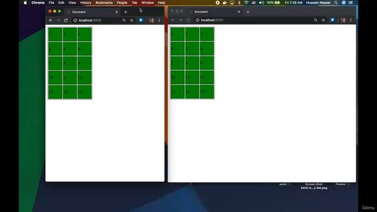
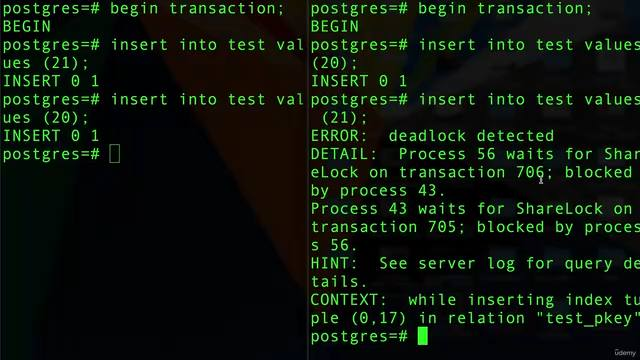
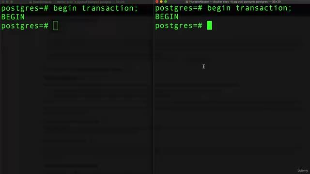
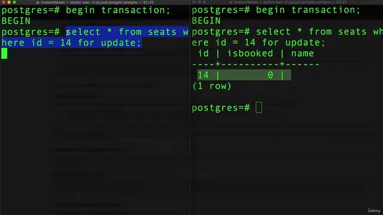
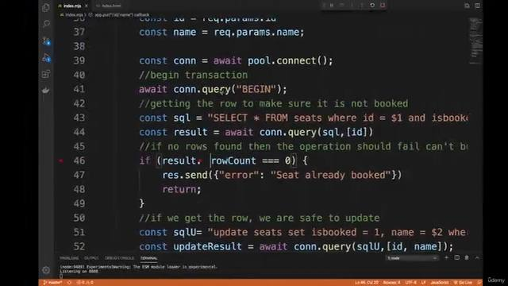
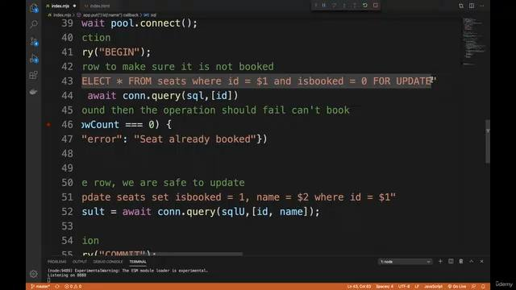
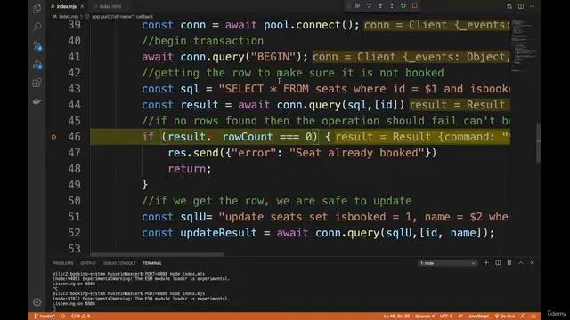
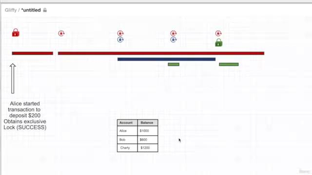

# Fundamentals of Database Engineering P65–P68 复现文档：排他锁、共享锁、死锁与「防重复预订」

---

## 1. 这一节做什么

P65–P68 这四集是一条完整的技术线，主线不是「讲锁的种类」，而是**把「同一个座位不能被两个人同时订走」这件事，从原理一路做到能跑的服务**。

拆开看：

- **P65** 建立两个概念：**exclusive lock（排他锁 / 写锁）** 和 **shared lock（共享锁 / 读锁）**。讲师用 Alice / Bob / Charlie 三个人的时间线演示「我现在要写这个值，谁都不许读」「我现在要读这个值，谁都不许改」，以及两者互斥的规则。
- **P66** 把镜头拉到 Postgres 终端，用两个 psql 会话制造一个**死锁（deadlock）**，观察 Postgres 怎么检测、怎么回滚。
- **P67** 引入**两阶段锁（two-phase locking）**：先一路 acquire、再一路 release，而且**一旦进入释放阶段就不能再申请锁**。用一个「电影院同一秒两个人选同一个座位」的例子说明没有它会发生 double booking。
- **P68** 把 P67 的结论落到真实应用：Express + Node.js + Postgres 写的订座系统，先用「先查再改」的经典写法把 **race condition** 复现出来（讲师用调试器卡住第一个请求来放大时间窗），再加上 `SELECT ... FOR UPDATE` 修掉它。

读完这份文档，你应该能得到：
1. 一个跑在 Docker 里的 Postgres；
2. 一套可以在两个终端里手动复现「死锁」「两阶段锁」的 SQL 实验；
3. 一个 `http://localhost:3000` 上能点的选座页面，两个窗口同时点同一个座位时，只有一个成功、另一个拿到 `seat already booked`。

---

## 2. 讲师原话（带「—— pNNN [MM:SS]」）

**排他锁是什么**

> 「你可以把排他锁想成下面这样：我想读数据库里的某一条数据，比如一列、一行。但我想保证，当我读这个值、或者想更新这个值时，没有人连着、也没有人尝试去读这个值。为了安全、为了前后一致，我要拿到这个值上的排他权限。这样如果有人试图读它，就会拿到一个错误。所以我作为这个连接，是唯一被允许更新它的人。」
> —— p065 [00:28]

**共享锁是什么**

> 「共享锁正好相反：当我从数据库里读一个值，我希望没有人改动它。比如我在读我的银行余额，我在跑报表、跑一个很大的查询，我就去拿一个共享锁，对数据库说：这条记录我占了共享锁，谁想改它，就让他失败。我要让这个值在我的这个事务里始终不变，这就是我拿共享锁的原因。而且很多人、很多连接可以同时拿各自的共享锁。」
> —— p065 [01:27]

**两者互斥**

> 「还有一点要先说清楚：当我试图拿排他锁时，这个值上不能已经存在任何共享锁；反过来，我要拿共享锁时，也不能已经存在排他锁。这两个是正好相反的。比如说某个余额上已经有 7 个共享锁了，那就意味着谁都没法在这个值上拿排他锁，也就是谁都没法改它。」
> —— p065 [02:50]

**死锁是什么**

> 「死锁发生在两个进程、或者两个客户端，在争抢一个或多个资源，其中任何一方都在等另一方释放某个资源上的锁，于是它们进入一个谁也不释放锁的无限状态。这在计算机科学里是个非常有名的经典问题，在数据库上当然也会发生。」
> —— p066 [00:00]

**数据库怎么处理死锁**

> 「Postgres 立刻就检测到了，大概花了一秒钟。死锁一被检测到，那个事务就被回滚了，另一个事务赢了，因为它先进了死锁。所以死锁就是这么被数据库处理的——大多数数据库都处理得很聪明，它们会回滚那个最后进入死锁的事务。」
> —— p066 [02:56]

**两阶段锁**

> 「两阶段锁的思想，就是把拿锁和放锁分成两个阶段。第一个阶段是 acquire、acquire、acquire，第二个阶段是 release、release、release。这里的诀窍是：**一旦你开始释放，就不能再申请**。」
> —— p067 [00:00]

**double booking 是什么**

> 「double booking 就是你要做一个电影院订票系统，两个用户在同一个毫秒去订同一个座位。如果没有两阶段锁或者别的实现，两个事务会同时执行，都去查数据库、都查到座位可用、都说那就订吧，于是双双成功，最后一个人覆盖前一个人——这非常糟糕，因为两个人可能都为同一个座位付了钱。」
> —— p067 [00:28]

**`FOR UPDATE` 的效果**

> 「我要查 `SELECT * FROM seats WHERE id = 14`，但在后面加一个 `FOR UPDATE`。加上 `FOR UPDATE` 之后，这一行、这个对象、这个 tuple 就拿到了排他锁，我现在就在第一阶段——不断累积锁的阶段。表面上看起来没区别，我照样拿到了结果，但底下有个东西变了：这一行上有排他锁了。所以第二个人试图做一模一样的事情时，看，它卡住了。因为它也想去拿这一行上的排他锁，而这个操作现在被挡住了，因为这个锁已经被另一个事务拿走了。」
> —— p067 [04:32]

**「先查再改」为什么不够**

> 「这个设计的漏洞就在这里。当然在我这台单机上不会发生，但如果你有一波请求同时打进来，就会出现两条语句在同一时刻并行执行的情况：第一个事务查到座位可用，走到这里；第二个查询也去查，同样发现这个座位可用。于是两条语句都会通过，两个都会执行 update。这就是问题所在——最后写入的人赢，而且是赢错了。」
> —— p068 [04:30]

**修复方案**

> 「问题的本质是，这两个人实际上都在改同一行。所以一个解法是：第一个到达这一行的进程，先在这一行上拿一个排他锁，这样另一个进程执行时就必须等前一个事务真正结束。在 Postgres 里怎么做？很简单，你本来就在 select 这一行，只要在后面加两个词就行——`for update`。这就叫行级锁。」
> —— p068 [08:13]

**代价：Postgres 的等待没有超时**

> 「这就是我不喜欢 Postgres 的地方。因为我用了 15 年 Oracle，Oracle 贵的一个原因就是，在 Oracle 里你可以指定一个超时，说『最多等五秒』。而这里，它是一个无限等待。」
> —— p068 [09:11]

---

## 3. 从零复现

下面按「先起库 → 手动做两组 SQL 实验 → 再写应用」的顺序走。**不要跳步**，第 5 步的复现依赖第 2 步建好的表。

### 3.1 环境要求

- Docker（能跑 `docker run`）
- Node.js 18 以上（用到了 `fetch`，不过只在浏览器端用，Node 端 `require` + `express` 即可）
- 两个终端窗口（P66 / P67 的实验必须两个会话同时开）

> 课里没讲 Node 和 Docker 的具体版本，下面给的版本号是我建议的可用版本，课里没锁定。

### 3.2 起一个 Postgres

```bash
docker run --name pg-booking \
  -e POSTGRES_PASSWORD=postgres \
  -e POSTGRES_DB=booking \
  -p 5432:5432 \
  -d postgres:16
```

`POSTGRES_DB=booking` 会自动建出 `booking` 这个库，后面所有实验和 Node 应用都连它。等两秒后确认活着：

```bash
docker exec -it pg-booking psql -U postgres -d booking -c "select 1;"
```

进得去就说明库起来了。

### 3.3 建表

把第 4 章的 `init.sql` 存到本地任意目录，然后：

```bash
docker exec -i pg-booking psql -U postgres -d booking < init.sql
```

它会建两张表：`seats`（P067 / P068 用）和 `test`（P066 死锁实验用）。



### 3.4 实验一：制造一次死锁（对应 P066）

开**两个**终端，分别进 psql：

```bash
# 终端 A
docker exec -it pg-booking psql -U postgres -d booking

# 终端 B
docker exec -it pg-booking psql -U postgres -d booking
```

按下面四步**严格交替**敲：

| 顺序 | 终端 | SQL |
|---|---|---|
| 1 | A | `BEGIN;` <br> `INSERT INTO test VALUES (20);` |
| 2 | B | `BEGIN;` <br> `INSERT INTO test VALUES (21);` |
| 3 | A | `INSERT INTO test VALUES (21);` ← 这里 A 会**卡住**，因为 21 在 B 的手里 |
| 4 | B | `INSERT INTO test VALUES (20);` ← 这里 B 也会**卡住** |

第 4 步敲下去之后，Postgres 大约一秒内检测到死锁，会**主动干掉其中一个事务**（讲师的说法是「最后进入死锁的那个」），另一个继续往下走。被干掉的那个终端会看到一条 `deadlock detected` 类的报错。两边都敲 `ROLLBACK;` 收尾。



**乐观版本**（同一个实验的对照组）：

| 顺序 | 终端 | SQL |
|---|---|---|
| 1 | A | `BEGIN;` <br> `INSERT INTO test VALUES (20);` |
| 2 | B | `BEGIN;` <br> `INSERT INTO test VALUES (30);` <br> `INSERT INTO test VALUES (20);` ← 卡住 |
| 3a | A | `ROLLBACK;` ← B 立刻成功（20 被释放了） |
| 3b | 或者 A | `COMMIT;` ← B **失败**，报 duplicate key |

3a 和 3b 二选一，分别跑一次，你就能亲眼看到「等待方拿到的是别人最终的决定」这件事。跑完记得 `DELETE FROM test;` 清干净。

### 3.5 实验二：两阶段锁 + `FOR UPDATE`（对应 P067）

还是那两个 psql 会话。

**第一轮：不用锁，复现 double booking（座位 13）**

| 顺序 | 终端 | SQL |
|---|---|---|
| 1 | A | `BEGIN;` <br> `SELECT * FROM seats WHERE id = 13;` |
| 2 | B | `BEGIN;` <br> `SELECT * FROM seats WHERE id = 13;` |
| 3 | A | `UPDATE seats SET is_booked = 1, name = 'Hussein' WHERE id = 13;` |
| 4 | B | `UPDATE seats SET is_booked = 1, name = 'Edmond' WHERE id = 13;` ← 卡住 |
| 5 | A | `COMMIT;` ← B 立刻解锁并覆盖 |
| 6 | B | `COMMIT;` |

最后 `SELECT * FROM seats WHERE id = 13;`，你会看到名字是 Edmond —— Hussein 被覆盖了。这就是「两个人付了钱，最后一个人赢」。

> 第 4 步为什么会卡？讲师说「这是 Postgres 的一个特有行为」：`UPDATE` 本身要拿行级写锁，A 还没提交，B 就得等。

**第二轮：加 `FOR UPDATE`，座位 14**

| 顺序 | 终端 | SQL |
|---|---|---|
| 1 | A | `BEGIN;` <br> `SELECT * FROM seats WHERE id = 14 FOR UPDATE;` |
| 2 | B | `BEGIN;` <br> `SELECT * FROM seats WHERE id = 14 FOR UPDATE;` ← **直接卡死** |
| 3 | A | `UPDATE seats SET is_booked = 1, name = 'Hussein' WHERE id = 14;` <br> `COMMIT;` |
| 4 | B | 解锁，返回的是**已提交的新值**（`is_booked = 1`），应用据此判断「已被订」并 `ROLLBACK;` |





注意第 4 步：B 解锁后不是拿到旧值，而是拿到 A 提交后的新值，然后**在应用层**判断「这行已经不满足 `is_booked = 0` 了」。这一点在 P068 的代码里会变成 `rowCount !== 1` 的判断。

### 3.6 起 Node 应用，先复现，再修

```bash
mkdir booking && cd booking
npm init -y
npm i express@4.19.2 pg@8.11.5
```

把第 4 章的 `db.js`、`server.js`、`public/index.html` 按目录结构放好：

```
booking/
├── package.json
├── db.js
├── server.js
└── public/
    └── index.html
```

跑起来：

```bash
node server.js
# booking app listening on http://localhost:3000
```

浏览器打开 `http://localhost:3000`，你应该看到 20 个绿格子。

**先复现 bug**：把 `server.js` 里那条 SELECT 末尾的 `FOR UPDATE` 删掉，然后

```bash
node --inspect server.js
```

在 Chrome 打开 `chrome://inspect`，连上后在那条 SELECT 后面打断点。开两个浏览器窗口：窗口一订 15 号座位、在断点处停住（讲师在 p068 [05:50] 就是这么做的）；窗口二直接订 15 号，会**成功**。然后放行窗口一，它也会成功 —— 两个人都订到了 15 号。



**再修复**：把 `FOR UPDATE` 加回去，重启。同样的操作下，窗口二会**一直转圈等待**，直到窗口一提交，然后窗口二拿到 `409 seat already booked`。





---

## 4. 完整代码

### 4.1 `init.sql`

```sql
-- 座位表：P067 / P068 用的就是这一张
-- 列名 is_booked / name 是从讲师的 SQL 里反推出来的（p067 02:44、p068 02:46）
CREATE TABLE IF NOT EXISTS seats (
  id        integer PRIMARY KEY,
  is_booked integer NOT NULL DEFAULT 0,
  name      text
);

INSERT INTO seats (id, is_booked, name)
SELECT g, 0, NULL
FROM generate_series(1, 20) AS g
ON CONFLICT (id) DO NOTHING;

-- P066 死锁实验用的小表：一个字段 + 主键
CREATE TABLE IF NOT EXISTS test (
  id integer PRIMARY KEY
);
```

### 4.2 `package.json`

```json
{
  "name": "seat-booking",
  "version": "1.0.0",
  "private": true,
  "main": "server.js",
  "scripts": {
    "start": "node server.js",
    "dev": "node --inspect server.js"
  },
  "dependencies": {
    "express": "4.19.2",
    "pg": "8.11.5"
  }
}
```

> 课里没给依赖版本，这两个是我建议的可用版本。

### 4.3 `db.js`

```js
const { Pool } = require('pg');

// 课里没讲环境变量名，下面这些是我定的默认值，和 3.2 的 docker run 参数对齐
const pool = new Pool({
  host: process.env.PGHOST || 'localhost',
  port: Number(process.env.PGPORT || 5432),
  user: process.env.PGUSER || 'postgres',
  password: process.env.PGPASSWORD || 'postgres',
  database: process.env.PGDATABASE || 'booking',
  max: 10
});

module.exports = pool;
```

### 4.4 `server.js`

```js
const path = require('path');
const express = require('express');
const pool = require('./db');

const app = express();
const PORT = Number(process.env.PORT || 3000);

app.use(express.json());
app.use(express.static(path.join(__dirname, 'public')));

// 读全部座位，给前端画格子用。课里没讲这个接口，是为了能复现补的
app.get('/seats', async (req, res) => {
  try {
    const result = await pool.query(
      'SELECT id, is_booked, name FROM seats ORDER BY id'
    );
    res.json(result.rows);
  } catch (err) {
    res.status(500).json({ error: err.message });
  }
});

// 订座：P068 的核心，逻辑顺序完全按 p068 [02:17] - [04:06] 的描述
app.put('/book', async (req, res) => {
  const { id, name } = req.body;

  // 1. 先从连接池里借一个 client，整个事务都用这同一个
  const client = await pool.connect();

  try {
    // 2. 开事务
    await client.query('BEGIN');

    // 3. 先查这座位是不是还没被订；FOR UPDATE 是 P068 的修复点
    const check = await client.query(
      'SELECT * FROM seats WHERE id = $1 AND is_booked = 0 FOR UPDATE',
      [id]
    );

    // 4. 查不到（rowCount 不是 1）就让这次请求失败
    if (check.rowCount !== 1) {
      await client.query('ROLLBACK');
      return res.status(409).json({ error: 'seat already booked' });
    }

    // 5. 占座
    await client.query(
      'UPDATE seats SET is_booked = 1, name = $1 WHERE id = $2',
      [name, id]
    );

    // 6. 提交
    await client.query('COMMIT');
    res.json({ ok: true, message: 'book successfully' });
  } catch (err) {
    // 7. 任何一步炸了都回滚，不能让半截事务留在库里
    await client.query('ROLLBACK');
    res.status(500).json({ error: err.message });
  } finally {
    // 8. 无论成功失败都把 client 还回池子，否则池子会被占干
    client.release();
  }
});

app.listen(PORT, () => {
  console.log(`booking app listening on http://localhost:${PORT}`);
});
```

### 4.5 `public/index.html`

```html
<!doctype html>
<html lang="zh-CN">
<head>
  <meta charset="utf-8" />
  <title>Seat Booking</title>
  <style>
    body { font-family: system-ui, sans-serif; padding: 24px; }
    .grid { display: grid; grid-template-columns: repeat(5, 110px); gap: 10px; }
    .seat {
      height: 64px; border-radius: 8px; border: 0; cursor: pointer;
      color: #fff; font-weight: 600; font-size: 13px;
      overflow: hidden; text-overflow: ellipsis; white-space: nowrap;
    }
    .free  { background: #22a06b; }
    .taken { background: #d64545; cursor: not-allowed; }
  </style>
</head>
<body>
  <h1>选座</h1>
  <p>绿 = 可选，红 = 已订</p>
  <div id="grid" class="grid"></div>

  <script>
    async function load() {
      const res = await fetch('/seats');
      const rows = await res.json();
      const grid = document.getElementById('grid');
      grid.innerHTML = '';
      for (const row of rows) {
        const btn = document.createElement('button');
        btn.className = 'seat ' + (row.is_booked ? 'taken' : 'free');
        btn.textContent = row.is_booked ? row.id + ' ' + (row.name || '') : String(row.id);
        btn.disabled = Boolean(row.is_booked);
        btn.onclick = () => book(row.id);
        grid.appendChild(btn);
      }
    }

    async function book(id) {
      const name = window.prompt('你的名字？');
      if (!name) return;
      const res = await fetch('/book', {
        method: 'PUT',
        headers: { 'Content-Type': 'application/json' },
        body: JSON.stringify({ id: id, name: name })
      });
      const data = await res.json();
      if (!res.ok) alert(data.error || 'failed');
      await load();
    }

    load();
  </script>
</body>
</html>
```

> 课里明确说了不讲前端（p068 [00:14]「我不打算展示我是怎么把这个应用搭出来的」），上面这段 HTML 是我为了让接口能点着跑补的最小壳子，不是讲师的原代码。

---

## 5. 逐行解释

### 5.1 为什么是 `pool.connect()` 而不是 `pool.query()`

`pool.query()` 每次从池子里借一个连接、跑完立刻还回去。但事务是**有状态**的：`BEGIN` 之后的那几条语句必须跑在**同一个连接**上，否则 `COMMIT` 会跑到另一个连接去、相当于什么都没提交。所以 `server.js` 第 1 步先 `await pool.connect()` 拿一个租约，全程用 `client.query()`，最后 `client.release()` 还回去。

**给前端的类比**：这相当于你自己管理一个 `fetch` 的 keep-alive 会话，而不是每发一条消息都新建一次长连接。`client.release()` 就是 `finally` 里的 `conn.close()`——不还就会泄漏。

### 5.2 `BEGIN` / `COMMIT` / `ROLLBACK` 三件套

`BEGIN` 告诉数据库「接下来的语句当成一个整体」，`COMMIT` 是「确认」，`ROLLBACK` 是「反悔」。P066 那个死锁实验里你已经亲眼看到：事务没提交之前，别人看得到的还是旧值，锁却已经挂在未提交的行上了。这就是为什么讲师反复强调「尽管还没提交，那个值上已经有排他锁了，别人不能再插一遍」。

**在 JS/Node 里对应什么**：Node 本身没有「事务」这个东西，你只能靠数据库提供。你在 Node 里写的 `try/catch` 不会自动回滚——第 7 步那句手写的 `ROLLBACK` 是必须的，少了它，一个抛异常的事务会一直挂着锁，直到连接被回收。

### 5.3 `WHERE id = $1 AND is_booked = 0` 这个条件

这一句同时做两件事：定位行 + 顺便检查「还没被订」。讲师在 p068 [02:46] 描述的就是这个写法。如果没有 `is_booked = 0`，查出来的是「座位存在」而不是「座位可用」，逻辑就错了。

### 5.4 `rowCount !== 1` 为什么能判失败

`node-postgres` 的查询结果里带一个 `rowCount`，表示这次查询命中了多少行。命中 1 行 = 座位存在且可选；命中 0 行 = 座位不存在或者已经被订。讲师在 p068 [03:12] 说的「拿到结果、行数是 1，说明这个座位是你的了；如果这个座位不可用，你会拿到一个错误」，就是这个判断。

**注意**：这里的 `rowCount` 是 `node-postgres` 的字段名，我上面代码里是直接用的。如果你换成别的驱动（比如 Python 的 psycopg），字段名不一样，**该字段名请以实际驱动文档为准**。

### 5.5 `FOR UPDATE` 到底加在哪

加在 `SELECT` 的最后，`WHERE` 之后。讲师在 p067 [04:32] 说得非常直白：「你本来就在 select 这一行，只要在后面加两个词就行」。加了之后，这条 SELECT 不只是读，它会在命中的行上**顺手拿一个排他锁**，一直持有到事务结束（`COMMIT` 或 `ROLLBACK`）。

这就是 P67 讲的「两阶段锁」的第一阶段：你在 grow 锁。等到 `COMMIT` 那一刻，进入第二阶段 shrink，锁全部释放。



### 5.6 第二个请求为什么会「等」，而不是立刻失败

这是初学者最容易困惑的点。查询里明明写了 `AND is_booked = 0`，为什么第二个请求不是直接返回 0 行？

因为在 **Postgres 的默认隔离级别（read committed）** 下，第二个事务执行 SELECT 时，看到的是「第一个事务提交之前」的快照，此时 `is_booked` 仍然是 0，所以它**命中了这一行**，然后才去拿锁 → 被挡住。等第一个事务提交后，它解锁、重新检查 WHERE 条件，发现已经不满足了，于是返回 0 行。讲师在 p068 [12:00] 描述的正是这个过程：「那个锁被解开了，现在这条 SELECT 读到的是刚刚提交的新值，也就是已经被订了，结果是 0」。

### 5.7 `catch` 里的 `ROLLBACK` 和 `finally` 里的 `release`

这两个不能合并。`ROLLBACK` 是**数据库层面**的清理（释放行锁），`release` 是**连接池层面**的清理（把连接还回去）。少了前者，锁会挂到连接被回收为止；少了后者，池子会被慢慢吃空——尤其在 P068 这个场景里，被 `FOR UPDATE` 挡住的请求是**一直等**的，池子里的连接会越占越多。

`Pool` 的 `max` 我设成 10：如果 10 个并发请求全部卡在同一个座位上的 `FOR UPDATE`，第 11 个请求连 `pool.connect()` 都会等。这个坑在第 7 章会说。

### 5.8 前端那段 `prompt`

讲师在 p068 [02:17] 说「我们从 prompt 里拿名字」。所以 `window.prompt` 是课里出现过的交互方式，不是我发明的。

### 5.9 为什么 P65 的「共享锁」在代码里没出现

有人在 P67 / P68 里只看到排他锁，会疑惑 P65 讲的共享锁去哪了。答案是：**普通 `SELECT` 在 Postgres 里并不加共享锁**，它走的是 MVCC 快照。讲师在 P65 [01:27] 描述的「拿到共享锁、别人改不了」，在实际 SQL 里对应的是 `SELECT ... FOR SHARE` 这类显式语法——**课里没有演示过这条语句**，P67 / P68 全程用的都是 `FOR UPDATE`。

---

## 6. 复现检查清单

- [ ] `docker ps` 能看到 `pg-booking` 容器在跑
- [ ] `docker exec -it pg-booking psql -U postgres -d booking -c "select count(*) from seats;"` 返回 20
- [ ] P066 死锁实验：第 4 步敲下去后，约 1 秒内有一边报 deadlock 类错误，另一边能继续
- [ ] P066 对照组：A `ROLLBACK` 时 B 立刻成功；A `COMMIT` 时 B 报 duplicate key
- [ ] P067 第一轮：座位 13 最后的名字是 Edmond（被覆盖了）
- [ ] P067 第二轮：座位 14 的第二个会话**卡住**，A 提交后解锁并读到 `is_booked = 1`
- [ ] `node server.js` 启动，浏览器打开 `localhost:3000` 看到 20 个绿格子
- [ ] 删掉 `FOR UPDATE` + 调试器卡住：两个请求都返回成功 —— bug 复现
- [ ] 加回 `FOR UPDATE`：第二个请求一直 pending，第一个提交后返回 `409 seat already booked`
- [ ] 刷新页面，被订的座位变红且显示名字

---

## 7. 课里没讲但你会撞上的

**1. 建表语句是我反推的。**
讲师在 P067 / P068 里只口述了列名（`is_booked`、`name`）和查询语句，完整的 `CREATE TABLE` **课里没讲**。上面 `init.sql` 是我按他的 SQL 反推的，你自己建表时列类型可以随便定，只要 `id` 是主键、`is_booked` 能区分 0/1 就行。

**2. 前端代码课里没讲。**
讲师明确说了「我不打算展示我是怎么把这个应用搭出来的」（p068 [00:14]）。`public/index.html` 是我补的最小壳子，你用 Postman / curl 直接打 `PUT /book` 也一样能验证。

**3. 环境变量名课里没讲。**
`PGHOST` / `PGPORT` / `PGUSER` / `PGPASSWORD` / `PGDATABASE` 这几个是我定的，不是讲师指定的。部署到别的环境时记得一起改。

**4. Postgres 的无限等待会把连接池吃光。**
讲师在 p068 [09:11] 亲口说这是他不喜欢 Postgres 的地方：「这里实际上是无限等待」。在一个真实服务里，如果有恶意用户或者前端 bug 让某个事务开完就不提交，所有后续请求会**一直卡在 `FOR UPDATE` 上**，池子里的 10 个连接很快被占满，整个服务假死。课里没讲怎么解决——实际项目里你至少要做两件事：给数据库会话设一个锁等待超时（Postgres 有相关会话参数，**具体参数名和默认值请以你所用版本的官方文档为准，课里没讲**），以及给 HTTP 请求本身加超时。

**5. 单机调试复现不出来，不代表没问题。**
讲师在 p068 [04:30] 说得很清楚：「当然在我这台单机上不会发生，但如果有一波请求同时打进来……」。你用浏览器手点两次，中间隔了几百毫秒，大概率是串行的，看不到 bug。必须像讲师那样（p068 [05:50]）用调试器把第一个请求卡住、或者用 `ab` / `wrk` 之类的并发工具压，才能稳定复现。

**6. 给前端同学的一句提醒：Node 是单线程，但这个 bug 跟单线程无关。**
锁在**数据库端**，不在你的进程端。两个 HTTP 请求就是两个独立的数据库会话，哪怕你的 Node 只用一个 event loop 处理它们，数据库那边照样是两条并发的事务。你在 JS 里熟悉的「单线程所以没有竞态」在这里完全不成立。

**7. 死锁检测的耗时不是固定的。**
讲师在 p066 [02:56] 说「大概花了一秒钟」。这是 Postgres 的一个可调参数决定的，不是恒定值，**具体参数名和默认值课里没讲**，你复现时看到 1 秒左右是正常的，看到 3 秒也别慌。

**8. `FOR UPDATE` 只锁「命中的行」。**
如果你的 WHERE 条件写得宽（比如没走索引），Postgres 可能扫到很多行、锁住很多行，并发度会掉得很厉害。`seats` 表用主键 `id` 查，是没问题的；换成业务里更复杂的查询条件时，要确认走的是索引。

**9. 这不是唯一解。**
讲师在 p068 [07:47] 说的是「**一个**解法，至少是」。课里没讲的其他方案（唯一约束兜底、乐观锁版本号、Redis 分布式锁）都不在 P65–P68 的范围内，别把它们安到这份文档头上。

**10. `FOR UPDATE` 的语法是 SQL 92 标准，但不是所有库都支持。**
讲师在 p068 [08:41] 提到 Postgres、MySQL、Oracle 支持行级锁。换数据库之前先查一下你用的那个库的文档，**课里没讲其他数据库的具体语法差异**。