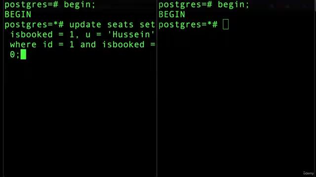
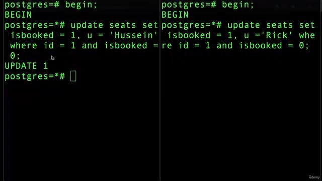
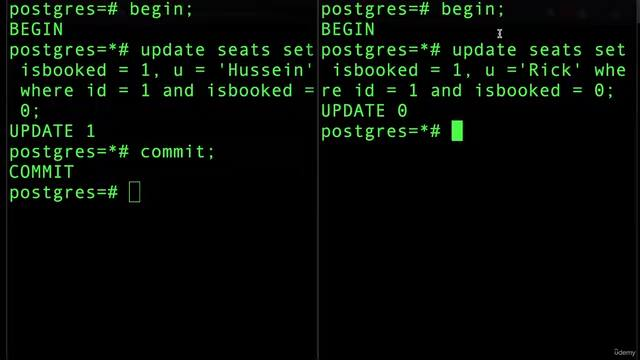
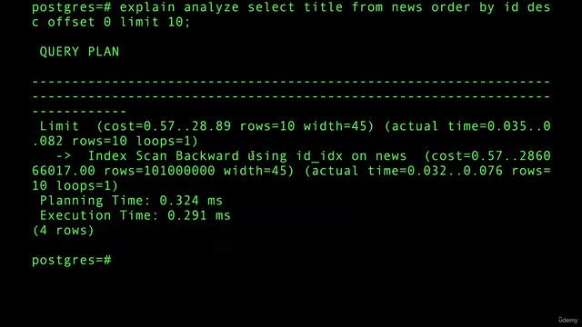
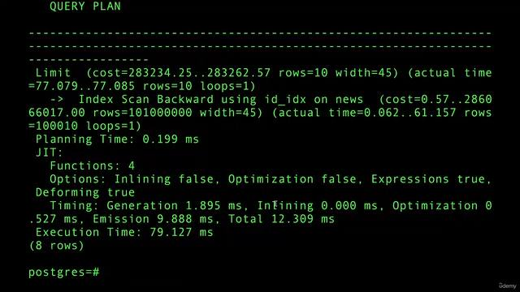
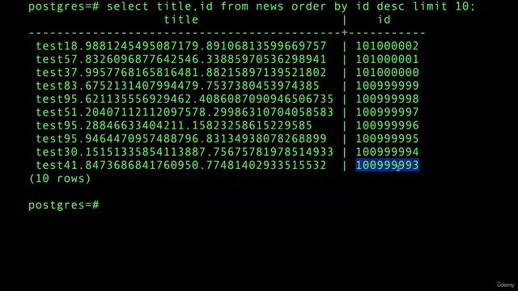
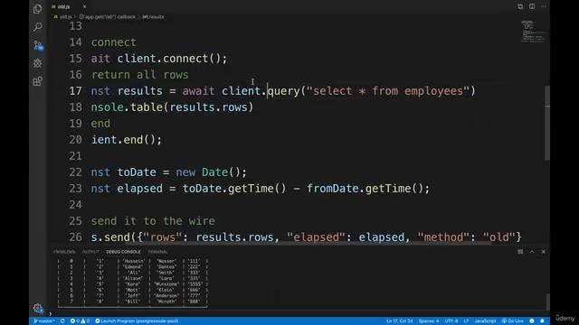
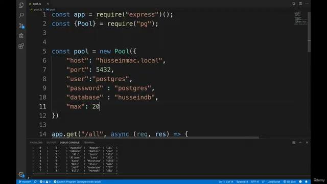
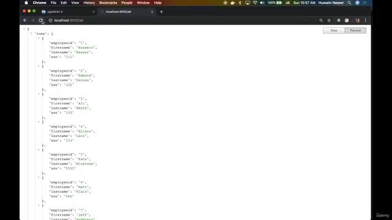
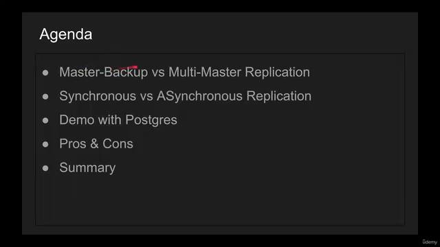

## 1. 这一节做什么

这段课不是四个孤立的知识点，而是一条围绕 **PostgreSQL 的并发与性能实验线**：

1. 用“座位预订”复现双订问题：两个事务同时想订同一个座位，为什么一个会阻塞、提交后另一个会不会覆盖；
2. 用 `news` 表复现 `OFFSET` 分页的性能问题，并改成基于索引的 keyset 分页；
3. 用 Node.js + Express + `pg` 写两个接口：每个请求新建/关闭连接的旧方式，以及启动时创建连接池的方式，并跑 1000 次请求对比平均耗时；
4. 最后是 replication 的概念大纲。注意：P72 的逐字稿只讲到“要讲 master/standby、multi-master、同步/异步、Postgres 13 demo、优缺点”，**没有给出主从复制的实际配置命令**。所以本文不会伪造 replication 的搭建步骤；P69–P71 可以照着跑通，P72 只做概念检查和后续学习提示。

本文的目标是：你在本地有一个 PostgreSQL，按下面的目录和代码保存文件，就能复现“双订拦截、分页对比、连接池压测”三组实验。讲师原话里反复强调：不要只记结论，要理解数据库内部发生了什么；同样的 SQL 在 Postgres、MySQL、SQL Server 上不保证完全一样。

在 JS/Node 里要提前建立一个直觉：`await` 不是锁。两个 HTTP 请求同时进来，Node 的事件循环会让它们交错执行；数据库行锁、事务隔离、条件更新才是跨请求的串行化手段。

## 2. 讲师原话（带「—— pNNN [MM:SS]」）

关于双订，讲师先说 `SELECT ... FOR UPDATE` 的思路：

> “Which effectively creates takes an exclusive lock on the row, so that this transaction is free to do all sorts of things until it commits so that it releases the lock.”
>
> —— p069 [01:48]

然后他提到另一种做法：不先查再锁，而是直接更新，再检查更新结果：

> “Just immediately do an update, right? And then check the result of the update if the seat was taken or not.”
>
> —— p069 [02:39]

关键点在提交之后：第二个事务不是简单“继续”，而是会重新看行值：

> “Postgres did a trick here. It actually refreshed the row to look at the final result.”
>
> —— p069 [09:30]

> “I cannot just resume, I have to kind of re execute the query in a sense, right, to see the actual values.”
>
> —— p069 [11:21]

讲师也明确说，这种“条件 UPDATE”能工作，但依赖数据库语义和隔离级别：

> “You need to be in read committed mode to do that.”
>
> —— p069 [15:21]

并且不保证所有数据库、所有索引计划都一样：

> “I cannot guarantee what will happen in Postgres if, for example, both of these are actually indexed.”
>
> —— p069 [14:03]

分页部分，讲师解释 `OFFSET` 的本质：

> “Page 10 translates to offset 100 assuming each page has 10 records.”
>
> —— p070 [00:55]

> “Offset by design means fetch and drop the first X number of rows.”
>
> —— p070 [01:22]

他还提醒翻页时可能读到重复行：

> “You might accidentally read duplicate records.”
>
> —— p070 [02:08]

替代方案是用已经有序的 ID 做游标：

> “I'm going to simulate an offset by using the ID itself. And then since the ID field has a beautiful index, I'm going to use that as a page.”
>
> —— p070 [05:57]

连接池部分，讲师先定义模式：

> “Connection pooling is a pattern of creating a pool of available connection, usually TCP, and allow multiple clients to share this pool of connections.”
>
> —— p071 [00:00]

关于池大小和等待：

> “The max parameter is how many connections do you want... The default, I believe, is 10.”
>
> —— p071 [04:31]

> “If there are no connections left, all of them are being used or busy, you're going to have to wait as a client. There is a timeout for that.”
>
> —— p071 [05:01]

最后 P72 只是 replication 的开场：

> “Replication in databases involves sharing information as to ensure consistency between redundant database instances.”
>
> —— p072 [00:00]

> “Master backup or master standby or master follower configuration versus multi-master replication... synchronous and asynchronous replication... actual demo with Postgres 13.”
>
> —— p072 [00:29] 到 p072 [00:59]

## 3. 从零复现

### 3.1 环境与目录

你需要：

- PostgreSQL。讲师在 P70/P71 用本地 Postgres，P72 提到 Postgres 13；建议 13 或更高。
- `psql` 或 pgAdmin。讲师演示用了 pgAdmin；下面用 `psql` 给可复制命令，二者等价。
- Node.js 18+。下面的 `bench.mjs` 用了 Node 18 内置 `fetch`。
- npm 依赖：`express@4.19.2`、`pg@8.12.0`。逐字稿没有给版本号，这两个版本是本文为了可复现锁定的；不是讲师课上念的版本。

目录结构：

```text
db-course-lab/
├─ sql/
│  ├─ 01_seats.sql
│  ├─ 02_news.sql
│  └─ 03_employees.sql
└─ app/
   ├─ package.json
   ├─ server.js
   └─ bench.mjs
```

先建数据库。逐字稿里口述数据库名叫 “hosane db”，但没有给用户名、密码、端口。下面用环境变量指向你的实际库；示例库名写成 `hosane_db`，你可以改成自己的：

```bash
createdb -h localhost -U postgres hosane_db
```

如果库已存在会报错，可以忽略或换库名。然后进入项目根目录执行 SQL 文件。

### 3.2 复现双订：条件 UPDATE 实验

先执行座位表：

```bash
psql -h localhost -U postgres -d hosane_db -f sql/01_seats.sql
```

打开两个终端，都进入同一个库：

```bash
psql -h localhost -U postgres -d hosane_db
```

终端 A 执行，但**不要 COMMIT**：

```sql
BEGIN;
UPDATE seats
SET is_booked = 1, booked_by = 'Hussein'
WHERE id = 1 AND is_booked = 0;
```

终端 B 执行：

```sql
BEGIN;
UPDATE seats
SET is_booked = 1, booked_by = 'Rick'
WHERE id = 1 AND is_booked = 0;
```

此时 B 会阻塞。回到 A 执行：

```sql
COMMIT;
```

B 会解除阻塞。预期结果是：B 不会把 `booked_by` 改成 `Rick`，受影响行数为 0；最终座位属于 Hussein。具体终端显示格式以你的 psql/pgAdmin 为准。







然后再复现显式锁版本。先把座位重置：

```sql
UPDATE seats SET is_booked = 0, booked_by = NULL WHERE id = 1;
```

终端 A：

```sql
BEGIN;
SELECT id, is_booked, booked_by
FROM seats
WHERE id = 1
FOR UPDATE;

UPDATE seats
SET is_booked = 1, booked_by = 'Hussein'
WHERE id = 1;

-- 先不要 COMMIT
```

终端 B：

```sql
BEGIN;
SELECT id, is_booked, booked_by
FROM seats
WHERE id = 1
FOR UPDATE;
```

B 会阻塞在 `SELECT ... FOR UPDATE`。A 提交后，B 才拿到锁并返回最新行；此时 `is_booked` 已经是 1。应用层看到 1 就不应该再更新。这里的 `FOR UPDATE` 是显式行锁；条件 UPDATE 是数据库在执行更新时隐式拿锁。两者都需要在事务里，`COMMIT` 之前锁不释放。

在 Node 里对应什么？事务就是一组必须一起成功或一起回滚的 `await client.query(...)`；`await` 只表示当前异步调用等待结果，不会阻止另一个请求进入同一行。所以不要用 JS 内存变量去防双订，除非你只有一个进程且能保证所有写入都走同一把锁；数据库行锁才是跨连接、跨进程的。

### 3.3 复现 OFFSET 分页问题

执行新闻表：

```bash
psql -h localhost -U postgres -d hosane_db -f sql/02_news.sql
```

先看小 offset：

```sql
EXPLAIN (ANALYZE, BUFFERS)
SELECT title
FROM news
ORDER BY id DESC
OFFSET 0
LIMIT 10;
```

再把 offset 改成 1000、100000、1000000：

```sql
EXPLAIN (ANALYZE, BUFFERS)
SELECT title
FROM news
ORDER BY id DESC
OFFSET 1000
LIMIT 10;

EXPLAIN (ANALYZE, BUFFERS)
SELECT title
FROM news
ORDER BY id DESC
OFFSET 100000
LIMIT 10;

EXPLAIN (ANALYZE, BUFFERS)
SELECT title
FROM news
ORDER BY id DESC
OFFSET 1000000
LIMIT 10;
```

你要观察的是：数据库为了拿最后 10 行，前面扫描/丢弃了多少行。offset 越大，做的无用功越多。第一次跑可能受缓存影响，多跑几次看趋势即可。





然后做 keyset 分页。第一页：

```sql
SELECT id, title
FROM news
ORDER BY id DESC
LIMIT 10;
```

假设你看到最后一条的 `id` 是 `199991`，下一页就用它做游标：

```sql
SELECT id, title
FROM news
WHERE id < 199991
ORDER BY id DESC
LIMIT 10;
```

再看执行计划：

```sql
EXPLAIN (ANALYZE, BUFFERS)
SELECT id, title
FROM news
WHERE id < 199991
ORDER BY id DESC
LIMIT 10;
```

这里数据库应该只需要围绕索引取接近 10 行，而不是先取 100010 行再丢掉 100000 行。实际行数、计划节点以你的 Postgres 输出为准。



### 3.4 复现连接池压测

先建 `employees` 表：

```bash
psql -h localhost -U postgres -d hosane_db -f sql/03_employees.sql
```

进入 `app` 安装依赖：

```bash
cd app
npm install
```

设置数据库连接环境变量。用户名、密码、端口按你的本地改：

```bash
export PGHOST=localhost
export PGPORT=5432
export PGUSER=postgres
export PGPASSWORD=你的密码
export PGDATABASE=hosane_db
```

启动服务：

```bash
npm start
```

另开终端测试：

```bash
curl http://localhost:3000/health
curl http://localhost:3000/old
curl http://localhost:3000/pool
```

旧接口每次请求都会 `new Client()`、`connect()`、`query()`、`end()`；池接口在启动时创建 `Pool`，请求里只写 `pool.query()`。池默认 `max` 按课里口述是 10，代码里用环境变量 `PGPOOL_MAX` 覆盖。

跑压测：

```bash
N=1000 node bench.mjs
```

它会先跑 1000 次 `/old`，再跑 1000 次 `/pool`，打印各自的平均服务端耗时。讲师在浏览器里看到旧方式大约 40ms 级别，池方式接近一半甚至更好；你的数字取决于本地数据库、缓存、机器。重点是趋势：旧方式每次都在建立/关闭 TCP 连接，池方式复用连接。







### 3.5 P72 replication 怎么处理

P72 只有概念大纲：master/standby 或 master/follower 与 multi-master 的区别、同步与异步复制的区别、Postgres 13 的 demo、复制的优缺点。逐字稿没有出现 `wal_level`、`pg_basebackup`、`primary_conninfo` 这类配置，也没有实际执行主从搭建。因此本文不写伪造的 replication 命令。你可以把 P72 当作后续学习清单：先确认自己能解释“为什么要复制、同步/异步各自等什么、主从和多主在写入路径上的差异”，等课程后续真正给出 demo 再动手。



## 4. 完整代码

### 4.1 `sql/01_seats.sql`

```sql
DROP TABLE IF EXISTS seats;

CREATE TABLE seats (
  id integer PRIMARY KEY,
  is_booked integer NOT NULL DEFAULT 0,
  booked_by text
);

INSERT INTO seats (id, is_booked, booked_by) VALUES
  (1, 0, NULL),
  (2, 0, NULL),
  (3, 0, NULL);
```

说明：逐字稿口述了 `is booked` 和“用户等于 Hussein/Rick”，但没有给建表语句。上面的 `is_booked`、`booked_by` 是为了可复现补的最小 schema；如果你的实际表列名不同，改 SQL 即可。

### 4.2 `sql/02_news.sql`

```sql
DROP TABLE IF EXISTS news;

CREATE TABLE news (
  id bigserial PRIMARY KEY,
  title text NOT NULL
);

INSERT INTO news (title)
SELECT 'article ' || g
FROM generate_series(1, 200000) AS g;

ANALYZE news;
```

`id` 是自增主键，Postgres 会自动建索引。逐字稿里说 `news` 表有 ID 索引，并使用 `ORDER BY id DESC` 做倒序分页。

### 4.3 `sql/03_employees.sql`

```sql
DROP TABLE IF EXISTS employees;

CREATE TABLE employees (
  id serial PRIMARY KEY,
  name text NOT NULL
);

INSERT INTO employees (name)
SELECT 'employee ' || g
FROM generate_series(1, 1000) AS g;
```

逐字稿只展示了 `SELECT * FROM employees` 的结果，没有给员工表字段。这里用最小两列让接口能跑；接口本身不依赖列名。

### 4.4 `app/package.json`

```json
{
  "name": "db-course-lab",
  "private": true,
  "type": "commonjs",
  "scripts": {
    "start": "node server.js",
    "bench": "node bench.mjs"
  },
  "dependencies": {
    "express": "4.19.2",
    "pg": "8.12.0"
  }
}
```

### 4.5 `app/server.js`

```js
const express = require('express');
const { Client, Pool } = require('pg');

const app = express();
const PORT = Number(process.env.PORT || 3000);

const pool = new Pool({
  max: Number(process.env.PGPOOL_MAX || 10),
  connectionTimeoutMillis: Number(process.env.PG_CONNECTION_TIMEOUT_MS || 0),
  idleTimeoutMillis: Number(process.env.PG_IDLE_TIMEOUT_MS || 10000),
});

async function queryWithOldClient() {
  const client = new Client();
  await client.connect();
  try {
    const result = await client.query('SELECT * FROM employees');
    return result.rows;
  } finally {
    await client.end();
  }
}

app.get('/health', (req, res) => {
  res.json({ ok: true });
});

app.get('/old', async (req, res) => {
  const start = Date.now();
  try {
    const rows = await queryWithOldClient();
    res.json({
      method: 'old',
      elapsed: Date.now() - start,
      rows,
    });
  } catch (err) {
    res.status(500).json({
      method: 'old',
      error: err.message,
    });
  }
});

app.get('/pool', async (req, res) => {
  const start = Date.now();
  try {
    const result = await pool.query('SELECT * FROM employees');
    res.json({
      method: 'pool',
      elapsed: Date.now() - start,
      rows: result.rows,
    });
  } catch (err) {
    res.status(500).json({
      method: 'pool',
      error: err.message,
    });
  }
});

app.listen(PORT, () => {
  console.log(`listening on http://localhost:${PORT}`);
});
```

### 4.6 `app/bench.mjs`

```js
const base = process.env.BASE_URL || 'http://localhost:3000';
const n = Number(process.env.N || 1000);

async function run(path) {
  const times = [];

  for (let i = 0; i < n; i++) {
    const res = await fetch(base + path);
    if (!res.ok) {
      throw new Error(`${path} returned ${res.status}`);
    }

    const body = await res.json();
    if (typeof body.elapsed !== 'number') {
      throw new Error(`${path} did not return numeric elapsed`);
    }

    times.push(body.elapsed);
  }

  const sum = times.reduce((a, b) => a + b, 0);
  return {
    path,
    n,
    avgElapsed: sum / n,
  };
}

const oldResult = await run('/old');
console.log(oldResult);

const poolResult = await run('/pool');
console.log(poolResult);
```

## 5. 逐行解释

### 5.1 双订 SQL

`BEGIN;` 开启事务。Postgres 在事务提交前不会释放该事务持有的行锁。`UPDATE seats SET is_booked = 1, booked_by = 'Hussein' WHERE id = 1 AND is_booked = 0;` 做了两件事：先按 `id` 找行，再检查 `is_booked = 0`，满足才更新。更新时数据库会对该行加锁。

第二个事务执行同样的 `UPDATE` 时，它一开始也可能看到 `is_booked = 0`，因为它是 read committed 隔离级别，事务开始后仍可能读到旧快照；但真正尝试更新时发现行被第一个事务锁住，于是阻塞。第一个事务 `COMMIT` 后，第二个事务解除阻塞，并重新检查条件；此时 `is_booked` 已经是 1，条件不成立，所以没有写入 Rick。讲师说这不是“继续执行旧判断”，而是数据库在锁释放后刷新/重新检查行值。

`SELECT ... FOR UPDATE` 是显式锁：你在事务里主动告诉数据库“这几行我要改，别人别动”。第二个事务的 `SELECT ... FOR UPDATE` 会阻塞到第一个事务提交；提交后它读到最新值，应用层再决定是否更新。相比条件 UPDATE，显式锁让你在锁住之后还能做多步操作，控制更清楚；代价是你要自己保证事务范围不要太大。

在 Node 里，`SELECT FOR UPDATE` 和 `UPDATE ... WHERE` 都是通过 `client.query()` 发出的 SQL。不要在两条 SQL 之间把锁“放掉”；一旦 `COMMIT` 或连接回到 autocommit，锁就释放。Node 的 `async/await` 不会帮你维护数据库事务边界。

### 5.2 OFFSET 与 keyset

`ORDER BY id DESC` 让 Postgres 可以反向扫描主键索引。`OFFSET 100000 LIMIT 10` 的含义不是“直接跳到第 100000 行”，而是先按索引顺序产生前面的行，再丢掉前 100000 行，最后留下 10 行。offset 越大，丢弃的行越多，CPU 和 IO 越浪费。

keyset 分页把“第几页”换成“上一页最后一条记录的 id”。`WHERE id < 199991 ORDER BY id DESC LIMIT 10` 让索引直接从 `199991` 往前找 10 条，不需要先产生前面所有行。`ORDER BY` 的方向要和比较符配合：倒序翻旧数据用 `id < last_seen_id`；正序往后翻则用 `id > last_seen_id`。讲师也说了，具体向前/向后翻可以由你的算法决定。

注意：`LIMIT 10 OFFSET 100000` 和 MySQL 风格的 `LIMIT 100000, 10` 不是所有数据库都一样；本文在 Postgres 里统一用 `OFFSET ... LIMIT ...`。

### 5.3 连接池

`new Client()` 是单连接。旧接口每次请求都 `connect()`，这会走 TCP 建连、认证、协议握手；请求结束 `end()` 又关闭连接。逐字稿说“连接建立和销毁很贵”，这就是旧方式慢的原因。

`new Pool({...})` 在服务启动时创建池。`max` 是池里最多保留多少个连接；逐字稿口述默认约 10。`connectionTimeoutMillis` 是池里没有空闲连接时，客户端最多等多久；0 表示一直等。`idleTimeoutMillis` 是连接空闲多久后被回收；逐字稿口述默认约 10 秒。请求里 `pool.query('SELECT ...')` 不需要你手动选连接，池会挑一个可用连接执行，执行完归还。

如果要做事务，不能直接 `pool.query('BEGIN')` 然后期望后续查询都在同一个连接上；要从池里拿专用 client：

```js
const client = await pool.connect();
try {
  await client.query('BEGIN');
  await client.query('UPDATE ...');
  await client.query('COMMIT');
} catch (err) {
  await client.query('ROLLBACK');
  throw err;
} finally {
  client.release();
}
```

这段是连接池和事务的结合方式；逐字稿在 P71 末尾也提到“可以问池要一个 client，锁住它，执行多条查询”。在 JS/Node 里，`client.release()` 相当于把连接还给池，不是关闭 TCP。

### 5.4 P72 概念

P72 逐字稿没有代码。你能确认的概念是：replication 是为了冗余实例之间保持一致，提高可靠性、容错和可访问性；配置上分 master/standby（master/follower）与 multi-master；复制方式分同步与异步；讲师计划用 Postgres 13 做 demo，并讨论优缺点。具体命令课里没讲，不要在这份文档里硬编。

## 6. 复现检查清单

- [ ] PostgreSQL 已启动，`hosane_db` 可连接。
- [ ] `01_seats.sql` 执行成功，`seats` 表有 id=1 的未预订座位。
- [ ] 两个 psql 会话做条件 UPDATE：B 阻塞；A `COMMIT` 后 B 没有写入 Rick。
- [ ] 重置座位后做 `SELECT ... FOR UPDATE`：B 阻塞在 SELECT；A 提交后 B 读到已预订。
- [ ] 能解释：条件 UPDATE 是隐式行锁 + 提交后重检；`FOR UPDATE` 是显式行锁。
- [ ] `02_news.sql` 插入 200000 行，`ORDER BY id DESC OFFSET ... LIMIT ...` 能看到 offset 越大越慢。
- [ ] keyset 分页用 `WHERE id < last_seen_id`，执行计划不再先产生大量行。
- [ ] `03_employees.sql` 执行成功，`/old` 与 `/pool` 都能返回 JSON。
- [ ] `N=1000 node bench.mjs` 能跑完，`/pool` 的平均耗时通常低于 `/old`。
- [ ] 知道 `max`、连接等待超时、空闲回收超时分别控制什么。
- [ ] 知道 P72 只给了 replication 大纲，本文没有伪造主从搭建命令。

## 7. 课里没讲但你会撞上的

1. **数据库名、用户名、密码、端口没给。** 逐字稿只说本地 Postgres 和 “hosane db”。你必须把 `PGHOST/PGPORT/PGUSER/PGPASSWORD/PGDATABASE` 换成自己的；否则 `new Client()` 会连默认库或直接报认证失败。

2. **`seats` 表结构是重建的。** 讲师口述了 `is booked` 和用户字段，但没有给 `CREATE TABLE`。本文用 `is_booked integer`、`booked_by text`。如果你的表列叫 `user` 或 `booked`，SQL 要改；`user` 在 Postgres 里还是关键字，可能需要双引号。

3. **`employees` 表列也没给。** 逐字稿只展示 `SELECT * FROM employees` 的结果。本文用 `id/name` 两列让接口跑起来；你实际表有多少列不影响 `SELECT *`，但返回 JSON 形状会不同。

4. **第二个会话“卡住”不是死锁。** 条件 UPDATE 和 `SELECT FOR UPDATE` 都会让第二个事务等第一个事务提交；如果你不提交第一个事务，第二个会一直等。复现时先确认第一个终端执行了 `COMMIT`。

5. **`SELECT FOR UPDATE` 必须在事务里。** 如果你在 autocommit 模式下执行，语句结束锁就释放，起不到“锁住后做多步”的作用。Node 里要从池里拿专用 `client`，不要用 `pool.query('BEGIN')` 后随便换连接。

6. **`OFFSET` 小表看不出问题。** 200000 行只是让趋势明显；如果表只有几百行，offset 也可能很快。讲师也提到第一次跑可能受缓存影响，要多跑几次看趋势。

7. **`LIMIT/OFFSET` 语法有数据库差异。** 本文按 Postgres 写 `OFFSET ... LIMIT ...`；MySQL 常见 `LIMIT offset, count`。不要把语法混用后误判性能结论。

8. **Node 18 以下没有全局 `fetch`。** `bench.mjs` 用了内置 `fetch`；低于 Node 18 需要换 HTTP 客户端，或者升级 Node。课里没讲这个环境细节。

9. **`pool.query()` 和事务不是一回事。** 普通查询可以让池随便挑连接；事务必须固定同一个 client。P71 末尾讲师提到“要一个 dedicated client 执行多条查询”，这是连接池项目里最容易写错的地方。

10. **P72 不能照本文配主从。** 逐字稿只到 replication 概念和大纲，没有 `postgresql.conf`、复制槽、基础备份命令。你需要等课程后续 demo 或查官方文档；本文不把没讲过的配置安到讲师头上。