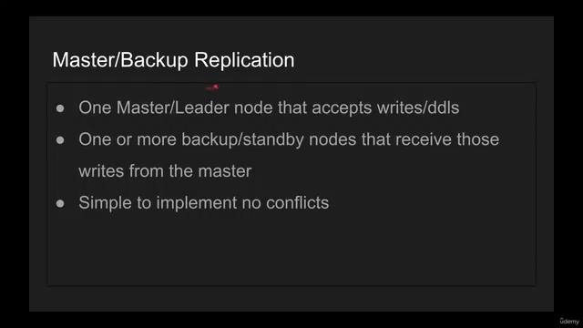
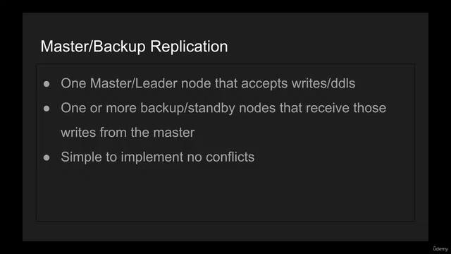
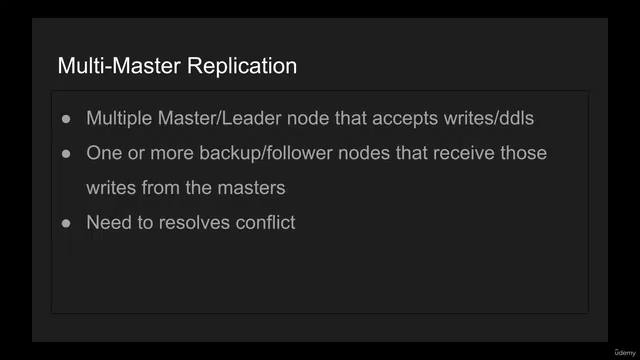
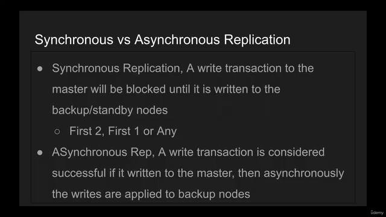
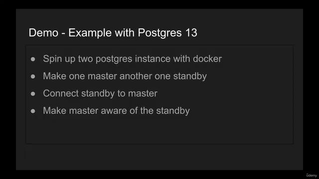
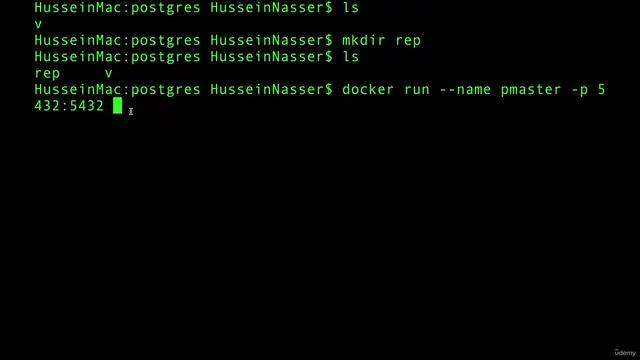
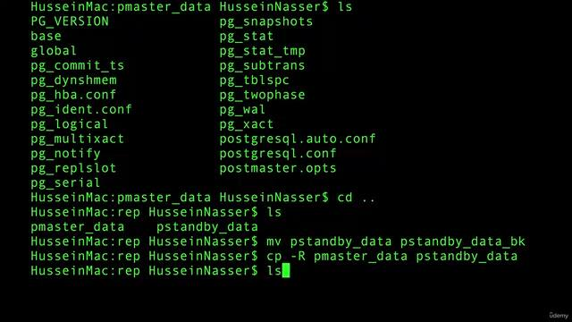
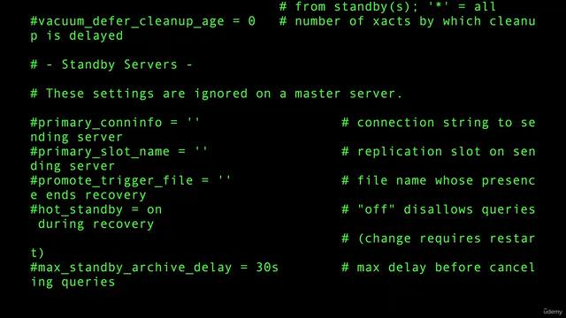
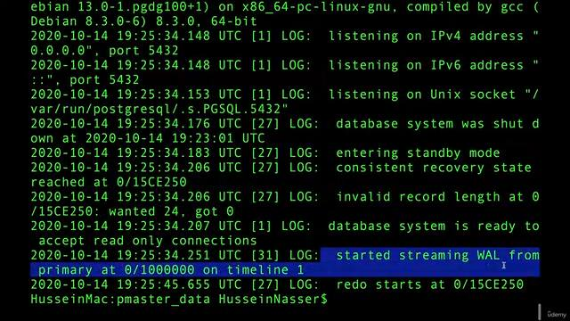

## 1 这一节做什么

这一节对应 P73–P76，主题是 **PostgreSQL 主备复制（master/standby replication）**，也叫 master backup replication。课程先讲清楚模型：一个主库接收写入和 DDL，多个只读备库接收主库复制过来的变更；然后讲同步复制与异步复制的取舍，以及多主复制为什么会引入冲突；最后用一个最小 Demo，用 Docker 起两个 PostgreSQL 13 实例，把其中一个配成 master、一个配成 standby，验证建表、插入、修改、清空等操作会从主库流到备库，同时备库拒绝写入。



这门课不是生产最佳实践课。讲师明确说，Demo 里为了简单会直接用 `postgres` 超级用户和 `postgres` 密码，这不是生产做法。读者要带走的是“复制是怎么跑起来的”，不是“照抄上生产”。换句话说，这一节的目标是建立一张可运行的心智地图：写入只进 master，standby 通过 WAL 持续追平 master，读请求可以分流到 standby，但 standby 默认不能写入。至于生产环境里的复制槽、专用复制用户、TLS、监控、延迟告警、故障切换，都属于这张地图之外的工程化问题，课程没有展开，复现时也不要误以为 Demo 配置可以直接上线。

对前端转 AI 应用工程师来说，可以这样类比：master 像唯一写入口，standby 像只读副本；同步复制像 `await` 到备库确认后才返回，异步复制像主库先返回、后台任务再慢慢同步。后面做 RAG、向量库、业务库读写分离时，读副本延迟、写后读一致性、故障切换这些问题都会遇到。比如用户在页面上刚提交一条记录，紧接着刷新列表却读到了旧副本，这不是“前端缓存没清”，而可能是异步复制下的读副本延迟；再比如主库故障后切到备库，应用连接串、只读状态、未同步 WAL 都会影响恢复。先把这一节的最小复制链路跑通，后面遇到这些问题时才知道该看哪一层。

## 2 讲师原话（带「—— pNNN [MM:SS]」）

> "你有一个负责接收写操作的主数据库节点……还会有许多只读备用节点，也叫备份节点，它们会从主节点接收这些写入。"
> —— p073 [00:08]

> "这种做法妙就妙在实现起来非常简单，因为不会产生冲突。"
> —— p073 [00:53]

> "多主模式是一种方案，但实现起来非常复杂……而且可能出现冲突。"
> —— p074 [00:29]

> "同步复制还会迫使你在客户端解除阻塞之前，先向子副本或备用副本提交。"
> —— p075 [00:26]

> "异步复制是这样的……只要写入主节点，我这边就完成了。客户端也就完成了……数据库现在必须在后台进程中做更多工作，定期把数据写入那些备用副本。"
> —— p075 [01:55]

> "我们会用 Docker 只启动两个 Postgres 实例。为简单起见，一个主节点，一个备用节点。"
> —— p076 [00:00]

> "我们会把全部数据从主节点复制到备用节点。这是正确配置复制的前提。一开始两边必须完全一致。"
> —— p076 [02:12]

> "host replication……用户 Postgres……all……MD5。"
> —— p076 [07:54]

> "主节点连接信息……应用名称……备用节点一……主机……端口 5432……用户 Postgres……密码 Postgres。"
> —— p076 [09:20]

> "备用节点一现在是一个优先级为一的同步备用节点。"
> —— p076 [14:07]








这些原话分别对应四个关键点：单主模型没有写冲突；多主模型复杂且要处理冲突；同步复制会用等待换一致性；异步复制会用延迟换吞吐。后面的 Demo 只验证“复制链路能通”，并没有展开多主和冲突解决，也没有做性能压测，所以复现时不要把同步配置误当成生产高可用方案。

## 3 从零复现

下面按“能直接跑”的顺序写。容器名用 `p-master`、`p-standby`，对应逐字稿里口述的 P master / P standby；数据目录放在 `$HOME/replication` 下。Demo 使用 `postgres:13`。

### 3.1 准备目录和端口

确认本机 Docker 可用，并且 `5432`、`5433` 没有被占用：

```bash
docker --version
lsof -i :5432 || true
lsof -i :5433 || true

mkdir -p "$HOME/replication"
cd "$HOME/replication"
```

目录结构最终会是这样：

```text
~/replication/
├── p-master-data/
├── p-standby-data/
└── p-standby-data.backup/
```

`lsof` 用来检查端口占用；如果命令不存在，可以用 `ss -ltnp | grep 5432` 代替。端口被占用时，`docker run -p 5432:5432` 会直接失败，报 `port is already allocated`。这时不要急着改配置，先确认本机是不是已经有 PostgreSQL 服务、别的 Docker 容器或之前残留的容器占用了端口。`mkdir -p` 的 `-p` 表示目录存在也不报错，适合反复执行。`$HOME/replication` 是本次 Demo 的根目录，后面所有数据目录、备份目录都放在这里，清理时只需要删这一个目录，不容易误删系统文件。

### 3.2 启动 master 容器

```bash
docker run -d \
  --name p-master \
  --add-host=host.docker.internal:host-gateway \
  -p 5432:5432 \
  -v "$HOME/replication/p-master-data:/var/lib/postgresql/data" \
  -e POSTGRES_PASSWORD=postgres \
  postgres:13
```

这里做了几件事：容器名 `p-master`；把宿主机 `5432` 映射到容器 `5432`；把 `p-master-data` 挂到 PostgreSQL 数据目录 `/var/lib/postgresql/data`；设置 `postgres` 用户密码为 `postgres`。`--add-host` 是为了让容器里能解析 `host.docker.internal`，这是复现适配，逐字稿里讲师用的是宿主机名。





这里要特别注意 `-v` 的写法：宿主机目录在前，容器目录在后。如果宿主机目录不存在，Docker 可能会自动创建，但权限和属主不一定正确；Linux 上常见的问题是容器内 `postgres` 用户无法写数据目录，日志里会出现 `Permission denied` 或 `could not change directory`。排查时先看 `docker logs p-master`，再检查宿主机目录权限。另一个常见错误是宿主机 `5432` 已经被占用，容器会启动失败；可以先 `docker ps -a` 看是否有旧的 `p-master`，用 `docker rm -f p-master` 清掉再重来。`POSTGRES_PASSWORD` 只在数据目录第一次初始化时生效，如果目录里已经有旧数据，改这个环境变量不会改已有密码，这也是反复实验时容易踩的坑。

### 3.3 启动 standby 容器

```bash
docker run -d \
  --name p-standby \
  --add-host=host.docker.internal:host-gateway \
  -p 5433:5432 \
  -v "$HOME/replication/p-standby-data:/var/lib/postgresql/data" \
  -e POSTGRES_PASSWORD=postgres \
  postgres:13
```

注意 standby 的宿主机端口是 `5433`，容器内仍然是 `5432`。两个实例现在是独立的，数据还不一样。

这一步的目的只是先让 PostgreSQL 完成初始化，生成一个可用的数据目录骨架；后面会把这个目录替换成 master 数据目录的副本。所以现在 standby 里有什么数据并不重要，重要的是它先成功跑起来一次。如果 `p-standby` 起不来，先看 `docker logs p-standby`。常见原因包括：`5433` 被占用、挂载目录权限不对、之前残留的同名容器没删。`docker ps -a` 可以看到已停止的容器；`docker rm -f p-standby` 可以强制删除。注意不要在还有重要数据时随便删容器和目录，本 Demo 的目录是专门用来实验的。

### 3.4 停库，把 master 数据复制到 standby

复制前必须停掉两个实例，保证数据目录一致：

```bash
docker stop p-master p-standby

mv "$HOME/replication/p-standby-data" \
   "$HOME/replication/p-standby-data.backup"

cp -R "$HOME/replication/p-master-data" \
      "$HOME/replication/p-standby-data"
```

讲师在课里说得很清楚：standby 的初始数据必须和 master 完全一致，否则复制会报一堆错。这里用“停库后整目录复制”的最小办法，没有用 `pg_basebackup`。

`docker stop` 会先发 SIGTERM，让 PostgreSQL 正常关闭；正常关闭后数据目录里的 WAL 和检查点是一致的。不要用 `docker kill` 直接杀，否则可能留下未完成写入，复制出来的目录不一定干净。`mv` 把原来的 standby 数据目录改名成备份，是为了保留现场，万一后面复制失败还能对照；`cp -R` 是递归复制，`-R` 不能漏。复制完成后，`p-standby-data` 的所有者、权限、文件内容都来自 master 目录。Linux 上如果容器内 `postgres` 用户的 UID 和宿主机目录属主不一致，可能启动失败；这时可以看日志里的权限报错，必要时用 `chown -R 999:999` 之类的方式调整，但具体 UID 以镜像为准，不要盲目照抄。更稳妥的方式是使用 `pg_basebackup`，课程为了简单没有用它，复现时知道这个差异即可。

### 3.5 配置 master 的 pg_hba.conf

编辑：

```bash
vim "$HOME/replication/p-master-data/pg_hba.conf"
```

在文件末尾追加一行：

```conf
host    replication    postgres    all    md5
```

这行的含义是：允许 `postgres` 用户从任意地址通过 `md5` 认证连接过来做 replication。课里明确说这不是好做法，生产应该建专用复制用户、限制网段、不要用超级用户。



`pg_hba.conf` 的匹配顺序是从上到下，第一条匹配的规则生效。追加在末尾通常没问题，但如果文件里前面已经有更严格的 `replication` 规则，可能会先被匹配到。排查连接失败时，可以看 master 日志里有没有 `no pg_hba.conf entry for replication connection` 之类的提示。`md5` 是较老的认证方式，生产更推荐 `scram-sha-256`，但 Demo 为了和课程一致用 `md5`。如果密码认证失败，先确认 `postgres` 用户密码确实是启动容器时设置的 `postgres`，再确认 `pg_hba.conf` 修改后是否重启或 reload 生效。PostgreSQL 修改 `pg_hba.conf` 后需要 reload，简单起见可以重启容器。

### 3.6 配置 standby 的 postgresql.conf

编辑：

```bash
vim "$HOME/replication/p-standby-data/postgresql.conf"
```

追加：

```conf
primary_conninfo = 'application_name=standby1 host=host.docker.internal port=5432 user=postgres password=postgres'
```

`application_name=standby1` 是这个备库的唯一标识，后面 master 的 `synchronous_standby_names` 要引用它。`host` 指向 master 暴露到宿主机的地址；`port=5432` 是 master 的宿主机端口；用户名密码就是前面启动容器时设置的 `postgres/postgres`。



这里最容易写错的是 `port`。standby 自己对外暴露的是 `5433`，但它连接 master 时要用 master 的地址和端口，也就是 `host.docker.internal:5432`，不是 `5433`。另一个常见错误是 `application_name` 和 master 的 `synchronous_standby_names` 大小写或拼写不一致，导致主库一直等不到同步备库，客户端写入可能被阻塞。`host.docker.internal` 在 Docker Desktop 上通常可用；Linux 上需要 `--add-host=host.docker.internal:host-gateway`，或者直接写宿主机局域网 IP。如果容器网络模式特殊，`host.docker.internal` 也可能解析不到，这时看 standby 日志里的连接超时或 `could not translate host name` 报错。

### 3.7 创建 standby.signal

在 standby 数据目录里创建空文件：

```bash
touch "$HOME/replication/p-standby-data/standby.signal"
```

这个文件告诉 PostgreSQL：这个实例是 standby，是只读的，要从 primary 流式接收 WAL。

`standby.signal` 的内容不重要，存在即可。它的作用类似一个开关：有它，实例按 standby 启动；没有它，实例可能按普通主库启动。常见错误是文件建错目录，建到了宿主机当前目录而不是 `p-standby-data` 里面；可以用 `ls -l "$HOME/replication/p-standby-data/standby.signal"` 确认。另一个错误是复制 master 数据目录时把 master 的 `standby.signal` 也带过来，或者忘了删掉旧的 `recovery.signal`，导致启动模式不符合预期。本 Demo 里 master 目录没有这些信号文件，复制后单独 `touch` 即可。

### 3.8 配置 master 的同步备库名

编辑 master 的 `postgresql.conf`：

```bash
vim "$HOME/replication/p-master-data/postgresql.conf"
```

追加：

```conf
synchronous_standby_names = '1 (standby1)'
```

`1 (standby1)` 表示至少要有 1 个名为 `standby1` 的备库提交后，主库才认为同步复制完成。课里也提到，如果你有多个 standby，可以写 `standby1, standby2, standby3`，再用 `1 (...)`、`2 (...)` 控制等待几个。

同步复制配置下，如果备库没连上，主库的写入可能会被阻塞。这是同步复制用可用性换一致性的直接体现。复现时如果发现 master 的 `INSERT` 卡住，先检查 standby 是否真的连上、`application_name` 是否匹配、`pg_stat_replication` 是否有记录。生产环境通常还要设置 `synchronous_commit`、`statement_timeout` 等参数来控制最坏情况，课程没有展开，这里也不额外引入。Demo 里只有两个实例，写 `1 (standby1)` 足够；如果写成 `2 (standby1)`，但只有一个备库，主库会一直等不到第二个确认。

### 3.9 启动并看日志

```bash
docker start p-master p-standby

docker logs p-master
docker logs p-standby
```

master 日志里应看到类似 `standby1 is now a synchronous standby with priority 1` 的信息；standby 日志里应看到开始从 primary 流式接收 WAL 的信息。具体措辞以你实际输出为准。



看日志时不要只看最后几行，最好从启动位置往后扫一遍。standby 日志里常见的错误包括：连接 master 超时、密码认证失败、`pg_hba.conf` 没有放行、`standby.signal` 缺失、数据目录不一致。master 日志里则关注 `pg_hba.conf` 拒绝、复制连接建立、同步备库状态变化。`docker logs` 默认输出到标准错误和标准输出，容器重启后日志还在；如果日志太多，可以加 `--tail 100` 只看最后 100 行。日志里的时间戳是容器内时区，和宿主机不一定一致，排查顺序问题时不要被时间戳误导。

### 3.10 进入 master 验证复制状态

```bash
docker exec -it p-master psql -U postgres
```

执行：

```sql
SELECT * FROM pg_stat_replication;
```

如果复制正常，应该有一行记录，能看到 `streaming`、`sync`、`standby1`、`postgres` 这些值。列名以实际输出为准。如果结果为空，说明没有备库连上来，先查 `primary_conninfo`、`pg_hba.conf`、`standby.signal` 和日志。

`pg_stat_replication` 是在 master 上看的，不是 standby 上看的。它反映“master 当前看到了哪些复制连接”。如果有一行但 `state` 不是 `streaming`，可能是还在初始化、网络中断或 WAL 发送有问题。`sync_state` 可以帮助判断是不是同步备库。查询结果为空时，不要只盯着 master 配置，standby 能不能连上 master 才是第一现场；`docker logs p-standby` 通常比 master 日志更直接。

### 3.11 测试 DDL/DML 复制

在 master 的 psql 里：

```sql
CREATE TABLE test (id integer);
```

再开一个终端进 standby：

```bash
docker exec -it p-standby psql -U postgres
```

在 standby 里：

```sql
\d test
```

应该能看到 `test` 表。然后在 standby 里尝试写入：

```sql
CREATE TABLE test1 (id integer, name varchar(200));
```

会报只读错误，因为 standby 是只读实例。具体报错以实际为准。

回到 master 插入数据：

```sql
INSERT INTO test (id)
SELECT (random() * 1000)::int
FROM generate_series(1, 10000);
```

在 standby 里查：

```sql
SELECT count(*) FROM test;
```

应该能看到数据。再在 master 执行：

```sql
ALTER TABLE test ADD COLUMN name varchar(200);
```

standby 里 `\d test` 会看到新列。最后：

```sql
TRUNCATE TABLE test;
```

standby 里数据也会被清空。这就是流式复制的最小闭环。

测试时要注意“写后读”的观察方式：在 master 执行完写入后，立刻去 standby 查，通常能看到，但同步复制下客户端返回时备库已经确认；异步复制下则可能有毫秒级到秒级的延迟。本 Demo 配了同步备库，所以正常情况下写入返回后 standby 应该已经可见。如果 standby 查不到，先确认是不是连到了错误的端口或错误的数据库，再确认 `pg_stat_replication` 是否还在 streaming。`TRUNCATE` 也是 DDL/DML 的一种，会通过 WAL 复制；如果 standby 数据没清空，说明复制链路已经断了，不是 `TRUNCATE` 特殊。

## 4 完整代码

下面给一份可直接保存执行的脚本。它会清理旧容器和旧目录，重新跑完整流程。**注意：脚本会删除 `$HOME/replication`，不要在有重要数据的机器上直接跑。**

文件：`replication-demo.sh`

```bash
#!/usr/bin/env bash
set -euo pipefail

REPL_DIR="$HOME/replication"
MASTER_DATA="$REPL_DIR/p-master-data"
STANDBY_DATA="$REPL_DIR/p-standby-data"
STANDBY_BACKUP="$REPL_DIR/p-standby-data.backup"

echo "==> 清理旧容器和旧目录"
docker rm -f p-master p-standby 2>/dev/null || true
rm -rf "$REPL_DIR"
mkdir -p "$REPL_DIR"

echo "==> 启动 master"
docker run -d \
  --name p-master \
  --add-host=host.docker.internal:host-gateway \
  -p 5432:5432 \
  -v "$MASTER_DATA:/var/lib/postgresql/data" \
  -e POSTGRES_PASSWORD=postgres \
  postgres:13

echo "==> 启动 standby"
docker run -d \
  --name p-standby \
  --add-host=host.docker.internal:host-gateway \
  -p 5433:5432 \
  -v "$STANDBY_DATA:/var/lib/postgresql/data" \
  -e POSTGRES_PASSWORD=postgres \
  postgres:13

echo "==> 等待两个实例初始化完成"
until docker exec p-master pg_isready -U postgres >/dev/null 2>&1; do
  sleep 1
done
until docker exec p-standby pg_isready -U postgres >/dev/null 2>&1; do
  sleep 1
done

echo "==> 停库，准备复制数据目录"
docker stop p-master p-standby

echo "==> 用 master 数据覆盖 standby 数据"
mv "$STANDBY_DATA" "$STANDBY_BACKUP"
cp -R "$MASTER_DATA" "$STANDBY_DATA"

echo "==> 配置 master 的 pg_hba.conf"
cat >> "$MASTER_DATA/pg_hba.conf" <<'EOF'
host    replication    postgres    all    md5
EOF

echo "==> 配置 standby 的 postgresql.conf"
cat >> "$STANDBY_DATA/postgresql.conf" <<'EOF'
primary_conninfo = 'application_name=standby1 host=host.docker.internal port=5432 user=postgres password=postgres'
EOF

echo "==> 创建 standby.signal"
touch "$STANDBY_DATA/standby.signal"

echo "==> 配置 master 的同步备库名"
cat >> "$MASTER_DATA/postgresql.conf" <<'EOF'
synchronous_standby_names = '1 (standby1)'
EOF

echo "==> 启动两个实例"
docker start p-master p-standby

echo "==> 等待 3 秒后打印日志"
sleep 3
docker logs p-master
docker logs p-standby

echo "==> 完成。进入 master："
echo "docker exec -it p-master psql -U postgres"
```

脚本开头 `set -euo pipefail` 的含义是：任何命令失败就退出、未定义变量报错、管道中任一命令失败也失败。这样能避免“前面已经出错，后面还在继续跑”的假成功。`docker rm -f ... || true` 是为了在容器不存在时也不中断脚本。`pg_isready` 循环用来等待数据库真正可连接，比固定 `sleep` 更稳。脚本最后只打印日志和进入命令，没有自动执行 SQL 测试；测试 SQL 在下一个文件里，建议手动逐条执行，便于观察每一步的结果。

文件：`test-replication.sql`

```sql
-- 在 master 的 psql 中执行
CREATE TABLE test (id integer);

INSERT INTO test (id)
SELECT (random() * 1000)::int
FROM generate_series(1, 10000);

ALTER TABLE test ADD COLUMN name varchar(200);

-- 在 standby 的 psql 中执行，应该报只读错误
-- CREATE TABLE test1 (id integer, name varchar(200));

-- 在 master 中执行，standby 中数据会消失
TRUNCATE TABLE test;
```

这个 SQL 文件不是让 `psql -f` 一次性跑完的，因为其中包含“在 standby 执行会报错”的注释示例。建议在 master 的交互式 psql 里逐条粘贴，再切到 standby 观察。`generate_series(1, 10000)` 用来一次插入一万行，方便观察 `count(*)`；`random()` 生成随机整数，只是为了制造数据，不影响复制验证。`ALTER TABLE` 和 `TRUNCATE` 分别验证 DDL 和清空操作也会复制。

## 5. 逐行解释

`docker run -d` 里的 `-d` 是后台运行。`--name p-master` 给容器起名，后面 `docker exec`、`docker logs` 都靠这个名字。`-p 5432:5432` 是宿主机端口到容器端口的映射；standby 用 `-p 5433:5432`，因为宿主机 `5432` 已经被 master 占用。`-v "$MASTER_DATA:/var/lib/postgresql/data"` 把数据目录挂到宿主机，这样停库后可以直接复制目录。`-e POSTGRES_PASSWORD=postgres` 设置 `postgres` 用户密码，课里明确说这是测试做法，生产不要这样。`--add-host=host.docker.internal:host-gateway` 是 Docker 网络适配，让容器内能把 `host.docker.internal` 解析到宿主机；没有它，standby 可能连不上 master。

先停库再 `cp -R`，是因为 PostgreSQL 运行时数据目录里可能有正在写的 WAL、`postmaster.pid` 等文件，热拷贝可能得到不一致的快照。讲师在课里说“必须完全一致”，否则备库启动会报错。这里没有用 `pg_basebackup`，而是用最小化的目录复制，目的是把复制链路跑通。生产环境更推荐 `pg_basebackup`，因为它会处理备份一致性、WAL 传输和权限等问题；但课程为了少引入工具，选择了停库复制。

`pg_hba.conf` 里的 `host replication postgres all md5`：`host` 表示 TCP 连接；`replication` 是 PostgreSQL 的伪数据库名，专门给复制连接用；`postgres` 是允许的用户；`all` 是允许的地址范围；`md5` 是认证方式。生产应该改成专用复制用户，例如 `replicator`，并把 `all` 收窄到备库网段，同时考虑 TLS。课里没讲专用用户创建，所以这里不展开。常见错误是只改了 `postgresql.conf` 没改 `pg_hba.conf`，结果 standby 日志里一直报认证或连接被拒绝；这时不要怀疑密码，先看 `pg_hba.conf` 是否放行了 `replication` 连接。

`primary_conninfo` 是 standby 连接 master 的连接串。`application_name=standby1` 是备库名字，必须和 master 的 `synchronous_standby_names` 对上，而且课里提醒它是大小写敏感的。`host=host.docker.internal` 是复现适配：逐字稿里讲师用的是宿主机名；在 Docker Desktop 上 `host.docker.internal` 指向宿主机，Linux 上需要 `--add-host=host.docker.internal:host-gateway` 或改成宿主机 IP。`port=5432` 是 master 暴露到宿主机的端口，不是 standby 的 `5433`。`user=postgres`、`password=postgres` 是测试账号。如果把 `port` 写成 `5433`，standby 会去连自己或连错实例，日志里通常表现为连接失败或认证失败。

`standby.signal` 是一个空文件，作用是让 PostgreSQL 以 standby 模式启动，进入只读状态并开始从 primary 接收 WAL。没有它，实例可能按普通主库启动，复制链路就不对。验证方式是进入 standby 后尝试 `CREATE TABLE`，应该报只读错误；如果居然能建表，说明它没有以 standby 模式启动，先检查 `standby.signal` 的位置和文件名。

`synchronous_standby_names = '1 (standby1)'` 里的 `1` 表示至少等待 1 个备库确认，`standby1` 是 `application_name`。课里还提到，如果有多个备库，可以写 `standby1, standby2, standby3`，再用 `1 (...)` 或 `2 (...)` 控制等待数量。同步复制的代价是客户端要等备库，吞吐会受影响；异步复制则是主库先返回，后台再同步，吞吐更高但可能读到旧数据。用 Node/JS 类比：同步复制像 `await` 到备库确认，异步复制像主库返回后丢给后台任务。前端做“提交后立即跳转列表”时，如果读的是异步备库，就要考虑是否强制读主库或做读己之写。

`SELECT * FROM pg_stat_replication;` 用来确认 master 是否看到备库。正常应有一行，能看到 `streaming`、`sync`、`standby1` 等值；字段名以实际输出为准。如果为空，优先查 `primary_conninfo` 的 host/port/user/password、`pg_hba.conf` 是否放行、`standby.signal` 是否存在，以及 `docker logs p-standby` 里的报错。如果有一行但状态不是 `streaming`，再看网络、WAL 发送和备库日志；不要只看 master 一侧。

测试部分：在 master 建表，standby 能看到，说明 DDL 复制；在 master 插入 10000 行随机数，standby 能查到，说明 DML 复制；在 standby 建表会报只读错误，说明 standby 拒绝写入；在 master `ALTER TABLE`，standby 能看到新列；在 master `TRUNCATE`，standby 数据清空。这一套就是课里演示的完整闭环。前端对照可以这样理解：写请求只发 master，读请求可以发 standby；如果页面要求“写完立刻看到自己的修改”，要么读 master，要么等复制延迟过去，要么在业务上接受最终一致。复现时先把这个闭环跑通，再去讨论读写分离和一致性策略。

## 6. 复现检查清单

- [ ] Docker 可用，`5432`、`5433` 没有被占用。验证方式：`docker --version` 有输出；`lsof -i :5432`、`lsof -i :5433` 没有占用进程，或者你确认可以停掉占用进程。
- [ ] `p-master`、`p-standby` 两个容器都处于 running 状态：`docker ps`。验证方式：`docker ps --filter name=p-master --filter name=p-standby` 能看到两行，状态是 `Up`；如果退出，先看 `docker logs`。
- [ ] master 的 `pg_hba.conf` 末尾有 `host replication postgres all md5`。验证方式：`tail -n 5 "$HOME/replication/p-master-data/pg_hba.conf"`，确认没有拼写错误，尤其是 `replication` 不是 `replica`。
- [ ] standby 的 `postgresql.conf` 里有 `primary_conninfo`，且 `application_name=standby1`。验证方式：`grep primary_conninfo "$HOME/replication/p-standby-data/postgresql.conf"`，确认 host、port、user、password 四项都指向 master。
- [ ] standby 数据目录里有 `standby.signal`。验证方式：`ls -l "$HOME/replication/p-standby-data/standby.signal"`，文件存在且为空即可。
- [ ] master 的 `postgresql.conf` 里有 `synchronous_standby_names = '1 (standby1)'`。验证方式：`grep synchronous_standby_names "$HOME/replication/p-master-data/postgresql.conf"`，确认括号和引号没有写错。
- [ ] `docker logs p-master` 能看到 `standby1 is now a synchronous standby with priority 1` 类似信息。验证方式：`docker logs p-master | grep -i standby`，具体措辞以实际输出为准。
- [ ] `docker logs p-standby` 能看到开始从 primary 流式接收 WAL 的信息。验证方式：`docker logs p-standby | tail -n 50`，重点看有没有连接失败、认证失败、数据目录不一致的报错。
- [ ] 在 master 执行 `SELECT * FROM pg_stat_replication;` 有一行记录，能看到 `streaming`、`sync`、`standby1`。验证方式：进入 master 的 psql 执行查询；如果为空，回到上一条看 standby 日志。
- [ ] master 建表后，standby `\d test` 能看到表。验证方式：master 执行 `CREATE TABLE test (id integer);`，standby 执行 `\d test`，能看到表结构。
- [ ] standby 执行 `CREATE TABLE` 会报只读错误。验证方式：在 standby 执行 `CREATE TABLE test1 (id integer, name varchar(200));`，应报 `cannot execute CREATE TABLE in a read-only transaction` 一类错误。
- [ ] master 插入数据后，standby `SELECT count(*)` 能看到数据。验证方式：master 插入 10000 行，standby 查询 `SELECT count(*) FROM test;`，正常应看到 10000。
- [ ] master `ALTER TABLE` 后，standby 能看到新列。验证方式：master 执行 `ALTER TABLE test ADD COLUMN name varchar(200);`，standby 再 `\d test`，能看到 `name` 列。
- [ ] master `TRUNCATE` 后，standby 数据清空。验证方式：master 执行 `TRUNCATE TABLE test;`，standby 查询 `SELECT count(*) FROM test;`，应返回 0。
- [ ] 如果失败，先看 `docker logs p-standby`，再看 `primary_conninfo` 的 host/port/user/password 是否写错。验证方式：按“standby 日志 → 连接串 → pg_hba.conf → standby.signal”的顺序排查，不要一上来就改 master。
- [ ] 如果 `host.docker.internal` 解析不了，Linux 上确认 `--add-host=host.docker.internal:host-gateway`，或改成宿主机局域网 IP。验证方式：`docker exec p-standby getent hosts host.docker.internal`，能解析出地址才算通。
- [ ] 如果容器起不来，检查数据目录权限；Linux 上 `cp -R` 后可能需要把目录 owner 改成容器内 postgres。验证方式：看 `docker logs` 里的 `Permission denied`，再对照容器内 `postgres` 用户的 UID 调整宿主机目录属主。

## 7 课里没讲但你会撞上的（表格：现象 / 原因 / 怎么办）

| 现象 | 原因 | 怎么办 |
| --- | --- | --- |
| `docker run` 报端口已被占用 | 宿主机 `5432` 或 `5433` 已有服务或旧容器占用 | `lsof -i :5432`、`lsof -i :5433` 查占用；停掉旧容器 `docker rm -f p-master p-standby`，或改宿主机端口映射 |
| `p-standby` 启动后日志一直报连接 master 失败 | `primary_conninfo` 的 host/port 写错，或 `host.docker.internal` 解析不了 | 在 standby 容器里 `getent hosts host.docker.internal`；Linux 确认 `--add-host`；把 host 改成宿主机可达 IP |
| standby 日志报 `no pg_hba.conf entry for replication connection` | master 的 `pg_hba.conf` 没有放行复制连接，或规则顺序被前面的规则拦截 | 在 master 的 `pg_hba.conf` 末尾确认有 `host replication postgres all md5`；改完重启 master |
| standby 日志报密码认证失败 | `primary_conninfo` 里的 user/password 和 master 实际账号不一致，或 `pg_hba.conf` 认证方式不匹配 | 确认 master 的 `postgres` 密码是启动时设置的 `postgres`；确认 `pg_hba.conf` 用 `md5` 或与实际密码存储方式匹配 |
| `pg_stat_replication` 查询结果为空 | standby 根本没连上 master，或 `standby.signal` 缺失导致 standby 没进入复制模式 | 先看 `docker logs p-standby`；确认 `standby.signal` 在 `p-standby-data` 目录里；再查连接串和 `pg_hba.conf` |
| 有复制记录但 `state` 不是 `streaming` | 复制连接刚建立、网络中断、WAL 发送异常，或备库还在初始化 | 等几秒再查；看 master 和 standby 两侧日志；确认数据目录初始一致 |
| master 写入卡住不返回 | 配了同步复制，但 standby 没连上或 `application_name` 不匹配，master 一直等确认 | 查 `pg_stat_replication` 和 standby 日志；确认 `synchronous_standby_names` 里的名字和 `application_name=standby1` 完全一致 |
| standby 能查表但数据比 master 少 | 异步复制延迟，或复制链路中断后刚恢复 | 查 `pg_stat_replication` 的落后字段；确认当前是同步还是异步；业务上需要“读己之写”时读 master |
| standby 执行写入报只读错误 | 这是 standby 的正常行为，不是故障 | 写入统一走 master；如果确实需要双写，那是多主或逻辑复制话题，本 Demo 不涉及 |
| 容器启动报数据目录权限错误 | 宿主机目录属主和容器内 `postgres` 用户 UID 不一致，常见于 Linux 上 `cp -R` 后 | 看日志确认；按容器内 `postgres` 的 UID 调整宿主机目录属主；或改用 `pg_basebackup` |
| 修改 `pg_hba.conf` 后不生效 | PostgreSQL 没有 reload/重启，或改错了数据目录里的文件 | 重启对应容器；确认改的是 `$HOME/replication/p-master-data/pg_hba.conf`，不是容器内临时路径 |
| 重复实验时密码/配置像没生效 | 数据目录已初始化，`POSTGRES_PASSWORD` 只在首次初始化时生效；旧配置还留在目录里 | 彻底清理 `$HOME/replication` 和旧容器后重跑；不要只重启容器就以为配置会重置 |