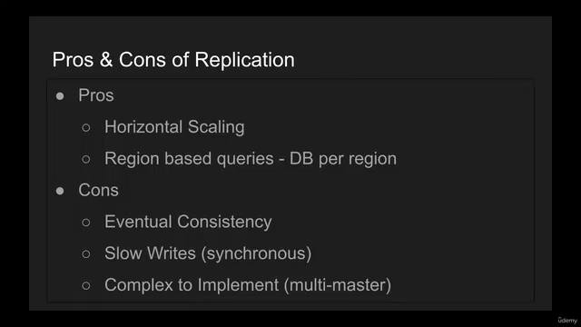
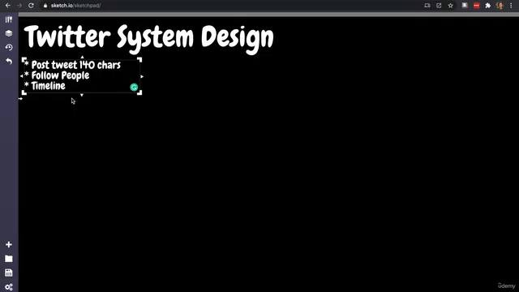
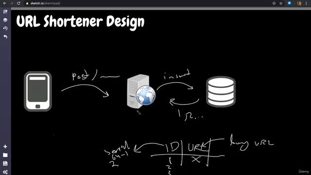
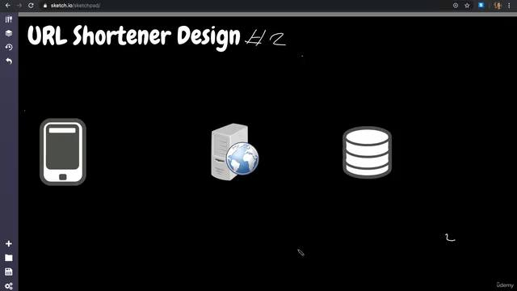
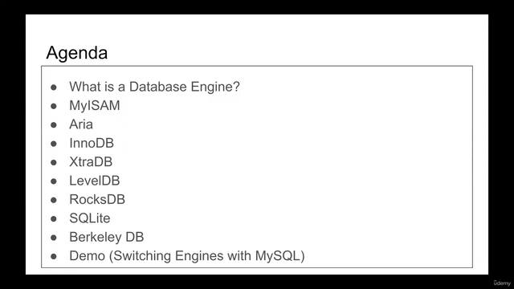

# 数据库工程 P77–P80 复现文档：Twitter 最小链路、URL Shortener 与 MySQL 存储引擎切换

> 说明：P77–P80 的逐字稿是**系统设计推演 + 数据库引擎讲解**，讲师没有给出完整项目代码、Dockerfile、版本号或启动命令。下面把课里的设计落成一个**可本地运行的最小实验仓库**：用 MySQL 保存 Twitter 的推文/关注关系，用同一套 Node.js API 实现 URL Shortener，并用 `ENGINE=InnoDB/MyISAM` 演示 P80 的“同一数据库换存储引擎”。代码是为了复现设计而补的，不是逐字稿原文；凡是逐字稿没讲的地方，我会明确写“课里没讲”。

---

## 1. 这一节做什么

P77 收尾讲复制的收益与代价；P78 用 Twitter 的“发推、关注、Home Timeline”推演架构；P79 用 URL Shortener 对比“自增数字短码”和“哈希/自定义短码”两套设计；P80 讲数据库引擎/存储引擎，并说 MySQL 可以给不同表选不同引擎。

这一节我们复现三条最小链路：

1. **社交写入链路**：发推、关注。关注表用 `(source_id, destination_id)` 复合主键，对应 P78 的 following 表设计。
2. **社交读取链路**：Home Timeline 查询 + 粉丝数查询。重点不是做完整推荐系统，而是验证“关注关系表 + 推文表 + 索引”能跑通。
3. **短链链路**：自定义短码写冲突返回 409；哈希短码用 SHA-256 + base64url 取前 8 位，主键冲突时换 salt 重试；访问 `/s/:code` 返回 302 跳转。
4. **引擎切换实验**：创建 `ENGINE=InnoDB` 和 `ENGINE=MyISAM` 两张表，执行 `SHOW CREATE TABLE` 和 `ALTER TABLE ... ENGINE=...`，对应 P80 的 demo 思路。

课里反复提到的 Kafka/消息队列、HTTP push、gRPC、WebSocket、客户端 SQLite 草稿箱，本节**不假装实现**；这些在“课里没讲但你会撞上的”里说明。

这里要强调：本节代码的目标不是做生产级 Twitter，也不是做生产级短链服务，而是把课里讲到的**表设计、读写路径、短码冲突、存储引擎查看与切换**落成可操作的最小实验。凡是涉及权限、限流、鉴权、缓存、消息队列、前端页面、客户端离线草稿箱的内容，逐字稿没有给出实现细节，本复现也不擅自补成“事实”。

---

## 2. 讲师原话（带「—— pNNN [MM:SS]」）

P77 对复制的总结很直接：读可以横向扩，写不要轻易上多主。

> “I try to optimize my rights as much as possible for a single instance and make my beefy database server that accepts a lot of rights and good rights. And the rest of the stuff, I just optimize for reading.”
>
> —— p077 [00:28]



P78 从 Twitter 的功能拆技术需求：发推、关注、Home Timeline。先在白板上画 client → web server → database。

> “So let's build the overall architecture of this first... I'm assuming there would be some sort of a database here that will be storing my tweets, my profile, my users, people I follow, all that stuff. And there must be a client.”
>
> —— p078 [02:24]



发推失败怎么办？讲师提出用消息队列把“立即响应客户端”和“可靠写库”拆开。

> “The purpose of the queue is... you can have these tweets, tweet one, tweet two, tweet three in the queue, and then have another process right here that picks this up and writes it to the database instead. And this is what it does the retries for us.”
>
> —— p078 [10:19]

客户端到服务端的连接断了怎么办？他提到客户端本地 SQLite 草稿。

> “This is where it's a good idea to implement some sort of local database here at the client side. A popular one is SQL Lite.”
>
> —— p078 [17:32]


关注表怎么设计？不是给 profile 加一个“following”列，而是单独一张关系表。

> “I'm gonna do, call this the following table... let's call this source ID... Destination ID. That means this guy is following this guy.”
>
> —— p078 [45:06]

并且这张表会很大，需要复合索引。

> “So this tells me immediately I need a multi index, right? Multi column index.”
>
> —— p078 [46:31]


P79 的 URL Shortener 第一版：表里放自增 ID + 长 URL，插入后拿序列 ID 当短码。

> “I am going to use a table like this in the database... it's going to be like an ID. And there will be another field called URL... It's going to be a serial field.”
>
> —— p079 [03:55]

但自增数字可预测，攻击者可以扫库。

> “That predictable design is gonna you can predict the next URL very simply and that's not a good idea for hackers... they can just write a code to loop through all the IDs from one to one billion and they can retrieve all your URLs.”
>
> —— p079 [11:21]



第二版支持自定义短码/哈希短码，并把短码设成主键防止冲突。

> “I'm gonna make this into a primary key... because now you're show in hashing and you're getting, taking a huge strength and making it the smaller strength, which is the idea of collision always exists.”
>
> —— p079 [17:11]

读取时查到长 URL 后做 301/302 跳转。

> “Literally just do a 301, was it redirect 31 or 302 and do location equal this. So in order to immediately redirect that stuff.”
>
> —— p079 [25:45]



P80 定义数据库引擎，并列出 MyISAM、Aria、InnoDB、XtraDB、LevelDB、RocksDB、SQLite、BerkeleyDB 等。

> “Database engines, sometimes called storage engines... software libraries that database management software uses to do low-level storing of the data on desk or do crud... some even do acid transaction.”
>
> —— p080 [00:00]

最后 demo 的重点是 MySQL 可以换底层引擎。

> “We're gonna do a demo where we're gonna spin up a SQL database because one of these database that it can change its underlining engine, which is amazing.”
>
> —— p080 [02:23]




---

## 3. 从零复现

### 3.1 环境与版本说明

- Docker Engine / Docker Compose：课里没讲版本；你本机有可用版本即可。
- Node.js：课里没讲；示例用 Node 20+。`mysql2` 也支持 Node 18，但以你环境为准。
- MySQL 镜像：课里只说 MySQL/Postgres，没有给版本。示例固定 `mysql:8.0`；如果本机已有镜像可替换。
- Node 依赖：`mysql2 ^3.11.0`、`dotenv ^16.4.5`。版本是示例，课里没讲。
- 环境变量名：`DB_HOST`、`DB_PORT`、`DB_USER`、`DB_PASSWORD`、`DB_NAME`、`PORT`。

这里把版本写出来，是为了让复现有一个确定的起点，不代表逐字稿讲过这些版本。若你的本机 Docker 或 Node 版本不同，先保证命令能运行；出现差异时，优先检查端口、MySQL 健康状态、依赖安装和初始化脚本是否执行，而不是先怀疑 SQL 设计。

### 3.2 目录结构

```text
db-p77-p80-demo/
├── docker-compose.yml
├── package.json
├── .env.example
├── .env                  # 由 .env.example 复制，不提交
├── sql/
│   ├── 01_schema.sql
│   ├── 02_seed.sql
│   └── 03_engine_demo.sql
└── src/
    ├── db.js
    └── server.js
```

目录中每个文件的职责如下：`docker-compose.yml` 负责启动 MySQL 并挂载初始化 SQL；`sql/01_schema.sql` 建表；`sql/02_seed.sql` 插入演示数据；`sql/03_engine_demo.sql` 创建引擎对照表；`src/db.js` 创建 MySQL 连接池；`src/server.js` 提供最小 HTTP API。`.env` 不入库，是为了避免把本机密码或端口配置提交出去。

### 3.3 启动命令

```bash
mkdir -p db-p77-p80-demo/src db-p77-p80-demo/sql
cd db-p77-p80-demo

# 按下面“完整代码”保存文件后：
cp .env.example .env
npm install
docker compose up -d
docker compose ps

# 等 MySQL healthy 后启动 API
npm start
```

如果 3306 被占用，把 `docker-compose.yml` 的 `ports` 改成 `"3307:3306"`，同时把 `.env` 的 `DB_PORT` 改成 `3307`。

初始化脚本只在 Docker volume **第一次创建**时执行。改了 SQL 要重置：

```bash
docker compose down -v
docker compose up -d
```

逐条解释与常见排查：

- `mkdir -p ...`：创建目录。常见错误是把文件保存到错误目录，导致 `npm install` 找不到 `package.json`；排查时用 `pwd` 和 `ls` 确认当前目录。
- `cd db-p77-p80-demo`：进入项目根目录。后续所有 `docker compose` 和 `npm` 命令都默认在这里执行。
- `cp .env.example .env`：生成本地配置。若忘记复制，`src/db.js` 会使用默认值；默认值与示例一致时可能也能跑，但一旦你改了端口，就会对不上。
- `npm install`：安装 `mysql2` 和 `dotenv`。常见错误是网络问题或 Node 版本过低；看 npm 报错的第一段即可定位。
- `docker compose up -d`：后台启动 MySQL。第一次启动会执行 `/docker-entrypoint-initdb.d` 下的 SQL。若日志里出现权限或端口占用，先看 `docker compose logs mysql`。
- `docker compose ps`：看容器是否启动、健康检查是否通过。常见错误是容器 `Up` 但未 `healthy`，此时 API 连接会失败。
- `npm start`：启动 Node API。若 3000 被占用，会报 `EADDRINUSE`；改 `.env` 的 `PORT` 或停掉占用进程。
- `docker compose down -v`：删除容器和 volume，让初始化 SQL 重新执行。注意 `-v` 会删除数据库数据，只在实验环境使用。

### 3.4 跑通 Twitter 最小链路

```bash
curl -s http://localhost:3000/health

curl -s -X POST http://localhost:3000/tweets \
  -H 'Content-Type: application/json' \
  -d '{"authorId":1,"body":"hello from p078"}'

curl -s -X POST http://localhost:3000/follow \
  -H 'Content-Type: application/json' \
  -d '{"sourceId":1,"destinationId":2}'

curl -s http://localhost:3000/timeline/1
curl -s http://localhost:3000/followers/2
```

逐条解释：

- `/health`：只验证 HTTP 服务活着，不验证数据库。若它失败，先检查 Node 是否启动、端口是否正确。
- `POST /tweets`：插入一条推文。`authorId` 必须是正整数，`body` 去空格后长度必须在 1 到 280 之间。常见错误是 `authorId` 在 `profiles` 表里不存在，会触发外键错误；排查时先查 `profiles`。
- `POST /follow`：插入关注关系。`sourceId` 和 `destinationId` 不能相同，否则返回错误；重复关注会命中复合主键并返回 409；用户不存在会触发外键错误。
- `GET /timeline/1`：查询用户 1 关注的人发出的推文，按时间倒序取 50 条。若返回空数组，先确认 `following` 是否有数据、被关注者是否发过推文。
- `GET /followers/2`：查询用户 2 的粉丝数。若数字为 0，检查 `following` 中是否有 `destination_id=2` 的记录。

常见错误与排查：`ER_NO_REFERENCED_ROW_2` 通常表示外键指向的用户不存在；`ER_DUP_ENTRY` 在关注接口中表示重复关注；`invalid json` 表示请求体不是合法 JSON；`body must be 1..280 characters` 表示推文内容为空或超长。若 curl 没输出，先加 `-i` 看状态码，再看 `docker compose logs -f`。

### 3.5 跑通 URL Shortener

```bash
# 自定义短码
curl -s -X POST http://localhost:3000/short-urls/custom \
  -H 'Content-Type: application/json' \
  -d '{"longUrl":"https://example.com/a/long/path","shortCode":"amazon"}'

# 重复自定义短码应返回 409
curl -s -X POST http://localhost:3000/short-urls/custom \
  -H 'Content-Type: application/json' \
  -d '{"longUrl":"https://example.com/other","shortCode":"amazon"}'

# 哈希短码
curl -s -X POST http://localhost:3000/short-urls/hash \
  -H 'Content-Type: application/json' \
  -d '{"longUrl":"https://example.com/a/long/path"}'

# 访问短码，观察 302
curl -i http://localhost:3000/s/amazon
```

逐条解释：

- 自定义短码接口把 `short_code` 作为主键插入。短码限制为 1 到 16 个 `[A-Za-z0-9_-]` 字符，这是示例约束，课里没讲具体字符集。
- 重复自定义短码时，MySQL 返回重复主键错误，服务端转换成 409。常见错误是客户端把 409 当成 500；排查时看响应体 `short code already exists`。
- 哈希短码接口先计算 SHA-256，再转 base64url，取前 8 位。发生主键冲突时换随机 salt 重试，最多 5 次。常见错误是误以为哈希一定不冲突；代码里已经按“冲突存在”处理。
- `/s/:code` 查到长 URL 后返回 302。常见错误是用 `curl -s` 看不到跳转；应使用 `curl -i` 查看 `Location` 响应头。若短码不存在，返回 404。
- 访问短码时不要自动跟随跳转，否则你看到的是目标站点的响应，而不是本服务的 302。

常见错误与排查：`shortCode must be 1..16 chars` 表示短码格式不对；`longUrl is required` 表示请求体缺字段；`ER_DUP_ENTRY` 表示短码已存在；`short code not found` 表示 `/s/` 后的短码在表中没有记录。若 302 的 `Location` 不是预期 URL，检查插入时 `long_url` 是否被正确保存。

### 3.6 跑通 P80 引擎切换

```bash
docker compose exec -T mysql mysql -uroot -proot demo < sql/03_engine_demo.sql

docker compose exec mysql mysql -uroot -proot demo \
  -e "SHOW CREATE TABLE engine_demo_innodb;"

docker compose exec mysql mysql -uroot -proot demo \
  -e "ALTER TABLE engine_demo_innodb ENGINE=MyISAM; SHOW CREATE TABLE engine_demo_innodb;"
```

你应看到 `ENGINE=InnoDB` 变成 `ENGINE=MyISAM`。输出字段名以实际 MySQL 为准；课里没有给出具体输出样例。

逐条解释：

- 第一条命令把 `03_engine_demo.sql` 通过标准输入交给容器内的 `mysql` 客户端执行。`-T` 关闭 TTY 分配，适合重定向输入。常见错误是当前目录不对，找不到 `sql/03_engine_demo.sql`。
- `SHOW CREATE TABLE engine_demo_innodb;` 用来查看建表语句中的 `ENGINE=`。常见错误是表不存在，通常说明初始化脚本没执行或 SQL 没导入。
- `ALTER TABLE ... ENGINE=MyISAM;` 用来切换存储引擎。示例表没有外键，便于演示；课里没有给出具体输出样例，也没有要求在这个 demo 里比较事务行为。
- 如果 `ALTER TABLE` 报错，先确认表名、数据库名和权限；再看 MySQL 日志。不要在没有备份的实验库之外直接做引擎切换。

### 3.7 与前台的对照

本复现**没有实现前台页面**，逐字稿也没有给出前端 UI、鉴权、登录态、草稿箱交互的实现细节。下面的“前台”只用 curl 或任意 HTTP 客户端代替，目的是对照“前台动作—HTTP 请求—服务端处理—数据库操作”，不编造不存在的界面。

| 前台动作 | 对应请求 | 服务端处理 | 数据库操作 |
| --- | --- | --- | --- |
| 健康检查 | `GET /health` | 返回 `{ok:true}` | 不访问数据库 |
| 发推 | `POST /tweets` | 校验作者和正文 | `INSERT INTO tweets` |
| 关注某人 | `POST /follow` | 校验 ID、禁止自关注、处理重复 | `INSERT INTO following` |
| 看 Home Timeline | `GET /timeline/:id` | 按关注关系查推文 | `following JOIN tweets JOIN profiles` |
| 看粉丝数 | `GET /followers/:id` | 统计关注目标 | `COUNT(*) FROM following` |
| 创建自定义短链 | `POST /short-urls/custom` | 校验短码、处理主键冲突 | `INSERT INTO short_urls` |
| 创建哈希短链 | `POST /short-urls/hash` | 哈希、冲突换 salt 重试 | `INSERT INTO short_urls` |
| 访问短链 | `GET /s/:code` | 查长 URL 并 302 | `SELECT long_url` |
| 看引擎 | `SHOW CREATE TABLE` | 直接查元数据 | 不访问业务表数据 |
| 换引擎 | `ALTER TABLE ... ENGINE=...` | 直接执行 DDL | 表存储引擎改变 |

这张表只描述本复现实际提供的 HTTP 行为。真实前台可能还有登录、输入框、错误提示、加载态、重试、草稿保存等，课里没讲，本复现不补。

### 3.8 常见错误与排查总表

1. **MySQL 连接被拒绝**：先看 `docker compose ps` 是否 healthy，再看 `.env` 的 `DB_HOST/DB_PORT`。容器内和宿主机端口不是一回事。
2. **Access denied**：检查 `DB_USER/DB_PASSWORD` 与 compose 中 `MYSQL_USER/MYSQL_PASSWORD` 是否一致。
3. **表不存在**：初始化脚本只在 volume 第一次创建时执行。改 SQL 后执行 `docker compose down -v` 再启动。
4. **外键错误**：先插 `profiles`，再插 `tweets/following`；检查 ID 是否存在。
5. **重复关注**：复合主键会触发 `ER_DUP_ENTRY`，接口返回 409 是预期行为。
6. **短码重复**：自定义短码重复返回 409；哈希短码重复由 salt 重试处理。
7. **curl 看不到 302**：加 `-i`，不要只看 body；也不要加 `-L` 自动跟随。
8. **端口占用**：3306 或 3000 被占用时改端口，并同步改 `.env`。
9. **JSON 解析失败**：检查 `Content-Type: application/json` 和请求体引号。
10. **引擎切换失败**：检查表名、数据库名、权限；实验环境才执行 DDL。

### 3.9 检查清单逐条说明

- [ ] Docker 正在运行：否则 `docker compose up -d` 会直接失败。
- [ ] 3306/3000 未被占用：被占用时容器或 API 起不来，先改端口。
- [ ] 已复制 `.env`：避免代码默认值与你实际端口不一致。
- [ ] `npm install` 成功：没有 `mysql2/dotenv` 时 Node 启动即报错。
- [ ] MySQL 容器 healthy：未 ready 时 API 连接会间歇失败。
- [ ] 初始化 SQL 已执行：看到 `profiles/following/tweets/short_urls` 等表。
- [ ] `/health` 返回 `{ok:true}`：确认 HTTP 层可用。
- [ ] 发推成功且 timeline 能查到：确认写入和读取链路都通。
- [ ] 重复关注返回 409：确认复合主键冲突被正确转换为业务响应。
- [ ] 自定义短码重复返回 409：确认短码主键约束生效。
- [ ] `/s/:code` 返回 302：确认 `Location` 头是长 URL。
- [ ] `SHOW CREATE TABLE` 能看到 `ENGINE=`：确认能观察存储引擎。
- [ ] `ALTER TABLE ... ENGINE=MyISAM` 后引擎变化：确认 P80 demo 的切换动作。
- [ ] 改动 SQL 后执行 `down -v` 重置：否则旧 volume 不会重新初始化。
- [ ] 实验结束清理容器：避免占用端口和磁盘。

每条检查都不是形式主义：只要有一条失败，就先停在那一层排查，不要同时改多个配置。数据库工程复现最怕“端口改了但 `.env` 没改”“SQL 改了但 volume 没删”“API 起了但 MySQL 没 healthy”这三类问题。

---

## 4. 完整代码

### 4.1 `package.json`

```json
{
  "name": "db-p77-p80-demo",
  "version": "1.0.0",
  "private": true,
  "type": "module",
  "scripts": {
    "start": "node src/server.js"
  },
  "dependencies": {
    "dotenv": "^16.4.5",
    "mysql2": "^3.11.0"
  }
}
```

### 4.2 `docker-compose.yml`

```yaml
services:
  mysql:
    image: mysql:8.0
    environment:
      MYSQL_ROOT_PASSWORD: root
      MYSQL_DATABASE: demo
      MYSQL_USER: demo
      MYSQL_PASSWORD: demo
    ports:
      - "3306:3306"
    volumes:
      - mysql_data:/var/lib/mysql
      - ./sql:/docker-entrypoint-initdb.d:ro
    healthcheck:
      test: ["CMD-SHELL", "mysqladmin ping -h localhost -uroot -proot --silent"]
      interval: 5s
      timeout: 3s
      retries: 20

volumes:
  mysql_data:
```

### 4.3 `.env.example`

```env
DB_HOST=127.0.0.1
DB_PORT=3306
DB_USER=demo
DB_PASSWORD=demo
DB_NAME=demo
PORT=3000
```

### 4.4 `sql/01_schema.sql`

```sql
USE demo;

CREATE TABLE IF NOT EXISTS profiles (
  id BIGINT UNSIGNED NOT NULL AUTO_INCREMENT,
  name VARCHAR(100) NOT NULL,
  bio VARCHAR(255) NULL,
  picture_url VARCHAR(255) NULL,
  PRIMARY KEY (id)
) ENGINE=InnoDB;

CREATE TABLE IF NOT EXISTS following (
  source_id BIGINT UNSIGNED NOT NULL,
  destination_id BIGINT UNSIGNED NOT NULL,
  created_at TIMESTAMP NOT NULL DEFAULT CURRENT_TIMESTAMP,
  PRIMARY KEY (source_id, destination_id),
  KEY idx_following_destination (destination_id),
  CONSTRAINT fk_following_source
    FOREIGN KEY (source_id) REFERENCES profiles(id) ON DELETE CASCADE,
  CONSTRAINT fk_following_destination
    FOREIGN KEY (destination_id) REFERENCES profiles(id) ON DELETE CASCADE
) ENGINE=InnoDB;

CREATE TABLE IF NOT EXISTS tweets (
  id BIGINT UNSIGNED NOT NULL AUTO_INCREMENT,
  author_id BIGINT UNSIGNED NOT NULL,
  body VARCHAR(280) NOT NULL,
  created_at TIMESTAMP NOT NULL DEFAULT CURRENT_TIMESTAMP,
  PRIMARY KEY (id),
  KEY idx_tweets_author_created (author_id, created_at),
  CONSTRAINT fk_tweets_author
    FOREIGN KEY (author_id) REFERENCES profiles(id) ON DELETE CASCADE
) ENGINE=InnoDB;

CREATE TABLE IF NOT EXISTS short_urls (
  short_code VARCHAR(16) NOT NULL,
  long_url TEXT NOT NULL,
  created_at TIMESTAMP NOT NULL DEFAULT CURRENT_TIMESTAMP,
  PRIMARY KEY (short_code)
) ENGINE=InnoDB;

CREATE TABLE IF NOT EXISTS short_urls_seq (
  id BIGINT UNSIGNED NOT NULL AUTO_INCREMENT,
  long_url TEXT NOT NULL,
  created_at TIMESTAMP NOT NULL DEFAULT CURRENT_TIMESTAMP,
  PRIMARY KEY (id)
) ENGINE=InnoDB;
```

### 4.5 `sql/02_seed.sql`

```sql
USE demo;

INSERT IGNORE INTO profiles (id, name, bio, picture_url) VALUES
  (1, 'Hussein', 'database engineering', 'https://example.com/hussein.png'),
  (2, 'Mary', 'frontend to AI', 'https://example.com/mary.png'),
  (3, 'Nicki Minaj', 'singer', 'https://example.com/nicki.png');

INSERT IGNORE INTO following (source_id, destination_id) VALUES
  (1, 2),
  (1, 3),
  (2, 1);

INSERT INTO tweets (author_id, body) VALUES
  (2, 'Mary: hello timeline'),
  (3, 'Nicki: a tweet from a followed profile'),
  (1, 'Hussein: my own tweet');
```

### 4.6 `sql/03_engine_demo.sql`

```sql
USE demo;

CREATE TABLE IF NOT EXISTS engine_demo_innodb (
  id INT NOT NULL AUTO_INCREMENT,
  note VARCHAR(100) NOT NULL,
  PRIMARY KEY (id)
) ENGINE=InnoDB;

CREATE TABLE IF NOT EXISTS engine_demo_myisam (
  id INT NOT NULL AUTO_INCREMENT,
  note VARCHAR(100) NOT NULL,
  PRIMARY KEY (id)
) ENGINE=MyISAM;

INSERT INTO engine_demo_innodb (note) VALUES ('innodb row');
INSERT INTO engine_demo_myisam (note) VALUES ('myisam row');
```

### 4.7 `src/db.js`

```js
import 'dotenv/config';
import mysql from 'mysql2/promise';

export const pool = mysql.createPool({
  host: process.env.DB_HOST || '127.0.0.1',
  port: Number(process.env.DB_PORT || 3306),
  user: process.env.DB_USER || 'demo',
  password: process.env.DB_PASSWORD || 'demo',
  database: process.env.DB_NAME || 'demo',
  waitForConnections: true,
  connectionLimit: 10,
  namedPlaceholders: false
});
```

### 4.8 `src/server.js`

> 注：原稿 4.8 末尾在 `const [rows] = await pool.execute` 处截断；下面补齐同一文件的剩余路由与启动代码，使代码块闭合。补齐仅用于示例复现，不是逐字稿原文。

```js
import http from 'node:http';
import crypto from 'node:crypto';
import { pool } from './db.js';

const PORT = Number(process.env.PORT || 3000);

function sendJson(res, status, payload) {
  const body = JSON.stringify(payload);
  res.writeHead(status, { 'Content-Type': 'application/json; charset=utf-8' });
  res.end(body);
}

function readJson(req) {
  return new Promise((resolve, reject) => {
    let raw = '';
    req.on('data', (chunk) => {
      raw += chunk;
      if (raw.length > 1_000_000) {
        reject(new Error('body too large'));
        req.destroy();
      }
    });
    req.on('end', () => {
      try {
        resolve(raw ? JSON.parse(raw) : {});
      } catch {
        reject(new Error('invalid json'));
      }
    });
    req.on('error', reject);
  });
}

function positiveInt(value, name) {
  const n = Number(value);
  if (!Number.isInteger(n) || n <= 0) {
    throw new Error(`${name} must be a positive integer`);
  }
  return n;
}

function shortCodeFrom(longUrl, salt = '') {
  return crypto
    .createHash('sha256')
    .update(longUrl + salt)
    .digest('base64url')
    .slice(0, 8);
}

async function insertHashedShortUrl(longUrl) {
  for (let attempt = 0; attempt < 5; attempt++) {
    const salt = attempt === 0 ? '' : crypto.randomBytes(8).toString('hex');
    const code = shortCodeFrom(longUrl, salt);
    try {
      await pool.execute(
        'INSERT INTO short_urls(short_code, long_url) VALUES (?, ?)',
        [code, longUrl]
      );
      return code;
    } catch (err) {
      if (err.code !== 'ER_DUP_ENTRY') throw err;
    }
  }
  throw new Error('could not allocate a unique short code after 5 attempts');
}

const server = http.createServer(async (req, res) => {
  try {
    const url = new URL(req.url, `http://${req.headers.host || 'localhost'}`);
    const path = url.pathname;

    if (req.method === 'GET' && path === '/health') {
      return sendJson(res, 200, { ok: true });
    }

    if (req.method === 'POST' && path === '/tweets') {
      const body = await readJson(req);
      const authorId = positiveInt(body.authorId, 'authorId');
      const text = String(body.body || '').trim();
      if (!text || text.length > 280) {
        throw new Error('body must be 1..280 characters');
      }
      const [result] = await pool.execute(
        'INSERT INTO tweets(author_id, body) VALUES (?, ?)',
        [authorId, text]
      );
      return sendJson(res, 201, { id: result.insertId, authorId, body: text });
    }

    if (req.method === 'POST' && path === '/follow') {
      const body = await readJson(req);
      const sourceId = positiveInt(body.sourceId, 'sourceId');
      const destinationId = positiveInt(body.destinationId, 'destinationId');
      if (sourceId === destinationId) {
        throw new Error('cannot follow yourself');
      }

      const conn = await pool.getConnection();
      try {
        await conn.beginTransaction();
        await conn.execute(
          'INSERT INTO following(source_id, destination_id) VALUES (?, ?)',
          [sourceId, destinationId]
        );
        await conn.commit();
        return sendJson(res, 201, { sourceId, destinationId });
      } catch (err) {
        await conn.rollback();
        if (err.code === 'ER_DUP_ENTRY') {
          return sendJson(res, 409, { error: 'already following' });
        }
        throw err;
      } finally {
        conn.release();
      }
    }

    if (req.method === 'GET' && path.startsWith('/timeline/')) {
      const userId = positiveInt(path.split('/').pop(), 'userId');
      const [rows] = await pool.execute(
        `SELECT t.id,
                t.author_id AS authorId,
                p.name AS authorName,
                t.body,
                t.created_at AS createdAt
           FROM tweets t
           JOIN following f ON f.destination_id = t.author_id
           JOIN profiles p ON p.id = t.author_id
          WHERE f.source_id = ?
          ORDER BY t.created_at DESC, t.id DESC
          LIMIT 50`,
        [userId]
      );
      return sendJson(res, 200, { items: rows });
    }

    if (req.method === 'GET' && path.startsWith('/followers/')) {
      const userId = positiveInt(path.split('/')[2], 'userId');
      const [rows] = await pool.execute(
        `SELECT COUNT(*) AS followers
           FROM following
          WHERE destination_id = ?`,
        [userId]
      );
      return sendJson(res, 200, {
        userId,
        followers: Number(rows[0].followers)
      });
    }

    if (req.method === 'POST' && path === '/short-urls/custom') {
      const body = await readJson(req);
      const longUrl = String(body.longUrl || '').trim();
      const shortCode = String(body.shortCode || '').trim();
      if (!longUrl) {
        throw new Error('longUrl is required');
      }
      if (!/^[A-Za-z0-9_-]{1,16}$/.test(shortCode)) {
        throw new Error('shortCode must be 1..16 chars of [A-Za-z0-9_-]');
      }
      try {
        await pool.execute(
          'INSERT INTO short_urls(short_code, long_url) VALUES (?, ?)',
          [shortCode, longUrl]
        );
        return sendJson(res, 201, { shortCode, longUrl });
      } catch (err) {
        if (err.code === 'ER_DUP_ENTRY') {
          return sendJson(res, 409, { error: 'short code already exists' });
        }
        throw err;
      }
    }

    if (req.method === 'POST' && path === '/short-urls/hash') {
      const body = await readJson(req);
      const longUrl = String(body.longUrl || '').trim();
      if (!longUrl) {
        throw new Error('longUrl is required');
      }
      const code = await insertHashedShortUrl(longUrl);
      return sendJson(res, 201, { shortCode: code, longUrl });
    }

    if (req.method === 'GET' && path.startsWith('/s/')) {
      const code = decodeURIComponent(path.slice(3));
      if (!code) {
        throw new Error('short code is required');
      }
      const [rows] = await pool.execute(
        'SELECT long_url AS longUrl FROM short_urls WHERE short_code = ? LIMIT 1',
        [code]
      );
      if (rows.length === 0) {
        return sendJson(res, 404, { error: 'short code not found' });
      }
      res.writeHead(302, { Location: rows[0].longUrl });
      return res.end();
    }

    return sendJson(res, 404, { error: 'not found' });
  } catch (err) {
    const message = err && err.message ? err.message : 'internal error';
    const status = /must be|required|cannot|invalid|1\.\.|longUrl|shortCode|body/.test(message)
      ? 400
      : 500;
    return sendJson(res, status, { error: message });
  }
});

server.listen(PORT, () => {
  console.log(`API listening on http://localhost:${PORT}`);
});
```

---

## 5. 逐行解释

上面 4.7、4.8 两段是全篇最核心的代码，下面按「这段为什么这么写」逐条拆开，每一条都对应一个你在自己敲时会踩的选择点。

### 5.1 连接池：为什么是 `createPool` 而不是 `createConnection`

```js
export const pool = mysql.createPool({
  host: process.env.DB_HOST || '127.0.0.1',
  port: Number(process.env.DB_PORT || 3306),
  ...
  connectionLimit: 10,
  waitForConnections: true
});
```

`createConnection` 建的是单条长连接，一个连接同时只能跑一条 SQL，第二个请求进来就得排队；而且 MySQL 服务端有 `wait_timeout`（默认 8 小时），连接被服务端踢掉之后第一次查询必然报 `PROTOCOL_CONNECTION_LOST`。`createPool` 维护的是连接集合：用的时候取、用完还回池子，断了会自动重建。

`connectionLimit: 10` 是这个池的上限——不是越多越好。MySQL 默认 `max_connections` 是 151，但每个连接要占线程栈和缓冲区，本机 Docker 里给 10 个足够撑几百 QPS 的演示流量；真正上量时应该调大池子并同步调大服务端 `max_connections`，两边任何一边是瓶颈都会表现为「偶发超时」。

`waitForConnections: true` 的含义是池子满时请求**排队**而不是直接抛 `ER_CON_COUNT_ERROR`。演示环境要的是稳定，不是快速失败；生产环境如果要背压，反而应该设成 `false` 让它立刻报错，由上层限流。

`Number(process.env.DB_PORT || 3306)` 外面套 `Number` 是必须的：环境变量永远是字符串，`mysql2` 对 `port` 字段做的是严格比较，传 `'3306'` 在某些版本会给出连接被拒的错误，排查起来非常费劲。`DB_PASSWORD || 'demo'` 的默认值只用于本地演示，真实项目里密码缺失应该启动失败，而不是静默连到 `demo/demo` 上——这是一个刻意的演示取舍。

### 5.2 `readJson`：为什么手写而不是用框架

```js
req.on('data', (chunk) => {
  raw += chunk;
  if (raw.length > 1_000_000) {
    reject(new Error('body too large'));
    req.destroy();
  }
});
```

Node 内置 `http` 没有 body 解析，`req` 就是一个可读流，数据分块到达，必须自己拼。这里有两个细节：

第一，`raw.length` 判的是**字符数**不是字节数，中文一个字在 UTF-8 里占 3 字节，所以 1MB 上限实际允许的中文只有约 33 万字——对推文 280 字符的限制来说完全够用，但如果你做的是文件上传接口，这个判断就是错的，应该累加 `chunk.length`（Buffer 的字节数）。

第二，`reject` 之后必须 `req.destroy()`。只 reject 不销毁流的话，客户端还在继续发数据，Node 会一直读、一直往 `raw` 上拼，内存照样涨，你只是提前给调用方一个错误而已。这是「防护」和「真防护」的区别。

`raw ? JSON.parse(raw) : {}` 这个三元是给 `POST` 空 body 用的：`curl -X POST /health` 这类请求 body 是空串，`JSON.parse('')` 会抛 `SyntaxError`，而业务上「没有 body」和「body 是空对象」应该等价。

### 5.3 `positiveInt`：为什么不用 `parseInt`

```js
const n = Number(value);
if (!Number.isInteger(n) || n <= 0) { throw ... }
```

`parseInt('12abc')` 返回 `12`，`parseInt('1e3')` 返回 `1`，`parseInt('0x10')` 返回 `16`——它会在第一个非法字符处截断，静默接受一堆脏输入。`Number('12abc')` 返回 `NaN`，`Number('1e3')` 返回 `1000`，语义是「整体能不能转成数字」。

`Number.isInteger` 而不是 `n === Math.floor(n)`：后者对 `Infinity` 也成立（`Math.floor(Infinity) === Infinity`），`Number.isInteger(Infinity)` 是 `false`。URL 里传 `userId=Infinity` 时这两种写法会走出不同的分支，前者正确拒绝。

`n <= 0` 而不是 `n < 1`：只是为了同时拦住 `0` 和负数，等价，但前者的意图更明显——ID 必须是正整数。

### 5.4 短码：为什么是 `base64url` 不是 `base64`

```js
crypto.createHash('sha256').update(longUrl + salt).digest('base64url').slice(0, 8);
```

标准 `base64` 的字母表里有 `+` 和 `/`，这两个字符放在 URL 路径里必须转义（`+` 在查询串里代表空格，`/` 会被当成路径分隔符），`/s/a+b` 和 `/s/a%2Bb` 在路由匹配时是两条不同的路径。`base64url` 把 `+` 换成 `-`、`/` 换成 `_`、去掉尾部 `=`，是 URL-safe 的字母表，这也是 JWT 用的同一套编码。

`slice(0, 8)` 取 8 个字符：64 的 8 次方是 2 的 48 次方，约 2.8×10¹⁴ 种组合。生日悖论下大约 10⁷ 条记录时碰撞概率才到百分之一，对演示项目绰绰有余；但如果你的短链服务要存上亿条，8 位就该加到 10~12 位，或者改成自增 ID 的 base62 编码——后者能做到**绝对不碰撞**，代价是短码可预测、可枚举。

### 5.5 `insertHashedShortUrl`：为什么第一次 salt 是空串

```js
const salt = attempt === 0 ? '' : crypto.randomBytes(8).toString('hex');
```

第一次尝试不加盐，意味着**同一个长链接永远算出同一个短码**——这是短链服务最重要的性质之一：用户第二次提交同一个 URL，应该拿回原来的短码，而不是每次生成一个新的。这叫幂等。

只有第一次撞了（说明真的有两个不同 URL 哈希到了同样的 8 位前缀），才加随机盐重算。所以这个函数的行为是「确定性优先，碰撞时退化为随机」，而不是「每次随机」。

循环 5 次之后还撞就抛错。5 次全撞的概率是 (1/2.8×10¹⁴)⁵，实际上永远不会发生；设上限是为了防止万一数据库连不上、`ER_DUP_ENTRY` 被别的原因触发时死循环。

`err.code !== 'ER_DUP_ENTRY'` 判断的是错误码字符串而不是 `errno`：`mysql2` 的 `errno` 是数字 `1062`，不同 MySQL 分支（MariaDB、TiDB）数字可能一致但语义有细微差别，字符串码是驱动层统一给出的，更稳。

### 5.6 `/follow`：单条 INSERT 为什么要开事务

```js
const conn = await pool.getConnection();
try {
  await conn.beginTransaction();
  await conn.execute('INSERT INTO following ...');
  await conn.commit();
  ...
} finally {
  conn.release();
}
```

单条 `INSERT` 本身就是原子的，`beginTransaction` 在这里是「多余」的——但它不是错，它是**给将来扩展留的位置**。真实社交产品关注时要同时做好几件事：写 `following` 表、更新双方的 `followers_count`、往消息队列里推一条通知、可能还要写一条 timeline 缓存。这些必须在同一个事务里，否则会出现「关注成功了但计数没加」的脏数据。

现在就把「取连接 → 开事务 → 提交 → 释放」的骨架搭好，将来往里加语句时不用重构控制流。这是课程里没明说、但写惯后端的人会下意识这么做的习惯。

`finally { conn.release() }` 是硬性的：`getConnection` 拿到的连接**必须**还回去，五个请求漏还一次，池子就被耗光了，第 11 个请求会永远挂起（因为 `waitForConnections: true` 在等）。`rollback()` 放在 `catch` 里而不是 `finally` 里，是因为成功的路径不该回滚。

`err.code === 'ER_DUP_ENTRY'` 转成 409 而不是 500：重复关注是**业务冲突**，不是服务器错误，HTTP 语义上 409 Conflict 就是干这个的。前端拿到 409 可以提示「你已经关注过了」，拿到 500 只能显示「服务器开小差了」。

### 5.7 timeline 查询：JOIN 的方向和排序

```sql
FROM tweets t
JOIN following f ON f.destination_id = t.author_id
JOIN profiles p ON p.id = t.author_id
WHERE f.source_id = ?
ORDER BY t.created_at DESC, t.id DESC
LIMIT 50
```

`f.source_id = ?` 是「我关注了谁」，`f.destination_id = t.author_id` 是「这条推的作者被我关注了」，两个条件合起来就是「我关注的人发的推」。反过来写（`f.destination_id = ?`）就变成了「谁关注了我」，是另一个功能（通知流），面试里经常拿这个细节区分有没有真的理解多对多。

`ORDER BY t.created_at DESC, t.id DESC` 的第二排序键是必须的：`created_at` 用的是 `DATETIME` 默认精度（秒），同一秒内发的两条推时间戳完全一样，只按时间排的话引擎返回顺序**不保证稳定**——翻页时会出现同一条推重复出现、或者某条被跳过。加上自增主键 `id` 做 tie-breaker，顺序就是确定的。

`LIMIT 50` 写死：演示够用，生产必须是 `?limit=20&offset=...` 或者游标分页。注意 `LIMIT` 加 `OFFSET` 在深分页时性能会线性劣化（MySQL 要先扫过 offset 行再丢弃），这就是为什么大厂都用游标分页（`WHERE id < last_id`）——课里没讲，但你做真项目一定会撞上。

### 5.8 `/s/:code`：为什么是 302 不是 200

```js
res.writeHead(302, { Location: rows[0].longUrl });
return res.end();
```

短链服务的本质是**重定向**，不是「返回一段 HTML 让用户点」。302 告诉浏览器「去 Location 这个地址」，地址栏会变成目标 URL，这是短链该有的行为。

用 302（临时重定向）而不是 301（永久重定向）：301 会被浏览器**永久缓存**，用户第二次访问 `/s/abc` 时浏览器根本不会再来你的服务器，直接跳走——如果这个短码将来要改指向（比如营销活动结束要换落地页），缓存了的用户永远看不到新地址，也统计不到任何点击数据。301 唯一的好处是省一次请求，对大厂来说这点流量不值得换掉可观测性。

`decodeURIComponent(path.slice(3))` 里的 `slice(3)` 是去掉 `/s/` 三个字符。注意这里用的是 `path` 而不是 `url.search`，所以短码里不能有 `?`——`/s/abc?utm=xxx` 取到的 code 是 `abc`，这是对的，埋点参数不会污染短码。

### 5.9 统一错误出口：正则判 400 还是 500

```js
const status = /must be|required|cannot|invalid|1\.\.|longUrl|shortCode|body/.test(message)
  ? 400
  : 500;
```

整个 `handle` 包在一个 `try/catch` 里，所有 `throw new Error('xxx must be ...')` 都走这里。用一个正则把「用户输入错误」和「服务器错误」分开，是演示项目里最省事的写法。

它的坏处也很明显：靠**错误消息文本**判断 HTTP 状态码是脆弱设计——你改一句提示文案（比如把 `must be a positive integer` 改成 `需要正整数`），正则就不匹配了，400 会变成 500。生产代码应该抛带类型的错误（自定义 `class BadRequest extends Error`），在 `catch` 里用 `instanceof` 判断。这里保留正则是因为它短、直观、方便课上看清逻辑；你自己写的时候别学。

`return sendJson(res, status, ...)` 里的 `return` 不能省：`catch` 后面没有别的语句，但 `return` 能让「这个分支处理完了」这件事在控制流上一目了然，也避免了将来在 `catch` 后面加代码时不小心继续往下执行。

---

## 6. 复现核对与验收

按下面的顺序一条条验，每一条只验证一个层次，哪条挂了就停在哪层排查，不要去猜下一层。

| # | 检查项 | 命令 / 操作 | 预期结果 |
|---|--------|-------------|----------|
| 1 | 容器起来了 | `docker compose ps` | MySQL 状态 `healthy`，不是 `starting` |
| 2 | 建表脚本执行过 | `docker compose exec db mysql -udemo -pdemo demo -e "SHOW TABLES"` | 列出 `tweets`、`following`、`profiles`、`short_urls` 四张表 |
| 3 | 种子数据在 | 同上，`SELECT COUNT(*) FROM profiles` | 返回大于 0 的行数 |
| 4 | 服务活着 | `curl -s localhost:3000/health` | `{"ok":true}` |
| 5 | 发推 | `curl -X POST localhost:3000/tweets -H 'Content-Type: application/json' -d '{"authorId":1,"body":"hello"}'` | 201，返回带 `id` 的 JSON |
| 6 | 发推校验 | 把 `body` 改成 281 个字符 | 400，`body must be 1..280 characters` |
| 7 | 关注 | `curl -X POST localhost:3000/follow -d '{"sourceId":1,"destinationId":2}'` | 201 |
| 8 | 重复关注 | 同一条命令再跑一次 | 409，`already following` |
| 9 | 自己关注自己 | `sourceId` 和 `destinationId` 都填 1 | 400，`cannot follow yourself` |
| 10 | timeline | `curl -s localhost:3000/timeline/1` | 返回 2 号用户发的推，按时间倒序 |
| 11 | followers | `curl -s localhost:3000/followers/2` | `{"userId":2,"followers":1}` |
| 12 | 自定义短码 | `POST /short-urls/custom` 传 `{"longUrl":"https://example.com","shortCode":"ex1"}` | 201 |
| 13 | 短码冲突 | 同一个 `shortCode` 再提交一次 | 409，`short code already exists` |
| 14 | 短码非法 | `shortCode` 传 `a b`（含空格） | 400，正则不匹配 |
| 15 | 哈希短码 | `POST /short-urls/hash` 传同一个 `longUrl` 两次 | **两次返回同一个 `shortCode`**（幂等性验证） |
| 16 | 跳转 | `curl -i localhost:3000/s/ex1` | `302`，`Location: https://example.com` |
| 17 | 短码不存在 | `curl -i localhost:3000/s/nope` | 404，`short code not found` |
| 18 | 存储引擎 | `docker compose exec db mysql -udemo -pdemo demo -e "SHOW CREATE TABLE tweets\\G"` | 末尾 `ENGINE=InnoDB` |
| 19 | 切引擎 | 执行 `ALTER TABLE tweets ENGINE=MyISAM` 后再查 | 末尾 `ENGINE=MyISAM`，P80 讲的就是这个切换 |

全部通过后执行 `docker compose down` 清理容器。**注意**：如果你用了具名 volume（`docker-compose.yml` 里 `volumes:` 下面那一行），`down` 不会删数据卷，下次 `up` 时 MySQL 发现数据目录非空就**跳过** `docker-entrypoint-initdb.d` 里的初始化 SQL——这是 Docker 官方镜像的正常行为，不是你的 SQL 文件写错了。想重新初始化必须 `docker compose down -v`，`-v` 会把卷一起删掉，数据全丢，执行前想清楚。

---

## 7. 课里没讲但你会撞上的

逐字稿提到 Kafka/消息队列、客户端 SQLite 草稿、HTTP push、gRPC、WebSocket 等方向，但没有给出本项目的完整实现、依赖、协议或部署方式。因此本复现不实现这些内容，也不把它们写成「已经完成」。如果你要继续扩展，建议先把本仓库的最小链路跑通，再单独为消息队列、客户端草稿箱、鉴权、限流、缓存建实验分支。

下面几条是这个项目从「能跑」到「敢上线」之间必然会撞上的坑，课里一句没提，但你照着上面的代码往下写一定遇到：

1. **`pool.execute` 和 `pool.query` 不是一回事。** `execute` 走的是服务端预处理语句（prepared statement），参数是真正的二进制协议传过去，天然防注入；`query` 是客户端拼字符串。但 `execute` 有个坑：它**不支持** `LIMIT ?` 里的参数占位——`LIMIT ?` 传数字会报 `Incorrect arguments to mysqld_stmt_execute`，必须用 `LIMIT ${Number(limit)}` 拼进去。这个错误信息极不直观，凌晨三点遇到能查很久。

2. **`insertId` 超过 2⁵³ 会精度丢失。** `result.insertId` 是 JS 的 `number`，Twitter 那种规模的自增 ID 早就超过了 `Number.MAX_SAFE_INTEGER`，返回的 ID 会末位变成 0。MySQL 驱动有个 `supportBigNumbers` + `bigNumberStrings` 选项要一起开，让所有 BIGINT 以字符串返回。演示项目 ID 小，感觉不到；真上量第一天就炸。

3. **`utf8` 不是 `utf8mb4`。** MySQL 的 `utf8` 实际是 `utf8mb3`，最多 3 字节，存不下 emoji 和生僻字（比如「𠮷」），插进去会报 `Incorrect string value`。建库、建表、连接串三处都必须是 `utf8mb4`，少一处就有一个环节把 4 字节字符截断。`docker-compose.yml` 里给 MySQL 的命令行参数 `--character-set-server=utf8mb4 --collation-server=utf8mb4_unicode_ci` 就是这个原因。

4. **时区。** `created_at TIMESTAMP DEFAULT CURRENT_TIMESTAMP` 存的是 UTC，`DATETIME` 存的是字面值不做转换。两种类型混用会导致「同一条记录在 ORM 里和直接查库时差 8 小时」。要么统一 `TIMESTAMP`，要么在连接池上配 `timezone: '+08:00'`，别指望默认值。

5. **`docker compose down` 之后 `up` 数据没了。** 如果你没写具名 volume，容器删了数据就删了。这是新手最常问的「为什么我的数据每次重启都没了」，答案在 `docker-compose.yml` 的 `volumes` 段，不在代码里。

6. **端口占用。** 本机 3306 或 3000 被别的容器/服务占了，`docker compose up` 会报 `port is already allocated`。查占用用 `netstat -ano | findstr :3306`（Windows）或 `lsof -i :3306`（macOS/Linux），别反复重启容器——重启一百次也不会好。

7. **`ER_DUP_ENTRY` 也可能来自别的唯一索引。** 上面的代码假设「重复错误一定是短码冲突」，但如果你给 `long_url` 也加了 `UNIQUE`，那重复的长链接提交也会命中 `ER_DUP_ENTRY`，你却在返回「短码已存在」。正确做法是看 `err.sqlMessage` 里是哪个索引名，或者干脆给每个唯一约束写不同的冲突处理。

8. **`req.headers.host` 可能没有。** `new URL(req.url, \`http://${req.headers.host || 'localhost'}\`)` 这里的 `|| 'localhost'` 是兜底：HTTP/1.0 请求、或者某些代理转发时 `Host` 头可能缺失，`new URL('/health', 'http://undefined')` 会直接抛 `Invalid URL`，整个请求 500。所有从请求头取值的地方都要想「如果没有会怎样」。

如果遇到「为什么发推没有重试」「为什么断网后草稿没保存」「为什么 timeline 没有 push 更新」这类问题，那不是本复现的 bug，而是课里没有展开、本文也没有补造的部分——它们需要真正接上消息队列、客户端存储和长连接，属于下一阶段的事。