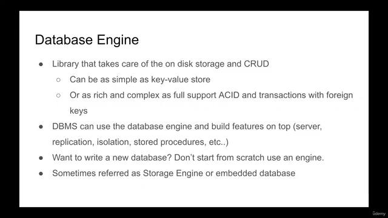
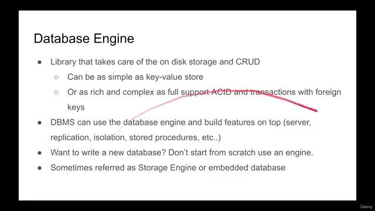
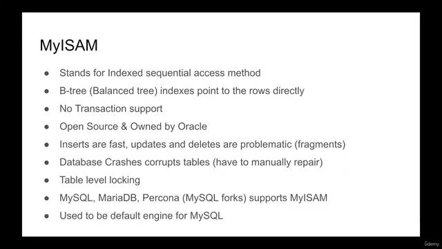
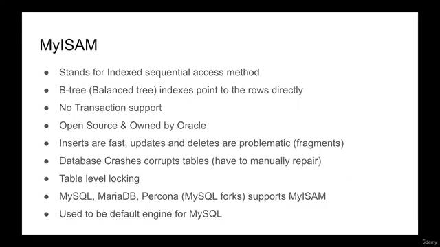
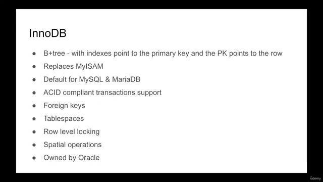
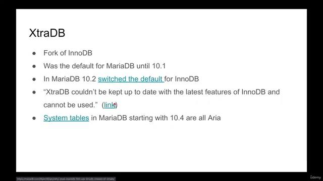
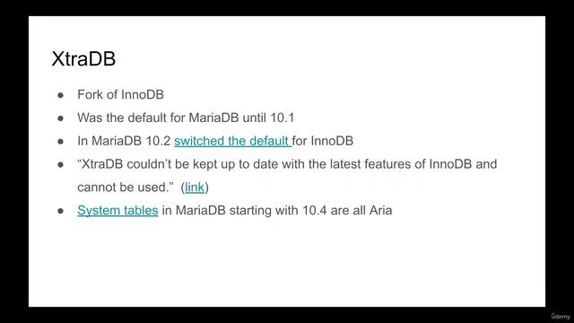

# P81–P84 数据库引擎层：MyISAM、InnoDB、XtraDB、Aria 的可运行复现

> 课程：Fundamentals of Database Engineering（BV1zNtU63Eqf），覆盖 P81–P84
> 目标读者：前端转 AI 应用工程师
> 一句话：这四集是**纯概念课，讲师没有敲过一行命令**。本文把它变成一套能跑的实验，让你亲手看到「MyISAM 回滚无效」「MyISAM 只有表级锁」「InnoDB 二级索引里装着主键」这三件事。

---

## 1. 这一节做什么

P81–P84 讲的是数据库软件里最下面那一层——**database engine（数据库引擎 / 存储引擎）**。讲师的原话是：引擎就是「一个库（library），负责磁盘存储，以及 create / update / delete 这些 CRUD 操作真正落到磁盘上」。在引擎之上还有一层 DBMS，负责主从复制、隔离级别、存储过程、外键约束等等——这些和「怎么把字节写到盘上」是两件不同的事，所以近年被拆开：**引擎可复用，DBMS 卖功能**。

这四集具体讲了四个引擎：

| 引擎 | 出现在 | 讲师的定位 |
|---|---|---|
| MyISAM | P82 | 非事务、只有表级锁、更新删除会制造碎片、可能损坏表 |
| InnoDB | P83 | 事务型、ACID、行级锁、外键、必须有主键、二级索引指向主键 |
| XtraDB | P84 | InnoDB 的 fork，没跟上 Oracle 的 InnoDB 特性，MariaDB 10.2 起切回 InnoDB |
| Aria | P84 | MariaDB 系统表仍在用，非事务 |

**问题在于：讲师全程只有口头结论，没有给任何一条可执行的 SQL。** 所以本文做的事情是——用 Docker 起一个 MariaDB，建三张不同引擎的表，把讲师说的每一条结论变成一次可以亲眼看到的实验。你照着做完，会得到：

- 一个能反复 `docker compose up` 的实验环境；
- 7 个脚本，每个脚本对应讲师的一句结论；
- 一份「看到什么 = 结论成立」的对照表。

**声明**：讲师课上**没有提过 Docker、没有提过 MariaDB 版本号、没有写过 SQL**。容器方案和下面的 SQL 都是本文为复现而补的，不是讲师给的。凡是我补的，下面都会标出来。

---

## 2. 讲师原话（带时间戳）

先把他说的关键几句摆出来，后面每个实验都挂在这些话上。原文是英文，转录里有明显的口音拼写（`my async`=MyISAM、`asset`=ACID、`B3`=B-tree、`AnnoDB`=InnoDB、`Morty`=Monty、`extra DB`=XtraDB），我保留原文并注中文。

**关于「引擎是什么」** —— p081 [00:00]：

> 引擎就是一个库，管磁盘存储和增删改查真正落盘的那部分。

**关于「引擎的能力上限可以差很多」** —— p081 [01:22]：

> 简单到只是个 KV 存储，复杂到支持完整 ACID、事务、外键。

**关于「能不能换引擎」** —— p081 [05:12]：

> "有些数据库管理系统允许你像 MySQL、MariaDB 或 Percona 那样灵活切换存储引擎……Postgres 就是一个例子，对吧？你不能更改 Postgres 的引擎。我相信它始终是 B3。"
>
> MySQL / MariaDB / Percona 可以按表换引擎；Postgres 不行，锁死 B-tree。

**关于 MyISAM 的索引方向** —— p082 [00:00]、[01:19]：

> "它代表索引顺序访问方法……你创建的每个索引都直接指向该行。"
>
> "索引会直接指向该行在磁盘上所在的偏移位置。"
>
> MyISAM = Indexed Sequential Access Method；每个索引都直接指向行在磁盘上的偏移量。

**关于 MyISAM 没有事务** —— p082 [01:46]：

> 没有事务，转账这种「一借一贷」在一个事务里做不到。

**关于 MyISAM 为什么写快、改慢** —— p082 [03:11]：

> 插入永远追加到文件末尾，所以快；更新/删除改变行大小，偏移量变了，所有指向它的索引都要跟着改，所以慢。

**关于 MyISAM 的锁粒度** —— p082 [05:24]：

> 只有表级锁，没有行级锁。

**关于 InnoDB 的主键** —— p083 [00:29]：

> "在 InnoDB 中总会有主键，而 MyISAM 则不同，你不一定非要建主键……如果不创建主键，InnoDB 会为你创建一个顺序主键。"
>
> InnoDB 必须有主键；你不建，它自己造一个自增的。MyISAM 不强制。

**关于 InnoDB 二级索引指向主键** —— p083 [01:08]：

> 二级索引不指向行，指向主键，再由主键指向行——多一次跳转。

**关于 XtraDB 的结局** —— p084 [00:46]、[00:54]：

> "添加到 XtraDB 的功能无法与 InnoDB 已有的功能保持同步……MariaDB 10.2 实际上已经从 XtraDB 切换到了 InnoDB。"
>
> XtraDB 是 InnoDB 的 fork，一个人（Monty）撑不过 Oracle 一个团队，特性跟不上，MariaDB 10.2 切回 InnoDB。

**关于 Aria** —— p084 [01:23]：

> "截至目前，MariaDB 上的系统表仍在使用 ARIA。"
>
> MariaDB 的系统表到现在还在用 Aria。





---

## 3. 从零复现

### 3.1 前置条件

- Docker Desktop（macOS / Windows）或 Docker Engine（Linux），`docker` 与 `docker compose` 可用；
- **两个终端窗口**（后面演示锁必须两个会话，这是本节的重点之一）；
- 不需要安装 MySQL 客户端，全部通过容器内的 `mariadb` 客户端执行。

检查：

```bash
docker --version
docker compose version
```

### 3.2 目录结构

在任意空目录下建出这套结构：

```
db-engine-lab/
├── docker-compose.yml
├── init/
│   ├── 01_schema.sql
│   └── 02_seed.sql
└── lab/
    ├── 00_check_engines.sql
    ├── 01_myisam_no_tx.sh
    ├── 02_innodb_tx.sh
    ├── 03_table_lock.sh
    ├── 04_row_lock.sh
    ├── 05_index_shape.sql
    └── 06_switch_engine.sh
```

```bash
mkdir -p db-engine-lab/init db-engine-lab/lab
cd db-engine-lab
```

### 3.3 启动

```bash
docker compose up -d
docker compose logs -f mariadb
```

等日志里出现 `ready for connections` 后 `Ctrl+C` 退出日志跟随。**初始化 SQL 只在数据卷为空时执行一次**——这是最容易踩的坑，`init/` 里的文件改了，必须 `docker compose down -v` 删卷重来。

### 3.4 实验顺序

按下面顺序跑，每一步都给了「预期看到什么」：

```bash
# 1) 先看清这台机器上有哪些引擎
docker exec -i db-engine-lab mariadb -uroot -prootpw enginelab < lab/00_check_engines.sql

# 2) 验证 MyISAM 没有事务（回滚无效）
bash lab/01_myisam_no_tx.sh

# 3) 同样的步骤，换 InnoDB（回滚有效）
bash lab/02_innodb_tx.sh

# 4) 验证 MyISAM 只有表级锁
bash lab/03_table_lock.sh

# 5) 验证 InnoDB 是行级锁
bash lab/04_row_lock.sh

# 6) 验证二级索引里装的是什么
docker exec -i db-engine-lab mariadb -uroot -prootpw enginelab < lab/05_index_shape.sql

# 7) 验证「按表换引擎」
bash lab/06_switch_engine.sh
```

### 3.5 每个实验在验证哪句话

| 脚本 | 讲师结论 | 成立时你会看到 |
|---|---|---|
| `00_check_engines.sql` | p081 可换引擎；p084 XtraDB 已被换掉 | 列表里有 MyISAM、InnoDB、Aria；**找不到 XtraDB** |
| `01_myisam_no_tx.sh` | p082 不支持事务 | `ROLLBACK` 之后余额还是被改过的值 |
| `02_innodb_tx.sh` | p083 ACID | `ROLLBACK` 之后余额恢复原值 |
| `03_table_lock.sh` | p082 只有表级锁 | 读**另一行**也被挡住，直到对方 `UNLOCK TABLES` |
| `04_row_lock.sh` | p083 行级锁 | 读另一行不阻塞；改**同一行**才阻塞 |
| `05_index_shape.sql` | p083 二级索引指向主键 | InnoDB 只查 `id, owner` 时不回表；MyISAM 要回表 |
| `06_switch_engine.sh` | p081 可切引擎 | `ENGINE` 列从 MyISAM 变成 InnoDB |

---

## 4. 完整代码

### 4.1 `docker-compose.yml`

```yaml
services:
  mariadb:
    image: mariadb:10.11
    container_name: db-engine-lab
    restart: unless-stopped
    environment:
      MARIADB_ROOT_PASSWORD: rootpw
      MARIADB_DATABASE: enginelab
    ports:
      - "3307:3306"
    command:
      - --character-set-server=utf8mb4
      - --collation-server=utf8mb4_unicode_ci
    volumes:
      - ./init:/docker-entrypoint-initdb.d:ro
      - mariadb_data:/var/lib/mysql

volumes:
  mariadb_data:
```

### 4.2 `init/01_schema.sql`

```sql
-- 实验用表：结构完全一样，只有 ENGINE 不同
USE enginelab;

CREATE TABLE account_myisam (
  id      INT         NOT NULL,
  owner   VARCHAR(32) NOT NULL,
  balance INT         NOT NULL,
  PRIMARY KEY (id),
  KEY idx_owner (owner)
) ENGINE=MyISAM;

CREATE TABLE account_innodb (
  id      INT         NOT NULL,
  owner   VARCHAR(32) NOT NULL,
  balance INT         NOT NULL,
  PRIMARY KEY (id),
  KEY idx_owner (owner)
) ENGINE=InnoDB;

-- 一张故意不建主键的 MyISAM 表，对应 p083「MyISAM 不强制主键」
CREATE TABLE note_myisam_nopk (
  body VARCHAR(64) NOT NULL
) ENGINE=MyISAM;

INSERT INTO account_myisam (id, owner, balance) VALUES (1, 'alice', 100), (2, 'bob', 100);
INSERT INTO account_innodb (id, owner, balance) VALUES (1, 'alice', 100), (2, 'bob', 100);
```

### 4.3 `init/02_seed.sql`

```sql
-- 灌一批数据，让优化器愿意走索引，而不是全表扫描
USE enginelab;

INSERT INTO account_myisam (id, owner, balance)
SELECT seq + 2, CONCAT('owner_', seq), 50 FROM seq_1_to_200;

INSERT INTO account_innodb (id, owner, balance)
SELECT seq + 2, CONCAT('owner_', seq), 50 FROM seq_1_to_200;
```

> `seq_1_to_N` 是 MariaDB 自带的虚拟序列，MySQL 没有这个语法。本文锁死 MariaDB，就是为了这一行写起来最省事。

### 4.4 `lab/00_check_engines.sql`

```sql
-- 这台服务器上有哪些引擎，以及它默认是不是启用
SELECT ENGINE, SUPPORT
FROM information_schema.ENGINES
ORDER BY ENGINE;
```

```sql
-- 我们建的三张表分别落在哪个引擎上
SELECT TABLE_NAME, ENGINE
FROM information_schema.TABLES
WHERE TABLE_SCHEMA = 'enginelab'
ORDER BY TABLE_NAME;
```

```sql
-- 对应 p084：MariaDB 的系统表用的是什么引擎
SELECT TABLE_NAME, ENGINE
FROM information_schema.TABLES
WHERE TABLE_SCHEMA = 'mysql'
  AND TABLE_NAME IN ('user', 'db', 'global_priv');
```

> 字段名以你机器的实际输出为准；`mysql.global_priv` 只在 10.4+ 存在，10.3 及以前用 `mysql.user`。

### 4.5 `lab/01_myisam_no_tx.sh`

```bash
#!/usr/bin/env bash
set -euo pipefail

CONT=db-engine-lab
run() { docker exec -i "$CONT" mariadb -uroot -prootpw enginelab -e "$1"; }

echo "== 0. 复位 =="
run "UPDATE account_myisam SET balance = 100 WHERE id IN (1,2);"
run "SELECT id, owner, balance FROM account_myisam WHERE id IN (1,2) ORDER BY id;"

echo
echo "== 1. 开启事务，模拟转账：1 号 -30，2 号 +30 =="
run "START TRANSACTION;
     UPDATE account_myisam SET balance = balance - 30 WHERE id = 1;
     UPDATE account_myisam SET balance = balance + 30 WHERE id = 2;
     SELECT id, balance FROM account_myisam WHERE id IN (1,2) ORDER BY id;"

echo
echo "== 2. 现在 ROLLBACK（本意是撤销上面两步） =="
run "ROLLBACK;"

echo
echo "== 3. 再看数据 =="
run "SELECT id, balance FROM account_myisam WHERE id IN (1,2) ORDER BY id;"
echo
echo "结论：如果第 3 步仍是 70 / 130，说明 ROLLBACK 对 MyISAM 无效。"
```

### 4.6 `lab/02_innodb_tx.sh`

```bash
#!/usr/bin/env bash
set -euo pipefail

CONT=db-engine-lab
run() { docker exec -i "$CONT" mariadb -uroot -prootpw enginelab -e "$1"; }

echo "== 0. 复位 =="
run "UPDATE account_innodb SET balance = 100 WHERE id IN (1,2);"

echo
echo "== 1. 同样的转账，同样的 ROLLBACK =="
run "START TRANSACTION;
     UPDATE account_innodb SET balance = balance - 30 WHERE id = 1;
     UPDATE account_innodb SET balance = balance + 30 WHERE id = 2;
     SELECT id, balance FROM account_innodb WHERE id IN (1,2) ORDER BY id;
     ROLLBACK;"

echo
echo "== 2. 再看数据 =="
run "SELECT id, balance FROM account_innodb WHERE id IN (1,2) ORDER BY id;"
echo
echo "结论：如果第 2 步回到 100 / 100，说明 InnoDB 的 ROLLBACK 生效。"
```

### 4.7 `lab/03_table_lock.sh`

```bash
#!/usr/bin/env bash
set -euo pipefail

CONT=db-engine-lab
run() { docker exec -i "$CONT" mariadb -uroot -prootpw enginelab -e "$1"; }

echo "== 会话 A：拿整张表的写锁，持有 8 秒 =="
docker exec -i "$CONT" mariadb -uroot -prootpw enginelab \
  -e "LOCK TABLES account_myisam WRITE; SELECT SLEEP(8); UNLOCK TABLES;" &

sleep 2

echo
echo "== 会话 B：只想读 id=2 这一行（和 A 要改的 id=1 完全无关） =="
run "SET SESSION lock_wait_timeout = 3;
     SELECT id, owner, balance FROM account_myisam WHERE id = 2;" \
  || echo ">>> 被表锁挡住了（这正是 MyISAM 的行为）"

wait

echo
echo "== 锁释放后再读一次 =="
run "SELECT id, owner, balance FROM account_myisam WHERE id = 2;"
```

### 4.8 `lab/04_row_lock.sh`

```bash
#!/usr/bin/env bash
set -euo pipefail

CONT=db-engine-lab
run() { docker exec -i "$CONT" mariadb -uroot -prootpw enginelab -e "$1"; }

echo "== 会话 A：事务里改 id=1，持有 8 秒不提交 =="
docker exec -i "$CONT" mariadb -uroot -prootpw enginelab \
  -e "START TRANSACTION;
      UPDATE account_innodb SET balance = balance - 1 WHERE id = 1;
      SELECT SLEEP(8);
      ROLLBACK;" &

sleep 2

echo
echo "== 会话 B-1：读 id=2（不同的行）——应该立刻返回 =="
run "SELECT id, balance FROM account_innodb WHERE id = 2;"

echo
echo "== 会话 B-2：改 id=1（同一行）——应该被行锁挡住 =="
run "SET SESSION innodb_lock_wait_timeout = 3;
     UPDATE account_innodb SET balance = balance - 1 WHERE id = 1;" \
  || echo ">>> 被行锁挡住了（这正是 InnoDB 的行为）"

wait

echo
echo "== A 回滚后，id=1 的值应恢复原样 =="
run "SELECT id, balance FROM account_innodb WHERE id = 1;"
```

### 4.9 `lab/05_index_shape.sql`

```sql
USE enginelab;

-- A：只查「二级索引列 + 主键列」
--    InnoDB 的二级索引叶子里带着主键，所以这里可以只走索引
--    MyISAM 的二级索引叶子里是「列值 + 行偏移量」，拿不到 id，必须回表
EXPLAIN SELECT id, owner FROM account_innodb WHERE owner = 'bob';
EXPLAIN SELECT id, owner FROM account_myisam WHERE owner = 'bob';

-- B：多查一列 balance，两种引擎都必须回表
EXPLAIN SELECT id, owner, balance FROM account_innodb WHERE owner = 'bob';
EXPLAIN SELECT id, owner, balance FROM account_myisam WHERE owner = 'bob';
```

### 4.10 `lab/06_switch_engine.sh`

```bash
#!/usr/bin/env bash
set -euo pipefail

CONT=db-engine-lab
run() { docker exec -i "$CONT" mariadb -uroot -prootpw enginelab -e "$1"; }

echo "== 切换前 =="
run "SELECT TABLE_NAME, ENGINE FROM information_schema.TABLES
     WHERE TABLE_SCHEMA = 'enginelab' AND TABLE_NAME = 'account_myisam';"

echo
echo "== 把这张表整体换成 InnoDB（重建表，数据保留） =="
run "ALTER TABLE account_myisam ENGINE=InnoDB;"

echo "== 切换后 =="
run "SELECT TABLE_NAME, ENGINE FROM information_schema.TABLES
     WHERE TABLE_SCHEMA = 'enginelab' AND TABLE_NAME = 'account_myisam';"

echo
echo "== 换回来，方便重复做实验 =="
run "ALTER TABLE account_myisam ENGINE=MyISAM;"
run "SELECT TABLE_NAME, ENGINE FROM information_schema.TABLES
     WHERE TABLE_SCHEMA = 'enginelab' AND TABLE_NAME = 'account_myisam';"
```

---

## 5. 逐行解释

**`image: mariadb:10.11`**
选定 10.11 有两个原因：一是它在 10.2 之后，默认引擎已经是 InnoDB，正好对上 p084「MariaDB 10.2 actually switched to InnoDB from XtraDB」；二是它同时保留 MyISAM 和 Aria，三个引擎能在一台机器上对比。如果你用 MySQL 8 镜像，`seq_1_to_200` 会报错，需要换成递归 CTE。

**`ports: "3307:3306"`**
宿主机 3307 映射容器 3306。你本机如果已经装了 MySQL 占着 3306，不改这个端口 `docker compose up` 会直接失败。

**`./init:/docker-entrypoint-initdb.d:ro`**
官方镜像的约定：容器**第一次**初始化数据目录时，会按文件名顺序执行这个目录下所有 `.sql`。`ro` 是只读挂载，防止容器往里写东西。这条机制的副作用是——**只在数据卷为空时生效**。你改了 `01_schema.sql` 再 `up`，什么都不会发生，必须先 `docker compose down -v`。

**`ENGINE=MyISAM` / `ENGINE=InnoDB`**
这就是 p081 说的「MySQL / MariaDB 可以按表换引擎」：引擎不是库级别的选项，是**建表语句的一部分**。同一张库里的两张表可以跑在两个完全不同的引擎上。

**`PRIMARY KEY (id), KEY idx_owner (owner)`**
`PRIMARY KEY` 在主键索引里，`KEY idx_owner` 是二级索引。这两个索引在两种引擎里的**物理内容完全不同**：

- MyISAM：`idx_owner` 的叶子是 `(owner, 行在 .MYD 文件里的偏移量)`；
- InnoDB：`idx_owner` 的叶子是 `(owner, 主键 id)`，要拿 `balance` 还得拿 id 回主键索引再查一次——这就是 p083 说的 "多次跳转和往返"。

`05_index_shape.sql` 里 `SELECT id, owner` 之所以能在 InnoDB 上不回表，就是因为 `id` 已经在二级索引里了；换到 MyISAM 就得回表，因为偏移量不是 `id`。

**`note_myisam_nopk` 这张没主键的表**
对应 p083「MyISAM 你不建主键也行」。同一句 SQL 换成 `ENGINE=InnoDB` 也能建成功，但 InnoDB 会在内部生成一个 6 字节的隐藏自增列当主键——**你在 `SHOW CREATE TABLE` 里看不到它**，但索引确实指向它。

**`START TRANSACTION; ... ROLLBACK;`（01 脚本）**
这是全篇最关键的一处。MyISAM 根本没有事务日志（redo/undo），`START TRANSACTION` 和 `ROLLBACK` 对它是**空操作**——语句不报错，但什么也不回滚。所以第 3 步你会看到 `70 / 130`，而不是 `100 / 100`。这正是讲师 p082 [01:46] 说的「转账在一个事务里做不到」。

**`LOCK TABLES account_myisam WRITE; SELECT SLEEP(8); UNLOCK TABLES;`（03 脚本）**
MyISAM 没有行锁，只能显式拿表锁。注意 `LOCK TABLES` 之后**必须 `UNLOCK TABLES`**，而且这个连接在锁住期间只能访问被锁的表。会话 B 读 `id=2`（和 A 要动的 `id=1` 八竿子打不着）依然被挡住——这就是「表级锁」的代价，讲师 p082 [05:24] 的原话。

**`SET SESSION lock_wait_timeout = 3;`**
MariaDB 的表锁/metadata lock 等待上限，默认很大（一天量级），不设的话脚本会挂住。设成 3 秒，超时后客户端报错退出，脚本里的 `|| echo` 接住，打印「被表锁挡住了」。这是本文为了让脚本能自动跑完加的，**讲师没讲过这个变量**。

**`innodb_lock_wait_timeout = 3`（04 脚本）**
InnoDB 行锁的等待上限，默认 50 秒。同样是为了脚本能收尾。注意 InnoDB 那边 `SELECT` 不会阻塞——默认隔离级别下普通 `SELECT` 是快照读，不申请锁；只有 `UPDATE` 同一行才会撞上行锁。这个「读不阻塞、写才阻塞」的对比，就是行级锁和表级锁最直观的差别。

**`ALTER TABLE account_myisam ENGINE=InnoDB;`（06 脚本）**
MySQL 系换引擎的标准做法：整表重建 + 数据搬迁。表小的时候瞬间完成，表大的时候这是一次全表拷贝，线上慎用。Postgres 没有对应语法——p081 [05:12] 讲师说 Postgres 的引擎锁死在 B-tree，就是这个意思。

**Node/JS 对照**（因为你是前端背景，这里补一句）：
- 事务 ≈ 在 `mysql2` 里 `connection.beginTransaction()` / `commit()` / `rollback()`，**必须绑在同一个 connection 上**，不能从连接池里随便再取一个连接执行后续语句；
- 表级锁 ≈ 给整个模块加一把全局 mutex（`await mutex.lock()`），所有请求排队，哪怕它们操作的是不同用户；
- 行级锁 ≈ 按 key 分片的 mutex（`keyedMutex.lock(userId)`），只阻塞同一 key 的请求；
- **别指望 Node 单线程帮你解决并发**：event loop 只保证 JS 不并行，10 个请求照样会并发打到数据库，一致性只能靠数据库的事务和锁来兜。

---

## 6. 复现检查清单

按顺序打完勾，说明你复现成功了：

- [ ] `docker compose up -d` 后 `docker compose ps` 显示 `db-engine-lab` 是 `running`
- [ ] `01` 脚本第 3 步输出 `70 / 130`（**没回滚**）→ MyISAM 无事务 ✅
- [ ] `02` 脚本第 2 步输出 `100 / 100`（**回滚了**）→ InnoDB 有事务 ✅
- [ ] `00` 脚本的引擎列表里能看到 `MyISAM`、`InnoDB`、`Aria`
- [ ] `00` 脚本的引擎列表里**看不到 `XtraDB`**（10.2+ 已移除，对上 p084）
- [ ] `03` 脚本里会话 B 读 `id=2` 被挡住并打印「被表锁挡住了」→ 只有表级锁 ✅
- [ ] `04` 脚本里 B-1（读 id=2）立刻返回，B-2（改 id=1）被挡住 → 行级锁 ✅
- [ ] `05` 脚本里 InnoDB 的 `SELECT id, owner` 不回表，MyISAM 的回表
- [ ] `06` 脚本里 `ENGINE` 列从 `MyISAM` 变成 `InnoDB` 再变回来
- [ ] 两个终端手动跑一遍 `03`，亲手看到 B 卡在那里（脚本跑通还不够，要看见「卡住」这件事）











---

## 7. 课里没讲但你会撞上

**① `docker compose up` 之后表不存在。**
百分之百是「初始化 SQL 只在空数据卷时执行」这条规则。`docker compose down -v` 把 `mariadb_data` 卷删掉再来。注意 `down` 不带 `-v` 卷还在，改了 `init/` 也是白改。

**② 宿主机 3306 被占。**
如果你本机已经跑着 MySQL，`docker compose up` 会报端口冲突。本文用的是 `3307:3306`，如果 3307 也冲突就继续往上找一个没人用的。

**③ 容器里的客户端叫什么。**
本文统一用 `mariadb`。10.5 之前的镜像里这个客户端可能只有 `mysql` 这个名字（`mariadb` 是后来的重命名），报 `executable file not found` 就把命令里的 `mariadb` 换成 `mysql`，参数完全一样。

**④ 锁实验在 `mysql -e` 里跑不完。**
`LOCK TABLES` 和 `SLEEP` 必须在**同一个连接**里，`docker exec` 每次都是新连接，所以脚本里把三条语句塞进了同一个 `-e` 参数。同理，手动实验一定要开两个 `docker exec -it ... mariadb ...` 会话，在一个会话里自问自答是看不到锁的。

**⑤ InnoDB 的 `SELECT` 为什么不阻塞。**
因为 InnoDB 默认隔离级别是 **REPEATABLE READ**，普通 `SELECT` 走的是 MVCC 快照读，根本不申请行锁。你只有在 `UPDATE` / `DELETE` / `SELECT ... FOR UPDATE` 时才会撞上锁。这个隔离级别和 MVCC 的细节**课里没讲**（p081 只是在 ACID 里提了 isolation 这个词），别把它安到讲师头上。

**⑥ `information_schema` 的字段名会变。**
本文用到的 `ENGINES.ENGINE` / `ENGINES.SUPPORT`、`TABLES.TABLE_NAME` / `TABLES.ENGINE` 在 MariaDB 10.x 上是稳定的，但别的字段（比如 `TABLES.ROW_FORMAT`、`TABLES.CREATE_OPTIONS`）各版本可能不同。**字段名以你机器上的实际输出为准**，别照抄别人的博客。

**⑦ `EXPLAIN` 的 `Extra` 列字符串因版本而异。**
MariaDB 和 MySQL 对「覆盖索引」的标记措辞不完全一样，可能写成 `Using index`，也可能带别的前后缀。你要看的不是字符串本身，而是**同一个查询在 InnoDB 和 MyISAM 两张表上的输出差异**——差异出来了，p083 那句「二级索引指向主键」就被你验证了。

**⑧ MyISAM 表在容器被强杀后可能需要修复。**
p082 [04:28] 讲师说 MyISAM 在写入中途崩溃会出现 corrupt table，有个 repair utility。想在容器里复现这个，得在写入过程中 `docker kill`，时机很难控制，**不保证能复现**。真遇到了，`REPAIR TABLE 表名;` 是 MyISAM 的修复入口，InnoDB 没有对应操作（它靠崩溃恢复）。

**⑨ 事务里夹了 DDL 会隐式提交。**
在 `START TRANSACTION` 和 `ROLLBACK` 之间执行 `ALTER TABLE` 或 `CREATE TABLE`，InnoDB 会先把事务提交掉，后面的 `ROLLBACK` 只能回滚 DDL 之后的语句。这是 MySQL 系的行为，**课里没讲**，但你在 `06` 脚本里如果把 `ALTER` 塞进事务就会撞上。

**