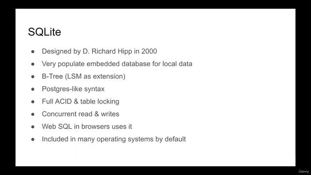
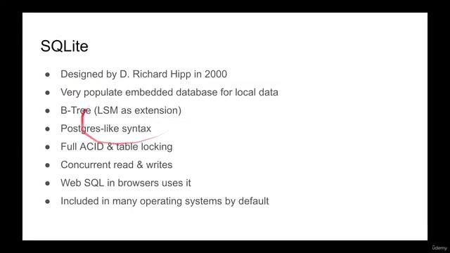
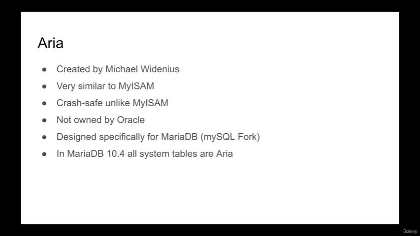
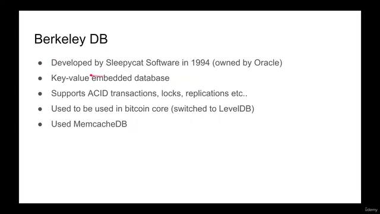
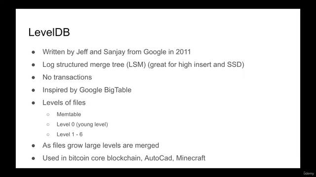

# Fundamentals of Database Engineering（P85–P88）复现文档：嵌入式数据库与存储引擎对照实验

> 读前说明：这四讲是“流行数据库/存储引擎巡礼”，**课里没有给项目、没有给安装命令、没有给代码仓库**。逐字稿里出现的是 SQLite、Aria、Berkeley DB、LevelDB 的定位和架构讨论。  
> 因此本文把“复现”定义为一个**可运行的最小验证工作区**：用 Node.js 搭两个脚本，分别验证 SQLite 的 ACID/回滚和 LevelDB 的批量写/迭代；Aria 与 Berkeley DB 因为课里没给可运行步骤，只做概念核对，不伪造命令。  
> 文中出现的 `better-sqlite3`、`level`、Node 脚本都是**文档作者为复现选的验证载体，不是讲师在课里提到的工具**。

---

## 1. 这一节做什么

这一节覆盖 P85–P88，主题不是“从零写一个数据库”，而是理解四类嵌入式数据库/存储引擎的差异：

- **SQLite**：本地嵌入式数据库，逐字稿说它“very popular embedded database for local data”，默认使用逐字稿写作 “B3” 的存储结构，支持完整 ACID，支持并发读写。  
- **Aria**：MariaDB 体系里的存储引擎，逐字稿把它放在 MySQL/MariaDB 作者 Michael 的故事里讲，强调它“crash safe”。  
- **Berkeley DB**：很老的键值嵌入式数据库，逐字稿说它支持 ACID、支持锁，曾被 Bitcoin Core 使用。  
- **LevelDB**：Google 的 LevelDB，逐字稿说它由 Jeff 和 Sanjay 在 2011 年写出，目标是**高插入、面向 SSD**，明确“no transactions”，用 LSM 思路，第一层是内存里的 MemTable，并且写 MemTable 时也写 WAL 日志。

本文要交付的复现物是：

```text
db-engines-lab/
├─ package.json
├─ src/
│  ├─ sqlite-bench.mjs
│  └─ level-bench.mjs
└─ data/                 # 运行后自动生成
```

运行后你能观察到：

1. SQLite 插入 1000 条记录，并在事务中故意抛错，看到回滚前后计数一致。
2. LevelDB 批量写入 1000 个键，读取其中一个键，并迭代统计键数量。
3. 两个脚本都输出 JSON，字段名来自本文代码，方便你对照检查。

**本实验不需要环境变量，不读取 `.env`，不启动端口。** 依赖版本建议：

```json
"better-sqlite3": "^11.0.0",
"level": "^8.0.0"
```

Node.js 要求 `>=20`。启动命令是 `npm run sqlite` 和 `npm run level`。



---

## 2. 讲师原话（带「—— pNNN [MM:SS]」）

先看 SQLite。讲师在 p085 里说它“very popular embedded database for local data”，并说“He uses B3 by default.”—— p085 [00:23]、p085 [00:50]。这里我保留逐字稿的 “B3” 写法，不擅自替讲师补成某个具体 B 树变体；课里没有展开 B3 的页结构、分裂合并细节。讲师还强调 SQLite “supports full acid”—— p085 [02:17]，以及“Concurrent read and writes Yes, it has concurrent read and concurrent write. You can write on parallel.”—— p085 [03:10]。这几句是本文做 SQLite 事务回滚实验的直接动机：本地数据库也要能回滚，也要能解释并发写的边界。

再看 Aria。p086 里讲师把 MariaDB、MySQL、Aria 的命名故事串起来，说“He created a fork of MySQL called MariaDB.”—— p086 [00:56]；又说 Aria 相比 MyISAM 修了一个关键点：“He made it crash safe.”—— p086 [01:25]。课里没有给 MariaDB 安装步骤，也没有给 `ENGINE=Aria` 的建表命令，所以本文只把它作为概念核对，不写“照着跑 Aria”的假命令。

Berkeley DB 在 p087 被放在“最老的数据库”位置：“Berkeley DB is one of these oldest databases...”—— p087 [00:00]；定位是“Key value embedded database ... support acid support locks”—— p087 [01:26]。课里没有给 Berkeley DB 的 API 示例，也没有给许可证细节，本文不会假装它有 SQL 接口。

LevelDB 是 p088 的重点。讲师说“level DB has been written by Jeff and Sanjay from Google in 2011.”—— p088 [00:00]；目标非常明确：“no transactions. This is the goal. We're building something for high insert and SSD.”—— p088 [01:24]。架构上，讲师说第一层是 MemTable：“the first level is the MIM table. That's the memory.”—— p088 [04:18]；并且写 MemTable 时也写日志：“they do support right ahead logs, right? It's a wall.”—— p088 [04:48]。本文的 LevelDB 实验只验证“批量写 + 读取 + 迭代”，不把它当事务数据库用。


---

## 3. 从零复现

### 3.1 准备环境

先确认 Node 版本：

```bash
node -v
npm -v
```

`node -v` 应该是 `v20.x` 或更高。本文不使用环境变量；如果你机器上有旧的 `NODE_OPTIONS`，建议先清掉，避免影响原生模块加载。

创建目录：

```bash
mkdir db-engines-lab
cd db-engines-lab
mkdir src
```

### 3.2 写入 `package.json`

在 `db-engines-lab/package.json` 写入第 4 节的完整内容。关键是：

- `"type": "module"`：让 `.mjs` 和 `import` 正常工作。
- `"sqlite": "node src/sqlite-bench.mjs"`：启动 SQLite 验证。
- `"level": "node src/level-bench.mjs"`：启动 LevelDB 验证。
- `"clean": "node -e \"require('node:fs').rmSync('data',{recursive:true,force:true})\""`：清理运行数据。

### 3.3 安装依赖

```bash
npm install
```

安装完成后检查：

```bash
ls node_modules/better-sqlite3
ls node_modules/level
```

如果 `better-sqlite3` 安装失败，通常是原生模块编译问题：Windows 需要 Visual Studio Build Tools，macOS 需要 Xcode Command Line Tools。这一点课里没讲，但你会撞上。

### 3.4 写入两个脚本

把第 4 节的 `src/sqlite-bench.mjs` 和 `src/level-bench.mjs` 原样保存。两个脚本都会自动创建 `data/` 目录：

- SQLite 文件：`data/sqlite.db`
- LevelDB 目录：`data/level/`

### 3.5 运行 SQLite 验证

```bash
npm run sqlite
```

示例输出格式如下，数字会因机器不同而变化：

```json
{
  "engine": "sqlite",
  "inserted": 1000,
  "ms": 12
}
rollback error: force rollback
{
  "before": 1000,
  "after": 1000,
  "rolledBack": true
}
```

你要重点看三个字段：`inserted` 是否为 `1000`，`before` 和 `after` 是否相等，`rolledBack` 是否为 `true`。`ms` 只是本机耗时，不是课里给的基准。

### 3.6 运行 LevelDB 验证

```bash
npm run level
```

示例输出：

```json
{
  "engine": "leveldb",
  "inserted": 1000,
  "ms": 15,
  "sample": {
    "title": "note-42",
    "body": "body-42",
    "createdAt": "2025-01-01T00:00:00.000Z"
  }
}
```

`inserted` 来自迭代计数，`sample` 来自 `db.get('note:42')`。同样，`ms` 仅用于确认脚本跑通，不要拿它和 SQLite 做严肃性能对比；课里没有给基准方法。

### 3.7 清理并重复运行

```bash
npm run clean
npm run sqlite
npm run level
```

SQLite 脚本每次会先 `DELETE FROM notes`，所以重复运行仍然是 1000 条；LevelDB 脚本会覆盖同名键，迭代计数也仍然是 1000。想彻底从零开始，用 `npm run clean` 删除 `data/`。



---

## 4. 完整代码

### 4.1 `package.json`

```json
{
  "name": "db-engines-lab",
  "version": "1.0.0",
  "private": true,
  "type": "module",
  "engines": {
    "node": ">=20"
  },
  "scripts": {
    "sqlite": "node src/sqlite-bench.mjs",
    "level": "node src/level-bench.mjs",
    "clean": "node -e \"require('node:fs').rmSync('data',{recursive:true,force:true})\""
  },
  "dependencies": {
    "better-sqlite3": "^11.0.0",
    "level": "^8.0.0"
  }
}
```

### 4.2 `src/sqlite-bench.mjs`

```js
import Database from 'better-sqlite3';
import fs from 'node:fs';

fs.mkdirSync('data', { recursive: true });

const db = new Database('data/sqlite.db');

db.exec(`
  CREATE TABLE IF NOT EXISTS notes (
    id INTEGER PRIMARY KEY AUTOINCREMENT,
    title TEXT NOT NULL,
    body TEXT NOT NULL,
    created_at TEXT NOT NULL
  );
`);

db.exec('DELETE FROM notes;');

const insert = db.prepare(`
  INSERT INTO notes (title, body, created_at)
  VALUES (?, ?, ?)
`);

const insertMany = db.transaction((rows) => {
  for (const row of rows) {
    insert.run(row.title, row.body, row.created_at);
  }
});

const rows = Array.from({ length: 1000 }, (_, i) => ({
  title: `note-${i}`,
  body: `body-${i}`,
  created_at: new Date().toISOString()
}));

const t0 = performance.now();
insertMany(rows);
const t1 = performance.now();

const count = db.prepare('SELECT COUNT(*) AS c FROM notes').get().c;

console.log(JSON.stringify({
  engine: 'sqlite',
  inserted: count,
  ms: Math.round(t1 - t0)
}, null, 2));

const before = db.prepare('SELECT COUNT(*) AS c FROM notes').get().c;

try {
  db.transaction(() => {
    insert.run('rollback-demo', 'should-not-persist', new Date().toISOString());
    throw new Error('force rollback');
  })();
} catch (err) {
  console.log('rollback error:', err.message);
}

const after = db.prepare('SELECT COUNT(*) AS c FROM notes').get().c;

console.log(JSON.stringify({
  before,
  after,
  rolledBack: before === after
}, null, 2));

db.close();
```

### 4.3 `src/level-bench.mjs`

```js
import { Level } from 'level';
import fs from 'node:fs';

fs.mkdirSync('data', { recursive: true });

const db = new Level('./data/level', { valueEncoding: 'json' });

await db.open();

const t0 = performance.now();

const batch = db.batch();

for (let i = 0; i < 1000; i++) {
  batch.put(`note:${i}`, {
    title: `note-${i}`,
    body: `body-${i}`,
    createdAt: new Date().toISOString()
  });
}

await batch.write();

const t1 = performance.now();

const value = await db.get('note:42');

let count = 0;
for await (const [key] of db.iterator()) {
  count++;
}

console.log(JSON.stringify({
  engine: 'leveldb',
  inserted: count,
  ms: Math.round(t1 - t0),
  sample: value
}, null, 2));

await db.close();
```



---

## 5. 逐行解释

### 5.1 `package.json`

`"type": "module"` 让 Node 按 ES Module 解析 `.mjs` 文件，这样两个脚本里的 `import` 才能直接用。前端同学会熟悉这种写法；如果你在 CommonJS 项目里复制，需要改成 `require` 或把文件后缀保持 `.mjs`。

`"engines": { "node": ">=20" }` 是提示，不是强制锁死。`better-sqlite3` 是原生模块，Node 版本太低或 ABI 不匹配时会报错。`"sqlite"` 和 `"level"` 两个脚本就是启动命令，避免你记长路径。

`"clean"` 用 Node 一行删除 `data/`，不依赖 `rm -rf`，Windows 和 macOS 都能用。注意它删除的是整个 `data` 目录，不要在里面放别的重要文件。

### 5.2 `src/sqlite-bench.mjs`

`import Database from 'better-sqlite3'`：`better-sqlite3` 是同步 API 的 SQLite 驱动。对前端转 AI 应用的同学来说，同步 API 的好处是代码直白，不会一上来就被 Promise 链绕晕。课里没讲这个包；这是本文选的验证工具。

`fs.mkdirSync('data', { recursive: true })`：确保 `data/` 存在。`recursive: true` 表示目录已存在也不报错。

`new Database('data/sqlite.db')`：打开或创建 SQLite 文件。SQLite 是嵌入式数据库，没有独立服务器进程，数据库就是一个文件；这正是逐字稿说的 “embedded database for local data” 的可观察形态。

`db.exec(...)` 里的 `CREATE TABLE IF NOT EXISTS` 建表。字段 `id` 自增，`title`、`body`、`created_at` 都是 `TEXT NOT NULL`。这里没有用复杂类型，方便你直接看懂。

`db.exec('DELETE FROM notes;')`：每次运行先清空，保证脚本可重复。否则你跑三次会得到 3000 条，检查清单就对不上。

`db.prepare(...)`：预编译插入语句。`?` 是占位符，`insert.run(row.title, row.body, row.created_at)` 按顺序绑定。不要用字符串拼接，避免 SQL 注入；这一点课里没展开，但属于数据库基本工程习惯。

`db.transaction((rows) => { ... })`：把 1000 次插入包成一个事务。**在 JS/Node 里对应什么**：它相当于把多条写操作串成一个同步事务函数；`better-sqlite3` 在回调抛错时会回滚。它不是 JavaScript 语言级事务，而是数据库事务的驱动封装。

`Array.from({ length: 1000 }, ...)`：生成 1000 条测试数据。`performance.now()` 取时间戳，`Math.round(t1 - t0)` 得到毫秒数。这个数字只用于确认脚本执行，不是课里给的性能结论。

`const count = db.prepare('SELECT COUNT(*) AS c FROM notes').get().c;`：`AS c` 是本文代码里定义的别名，所以输出字段叫 `inserted`，值是 `count`。如果你改 SQL 别名，输出字段值也会变，但字段名仍是代码里写的 `inserted`。

回滚演示部分：`before` 先取一次计数；`db.transaction(() => { insert.run(...); throw new Error('force rollback'); })()` 在事务里插入一条 `rollback-demo`，然后立刻抛错。`catch` 打印 `rollback error: force rollback`。`after` 再取计数。`rolledBack: before === after` 为 `true` 就说明事务回滚生效。**在 JS/Node 里对应什么**：这类似前端表单提交失败后不能留下半条数据；数据库层用事务保证“要么全成，要么全不成”。

`db.close()`：关闭数据库文件。脚本结束前关闭是好习惯，避免文件句柄残留。

### 5.3 `src/level-bench.mjs`

`import { Level } from 'level'`：`level` 是 LevelDB 的 Node 封装。课里讲的是 LevelDB 这个存储引擎，不是这个 npm 包；本文用它来观察 LSM 风格键值库的批量写和迭代行为。

`new Level('./data/level', { valueEncoding: 'json' })`：打开 `data/level` 目录作为数据库。`valueEncoding: 'json'` 让值可以存对象，读取时自动反序列化。LevelDB 是键值存储，不是 SQL 数据库；这里没有表，只有键和值。

`await db.open()`：显式打开。`level` 的 API 是 Promise 风格，所以用 `await`。

`const batch = db.batch()`：创建一个批量操作对象。注意：**batch 不是事务**。课里明确说 LevelDB “no transactions”—— p088 [01:24]。批量写只是把多个 put 合并提交，减少 I/O，不提供“出错全部回滚”的语义。**在 JS/Node 里对应什么**：如果你需要多键原子性，不能指望 `batch`，要在上层用单写队列、补偿逻辑或换支持事务的数据库。

`batch.put(\`note:${i}\`, { ... })`：写入 1000 个键，键是 `note:0` 到 `note:999`，值是对象。LevelDB 的“更新”在底层不是原地改旧值，而是追加新记录；旧值由后续 compaction 处理。课里没展开 compaction 细节，这里不编。

`await batch.write()`：提交批量写。`t1 - t0` 得到耗时。`await db.get('note:42')` 读取一个样本，输出到 `sample` 字段。

`for await (const [key] of db.iterator()) { count++; }`：迭代整个键空间并计数。`db.iterator()` 返回异步迭代器，`[key]` 只取键，值不用。`count` 最终是 1000。这个迭代也说明 LevelDB 是按键有序的键值存储；课里没讲比较器细节，本文不扩展。

`await db.close()`：关闭数据库。LevelDB 关闭时会刷写必要状态，不要省略。



---

## 6. 复现检查清单

按顺序打勾：

- [ ] `node -v` 输出 `v20.x` 或更高。
- [ ] 目录结构是 `db-engines-lab/package.json`、`db-engines-lab/src/sqlite-bench.mjs`、`db-engines-lab/src/level-bench.mjs`。
- [ ] `npm install` 成功，`node_modules/better-sqlite3` 和 `node_modules/level` 存在。
- [ ] `npm run sqlite` 输出 `"engine": "sqlite"`，`"inserted": 1000`。
- [ ] SQLite 输出里出现 `rollback error: force rollback`。
- [ ] SQLite 输出里 `"before": 1000`、`"after": 1000`、`"rolledBack": true`。
- [ ] `npm run level` 输出 `"engine": "leveldb"`，`"inserted": 1000`。
- [ ] LevelDB 输出里 `"sample"` 是对象，包含 `title`、`body`、`createdAt`。
- [ ] 再次运行 `npm run sqlite` 和 `npm run level` 仍然成功，说明脚本可重复。
- [ ] `npm run clean` 后 `data/` 目录消失。
- [ ] 如果 `better-sqlite3` 安装失败，检查 Node 版本、Python、C++ 编译工具；Windows 装 VS Build Tools，macOS 装 Xcode Command Line Tools。
- [ ] 如果 LevelDB 报目录锁错误，确认没有另一个进程正在使用 `data/level`，然后 `npm run clean` 重来。
- [ ] 不要拿 `ms` 数字做数据库选型结论；课里没有给基准方法，本文只验证语义和可运行性。



---

## 7. 课里没讲但你会撞上的

**第一，课里没有项目脚手架。** P85–P88 是概念课，没有 `npm init`、没有目录结构、没有启动命令。本文的 Node 工作区是文档作者补的验证载体，不是讲师原话。你如果拿它去当“讲师官方示例”，会误解课程定位。

**第二，`better-sqlite3` 是原生模块。** 它需要编译，安装失败往往不是网络问题，而是本机缺少 C++ 工具链。课里没讲这个包，也没讲编译依赖。前端同学常见坑是 Node 版本太新或太旧导致 ABI 不匹配；先看 `node -v`，再看 npm 报错里的 `node-gyp` 信息。

**第三，SQLite 的并发写不是“随便并发”。** 逐字稿说 SQLite 支持并发读写、可以并行写—— p085 [03:10]。但课里没有展开文件锁、busy timeout、WAL 模式这些工程细节。实际多进程写同一个 SQLite 文件时，仍可能遇到锁冲突。**在 JS/Node 里对应什么**：Node 单线程只保证你的 JS 回调不并行执行，不保证跨进程没有文件锁；生产里常用单写队列串行化写操作，或者设置忙等重试。本文脚本没有加这些，因为课里没讲，我不想把额外配置伪装成讲师内容。

**第四，SQLite 的事务回滚是数据库行为，不是 JS 异常自动回滚。** 本文用 `db.transaction` 包住插入再抛错，才看到回滚。如果你自己写 `insert.run()` 后手动 `throw`，没有事务包裹就不会回滚。课里说 SQLite 支持 ACID—— p085 [02:17]，但没有给代码；本文补的是最小可观察实验。

**第五，LevelDB 没有事务。** 讲师明确说 “no transactions”—— p088 [01:24]。`batch` 只是批量写，不是事务。**在 JS/Node 里对应什么**：前端熟悉的 `Promise.all` 也不是事务；多个 `put` 失败时不会自动撤销已成功的键。需要原子多键写入时，要么换数据库，要么在上层做补偿和幂等设计。Java 里类似“没有 `@Transactional` 的批量操作”，知道即可。

**第六，LevelDB 的更新和删除不是原地修改。** 课里说它面向高插入和 SSD，LSM 思路是追加写；讲师也提到“if I want to update it's an insert”—— p088 [03:21] 附近。实际你会遇到空间放大和 compaction：旧值不会立刻消失，删除通常也是写 tombstone。课里没讲 compaction 策略，本文不编参数。你如果做本地缓存，要接受“磁盘占用可能先涨后降”。

**第七，Aria 不是单独启动的数据库。** 它是 MariaDB 的存储引擎。课里讲了 MariaDB 分叉和 Aria 的 crash safe—— p086 [00:56]、p086 [01:25]，但没讲安装 MariaDB、建表指定引擎、查看系统表的命令。所以本文不提供 `ENGINE=Aria` 的假命令。你要实验 Aria，需要先按 MariaDB 官方文档安装，再查 `SHOW ENGINES`；这属于课里没讲的部分。

**第八，Berkeley DB 不是 SQL 数据库。** 课里说它是 “Key value embedded database ... support acid support locks”—— p087 [01:26]。它没有 SQL 表，也不是“启动一个端口连上去”的服务。本文没有给 Berkeley DB 代码，因为课里没给 API，我不想凭空编一个包名和调用方式。你要复现它，需要另找官方文档，并注意许可证问题；课里没讲许可证。

**第九，`level` npm 包不是 Google 原版 LevelDB。** 课里讲的是 LevelDB 存储引擎；本文用 `level` 包来观察键值行为。两者不是同一个东西，但足以验证“批量写、读取、迭代”的语义。课里没讲这个 npm 包，也没讲 Node 绑定。

**第十，截图只是课堂画面，不是命令输出。** 本文插入的截图用于对照讲师讲述位置，例如 SQLite 的 ACID、LevelDB 的 MemTable/WAL。它们不是终端输出，不能替代你本机运行结果。你的 `ms`、文件大小、目录内容都会和截图不同，这是正常的。


---

### 最后一句

如果你只做一件事：先跑 `npm run sqlite`，确认 `rolledBack: true`；再跑 `npm run level`，确认 `inserted: 1000`。这两个结果分别对应本文最想让你看到的两个差异：**SQLite 有事务回滚，LevelDB 明确没有事务**。其余关于 Aria、Berkeley DB 的内容，按“课里没讲”的边界处理，不要为了凑实验去伪造命令。