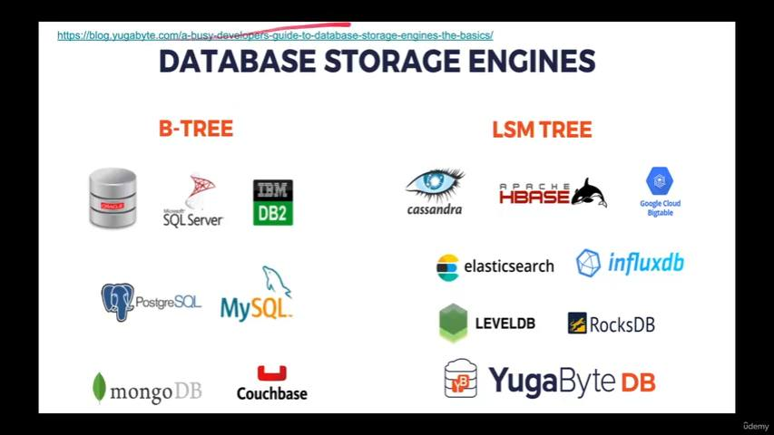
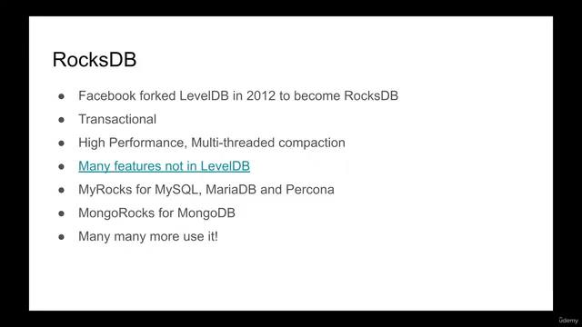
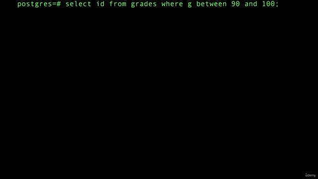
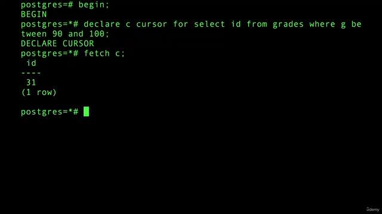
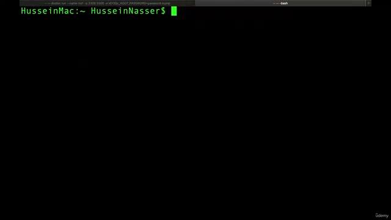
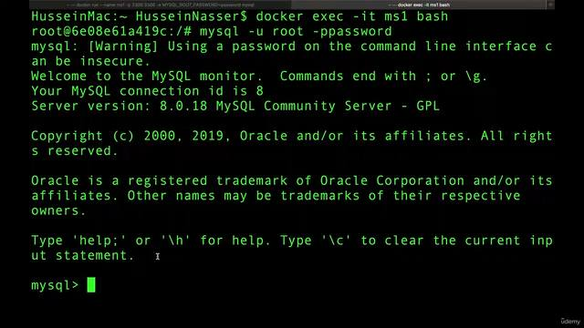
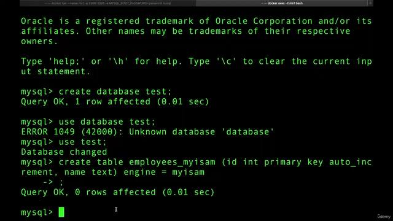

# Fundamentals of Database Engineering P89–P92 复现文档：MySQL 存储引擎事务差异与 PostgreSQL 服务端游标

> 阅读说明：本文档保留原有的引用、图片和代码块；扩写部分只用于解释命令、补充常见错误与排查、做前台演示对照，以及逐条说明检查清单，不改变原实验事实。为避免歧义，下面把讲师视频中的终端操作称为“前台演示”，把本地复现称为“本地操作”。本文所说的“前台对照”，指把本地命令与讲师在视频前台终端里的操作逐项对照，不是指 Web 前端。

## 1. 这一节做什么

这一节覆盖 P89–P92。P89、P90 是背景：讲 RocksDB 从 LevelDB fork 出来后补上了事务、ACID、多线程 compaction 等能力，以及 LSM 与 B-Tree 两类存储引擎分别被哪些数据库使用。P91 是第一个动手实验：用 Docker 启动 MySQL，在同一个数据库里创建两张表，一张 `ENGINE=MyISAM`，一张 `ENGINE=InnoDB`，然后用 Node.js 连接 MySQL，观察“未提交的插入”在另一个连接里是否可见，从而证明 MyISAM 不支持事务、InnoDB 支持事务。P92 是第二个实验：在 PostgreSQL 里使用服务端游标，先 `DECLARE` 游标，再通过 `FETCH` 按需取行，理解游标节省客户端内存、可取消、可分页的优点，以及有状态、长事务、不能跨连接共享的代价。

最后你会得到两个可运行目录：`mysql-engine-demo` 和 `postgres-cursor-demo`。第一个目录用 Node.js 自动演示 MyISAM 与 InnoDB 的差异；第二个目录用一条 SQL 脚本演示 PostgreSQL 游标的 `DECLARE / FETCH / CLOSE`。P89、P90 不产出代码，只作为理解“为什么存储引擎层可以替换”的背景。

从复现角度看，这一节的重点不是背概念，而是把“存储引擎是否支持事务”和“游标是否依赖事务状态”变成可以观察、可以重复的实验。P91 的核心观察点是：同一个数据库里，不同表可以指定不同存储引擎；MyISAM 表上的插入会立即对其他连接可见，rollback 不会撤销；InnoDB 表上的未提交插入对其他连接不可见，提交后才可见。P92 的核心观察点是：游标在事务中声明，按 `FETCH` 逐步取行，取完后 `CLOSE`，最后 `COMMIT`；游标节省客户端内存，但它是有状态的，并且与当前事务/连接绑定。

## 2. 讲师原话（带「—— pNNN [MM:SS]」）

讲师在 P89 先交代 RocksDB 的来历：

> “They forked it and called it RocksDB.” —— p089 [00:29]

这里说的是 RocksDB 从 LevelDB fork 出来。讲师接着强调它补上了事务能力：

> “They support transactions. So now they are transactional, fully acid.” —— p089 [00:58]

P90 讲师展示了一张存储引擎分类图，把数据库按 LSM 和 B-Tree 分开：

> “This is the LSM Log Structure Merch Tree. This is the database that uses B-Trees...” —— p090 [00:00]



P91 进入实操，讲师先说要起 MySQL 容器，并在同一个库里建两张不同引擎的表：

> “We're going to spin up MySQL.com container... create a table with MyISen... another table with NODB.” —— p091 [00:00]




真正验证 MyISAM 时，讲师给了一个非常明确的结论：

> “MyISAM does not support transactions. Period.” —— p091 [12:46]

而 InnoDB 在提交后，另一个客户端才能看到：

> “the moment I commit I go back look at that it's right there” —— p091 [15:41]

P92 转到游标。讲师先给出约束：

> “Cursors have to be to work within a transaction.” —— p092 [02:35]

然后讲游标最大的好处：

> “The beauty of Cursor is you save on memory in the client side.” —— p092 [04:32]

以及最大的代价：

> “The bad about this is essentially it's stateful.” —— p092 [07:10]






这些引用和截图对应的不是“额外结论”，而是复现时的观察依据：P89、P90 解释为什么存储引擎可以替换、为什么会有 LSM 与 B-Tree 的差异；P91 用 MyISAM 与 InnoDB 的对照把“事务是否生效”直接展示出来；P92 用 PostgreSQL 游标把“服务端保存读取位置”这件事展示出来。下面的本地操作，就是把这些前台演示改写成可重复执行的命令和脚本。

## 3. 从零复现

### 3.1 环境与目录

你需要：

- Docker，能成功执行 `docker run hello-world`。讲师在 P91 明确说，只要 Docker 能跑，这个教程就能做。
- Node.js 18 或更高版本。
- 两个目录：

```text
mysql-engine-demo/
├─ package.json
├─ .env
├─ index.js
└─ schema.sql

postgres-cursor-demo/
└─ cursor_demo.sql
```

课里没有讲 `.env` 和具体 npm 包版本，下面是为了“照着做能跑”补的；MySQL 镜像课里说默认 latest，并说如果失效可以固定 `mysql:8`，所以这里固定 `mysql:8`。

**命令完整解释：`docker run hello-world`。** 这条命令不是实验主体，而是环境自检。`docker run` 表示让 Docker 拉取并运行一个镜像；`hello-world` 是 Docker 官方提供的最小验证镜像。它成功时通常会打印一段说明文字，表示 Docker 客户端能连上 Docker daemon，镜像能拉取或本地已存在，容器能启动并退出。如果这条命令失败，后面的 MySQL 和 PostgreSQL 容器都不必继续排查，应先处理 Docker 本身。

**常见错误与排查：Docker 不可用。** 如果提示 `Cannot connect to the Docker daemon`，说明 Docker Desktop 或 Docker 服务没有启动；如果提示权限不足，在 Linux 上可能需要把当前用户加入 `docker` 组或使用 `sudo`；如果提示拉取镜像失败，需要检查网络或镜像源。这里不改变实验事实，只是把“Docker 能跑”作为前置条件。

**前台对照：** 讲师在 P91 说只要 Docker 能跑就能做，本地第一步用 `docker run hello-world` 做同样的前置确认。确认通过后，再启动 MySQL 容器。

### 3.2 实验 A：启动 MySQL 并建两张不同引擎的表

先启动容器。容器名用讲师在 P91 里说的 `ms1`，端口映射 3306，root 密码设为 `password`：

```bash
docker run --name ms1 \
  -p 3306:3306 \
  -e MYSQL_ROOT_PASSWORD=password \
  -d mysql:8
```

**命令完整解释：** `docker run` 创建并启动一个新容器；`--name ms1` 给容器命名为 `ms1`，后续 `docker exec`、`docker stop`、`docker rm` 都可以用这个名字定位容器；`-p 3306:3306` 把宿主机端口 3306 映射到容器内 MySQL 默认监听的 3306 端口，格式是“宿主机端口:容器端口”；`-e MYSQL_ROOT_PASSWORD=password` 向 MySQL 官方镜像传入 root 用户密码环境变量，MySQL 首次初始化时会用这个密码创建 root 账号；`-d` 表示后台运行并返回容器 ID；`mysql:8` 是镜像名和标签，这里固定 MySQL 8，避免 `latest` 未来变化导致复现不一致。

**常见错误与排查：端口占用。** 如果本机已经有 MySQL 占用 3306，`docker run` 会报端口绑定失败。此时可以把 `-p 3306:3306` 改成 `-p 3307:3306`，表示宿主机 3307 映射到容器 3306；同时要把 `.env` 里的 `MYSQL_PORT` 改成 `3307`。**容器名已存在。** 如果之前已经创建过 `ms1`，再次执行同名 `--name ms1` 会报名字冲突，可以先 `docker rm -f ms1` 删除旧容器再启动。**密码变量拼写。** `MYSQL_ROOT_PASSWORD` 是 MySQL 官方镜像使用的变量名，拼错会导致初始化行为不符合预期。**镜像拉取慢。** 首次运行需要拉取 `mysql:8`，等待时间取决于网络。

等容器初始化完成。可以用 `docker ps` 看状态，也可以执行：

```bash
docker exec -it ms1 mysqladmin -uroot -ppassword ping
```

**命令完整解释：** `docker exec` 在已经运行的容器里执行命令；`-it` 表示分配交互式终端并保持标准输入打开，适合手动进入容器或执行交互命令；`ms1` 是容器名；`mysqladmin` 是 MySQL 自带的运维客户端；`-uroot` 表示用户名为 `root`，`-u` 和用户名之间可以没有空格；`-ppassword` 表示密码为 `password`，注意 `-p` 和密码之间不能有空格；`ping` 是 `mysqladmin` 的子命令，用来检查 MySQL 服务是否可连接。成功时通常返回 `mysqld is alive` 一类信息。

**常见错误与排查：MySQL 还没初始化完。** 容器刚启动时 MySQL 可能还在初始化，`ping` 可能短暂失败，可以等待几秒再试；如果一直失败，用 `docker logs ms1` 查看初始化日志。**密码写法错误。** 如果写成 `-p password`，`mysqladmin` 会把 `password` 当成数据库名或其他参数，导致认证失败或用法错误；讲师在 P91 专门强调 `-ppassword` 可以，`-p password` 不行。**容器没运行。** 如果 `docker ps` 看不到 `ms1`，用 `docker ps -a` 查看是否已退出，再结合日志排查。

进入 `mysql-engine-demo` 目录，把第 4 段的 `schema.sql` 保存好，然后执行：

```bash
docker exec -i ms1 mysql -uroot -ppassword < schema.sql
```

**命令完整解释：** 这里的 `docker exec -i` 表示把标准输入交给容器内命令，但不分配伪终端，适合用重定向把本地文件喂给容器里的 `mysql` 客户端；`ms1` 是容器名；`mysql -uroot -ppassword` 是容器内 MySQL 客户端，使用 root 和密码登录；`< schema.sql` 是 shell 的输入重定向，把本地当前目录下 `schema.sql` 的内容作为标准输入传给 `mysql` 客户端执行。它等价于“进入容器后打开 MySQL 客户端，再逐条执行 `schema.sql` 里的语句”。

注意 `-p` 和密码之间不能有空格。讲师在 P91 专门强调：`-ppassword` 可以，`-p password` 不行。



你也可以像讲师一样进入容器：

```bash
docker exec -it ms1 bash
mysql -uroot -ppassword
```

**命令完整解释：** 第一条命令进入 `ms1` 容器的 bash shell；第二条命令在容器内启动 MySQL 客户端。进入客户端后，可以手动执行 `schema.sql` 里的 SQL。与上一种重定向方式相比，这种方式更适合观察每一步输出，也更容易在交互式客户端里执行 `SHOW ENGINES;` 等命令。

**常见错误与排查：找不到 `schema.sql`。** 重定向 `< schema.sql` 使用的是当前 shell 工作目录，如果不在 `mysql-engine-demo` 目录下，会提示找不到文件。**容器内没有 bash。** 某些精简镜像可能没有 bash，可以尝试 `sh`，但本文使用的 `mysql:8` 通常可以按上述方式操作。**SQL 执行中断。** 如果 `schema.sql` 中某条语句报错，`mysql` 客户端会输出错误位置，先根据错误信息检查数据库、表名、引擎名和权限。

然后在 MySQL 客户端里执行 `schema.sql` 里的语句。建表完成后，执行：

```sql
SHOW ENGINES;
```

它会列出当前 MySQL 支持的存储引擎。讲师用这个命令说明 MySQL 的存储引擎是插件式的，可以在表级别选择。输出列名请以你实际版本为准；你只要确认能看到 `MyISAM`、`InnoDB` 等引擎名即可。

**命令完整解释：** `SHOW ENGINES;` 是 MySQL 管理命令，用来列出当前服务器编译或加载的存储引擎，以及每个引擎是否可用。输出中常见列包括引擎名称、支持级别、是否支持事务、是否支持保存点等，但不同版本列名和显示可能略有差异。这里不要求背输出格式，只要求确认 `MyISAM` 和 `InnoDB` 出现在列表中，从而说明后续建表时可以使用这两个引擎。

**常见错误与排查：看不到某个引擎。** 如果输出里没有 `MyISAM` 或 `InnoDB`，先确认连接的是不是刚启动的 `ms1` 容器，而不是本机另一个 MySQL；再确认镜像版本。**输出列名不同。** 不同 MySQL 版本输出列名可能不同，这是正常现象，不影响实验结论。





**前台对照：** 讲师在 P91 前台演示中进入 MySQL 容器，打开 MySQL 客户端，然后创建数据库和两张不同引擎的表，并用 `SHOW ENGINES;` 查看引擎列表。本地复现时，可以用 `docker exec -i ... < schema.sql` 一次性执行，也可以像讲师一样进入容器后手动执行。两种方式的事实一致：同一个 `test` 数据库里，`employees_myisam` 使用 MyISAM，`employees_innodb` 使用 InnoDB。

### 3.3 实验 A：安装依赖并运行 Node.js 演示

在 `mysql-engine-demo` 下执行：

```bash
npm install
npm start
```

**命令完整解释：** `npm install` 根据 `package.json` 安装依赖，本实验需要 `dotenv` 和 `mysql2`；`npm start` 执行 `package.json` 中 `scripts.start` 定义的命令，也就是 `node index.js`。运行后，Node.js 会分别创建 writer 和 reader 两个 MySQL 连接，先演示 MyISAM，再演示 InnoDB。

你会看到分两段输出：`[MyISAM]` 和 `[InnoDB]`。预期行为是：

- MyISAM：writer 连接 `beginTransaction()` 后插入 `Hussein-myisam`，还没 commit，另一个 reader 连接就能查到这行。随后 writer 执行 `rollback()`，reader 再查，行仍然在。因为 MyISAM 不支持事务，插入立即生效，rollback 不会撤销。
- InnoDB：writer 连接 `beginTransaction()` 后插入 `Hussein-innodb`，还没 commit，reader 连接查不到；但 writer 自己在同一个事务连接里能查到；writer `commit()` 之后，reader 再查就能看到。

这正好对应讲师在 P91 里用断点和另一个终端查询演示的过程。

**常见错误与排查：`npm install` 失败。** 先检查 Node.js 版本是否满足 `>=18`，再检查网络和 npm 源；如果依赖已安装但版本不对，可以删除 `node_modules` 和 `package-lock.json` 后重装。**`npm start` 报连接失败。** 如果报 `ECONNREFUSED`，通常是 MySQL 容器没启动、端口没映射成功，或 `.env` 中端口与 `docker run` 的宿主机端口不一致；如果报认证失败，检查 `.env` 中 `MYSQL_USER`、`MYSQL_PASSWORD` 是否与容器初始化时一致。**报表不存在。** 说明 `schema.sql` 没有执行成功，或连接到了另一个数据库；先确认 `MYSQL_DATABASE=test`，再重新执行建表脚本。**事务行为不符合预期。** 检查是否错误地使用了连接池并让不同语句跑到不同连接；本实验要求 writer 的 `beginTransaction()`、`INSERT`、`rollback()`/`commit()` 在同一个连接上，reader 使用另一个独立连接。

**前台对照：** 讲师在 P91 前台用断点和另一个终端查询来观察“未提交插入是否可见”。本地用 Node.js 的两个连接模拟同一个过程：writer 连接负责事务和插入，reader 连接负责从另一个客户端观察。MyISAM 段看到“未提交也可见、rollback 后仍在”，InnoDB 段看到“未提交不可见、本事务可见、commit 后可见”，这与前台演示的结论一致。

### 3.4 实验 B：启动 PostgreSQL 并运行游标脚本

课里 P92 只演示了 PostgreSQL 游标 SQL，没有给 Docker 启动命令和建表语句。下面是补的最小可运行版本。启动 PostgreSQL 16：

```bash
docker run --name pg1 \
  -e POSTGRES_PASSWORD=password \
  -p 5432:5432 \
  -d postgres:16
```

**命令完整解释：** `docker run` 创建并启动 PostgreSQL 容器；`--name pg1` 指定容器名；`-e POSTGRES_PASSWORD=password` 设置 PostgreSQL 超级用户 `postgres` 的密码；`-p 5432:5432` 把宿主机 5432 映射到容器内 PostgreSQL 默认端口 5432；`-d postgres:16` 后台运行 PostgreSQL 16 镜像。这里固定 16 是为了复现稳定，不改变 P92 的游标实验事实。

**常见错误与排查：5432 端口被占用。** 如果本机已有 PostgreSQL 占用 5432，可以改成 `-p 5433:5432`，后续连接时使用 5433；但本文的 `docker exec` 方式不依赖宿主机端口，只要容器内服务正常即可。**容器名冲突。** 如果已有 `pg1`，先 `docker rm -f pg1` 再启动。**初始化未完成。** PostgreSQL 首次启动也需要初始化，`psql` 可能短暂连不上，可以等待几秒或查看 `docker logs pg1`。

把第 4 段的 `cursor_demo.sql` 保存到 `postgres-cursor-demo` 目录，执行：

```bash
docker exec -i pg1 psql -U postgres < cursor_demo.sql
```

**命令完整解释：** `docker exec -i pg1` 把标准输入交给 `pg1` 容器；`psql -U postgres` 在容器内以 `postgres` 用户启动 PostgreSQL 客户端；`< cursor_demo.sql` 把本地 SQL 文件内容作为标准输入传给 `psql` 执行。它会依次建表、插入数据、开启事务、声明游标、分批 `FETCH`、关闭游标并提交。

在 Windows PowerShell 里如果 `<` 不生效，可以用：

```powershell
Get-Content .\cursor_demo.sql | docker exec -i pg1 psql -U postgres
```

**命令完整解释：** `Get-Content .\cursor_demo.sql` 读取当前目录下 SQL 文件内容；管道 `|` 把内容传给 `docker exec -i pg1 psql -U postgres` 的标准输入。它和 Linux/macOS 下的重定向 `<` 作用相同，都是把脚本喂给容器内的 `psql`。

**常见错误与排查：PowerShell 重定向报错。** Windows PowerShell 对 `<` 的支持与 bash 不同，使用上面的管道写法即可。**`psql` 报数据库不存在。** 本文脚本没有显式创建数据库，默认连接 `postgres` 数据库；如果使用其他连接参数，需要确认数据库存在。**游标相关报错。** 如果提示游标不存在，检查 `DECLARE`、`FETCH`、`CLOSE` 是否在同一个事务和同一个 `psql` 会话中执行；脚本是一次性执行的，正常情况下不会跨会话。**脚本重复执行。** 脚本开头有 `DROP TABLE IF EXISTS grades;`，可以重复建表，但会清空旧表。

脚本会建一张小表 `grades`，插入 6 行，然后在一个事务里 `DECLARE c CURSOR FOR SELECT ...`，再用 `FETCH 2`、`FETCH 2`、`FETCH LAST` 分批取行。你会看到游标先取两行，再取两行，最后取最后一行。执行 `CLOSE c; COMMIT;` 结束。

**前台对照：** 讲师在 P92 前台演示的是在 PostgreSQL 里先 `DECLARE` 游标，再 `FETCH` 取行，最后关闭并提交。本地脚本把这些步骤写进一个 SQL 文件，通过 `psql` 一次性执行。观察点相同：游标在事务中声明，`FETCH` 按需取行，`CLOSE` 释放游标，`COMMIT` 结束事务。

## 4. 完整代码

### 4.1 `mysql-engine-demo/package.json`

```json
{
  "name": "mysql-engine-demo",
  "version": "1.0.0",
  "private": true,
  "description": "P91 MyISAM vs InnoDB transaction demo",
  "main": "index.js",
  "scripts": {
    "start": "node index.js"
  },
  "dependencies": {
    "dotenv": "16.4.5",
    "mysql2": "3.11.0"
  },
  "engines": {
    "node": ">=18"
  }
}
```

### 4.2 `mysql-engine-demo/.env`

```dotenv
MYSQL_HOST=127.0.0.1
MYSQL_PORT=3306
MYSQL_USER=root
MYSQL_PASSWORD=password
MYSQL_DATABASE=test
```

### 4.3 `mysql-engine-demo/schema.sql`

```sql
CREATE DATABASE IF NOT EXISTS test;
USE test;

DROP TABLE IF EXISTS employees_myisam;
CREATE TABLE employees_myisam (
  id INT NOT NULL AUTO_INCREMENT,
  name TEXT,
  PRIMARY KEY (id)
) ENGINE=MyISAM;

DROP TABLE IF EXISTS employees_innodb;
CREATE TABLE employees_innodb (
  id INT NOT NULL AUTO_INCREMENT,
  name TEXT,
  PRIMARY KEY (id)
) ENGINE=InnoDB;

SHOW ENGINES;
```

### 4.4 `mysql-engine-demo/index.js`

```js
require('dotenv').config();
const mysql = require('mysql2/promise');

const baseConfig = {
  host: process.env.MYSQL_HOST || '127.0.0.1',
  port: Number(process.env.MYSQL_PORT || 3306),
  user: process.env.MYSQL_USER || 'root',
  password: process.env.MYSQL_PASSWORD || 'password',
  database: process.env.MYSQL_DATABASE || 'test',
};

async function createConnection() {
  return mysql.createConnection(baseConfig);
}

async function demoMyISAM() {
  const writer = await createConnection();
  const reader = await createConnection();

  try {
    await writer.query('TRUNCATE TABLE employees_myisam');

    await writer.beginTransaction();
    await writer.query(
      'INSERT INTO employees_myisam (name) VALUES (?)',
      ['Hussein-myisam']
    );

    const [beforeRollback] = await reader.query(
      'SELECT id, name FROM employees_myisam ORDER BY id'
    );
    console.log('[MyISAM] 未 commit 时，另一个连接看到：', beforeRollback);

    await writer.rollback();

    const [afterRollback] = await reader.query(
      'SELECT id, name FROM employees_myisam ORDER BY id'
    );
    console.log('[MyISAM] rollback 后，另一个连接看到：', afterRollback);
  } finally {
    await writer.end();
    await reader.end();
  }
}

async function demoInnoDB() {
  const writer = await createConnection();
  const reader = await createConnection();

  try {
    await writer.query('TRUNCATE TABLE employees_innodb');

    await writer.beginTransaction();
    await writer.query(
      'INSERT INTO employees_innodb (name) VALUES (?)',
      ['Hussein-innodb']
    );

    const [readerBeforeCommit] = await reader.query(
      'SELECT id, name FROM employees_innodb ORDER BY id'
    );
    console.log('[InnoDB] 未 commit 时，另一个连接看到：', readerBeforeCommit);

    const [writerInTransaction] = await writer.query(
      'SELECT id, name FROM employees_innodb ORDER BY id'
    );
    console.log('[InnoDB] 未 commit 时，本事务连接看到：', writerInTransaction);

    await writer.commit();

    const [readerAfterCommit] = await reader.query(
      'SELECT id, name FROM employees_innodb ORDER BY id'
    );
    console.log('[InnoDB] commit 后，另一个连接看到：', readerAfterCommit);
  } catch (err) {
    await writer.rollback();
    throw err;
  } finally {
    await writer.end();
    await reader.end();
  }
}

(async () => {
  await demoMyISAM();
  await demoInnoDB();
})().catch((err) => {
  console.error(err);
  process.exitCode = 1;
});
```

### 4.5 `postgres-cursor-demo/cursor_demo.sql`

```sql
DROP TABLE IF EXISTS grades;

CREATE TABLE grades (
  student_id INT PRIMARY KEY,
  grade INT NOT NULL
);

INSERT INTO grades (student_id, grade) VALUES
  (1, 95),
  (2, 88),
  (3, 91),
  (4, 99),
  (5, 75),
  (6, 93);

BEGIN;

DECLARE c CURSOR FOR
  SELECT student_id, grade
  FROM grades
  WHERE grade BETWEEN 90 AND 100
  ORDER BY student_id;

FETCH 2 FROM c;
FETCH 2 FROM c;
FETCH LAST FROM c;

CLOSE c;
COMMIT;
```

## 5. 逐行解释

### 5.1 Docker 与 MySQL 部分

`docker run --name ms1` 给容器起名，后面 `docker exec` 要用这个名字。`-p 3306:3306` 把容器内 MySQL 默认端口 3306 映射到宿主机 3306；Node.js 连 `127.0.0.1:3306` 就连到这个容器。`-e MYSQL_ROOT_PASSWORD=password` 是 MySQL 官方镜像要求的 root 密码环境变量。`-d mysql:8` 让容器后台运行，并固定 MySQL 8 版本。讲师说默认 latest，但如果未来 latest 不兼容，固定 `mysql:8` 更稳。

`docker exec -it ms1 mysqladmin -uroot -ppassword ping` 用来检查容器内 MySQL 是否已经可连接。`-it` 适合交互式观察，`mysqladmin ping` 只做连通性检查，不修改数据。`docker exec -i ms1 mysql -uroot -ppassword < schema.sql` 则是把本地 SQL 文件通过标准输入交给容器内 MySQL 客户端执行。`-i` 保留标准输入，`<` 是 shell 重定向；这两者配合，才能让容器里的 `mysql` 读到本地文件内容。

`schema.sql` 里 `CREATE DATABASE IF NOT EXISTS test; USE test;` 创建并切换到 `test` 库。两张表字段完全一样：`id INT NOT NULL AUTO_INCREMENT` 自增主键，`name TEXT` 名字。唯一区别是 `ENGINE=MyISAM` 和 `ENGINE=InnoDB`。这就是讲师说的“同一个数据库里，两张表可以用不同存储引擎”。`SHOW ENGINES;` 让 MySQL 列出支持的引擎，用来确认 MyISAM 和 InnoDB 都在。

**常见错误与排查：** 如果 `CREATE DATABASE` 报权限错误，确认使用的是 root 或具备建库权限的账号；如果 `DROP TABLE IF EXISTS` 后建表失败，检查表名是否与 Node.js 中一致；如果 `ENGINE=MyISAM` 报错，说明当前 MySQL 不支持该引擎或拼写错误，先用 `SHOW ENGINES;` 确认。**前台对照：** 讲师在 P91 前台进入 MySQL 客户端后建库建表，本地用 `schema.sql` 做同样的事；`SHOW ENGINES;` 的输出用于确认引擎可用，和前台演示的观察点一致。

### 5.2 Node.js 事务演示部分

`require('dotenv').config();` 读取 `.env`。`mysql2/promise` 是 MySQL 的 Promise 客户端；讲师在 P91 说的是“MySQL Promise library”，没有点名 npm 包，这里用常见的 `mysql2/promise` 补全。`baseConfig` 里 host、port、user、password、database 都来自环境变量，默认值与讲师演示一致：`127.0.0.1`、`3306`、`root`、`password`、`test`。

`createConnection()` 每次创建一个独立连接。事务是连接级别的状态，所以演示里必须让 writer 和 reader 用两个不同连接，才能模拟“另一个客户端”。在 JS/Node 里要记住：不要以为 `await` 之间事务会自动跟着你走；`beginTransaction()`、`INSERT`、`commit()` 必须发生在同一个 connection 上。如果你用连接池，`pool.query()` 可能换连接，事务就会失效，必须 `pool.getConnection()` 拿到同一个连接。

`demoMyISAM()` 先 `TRUNCATE TABLE employees_myisam` 清空表，再 `beginTransaction()`，然后插入 `Hussein-myisam`。接着 reader 连接查询，能看到这行。为什么？因为 MyISAM 不支持事务，`beginTransaction()` 对它没有实际事务效果，INSERT 立即对所有连接可见。然后 writer 执行 `rollback()`，reader 再查，行仍然在。讲师在 P91 的原话是 “MyISAM does not support transactions. Period.”，并且说没有 rollback，插入了就是插入了，不想要只能再 delete。

`demoInnoDB()` 同样先清空，再 `beginTransaction()`，插入 `Hussein-innodb`。reader 连接此时查不到，因为 InnoDB 支持事务，未提交的修改对其他连接不可见。writer 自己在同一个事务连接里查询，能看到自己的未提交行，这对应讲师说的“within my transaction I can see my own rows”。最后 `writer.commit()`，reader 再查就能看到。这里涉及隔离级别：InnoDB 默认隔离级别下，其他连接看不到未提交数据；课里没有展开所有隔离级别，只演示了这个核心现象。在 Node.js 里，事务代码要放在 `try/catch` 里，出错时 `rollback()`，否则连接可能一直占着事务。

**常见错误与排查：** 如果 MyISAM 段 reader 查不到插入行，先确认表真的是 MyISAM，而不是误建成了 InnoDB；如果 InnoDB 段未提交时 reader 能看到行，检查是否两个查询用了同一个连接，或是否自动提交导致事务边界不对；如果 `rollback()` 报错，检查当前连接是否真的处于事务中。**前台对照：** 讲师在 P91 前台用另一个终端/断点观察未提交插入；本地用 reader 连接模拟另一个客户端，用 writer 连接模拟事务连接。输出中的 `[MyISAM]` 和 `[InnoDB]` 就是对照结果。

### 5.3 PostgreSQL 游标部分

`BEGIN;` 开启事务，因为讲师明确说游标必须在事务里工作。`DECLARE c CURSOR FOR SELECT ...` 创建名为 `c` 的游标。讲师说这一步主要是让数据库准备查询计划，并不会一次性把所有结果拉到客户端。`FETCH 2 FROM c;` 取两行；再 `FETCH 2` 取接下来两行；`FETCH LAST FROM c;` 取最后一行。`FETCH LAST` 有时需要数据库做更多工作，讲师说有时数据库知道怎么高效拿最后一行，有时不知道，这可能涉及索引反向扫描还是正向扫描。`CLOSE c;` 关闭游标，`COMMIT;` 结束事务。

游标的好处是省客户端内存：你不需要把一百万行全部读进 Node 进程，可以一次 `FETCH` 100 行，处理完再取下一批。它也可以取消，适合流式处理。坏处是它有状态：游标绑在数据库的某个连接/事务上，另一个请求、另一个进程、另一个连接不知道你的游标。在 Node.js 里，这就像你在后端进程里维护了一个“读取位置”，但这个位置不能跨请求随便共享；如果你用连接池，下一次请求可能拿到另一个连接，游标就丢了。讲师还说游标会导致长事务，长事务会占锁、阻塞 DDL，连接池也可能被占满。课里没有讲具体连接池实现，但这是实际工程里必须注意的。

**常见错误与排查：** 如果 `DECLARE` 报“游标已存在”，说明同名游标还没关闭，先 `CLOSE c;` 或回滚事务；如果 `FETCH` 报“游标不存在”，检查是否跨事务、跨连接执行；如果结果行数不符合预期，检查 `WHERE grade BETWEEN 90 AND 100` 和 `ORDER BY student_id`，再对照插入的 6 行数据。**前台对照：** 讲师在 P92 前台逐条执行 `DECLARE`、`FETCH`、`CLOSE`、`COMMIT`；本地脚本按同样顺序执行，只是把交互式命令写进文件，观察点不变。

## 6. 复现检查清单

- [ ] `docker run hello-world` 能成功，Docker 可用。
- [ ] `docker ps` 能看到 `ms1` 处于 Up 状态。
- [ ] `docker exec -i ms1 mysql -uroot -ppassword < schema.sql` 执行无报错。
- [ ] `SHOW ENGINES;` 的输出里能看到 `MyISAM` 和 `InnoDB`，字段名以你的实际输出为准。
- [ ] `npm install` 成功，`npm start` 能运行。
- [ ] `[MyISAM]` 输出中，未 commit 时另一个连接已经能看到 `Hussein-myisam`。
- [ ] `[MyISAM]` 输出中，rollback 后这行仍然存在。
- [ ] `[InnoDB]` 输出中，未 commit 时另一个连接看不到 `Hussein-innodb`。
- [ ] `[InnoDB]` 输出中，未 commit 时本事务连接能看到这行。
- [ ] `[InnoDB]` 输出中，commit 后另一个连接能看到这行。
- [ ] `pg1` 容器启动成功，`cursor_demo.sql` 执行无报错。
- [ ] 游标脚本能输出 `FETCH 2`、`FETCH 2`、`FETCH LAST` 的结果，最后 `CLOSE`、`COMMIT` 成功。
- [ ] 实验结束后可以 `docker stop ms1 pg1`，需要重来时可以 `docker rm -f ms1 pg1`。

### 6.1 检查清单逐条说明

1. **`docker run hello-world` 能成功，Docker 可用。** 这条检查的是环境底座。只有 Docker 客户端能连上 daemon、能拉取或运行最小镜像，后面的 MySQL/PostgreSQL 容器才有意义。失败时先看 Docker Desktop 是否启动、当前用户是否有权限、网络是否能拉镜像。
2. **`docker ps` 能看到 `ms1` 处于 Up 状态。** 这条检查的是 MySQL 容器是否真的在运行。`docker ps` 只显示运行中的容器；如果看不到，用 `docker ps -a` 看是否退出，再用 `docker logs ms1` 看初始化日志。容器名必须是 `ms1`，否则后续 `docker exec` 会找不到。
3. **`docker exec -i ms1 mysql -uroot -ppassword < schema.sql` 执行无报错。** 这条检查的是建库建表脚本是否成功执行。重点看两点：当前目录是否有 `schema.sql`，以及 `-ppassword` 是否没有空格。若报错，先根据错误信息定位是权限、语法还是连接问题。
4. **`SHOW ENGINES;` 的输出里能看到 `MyISAM` 和 `InnoDB`，字段名以你的实际输出为准。** 这条检查的是当前 MySQL 是否支持实验所需的两个引擎。不同版本输出列名可能不同，不必强求列名一致，只要引擎名出现即可。若看不到，确认连接的是 `ms1` 而不是本机其他 MySQL。
5. **`npm install` 成功，`npm start` 能运行。** 这条检查的是 Node.js 依赖和入口脚本。`npm install` 失败通常是 Node 版本、网络或依赖版本问题；`npm start` 失败通常是连接配置、表不存在或 MySQL 未就绪。先看报错类型，再回到 `.env` 和 `schema.sql` 对照。
6. **`[MyISAM]` 输出中，未 commit 时另一个连接已经能看到 `Hussein-myisam`。** 这条是 MyISAM 不支持事务的直接证据。reader 是另一个连接，它能看到 writer 未提交的插入，说明 MyISAM 没有把插入隔离在事务里。若看不到，检查表引擎是否真是 MyISAM。
7. **`[MyISAM]` 输出中，rollback 后这行仍然存在。** 这条进一步证明 MyISAM 的 `rollback()` 不会撤销插入。因为 MyISAM 不支持事务，插入立即生效，rollback 没有事务语义可回滚。若 rollback 后行消失，说明表可能不是 MyISAM，或代码连接/表名不对。
8. **`[InnoDB]` 输出中，未 commit 时另一个连接看不到 `Hussein-innodb`。** 这条是 InnoDB 事务隔离的直接证据。writer 已插入但未提交，reader 作为另一个连接看不到未提交数据。若能看到，检查是否 reader 和 writer 误用了同一个连接，或是否自动提交导致插入已提交。
9. **`[InnoDB]` 输出中，未 commit 时本事务连接能看到这行。** 这条对应“事务内可以看到自己的未提交修改”。writer 在同一个事务连接里查询，应该能看到自己刚插入的行。若看不到，检查插入和查询是否在同一个连接、同一个事务中。
10. **`[InnoDB]` 输出中，commit 后另一个连接能看到这行。** 这条证明提交后其他连接才可见。writer 执行 `commit()` 后，reader 再查就能看到 `Hussein-innodb`。若 commit 后仍看不到，检查是否 commit 失败、连接是否断开、查询是否连到其他数据库。
11. **`pg1` 容器启动成功，`cursor_demo.sql` 执行无报错。** 这条检查 PostgreSQL 环境和脚本语法。容器启动成功不等于初始化立刻完成，若 `psql` 短暂连不上可以等待；若脚本报错，先看是建表、插入、游标还是事务语句出错。
12. **游标脚本能输出 `FETCH 2`、`FETCH 2`、`FETCH LAST` 的结果，最后 `CLOSE`、`COMMIT` 成功。** 这条检查游标生命周期是否完整。`DECLARE` 后按 `FETCH` 取行，`CLOSE` 释放游标，`COMMIT` 结束事务。若中途报游标不存在，检查是否跨会话执行；若结果行数不对，检查 `WHERE` 条件和插入数据。
13. **实验结束后可以 `docker stop ms1 pg1`，需要重来时可以 `docker rm -f ms1 pg1`。** 这条检查清理流程。`docker stop` 停止运行中的容器但保留容器；`docker rm -f` 强制删除容器，适合需要重新用同名容器启动时使用。若端口仍被占用，先确认旧容器是否已删除。

## 7. 课里没讲但你会撞上的

1. **3306 端口被本机 MySQL 占用**：如果 `docker run` 报端口冲突，把 `-p 3306:3306` 改成 `-p 3307:3306`，同时把 `.env` 里的 `MYSQL_PORT` 改成 `3307`。课里没讲端口冲突处理。
2. **容器名已存在**：再次执行 `docker run --name ms1` 会报名字冲突。先 `docker rm -f ms1`，再重新起。
3. **`-p` 和密码之间有空格**：`mysql -uroot -ppassword` 可以，`mysql -uroot -p password` 会被客户端当成不同参数，容易认证失败或进入错误交互。这个点在 P91 前台也专门强调过。
4. **MySQL 容器刚启动还没准备好**：`docker ps` 显示 Up 不代表 MySQL 已经完成初始化。此时执行 `schema.sql` 可能连接失败，等待几秒或用 `mysqladmin ping` 检查即可。
5. **Node.js 连接到了错误的 MySQL**：如果本机也装了 MySQL，`127.0.0.1:3306` 可能连到本机服务而不是容器。用 `docker ps` 确认端口映射，必要时改宿主机端口并在 `.env` 中同步修改。
6. **事务代码用了连接池但没有固定连接**：`pool.query()` 可能从池里换连接，导致 `beginTransaction()`、`INSERT`、`commit()` 不在同一个连接上。复现本实验时，最稳妥的是像示例代码一样显式创建 writer 和 reader 两个连接。
7. **PostgreSQL 的 5432 端口被占用**：如果本机已有 PostgreSQL，启动 `pg1` 时可能端口冲突。可以改宿主机端口，或直接用 `docker exec` 在容器内执行 `psql`，避免依赖宿主机端口。
8. **PowerShell 下 `<` 不生效**：Windows PowerShell 对输入重定向的支持与 bash 不同，使用 `Get-Content .\cursor_demo.sql | docker exec -i pg1 psql -U postgres` 更稳。
9. **游标跨连接/跨事务丢失**：游标是有状态的，绑定在当前事务和连接上。不要在一个连接里 `DECLARE`，再到另一个连接里 `FETCH`；也不要在事务结束后继续 `FETCH`。
10. **长事务占资源**：游标配合长事务会延长事务生命周期，可能占锁、阻塞 DDL、占用连接池。实验里数据很少，问题不明显；实际工程中要控制事务范围和游标使用时间。

**清理命令解释：** `docker stop ms1 pg1` 会停止两个容器但保留容器文件，适合暂时结束实验；`docker rm -f ms1 pg1` 会强制删除容器，适合需要重新用同名容器启动或彻底清理实验环境。执行删除前确认没有需要保留的数据；本实验的数据都在容器内，删除容器后需要重新执行建表和插入脚本。