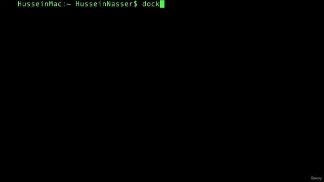
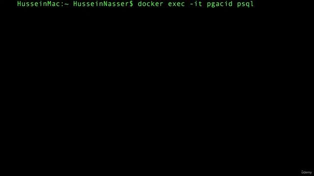
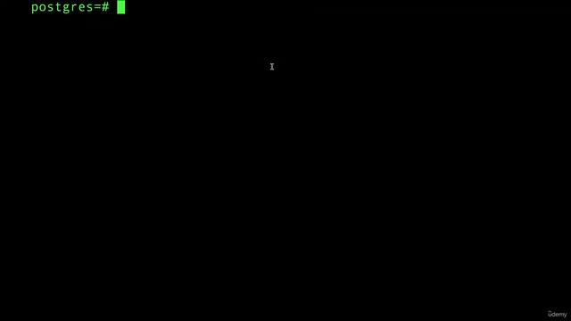
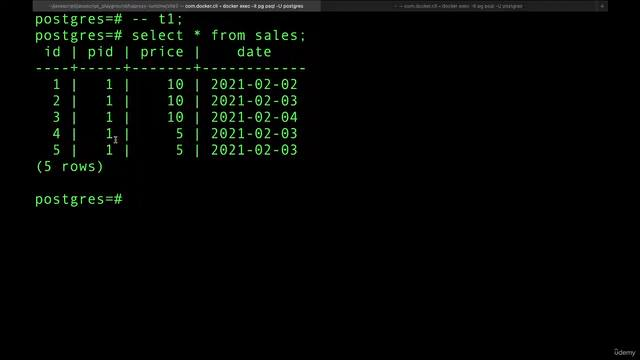
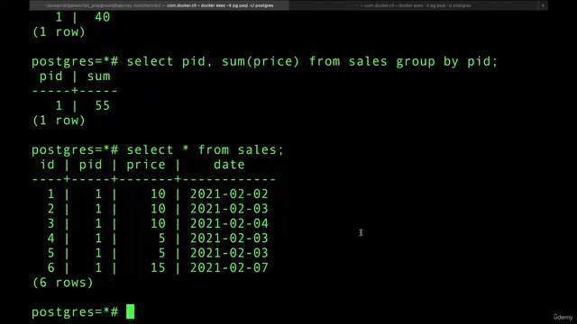
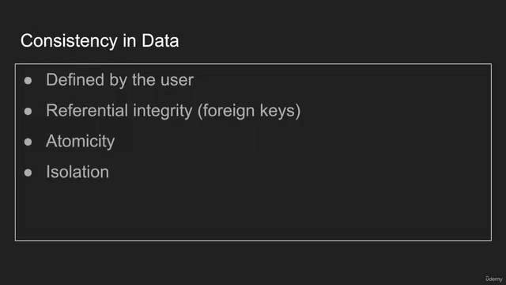
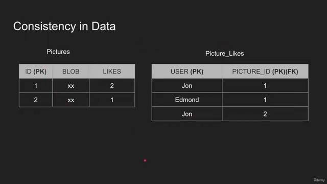
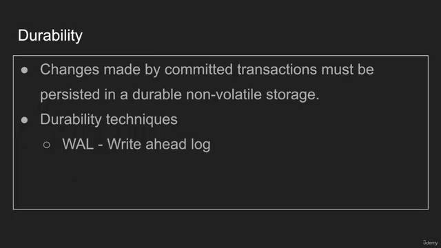
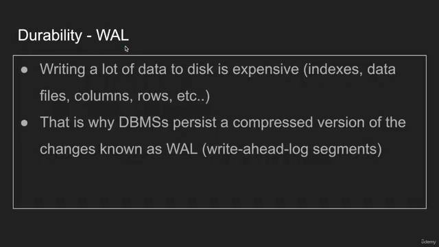

# Fundamentals of Database Engineering：P009–P012 一致性与持久性 + Postgres ACID 实操

## 1. 这一节做什么

P009–P012 是 ACID 四讲里 C（Consistency）和 D（Durability）的收尾，外加两节实操课。具体拆开看：

- **P009** 把「一致性」拆成两种完全不同的东西：**数据本身的一致性**（referential integrity，引用完整性）和**读一致性**（replica lag，副本延迟）。讲师用 Instagram 的 pictures / likes 两张表举例，说明「点赞数对不上」和「点赞记录指向一张已经不存在的图」分别属于哪种不一致。
- **P010** 讲「持久性」：WAL（Write-Ahead Log）、异步快照、Redis 的 AOF，以及最关键的 **OS cache 陷阱**——操作系统会先写内存缓存再告诉你「写成功了」，这时候断电就丢数据，所以数据库要用 `fsync` 绕过 OS cache。
- **P011** 用 Docker + Postgres 13 把 A、C、I、D 四个属性全部跑一遍：建 products / sales 两张表，用 `BEGIN` / `COMMIT` / 模拟崩溃 / 双会话并发，把原子性、一致性、隔离性、持久性逐个演示。
- **P012** 单独讲**幻读**（phantom read）：你在一个事务里做报表，另一个事务插了一行，你第二次查询就多出一行「幽灵」。然后演示 `serializable` 隔离级别怎么防住它，以及 Postgres 在 `repeatable read` 下就能防幻读这个特例。

学完这一节，你手上会有一个能跑起来的 Postgres 容器、两张表、以及四组可复现的实验。**这一节是纯实操课，所有命令都能直接复制粘贴。**

进一步说，这一节的学习目标不是背 ACID 四个单词，而是把抽象概念落到可观察的现象上：原子性看的是「事务未提交就退出，修改是否消失」；一致性看的是「库存扣减和销售记录是否互相对得上」；隔离性看的是「两个会话并发时，一个会话能否看到另一个会话未提交或已提交的修改」；持久性看的是「事务返回 commit 成功后，容器重启数据是否还在」。同时，P009 和 P010 提供了理论背景：数据一致性要靠数据库约束、外键、事务来维护，读一致性则更多和副本、快照、隔离级别有关；持久性则要理解 WAL、日志落盘、`fsync` 和 OS cache 的关系。后面的 P011 和 P012 是把这些概念放进 Postgres 里实际跑一遍，所以阅读时不要只看结论，要按命令顺序自己敲一遍，观察每一步的输出变化。

这一节的前置要求很低：会开终端、会执行 Docker 命令、知道 `select` / `insert` / `update` 的基本含义即可。但如果你平时写前端或 Node 服务，建议在复现时主动对照「浏览器请求 → 后端 API → 数据库连接池 → 事务」这条链路，因为 ACID 不是数据库自己的事，应用层如果事务边界写错、连接池复用了错误连接、接口在 commit 前就返回成功，同样会制造不一致和不持久的问题。

---

## 2. 讲师原话（带时间戳）

> "一致性到底是什么？其实要理解，一致性有两个层面：一种是我所说的数据本身的一致性……另一种是一致性，我称之为读一致性。"
> —— p009 [00:28]

> "大多数时候，是在数据库中强制实施引用完整性和外键约束。"
> —— p009 [02:21]

> "如果我们在从一个账户扣款时发生崩溃，然后重启数据库，而这个账户仍然处于已扣款状态，对吧，我们就凭空少了 100 美元。这就是数据不一致。"
> —— p009 [03:17]

> "最终一致性其实只针对读操作。因为如果你持续发起读请求，可能会读到旧值，但最终会读到正确的值。"
> —— p009 [10:25]

> "简而言之，持久性就是把客户端对数据库所做的写入持久化到非易失性存储系统中的过程。"
> —— p010 [00:00]

> "数据库系统里有一个非常关键的东西。它是操作系统负责处理的问题之一，叫做操作系统缓存。"
> —— p010 [05:29]

> "这叫做 fsync 命令。fsync 命令就是强制把写入始终落到磁盘上。所以它会很慢。"
> —— p010 [08:22]

> "现在该把它们付诸实践，并在真实的数据库环境中解释这四个特性了。所以我选择 Postgres。"
> —— p011 [00:00]

> "这就是原子性的含义。所有事务都必须作为一个原子来完成，对吧？你不能把它们拆开。"
> —— p011 [07:35]

> "我们会使用可重复读隔离级别。我想这个说法是对的。默认级别是读已提交。"
> —— p011 [16:09]

> "具体来说，幻读就是另一个事务插入了一行新数据，而突然之间，当你在自己的隔离事务中执行查询时，开始看到这一行，尽管你本来不应该看到它。"
> —— p012 [00:27]

> "Postgres 即使在可重复读等其他隔离级别下也能防止幻读。"
> —— p012 [05:37]

这些原话对应到后面的实操时，可以抓住几个关键词：P009 的「two falls」对应数据一致性和读一致性两条线；P010 的「OS cache」「fsync」对应持久性为什么不能只相信操作系统的写成功返回；P011 的「atom」「read committed」「repeatable read」对应事务边界和隔离级别实验；P012 的「phantom read」和「Postgres prevents phantom reads」对应幻读实验以及 Postgres 的特殊行为。读引用时不要只记英文句子，建议在旁边标注它对应的是哪一个实验现象，这样复现时更容易把理论和输出对上。

---

## 3. 从零复现

### 3.1 环境准备

需要的东西只有一样：**Docker**。讲师原话是「I'd like to use Docker because this way I can try out many, many databases with just one command」。不需要本地装 Postgres，不需要装客户端，全部在容器里跑。

```bash
# 确认 Docker 可用
docker --version
# 预期输出类似：Docker version 24.x.x, build xxxxx
```

命令解释：`docker --version` 只检查 Docker CLI 是否安装并能在当前终端里调用，它不会启动容器，也不会检查 Docker daemon 是否正在运行。常见错误是命令不存在，说明 Docker 没装或 PATH 没配；如果命令存在但后面 `docker run` 报「Cannot connect to the Docker daemon」，说明 Docker Desktop 或 Docker 服务没启动，需要先启动 Docker。前端对照：如果你平时只开浏览器和 Node dev server，可能没意识到数据库是独立进程；这里所有数据库操作都发生在容器内，你的前端代码无法直接访问它，除非额外暴露端口。当前实验故意不暴露端口，所以不要尝试从宿主机 `localhost:5432` 连接。

### 3.2 启动 Postgres 容器

讲师用的镜像是 `postgres:13`，容器名叫 `acid`，密码通过 `-e POSTGRES_PASSWORD` 传进去：

```bash
docker run --name acid -e POSTGRES_PASSWORD=postgres -d postgres:13
```



**注意**：讲师特意说「We don't really need to expose the port or anything because we're going to really go into the container itself, bash into the container.」——所以**没有 `-p 5432:5432`**，后面所有操作都是 `docker exec` 进容器里做的。

命令解释：`docker run` 会创建并启动一个新容器；`--name acid` 给容器起固定名字，后面 `docker exec` 和 `docker stop` 都靠这个名字定位；`-e POSTGRES_PASSWORD=postgres` 设置环境变量，Postgres 官方镜像要求必须提供初始化密码，否则容器可能启动后退出；`-d` 表示后台运行，不占用当前终端；`postgres:13` 指定镜像和标签。常见错误有两个：一是容器名冲突，第二次执行会提示名字已被占用，需要先 `docker rm -f acid`；二是镜像拉取慢或失败，可以先单独执行 `docker pull postgres:13` 观察网络。前端对照：这一步相当于启动后端依赖的数据库服务，但因为没有 `-p`，它只存在于 Docker 网络内部，宿主机上的 Node 服务此时不能通过端口直连；如果要做前后端联调，需要改成带端口映射的启动方式，但本实验不需要。

启动后确认容器在跑：

```bash
docker ps
```

讲师原话：「They always make sure that it's running because you might have spilled something in the command or did something. If it's not running, something is wrong.」

验证时重点看 `STATUS` 是否为 `Up`，`NAMES` 是否为 `acid`。如果 `docker ps` 看不到容器，用 `docker ps -a` 查看它是否处于 `Exited` 状态，再用 `docker logs acid` 看启动日志。常见原因是密码环境变量没传、镜像没拉全、端口或卷配置冲突。前端排查也可以借用这个思路：接口报错时先确认依赖服务是否真的在跑，而不是只看启动命令有没有返回。

### 3.3 进入 psql

```bash
docker exec -it acid psql -U postgres
```

`-it` 是交互式终端，`psql` 是 Postgres 的客户端命令，`-U postgres` 指定用 postgres 用户登录。进去之后你会看到 `postgres=#` 的提示符。

命令解释：`docker exec` 是在已经运行的容器里执行命令；`-i` 保持标准输入打开，`-t` 分配伪终端，两者合起来才能交互式输入 SQL；`psql` 是容器里自带的客户端；`-U postgres` 指定数据库用户。这里没有 `-d`，所以默认连接名为 `postgres` 的数据库。常见错误：如果提示 `psql: error: connection to server on socket ... failed`，通常是容器没跑或 Postgres 还没初始化完，可以等几秒再试；如果提示角色不存在，说明 `-U` 写错。退出方式用 `\q`，不要和 shell 的 `exit` 混淆。前端对照：这类似用数据库客户端连接开发库，只是连接发生在容器内部；真实项目里连接信息会放在后端环境变量里，不会暴露给浏览器。

### 3.4 建表

讲师在 `postgres` 这个默认数据库里直接建表。先建 products：

```sql
create table products (
  pid serial primary key,
  name text,
  price float,
  inventory integer
);
```



这里有个细节：讲师一开始想用 `double`，然后说「I'm not sure it's double or float in Postgres. I keep forgetting in different databases... It's not called double. It's gotta be float, I think.」——**Postgres 里用 `float`**，`double` 是 MySQL / Oracle 的叫法。

命令解释：`serial` 是 Postgres 的自增列写法，会隐式创建序列并让列默认取下一个值；`primary key` 同时带来唯一约束和非空约束；`text` 是变长文本；`float` 是讲师演示用的浮点类型，实际项目里金额更常用 `numeric` 或整数分，但本课为了简单用了 `float`；`inventory integer` 存库存整数。常见错误：如果你照 MySQL 习惯写 `double`，Postgres 可能报类型不存在；如果表已经存在，`create table` 会报错，需要先删表或换名字。前端对照：这相当于 ORM 里的 migration / schema 定义，前端表单字段最终要映射到这些列类型；金额用浮点时要小心精度，前端展示可以格式化，但业务计算不要依赖前端浮点。

再建 sales：

```sql
create table sales (
  sale_id serial primary key,
  pid integer,
  price float,
  quantity integer
);
```

讲师原话：「I can create it as a foreign key, but it doesn't have to.」——所以 `pid` 这里**没有加外键约束**，只是普通 integer。这是故意的，方便后面演示「引用完整性被破坏」的情况。

命令解释：`sale_id` 是销售记录主键；`pid` 用来关联 products 的 `pid`，但这里故意不加 `references products(pid)`，所以数据库不会阻止你插入一个不存在的商品号。常见错误是误以为没有外键也能自动保证引用完整性；实际上没有外键时，应用层必须自己校验，否则就会出现 P009 里说的「点赞记录指向不存在的图」这类孤儿记录。前端对照：前端提交订单时如果只传商品 id，后端必须校验商品存在；不能因为前端下拉框里选过就假设数据库一定对得上。

### 3.5 插入初始数据

```sql
insert into products (name, price, inventory)
values ('phone', 999, 100);
```

讲师原话是「Let's call this a phone... the price of the phone is 999... let's say 10 phones. We sold 10 phones.」——注意这里 `10` 是**卖出的数量**，库存初始值是 `100`。后面查询会看到 `90`，就是因为扣了 10。

命令解释：`insert into ... (列名) values (...)` 只给指定列赋值，`pid` 由 `serial` 自动生成，通常是 1。`name` 是文本，`price` 是浮点，`inventory` 是整数。常见错误：如果重复执行，会插入多行 phone，后面按 `pid = 1` 查询时可能对不上你的预期；可以先用 `select * from products;` 查看当前数据。前端对照：这类似 seed 数据或测试 fixture；前端联调时如果数据库里有多条同名数据，按名称查可能出问题，按主键查更稳。

### 3.6 原子性实验（P011 前半段）

**实验 A：模拟崩溃，验证回滚**

```sql
begin;
update products set inventory = inventory - 10 where pid = 1;
select * from products;   -- 此时看到 90
```

然后**不要 commit**，直接退出 psql（`\q` 或 Ctrl+D），模拟「事务做到一半崩溃」。

重新进容器：

```bash
docker exec -it acid psql -U postgres
```

```sql
select * from products;   -- 看到 100，不是 90
```



讲师原话：「if you do that, without atomicity, it will be a disaster if you come back to the database, and then you said, select star from product, and you saw that it's a 90. But no, it says it's 100. Why? Because of atomicity.」

命令解释：`begin` 开启事务，之后的 `update` 只在这个事务内可见；`select` 看到 90 是因为同一事务能读到自己未提交的修改；直接退出 psql 会让连接断开，Postgres 对未提交事务执行回滚，所以重新连接后看到 100。常见错误：如果你在退出前手误执行了 `commit;`，那就会变成 90，实验 A 就失败了；如果不确定当前事务状态，可以重新开一个会话查，或直接 `\q` 重来。前端对照：Node 里对应 `client.query('BEGIN')` 和 `client.query('ROLLBACK')`；如果接口抛异常但没有 rollback，连接归还池后可能留下未完成事务，所以事务必须包在 try/catch/finally 里。

**实验 B：正确提交，验证一致性**

```sql
begin;
update products set inventory = inventory - 10 where pid = 1;
insert into sales (pid, price, quantity) values (1, 999, 10);
commit;

select * from products;   -- 90
select * from sales;       -- 1 行，quantity = 10
```

讲师原话：「now if I sum those puppies up, you get 100 and that's called consistency.」——`90 + 10 = 100`，库存和销售记录对上了，这就是数据一致性。

命令解释：`update` 扣库存，`insert` 记销售，两个操作在同一个事务里，`commit` 后一起生效；查询 products 看到 90，sales 看到一行 quantity 为 10，两者相加回到初始 100。常见错误：如果只执行 update 不执行 insert 就 commit，库存和销售记录对不上；如果 insert 失败但 update 已 commit，也会不一致，所以要用事务包住。前端对照：下单接口里「扣库存 + 写订单」必须在同一个数据库事务里，不能先扣库存再异步写订单，否则中间失败就会出现少卖或超卖。

### 3.7 隔离性实验（P011 中段）

需要**两个终端**。开两个窗口，都执行 `docker exec -it acid psql -U postgres`。

**会话 1**（做报表的）：

```sql
begin;
select pid, count(*) from sales group by pid;
```

**会话 2**（同时发生的新销售）：

```sql
insert into sales (pid, price, quantity) values (1, 999, 10);
update products set inventory = inventory - 10 where pid = 1;
commit;
```

**回到会话 1**：

```sql
select pid, price, quantity from sales;   -- 看不到会话 2 新插的那行
commit;
select pid, price, quantity from sales;   -- 现在看到了
```

讲师原话：「you printed that you made three, three sales, three sales here. And then you made, and then you actually printed that stuff and guess what guys this don't match」——这就是**不可重复读**：同一个事务里两次查询结果不一样。

命令解释：默认隔离级别是 `read committed`，会话 1 的第一次查询只能看到查询开始前已提交的数据；会话 2 插入并提交后，会话 1 在同一个事务里再查就能看到新行，所以两次查询不一致。常见错误：两个终端如果连到了不同数据库或不同容器，实验结果会不对；会话 2 如果忘了 `commit`，会话 1 看不到变化，也会误判。前端对照：报表接口如果在一个事务里分多次查询，默认级别下可能拿到前后不一致的快照；需要一致快照时，要显式设置更高隔离级别或一次查询取完。

**用 repeatable read 修复**：

```sql
-- 会话 1
rollback;
begin transaction isolation level repeatable read;
select pid, count(*) from sales group by pid;
```

```sql
-- 会话 2 再插一行
insert into sales (pid, price, quantity) values (1, 999, 10);
commit;
```

```sql
-- 会话 1 再查
select pid, count(*) from sales group by pid;   -- 还是旧值
commit;
select pid, count(*) from sales group by pid;   -- 提交后才看到新值
```

讲师原话：「your isolation level prevents you from seeing stuff that other people is changing. That's a beautiful repeatable rate.」

命令解释：`begin transaction isolation level repeatable read;` 让事务看到开始时的快照，事务内多次查询结果保持一致；会话 2 提交的新行在会话 1 提交前不可见。常见错误：隔离级别必须在事务开始时设置，事务中途不能随意切换；`rollback` 后旧事务结束，再 `begin` 新级别才生效。前端对照：如果后端接口需要「同一事务内多次读保持一致」，可以在连接上执行 `SET TRANSACTION ISOLATION LEVEL REPEATABLE READ` 或连接串配置；但连接池里必须保证同一事务使用同一个 client。

### 3.8 持久性实验（P011 后半段）

```sql
begin;
insert into products (name, price, inventory) values ('TV', 3000, 10);
commit;
```

**commit 之后立刻**在另一个终端执行：

```bash
docker stop acid
```

然后重新启动：

```bash
docker start acid
docker exec -it acid psql -U postgres
```

```sql
select * from products;   -- TV 还在
```

讲师原话：「if you tell me that you committed something that means if I log in again it better be there so let's see if it is it there yep it's right there because it told me it committed」

命令解释：`commit` 返回成功后，Postgres 要保证已提交事务的修改不会因为后续重启而丢失；`docker stop` 停止容器，`docker start` 重新启动，再查询仍能看到 TV。常见错误：如果 `commit` 还没返回就 `stop`，实验时序不对；如果容器被 `docker rm` 删除且没有卷，数据会随容器删除而消失，这不是持久性失败，而是存储生命周期问题。前端对照：API 只有在数据库 commit 成功后才能返回「下单成功」；如果先返回成功再异步 commit，用户看到成功但数据可能丢。

### 3.9 幻读实验（P012）

**先补一列**：P011 建表时没有 date 列，但 P012 的 range query 需要它。讲师在 P012 里直接用了 `date` 字段，但没讲怎么加的，这里补上：

```sql
alter table sales add column sale_date date;
```

**会话 1**（做报表）：

```sql
begin;
select * from sales;                          -- 假设 5 行
select pid, sum(price) from sales group by pid;
```

**会话 2**（同时发生的新销售）：

```sql
insert into sales (pid, price, quantity, sale_date)
values (1, 15, 1, '2021-02-07');
commit;
```

**回到会话 1**：

```sql
select * from sales;   -- 变成 6 行了，多出一行「幽灵」
```



**用 serializable 修复**：

```sql
-- 会话 1
rollback;
begin transaction isolation level serializable;
select * from sales;   -- 6 行
```

```sql
-- 会话 2 再插一行
insert into sales (pid, price, quantity, sale_date)
values (1, 15, 1, '2021-02-07');
commit;
```

```sql
-- 会话 1 再查
select * from sales;   -- 还是 6 行，被隔离了
commit;
```



讲师原话：「Postgres detected that, hey, something happened on the other end, but don't worry, we have isolated you from that change.」

命令解释：`alter table sales add column sale_date date;` 给已有表补日期列，已有行的该列值为 NULL；`begin transaction isolation level serializable;` 开启最高隔离级别，Postgres 用 SSI 检测并发冲突，使会话 1 在事务内看不到会话 2 新插入的行。常见错误：如果不先补 `sale_date`，插入语句会报列不存在；会话 2 如果没 `commit`，会话 1 本来就看不到，不能证明幻读；serializable 下如果冲突严重可能报序列化失败，需要应用重试。前端对照：报表页面如果要求「一次事务内统计口径固定」，不能在前端分页多次请求数据库再拼结果；应该让后端在一个事务或一次查询里返回稳定快照。

**Postgres 特例**：讲师特别强调「Postgres prevents phantom reads even in other isolation levels such as repeatable read isolation level」——**MySQL / Oracle / SQL Server 在 repeatable read 下是防不住幻读的**，只有 Postgres 靠 MVCC 版本号做到了。这是 Postgres 独有的行为，换数据库要重新验证。

---

## 4. 完整代码

### 4.1 目录结构

```
acid-demo/
├── 01_schema.sql        # 建表 + 初始数据
├── 02_atomicity.sql     # 原子性实验（单会话）
├── 03_isolation.sql     # 隔离性实验（双会话，会话 1 用）
├── 03_isolation_s2.sql  # 隔离性实验（双会话，会话 2 用）
├── 04_durability.sql    # 持久性实验
└── 05_phantom.sql       # 幻读实验（双会话）
```

目录解释：这些 SQL 文件不是自动执行的整体，而是按实验拆开的手动脚本。`01_schema.sql` 负责初始化；`02_atomicity.sql` 里有「退出 psql」的步骤，不能当成一条命令自动跑完；`03_isolation.sql` 和 `03_isolation_s2.sql` 要分别在两个会话执行；`04_durability.sql` 需要配合另一个终端执行 `docker stop`；`05_phantom.sql` 也需要双会话。常见错误是直接 `psql -f` 跑 `02_atomicity.sql`，但文件里「不要 commit 直接退出」是人工操作，自动化执行会改变实验含义。前端对照：这类似把集成测试拆成多个步骤，有些步骤需要人工制造并发，不能只靠一个单测函数。

### 4.2 `01_schema.sql`

```sql
-- 建 products 表
create table products (
  pid serial primary key,
  name text,
  price float,
  inventory integer
);

-- 建 sales 表
create table sales (
  sale_id serial primary key,
  pid integer,
  price float,
  quantity integer
);

-- 插入初始数据：一部手机，单价 999，库存 100
insert into products (name, price, inventory)
values ('phone', 999, 100);

-- 验证
select * from products;
select * from sales;
```

执行方式可以在容器外：`docker exec -i acid psql -U postgres < 01_schema.sql`。常见错误：如果表已存在，会报错；如果想重跑，先 `drop table sales; drop table products;` 或重建容器。前端对照：这相当于初始化 migration 和 seed，前端联调前要确认数据库不是空表。

### 4.3 `02_atomicity.sql`

```sql
-- 实验 A：模拟崩溃
begin;
update products set inventory = inventory - 10 where pid = 1;
select * from products;   -- 90
-- 此时不要 commit，直接 \q 退出，模拟崩溃

-- 重新进 psql 后执行：
select * from products;   -- 100，回滚了

-- 实验 B：正确提交
begin;
update products set inventory = inventory - 10 where pid = 1;
insert into sales (pid, price, quantity) values (1, 999, 10);
commit;

select * from products;   -- 90
select * from sales;      -- 1 行，quantity = 10
```

这个文件的关键是「不要 commit」和「重新进 psql」两个人工步骤。验证时先确认实验 A 回到 100，再做实验 B，否则库存基数会变。常见错误：实验 A 中途执行了 `commit`，或实验 B 之前没有把库存恢复到 100。前端对照：这对应后端事务异常回滚；如果异常处理里漏了 rollback，连接池可能留下未提交事务。

### 4.4 `03_isolation.sql`（会话 1）

```sql
-- 默认隔离级别：read committed
begin;
select pid, count(*) from sales group by pid;
-- 此时去会话 2 执行 03_isolation_s2.sql
select pid, price, quantity from sales;   -- 看不到新行
commit;
select pid, price, quantity from sales;   -- 提交后看到了

-- 换成 repeatable read
rollback;
begin transaction isolation level repeatable read;
select pid, count(*) from sales group by pid;
-- 此时去会话 2 再插一行
select pid, count(*) from sales group by pid;   -- 还是旧值
commit;
select pid, count(*) from sales group by pid;   -- 提交后才看到新值
```

验证时注意两个 `select` 的位置：第一个事务里 `commit` 前后对比，第二次事务里 `repeatable read` 事务内两次查询对比。常见错误：会话 2 没执行或没提交；会话 1 在会话 2 提交前就查了第二次。前端对照：如果接口在一次请求里多次查库，要考虑隔离级别是否满足业务。

### 4.5 `03_isolation_s2.sql`（会话 2）

```sql
insert into sales (pid, price, quantity) values (1, 999, 10);
update products set inventory = inventory - 10 where pid = 1;
commit;
```

这个文件模拟并发销售：先插销售记录，再扣库存，最后提交。常见错误是只执行 insert 不执行 update，或忘记 commit。前端对照：这相当于另一个用户同时下单，后端两个请求各自拿不同连接执行事务。

### 4.6 `04_durability.sql`

```sql
begin;
insert into products (name, price, inventory) values ('TV', 3000, 10);
commit;
-- commit 之后立刻在另一个终端执行：docker stop acid
-- 然后 docker start acid，重新进 psql
select * from products;   -- TV 还在
```

验证点是 commit 返回后 TV 一定在。常见错误：`docker stop` 太早，commit 还没完成；或者 `docker rm` 删容器导致数据随容器消失。前端对照：接口返回成功前必须等 commit 完成。

### 4.7 `05_phantom.sql`

```sql
-- 先补 date 列（P011 建表时没有）
alter table sales add column sale_date date;

-- 会话 1：做报表
begin;
select * from sales;
select pid, sum(price) from sales group by pid;
-- 此时去会话 2 插一行
select * from sales;   -- 多出一行，幻读

-- 用 serializable 修复
rollback;
begin transaction isolation level serializable;
select * from sales;
-- 此时去会话 2 再插一行
select * from sales;   -- 被隔离，看不到
commit;
```

常见错误：没补 `sale_date` 就执行插入；会话 2 插入后没提交；会话 1 没有回滚旧事务就开新事务。前端对照：报表接口不要依赖前端分页拼接，后端应返回稳定快照。

### 4.8 一键启动脚本 `run.sh`

```bash
#!/usr/bin/env bash
set -e

# 清理旧容器（如果存在）
docker rm -f acid 2>/dev/null || true

# 启动 Postgres 13
docker run --name acid -e POSTGRES_PASSWORD=postgres -d postgres:13

# 等 Postgres 起来
echo "等待 Postgres 启动..."
sleep 5

# 执行 schema
docker exec -i acid psql -U postgres < 01_schema.sql

echo "完成。进入 psql：docker exec -it acid psql -U postgres"
```

脚本解释：`set -e` 让命令失败时退出；`docker rm -f acid` 清理旧容器，`|| true` 避免不存在时报错；`sleep 5` 等待初始化，网络慢时可加大；`docker exec -i` 把 SQL 文件重定向进容器。常见错误：`01_schema.sql` 不在当前目录；Postgres 5 秒还没起来；容器名冲突。前端对照：这类似本地开发的一键初始化脚本，执行前会清掉旧数据，不要在需要保留数据的环境使用。

---

## 5. 逐行解释

**`docker run --name acid -e POSTGRES_PASSWORD=postgres -d postgres:13`**
- `--name acid`：容器名，后面 `docker exec` 要用。名字冲突会报错，所以脚本里先 `docker rm -f acid`。
- `-e POSTGRES_PASSWORD=postgres`：Postgres 镜像**必须**有密码才能启动，不传会直接退出。讲师原话「you have to give that Pulsegres user a password」。
- `-d`：detach，后台运行。
- `postgres:13`：讲师原话「let's pull up Postgres 13. That's the latest thing.」——注意这是录课时的「最新」，现在 13 已经不是最新了，但为了复现一致，**建议锁 13**。
- 常见错误：容器名重复、镜像拉取失败、忘记 `-d` 导致终端被占住。前端对照：这相当于启动后端依赖服务，真实项目通常用 docker-compose 管理，并暴露端口给后端连接。

**`docker exec -it acid psql -U postgres`**
- `exec`：在运行中的容器里执行命令。
- `-it`：交互式 + 分配终端，不然 psql 没法输入。
- `psql -U postgres`：用 postgres 用户登录。**没有 `-d` 参数**，默认连 `postgres` 数据库。
- 常见错误：少了 `-it` 无法交互；容器没启动；`-U` 用户写错。前端对照：类似数据库客户端连接，但连接发生在容器内。

**`create table products (pid serial primary key, ...)`**
- `serial`：Postgres 的自增类型，等价于「integer + sequence + default nextval」。讲师原话「That's an auto increment in MySQL, I think it's called.」——MySQL 里叫 `auto_increment`，Postgres 里叫 `serial`。
- `primary key`：主键，隐含 `not null` + 唯一索引。
- `price float`：讲师一开始想写 `double`，发现 Postgres 不认，改成 `float`。**这是踩坑点**，MySQL / Oracle 用 `double`，Postgres 用 `float` 或 `double precision`。
- 常见错误：重复建表、类型写错、忘记主键。前端对照：ORM 实体字段要和这些列类型对应。

**`create table sales (sale_id serial primary key, pid integer, ...)`**
- `pid integer`：**没有加 `references products(pid)`**。讲师原话「I can create it as a foreign key, but it doesn't have to.」——不加外键，才能演示「孤儿记录」（P009 里 Edmond 点赞了不存在的 picture 4）。
- 常见错误：误以为数据库会自动保证引用完整性。前端对照：后端必须校验商品 id 存在，不能只靠前端传值。

**`begin; ... commit;`**
- `begin`：开启事务。Postgres 里 `begin` 和 `begin transaction` 等价。
- `commit`：提交。不 commit 直接退出，Postgres 会自动 rollback——这就是原子性实验 A 的原理。
- 常见错误：混淆 `commit` 和 `rollback`；异常路径忘记回滚。前端对照：Node `pg` 里用 `client.query('BEGIN')` / `COMMIT` / `ROLLBACK`，事务必须绑定同一 client。

**`begin transaction isolation level repeatable read;`**
- 设置隔离级别。Postgres 支持四级：`read uncommitted`（实际等同 read committed）、`read committed`（默认）、`repeatable read`、`serializable`。
- 讲师原话「The default was read committed. That means anything that has been committed on other transaction, I can see it.」——默认级别下，别人提交了你就能看到，所以会出现不可重复读。
- 常见错误：以为 Postgres 默认是 repeatable read（那是 MySQL InnoDB 默认）。前端对照：隔离级别是连接/事务属性，连接池复用时要小心。

**`begin transaction isolation level serializable;`**
- 最高隔离级别。Postgres 会检测事务之间的依赖（SSI，Serializable Snapshot Isolation），有冲突就报错回滚。
- 讲师原话「Postgres detected that, hey, something happened on the other end, but don't worry, we have isolated you from that change.」
- 常见错误：serializable 下并发冲突可能导致事务失败，应用要能重试。前端对照：报表类接口可选择更高隔离级别，但要有重试策略。

**`alter table sales add column sale_date date;`**
- 补列。P011 建表时没有 date，P012 的 range query 需要它。**课里没讲这一步怎么加的**，这里补上。
- 常见错误：列已存在会报错；已有行该列为 NULL。前端对照：这相当于 migration 加字段，前端表单要兼容空值。

**`docker stop acid` / `docker start acid`**
- 模拟断电。`stop` 是优雅停止（发 SIGTERM），`start` 是重新拉起。讲师原话「in the exact same second I am going to insert a new sales and see if this is actually gonna happen」——commit 和 stop 的时序要尽量接近，才能验证「commit 返回了就一定持久」。
- 常见错误：把 `stop` 当成硬断电；用 `rm` 删容器导致数据丢失。前端对照：用户点击支付后，后端 commit 成功再返回成功页。

---

## 6. 复现检查清单

按顺序打勾，全部通过说明复现成功：

- [ ] `docker ps` 能看到 `acid` 容器，状态 `Up`。验证方法：输出中 `NAMES` 为 `acid`，`STATUS` 以 `Up` 开头；若没有，用 `docker ps -a` 看是否 `Exited`，再看 `docker logs acid`。
- [ ] `docker exec -it acid psql -U postgres` 能进 psql，提示符是 `postgres=#`。验证方法：进入后执行 `select 1;` 应返回一行；退出用 `\q`。
- [ ] `\dt` 能看到 `products` 和 `sales` 两张表。验证方法：在 psql 里执行 `\dt`，输出两行；若看不到，确认当前数据库是 `postgres`，可用 `\l` 和 `\c postgres`。
- [ ] `select * from products;` 返回 1 行：`phone, 999, 100`。验证方法：检查 `pid` 为 1、`inventory` 为 100；若有多行，说明重复插入了初始数据。
- [ ] 原子性实验 A：`begin; update ...;` 后退出，重进查询还是 100。验证方法：退出前确认 `select` 看到 90，退出后重新连接再查为 100；若为 90，说明中途 commit 了。
- [ ] 原子性实验 B：`commit` 后查询是 90，`sales` 表有 1 行。验证方法：查 products 为 90，查 sales 有一行 `quantity = 10`，90 + 10 = 100。
- [ ] 隔离性实验：会话 1 在 `begin` 里查不到会话 2 新插的行，`commit` 后能查到。验证方法：会话 1 第一次查行数，会话 2 插入并 commit，会话 1 再查行数不变；会话 1 commit 后再查行数增加。
- [ ] repeatable read 实验：会话 1 在事务里两次查询结果一致。验证方法：会话 1 开启 `repeatable read` 后查一次，会话 2 插入并 commit，会话 1 再查仍为旧值；会话 1 commit 后才看到新值。
- [ ] 持久性实验：`commit` 后 `docker stop` / `start`，TV 还在。验证方法：commit 返回后立刻 stop，start 后进 psql 查 products 包含 TV；若没有，检查是否 commit 未完成或容器被 rm。
- [ ] 幻读实验：默认级别下会话 1 能看到会话 2 新插的行。验证方法：会话 1 `begin` 后查行数，会话 2 插入并 commit，会话 1 再查行数增加。
- [ ] serializable 实验：会话 1 看不到会话 2 新插的行。验证方法：会话 1 开启 serializable 后查行数，会话 2 插入并 commit，会话 1 再查行数不变；commit 后或新事务才看到。
- [ ] **Postgres 特例验证**：repeatable read 下也看不到幻读（MySQL 下会看到）。验证方法：把会话 1 改成 `repeatable read`，重复幻读实验，Postgres 中事务内行数不变；换 MySQL 需重新验证，不能直接套结论。

---

## 7. 课里没讲但你会撞上的

| 现象 | 原因 | 怎么办 |
|---|---|---|
| `postgres:13` 镜像拉取慢或卡住 | 国内访问 Docker Hub 网络不稳定，镜像体积较大 | 配置镜像加速，或提前 `docker pull postgres:13`；确认网络后重试，不要反复 `docker run` 制造多个半成品容器 |
| `Conflict. The container name "/acid" is already in use` | 第二次执行 `docker run --name acid` 时旧容器还在 | 先 `docker rm -f acid` 再跑；或使用 `run.sh` 里的清理逻辑 |
| psql 退不出去或退错方式 | 把 shell 的 `exit` 和 psql 的 `\q` 混淆 | 在 psql 提示符下用 `\q` 或 Ctrl+D；`exit` 也可能退出，但 `\q` 更标准 |
| 不知道两个终端会话怎么开 | 讲师只说需要两个 terminals，没演示窗口管理 | macOS / Linux 开两个终端窗口，Windows 用 Windows Terminal 开两个 tab，都执行 `docker exec -it acid psql -U postgres` |
| P012 插入报 `column "sale_date" does not exist` | P011 建表时没有 `sale_date`，P012 直接用了 | 先执行 `alter table sales add column sale_date date;`；这是课里没讲但必须补的迁移步骤 |
| 以为 Postgres 默认隔离级别是 repeatable read | 把 MySQL InnoDB 默认值套到 Postgres | Postgres 默认是 `read committed`；用 `show default_transaction_isolation;` 可确认当前值 |
| 想做持久性调优但不知道 `fsync` 在 Postgres 里对应什么 | P010 讲的是 OS 层 `fsync`，Postgres 还有自己的提交参数 | 关注 `fsync` 和 `synchronous_commit`，默认通常是 `on`；调优前先理解丢数据风险，不要在生产随意关闭 |
| 听到 MVCC 但不知道它和幻读的关系 | 讲师提到 Postgres 用版本号实现 MVCC，但没有展开 | 简单理解：每行有多个版本，事务看自己开始时的快照；Postgres 的 `repeatable read` 因此能防幻读。深入实现需另找 MVCC 资料 |
| Node 里事务写错，连接池复用导致串事务 | JS 没有事务原语，`BEGIN` / `COMMIT` 绑定在具体 client 上 | 用 `pg` 时从 pool 取一个 client，所有事务语句都走这个 client，`try/catch/finally` 里 rollback/release；不要跨 `pool.query` 做事务 |
| Java / JPA 里不知道自增主键怎么配 | 讲师提到 MySQL `auto_increment`，Java 体系有不同注解 | JPA 可用 `@GeneratedValue(strategy = GenerationType.IDENTITY)`；知道即可，本课重点不是 Java |
| 从宿主机或前端直连 `localhost:5432` 连不上 | 启动容器时没有 `-p 5432:5432`，端口未暴露 | 本实验故意不暴露；需要直连时重新启动容器并加 `-p 5432:5432`，但不要把数据库端口暴露给公网 |
| `docker stop` 被当成硬断电 | `docker stop` 发 SIGTERM，Postgres 会优雅关闭 | 它适合验证 commit 后重启仍在，但不等同拔电源；要测硬崩溃需更复杂手段，本课不要求 |
| `create table` 报 `type "double" does not exist` | 把 MySQL / Oracle 的 `double` 写法带到 Postgres | 用 `float` 或 `double precision`；金额建议用 `numeric`，本课为演示用 `float` |
| 重复执行 `01_schema.sql` 报表已存在 | 建表语句不是幂等的 | 重建容器，或先 `drop table sales; drop table products;`；生产迁移要用版本化 migration |
| `docker exec -i acid psql -U postgres < 01_schema.sql` 没反应或报文件不存在 | 当前目录不对，或容器没启动 | 确认在 `acid-demo/` 目录，先 `docker ps` 确认容器 `Up`，再执行重定向 |
| serializable 实验偶尔报序列化失败 | SSI 检测到并发冲突会主动回滚事务 | 这是正常保护机制；应用层捕获错误后重试整个事务，不要只重试最后一条 SQL |

**参考截图汇总**（本文引用的关键帧）：










