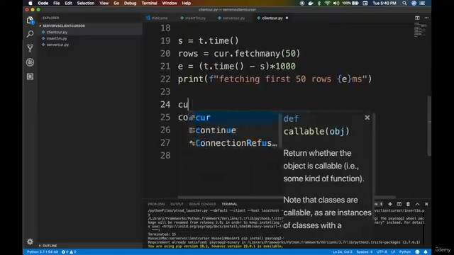
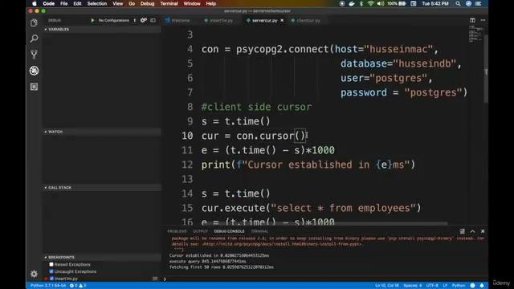

# Fundamentals of Database Engineering · P93–P99 复现文档

> 覆盖内容：Postgres 客户端游标 vs 服务端游标的实测对比（P93–P97）+ MongoDB 存储引擎架构演进与 5.3 clustered collection（P98–P99）。
> 读者画像：前端转 AI 应用工程师。涉及事务/锁/并发的地方会补一句「在 Node 里对应什么」。

---

## 1. 这一节做什么

P93–P99 是两个独立专题，被放在同一个视频系列里连播。

**专题 A（P93–P97）：Postgres + Python 的游标实测。**
讲师在本地 Postgres 建了一张 `employees` 表，用 `insert1million.py` 灌进去 100 万行；然后写两份几乎一模一样的脚本 `clientCursor.py`（客户端游标）和 `serverSideCursor.py`（服务端游标）。两份脚本都对 `employees` 执行 `SELECT *`，只取前 50 行，并在三个位置用 `time.time()` 打点：建立 cursor、execute 执行查询、`fetchmany(50)` 抓取。通过这三段耗时，把「客户端游标 = 一次性把全部结果拉进客户端内存」和「服务端游标 = 结果留在服务器、按需分批取」这两种行为，变成两张可以直接对比的数字表。

对前端转 AI 应用工程师的用处：这不是数据库理论，而是**真实会踩的内存坑**。你在 Node 里用 `pg` 写 `SELECT`、或用 Python 写 RAG 数据清洗脚本时，默认拿到的就是客户端游标。一旦表里有上百万行（向量库的 chunk 表、日志表），`fetchall()` / 不设 limit 的查询会直接把进程 RSS 拉满然后 OOM。这一节就是拿数字告诉你这件事。

**专题 B（P98–P99）：MongoDB 存储引擎的演化史。**
纯理论，没有代码实验。讲师从「任何数据库都分两层：前端 API 和存储引擎」讲起，说清 SQL 与 NoSQL 的差别其实在「前端」这一层（数据格式 + 查询 API），底层存储引擎只认 page 和 bytes。然后按时间线梳理 MongoDB 的存储层进程：

- **MMAPv1**：基于文件偏移量（offset）寻址，改文档长度会把整个文件的偏移量打乱；早期是**全局锁**，v2 改成**集合级锁**。
- **WiredTiger**（2014 年 MongoDB 收购，讲师读作 "wired tiger"）：引入隐藏的 record ID 索引 + 独立的 `_id` 索引，导致按 ID 查文档要做 **两次 B+ 树查找**；带来文档级锁、压缩。
- **5.3 的 clustered collection**：去掉隐藏索引，`_id` 索引本身就是聚簇索引，文档内联在索引叶子里，按 ID 查变成**一次 B+ 树查找**。

最后用官方文档逐条讲 clustered collection 的收益（更快的查询、更小的存储、去掉二次 TTL 索引）和限制（只能在建集合时指定、secondary index 反而更大）。

---

## 2. 讲师原话（带「—— pNNN [MM:SS]」）

**游标的定义：**

> "客户端游标是指，例如你执行一条 select 语句时，所有结果都会被执行并通过网络传送到你的客户端，也就是 Python。"

—— p093 [00:26]

> "相比之下，服务器端游标是在数据库上创建游标，只有在你确实需要某些内容时，客户端才能说：给我 10 条结果……再给我下一批，在结果中滚动。只有在你确实需要时，它才会开始获取这些结果。"

—— p093 [00:54]

**两份脚本的唯一区别：**

> "基本上就是复制粘贴。要改成服务器端游标，唯一的区别就是给它一个名字……一旦你给它一个名字，它就变成服务器端游标了。"

—— p096 [00:00]

**实测数字（讲师原话）：**

> "使用服务器端游标时，执行查询只用了 3 毫秒。而现在，获取这 50 行实际上比客户端游标略慢，因为我们仍然需要进行一次往返。"

—— p096 [00:20]

**客户端游标的耗时（讲师原话描述终端）：**

> "建立游标显然几乎不耗时……0.02 毫秒。但看看执行查询……845 毫秒。然后获取前 50 行根本不算什么，对吧，几乎不耗时，因为所有内容都已经在客户端了。"

—— p095 [03:43]

**两条工程建议：**

> "永远不要像我们这里这样执行无界查询……你基本上可以通过加 limit 来模拟服务器端游标，对吧？给我前 10 条结果。"

—— p097 [03:44]

> "服务器端游标，请记住这完全是具有状态的操作……在网页环境中你很难把它用好……就我个人而言，如果你问我，我更喜欢客户端游标，而且你必须非常非常谨慎小心。"

—— p097 [04:10]

**MongoDB 两层结构：**

> "几乎总是会有两个部分……数据库的前端部分，也就是 API……第二部分实际上是数据格式……任何数据库系统的核心，都是数据格式。"

—— p098 [02:18]

> "存储引擎并不真正关心你在里面存了什么。对存储引擎来说，你有一个叫作页的东西。而在页里面，你有一些字节。它关心的就只有这些。"

—— p098 [05:37]

**MMAPv1 的偏移量与锁：**

> "这样做的问题在于，你碰到任何内容，都会改变文档大小……整个文件现在都被打乱了。因为偏移量，你会改变磁盘上的物理偏移量。"

—— p098 [22:46]

> "第一个版本是每个数据库一把全局锁……在第二版中，他们把它改成了集合级锁。"

—— p098 [24:41]

**WiredTiger 的双索引：**

> "他们把它存成聚簇 B 树索引……他们有一个叫作记录 ID 的东西……如果你实际上是在按 ID 这个主键查找，那么在 WiredTiger 中你会进行两次查找，而不是一次。"

—— p098 [32:13]

**5.3 clustered collection：**

> "在 5.3 版本中，MongoDB 引入了一个叫作聚簇集合的新功能。"

—— p099 [00:00]

> "聚簇集合在 5.3 和 6.0 中实际上彻底移除了那个隐藏索引。这让 ID 索引成为你的聚簇索引。这意味着文档会内联存储在 ID 索引中。"

—— p099 [06:56]

---

## 3. 从零复现

### 3.1 环境与依赖

| 组件 | 说明 |
| --- | --- |
| PostgreSQL | 本地实例，默认端口 5432（讲师在自己 macOS 笔记本上跑） |
| Python | 3.x |
| psycopg2 | `import psycopg2`（课里没说版本，也没提 `psycopg2-binary`；为了免装 postgres 开发头文件，用预编译包更省事） |

```bash
# 建议用虚拟环境
python -m venv .venv
source .venv/bin/activate        # Windows: .venv\Scripts\activate
pip install psycopg2-binary
```

> 课里只说了 `import psycopg2`，没指定版本。`psycopg2-binary` 是同 API 的预编译发行版，选它是复现上的便利建议，不是讲师要求。

### 3.2 建库建表

逐字稿里讲师说「I created a database and I created a table」，但**没有贴出建表 SQL**。为了让后面三个脚本能直接跑起来，这里给出等价的最小建表语句——这是复现重建，不是讲师原话：

```sql
CREATE DATABASE husseindb;
\c husseindb

CREATE TABLE employees (
    id   INTEGER PRIMARY KEY,
    name TEXT
);
```

表名和列名的依据：逐字稿 p093 [00:26] 出现 `select all from employees`，p094 [01:51] 出现 id 和 name（名字值形如 "test i"）。`id` 设成主键只是让它能当主键用，课里没强调索引。

### 3.3 目录结构

```
server-vs-client-cursor/
├── insert1million.py
├── clientCursor.py
└── serverSideCursor.py
```

### 3.4 运行顺序

```bash
# 1. 灌 100 万行（讲师自己也说"会 chug 一会儿"，他快进过去了）
python insert1million.py

# 2. 验证行数（p094 [03:27] 讲师用 count(*) 确认过）
#    psql 里执行：
#    SELECT count(*) FROM employees;   -- 期望 1000000

# 3. 跑客户端游标
python clientCursor.py

# 4. 跑服务端游标
python serverSideCursor.py
```


---

## 4. 完整代码

> 三个文件均可直接保存运行。连接参数里的 `host / database / user / password / port` 是逐字稿 p094 [00:57]–[01:23] 讲师口述的值（host 是他自己的机器名 Hussein Mac，database 是 Hussein DB，user/password 都是 postgres，端口 5432）。**你必须改成自己环境的实际值**，否则第一条就连接失败。

### 4.1 `insert1million.py`

```python
import psycopg2

connection = psycopg2.connect(
    host="Hussein-Mac.local",   # 讲师用的是自己机器名 Hussein Mac，改成你的
    database="husseindb",       # 讲师口述 Hussein DB
    user="postgres",
    password="postgres",
    port=5432,
)

cursor = connection.cursor()

for i in range(1_000_000):
    cursor.execute(
        "INSERT INTO employees (id, name) VALUES (%s, %s)",
        (i, f"test {i}"),
    )

connection.commit()
cursor.close()
connection.close()
```

### 4.2 `clientCursor.py`

```python
import time
import psycopg2

connection = psycopg2.connect(
    host="Hussein-Mac.local",
    database="husseindb",
    user="postgres",
    password="postgres",
    port=5432,
)

# 客户端游标：connection.cursor() 不带 name 参数
t0 = time.time()
cursor = connection.cursor()
t1 = time.time()
print(f"cursor established in {(t1 - t0) * 1000:.2f} milliseconds")

t2 = time.time()
cursor.execute("SELECT * FROM employees")
t3 = time.time()
print(f"execute the query in {(t3 - t2) * 1000:.2f} milliseconds")

t4 = time.time()
cursor.fetchmany(50)
t5 = time.time()
print(f"fetch the first 50 rows in {(t5 - t4) * 1000:.2f} milliseconds")

cursor.close()
connection.close()
```

### 4.3 `serverSideCursor.py`

```python
import time
import psycopg2

connection = psycopg2.connect(
    host="Hussein-Mac.local",
    database="husseindb",
    user="postgres",
    password="postgres",
    port=5432,
)

# 服务端游标：connection.cursor() 传入 name 参数
t0 = time.time()
cursor = connection.cursor("server_cursor")
t1 = time.time()
print(f"cursor established in {(t1 - t0) * 1000:.2f} milliseconds")

t2 = time.time()
cursor.execute("SELECT * FROM employees")
t3 = time.time()
print(f"execute the query in {(t3 - t2) * 1000:.2f} milliseconds")

t4 = time.time()
cursor.fetchmany(50)
t5 = time.time()
print(f"fetch the first 50 rows in {(t5 - t4) * 1000:.2f} milliseconds")

cursor.close()
connection.close()
```

### 4.4 创建 clustered collection（MongoDB，P99 口述，官方语法补全）

P99 [25:48] 讲师口述了要点：「specify a cluster index, and it has to be this key ID one, and it has to be unique, and you can give it any name you want。」完整命令讲师没有逐一贴出，下面按 MongoDB 官方 clustered collection 语法补全：

```js
// 需要 MongoDB 5.3 及以上；只能对"新建的集合"生效
db.createCollection("myClusteredCollection", {
  clusteredIndex: {
    key: { _id: 1 },
    unique: true,
    name: "myClusteredIndex"
  }
})
```

> 字段名 `clusteredIndex / key / unique / name` 是按官方语法补全的；讲师只口头点了「key 是 _id、unique、可命名」三点。

---

## 5. 逐行解释

### 5.1 `insert1million.py`

**`import psycopg2`**：psycopg2 是 Python 访问 Postgres 最常用的驱动。它提供的核心对象是 `connection` 和 `cursor`——和 Node 里 `pg` 包的 `Client` / `Client.query` 是同一套心智模型。

**`psycopg2.connect(...)`**：建立一个到 Postgres 的连接。讲师在 p094 [00:57] 一项一项说过这些参数：host 是机器名、database 是 `Hussein DB`、user 是 `postgres`、password 是 `postgres`、port 是 5432（默认端口）。在 Node 里对应 `new Client({ host, database, user, password, port })`。

**`connection.cursor()`**：从连接上派生一个游标。这一步不指定 name，所以是**客户端游标**——此刻数据库上什么都没发生，只是 Python 侧准备了一个句柄。

**`for i in range(1_000_000): cursor.execute(...)`**：讲师明确说这是「最简单但未必最优」的写法（p094 [01:23]，"显然，做事有最理想的做法，但我们只是在插入而已。"）。每次 execute 都发一条 INSERT，没有用 `executemany` 批处理。这也是它慢的原因。

**`connection.commit()`**：讲师专门强调了这一句（p094 [02:16]）："你不会想创建上百万行，然后再说你要关闭它，因为整个操作都会回滚。" 在 Node 里对应两件事：如果你用 `pg` 的 `client.query('BEGIN')` 手动开了事务，就要显式 `COMMIT`；如果没开显式事务，`pg` 默认自动提交，单条 INSERT 就会落盘。

**`cursor.close()` + `connection.close()`**：讲师说 "make it a habit"（p094 [01:23]）。不关连接会泄漏连接池槽位，Postgres 默认 `max_connections` 是 100，跑几个脚本不关就能把库堵死。

### 5.2 `clientCursor.py`

**三组 `time.time()`**：讲师在 p095 [02:16] 解释过思路——"在启动游标之前先创建一个快照。"，结束后的时间减去起始时间，"乘以 1000" 得到毫秒。所以 `(t3 - t2) * 1000` 就是毫秒数。

**第一段（建立 cursor）**：记录 `connection.cursor()` 的耗时。讲师在结果里观察到约 **0.02 ms**（p095 [03:43]），基本是纯本地操作。

**第二段（execute）**：记录 `cursor.execute("SELECT * FROM employees")` 的耗时。**对客户端游标来说，这一句是整个实验的关键**。讲师的观察是约 **845 ms**（p095 [03:43]），因为驱动会把 100 万行全部执行并**通过网络传输到 Python 进程内存**里。注意：`execute` 并不会把结果「存进一个 Python list」——讲师的措辞是 "it's a tuple, so it's not an array, so we didn't actually allocate everything"（p095 [04:12]），意思是驱动内部按元组方式缓存结果集，内存占用不小但也不是一个 100 万元素的 list。

**第三段（fetchmany(50)）**：记录取前 50 行的耗时。因为 100 万行已经在客户端内存里，取 50 行几乎不花时间（讲师的观察是「几乎为 0」）。

**`cursor.fetchmany(50)`**：只取 50 行，且**不打印**——讲师说 "我不会把它们打印出来或做类似的事情。"（p095 [01:49]），目的是让计时只反映取数、不掺入终端 I/O。

**这里在 Node 里对应什么**：`pg` 包默认走的是客户端游标行为——`client.query('SELECT * FROM employees')` 会把结果全部拉进 Node 进程内存。如果你在写 RAG 数据管线、想避免把百万行 chunk 全塞内存，应该改用 `pg-cursor`（`cursor.read(50)`，行为上等价于 `fetchmany(50)`）或 `pg-query-stream`（真正的流式）。

### 5.3 `serverSideCursor.py`

**唯一区别：`connection.cursor("server_cursor")`**。讲师 p096 [00:00] 说得很直白——"其实就是复制粘贴……要做成服务器端游标，唯一的区别就是给它起个名字。"。给 name 之后，psycopg2 就会在数据库侧用 `DECLARE CURSOR` 声明一个真正的服务端游标（这个底层机制课里没讲，是 psycopg2 的实现细节，这里作为补充说明）。

**execute 只有约 3 ms**（p096 [00:20]）。因为服务端游标在 execute 阶段只做了「声明」，没有真的把 100 万行传回来。数据一直躺在服务器上。

**fetchmany(50) 反而更慢一点**（p096 [00:20] 说 "会比客户端游标稍慢一些，因为我们仍然需要做一次往返通信。"）。因为每次 fetch 都要真的走一趟网络往返，向服务器说「给我 50 行」。讲师补充：如果循环 fetch，每 50 行大约 2 ms（p096 [00:56]，"每 50 行将耗时 2 毫秒"）。

**这里在 Node 里对应什么**：`pg-cursor` 的 `cursor.read(50)` 就是同一件事的 Node 版——每次 read 是一次服务端往返，结果集不进 Node 内存。做 ETL / 大表导出时用它，别用 `client.query('SELECT *')`。





### 5.4 两种游标的取舍（P97 讲师结论）

讲师在 P97 花了一整段讲优缺点，不要把这一节理解成「服务端游标更好」。

**客户端游标的优点**：把内存分配、结果集缓存、游标生命周期都压在客户端身上，服务器只提供一个连接，压力小（p097 [00:00]）。

**客户端游标的缺点**：拉大结果集会吃满网络带宽（p097 [00:58]），而且客户端内存可能根本放不下（p097 [01:27]）。

**服务端游标的优点**：客户端内存被解放，服务器持有游标，适合「一边拉一边处理」的 ETL 场景——比如一次处理百万行、每 50 行做一次 map/reduce 风格的聚合再吐出去（p097 [02:44]）。

**服务端游标的缺点**：状态全部落在数据库侧。想象上千个客户端各自开着服务端游标还忘记关，游标泄漏会把数据库拖垮（p097 [01:55]–[02:22]）。讲师原话是 "你的数据库，你可能会危及数据库本身。"。

**讲师自己的倾向**：他在 p097 [04:10] 说 "我更喜欢客户端游标，而且你必须非常非常谨慎地处理你正在做的事。"，意思是用客户端游标没问题，但**必须**配合 `WHERE` / `LIMIT` 做有界查询，永远不要 `SELECT *` 全表拉。

**Node/Web 场景的直接对应**：服务端游标是**有状态**的，它绑定在一个打开的数据库会话/事务上。在无状态的 HTTP 服务里，你不能把一个游标存在两个请求之间（除非自己做 session 持有）。这就是讲师说的 "你不能以无状态的方式构建它。"（p097 [04:10]）。在 Node 里，这意味着一份 `pg-cursor` 的生命周期必须在一个请求/一个后台任务内部闭合，不能跨请求。


### 5.5 MongoDB 部分（P98–P99，纯理论）

这部分没有可运行代码，但要点必须记住，否则后面看 clustered collection 会绕晕。

**任何数据库都分两层**（p098 [02:18]）：前端 API 层（SQL、或者 Mongo/Redis 的 get/put 命令）负责「用户怎么描述我要什么」；存储引擎层负责「数据怎么落到磁盘」。**SQL 与 NoSQL 的差别主要在前端**：SQL 用「表/行/列」这套数据格式 + SQL 这门查询语言；Mongo 用「JSON 文档」+ get/put 命令。存储引擎对两者一视同仁——它只看到 page 和 bytes（p098 [05:37]）。

**page 是存储引擎的原子单位**（p098 [06:36]）：InnoDB MySQL 是 16 KB，Postgres 是 8 KB，Mongo 课里讲师说他记不清具体值（p099 [23:25] 提到官方文档说 WiredTiger 是 4 KB，讲师自己也不确定，原话是 "我不知道那是否正确。"）。**不要在复现里硬编码任何一个 page size**，以你实际数据库的 `SHOW` / 配置输出为准。

**WAL/journaling**：写数据文件很贵（一次 IO 写一整页），所以改动先进内存脏页，同时把「我改了什么」顺序追加到一个日志里（Mongo 叫 journal，p098 [10:57]）。崩溃后从最后一个 checkpoint 重放日志恢复。这一层的名字是 WAL 还是 journal 取决于数据库，别混用。

**MMAPv1 的问题**（p098 [18:31] 起）：用文件偏移量（讲师称 "disk location"）寻址——一个 64 位指针，高 32 位文件名、低 32 位文件内偏移。好处是读极快；坏处是**只要文档长度变了，后面所有文档的偏移量全错**，整份文件被打乱（p098 [22:46]）。锁方面，v1 是**全局锁**，v2 改成**集合级锁**（p098 [24:41]），同一集合上的两个文档不能并发改。

**WiredTiger 的双索引**（p098 [32:13]）：Mongo 收购 WiredTiger 后，存储层换成隐藏的 record ID 索引（64 位）+ 用户可见的 `_id` 索引（12 字节 ObjectId）。**按 ID 查文档要做两次 B+ 树查找**：先在 `_id` 索引里查到 record ID，再拿 record ID 去隐藏索引里查文档。写入同理，要写两个索引。好处是文档级锁、压缩。

**5.3 的 clustered collection**（p099 [00:00]）：去掉隐藏索引，`_id` 索引自身就是聚簇索引——叶子节点里直接就是文档。按 ID 查变成一次 B+ 树查找，写入也只写一个索引。

**clustered collection 的限制**（p099 后半段）：

1. 一个集合只能有一个 clustered index；
2. **只能在建集合时指定**，不能在已有集合上后加（p099 [15:28]）；
3. 不能把一个普通集合原地转换成 clustered collection，反之也不行，只能新建集合然后拷数据（p099 [16:54]）；
4. 只要有 secondary index，集合整体存储会变大——原来 secondary index 的值是 8 字节的 record ID，现在要指向 `_id`（默认 12 字节，但用户可以自定义成任意长度，比如 UUID 字符串能到 36 字节），这一点在 p099 [21:32] 讲得很细；
5. **默认情况下 secondary index 的优先级高于 clustered index**，如果查询里同时命中了 `_id` 和一个 secondary 字段，planner 可能选 secondary（p099 [17:49]）。讲师对此的评价是 "我还是不明白为什么会优先选择二级索引而不是主索引……这似乎是个糟糕的主意。"。

> 注意：上面第 5 条是讲师对 MongoDB 官方文档行为的**转述 + 个人质疑**，不是 MongoDB 官方结论。如果要落地，请以你实际用的 MongoDB 版本的 `explain()` 输出为准。


---

## 6. 复现检查清单

按顺序打勾，任何一项失败都会导致后面的实验数字失真甚至跑不起来。

**环境**
- [ ] `psql --version` 能输出，本地 Postgres 已启动
- [ ] `pip show psycopg2-binary` 有输出（或 `python -c "import psycopg2"` 不报错）
- [ ] 三个 `.py` 文件放在同一目录

**数据库**
- [ ] `psql -l` 能看到 `husseindb`
- [ ] `\d employees` 能看到 `id` 和 `name` 两列
- [ ] `SELECT count(*) FROM employees;` 在灌数之前返回 0

**灌数**
- [ ] `python insert1million.py` 跑完没有异常退出
- [ ] 灌数后 `SELECT count(*) FROM employees;` 返回 1000000
- [ ] 脚本末尾 `connection.commit()` 存在（漏了数据会被回滚，count 会是 0）

**客户端游标**
- [ ] `clientCursor.py` 里 `connection.cursor()` **不带** name 参数
- [ ] 脚本输出三条毫秒计时
- [ ] 观察到的现象：executing the query 一项明显偏大（讲师机器上约 845 ms），fetch 前 50 行接近 0
- [ ] 跑的时候开一个终端用 `top` / 活动监视器看 Python 进程 RSS，应该看到内存明显上涨

**服务端游标**
- [ ] `serverSideCursor.py` 里 `connection.cursor("server_cursor")` **带** name 参数
- [ ] 观察到的现象：execute 一项很小（讲师机器上约 3 ms），fetch 50 行稍微花时间（每次往返，讲师说循环 fetch 时约 2 ms / 50 行）
- [ ] 同样看 RSS，Python 进程内存不会因为选 100 万行而暴涨

**MongoDB（仅阅读，不要求跑）**
- [ ] 确认你的 MongoDB 版本 ≥ 5.3（clustered collection 从 5.3 才有）
- [ ] 理解「clustered collection 只能在建集合时指定」，不要在已有集合上试 `createIndex` 加 clustered

**排错顺序**（哪一步挂了先查这里）
1. 连接失败 → 先查 `host`，讲师用的是他自己的机器名 `Hussein Mac`，**必须替换**成你本机的 `localhost` 或实际主机名
2. `FATAL: database "husseindb" does not exist` → 回到 3.2 建库
3. `relation "employees" does not exist` → 建表语句没执行
4. count 是 0 但脚本没报错 → 检查 `connection.commit()` 是否被漏删
5. clientCursor 跑完 Python 进程被系统杀掉（OOM）→ 说明你表里的行数远超 100 万，这正是讲师要演示的反面教材，改成带 `LIMIT` 的查询

---

## 7. 课里没讲但你会撞上的

下面每条都标注了来源，凡是没有「课里原话」依据的，都是复现过程中会遇到的工程事实，请以你实际环境输出为准。

**7.1 psycopg2