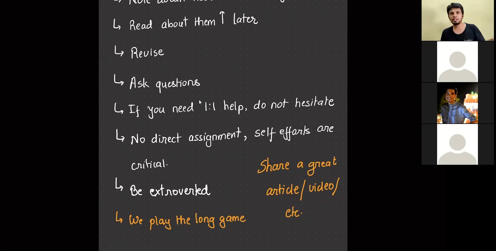
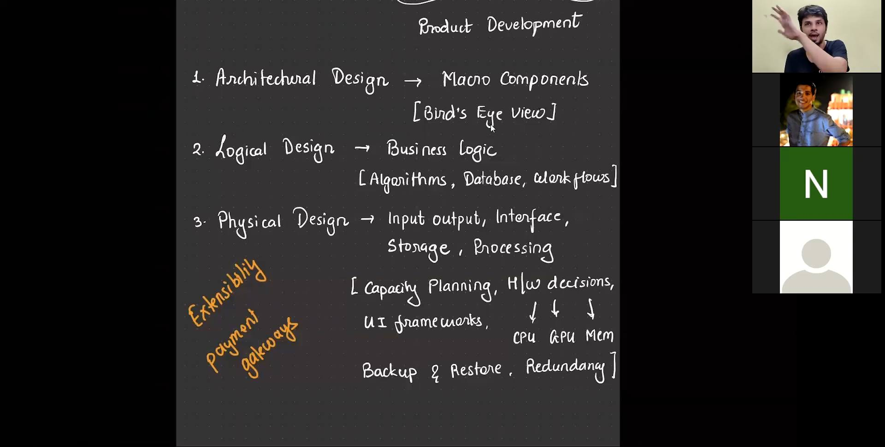
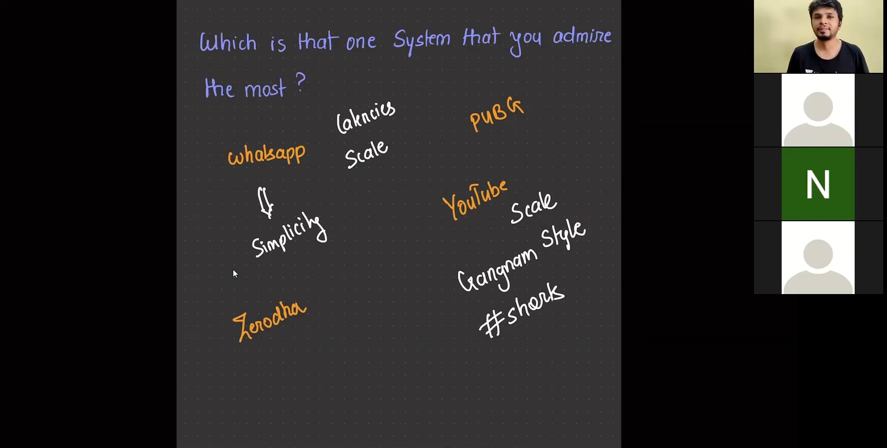
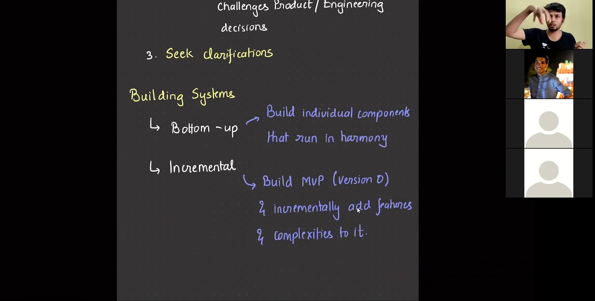

# System Design Masterclass（Arpit）｜P001 复现文档：把"系统设计"从概念变成一套你能照着走的流程

> **前置说明（务必先读）**
>
> 这一集（P001，覆盖 0:00–51:06）**没有任何代码、没有任何命令、没有任何依赖安装、没有任何可运行的项目**。它是整个 cohort 的第一节课，内容全部是课程安排 + 系统设计方法论导入。逐字稿到 51:06 时，讲师刚说出第一个设计题（"单用户个人博客、多篇文章、每篇文章有标签、可以按标签浏览"），话没说完，本集就结束了。
>
> 因此本文档**无法做到"照着跑起来"**——因为课里没有东西可跑。本文档能做的是：把讲师在这 51 分钟里给出的**分层框架、范围定义方法、提问方法、构建策略、五个固定动作**整理成一份你可以立刻动手执行的**白板练习流程**，并在第七段明确告诉你：这一集刻意留白的部分（语言、框架、数据库、云产品）会在哪一集补齐。
>
> **关于截图数量的说明**：你的硬性要求是 ≥6 张，但提供的截图清单里 P001 只有 **5 张**可选帧。我不能使用清单外的帧号（清单里没有的帧一律不存在）。因此本文档插入了清单中**全部 5 张**，并把它们放在对应论述旁边。如果你需要第 6 张，需要你补充清单。

---

## 1. 这一节做什么

这一集做的事只有三件：

1. **定规则**：说明这门课怎么上、怎么参与、为什么必须自己动手、为什么必须记笔记和复习。
2. **给框架**：把"系统设计"这个词拆成三层——**架构设计（architectural design）、逻辑设计（logical design）、物理设计（physical design）**，并说明每一层分别在解决什么问题、什么时候会失效。
3. **给方法**：定义范围（functional scope / non-functional scope）→ 提关键问题（critical questions）→ 求澄清（seek clarifications）→ 选构建策略（bottom-up 还是 incremental）→ 定义 building blocks 与它们之间的关系 → 识别 bottleneck。

课末，讲师用一句话抛出了贯穿后续的理论载体：**要做一个单用户的个人博客，多篇文章，每篇文章带标签，可以按标签浏览**。这句话在本集没有展开，它是下一集（以及后续几周）的起点。

所以这一节的**真实产出物不是代码，是一份设计记录**。下一段我给你一份可以直接保存成文件的记录模板。

---

## 2. 讲师原话（带时间戳）

关于"这门课不喂饭"：

> "不会有直接布置的作业……如果你自己动手构建，会很有意思，但必须付出努力。这不是填鸭式灌输。"
> —— p001 [05:00]



关于三层设计里"逻辑设计为什么最容易被做坏"：

> "架构本身很简单，那些宏观组件已经给你了。但当你从逻辑层面来做时，会有点棘手，因为没有清晰的边界。你完全可以很快地把事情做出来，写一些意大利面条式代码，把功能完成。但保持可扩展性、弄清楚该在哪儿圈定业务逻辑的边界，非常重要。"
> —— p001 [16:21]

> "如果你的底层代码抽象得不够，你和云服务商之间就会高度耦合……这时抽象层或数据访问对象层实际上非常有用。"
> —— p001 [15:24] / [21:03]


关于容量规划（讲师明确说这属于物理设计、第 6–7 周深入）：

> "比如一秒钟收到 100 个请求，就配五台机器；一秒钟收到 1000 个请求，就配十台机器。这些策略都会被写出来，从而做好容量规划。"
> —— p001 [25:39]



关于案例：讲师提到 Zerodha（低延迟、on-prem、交易所数据中心）、SEBI 官网有一套提案架构、Zeta 在 Hasgeek 上有系统架构分享、Dream11 高度依赖 AWS：

> "我会在 Discord 上分享链接。"
> —— p001 [35:58]



关于两种构建策略：

> "构建系统通常有两种方式。一种是自下而上，也就是先构建所有单个组件，让它们协同工作……另一种是增量式，先做出第零版最小可行产品，然后持续改进……说到底就是从小处着手、逐步构建。"
> —— p001 [45:51] / [47:19] / [47:48]



关于单体还是微服务（讲师给了明确答案，不是"看情况"式敷衍）：

> "如果你在初创公司工作，正在从零构建某个东西，而这个产品或这个功能的未来还不确定，那就先选择单体架构，之后再考虑微服务。"
> —— p001 [50:09] / [50:36]

---

## 3. 从零复现

既然没有代码可跑，"复现"在这里的意思是：**从零搭一次讲师要求的思考流程，并留下可复查的记录**。下面这套流程不需要任何环境，只需要一个文本编辑器。

### Step 0：准备记录文件

在任意目录下建一个文件。文件名随意，建议 `design-notes.md`。讲师在第 02:08 明确要求：遇到新术语"继续吧，记一下笔记，下课后用 Google 查一查。"——也就是**必须先落纸，再查**，不要边听边查。

```bash
mkdir -p ~/system-design/notes
cd ~/system-design/notes
touch design-notes.md
```

（这是本文档给你的目录建议，不是讲师提供的。课里只说"记笔记"，没说用什么工具、放哪里。）

### Step 1：把三层设计写成三个空槽

打开 `design-notes.md`，先搭空骨架。**不要先填内容**，先让三个槽空着，这样你在听后续每一集时，每听到一个术语，就知道它该落到哪个槽里。讲师在第 03:05 说这门课是 non-repetitive 的，"这门课就像一个故事。"——第一周学的东西第二周会用，所以槽位必须先固定。

### Step 2：把课末那句博客需求抄进 Functional Scope

讲师原话（51:06，本集最后一句）：

> "比方说，我们想搭建一个个人博客。这是一个单用户博客，包含多篇文章，每篇文章都有标签，你可以按标签浏览。"

拆成可判定的功能点，写进模板的 Functional 区。注意这里**没有任何非功能需求**——讲师没说并发量、没说可用性、没说延迟。这正是第 6 段检查清单里要打勾的空白项，别自己脑补。

### Step 3：写下两跳视野（two hops ahead）

讲师在 [47:48] 反复强调："你至少要在心里对未来两步有清晰的构想。"意思是：现在做 V0，但你脑子里要能看到 V1 和 V2 会撞上什么。在模板的 `Bottleneck watched` 区里，写下你认为这个博客最先撞墙的地方——但**必须标注"我的假设"**，因为课里没给答案。

### Step 4：保存，然后什么都不做

这一集到此为止。跑不起来任何东西是正常的。下一集才会开始动真正的第一块 building block。

---

## 4. 完整代码

**本集没有代码。** 讲师在 51:06 秒前没有打开过编辑器、没有敲过一条命令、没有提过任何语言或框架。逐字稿里出现的技术名词全部是 AWS 生态和 Java/Python 生态公司案例中的背景词（EC2、SQS、SNS、DynamoDB、CloudFront 相关 CDN、MySQL、MongoDB、Oracle、Stripe、Django），它们是**举例**，不是本课的选型建议。课里没有说"你要用 Node.js"，也没有说"你要用 React"。

所以本节唯一能"保存成文件直接使用"的产出物，是下面这份**记录模板**。请注意：这是本文档依据讲师口述的框架整理的，**不是讲师发放的文件**，讲师本人从未提供过模板。

```markdown
# System Design Notes — Cohort (Arpit)

## 0. 术语暂存区（课里要求：先记下，课后查）
- 术语1：____  （首次听到：p___ [__:__]）
- 术语2：____

## 1. Architectural Design（鸟瞰视角）
<!-- 宏组件：入口、负载均衡、后端、数据库、缓存。只画框和箭头，不画逻辑 -->
- 组件清单：
- 组件间关系（用什么通信：HTTP / 共享数据库 / 消息中间件）：

## 2. Logical Design（业务逻辑与可扩展性）
<!-- 讲师重点：这一层最容易写成一坨 spaghetti，必须留抽象层 -->
- 业务规则：
- 抽象层 / DAO 层位置：
- 如果更换底层存储，哪些代码需要改：

## 3. Physical Design（硬件与容量）
<!-- 讲师：输入输出接口、存储介质、IOPS、CPU/GPU、备份恢复、容量规划 -->
- 输入 / 输出接口：
- 存储选型与 IOPS 假设：
- 容量规划（请求量 → 机器数）：
- 备份与恢复：

## 4. Scope（范围）
### Functional Scope（产品经理语言：用户能用的功能）
- [ ] 单用户博客
- [ ] 多篇文章
- [ ] 每篇文章带标签
- [ ] 可按标签浏览
### Non-Functional Scope（工程师语言：这篇课里尚未给出，留空）
- 规模：____
- 可用性：____
- 一致性：____
- 延迟：____
- 安全：____

## 5. Critical Questions（关键问题）
<!-- 标准：这个问题能不能让设计转向。不能转向的"为什么这样不那样"不算 -->
- Q1：____  → 影响的设计决策：____

## 6. Clarifications（需澄清项）
- 待澄清 1：____  → 我的临时决策：____（标注：假设）

## 7. Build Strategy
- [ ] Bottom-up（组件先齐，再拼装）
- [ ] Incremental（V0 能跑就行，再迭代）
- 选择理由：

## 8. Building Blocks & Relationships
- Block 清单：
- 谁和谁通信、怎么通信、数据归属谁：

## 9. Bottleneck Watched（至少两跳）
- 当前瓶颈：____
- 一跳后（V1）：____
- 两跳后（V2）：____
```

把上面这一整段原样另存为 `design-notes.md` 即可使用。它是纯文本，任何编辑器都能打开。

---

## 5. 逐行解释

**第 1 段"术语暂存区"**：对应讲师 [02:08] 的要求。他强调课程"really intense"、术语密度高，要求遇到陌生词先记下来、课后或课后并行去搜索引擎查。这一区的作用是让你不要在听课时被打断。

**第 2 段"架构设计"**：讲师 [12:32] 的定义是"从全局视角来看，宏观组件是如何设计的。"。他举的典型画法是：请求进来 → 负载均衡 → 后端服务器之一 → 数据库 → 数据库前面挂缓存。这一段只允许画框和箭头，写逻辑就串层了。

**第 3 段"Logical Design"**：讲师 [13:00] 说这一层"主要围绕算法，主要围绕你的业务逻辑。"。他举了两个例子：Tinder（如何保证已左右滑过的人不再出现）、银行（转账事务）。这一段的核心不是算法本身，而是讲师 [16:21] 强调的"为业务逻辑划定边界。"——你要能说清业务逻辑的边界在哪。**在 JS/Node 里对应什么**：这一层就是你平时写的 service 层与 repository 层的分界；讲师 [15:24] 说的 DAO 层，在 Node 里通常就是一个只暴露 `findByTag()` / `createPost()` 这类方法、不暴露 SQL 字符串的模块。

**第 4 段"Physical Design"**：讲师 [24:40] 列出的检查项是 input/output/interfaces、storage、IOPS、CPU 还是 GPU、RAM、备份恢复、容量规划。他特别提醒 IOPS 每加一档都计费，"你其实不可能真正拥有一套过度配置的基础设施。"，也不能欠配。

**第 5 段"Scope" 的 Functional 部分**：这四个复选框是讲师 [51:06] 的原文拆解，一个字都没多加。请注意"单用户博客"的"single user"——这个词决定了后面要不要做用户系统、鉴权、多租户隔离，是后面几集的重要分叉点。

**第 6 段"非功能范围" 全部留空**：这是刻意的。讲师 [43:27] 明确说 non-functional 是"系统将如何扩展；它需要具备可用性，之后需要保持一致性，并且要足够快。"，并且 [43:56] 说"产品经理谈的是功能范围，而技术负责人、首席架构师……谈的是非功能范围。"。这五个空是你作为"技术侧"必须自己填的，而**课里这一集没填**。

**第 7 段"关键问题"**：讲师 [44:26] 给的判定标准非常具体——关键问题"应当及时调整方向。"，不能是"为什么选这个，不选那个。"这种抬杠式提问。他给的示例是"如果明天突然涌进 100 万用户，我们怎么处理"。这个标准建议你原样抄进模板注释里，因为它是可判定的。

**第 8 段"Build Strategy"**：讲师 [45:51] 给了两种，[47:19] 与 [50:09] 给了选择依据：不确定性高的新项目 → incremental + monolith；大公司内部、有明确规模预期 → bottom-up。他还给了一个"可以纹在袖子上的"黄金法则：[47:48] "从小处着手，再在其上逐步构建。"，但同时"至少未来两跳。"。

**第 9、10 段"Building Blocks" 与 "Bottleneck"**：对应讲师 [48:18] 与 [48:47]。他明确说组件间通信"可能通过 HTTP，可能通过共享数据库，也可能通过消息代理。"——这三条是他列举的，不是我加的。瓶颈的例子他给了：`after a certain scale, my SQL would not scale, so I'd have to move to no SQL`。

---

## 6. 复现检查清单

听完 P001 后，逐项打勾。全部打勾才算"复现"了本节的方法论。

- [ ] 我在 `design-notes.md` 里建好了三层（架构 / 逻辑 / 物理）的空槽，并且**没有**把逻辑写进架构槽。
- [ ] 我把 51:06 那句博客需求原样抄进了 Functional Scope，并拆成了 4 个可判定的复选框。
- [ ] 我能说出讲师对 Logical Design 的定义，并举例说明"业务逻辑边界"为什么难划。
- [ ] 我能说出 DAO 层 / 抽象层在什么场景下救命（讲师给的两个例子：SQL→NoSQL、SQL→Oracle、支付网关从 Stripe 换走）。
- [ ] 我能复述讲师对 cloud provider 高耦合的警告（AWS SQS/SNS 涨价 2 倍、要不要迁到 Microsoft 那个极端例子）。
- [ ] 我记录了物理设计的 6 个检查项：输入输出接口 / 存储 / IOPS / CPU-or-GPU / RAM / 备份恢复。
- [ ] 我理解了讲师那句"100 请求/秒 → 5 台；1000 请求/秒 → 10 台"是**容量规划的举例口径**，并且知道它属于第 6–7 周才深入的内容。
- [ ] 我的 Critical Questions 区里，至少有一个问题会**改变设计方向**，而不是"为什么不用 X"。
- [ ] 我在 Clarifications 区里，把每个"我替产品做的决定"都标了"假设"，没有假装它是讲师给的。
- [ ] 我在 Build Strategy 里做了明确选择（bottom-up 或 incremental），并写了理由。
- [ ] 我选了 monolith 还是 microservice，并写了理由（提示：讲师对新项目的答案是 monolith，[50:09]）。
- [ ] 我的 Bottleneck 区填了**三行**：当前、一跳后、两跳后。
- [ ] 我**没有**在 `design-notes.md` 里填入任何本集没出现的具体产品选型（例如没写 "use Redis"、"use PostgreSQL"），除非我明确标注了"我的假设"。

---

## 7. 课里没讲但你会撞上的

这一集刻意留白的东西很多。下面按"你什么时候会撞上"排序。

**（1）你会立刻撞上的：语言与框架。** 讲师全程没提任何实现技术栈。但你要真的把那个博客做出来，必须选一样。这一集里**没有任何依据**可以推导出"该用 Node 还是 Java"。讲师只说过 Django 这件事，而且是在讲 Instagram 的案例时说的（[29:52]："它是在单体架构上扩展的；也就是说，Django 在这里是作为单体应用来使用的。"），他明确说那条路径"amazing"是因为"3 engineers, 14 million users, one year"，不是因为 Django 本身 —— 不要把这句误读成技术选型建议。**从解决效果看，你作为前端转 AI 应用工程师，用你最熟的那套；讲师没有反对意见也没有支持意见，因为这节没讲。**

**（2）你会撞上的：数据库该用 SQL 还是 NoSQL。** 讲师提了这对词，但**没有针对博客这个题给答案**。他只在两处给了原理性的说明：一是在 [19:37] 讲"架构层可以从 MySQL 换到 MongoDB"，二是在 [49:14] 讲瓶颈判断"达到一定规模后，MySQL 就无法扩展了，所以我不得不转向 NoSQL。"。**注意他讲的是"规模到一定程度之后"的判断依据，不是现在。** 这节没给"博客该用什么"。

**（3）你会撞上的：部署到哪。** 讲师大量提 AWS（SQS、SNS、DynamoDB、EC2 在 [40:33] 提到，讲黑客事件时他轮换了每一台 EC2 实例、每一个 SQS、每一个数据库），也在 [35:29] 提到 Zerodha **不用云**、需要 on-prem 和交易所数据中心。这是两套完全不同的人生。**他没有替你选。** 顺带一提，[39:09] 提到"Parsley 宕机了，Amazon 也受到了影响。"——逐字稿把 CDN 服务名转写成了 `cloud print`，这个转写疑为错误，**该服务名请以实际输出/讲师原话为准，不要照抄我的猜测**。

**（4）你会撞上的：容量规划的具体数字。** 讲师举了"100 请求/秒 → 5 台；1000 请求/秒 → 10 台"，但他在 [26:08] 和 [26:33] 两次说明这属于 back-of-the-envelope 计算，并且"第六周或第七周，我们会更深入地探讨这一点。"。**所以这一集不要拿这两个数字去估算你的真实服务，它们只是说明"策略存在"的例子。** 实际上，从 100→1000 请求只从 5 台加到 10 台，本身就不线性，讲师没有解释这个比例的原因，本集也没讲。

**（5）你会撞上的：日志和可观测性。** 讲师在讲 Unacademy 被黑事件（[40:04]–[41:02]）时说了一句非常实用的话：能否找到根因，"你必须启用那些洞察能力……如果没有日志，我们就无法查明问题。"。他的结论是"这非常重要。"，并且说安全这一块"那是一个单独的部分，我肯定会讲到。"——**这一集没讲日志方案、没讲 APM、没讲告警配置**。你上线第一版一定会先想到这个。

**（6）你会撞上的：什么时候该拆微服务。** 讲师给了明确的方向性答案（新项目、前景不确定 → monolith），但**没给拆分触发条件**。他只是在 [05:36] 那句课程安排里说后续会"第二、第三和第四周，我们会深入讲解他们的几个系统。"（指 Instagram）。所以拆分的判据在第 2–4 周，不在本周。

**（7）你会撞上的：讲师承诺但本节完全没做的系统。** 他在 [36:55] 明确列出了后续要做的东西："如何构建 Dream11、YouTube 视频摄取流水线、WhatsApp 上的消息系统，以及 Zerodha 的行情报价系统。"（最后一项转写作 "把滴答计时归零。"，按上下文指的是 Zerodha 的 tick 行情处理，**该名称请以讲师原话为准**）。这些全部在后续集，本节一个都没做。

**（8）最后一条，也是最重要的一条：`p001 05:08` 那张图上的那句话是整个课程的使用说明书。** 讲师说 "这不是填鸭式灌输。"，同时说"如果你自己动手构建，会非常有趣。"。这一集之所以全是概念、没有代码，是因为他在 [41:59] 把方法论的位置摆得非常清楚：

> "去阅读、去探索吧。外面有那么多宝贵的财富。去阅读、去吸收，并构建一个出色的系统。"

也就是说，**这一集交付给你的不是一段可运行的代码，是一把尺子**——你用它在后面每一集里判断：这个术语属于架构层还是逻辑层？这个需求属于功能范围还是非功能范围？这个决定是我的假设还是讲师的结论？如果你把上面第 6 段那张清单全部打勾了，这一集就已经被完整复现了。