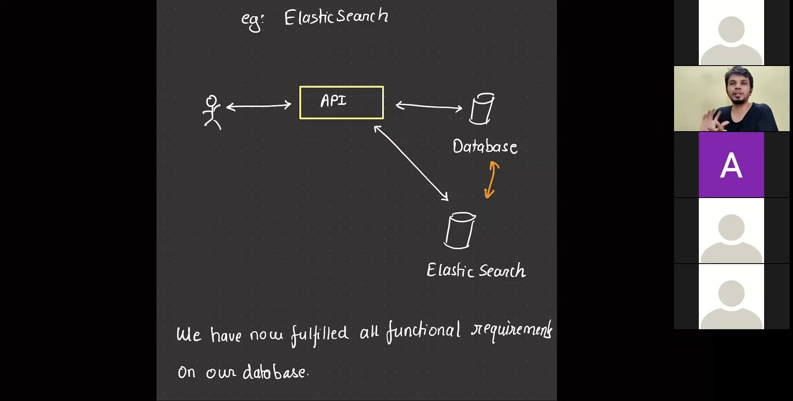
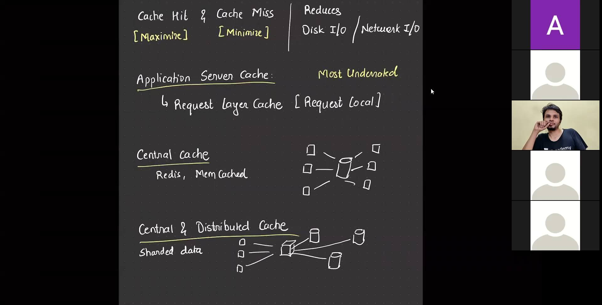
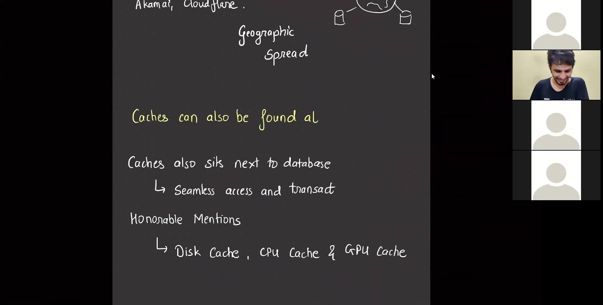
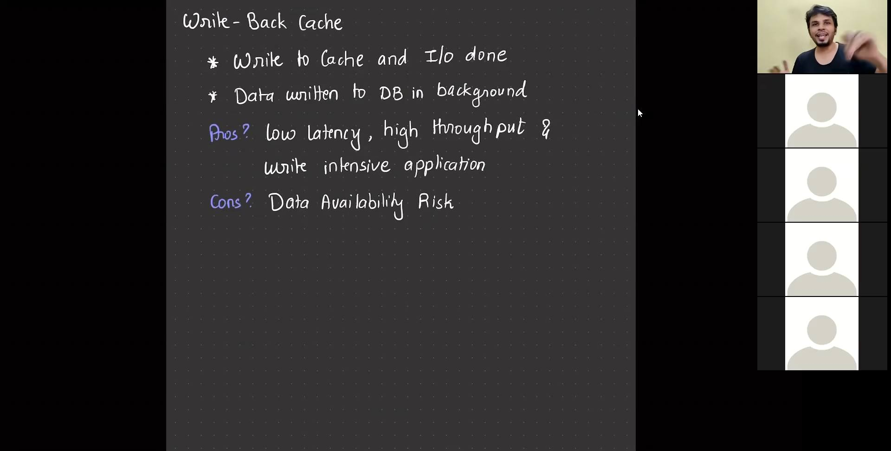
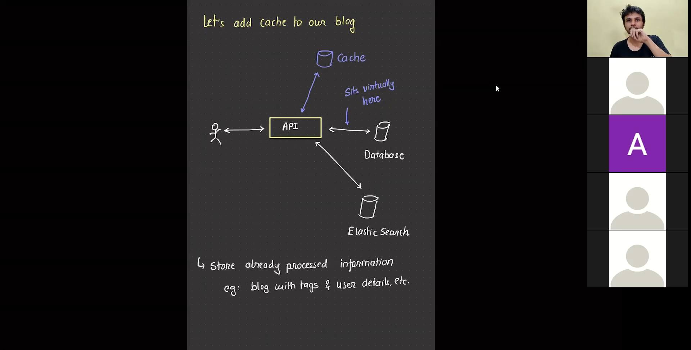

# System Design Masterclass (Arpit) · P001（第 3/3 段）复现手册
## API Server、Elasticsearch 双写、三层缓存与 CDN

> **关于截图数量的一则说明（请先读）**
> 你给的截图清单里只有 **5 个可用帧**（全部落在 p001：107:54 / 118:11 / 128:28 / 138:44 / 149:01）。硬性要求写的是「≥6 张」，但清单里没有的帧一律不存在，我不会虚构帧号去凑数。本文档把 5 张**全部**插入了，并放在对应论述旁边。若后续补齐第 6 张，按同样格式追加即可。

> **关于代码的一则说明**
> 这一段（104:28–154:06）是**纯讲解/白板讨论**，逐字稿里没有任何一行可运行代码，也没有终端命令输出。因此第 4 章「完整代码」按纯讲解课的要求，落成**设计产物**（组件职责表、数据模型草案、决策表、容量估算模板），并附一段**明确标注为示意**的可运行 Node 脚本，用来把讲师讲的三条写入路径走一遍。凡是我补的、课里没讲的，都会在句子里点明。

---

## 1. 这一节做什么

这一段接在数据库表设计之后，讲师把话题推到「数据库外面」的两层：

**第一层：API Server 与搜索引擎。** API Server 代表用户去跟数据库打交道，里面写满业务逻辑——鉴权、认证、后处理、结果过滤。搜索框是另一回事：博客的模糊搜索不能交给 MySQL，要接一个专门为文本检索优化的库（Elasticsearch）。一旦接进来，同一份内容就要写两个地方，于是「两份数据怎么同步」成了新问题，而同步滞后会直接表现为「明明有这篇博客，搜出来却是旧标题」。

**第二层：缓存。** 讲师从磁盘 IO 昂贵讲到缓存利用时空局部性，再讲到缓存可以挂在架构的每一个层级（应用服务器缓存 / 集中式 Redis·Memcached / 分布式分片缓存 / CDN / Varnish），最后落到本节最硬的知识点：**write-through、write-around、write-back 三种写缓存策略**，各自的延迟、吞吐、丢数据风险，以及什么时候该选哪个。CDN 作为「地理维度的缓存」单独收尾，包括它的收益（就近、降载、可用性、挡 DDoS）和它的坑（脏内容、purge / TTL）。

**这一节真正的产出物**（也是你照着做能拿到手的东西）：

1. 一张组件职责表：谁负责鉴权、谁负责搜索、谁负责同步。
2. 一条写路径：API Server → DB → 缓存 → 队列 → worker → Elasticsearch。
3. 一张三种写缓存策略的取舍表。
4. 一份「博客系统里所有能加缓存的地方」的清单（这是讲师留的课后作业）。
5. 一个验证手段：用浏览器 Network 面板限速，观察客户端在超时后怎么重试。

讲师自己在结尾点了题：「缓存是帮你减少**昂贵操作**的东西，不一定非得是内存。」（[147:22] 一段的大意）——这句话是整节的判据，后面所有判断都从它推出来。

---

## 2. 讲师原话

下面这些是本节的关键论断，按主题归类，每条带原始时间戳。逐字稿是机器转写，个别词明显错了（比如把 text search 转成 "tech sector"），我在括号里标注，但没有改动引文本身。

**关于 API Server 的定位**

> "这里的 API 服务器可以做的是，代表用户与数据库通信，并且所有业务逻辑都写在这里，比如授权检查、身份认证、后处理、结果过滤，所有这些东西都在这里。"
> —— p001 [104:28]

> "如果你在构建需要通信的微服务，可以选择 gRPC 或原始 TCP，但这是一个你可以使用的协议。"
> —— p001 [104:56]

**关于为什么搜索不能用 MySQL**

> "所以要在我们的博客之上构建高效的搜索，我们使用的是一种专门的数据库，它针对文本搜索做了优化。所以我们可能不会选择用 MySQL 或基于 SQL 的数据库来做这件事。我们选择的是 Elasticsearch。"
> —— p001 [104:56]

> "如果你用 MySQL 这样的数据库做字符串匹配，你的 MySQL 服务器会哭的。它会缩在角落里哭。所以它本来就不是用来解决这个问题的，而 Elasticsearch 存储这类数据非常高效。所以用对的工具解决对的问题很重要。"
> —— p001 [105:53]

**关于双写与数据同步**

> "那么你的工作就是，博客的每一次更新都要写到两个地方。一个写到数据库，另一个写到 Elasticsearch。然后你就必须保持数据同步。那是另一个问题。"
> —— p001 [105:24]

> "可能是同步的场景，比如你更新了某个东西，比如博客的标题被更新了，但变更还没有同步到 Elasticsearch，因为所有搜索查询都去哪里了？去 Elasticsearch。如果这个更新后的标题没有在 Elasticsearch 数据中更新，它仍然在基于旧标题做搜索。"
> —— p001 [107:16]

> "它会基于它拥有的数据给你结果，因为对 Elasticsearch 来说，那就是它在处理的数据。它根本不知道另一个数据库里是什么。"
> —— p001 [107:46]



**关于 Elasticsearch 里要存成什么样**

> "当你把数据存到 Elasticsearch 时，可能是这样的：你会把整个数据反规范化。比如标题，你有标签，标签不是 ID 而是实际的字符串，因为你做搜索针对的是字符串和文本。"
> —— p001 [108:41]

> "会有一个不同的服务来处理这件事，所有更新流经那里，然后它推送出去，基本上把它转换成某种格式并存储到 Elasticsearch 中，让 Elasticsearch 搜索起来最优。"
> —— p001 [109:06]

**关于「为什么不干脆全用 Elasticsearch」**

> "所以首先这个用例，这是这个周末的博客。所以全部放在 Elasticsearch 里。这没有问题。"
> —— p001 [109:36]

> "你不会想在那种不保证 ACID 属性的数据库之上构建支付系统。"
> —— p001 [110:05]

> "一个专门处理支付的系统，一个专门做搜索的系统。"
> —— p001 [110:56]

**关于读写比对设计的影响**

> "如果我们只是把一个系统限制为单一用户的系统，基本上就像我说的，写一次读很多次。你可以选择使用 Elasticsearch 并完全跳过关系型数据库，同时缓存大量数据。"
> —— p001 [111:54]

> "如果你在设计一个非常微小的系统，简单到只是一个博客，你可以完全跳过 MySQL，只用 Elasticsearch 来存储所有数据。"
> —— p001 [111:54]

**关于缓存为什么存在**

> "你有一个基于磁盘的数据库，每一次读、每一次获取都会被转换成一次磁盘 IO，这非常昂贵。什么比磁盘更快？是内存。"
> —— p001 [112:51]

> "所以缓存做的是，缓存实际上利用了数据的空间和时间局部性。"
> —— p001 [113:48]

> "缓存帮助我们减少这种磁盘 IO 和网络 IO。"
> —— p001 [114:46]

**关于缓存可以挂在哪**

> "所以应用服务器缓存就是你的 API 服务器缓存一些数据。这非常高效。这类似于委托。"
> —— p001 [115:44]

> "你可以有集中式缓存，比如 Redis、Memcached。你可以有分布式缓存，就像多个 Redis 节点连接在一个网络中，基本上以分片的方式存储数据。"
> —— p001 [116:11]

> "当你的单个缓存节点无法处理负载时，你的集中式和分布式缓存就派上用场了。那时候你需要一组集群。"
> —— p001 [117:07]



**关于 CDN**

> "最后一层缓存是 CDN 级别。现在你有集中式缓存，你有分布式缓存。在 CDN 级别做缓存。CDN 做什么？CDN 在你缓存某些东西时，它会跨地域进行缓存。"
> —— p001 [118:34]

> "Akamai、Cloudflare，这些 CDN 是很好的例子。你可以缓存图片、静态数据，甚至 API 响应，你都可以缓存它们。"
> —— p001 [120:30]

**关于 ETag**

> "你实际上可以创建博客正文的哈希，还有标题的哈希，基本上是把标题和所有这些内容组合成一个大字符串，然后对它创建哈希。它就会成为 ETag，你可以基于 ETag 来缓存。"
> —— p001 [127:33]

> "然后如果 ETag 变了，你就请求更新的内容，否则就不请求，基本上是暴露一个更廉价的 options 调用，给你响应的 ETag。"
> —— p001 [128:02]



**关于淘汰策略**

> "关于缓存，你应该阅读的是所有缓存淘汰策略，更重要的是，如何实现每一种。比如 FIFO、LIFO、LRU、LFU，然后随机替换非常简单，但按顺序实现 LRU 和 LFU 是一个重要的算法。"
> —— p001 [130:25]

**关于缓存的代价**

> "缓存有一个问题就是它的易失性，因为数据丢失是可能的，如果你的缓存——因为缓存把所有东西都存在 RAM 里，如果服务器宕机了，你的缓存就没了。"
> —— p001 [131:20]

> "你通常不会把它用于事务性数据，比如支付系统，比如存储实际的事务信息，你不会用它。"
> —— p001 [131:47]

**关于三种写缓存策略**

> "首先是写穿透缓存。写操作同时写入你的数据库和缓存。"
> —— p001 [132:42]

> "所以基本上我的数据库和缓存都需要实时同步。所以任何更新都要写到两个地方。它给你非常快的读取速度，因为你的数据是一致的。它给你容错能力。"
> —— p001 [133:40]

> "它的一个缺点是延迟。"
> —— p001 [134:09]

> "那么这里发生的是，我们写入数据库，但我们不写入缓存。好，在那个请求上下文中我们不写入缓存。然后有一个同步应用接收这个更新，慢慢地填充缓存。"
> —— p001 [135:56]

> "这对于新写入的数据不会被立即读取的用例非常好。"
> —— p001 [136:21]

> "第三种是我最喜欢的，写回缓存，先写入缓存，然后你说 IO 完成了。然后你慢慢地把数据同步到数据库。"
> —— p001 [138:15]

> "它帮助你构建非常快的系统，非常快、低延迟、高吞吐的写密集型应用。"
> —— p001 [138:44]

> "缺点是你的数据可用性有风险，因为既然你写在缓存里，如果你的缓存宕机了，你就会丢数据。"
> —— p001 [138:44]



**关于 Instagram 点赞的旁证**

> "它是写回缓存，但不是写在集中式缓存上，而是在应用端。应用端给你很快的响应，但然后它慢慢地发起 API 调用。"
> —— p001 [139:43]

> "所以我做的是，我用 Chrome 浏览器减慢了网络速度，把延迟调得非常高。然后我让 Instagram 服务器对我的请求超时。超时发生后，我看到它实际上重试了那个请求，然后又重试了一次。它做了三次。"
> —— p001 [140:40]



**关于数据怎么同步进 Elasticsearch**

> "你的 API 服务器把消息放入一个被系统消费的消费者中，然后把它存入数据库。所以这可能是一个从队列消费的 worker。比如一个 SQS。"
> —— p001 [150:16]

> "这个 worker 从队列中消费消息。一旦它从队列中消费了消息，它基本上把对象转换成 Elasticsearch 友好的对象，这对搜索是最优的，然后把它存储到 Elasticsearch 中。"
> —— p001 [150:43]

> "所以在这件事中，每次读或每次写都会产生三次写入。一次写入数据库。比如如果你用的是写穿透缓存，那么第二次写入会写到缓存，第三次会写到这个队列。"
> —— p001 [151:09]

**关于 CDN 的边界**

> "它不会。认证方面，它给你签名 URL，但它不会对你的数据做用户认证。"
> —— p001 [145:57]

> "你要么必须显式通知你的 CDN，这个数据现在过期了，更新数据，或者基本上显式地使缓存失效，或者给它设置一个 TTL。"
> —— p001 [144:03]

**关于缓存位置**

> "它虚拟上会坐在数据库旁边，但物理上它会是另一台服务器，API 可以直接与它通信。"
> —— p001 [146:24]

---

## 3. 从零复现

纯讲解课没有「跑命令」这一步，但有**推导链**。下面按 需求 → 约束 → 估算 → 方案 → 取舍 重新走一遍，每一步都告诉你「讲师在哪儿说了」和「你要落下什么」。

### 步骤 0：定下需求边界

讲师给的场景是一个博客：**作者一个人写，很多人读**（write once, read many）。这句话在 [111:25] 被学员 Rahul 提出来，讲师确认「that does influence design in a lot of ways」。
你要落下的第一个产物不是代码，是一句话的需求陈述：*写者 1 人，读者很多，读远多于写，内容以文本为主，需要按关键字做模糊检索。*
**这一步做错的后果**：后面所有取舍都会跟着错。讲师反复强调，博客这种场景「全用 Elasticsearch 也没问题」（[109:36]、[111:54]），因为读写比极端偏向读；但支付系统不行，因为要 ACID。**同构的架构，换个场景就是错的。**

### 步骤 1：切出 API Server 层

API Server 负责：代表用户访问数据库、鉴权（authorization）、认证（authentication）、后处理（post processing）、结果过滤（filtering results）。这是 [104:28] 的原话。
微服务之间的通信，讲师提了两条路：gRPC，或者裸 TCP；对外则回到 REST 设计。
**你要落下的**：一个边界清晰的 API 层，它不发 SQL 给搜索库、也不直接跟 CDN 打交道（CDN 的事由浏览器和静态资源 URL 解决）。

### 步骤 2：把搜索需求单独拎出来

约束是「模糊匹配文本」。讲师的原话很直白：拿 MySQL 做字符串匹配，「your MySQL server would cry」。
**你要落下的**：一个独立的搜索子系统（Elasticsearch），它的存储形态跟主库**不一样**——反范式化、把 tag 存成字符串而不是 ID（[108:41]）。
因为搜索是拿字符串去匹配的，存 ID 没法匹配。
**代价**：同一份数据存在两个地方，同步问题从这一刻开始存在，且永远存在。

### 步骤 3：定义双写

「every update that comes to your blog, is written at two places」——[105:24]。
**你要落下的**：一条明确的写路径。注意讲师在 [151:09] 把这条路径补完整了：一次写会产生**三个**动作——写 DB、写缓存（如果用了 write-through）、往队列丢一条「该重建索引了」的消息。
**这里要立刻记下的失败模式**：任何一步失败，两份数据就不一致；而 Elasticsearch 「has no idea what is the other database」（[107:46]），它没法自己发现这件事。

### 步骤 4：为什么不能让 Elasticsearch 兼做同步

因为这正是 [107:16] 那段讨论的现场：学员问「有人说搜索框里内容明明存在，但搜不出来相关结果，是不是同步问题？」讲师回答：可能，因为标题更新了但还没同步到 ES，而所有搜索请求都打到 ES，于是它还在旧标题上匹配。
**取舍**：接受短时间不一致（异步同步），还是让写变慢（同步双写）？讲师没有给唯一答案，他把答案绑在「你的系统能不能容忍这段时间差」上。

### 步骤 5：算一下读放大的代价

讲师没有给出任何 QPS、延迟、容量的具体数字——**课里没做估算**，唯一出现的量级是「there would be one million concurrent users to read from」（[113:20]）。
所以这里我只能给一个**空模板**（第 4.6 节），把算式结构写死，数字留空让你按自己的场景填。这是复现这一步的正确做法：不替讲师编数字。

### 步骤 6：加缓存，先定层级再定策略

讲师给的层级清单（按他从上往下的讲法）：应用服务器缓存 / 请求层缓存 → 集中式缓存（Redis、Memcached）→ 分布式缓存（多节点分片）→ CDN → Varnish（[128:32] 顺带提到）。淘汰策略要读的是 FIFO、LIFO、LRU、LFU、random（[130:25]）。
**你要落下的**：先选层级，再选写策略。层级选错，策略再好也白搭。

### 步骤 7：选写策略

这是本节最需要「照着填」的一步。三条路径的判据：

| 你的场景 | 选它 | 讲师依据 |
|---|---|---|
| 写完马上就要读到，且不能读到旧值 | write-through | [133:40]「both needs to be in real time sync」 |
| 写完不会立刻被读，能容忍首次 miss | write-around | [136:21]「newly write data is not immediately read」 |
| 写特别密集、要极低写延迟，能容忍丢一点 | write-back | [138:44]「low latency, high throughput, right intensive」 |

### 步骤 8：CDN 与失效

CDN 缓存的是「不常变」的东西：图片、视频、直播、静态 API 响应（比如全站配置下发）。失效手段只有两条：**主动 purge**，或者**设 TTL 等它自己过期**（[144:03]）。
CDN **不做用户认证**，它只给 signed URL（[145:57]）。

### 步骤 9：怎么验证你说的是对的

讲师给了个很具体的方法：打开 Chrome，Network 面板，把网络限速调到很低（他举例 10 kbps），然后观察客户端行为。Instagram 点赞在超时后重试了三次（[140:40]、[149:47]）。
**你要落下的**：一个可以重复的验证动作，而不是「我觉得应该这样」。

---

## 4. 完整代码

> **本章声明：逐字稿里没有任何代码。** 下面 4.1–4.6 是把讲师口头描述落成的**设计产物**；4.7 是一段**示意脚本**，用 Node 把三种写缓存策略跑一遍，方便你建立体感。所有非讲师原话的内容都在小节标题里标了「（我补的）」。

### 4.1 组件职责表（依据讲师 [104:28]–[151:38]）

| 组件 | 职责 | 讲师是否明说 |
|---|---|---|
| API Server | 代表用户访问 DB；鉴权、认证、后处理、结果过滤；REST 设计 | 是 [104:28] |
| 主数据库（MySQL） | 权威数据源，承载 ACID 需求 | 是 [110:05] |
| Elasticsearch | 只负责文本检索；存反范式化数据（tag 存字符串不存 ID） | 是 [104:56]、[108:41] |
| 同步 worker | 消费队列消息，把对象转换成 ES 友好格式，写入 ES | 是 [150:43] |
| 消息队列（讲师举例 SQS） | 承接每次写入产生的「重建索引」消息 | 是 [150:16] |
| 应用服务器缓存 | API Server 自己缓存数据，讲师称其「underrated」 | 是 [115:44] |
| 集中式缓存（Redis / Memcached） | 单点缓存，逻辑上挨着数据库，物理上是独立服务器 | 是 [116:11]、[146:24] |
| 分布式缓存 | 多个缓存节点分片，单节点扛不住时用 | 是 [116:11]、[117:07] |
| CDN（Akamai / Cloudflare） | 地理就近缓存；图片、静态数据、部分 API 响应；挡 DDoS / botnet | 是 [120:30]、[143:05] |
| Varnish | 另一层缓存，讲师一句带过 | 是 [128:32]（点到为止） |

### 4.2 数据模型草案（我补的，课里没给建表语句）

讲师只说了一句关键约束：ES 里要 **denormalize**，tag 存字符串不存 ID。下面这组草案就是按这句话展开的，**主库 DDL 和 ES mapping 的具体字段名课里都没讲**，你可以按自己产品改。

```sql
-- 主库（关系型）：讲师没有给出建表语句，以下为按其描述的草案
CREATE TABLE blogs (
  id          BIGINT PRIMARY KEY AUTO_INCREMENT,
  author_id   BIGINT      NOT NULL,
  title       VARCHAR(200) NOT NULL,
  body        MEDIUMTEXT   NOT NULL,
  status      TINYINT      NOT NULL DEFAULT 1,  -- 1=正常 0=已删除
  created_at  DATETIME     NOT NULL,
  updated_at  DATETIME     NOT NULL
);

CREATE TABLE tags (
  id   BIGINT PRIMARY KEY AUTO_INCREMENT,
  name VARCHAR(50) NOT NULL UNIQUE
);

CREATE TABLE blog_tags (
  blog_id BIGINT NOT NULL,
  tag_id  BIGINT NOT NULL,
  PRIMARY KEY (blog_id, tag_id)
);  -- 关系型世界里的规范化存法：只存 ID 关联
```

```json
// Elasticsearch 文档：同一个博客的反范式化形态（课里没给 mapping，以下是草案）
{
  "id": "1024",
  "title": "用缓存把读延迟压下去",
  "body": "……全文……",
  "tags": ["cache", "elasticsearch", "system-design"],
  "author_name": "arpit",
  "updated_at": "2024-01-01T10:00:00Z"
}
```

两边的差异点就在 `tags`：SQL 里是 `blog_tags` 里的数字 ID，ES 里是**可以直接被搜索匹配的字符串**。这正是讲师 [108:41] 说「not IDs but the actual strings because what you perform search on is strings and text」的意思。

### 4.3 三条路径（依据 [150:16]–[151:38] 的补全）

**写路径**（一次更新产生三个动作，讲师原话是 "进行三次写入"）：

```
Client
  │  PUT /blogs/1024
  ▼
API Server（鉴权 → 校验 → 落库）
  ├─(1)→ 主数据库        UPDATE blogs SET ...
  ├─(2)→ 缓存             write-through 时同步写；write-around 时跳过
  └─(3)→ 消息队列          { type: "reindex", id: 1024 }
                                │
                                ▼
                          sync worker
                                │  反范式化 + 转成 ES 友好格式
                                ▼
                          Elasticsearch
```

**读路径**（讲师 [146:24] 描述的「虚拟上挨着数据库」）：

```
Client → API Server → 缓存命中？ ── 是 ──→ 直接返回
                          │
                          否（cache miss）
                          ▼
                       主数据库 → 回填缓存 → 返回
```

**搜索路径**（讲师 [104:56]–[107:46]）：请求**不经过主库**，直接打 Elasticsearch；所以主库更新后 ES 没跟上，这段时间搜到的就是旧结果。

### 4.4 三种写缓存策略对照表（依据 [132:42]–[139:13]）

| 维度 | write-through | write-around | write-back |
|---|---|---|---|
| 写 DB | 是（同一次请求内） | 是 | 异步，稍后落库 |
| 写 cache | 是（同一次请求内） | 否 | 是，且**先于** DB |
| 何时算写完 | DB 与 cache **都**成功 | DB 成功 | cache 成功即返回 |
| 写延迟 | 高（两次 IO 串行） | 中 | 最低 |
| 读延迟 | 低（数据一致，读哪边都行） | 新数据首次读会 miss | 最低 |
| 数据风险 | 低（两边互为备份） | 低 | **高**：cache 挂了就丢数据 |
| 讲师评价 | 延迟是主要缺点 [134:09] | 适合「写完不马上读」[136:21] | 「my favorite」[138:15] |
| 典型场景 | 需要实时一致的读写 | 写多但新内容不急着被看 | 点赞、计数、写密集 |

**失败处理**：讲师被问到「一边写成功一边失败怎么办」，明确说不存在教科书答案——「It depends on how your system would cope up with that」（[134:37]）。有的系统认为 DB 成功 cache 失败可以接受，有的必须回滚。**这是设计决策，不是技术选型。**

### 4.5 决策表：三个「为什么不」

| 问题 | 讲师结论 | 依据 |
|---|---|---|
| 为什么不用 MySQL 做模糊搜索？ | 它不是干这个的，「would sit in the corner and cry」 | [105:53] |
| 为什么博客可以全用 ES，支付系统不行？ | 支付需要 ACID；ES 不保证 | [110:05] |
| 为什么支付系统明明有数据库还要 ES？ | 因为还要按客户名做模糊搜索，这事 MySQL 做不好 | [110:29] |

### 4.6 容量估算模板（课里没做估算，以下是空模板）

讲师全程只给了一个量级数字：「one million concurrent users to read from」（[113:20]）。**他没有做任何 QPS / 存储 / 命中率的计算**，所以下面每行我都留了 `___` 让你自己填，不要照抄成结论：

| 量 | 算式 | 讲师给的数 | 你要填的 |
|---|---|---|---|
| 读 QPS | 并发读者数 ÷ 平均刷新间隔（秒） | 并发读者 1,000,000 | 间隔 ___ 秒 → QPS = ___ |
| 写 QPS | 日增博客数 ÷ 86400 | 未提 | ___ |
| 读写比 | 读 QPS ÷ 写 QPS | 定性为 read-heavy | ___ : 1 |
| 缓存容量 | 热点博客数 × 平均文档大小 × 冗余系数 | 未提 | ___ |
| 目标命中率 | 命中÷(命中+未命中) | 讲师只说「maximize 命中、minimize miss」[114:46] | ___ % |
| ES 索引延迟容忍 | 同步 worker 端到端延迟 | 未提，只说会造成搜到旧标题 | ___ 秒 |

**这张表的意义**：复现这节课时，如果有人说「你应该上分布式缓存」，你应该能立刻回到这张表，用命中率和单节点承载量来回答，而不是凭感觉。

### 4.7 三种写路径的示意脚本（课里没有代码，以下为示意）

下面这段 Node 脚本把 4.3 的写路径和 4.4 的三种策略各跑一遍。它用 `Map` 模拟数据库和缓存，用数组模拟队列，**不依赖任何外部服务**，可以存成 `demo.js` 直接 `node demo.js` 跑。注意：**这里出现的库名、API 名全是我为了让脚本跑起来加的，讲师没有提过它们。**

```js
// demo.js
// ⚠️ 课里没有代码，以下为示意实现，用于把讲师描述的三种写缓存策略跑通。
// 运行方式：node demo.js
// 依赖：无（Node 18+ 即可）

// ========== 基础设施模拟 ==========
const db = new Map();          // 模拟磁盘数据库
const cache = new Map();       // 模拟内存缓存（Redis / Memcached 那一层）
const queue = [];              // 模拟消息队列（讲师举例 SQS）
const dirty = new Map();       // write-back 专用：尚未落库的脏数据

const sleep = (ms) => new Promise((r) => setTimeout(r, ms));

// 模拟磁盘 IO 与网络 IO 的耗时，让差异可观察
const DB_WRITE_MS = 8;
const CACHE_WRITE_MS = 2;

// ========== 策略 1：write-through ==========
// 讲师 [132:42]：写库和写缓存同时发生，两边都成功才算写完
async function writeThrough(id, doc) {
  const t0 = Date.now();
  await sleep(DB_WRITE_MS);      // (1) 写主库
  db.set(id, doc);

  await sleep(CACHE_WRITE_MS);   // (2) 写缓存——这一步是 write-through 多出来的延迟
  cache.set(id, doc);

  queue.push({ type: "reindex", id });  // (3) 通知搜索侧重建索引
  return { strategy: "write-through", ms: Date.now() - t0, doc };
}

// ========== 策略 2：write-around ==========
// 讲师 [135:56]：这次请求只写库，缓存交给异步任务或首次 miss 时回填
async function writeAround(id, doc) {
  const t0 = Date.now();
  await sleep(DB_WRITE_MS);
  db.set(id, doc);
  // 注意：这里没有 cache.set
  queue.push({ type: "reindex", id });
  queue.push({ type: "warm-cache", id }); // 交给 worker 慢慢回填
  return { strategy: "write-around", ms: Date.now() - t0, doc };
}

// ========== 策略 3：write-back ==========
// 讲师 [138:15]：先写缓存就算写完了，之后慢慢落库
async function writeBack(id, doc) {
  const t0 = Date.now();
  await sleep(CACHE_WRITE_MS);   // 只付内存的代价
  cache.set(id, doc);
  dirty.set(id, doc);            // 标记为脏，等后台刷盘

  queue.push({ type: "reindex", id });
  return { strategy: "write-back", ms: Date.now() - t0, doc };
}

// ========== 读路径：讲师 [146:24] 描述的先查缓存、miss 再查库 ==========
async function read(id) {
  if (cache.has(id)) return { source: "cache", doc: cache.get(id) };
  await sleep(DB_WRITE_MS);      // 用写耗时近似一次磁盘读，仅为演示
  const doc = db.get(id);
  if (doc) cache.set(id, doc);   // 回填
  return { source: "db(miss)", doc };
}

// ========== 后台 worker：消费队列 ==========
async function runWorkerOnce() {
  const batch = queue.splice(0, queue.length);
  const handled = [];
  for (const msg of batch) {
    if (msg.type === "warm-cache") {
      const doc = db.get(msg.id);
      if (doc) cache.set(msg.id, doc);       // 异步回填缓存
      handled.push(`warm-cache#${msg.id}`);
    }
    if (msg.type === "reindex") {
      // 讲师 [150:43]：把对象转换成 ES 友好格式再写进去（此处只打印）
      const doc = db.get(msg.id) ?? dirty.get(msg.id);
      handled.push(`reindex#${msg.id}:${doc ? doc.title : "missing"}`);
    }
  }
  return handled;
}

// ========== 演示 ==========
(async () => {
  console.log("=== write-through ===");
  console.log(await writeThrough(1, { title: "缓存入门" }));
  console.log("读:", await read(1));

  console.log("\n=== write-around ===");
  console.log(await writeAround(2, { title: "同步滞后" }));
  console.log("立刻读（应 miss）:", await read(2));
  await runWorkerOnce();
  console.log("worker 跑完后读:", await read(2));

  console.log("\n=== write-back ===");
  console.log(await writeBack(3, { title: "写入即返回" }));
  console.log("此刻主库里有吗:", db.has(3));   // false
  console.log("此刻缓存里有吗:", cache.has(3)); // true
  console.log("这次课里没讲落库时机，下面手动模拟后台刷盘:");
  await sleep(20);
  for (const [id, doc] of dirty) db.set(id, doc);
  dirty.clear();
  console.log("刷盘后主库里有吗:", db.has(3));  // true
})();
```

**这段脚本能验证的三件事**（都是讲师口述的结论）：

1. write-through 的耗时明显高于 write-back（因为多了一次 cache 写）。
2. write-around 写完之后立刻读会 miss，worker 跑完才命中。
3. write-back 返回时**主库里还没有这条数据**——这就是讲师说的「cache 挂了就丢数据」的物理原因。

---

## 5. 逐行解释

### 5.1 解释 4.1 的职责划分

**为什么搜索必须单独一个组件？** 因为两种存储的**物理结构**不同：关系库为了不重复存储，把 tag 拆到关联表里；而搜索是按字符串匹配的（[108:41]），存 ID 意味着每次搜索前要先做一次 join 把 ID 换回字符串——这正好是关系库最不擅长的事。讲师用了一句很重的判断：「using the right set of tool to solve the right set of problem is important」（[105:53]）。

**为什么不把同步逻辑放进 API Server？** 讲师说的是「There would be a different service that takes care of this」（[109:06]）。原因是同步要做格式转换（反范式化），而格式是跟着搜索需求变的；把它塞进 API Server，等于让在线请求路径承担离线转换的成本。

**为什么应用服务器缓存被称为 underrated？** 因为它把一次网络往返干掉了（[115:44]）。Redis 再好，也要一次网络 IO；如果数据就在进程内存里，连 IO 都没有。代价是多实例部署时每台机器各存一份，一致性自己负责——**这一点课里没讲**，见第 7 章。

### 5.2 解释 4.2 的数据模型

**`tags` 存字符串的真正代价**：改一个 tag 名，主库只改一行，ES 里所有相关文档都要重建。这就是为什么讲师反复强调同步是「a different problem」——它不是加个字段的事，它是一个**需要独立设计的子系统**。

**`status` 字段的必要性**：学员在 [124:45] 问「删除之后怎么通知缓存不要继续返回这条」。讲师没给方案，只说这问题「needs to be handled by the application」。软删除（`status=0`）是常见做法之一，但这属于我补的，不是课里的内容。

### 5.3 解释 4.3 的三条路径

**为什么写路径有三次写？** [151:09] 的原话：「it makes three writes upon every read or upon every right」。第三次写（丢队列）是**为了搜索**，不是为了数据本身。如果你不做搜索，这次写就不存在；一旦做了搜索，这次写就没法省——你不可能让搜索库自己去轮询主库。

**为什么搜索路径不经过主库？** 因为 Elasticsearch「has no idea what is the other database」（[107:46]），它只能拿自己手里的数据回答。**所有搜索请求都打到 ES**（[107:16]），这句话决定了搜索结果的时效性上限 = 同步延迟。

**读路径里的「回填」是什么？** 讲师 [146:24]：「if it entries not there, it would go to the database, get the data, populate the cache and serve it back」。这就是 cache-aside 的做法，虽然他没用这个词。

### 5.4 解释 4.4 的三行取舍

**write-through 的延迟为什么高？** 讲师 [134:09]：「instead of just writing it to the database and returning it, it is writing to the database and writing to the cache both」。原本一次 IO 变两次，而且通常是串行的。在 Node 里，如果你写成 `await Promise.all([dbWrite(), cacheWrite()])`，那是并行的两次 IO——**但讲师讲的是串行语义**，两种实现的失败语义不同，别混。这是 JS/Node 侧你需要自己决定的，课里没讲。

**write-around 解决的是哪个问题？** 讲师点得很准：write-through 是「flooding the cache every time」（[137:19]）——每次写都往缓存灌，包括那些永远不会被读的内容。write-around 的取舍是：我只在**真的被读**的时候才缓存它。所以它天然适配「写完不会马上被读」。代价是「recently written items will have a cash list（cache miss）upon first read」（[137:46]）。

**write-back 的风险到底在哪？** 不是「理论上有风险」，是**你返回了 200，但数据只在内存里**。我那段示意脚本里 `db.has(3)` 打印 `false` 就是这个意思。讲师把它归为「my favorite」（[138:15]），前提是「if you can incur that」——你要能接受这个风险，而且大概率要配持久化（AOF/RDB 之类）兜底，**但 AOF/RDB 这些名词课里一个都没提**。

**Instagram 点赞那段的真正含义**：[139:43] 说的是「right back cache but not on the central cache but on the app side」。也就是说，缓存写在了**客户端/App 本地**，用户立刻看到 +1，然后异步发 API 请求，失败重试。这跟服务端的 write-back 是**同一个思路的两个位置**。讲师在 [140:40] 用 Chrome 限速实测了三层重试——这是本节唯一一个「你可以自己动手复现」的实验。

### 5.5 解释 4.6 的估算表

**为什么我要把它留空？** 因为讲师没算。如果我填一个「100 万并发 × 每秒 1 次 = 1,000,000 QPS」，那是我编的，而且明显不合理（并发不等于 QPS，刷新有间隔）。留空 + 给算式，才是这节课的真实产出：**他会把「要不要分片」这个决策挂在你算出来的数上**——「when your single cache node is not able to handle the load」（[117:07]）。

### 5.6 解释 4.7 的脚本

**`sleep` 为什么要有？** 没有真实延迟，三种策略的耗时差异是 0，你在终端里看不出 write-through 慢在哪。这里用固定毫秒数近似磁盘与网络，数值是我随手定的，只为演示。

**`dirty` 这个 `Map` 是干什么的？** 它代表「已写缓存、未写库」的那部分数据。现实里这层通常由缓存自身的持久化机制承担，但讲师没提具体机制，所以我用一个最直白的数据结构把它显式暴露出来——**你能亲眼看到风险存在**。

**`runWorkerOnce` 为什么既要处理 `warm-cache` 又要处理 `reindex`？** 因为它们是两件事：一件是「把数据塞进缓存」（write-around 需要），一件是「把数据塞进搜索库」（所有策略都需要）。讲师在 [150:16]–[151:38] 讲同步时，只讲了后者；前者是我根据 write-around 的描述补的。

---

## 6. 复现检查清单

照着打勾。每一条都能在逐字稿里找到出处，括号里是时间戳。

**概念层**
- [ ] 我能说清 API Server 负责哪五件事（鉴权、认证、后处理、过滤、代表用户访问 DB）〔[104:28]〕
- [ ] 我能说出为什么 MySQL 不适合做模糊文本搜索〔[105:53]〕
- [ ] 我能说出为什么博客可以全用 ES，而支付系统不行〔[110:05]〕
- [ ] 我能说出「搜索框里内容存在却搜不到相关结果」的可能原因〔[107:16]〕
- [ ] 我能解释 ES 里为什么要存反范式化数据、tag 为什么存字符串〔[108:41]〕
- [ ] 我能说出读多写少（write once, read many）会影响哪几个设计决策〔[111:25]〕

**设计层**
- [ ] 我画出了写路径，并标出「三次写」分别是什么〔[151:09]〕
- [ ] 我画出了读路径，标出 miss 后的回填动作〔[146:24]〕
- [ ] 我列出了博客系统里至少 5 个能加缓存的位置（这是讲师布置的作业）〔[114:16]〕
- [ ] 我能区分应用服务器缓存 / 集中式缓存 / 分布式缓存 / CDN 各自解决什么问题〔[115:44]–[120:30]〕
- [ ] 我能说出什么时候才需要从集中式缓存升级到分布式缓存〔[117:07]〕
- [ ] 我填完了 4.6 那张估算表的所有 `___`

**策略层**
- [ ] 我能不看表说出 write-through 的优缺点〔[133:40]、[134:09]〕
- [ ] 我能说出 write-around 适合什么场景，以及它的首次读代价〔[136:21]、[137:46]〕
- [ ] 我能说出 write-back 的风险具体是什么〔[138:44]〕
- [ ] 我知道 write-through 一边成功一边失败时**没有**标准答案〔[134:37]〕

**CDN 层**
- [ ] 我能列出 CDN 的至少四个收益（就近、提速、降载、可用性、安全）〔[143:05]〕
- [ ] 我能说出 CDN 的两条失效手段（主动 purge / TTL）〔[144:03]〕
- [ ] 我知道 CDN **不做**用户认证，只提供 signed URL〔[145:57]〕
- [ ] 我能举出「不常变的内容」都有哪些〔[144:31]〕

**动手层**
- [ ] 我跑通了 4.7 的 `demo.js`，亲眼看到 `db.has(3) === false`
- [ ] 我在 Chrome Network 面板把限速调到 2G / 10kbps，打开一个真实站点，观察了它的重试行为〔[149:47]〕
- [ ] 我读了 LRU 与 LFU 的 O(1) 实现（讲师明确说这是面试会问的）〔[130:25]〕

---

## 7. 课里没讲但你会撞上的

这一章写的都是**逐字稿里没有**、但你一旦动手就会立刻碰到的东西。我标明每个问题的性质，不冒充讲师的观点。

**1. ETag 的状态码到底是 304 还是 204。**
讲师在 [125:42] 说「I do see some 204s being sent by some APIs, which is basically just for content not modified」。按 HTTP 语义，「内容未修改」的标准响应是 **304 Not Modified**，204 是「成功但无内容」。课里没细究这个区别，你实现时会立刻遇到。**这条是我的补充，不是讲师说的。**

**2. If-None-Match 的具体头名。**
讲师提到「IMS requests」，并说「IMS requests are generally cheap」（[127:06]）。实际发条件请求用的是 `If-None-Match`（配合 ETag）或 `If-Modified-Since`（配合 Last-Modified）。课里没有给出准确的头名。

**3. Signed URL 具体怎么签。**
讲师明确说这个留到第二天：「Signed URL, we will anyway cover tomorrow」（[151:38]）。**这一段里没有答案**，别在这里找。

**4. 缓存穿透、击穿、雪崩。**
讲师讲了命中/未命中、讲了淘汰策略、讲了三种写策略，但**没有**讲这三个经典失效场景，也没有提 Bloom filter、互斥重建之类的对策。

**5. 消息队列的选型与语义。**
讲师只举了 SQS 一个例子（[150:16]），没有讲至少一次 / 至多一次投递、没有讲幂等。而你一旦用队列去同步 ES，**重复消费导致重复索引是必然发生的**——这需要你的 worker 做幂等（按 `id` upsert）。课里没讲。

**6. 分布式缓存里多实例的一致性。**
应用服务器缓存（[115:44]）在单机上没问题，但你的 API Server 一旦水平扩容成 3 台，每台各存一份，A 机器上的写不会同步到 B 机器。课里没讲这个问题的解法。

**7. 删除/更新时怎么让缓存失效。**
学员在 [124:45] 提了这个问题，讲师的回答是「That problem also needs to be handled by the application」，没有展开。这就是 4.2 里我补 `status` 字段的原因——**但这是我的补法，不是课里的方案**。

**8. 事务在 Node 里对应什么。**
讲师说「it does not guarantee asset（ACID）properties」（[110:05]），这句话对后端是常识，对前端转过来的你是盲区。在 Node 里，关系库事务通常通过 ORM 的 `$transaction`（Prisma）或 `BEGIN/COMMIT`（pg）来写；**课里没有出现过任何 Node 侧代码**，这一段是我为了让概念落地补的类比。

**9. write-through 的「同步写两边」在 JS 里到底是串行还是并行。**
讲师描述的是串行语义（先 DB 再 cache）。但 JS 里你完全可以 `Promise.all` 并行发出去——性能更好，失败语义完全不同（可能两边都成功、可能一边成功一边失败、失败后要不要回滚？）。课里没讲这个实现层的取舍。

**10. Elasticsearch 与主库的最终一致性能不能收敛。**
讲师说同步是「a different problem」（[105:24]）、「we'll be discussing moving to more of the next week」（[109:06]）。**这一段里他只给了队列 + worker 的方向，没给补偿、重试、死信这些工程细节。**

**11. CDN 的鉴权边界。**
讲师说 CDN 不做用户认证，只给 signed URL（[145:57]）。但 signed URL 的过期时间设多长、能不能绑定 IP、能不能防二次分发——课里都没讲。

---

### 附：本节可用截图的落点索引

| 帧 | 时间 | 对应论述 |
|---|---|---|
| `p001_6474s.jpg` | 107:54 | ES 同步滞后 → 搜到旧标题 |
| `p001_7091s.jpg` | 118:11 | 应用服务器缓存 = 在 API Server 上缓存响应 |
| `p001_7708s.jpg` | 128:28 | ETag = title