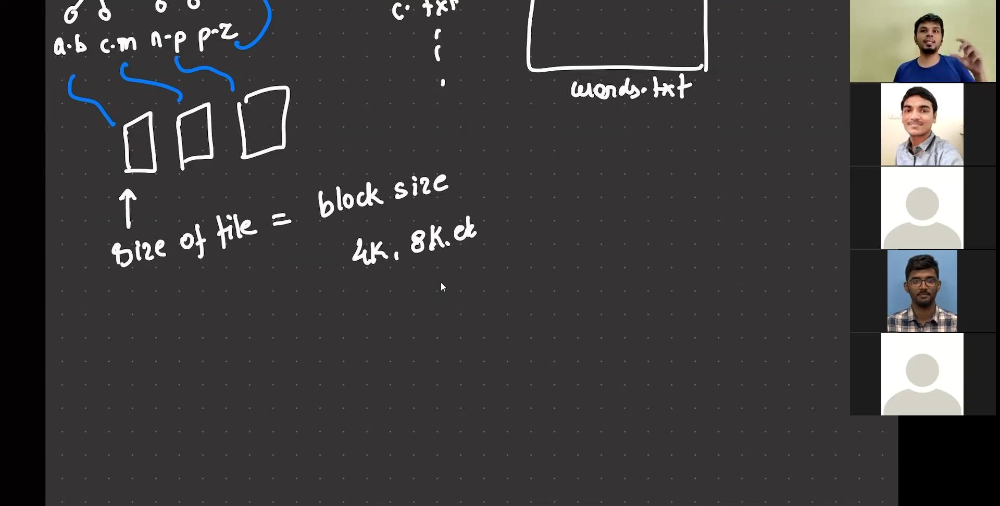
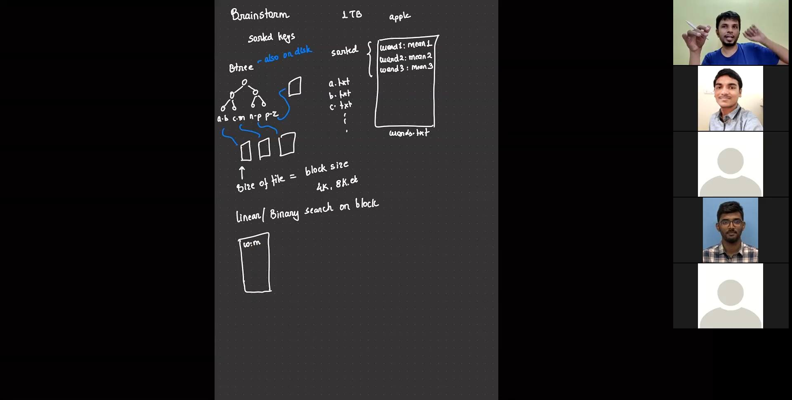
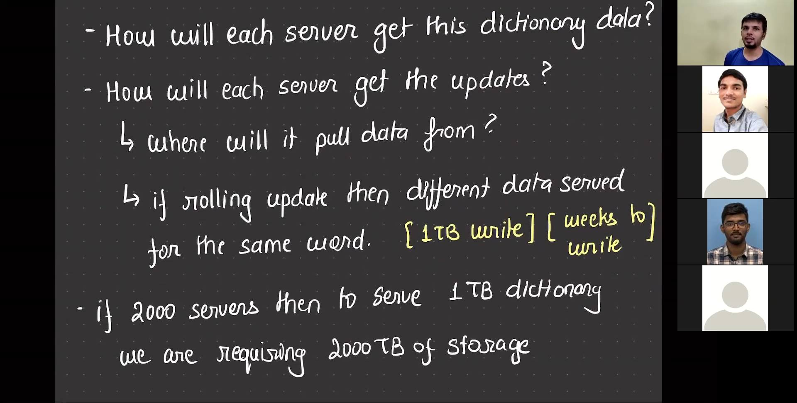
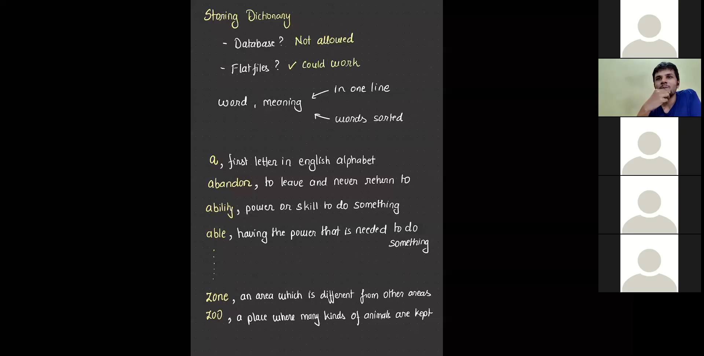
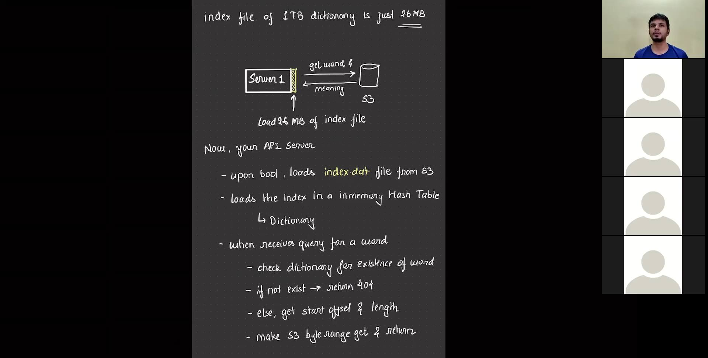

# System Design Masterclass（Arpit）P010 复现文档：不用数据库，用扁平文件做 1TB 单词词典

## 1. 这一节做什么

这一节的目标不是写一个普通 CRUD，而是从约束出发，设计一个**不能用传统数据库**的单词词典系统：词典约 1TB，读请求极高，词条和释义每周通过 change log 更新，查询以“给定一个精确单词，返回释义”为主。课程先回顾“用 MySQL 换内存存储引擎做缓存”的思路，然后进入核心问题：**如何用文件系统 / 对象存储 + 自己实现的索引，完成类似数据库的 pointed query（点查）**。

最终方案可以概括为：

1. 主词典保存为一个按单词排序的大文件，逻辑上是 `word,meaning`。
2. 单独生成一个很小的索引文件 `index.dat`，每行记录单词、起始 offset、长度。
3. API 服务器启动时只把 `index.dat` 加载进内存，不把 1TB 主词典复制到每台机器。
4. 查询时先在内存索引里找到 `start offset + length`，再向 S3 / 网络附加存储发起 **byte range** 读取，只取释义所在的那段字节。
5. 每周把 change log 与主词典做一次有序合并，重写主词典和索引，再上传新版本。
6. 更新时必须处理“服务器内存里是旧索引，而 S3 上已经是新词典”的一致性问题，课程讨论了用版本 / epoch、唯一 tuple、通知或中心位置发布、旧版本延迟删除等方向。

这一节是**纯讲解课**，逐字稿里没有给出可运行的工程代码。因此本文档第 4 节不会伪造“课程完整代码”，而是把讲师的设计落成可复现的数据文件样例、组件职责表、接口草案和容量估算表；所有示意内容都会明确标注“课里没有代码，以下为示意”。

---

## 2. 讲师原话（带「—— p010 [MM:SS]」）

> “just changing the MySQL storage engine……you can switch it to an in-memory storage engine.”
>
> 讲师先用 MySQL 的存储引擎变化说明：同一个 SQL 层可以换底层存储方式，从而获得内存级读写能力。这是本节的开场引子。—— p010 [02:24]


> “Try is in memory, right? But what if our entire dictionary is one terabyte big?”
>
> 讨论“不用数据库做词典”时，讲师提醒： Trie 只能让查找变快，但解决不了 1TB 数据怎么存、释义很长时怎么存。—— p010 [13:16]

> “whenever you are performing any disk IO operation, the unit of operation is same as the block size.”
>
> 讲师强调磁盘 IO 的单位是配置的 block size，可能是 4KB、8KB 等；即使只读 1 字节，也会读入整个块。—— p010 [20:17]


> “you cannot have word and meaning stored together here. You might have word and a pointer to a meaning.”
>
> 当释义可能长达 4MB、而磁盘块只有 4KB 时，不能把单词和释义塞在同一条定长记录里，应存“单词 + 指向释义的指针”。—— p010 [28:14]



> “2,000 servers……to serve one terabyte of dictionary we are actually having 2,000 terabytes of storage.”
>
> 如果每台 API 服务器都本地保存完整词典，2000 台服务器就是 2000TB 存储，课程用这个夸张数字说明资源浪费。—— p010 [41:01]



> “every single blob storage……supports byte range features.”
>
> 讲师指出 S3 或任何网络附加存储、磁盘读取都支持按字节范围读取：给一个 offset 到另一个 offset，就返回这段数据。—— p010 [51:18]



> “if you want to have great performance out of a database, just ensure that your database can keep all of the indexes in memory.”
>
> 讲师把数据库索引思想迁移到扁平文件：索引远小于数据，应该常驻内存。—— p010 [58:55]



> “merge the two sorted lists……upload the merge dictionary to S3 and you upload index.dat file to S3.”
>
> 更新时把已排序的主词典和已排序的 change log 合并，重新生成主词典与索引，再上传。—— p010 [60:23]



> “your servers have the index file built for old dictionary but we have updated the dictionary file……we would be getting old and garbage data.”
>
> 如果直接覆盖 S3 上的主词典，而服务器内存里仍是旧索引，offset 可能指向错误内容；这是更新方案必须解决的核心一致性问题。—— p010 [63:15]

---

## 3. 从零复现

这一节按“需求 → 约束 → 估算 → 方案 → 取舍”的顺序复现讲师推导。复现的目标不是跑一个现成项目，而是得到一套能照着搭出来的设计步骤和可核对产物。

### 步骤 0：写清楚约束卡

先把课程里明确给出的约束列出来，避免中途拍脑袋：

| 约束项 | 课程中的设定 | 对设计的影响 |
|---|---|---|
| 数据规模 | 词典约 1TB | 不能无脑全量复制到每台机器 |
| 词数 | 约 171k，接近 200k | 单词数量有限，释义可能很长 |
| 查询方式 | 精确单词查询 | 可以做 pointed query |
| 更新频率 | 每周一次 change log | 可以离线合并、重写、发布 |
| 更新内容 | 新增词、修改释义等变化量 | 不需要每次全量重算业务逻辑 |
| 存储限制 | 不能用传统数据库 | 要用 flat file / blob storage |
| API 扩展 | API 服务器可水平扩展 | 读多写少，适合索引常驻内存 |
| 读规模 | 课程举例 2M requests/s | 不能每次请求都拉 1TB 文件 |
| 单条释义 | 假设可能到 4MB | 主词典记录不能假设定长小记录 |
| 磁盘块 | 4KB、8KB 等 | 读写以块为单位，索引要避免读放大 |

这一步的验收：团队每个人都能回答“为什么不能每台服务器放一份 1TB 文件”。

### 步骤 1：先做最朴素的 CSV 基线

课程从最简单的 flat file 开始：一个 `words.txt`，每行 `word,meaning`，按单词排序。例如：

```text
a,first letter in the English alphabet
abandon,to leave something
ability,the power or skill to do something
able,having the power or skill
```

这一步只验证数据形态，不解决性能。为什么先做它？因为后面所有索引、offset、byte range 都建立在这个“主文件按单词排序”的前提上。排序是后续二分、块定位、合并更新的基础。

### 步骤 2：估算“每台服务器本地放全量”的成本

如果每台 API 服务器都保存完整 1TB 词典：

```text
单台服务器词典存储 = 1TB
服务器数量 = 2000
总存储 = 2000 × 1TB = 2000TB
```

这就是讲师在 p010 [41:01] 说的“2000 terabytes of storage”。这个方案虽然读本地磁盘很快，但存储成本、部署时间、更新分发都不可接受。结论：主词典必须放到中心位置，例如 S3 或任何网络附加存储。

### 步骤 3：把主词典放到中心存储，并避免全量拉取

中心存储解决“只存一份 1TB”的问题，但新问题出现：API 服务器不能每次请求都从中心存储拉 1TB，也不能每次启动都复制 1TB 到本地。课程的方向是：**服务器直接对中心存储做 ranged read**，只读需要的字节段。

关键能力是 byte range：给定文件中的 `offset A` 到 `offset B`，存储系统返回这一段字节。讲师在 p010 [51:18] 明确说 S3 和任何 blob storage 都支持 byte range。

### 步骤 4：建立索引文件 `index.dat`

要按 byte range 读，必须先知道“这个单词的释义从哪个 offset 开始、长度多少”。课程设计了一个独立索引文件，逻辑字段是：

```text
word,start_offset,length
```

例如：

```text
a,0,35
abandon,36,20
ability,57,38
able,96,31
```

这样查询 `ability` 时，不需要扫描 1TB 主词典，只需要在索引里找到 `start_offset=57, length=38`，然后向 S3 请求 `bytes=57-94`。

### 步骤 5：做索引容量估算

课程给了一个非常关键的 back-of-the-envelope 计算：

```text
总词数 ≈ 171,000
单条索引平均长度 ≈ 15.7 bytes
索引总大小 ≈ 171,000 × 15.7 bytes ≈ 2.6 MB
```

讲师解释 15.7 bytes 的构成：平均单词长度 + 两个分隔符 + 一个换行 + 两个 4 字节整数。也就是索引文件只存“词、两个整数、少量分隔符”，不存长释义，所以 1TB 主词典的索引只有约 2.6MB。这个数字让“索引常驻内存”成为现实。

注意：课程中 `index.dat` 的最终二进制序列化格式没有给出完整实现。讲师提到可以把整数 marshal 成 4 字节；复现时建议先用可读文本行格式，方便核对 offset，生产环境再按课程思路改成 4 字节整数。**课里没有给出 `index.dat` 的完整二进制格式规范**。

### 步骤 6：确定查询流程

课程给出的查询流程可以复现为：

1. API 服务器启动时，从 S3 下载 `index.dat`，加载到内存哈希表 / 字典。
2. 收到单词查询。
3. 在内存索引里查这个单词。
4. 不存在：直接返回 404。
5. 存在：取出 `start_offset` 和 `length`。
6. 向 S3 发起 byte range 请求，读取主词典中对应区间。
7. 把读取到的释义返回给用户。

在 Node.js 里，内存索引可以对应为 `Map<string, { start: number; length: number }>`。课里没有写 Node 代码，这只是对应说明。

### 步骤 7：处理每周更新

课程说更新不是全量新词典，而是每周 change log：新增词、修改释义等。复现步骤：

1. 保持主词典按单词排序。
2. 把 change log 也按单词排序。
3. 用归并两个有序列表的方式合并：遇到相同单词，以 change log 为准；遇到新单词，插入。
4. 重新生成 `words.txt`。
5. 重新生成 `index.dat`，因为 offset 已经变化。
6. 上传新的主词典和新的索引文件。
7. 通知 API 服务器重新加载索引，或让服务器通过中心位置感知新版本。

### 步骤 8：解决“旧索引 + 新词典”的不一致

如果直接覆盖 S3 上的同一个 `words.txt`，服务器内存里还是旧 `index.dat`，旧 offset 可能指向新文件的其他单词或垃圾内容。课程在 p010 [63:15] 明确指出这个问题。

课程讨论的解决方向包括：

- 不直接覆盖，而是创建新文件 / 新版本。
- 给主词典和索引保存同一个 epoch，保证一一对应。
- 索引使用唯一 tuple / 唯一版本标识。
- API 服务器更新后通知其他服务器，或者更新一个中心位置让其他服务器读取。
- 等所有服务器都不再引用旧位置后，再优雅删除旧版本。

这些是课程中的讨论方向，不是完整实现。复现时至少要保证：**主词典和索引必须成对发布，查询端只能使用同一版本的索引和主词典**。

---

## 4. 完整代码

**说明：这一节是纯讲解课，逐字稿没有给出可运行代码。以下不是“课程代码”，而是把讲师方案落成可复现产物的设计草案与数据文件样例。所有接口、目录、版本字段都是复现用示意，课里没有逐字定义。**

### 4.1 复现产物目录（示意）

```text
dictionary-repro/
  words.txt          # 主词典，按 word 排序，word,meaning
  index.dat          # 索引，word,start_offset,length
  changelog.csv      # 每周变更，word,meaning
  README.md          # 记录版本与发布顺序
```

### 4.2 主词典样例 `words.txt`

```text
a,first letter in the English alphabet
abandon,to leave something
ability,the power or skill to do something
able,having the power or skill
```

要求：文件按 `word` 的字典序排序。每条记录的 `meaning` 可以很长，但单词和释义之间用第一个逗号分隔；如果释义内部有逗号，需要转义。课程没有规定转义规则，这是复现时要自己补的工程细节。

### 4.3 索引样例 `index.dat`

复现初期建议用可读文本，字段为 `word,start_offset,length`：

```text
a,0,43
abandon,44,18
ability,63,41
able,105,32
```

说明：上面的 offset 和 length 只是示例，实际值必须由生成脚本根据 `words.txt` 的字节位置计算。课程明确说主词典和索引要能一一对应，因此每次重写 `words.txt` 都必须重新生成 `index.dat`。

### 4.4 change log 样例 `changelog.csv`

```text
ability,the quality or state of being able
abacus,a counting tool with beads
```

合并规则：如果 change log 中的单词已存在，用新释义覆盖；如果不存在，插入新单词。合并后必须重新排序并重新生成索引。

### 4.5 组件职责表

| 组件 | 职责 | 课程依据 / 说明 |
|---|---|---|
| API Server | 接收查询、查内存索引、向 S3 发 byte range 请求、返回释义 | 课程描述了 API 服务器水平扩展和查询流程 |
| 内存索引 | 保存 `word -> start_offset,length` | 课程说索引只有约 2.6MB，可常驻内存 |
| S3 / NAS | 保存 1TB 主词典，支持 byte range 读取 | 课程明确说 blob storage 支持 byte range |
| 合并任务 | 每周把 change log 与主词典归并，重写主词典与索引 | 课程讲了两有序列表合并 |
| 发布 / 通知机制 | 让 API 服务器切换到新版本索引 | 课程讨论了通知、中心位置、epoch、唯一 tuple、旧版本延迟删除 |

### 4.6 接口草案（课里没有定义 HTTP 接口，以下为示意）

| 接口 | 输入 | 输出 | 说明 |
|---|---|---|---|
| `GET /words/{word}` | 单词 | 200 + 释义；404 | 对外查询接口，复现用示意 |
| `getIndex(word)` | 单词 | `{ start, length, version }` 或空 | 内存索引查询 |
| `readRange(objectKey, start, length)` | 对象键、起始 offset、长度 | 字节段 | 对应 S3 byte range |
| `publish(version, wordsKey, indexKey)` | 版本、主词典对象、索引对象 | 成功 / 失败 | 成对发布，避免旧索引配新词典 |

### 4.7 容量估算表

| 项目 | 算式 | 结果 |
|---|---|---|
| 总词数 | 课程口径 | 约 171k，接近 200k |
| 单条索引平均长度 | 平均单词长度 + 分隔符 + 换行 + 2×4 字节整数 | 约 15.7 bytes |
| 索引总大小 | 171,000 × 15.7 bytes | 约 2.6 MB |
| 单服务器本地全量词典 | 1TB × 1 | 1TB |
| 2000 台服务器全量复制 | 2000 × 1TB | 2000TB |
| 假设单条释义上限 | 课程假设 | 可达 4MB |
| 磁盘块大小 | 课程举例 | 4KB、8KB 等，以实际配置为准 |

---

## 5. 逐行解释

**为什么先讲 MySQL 换存储引擎？**  
课程用 MySQL 的 InnoDB 和内存存储引擎说明：SQL 层可以保留，底层存储可以换。这个引子是为了让读者理解“存储引擎决定数据怎么落盘”。但本节最终没有用 MySQL 做词典，而是转向 flat file + 自建索引。课里没有要求必须用 MySQL 实现词典。

**为什么不能每台 API 服务器放一份 1TB 词典？**  
单台 1TB 看似读得快，但 2000 台就是 2000TB。除了存储成本，还有首次分发、每周更新、版本一致性、部署时间等问题。课程用这个极端数字逼迫设计转向中心存储。

**为什么中心存储不能每次请求都拉全量？**  
1TB 文件不可能在每次查询时传输。即使只拉一个单词，也需要知道它在文件中的位置。因此必须把“找位置”和“读内容”分开：索引负责找 offset，中心存储负责按 range 返回字节。

**为什么主词典要按单词排序？**  
排序后可以做有序合并、二分、块定位，也方便生成稳定索引。课程从 CSV 开始就强调排序；更新时也依赖“两个有序列表归并”。如果不排序，每周 change log 的合并会退化成全量扫描和复杂匹配。

**为什么单词和释义不能总是放在同一条定长记录里？**  
磁盘 IO 以 block 为单位，课程举例 4KB；而释义可能长达 4MB。如果把长释义塞进块内记录，会严重读放大。课程给出的方向是 `word + pointer`：块里放单词和指向释义的指针，释义单独存放。这样索引仍然很小，长释义不会破坏块结构。

**为什么需要 `index.dat`？**  
S3 不是数据库，不能直接执行 `select * from words where word = 'apple'`。要在扁平文件上模拟 pointed query，必须自己维护 offset 索引。`index.dat` 就是课程所说的“给扁平文件建索引”。

**为什么索引可以放进内存？**  
因为索引不存释义，只存单词、起始 offset、长度。按课程估算约 2.6MB，2000 台机器每台放 2.6MB 索引完全可以接受。这就是讲师说的“数据库要把索引放内存”在扁平文件方案中的对应做法。

**为什么查询不存在时直接 404？**  
内存索引已经包含全部单词，查不到就不必访问 S3。这减少无效网络 IO。课里在查询流程中明确说了“如果不存在，直接返回 404”。

**为什么更新要重写主词典和索引？**  
change log 合并后，单词顺序和释义长度都可能变化，旧 offset 会失效。因此不能只更新主词典而不更新索引。课程明确说上传合并后的 dictionary 和 `index.dat` 两个文件。

**为什么直接覆盖 S3 文件会出问题？**  
API 服务器内存里是旧索引，S3 上已经是新主词典。旧 offset 在新文件中可能指向别的单词，导致返回垃圾数据。课程在 p010 [63:15] 把这个问题作为更新方案的核心 caveat。复现时必须成对发布，并用版本 / epoch / 通知机制切换。

**为什么课程提到 epoch、唯一 tuple、通知和延迟删除？**  
这些是课堂讨论中提出的解决方向：让主词典和索引有同一版本标识；让服务器知道新版本；等没有服务器引用旧版本后再删除旧对象。它们不是完整协议，课里没有给出实现细节。复现时至少要保证“索引和主词典同版本”，否则一定会读到错数据。

**Node.js 读者注意什么？**  
内存索引可以用 `Map`；byte range 读取对应对象存储的 range 请求；每周合并可以放在后台 worker，不要阻塞 API 进程。课程没有讲锁和事务；如果多进程同时发布，复现时需要自己加“单写者”或发布锁，否则会出现两个版本交叉上传。课里没有讲具体锁方案。

---

## 6. 复现检查清单

- [ ] 已写出约束卡：1TB、171k 词、每周 change log、精确查询、不能用传统数据库。
- [ ] 已生成按单词排序的 `words.txt`，每行 `word,meaning`。
- [ ] 已计算并记录“2000 台 × 1TB = 2000TB”的本地复制成本。
- [ ] 已决定使用 S3 / NAS 作为中心存储，并确认支持 byte range。
- [ ] 已生成 `index.dat`，字段至少包含 `word,start_offset,length`。
- [ ] 已核对 `index.dat` 中每个 offset 和 length 都能从 `words.txt` 正确读出释义。
- [ ] 已按课程口径估算索引大小：171,000 × 15.7 bytes ≈ 2.6MB。
- [ ] 已实现查询流程：内存索引查词 → 不存在 404 → 存在则 range 读取 → 返回释义。
- [ ] 已验证长释义不会破坏块/索引设计，必要时采用 `word + pointer` 思路。
- [ ] 已实现 change log 与主词典的有序合并，冲突时以 change log 为准。
- [ ] 合并后已重新生成主词典和索引，并成对上传。
- [ ] 已设计版本切换：epoch / 唯一 tuple / 通知或中心位置，确保服务器不会用旧索引读新词典。
- [ ] 已验证旧版本在所有服务器切换后再删除。
- [ ] 已记录“课里没讲”的工程项：HTTP 框架、鉴权、重试、监控、压缩、changelog 格式、删除语义等。

---

## 7. 课里没讲但你会撞上的

1. **`index.dat` 的最终二进制格式**：课程说可以把整数 marshal 成 4 字节，也提到分隔符和平均 15.7 bytes，但没有给出完整文件规范。复现时先用文本行格式，生产再定二进制格式。
2. **change log 的格式与删除语义**：课程说新增、修改等变化，但没有定义“删除单词”如何表示。你需要自己约定删除标记。
3. **S3 的实际 API 和权限**：课程把 S3 当作 byte range 存储的代称，没有讲 SDK、签名、桶策略、跨区域复制。
4. **发布原子性**：课程讨论了 epoch / 唯一 tuple / 通知，但没有给出完整发布协议。复现时要保证主词典和索引成对可见。
5. **API 服务器如何收到更新通知**：课程提到通知其他服务器或更新中心位置，但没有指定消息队列、轮询还是配置中心。
6. **并发写和锁**：课程没有讲多个合并任务同时跑会怎样。Node.js 里可以用单写者进程或发布锁，但课里没有给方案。
7. **网络重试与超时**：byte range 请求可能失败，课程没有讲重试、超时、熔断。
8. **压缩与传输成本**：1TB 主词典是否压缩、S3 请求费用、跨区流量，课程没有展开。
9. **监控与限流**：2M req/s 是课堂举例，真实系统需要限流、缓存、监控，课里没有实现。
10. **每词一个文件方案的文件数量问题**：课程讨论过“每个单词一个文件”以及按字母分层目录，但指出这会带来大量移动部件、不可 shipable。复现时不要把它当成唯一方案。

照着本文档做，你至少能复现出课程的核心链路：**排序主文件 → 生成 offset 索引 → 索引常驻内存 → byte range 点查 → 有序合并更新 → 版本化发布**。这就是 P010 从“不能用数据库”推到“自己实现数据库索引能力”的完整设计路径。