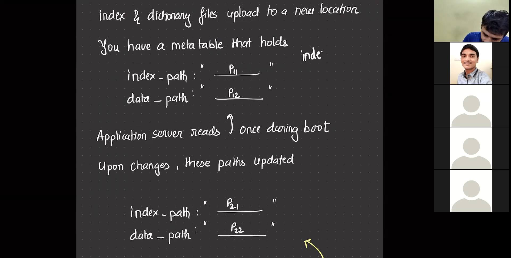
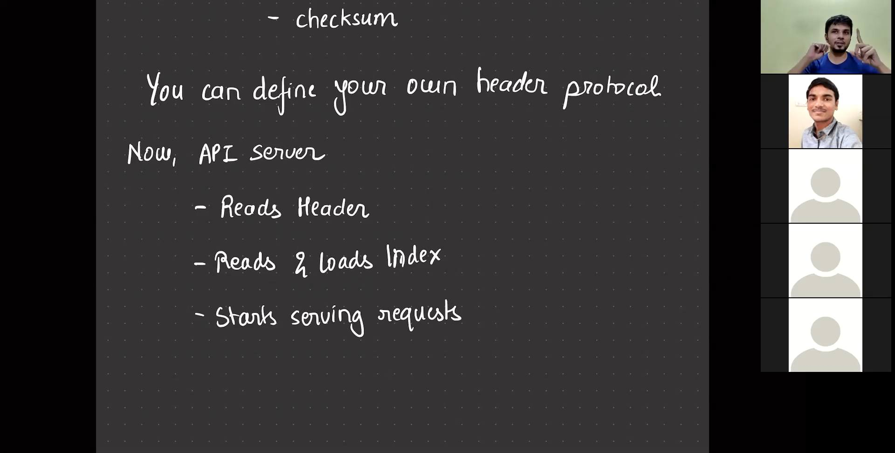
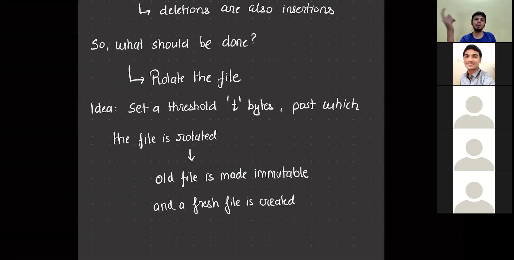
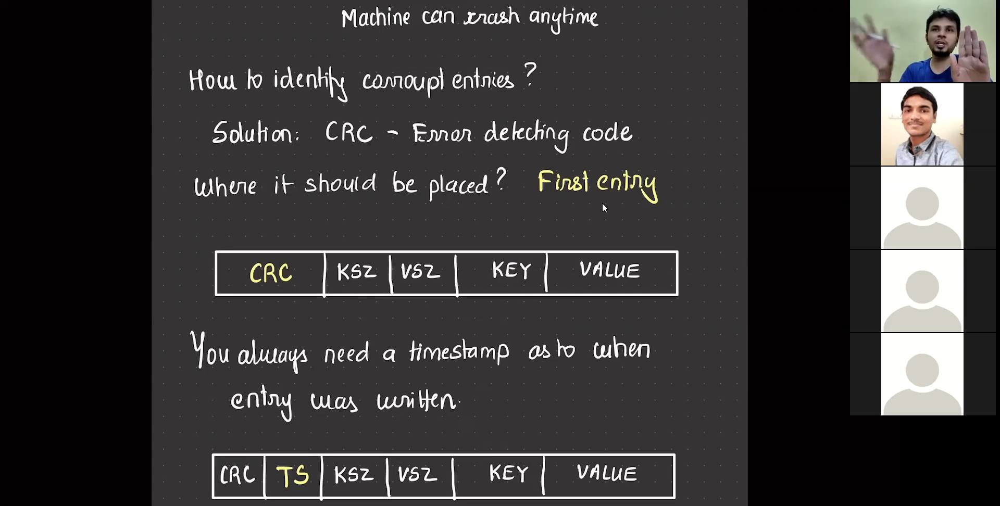
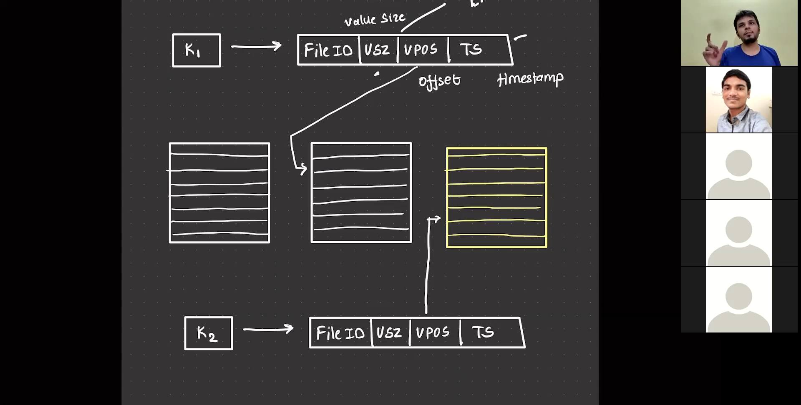
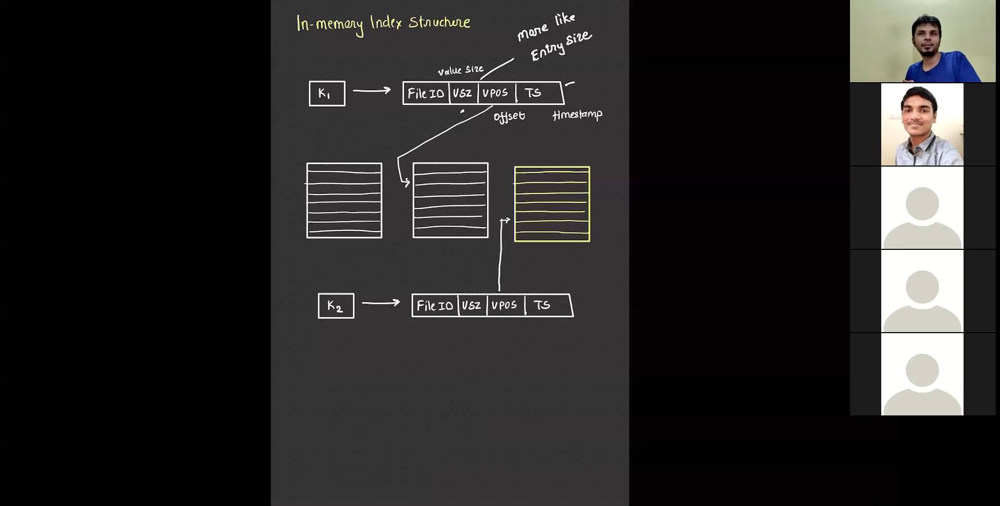

# System Design Masterclass (Arpit) P10 复现文档：只读词典热更新、合并文件头与 Log-Structured Key-Value Store

> **先说明边界**：P10（第 2/2 段，66:06–136:35）是系统设计讲解/白板课，逐字稿里没有完整仓库、依赖版本、环境变量或启动命令。按“纯讲解课”标准，本文第 3 节复现讲师的推导过程，第 4 节把讲师方案落成可照着做的设计产物。**凡是课里没给的字段名、命令、库、版本，本文都会标注“课里没讲”或“示意”，不把没出现的工具安到讲师头上。**

## 1. 这一节做什么

这一节完成两条主线。

第一条主线是**只读词典/索引文件在 S3 上的更新与滚动升级**。讲师先讨论“轮询文件是否变化”的短时错误数据问题，再提出用固定路径的 `meta.json` 保存 index path 和 data path，上传新文件后只更新 meta，新服务器启动读新路径、旧服务器继续读旧路径，最后滚动替换旧服务器。随后讲师把词典索引从“每字节都要省”的角度继续优化：减少分隔符、用压缩、把 index 和 data 合并成单文件，并在文件开头放固定 header，记录 index/data 的 offset、长度和元信息。

第二条主线是**Log-Structured Storage / Key-Value Store**。讲师用 append-only 文件实现 put/get/delete：写只追加，读靠内存哈希表指向文件偏移；删除是写入特殊值；每条记录前面放 CRC 用于检测部分写；文件到 50 MB 就轮转，旧文件变 immutable；后台做 merge/compaction 清掉 stale 和 deleted entry。讲师明确指出这套设计就是 Bitcask，Bitcask 是 Riak 的存储后端，而 Riak 被 Uber 用于生产。

这一节的产物不是某个可运行仓库，而是一套**可直接照着实现/检查的存储设计规格**：词典热更新流程、单文件 header 协议、日志记录布局、内存索引结构、轮转与合并规则、复现检查清单。

## 2. 讲师原话

> "你只需每五分钟调用一次，看看索引或数据是否发生变化……如果你每五分钟才做一次，而索引或数据在第一分钟就发生了变化，那么接下来四分钟你提供的都是错误数据。"
> —— p010 [66:06]

> "你会有自己的 index.zero.dat 文件和 dictionary.zero.dat 文件。"
> —— p010 [68:03]

> "你的元文件里可以包含索引路径和数据路径，API 服务器会在启动时加载这些信息。"
> —— p010 [68:30]

> "旧服务器仍会继续从 p11 和 p12 提供数据……它们可能拿到过期数据，但绝不会拿到错误数据。"
> —— p010 [69:53]

> "你必须考虑自己写入的每一个字节的数据。"
> —— p010 [72:07]

> "你可以直接合并它们……再加一个固定头部，写入一些关于数据库的基本信息。"
> —— p010 [75:01]

> "写操作必须顺序进行……不允许有磁盘寻道。"
> —— p010 [94:09]

> "删除也可以是一次写入，也就是新增一条记录……特殊值……负一。"
> —— p010 [100:10]

> "CRC 必须是我们写入的第一项，这样我们就绝不会写入错误的值。"
> —— p010 [104:27]

> "维护一个内存中的哈希表……用来存储键和偏移量。"
> —— p010 [108:17]

> "一旦某个文件达到一定大小，比如 50 MB，就再创建一个文件并开始写入。"
> —— p010 [112:34]

> "合并与压实……每 30 分钟一次、每小时一次，具体取决于吞吐量。"
> —— p010 [116:22]

> "我们刚才讨论的这个数据库……不过就是一个 Bitcask。"
> —— p010 [125:17]

这里保留逐字稿的读音写法。逐字稿里也出现 “BitTask”“BitCast”，通常拼写为 Bitcask；逐字稿里的 “React/RIAK” 指分布式数据库 Riak，不要和前端 React 混淆。课里没讲 Bitcask 源码的完整实现细节，只讲了设计骨架和 GitHub 上有代码。

## 3. 从零复现

### 3.1 需求：先明确要解决什么问题

需求一：词典/索引数据放在 S3 一类对象存储上，API 服务器启动时加载 index 和 dictionary，然后对外提供查询。服务是自动扩缩容的，不能假设有一台固定 inventory 机器保存最新版本。

需求二：词典/索引会更新。更新时不能让用户读到“半新半旧”的错误数据。讲师反复强调：可以接受短时间 stale data，但不能接受 wrong data。

需求三：词典索引本身不大。逐字稿给了一个具体数字：`index.dat` 大约 2.6 MB，压缩后目标约 2.1 MB。这个数字用于说明“每个字节都要考虑”，不是让你把线上容量拍成 2.1 MB。

需求四：除了词典这种只读场景，还要能设计一个高写吞吐的嵌入式 key-value store。讲师用 log structured storage 来实现 put/get/delete，并说这套设计是 Bitcask 的基础。

### 3.2 约束：为什么不能随便覆盖文件

约束一：服务启动时读文件，运行中把 index 放内存。旧服务器已经加载了旧 index，新服务器启动时才读 meta。因此更新不能简单“原地覆盖同一个 index 文件”，否则旧服务器可能正在读旧文件，新服务器读新文件，边界不可控。

约束二：S3 上文件被替换/更新时，所有服务器没有统一的“刷新时刻”。讲师先讨论了轮询：每五分钟查一次 index/dict 是否变化；如果第 1 分钟变化，后面 4 分钟仍在服务旧数据。这个方案只能缩小错误窗口，不能消除。

约束三：log structured storage 的写只能 append。逐字稿说：“writes has to be sequential... no disk seeks are allowed.” 这里的“不允许 disk seek”指写路径不能回头改旧 entry，读路径仍可能 seek 到 offset。

约束四：单文件不能无限增长。讲师说 32 位文件系统下单文件最大约 2 TB；而且 updates 也是 insertions，deletes 也是 insertions，文件会膨胀。所以要按阈值轮转。

约束五：内存索引必须放得下所有 key。讲师明确说这是这套设计的主要限制：“the only limitation we have is our index should fit in memory.” 如果 key 多到内存放不下，这套单机 Bitcask 式设计就要改。

### 3.3 估算：把讲师给的数量关系写出来

| 项目 | 讲师给的数字/关系 | 复现时怎么用 |
|---|---|---|
| 原始 index 文件 | 约 2.6 MB | 作为词典索引基线 |
| 压缩后 index | 约 2.1 MB | 作为优化目标；课里说 Huffman 约省 40%，但同一段又说 2.6→2.1，两个口径不完全一致，复现时应以实测为准 |
| 单文件轮转阈值 | 例：50 MB | active 文件到 50 MB 后变 immutable，新建 active |
| 32 位文件系统单文件上限 | 约 2 TB | 说明为什么不能只靠一个巨大文件；按 50 MB 估算约 4.19 万个段，但课里没要求真开这么多文件，实际还受文件句柄限制 |
| get 成本 | 1 次内存哈希查找 + 1 次 disk seek + 1 次 disk read | 这是讲师对点查的成本拆解；平均 O(1)，最坏情况讲师在问答里提到哈希表内部仍可能涉及二分查找，最坏 O(log n) |
| compaction 频率 | 30 分钟一次或 1 小时一次，看吞吐 | 不是固定值，课里没给统一配置 |
| 合并/压缩节省 |  stale entry 和 deleted entry 跳过 | 具体节省比例取决于更新/删除比例，课里没给公式 |

这里要特别小心：讲师说“Huffman 压缩约 40%”，又说“index 从 2.6 MB 变成 2.1 MB”。2.6 到 2.1 约是 19% 的下降，不是 40%。这不是本文要修正讲师的数学，而是复现时必须知道的**口径风险**：40% 是口头估算，2.1 MB 是讲师给的结果目标；真正实现时要拿自己的词典做压缩前后实测。

### 3.4 方案 A：词典/索引热更新与滚动升级



复现步骤按讲师推导走：

1. 在固定路径放一个 meta 文件，逐字稿说的是 `/meta.json`。这个文件路径不变，所有 API 服务器启动时都读它。
2. meta 里保存 index path 和 data path。讲师举例：`index.zero.dat`、`dictionary.zero.dat`，用 epoch/unique identifier 区分版本。
3. 应用服务器 boot 时读 `/meta.json`，得到当前版本的 index path 和 data path，从 S3 加载 index 到内存。
4. 周任务/更新任务不覆盖旧文件，而是上传新版本文件，例如从 `p11/p12` 更新到 `p21/p22`。讲师用 `P11`、`P12`、`P21`、`P22` 指代旧路径和新路径。
5. 更新任务最后更新同一个 `/meta.json`，把 index path/data path 指到新版本。
6. 新启动的服务器读新 `/meta.json`，加载新文件；旧服务器内存里仍是旧路径，继续服务旧数据。讲师说旧服务器可能给 stale data，但不会给 wrong data。
7. 确认新服务器正常后，把旧服务器从负载均衡器摘掉，或滚动终止旧服务器。自动扩缩容删一台旧服务器、加一台新服务器，新服务器带新配置启动。
8. 所有旧服务器替换完后，再删除旧的 dictionary/index 文件。

这条方案的核心不是“文件更新”，而是**版本指针 + 不可变数据文件 + 滚动替换进程**。旧服务器不需要知道新文件，因为它的内存索引已经加载完成；新服务器也不需要处理旧文件，因为它在 boot 时读到新 meta。

### 3.5 方案 B：把 index 和 data 合并成一个文件，前面放固定 header



讲师说两个文件不方便整体搬运，想把 index 和 data 合并成一个文件。问题是：合并后怎么知道 index 在哪里结束、data 从哪里开始？用分隔符不可靠，因为 data 里可能出现分隔符。更好的做法是**固定 header**。

固定 header 要自包含，不能依赖“上一条 entry”或“下一条 entry”来推断。讲师说 header 里可以放：

- 总 key/word 数；
- index 的 offset；
- index 的 length；
- data 的 offset；
- data 的 length（逐字稿说 offset of data，长度可按同样思路补）；
- 版本；
- last updated at 之类的元信息。

读取流程：API 服务器打开这个单一文件，先读固定 header，从 header 得到 index 的 offset 和 length；按这个范围读 index chunk，加载到内存；后续查询走内存 index，再按 offset 去读 data chunk。讲师说这种“固定 header + 自描述 offset”在 zip 文件、JPEG/PNG/MP3、HDFS、Google File System、Spanner 内部都能看到类似思想。课里没有给字节级字段顺序，只给了设计原则：**header 必须固定大小、可预测、每项信息自包含**。

讲师在问答里还讨论了一个优化：如果 index 里存的是 start offset 和 end offset，或者只存 start offset 再结合上一条长度，可以省 4 字节。讲师的取舍是：很多协议宁愿让每条信息自包含，存 start/end，避免依赖前后 entry；这个不是唯一正确答案，取决于你的协议。课里也提到：如果 index 是 hash map 结构，就不能靠“上一条”推断；如果是排序列表做二分，才可以考虑这种省字节方案。

### 3.6 方案 C：Log-Structured Key-Value Store


讲师把 log structured storage 定义为：文件永远 append-only，写顺序进行，不能回头更新旧 entry。为什么要这样？因为机械盘最贵的是磁头移动/disk seek；顺序写让磁头只往一个方向走。SSD 上优势没那么明显，但大规模基础设施为了成本会用机械盘，所以这套设计仍有价值。Kafka/事件总线、MySQL binlog、commit log 这类高写吞吐场景都有类似思想。

复现一个最小 KV store，按讲师的设计拆成四层：

1. **写路径**：`put(key, value)` 追加一条记录到 active file。记录里不只有 key/value，还要有 key size、value size，因为 key/value 都是变长。讲师说先读 4 字节 key size、4 字节 value size，再按长度读 key 和 value。
2. **删除路径**：`delete(key)` 不回头删旧 entry，而是再 append 一条“特殊值”记录。讲师举例用 `-1` 或任意业务上排除的 magic number 表示删除。这样 delete 也是 O(1) append。
3. **读路径**：如果没有索引，`get(key)` 要从文件头扫到尾，找该 key 最新一条记录，判断是值还是删除标记，所以是 O(n)。为了变成点查，维护一个**内存哈希表**：key → 文件位置。文件位置至少需要 file ID、offset；讲师后面说内存结构里存 `vPos`（offset）和 `vSize`，并说 `vSize` 可能是整个 entry 的长度，而不只是 value 长度——这是讲师的“best guess”，课里没有给出官方字段定义。
4. **崩溃检测**：每条记录最前面写 CRC。讲师说 CRC 要第一个原子落盘，然后才是 key size、value size、key、value；如果写到一半机器崩了，读的时候 CRC 对不上，就能发现这条 entry 不完整，跳过它。CRC 只能检测损坏，不能纠正数据。timestamp 也写进 entry，但讲师自己说 timestamp 的具体用途在资料里只看到一句“检查 entry 是否 still”，没有完全解释清楚。

### 3.7 文件轮转、merge/compaction 与取舍



单文件一直 append 会膨胀，所以到 50 MB 就轮转：当前 active 文件变成 immutable，只读；新建 active 文件继续写。内存索引从“key → offset”升级为“key → fileId + vPos + vSize”。get 时先查内存索引拿到 fileId/offset，再到对应文件读 entry。

文件轮转的并发细节，讲师在问答里说：轮转不能在写路径里同步做，否则写吞吐会受影响；可以用 soft link 指向 active 文件，轮转时切换 soft link；实现上另有线程做 rotation，论文和实现有差异。课里没有给 soft link 的具体代码。

merge/compaction 解决“旧 entry 永远不会再被查询”的浪费。比如 key 被更新 100 次，前 99 条基本是垃圾，只有第 100 条会被 get。compaction 把多个 immutable 文件合并，跳过 stale entry 和 deleted entry，只保留每个 key 的最新 live 版本；合并后 offset 会变，所以内存索引也要更新。讲师说这类似 merge sort，并且要对每个 key 原子更新；compaction 期间可能有类似 GC 的 pause。讲师还说 compaction 可以在同一进程做，因为要更新同一份内存哈希表。

取舍总结：

- 轮询文件变化：实现简单，但会有一段时间服务旧数据，不能根治。
- 并行上传新文件 + 更新 meta：短期有两份存储，但旧服务器继续读旧文件，用户不会读到半新半旧。
- 压缩：省空间，但增加 CPU；40% 是口头估算，必须实测。
- 合并单文件 + header：方便搬运，但 header 必须固定、自描述。
- append-only：写吞吐高、chronology 天然存在，但文件膨胀，必须 compaction。
- 内存索引：get O(1) 平均，但 key 必须放得进 RAM。

## 4. 完整代码

> **课里没有代码**。P10 是设计讲解，逐字稿没有给出可运行源码、依赖版本、环境变量或启动命令。下面按“纯讲解课”的要求，把讲师方案落成完整的**设计决策表、组件职责表、接口/数据模型草案、容量估算表**。字段名没有出现在逐字稿里的，均标为“示意”；实现时以你自己的协议为准。

### 4.1 设计决策表

| 问题 | 讲师方案 | 为什么这样定 | 代价/边界 | 课里依据 |
|---|---|---|---|---|
| 词典更新如何不让旧服务器读错 | 固定 `/meta.json` 保存 index path/data path；上传新文件；更新 meta；滚动替换服务器 | 旧服务器继续读旧内存索引，新服务器读新路径；可 stale，不可 wrong | 短期双份文件；需要滚动升级流程 | p010 [68:30]–[71:14] |
| 如何发现文件变化 | 轮询 meta/文件修改时间，或用并行文件 + epoch | 轮询会短时错误；并行文件避免原地替换 | 轮询不能根治；并行文件占双份空间 | p010 [66:06]–[68:03] |
| 如何节省 index 字节 | 减少分隔符；固定宽度整数；Huffman 压缩 | 嵌入式存储要逐字节考虑 | 压缩增 CPU；40% 与 2.1 MB 口径不一致 | p010 [72:07]–[74:33] |
| 如何合并 index 和 data | 单文件 + 固定 header，记录 index/data offset 和 length | header 自描述，方便整体搬运和读取 | header 字段布局课里没给字节级定义 | p010 [75:01]–[77:19] |
| 如何实现高写吞吐 KV | append-only log；写顺序，不回头更新 | 避免写路径 disk seek；chronology 天然存在 | 文件膨胀；读需要索引 | p010 [93:40]–[96:23] |
| delete 怎么做 | 再 append 一条特殊值记录，例如 `-1` | 不破坏 append-only；delete 也 O(1) | 特殊值必须业务上排除；compaction 要跳过 | p010 [100:10]–[101:08] |
| 点查怎么变快 | 内存哈希表：key → fileId/vPos/vSize | 一次内存查找 + 一次 disk seek/read | 所有 key 必须装进内存 | p010 [108:17]–[111:08] |
| 崩溃怎么检测 | 每条 entry 最前面写 CRC | 部分写时 CRC 对不上，可跳过尾部损坏 entry | 只能检测不能纠正；CRC 算法/宽度课里没讲 | p010 [104:27]–[107:19] |
| 文件太大怎么办 | active/immutable 轮转，例 50 MB | 避免单文件无限增长；旧文件只读 | 文件句柄、soft link、线程实现课里没展开 | p010 [112:34]–[114:30] |
| 垃圾 entry 怎么清 | merge/compaction，跳过 stale/deleted | 只保留每个 key 最新 live entry | offset 变化要更新内存索引；可能有 pause | p010 [115:26]–[117:46] |

### 4.2 组件职责表

| 组件 | 职责 | 输入/输出 | 课里说明 |
|---|---|---|---|
| `/meta.json` | 固定版本指针，保存 index path、data path、epoch 等 | 被 API server 启动时读取；被更新任务替换 | 路径固定；字段名课里没给 |
| index 文件 | 词典索引/内存加载源 | API server 读入内存 | 例 `index.0.dat` |
| data/dictionary 文件 | 实际词典数据 | 按 index 指向的 offset 读 | 例 `dictionary.0.dat` |
| 单一合并文件 | index + data + fixed header | API server 先读 header，再读 index chunk | header 固定大小、自描述 |
| API server | boot 时读 meta，加载 index；对外查询 | 内存索引 + 文件读取 | 旧 server 继续旧路径 |
| 更新任务/周任务 | 上传新版本文件，更新 meta | 新 index/data 文件 | 讲师说 weekly job |
| 负载均衡/自动扩缩容 | 摘旧 server、加新 server | 滚动替换 | 讲师说典型 rolling upgrade |
| active log file | 唯一可写文件 | `put`/`delete` append | 到阈值轮转 |
| immutable log files | 只读旧文件 | `get` 可读；compaction 输入 | 不允许写 |
| 内存哈希索引 | key → fileId/vPos/vSize | get 点查 | `vSize` 解释见备注 |
| compaction 任务 | 合并 immutable 文件，跳过垃圾 | 输出新文件，更新内存索引 | 可能同进程，类似 GC pause |
| CRC/timestamp | 检测部分写、记录元信息 | 每条 entry 开头/元信息 | timestamp 用途讲师未完全解释 |

### 4.3 接口/数据模型草案（示意）

> 下面 JSON 里的字段名是**示意**。逐字稿只说了“meta file could have index path and data path”“add a epoch/unique identifier”，没有给准确 JSON 字段名。

```json
{
  "index_path": "index.0.dat",
  "data_path": "dictionary.0.dat",
  "epoch": 0
}
```

合并单文件的固定 header 草案：

| header 字段（示意） | 作用 | 课里是否明确 |
|---|---|---|
| total_keys / total_words | 总 key/word 数 | 讲师提到“how many words” |
| index_offset | index 起始位置 | 明确 |
| index_length | index 长度 | 明确 |
| data_offset | data 起始位置 | 明确 |
| data_length | data 长度 | 讲师说 offset，长度按同思路补 |
| version | 文件版本 | 讲师提到 version |
| last_updated_at | 最后更新时间 | 讲师提到 last updated at |

log entry 草案：

| 顺序 | 字段 | 说明 | 课里是否明确 |
|---|---|---|---|
| 1 | CRC | 放最前面，用于检测部分写 | 明确 |
| 2 | timestamp | 写入时间 | 明确，但用途未完全解释 |
| 3 | key_size | key 字节长度 | 明确 |
| 4 | value_size | value 字节长度 | 明确 |
| 5 | key | 变长 key | 明确 |
| 6 | value | 变长 value；删除时写特殊值 | 明确，特殊值例 `-1` |

内存索引 entry 草案：

| 字段 | 说明 | 课里是否明确 |
|---|---|---|
| key | 索引 key | 明确 |
| fileId | 该 key 最新 entry 所在文件 | 讲师说文件轮转后要加 |
| vPos | 文件内 offset | 明确 |
| vSize | 讲师“best guess”是整个 entry 的长度，不一定是 value 长度 | 明确是猜测，需以实际实现为准 |

### 4.4 容量与复杂度估算表

| 指标 | 讲师结论 | 复现注意 |
|---|---|---|
| 词典 index 原始大小 | 约 2.6 MB | 作为基线 |
| 压缩后目标 | 约 2.1 MB | 与“约 40%”口径不一致，实测 |
| put | O(1) append | 受文件轮转/写队列影响 |
| delete | O(1) append 特殊值 | compaction 前文件仍保留旧 entry |
| get（有内存索引） | 1 次内存 lookup + 1 次 disk seek + 1 次 disk read；平均 O(1) | 最坏情况讲师问答说哈希表内部仍可能二分，O(log n) |
| get（无索引） | O(n) 扫全文件 | 用来解释为什么必须建索引 |
| 文件轮转阈值 | 例 50 MB | 不是固定标准 |
| 单文件上限 | 32 位文件系统约 2 TB | 平台相关 |
| compaction 频率 | 30 分钟或 1 小时，看吞吐 | 课里没给统一配置 |
| 内存限制 | 所有 key 必须放得进 RAM | 这是单机 Bitcask 式设计的主要限制 |

### 4.5 目录结构草案（课里没给，按讲师文件名模式示意）

```text
storage/
  meta.json
  index.0.dat
  dictionary.0.dat
  log/
    active.log
    immutable-0001.log
    immutable-0002.log
```

再次强调：**依赖版本、环境变量名、启动命令，课里都没讲**。上面的目录只是把 `index.zero.dat`、`dictionary.zero.dat`、`/meta.json`、active/immutable 文件这些讲师提过的概念落成示意结构，不是讲师仓库。

## 5. 逐行解释



**5.1 为什么用固定 `/meta.json`，而不是让每台服务器自己轮询？**  
因为 API 服务器是自动扩缩容的，没有固定 inventory。每台服务器启动时读同一个固定路径，才能拿到当前 index/data 路径。轮询只能缩小“文件已经变但服务器还没刷新”的窗口；如果第 1 分钟变化、5 分钟才轮询，后面 4 分钟仍服务旧数据。固定 meta 把“版本切换”集中到一个指针文件，旧服务器不需要刷新，新服务器启动时自然读新版本。

**5.2 为什么上传新文件而不是覆盖旧文件？**  
覆盖会让“正在读旧文件的服务器”和“正在读新文件的服务器”落在同一个文件的不同版本上，边界不可控。新课里用 `index.zero.dat`、`dictionary.zero.dat` 到 `p11/p12`、`p21/p22` 的方式，旧文件不变，新文件另存。旧服务器继续读旧内存索引，新服务器读新文件。这样最坏是 stale，不是 wrong。对应到 Node/JS：不要用“原地写同一个大 JSON 然后让多个进程热读”的方式；更稳的是写新文件，再用一个版本指针切换。

**5.3 为什么滚动升级而不是一次性全换？**  
讲师说典型部署就是 rolling upgrade：从负载均衡器摘一台旧服务器，自动扩缩容补一台新服务器；新服务器启动带新配置/新代码。全换会让所有旧服务器同时消失，流量和缓存都抖动。滚动替换让新旧版本短暂共存，符合“双份文件”的设计。

**5.4 为什么固定 header 必须固定大小、自描述？**  
读取方先读 header，才能知道 index 从哪里开始、多长、data 从哪里开始。如果 header 大小可变，读取方就不知道读多少字节才算 header；如果 header 依赖别的 entry 推断偏移，协议就不自包含。讲师说“every single information has to be self-contained”，这正是嵌入式文件格式的常见做法。对应到前端/Node：解析二进制文件时先读固定长度的头，再按头里的 offset/length 去切片，不要靠分隔符猜边界。

**5.5 为什么 log structured storage 写路径不允许 disk seek？**  
机械盘最贵的是磁头来回移动。append-only 让写只往文件尾追加，磁头基本单向移动，所以写吞吐高。读路径仍可能 seek 到某个 offset，但读不是写瓶颈。对应到 Node：如果你用多个 async 任务并发 `appendFile` 同一个文件，写入顺序可能交错，会破坏“单写者串行”的假设；更稳的是单写者队列/串行写。课里强调的是嵌入式数据库的单进程单文件写，不是多进程共写。

**5.6 为什么 delete 要写成特殊值？**  
因为 append-only 不允许回头删旧 entry。delete 只是再 append 一条记录，表示“这个 key 被删了”。讲师举例用 `-1` 或业务排除的 magic number。这样 delete 也是 O(1)。读的时候如果最新 entry 是特殊值，就返回“不存在”。旧值还留在文件里，直到 compaction 跳过它。注意：特殊值必须和你的业务值域不冲突；课里只是举例，不是强制 `-1`。

**5.7 为什么 CRC 要放最前面？**  
讲师说 CRC 要第一个原子落盘，然后再写 key size、value size、key、value。这样如果写到一半机器崩了，读的时候先读 CRC，再读后面的字段；CRC 和内容对不上，就能判断这条 entry 不完整，跳过尾部损坏记录。CRC 只能检测，不能修复。课里没给具体 CRC 算法和字节宽度，只说“fixed byte size representation / checksum”这类思路。对应到 Node：实现时你会遇到“CRC 用哪个库、多少字节、是否包含 timestamp/key size/value size”的问题，这些课里没讲，必须自己定协议并测试。

**5.8 为什么内存哈希表能救 get？**  
没有索引时，get 要从文件头扫到尾，找 key 的最新 entry，O(n)。有了内存哈希表，key 直接映射到 fileId/vPos/vSize，一次内存查找定位 entry，再一次 disk seek/read 读出来。讲师说 get 变成 1 次内存 lookup + 1 次 disk seek + 1 次 disk read。限制是所有 key 必须放得进 RAM。对应到 JS/Node：用 `Map` 做内存索引很自然，但 `Map` 也占内存；key 规模上去后要考虑分片/多实例，课里没展开。

**5.9 为什么文件要轮转成 active + immutable？**  
如果只有一个巨大文件，更新和删除也是追加，文件会无限膨胀；而且单文件有平台上限。轮转到 50 MB 后，旧文件变 immutable 只读，新文件 active 可写。内存索引要加 fileId，因为同一个 key 的最新 entry 可能在不同文件。对应到 Node：维护一个 `activeFileId`，轮转时切换写入目标，旧文件不再接受写；读路径按索引里的 fileId 打开对应文件。课里没讲文件句柄池、打开文件数上限，这些是复现会撞上的工程细节。



**5.10 为什么 compaction 要跳过 stale 和 deleted？**  
一个 key 更新 100 次，前 99 条基本不会再被查询；delete 后旧值也不应再返回。compaction 合并 immutable 文件时只保留每个 key 的最新 live 版本，跳过旧版本和删除标记，节省空间。合并后 offset 变了，所以内存索引要更新。讲师说这类似 merge sort，并且对每个 key 要原子更新。对应到 Node：不要在读路径看到“半合并”的索引；可以先把新索引构建好，再整体替换 `Map` 或加版本号。课里只说了要原子，没给具体切换代码。

**5.11 为什么 timestamp 有争议？**  
讲师在问答里明确说，资料里只写了一行“可以检查 entry 是否 still”，他没有找到完整解释；他猜测如果要从内存立即服务，可能需要知道 last updated。本文不把 timestamp 说成确定用途。复现时你可以先把 timestamp 当元信息写入，但不要假设它能解决多进程冲突。讲师后面回答多 master/多 segment 问题时说：这套设计是单进程单文件，不能两个进程写同一文件；如果分布式分片，可能需要 timestamp 判断先后，但课里没展开。



**5.12 Bitcask、Riak、Uber 是什么关系？**  
讲师说我们刚设计的这套东西就是 Bitcask；Bitcask 是 Riak 的存储后端；Riak 是分布式、分片数据库，每个节点跑一个 Bitcask 实例；Uber 在 production 用 Riak。课里没讲 Bitcask 的完整源码，只给了设计骨架。LSM tree 在问答里被提到：它基于同一 idea，只是有多层，写先到一层再层层合并；课里没展开多层细节。

## 6. 复现检查清单

> 课里没有给仓库和启动命令，下面用“文件状态 + 行为检查”代替命令。每一项都能对照讲师的设计验证。

| 阶段 | 操作 | 预期 | 失败信号 |
|---|---|---|---|
| 词典热更新 1 | 准备固定 `/meta.json`，写入 index path/data path/epoch | 所有 server 启动都读同一路径 | 每台 server 读不同路径，版本不可控 |
| 词典热更新 2 | 上传 `index.0.dat`、`dictionary.0.dat` | API server 能加载 index 到内存 | 文件缺失/路径不一致 |
| 词典热更新 3 | 上传新版本 `index.1.dat`、`dictionary.1.dat`，先不切 meta | 旧 server 仍读旧路径，新 server 尚未切 | 旧文件被覆盖，旧 server 读错 |
| 词典热更新 4 | 更新 `/meta.json` 到新路径 | 新启动 server 读新路径；旧 server 继续旧内存索引 | 旧 server 被迫重载，出现混合数据 |
| 词典热更新 5 | 滚动摘旧 server、加新 server | 全部新 server 读新版本 | 一次性全停，流量抖动 |
| 词典热更新 6 | 确认无旧 server 引用后删除旧文件 | 旧文件可删 | 删早了，旧 server 读失败 |
| 合并文件 header | 写入固定 header，记录 index offset/length、data offset/length、total keys、version | 读取方先读 header，再按 offset 读 index chunk | header 变长/

## 7. 课里没讲但你会撞上的

| 现象 | 原因 | 怎么办 |
|---|---|---|
| 找不到可运行仓库、依赖版本、环境变量或启动命令，无法直接跑起来 | P10 是设计讲解；课里没给完整仓库、依赖版本、环境变量、启动命令 | 按第 4 节设计规格自建最小实现；补充：依赖、版本、启动命令课里没讲，不要假称复现讲师仓库 |
| 实现固定 header 时不知道字段宽度、顺序、端序和对齐方式 | 课里只给 header 设计原则和字段清单；补充：字节级字段顺序、宽度、端序、padding 课里没讲 | 自定固定大小 header，写 magic、version、header_size，固定端序，并做二进制读写测试；补充：这些具体协议课里没讲 |
| `meta.json` 字段名和示例对不上，换实现就解析失败 | 逐字稿只说 meta 保存 index path 和 data path；补充：准确 JSON 字段名课里没讲，文档里的字段是示意 | 固定自己的 schema 并版本化，不依赖未定义字段；补充：字段名课里没讲 |
| 更新 `/meta.json` 时，新启动服务器读到半截 JSON 或旧缓存 | 课里只说更新同一个 meta；补充：原子替换、缓存、失败重试课里没讲 | 先写临时文件再原子替换，reader 解析失败时重试；补充：原子替换细节课里没讲 |
| 并发 append 同一个 active 文件，记录交错或 CRC 错乱 | 课里强调 append-only 和单进程单文件；补充：多线程、多 async、多进程的具体串行化、锁和写队列课里没讲 | 用单写者队列或锁，禁止多进程共写同一 active 文件；补充：实现细节课里没讲 |
| 文件轮转时读错文件，或写吞吐明显抖动 | 课里只讲 active/immutable 和 50 MB 例子；补充：rotation 线程、soft link 切换、文件句柄池的具体代码课里没讲 | 写路径串行，原子切换 active 指针，索引带 fileId，做并发读写测试；补充：代码课里没讲 |
| CRC 总是对不上，或者半写检测失效 | 课里只说 CRC 放最前面；补充：CRC 算法、宽度、覆盖哪些字段课里没讲 | 协议里固定 CRC 覆盖范围并测试截断写入；补充：算法和宽度课里没讲 |
| `get` 读出的 value 错位，读多或读少 | 讲师说 `vSize` 是 best guess，可能是整个 entry 长度，不一定是 value 长度；补充：官方字段定义课里没讲 | 协议里分开 entry 长度和 value 长度，索引存明确含义；补充：字段定义课里没讲 |
| 业务值恰好是 `-1` 时被误判为删除 | 课里只举例用 `-1` 表示删除，特殊值必须业务上排除；补充：具体 tombstone 编码课里没讲 | 用独立 tombstone 标记或类型标记，不假设 `-1` 安全；补充：编码课里没讲 |
| compaction 期间读路径看到半合并索引，或 offset 指向失效文件 | 课里只说 compaction 要原子更新索引、可能有 pause；补充：整体替换、版本切换、引用计数代码课里没讲 | 新索引构建完整体替换，旧文件延迟删除，读路径按版本取；补充：具体切换代码课里没讲 |
| 文件段数一多就打开失败或句柄耗尽 | 50 MB 轮转和约 2 TB 上限会推出很多段；文档提示还受文件句柄限制；补充：句柄池和段数上限配置课里没讲 | 限制段数、按需打开文件、及时 compaction；补充：句柄池课里没讲 |
| 只做全量替换，漏掉“有则更新、无则新增”的周变更 | 逐字稿说更新是 change log，不是整本词典；补充：change log 格式与合并算法课里没讲 | 先合并 change log 生成新不可变版本，再切 meta；补充：格式和算法课里没讲 |
| 把 word 和 meaning 放同一记录后，块或记录过大 | 逐字稿说 meaning 可能很长，应使用 word 加 pointer；补充：具体阈值、指针编码、块大小配置课里没讲 | index 存 word 到 data offset/length，meaning 单独存，按实测定约束；补充：具体布局课里没讲 |
| 按“约 40%”压缩目标做，实测达不到 | 课里口头约 40% 压缩，与 2.6 MB 到 2.1 MB 的口径不完全一致；课里没给压缩公式和统一目标 | 以自己词典压缩前后实测为准，不把 2.1 MB 当线上容量 |
| 本地无法直接复现 S3 固定 meta 加滚动替换 | 课里没给 S3 SDK、部署命令、负载均衡或自动扩缩容环境；逐字稿只说 S3 可用 network attached storage 替代；补充：具体环境课里没讲 | 用本地目录模拟固定 meta 和不可变文件，多进程模拟旧/新 server；补充：部署命令课里没讲 |
| 单次脚本测不出“旧服务器继续服务旧数据” | 需要长驻 reader 持有旧 meta 和旧内存索引；补充：测试方法课里没讲 | 两个 reader 进程分别加载旧/新 meta，验证旧进程不重载、新进程读新路径；补充：测试方法课里没讲 |
| 照着逐字稿前半实现 B+ 树，偏离最终单文件 header 方案 | 逐字稿前半把 B+ 树作为推导和反例，文档结论是固定 header 单文件；补充：完整 B+ 树代码课里没讲 | 按最终方案做 index/data 合并加 header；中间 B+ 树只当概念理解；补充：若要做 B+ 树，代码课里没讲 |
