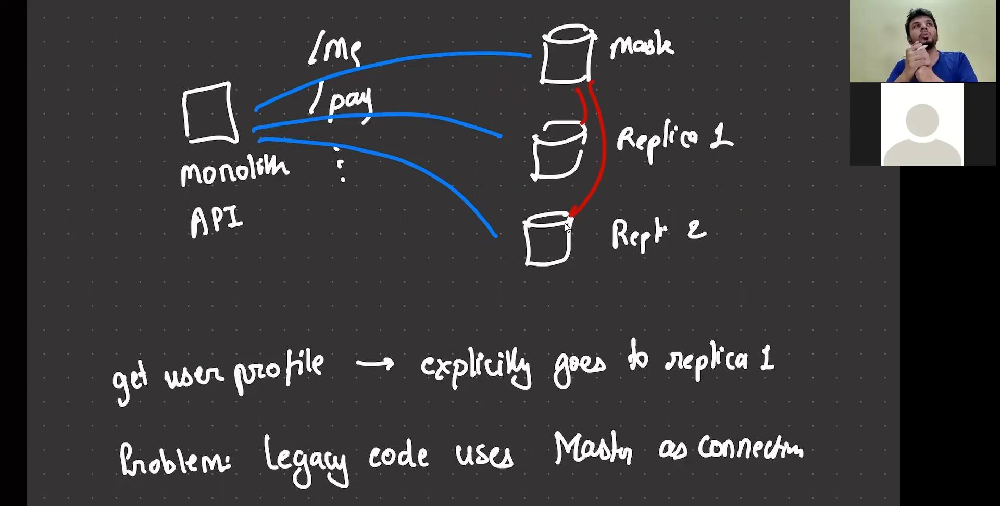
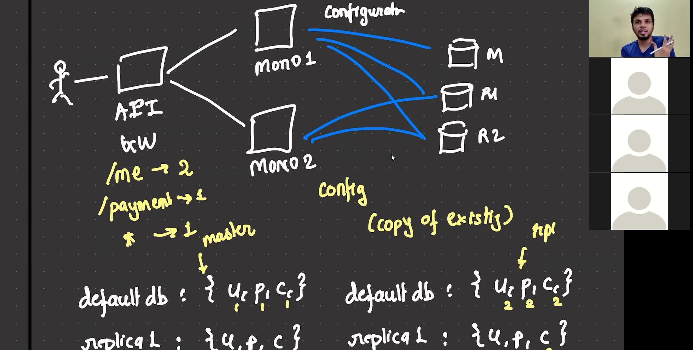
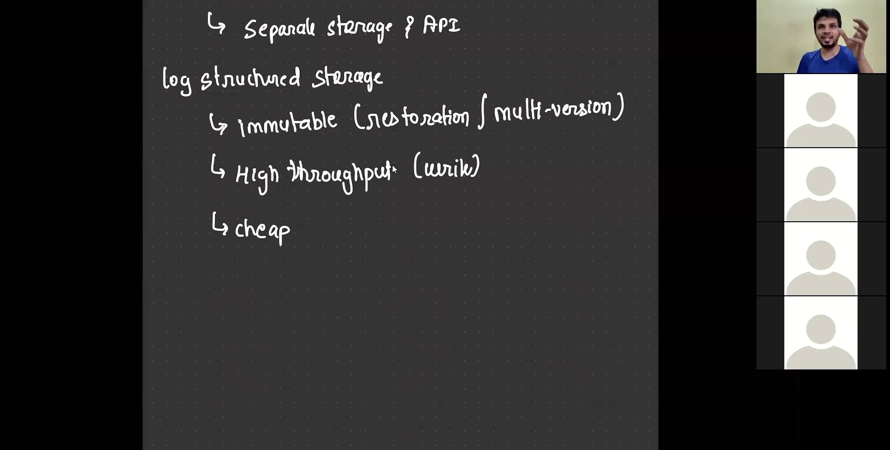
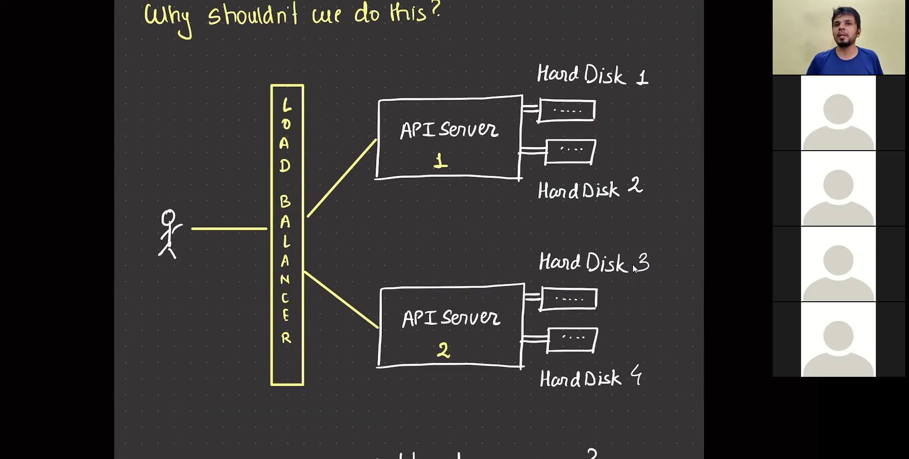
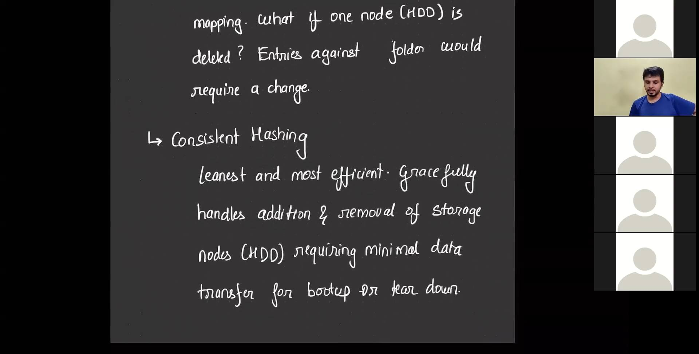
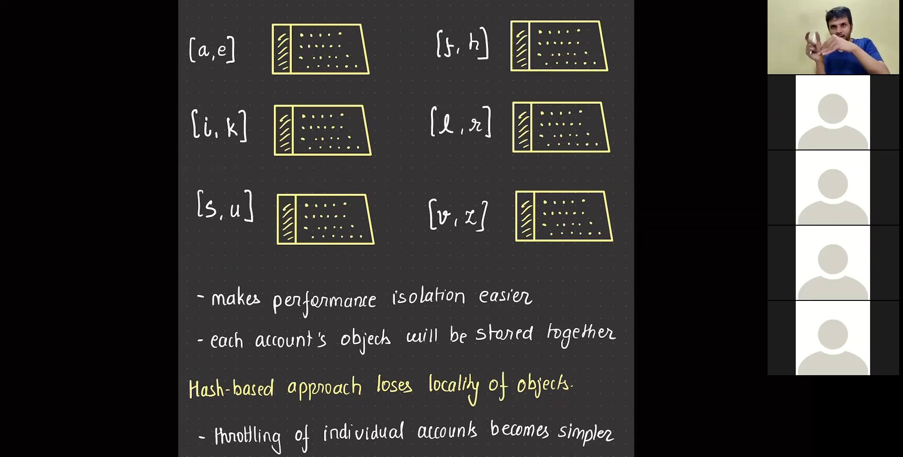

# System Design Masterclass（P011）：不改一行代码给主库降压 + S3 存储引擎从零推导

> 本节是**纯讲解课**：逐字稿里没有出现任何可运行的代码、命令输出或配置文件语法。因此第 3～5 章按「设计复现」的要求来写——把讲师的两段推导还原成你可以照着填、照着画的步骤，把结论落成可直接使用的产物（决策表、职责表、接口草案、容量表），并在每一节明确标出**哪些是讲师讲的、哪些是你复现时必须自己补的**。

---

## 1. 这一节做什么

P011 这一节实际上讲了两个互相独立、但方法论一致的东西。

**第一段（约 0:00–17:54）：一个真实的线上事故，以及一个「不动代码」的解法。**
一个跑着 10 万行以上 legacy 代码的巨型 monolith，前端是一个 API Gateway，后端是一主（master）两从（replica）。问题出在：legacy 代码里到处是「默认连接对象」，而这个默认连接指向 master，于是**大量本可以打到 replica 的读请求，全都压在 master 上**。讲师的团队没有去逐个改这 10 万行代码，而是复制了一份配置、起了第二套完全相同的 monolith，只把配置里「默认连接」从 master 改成 replica1，然后在 API Gateway 上按 URL 打规则分流：只读的 API 走第二套，其余默认（`*`）全部走第一套。用配置复制 + 网关规则，给自己买到了大约一个月的 runway，把「一次性重构」换成了「按 API 逐个迁移」。

**第二段（约 18:23–结束）：S3 存储引擎的白板推导。**
从「一个 API server + 一块本地磁盘」出发，一步步加东西：磁盘不够加磁盘 → 磁盘多了要决定数据放哪块 → 加负载均衡和多台 API server → 发现必须 sticky → 发现 sticky 压在负载均衡上很蠢 → 把 API 层和存储层拆开、把 sticky 下沉到存储层的中间接口层 → 选定位算法（hash mod N / meta DB / 一致性哈希）→ 发现一致性哈希在「持久化存储 + 桶级热点」这个场景下治不了病 → 换成 range-based partitioning，并把热分区拆成两个互斥区间。

两份产物，对着文档做完你应该都有：

| 产物 | 对应章节 | 交付形态 |
|---|---|---|
| A. 一份「双 monolith + 网关分流」迁移方案 | 3.1 / 4.1 | 配置结构表 + 路由规则表 + 迁移顺序 |
| B. 一份 S3 存储层设计说明 | 3.2 / 4.2 | 演进路径 + 决策表 + 组件职责表 + 接口草案 + 容量表 |

---

## 2. 讲师原话

**关于问题本身（案例 A）**

> "我的遗留代码使用主库连接。所以即使是读查询，比如 get user profile 会显式配置到副本 1，但 get course info 会走主库，因为那是遗留代码。类似这样的地方有成千上万个。"
> —— p011 [03:08]

> 「master 本来只该处理写。现在 legacy code 的读查询也打到 master，这些读查询让我的 master choke。因为它们完全可以由 replica one 和 replica two 来服务，但没有。」
> —— p011 [04:06]



> 「现在的问题是：我们没法翻遍 10 万行 legacy 代码去把流量从 master 挪到 replica，因为那意味着你要读懂业务逻辑再改。」
> —— p011 [07:51]

**关于解法（案例 A）**

> 「不是在 API gateway 层，如果它是读 API……搞两个 monolith，一个读一个写，然后在 API gateway 层，把读的那个 monolith API 配到读 replica 上。」
> —— p011 [08:20]（这是课堂上学员 Varun 给出的答案，讲师确认「That is exactly what we did」）

> 「我们没有改任何代码，只是把 monolith one 的整个配置复制粘贴到 monolith two，然后在这个配置里，本来指向 master 的那个连接——用户名密码连接串——改成 replica one。于是任何原本走 default DB 的请求，在 monolith one 上打到 master，在 monolith two 上就打到 replica one。」
> —— p011 [12:38] / [13:05]

> 「就算有写请求打过去也会失败，因为 replica 是只读的，不会接受 update。但这样我们就知道了。所以我们配一条规则：`/me` 是只读 API，走 monolith 2；`/payments` 需要写，走 monolith 1；再加一条星号规则，把所有没匹配上的都转到 monolith 1。这样我现有的行为跟 legacy 完全一样，不会有任何问题。」
> —— p011 [13:34] / [14:04]



> 「用的网关是 Kraken D，K-R-A-K-E-N-D，一个流行的开源项目，我们没自己写。」
> —— p011 [16:59]

> 「我们本质上只是复制粘贴了整套配置、复制了一整套基础设施，没有改动任何一行代码，就争取到了时间。虽然这不是最优解，但至少能立刻看到响应时间的改善，因为 master 从一堆垃圾请求里解放出来了。」
> —— p011 [17:28]

**关于 S3 的起点与成本约束（案例 B）**

> 「一个 day-one 就能建起来的 S3 server，跟我们做分布式缓存时一样：user → API server，只不过这一次用 API server 的**硬盘**来存数据。S3 无非就是暴露在你文件系统之上的一个 API。你 GET 一个路径 `/home/app/abc.txt`，它就走到那块盘、读到文件信息、把文件读出来返回给你，就这么简单。Dropbox 第 0 天就长这样，GitHub 也就是文件系统之上的一层接口。」
> —— p011 [37:40] / [39:07] / [38:08]

> 「为什么便宜这件事重要？因为人们要把 S3 当垃圾场用，几乎所有 AWS 客户的数据湖都在 S3 上。如果你要高写吞吐，可以用 SSD，也可以用 spinning disk 做 append-only。用 SSD 会很贵。在这个规模下——每天成千上万客户往里面灌 PB 级数据——哪怕一块盘省 1 美元，加起来也是几百万美元。所以从 day zero 开始你就必须为成本做优化。」
> —— p011 [22:05] / [23:26]



> 「如果你要支持高写吞吐，就用 append-only，也就是 log structured storage。它用磁碟，不需要反复回盘寻道，于是你能从机械盘上拿到高写吞吐，从而省钱。这是一个非常重大的决策。」
> —— p011 [23:52]

**关于 S3 的扩展路径（案例 B）**

> 「一旦你的盘成为瓶颈，你插一块新盘——就像插 USB 外置硬盘一样。然后由 hash 函数决定哪个桶去哪块盘。」
> —— p011 [39:37] / [40:04]

> 「但这样还是不行：并行写的磁盘 IO 会挂、存储有上限、机器上的 USB 口是有限的、整体网络 IO 可能成为瓶颈、而且只有一台机器，任何地方挂了就完了。所以必须水平扩展：一个负载均衡 + 多套同样的结构。这时核心问题变成了负载均衡算法——如果是 round robin，它就不知道『这个文件夹在这台 API server 上』，请求就得去别处找。所以负载均衡必须是 sticky 的。」
> —— p011 [41:30] / [42:28] / [43:21]



> 「跟分布式缓存一样，我们把存储从 API server 里拆出去。把 API server 和硬盘分开，让 API server 独立扩展、存储网络也独立扩展。中间那个对接层，把存储层抽象给 API 层。」
> —— p011 [45:15] / [48:05]

> 「这样 API server 就独立了：任何请求可以进任何一台 API server，负载均衡器想用什么算法都行——least connection、round robin、random。但数据在哪，这个 stickiness 被下移了，落在这个接口层上。这就像我们缩小临界区：一开始整段代码都是临界区，加锁；后来发现不需要，把上下几行去掉，只留真正要保护的那两行。」
> —— p011 [48:35] / [49:05] / [49:34]

**关于定位算法与热分区（案例 B 的核心）**

> 「最直觉的方案是 hash(path) mod N。但 N 一变，全部数据都要重新索引——跟上周分布式缓存遇到的是同一个问题，那时候的答案是 consistent hashing。或者不用 hash，用静态绑定：哪几个文件夹在哪块盘，写进一个 metadata database（meta DB）。节点删掉时就只更新那几个 key 的绑定。」
> —— p011 [51:01] / [51:30] / [52:00]



> 「一致性哈希看起来很合适：优雅地处理节点增删、最小数据迁移。但它解决不了热分区。你把桶 hash 到环上一个位置，桶是热的，加一个节点，数据只是从 HDD 1 搬到 HDD 5——本来 HDD 1 热，现在 HDD 5 热。就像扫房子，灰尘没有消失，只是被你从屋里扫到了簸箕里。」
> —— p011 [54:25] / [55:47] / [56:17]

> 「根因在于：热点是在**桶**这一级的。而且更糟的是，如果 hash 到文件级，同一个组织的文件会散落在 H1、H2、H3、H4 上。H1 变热了，你不知道是 O1 还是 O3 造成的，没法精准限流。所以 hash 方式丢掉的是**局部性**。」
> —— p011 [57:14] / [63:27] / [65:19] / [66:15]

> 「更好的办法是 range-based partitioning。假设有个 A 到 Z 的范围，A-E 去第一个分区，F-H 去第二个，I-K 去第三个，L-R 去第四个，S-U 去第五个，V-Z 去第六个。这样显式地静态告诉系统：A 到 E 只在这块盘。好处是能很容易定位热分区——如果 L 到 R 是热的，就把它拆成 L-M 和 N-R。」
> —— p011 [60:05] / [60:34] / [61:03]



> 「一致性哈希和范围分区其实非常像，只是一个用 hash 函数，一个用静态划分。范围分区让性能隔离更容易，定位瓶颈更容易，而且同一个账号的对象会存在一起，有数据局部性，限流和 throttling 也更容易做。」
> —— p011 [61:33] / [62:03] / [62:30] / [66:45]

---

## 3. 从零复现

### 3.1 案例 A：双 monolith + 网关分流

#### 步骤 1｜把现状画出来（讲师原话 0:52–11:40）

先画你手上的系统，画错的图会带出错的方案。讲师画出来的是：

```
[客户端]
   │
[API Gateway]                       ← 已有，不是本节新加的
   │
[Monolith API Server]               ← 一套代码，REST：/me、/payment、/course-info ……
   │  （client-side sharding：代码里硬编码选哪个库）
   ├── master DB        ← 写；但 legacy 的 default 连接也指向这里
   ├── replica 1        ← 读（部分代码显式指定）
   └── replica 2        ← 读（部分代码显式指定）
```

两个关键概念先对齐：

- **client-side sharding**：monolith 自己知道有哪些库、自己建连、自己在代码里决定走哪个。对应到 JS/Node 就是：你在应用里手写多个 `mysql2` / `pg` 的 Pool，然后 `if (isReadOnly) await replicaPool.query(...) else await masterPool.query(...)`。没有代理层帮你分。
- **default connection object**：legacy 代码里那个「不特别指定就用的连接」。Node 里就是那个 module-level 导出的 `pool`，全项目几百个文件都在 `import { pool } from './db'`，谁也没写它到底是主还是从。这就是事故的种子。

#### 步骤 2｜把需求写成一句话，并且量化（讲师原话 06:00）

讲师把目标反复压缩成了一句话：

> 「不必要的读不要打到 master，应该被 replica 服务。」

这句话里有三个词要你自己补数据，**课里没给任何具体数字**，你必须从自己系统的指标里取：

| 你要取的指标 | 取法 | 用途 |
|---|---|---|
| master 的总 QPS | 主库监控 | 分母 |
| 其中「读」语句占比 | 慢查询日志 / `SHOW FULL PROCESSLIST` 抽样 / APM 的 SQL 类型统计 | 判断值不值得做 |
| 这些读里「可以被 replica 服务」的占比 | 是否有强一致读（读到自己刚写的数据） | 决定迁移边界 |
| master CPU / 连接数的水位 | 主库监控 | 判断 deadline |

用一条算式表达这个项目的收益上界：

```
可挪走的负载 ≈ master 总 QPS × 读语句占比 × 允许走从库的读占比
```

如果你先测出来「读占 70%，其中 90% 不要求强一致」，那这个项目最多能把 master 的负载砍掉 0.7 × 0.9 = **63%**。这个数字就是你说服团队「值得做、但也只值这么多」的依据。**课里没做这个估算**，但它是复现这类项目时必须做的第一步。

#### 步骤 3｜排除「正攻法」，并说清为什么排除（讲师原话 04:34–05:31 / 07:51）

正攻法是：翻遍 10 万行 legacy 代码，找到每个 SQL / 每个 REST handler，判断它到底需不需要 master，再改。

讲师给出的排除理由有三条，都很实在：

1. **成本高**：10 万行以上，且是 legacy。
2. **认知成本高于代码成本**：你得先读懂业务逻辑才能判断「这个读能不能容忍主从延迟」。
3. **会做大量无用功**：代码里有大量 dead code、大量根本没人调的 API。「系统里有很多 API 甚至根本没被调用过。」——这是后面「按流量迁移而不是按代码迁移」这个关键决策的来源。

#### 步骤 4｜方案成型：复制一整套，只改一个连接串（讲师原话 09:15–13:05）

这是本案例的核心 hack，三步：

1. **复制配置**：把 monolith 1 用的那份远程配置整份 copy 成 monolith 2 的配置。讲师描述的配置形态是「三组连接 + 一个默认指向」：

| 配置项 | monolith 1（legacy，不改） | monolith 2（新建） |
|---|---|---|
| default DB | 指向 master | **改成指向 replica 1** |
| replica 1 | 指向 replica 1 | 指向 replica 1 |
| replica 2 | 指向 replica 2 | 指向 replica 2 |

讲师用了 `u1 p1 c1` / `u2 p2 c2` / `u3 p3 c3` 这种简写（username / password / connection string）来描述三组连接，然后说：把 legacy 配置里 default 那一组（u1p1c1）换成 replica 那一组（u2p2c2）。**没有改动代码，只改配置。**

2. **让配置在启动时加载**：讲师说他们的配置是远程配置中心，「API server 启动时会去检查该加载哪份配置，然后去加载」。所以同一个二进制、同一份镜像，靠启动参数/环境决定加载哪份配置。→ 这就是为什么它能做「同一套代码跑两份」。

3. **在网关层按 URL 分流**（下一步）。

> 这里要讲清一个必然结果，讲师的原话是：**错的写请求会失败**。因为 replica 是只读的，`UPDATE` 打过去会被拒绝。这不是缺陷，这是探测器——哪条 API 打挂了，就说明它是写 API，迁回 monolith 1 即可。

#### 步骤 5｜设计路由规则，并且让「默认行为 = 老行为」（讲师原话 13:34–14:33）

规则表（讲师口述的就是这个形状）：

| 优先级 | 匹配 | 目标 | 理由 |
|---|---|---|---|
| 1 | `/me` | monolith 2 | 已确认只读 |
| 2 | `/payments` | monolith 1 | 已确认有写 |
| 3（catch-all） | `*` | **monolith 1** | 保证未迁移的一切行为与改动前**完全一致** |

这个「catch-all 指向 legacy」的顺序是整套方案能上线的关键：上线那一刻，网关一条规则都没匹配到，100% 流量走 monolith 1，系统行为跟以前一模一样，风险为零。之后每确认一个只读 API，就往表里加一行。**这是一个可随时回滚、逐条生效的灰度迁移，不是一次性切换。**

迁移节奏（讲师原话 15:01）：按 API 一个个来，不是按代码行来，因为「可能有很多 dead code，很多 API 根本没人调」。这样也顺便绕开了「必须先读懂全部业务逻辑」这个不可能完成的前置条件。

#### 步骤 6｜算清你买到了多少时间（讲师原话 15:31）

讲师说这套操作「大概买到了一个月 runway，把优化往后推」。这个数是他们团队和业务节奏决定的，你的项目里要自己算：

```
可用 runway ≈ (master 当前水位 - 告警阈值) ÷ 每天水位增长率
```

如果 master 现在 65%，报警线 80%，每天涨 1%，那你大概有 15 天。这个数字直接决定了你在步骤 5 里能多从容地逐条迁移。

#### 步骤 7｜记录方案边界（讲师原话 45:15 之前 / 全段）

讲师自己承认这不是最优解，原话是「although not optimal」。你必须写进方案文档的边界：

- 它治的是「读错走主库」，不治「查询本身太慢」「缺索引」「N+1」。
- 它靠复制基础设施换时间，**硬件成本翻倍**（两套 monolith）。
- 它不减少代码债务，只是把「改代码」换成「改配置 + 改网关规则」。
- monolith 2 上的写请求会失败——必须有监控能区分「预期内的失败」和「预期外的失败」，否则你会被报警淹没。

### 3.2 案例 B：S3 存储引擎推导

#### 步骤 1｜先给 S3 定位（讲师原话 36:41–39:07）

讲师给的定义是：**S3 就是一个暴露在文件系统之上的 API**，是分布式文件存储，最常见的用途是数据湖。类比对象是 Google Drive 的文件夹。Dropbox 第 0 天就是这样，GitHub 也就是「文件系统之上的一层」，`git pull` / `git merge` 本质是在那块盘上跑命令。

这一步很重要，因为它告诉你：**先把 day-one 版本实现出来，再谈扩展**。

#### 步骤 2｜Day-1 版本（讲师原话 37:40–39:37）

```
[客户端] → [API Server + 本地磁盘]
              ├── bucket A  = /data/bucketA
              └── bucket B  = /data/bucketB
```

- 一个 bucket = 一个顶层目录。
- 对象 key = 桶内的路径，例如 `/home/app/abc.txt`。
- `GET /bucket/home/app/abc.txt` → 直接读文件返回。
- `PUT` / `DELETE` → 直接写/删文件。

讲师原话：「GET、PUT、DELETE 的核心实现非常简单，就是普通的文件系统调用。」

#### 步骤 3｜约束排序：哪条约束是「从 day zero 就要优化」的（讲师原话 22:05–25:14）

这一步是全课最像「系统设计」的地方——讲师没有先谈扩展性，而是先谈**成本**，并且给出了理由链：

1. S3 的定位是「垃圾场 / 数据湖」，客户会把 PB 级数据往里堆。
2. 所以规模是「几十个客户合起来每天至少 PB 级」。
3. 所以「一块盘省 1 美元 = 几百万美元」。
4. 所以在 day zero 就必须为成本做决策，不能「先用 SSD，以后再说」。
5. 于是不能选 SSD → 只能选机械盘 → 机械盘随机写慢 → 必须 append-only（log structured）→ 顺带得到「写高效、不随机寻道」。
6. 而 append-only 天然带来多版本，正好满足「回滚到历史版本」这个需求（Google Drive / Dropbox 上传同名文件会新增版本）。

这条链的结论：**高写吞吐 + 低成本 + 多版本，三个需求指向同一个实现选择：机械盘上的 log structured / append-only 存储。**


#### 步骤 4｜扩展第一跳：单盘不够 → 加盘 → 必须决定数据放哪（讲师原话 39:37–41:30）

盘成为瓶颈，插第二块盘。然后立刻出现一个新问题：**数据放哪块？**

讲师给的第一个解法是 `hash(bucket) → 选盘`，例如 `/a` 去盘 1，`/etc/system` 去盘 4。

然后他指出这个解法撑不住，并列了 5 条瓶颈：

| 瓶颈 | 讲师原话要点 |
|---|---|
| 磁盘 IO | 「并行写的磁盘 IO 可能失败」 |
| 存储上限 | 「磁盘存储是有限的」 |
| 物理接口 | 「机器上的 USB 口有限，你有 Atvex2 也加不了更多」 |
| 网络 | 「用户到 API server 的整体网络 IO 会成为瓶颈」「单机可用的网络连接数有限」 |
| 单点故障 | 「DB 或磁盘会挂、机器会挂」 |

#### 步骤 5｜扩展第二跳：加负载均衡 + 多台 API server（讲师原话 42:00–45:15）

```
                    ┌─ API server 1 ── 磁盘 1、磁盘 2
[客户端] → [LB] ────┤
                    └─ API server 2 ── 磁盘 3、磁盘 4
```

讲师的原话是「一个 load balancer + 多套同样结构」。这一步的**致命细节**是：

> 「负载均衡算法就成了真正关键的东西。如果它是 round robin，它就不知道『这个文件夹在这台 API server 上』，请求就得去别处找。所以负载均衡必须是 sticky 的。」

而且要 sticky 的**不止一层**：不仅 LB → API server 要 sticky，API server → 磁盘的分配也要 deterministic（「同一个输入永远给同一个输出」）。

#### 步骤 6｜关键重构：把 sticky 从 LB 下沉到存储层（讲师原话 45:15–50:32）

讲师给出的重构动因很干净：既然只有「数据在哪」这件事需要 sticky，那就不该让 LB 和 API server 背这个包袱。

```
                ┌─ API server 1 ─┐
[客户端] → [LB] ─┤                ├─→ [中间接口层 / central switch] ─→ [存储节点网络]
                └─ API server 2 ─┘
```

三个变化：

1. **API server 与磁盘解耦**：API server 只管 HTTP 和业务逻辑，读写委托给存储网络。
2. **两层各自独立扩展**：API server 加机器、存储网络加盘，互不阻塞。
3. **stickiness 下沉**：LB 想用 round robin / least connection / random 都行；API server 完全无状态；只有中间接口层需要知道「这个 bucket 在哪」。

讲师用的类比很到位：**这就像缩小临界区**。一开始整段代码都加锁，后来发现不用，把上下几行去掉，只锁真正要保护的那两行。系统设计也是同一套动作：找到唯一真正需要共享状态的边界，把锁（这里指 stickiness）精确地放在那一条边上。

→ JS/Node 对应：Node 单线程没有真正的互斥锁需求（CPU 密集才需要），但「缩小共享状态的边界」这个思路完全一样——别用一个全局的可变对象兜住一切，只让真正需要原子的那一小块共享。

#### 步骤 7｜中间接口层怎么定位数据：三个候选（讲师原话 50:32–52:27）

| 候选 | 优点 | 致命问题 |
|---|---|---|
| `hash(path) mod N` | 简单、无状态 | N 变化时全量数据要重新索引（和分布式缓存同样的问题） |
| **meta DB（静态绑定）** | 节点删除时只更新几个 key 的绑定 | 每次读写都要查一次 meta DB |
| **一致性哈希** | 节点增删时最小数据迁移、优雅 | **治不了热分区**（见下一步） |

#### 步骤 8｜为什么一致性哈希在这里失效（讲师原话 54:25–59:38）

这是全课最值得反复读的一段。讲师把推导拆开讲了：

1. **热点的粒度是桶，不是节点**。一个 bucket hash 到环上某点，它落在 HDD 1。
2. **加一个节点，桶会搬到新节点**：本来热的是 HDD 1，加完 HDD 5 之后，那个桶搬过去，热的是 HDD 5。
3. **热度没有被消灭，只是搬家了**。讲师的比喻：「扫房子，灰尘没消失，只是从屋里扫到了簸箕里。」
4. **根因更深一层**：一致性哈希本质是在**利用随机化**。你不知道 hash 输出落在环上哪个点，你假设所有点等概率。「每个点都是等概率的，那你怎么可能解决热点问题？」
5. **所以这个结论只对持久化存储成立**：讲师明确说了，「对负载均衡它仍然好用，对分布式缓存它仍然好用，但对这个规模的持久化存储，它可能不是最佳选择。」——**同一套算法，在不同场景下结论可以相反**，这是他在课上反复强调的「没有唯一正确答案」。

再往下还有一层，讲师专门讨论了「那 hash 到 file 级行不行」：

- 文件级 hash → 同一组织的文件散落在 H1/H2/H3/H4。
- H1 变热了，你不知道是 O1 还是 O3 造成的。
- 你没法精准地限流那一个肇事者，只能惩罚无差别。
- 结论：**hash 方式丢掉的是数据局部性，而局部性是定位问题和限流的原材料。**

#### 步骤 9｜最终方案：range-based partitioning（讲师原话 59:38–62:03）

```
A──E  →  分区 1
F──H  →  分区 2
I──K  →  分区 3
L──R  →  分区 4   ← 假设这个是热的
S──U  →  分区 5
V──Z  →  分区 6
```

热的处理方式：**把 L-R 拆成 L-M 和 N-R**，新加一块盘服务 N-R（讲师的说法：「再定义一个硬盘，数据放 L-M 和 N-R」）。M 造成的压力只落在 L-M 上，N-R 平安无事。

讲师对两者的关系总结得很准确：

> 「一致性哈希和范围分区其实非常相似，只是一个用 hash 函数，一个用静态划分，其余模型完全一样。」

range 方案的三个收益（讲师原话 62:03–66:45）：

| 收益 | 说明 |
|---|---|
| 性能隔离 | M 桶闹事，只影响 L-M，其他盘毫发无损 |
| 可定位 | 能 pinpoint 是哪个区间出了问题，直接拆 |
| 数据局部性 | 同一账号/组织的对象聚在一起；也能做多级 range（账号层 → 桶层） |
| 限流基建 | 知道是谁在闹，就能对那个 account / 桶做 throttling，而不是无差别限流 |

---

## 4. 完整代码

> **声明**：本节逐字稿里讲师**没有给出任何一行可执行代码、配置文件内容或 API 定义**。因此下面第 4.1 / 4.2 是「把讲师口述的方案整理成可直接使用的产物」：配置结构表、路由规则表、决策表、职责表、接口/数据模型草案、容量估算表。

### 4.1 案例 A 的可落地产物

#### 4.1.1 配置结构表（照讲师描述的「三组连接 + 默认指向」整理）

| 字段 | monolith 1 的取值 | monolith 2 的取值 | 说明 |
|---|---|---|---|
| `default` | master 的连接（u1/p1/c1） | **replica 1 的连接（u2/p2/c2）** | 这是唯一的一处改动 |
| `replica1` | replica 1 的连接（u2/p2/c2） | replica 1 的连接（u2/p2/c2） | 保持不变 |
| `replica2` | replica 2 的连接（u3/p3/c3） | replica 2 的连接（u3/p3/c3） | 保持不变 |

讲师原话里配置是这样组织的：「default、replica one、replica two，然后每组有 username、password、connection string 等等，三组都类似，只有这里是 u1p1c1、u2p2c2、u3p3c3 的区别。legacy 配置那一次被 copy 过去，然后把 default 那一组——也就是指向 master 的那一组——改成指向 replica。」

**⚠️ 注意（不许编造的部分）**：讲师没有说这份配置的**文件格式**（是 YAML、JSON、properties 还是配置中心里的 KV），也没有说字段字面名。你复现时用自己配置中心的格式，只要满足「三组连接 + 一个默认指向」这个结构即可。

#### 4.1.2 网关路由规则表

| 序号 | 匹配条件 | 目标 | 上线状态 | 备注 |
|---|---|---|---|---|
| 1 | URL = `/me` | monolith 2 | 逐条启用 | 只读 API |
| 2 | URL = `/payments` | monolith 1 | 逐条启用 | 有写 |
| …… | …… | …… | 逐条启用 | 讲师说「按 API 一个个迁」 |
| N（最后一条） | `*` | **monolith 1** | 上线即生效 | catch-all，保证未迁移部分行为不变 |

讲师还说了一句关键的：规则可以到 **method 级**（「在 API gateway，你可以配 URL 是什么、method 是什么，转发到哪」），但**不能按「是不是 GET」自动推断只读**——他原话是「所有 REST server 只懂 URL，method 是在处理逻辑里体现的；我想过能不能从请求里提取 method 自动判断，那会非常难」。所以迁移是**人确认一条、配一条**。

#### 4.1.3 迁移顺序表（一次性填好，逐条打勾）

| # | API | 判定依据 | 迁移到 monolith 2 | 观察指标 | 回滚动作 |
|---|---|---|---|---|---|
| 1 | `/me` | 代码路径只有 SELECT | ☐ | monolith 2 上 5xx 错误率、replica 延迟 | 删规则 |
| 2 | 待填 | 待填 | ☐ | 同上 | 删规则 |
| …… | …… | …… | ☐ | 同上 | 删规则 |

判定依据一栏，你要填三件事：这条 API 的 SQL 是否只读；是否要求「写后立即读到自己的写」（强一致读）；如果强一致，有没有别的办法（比如让这条 API 在写之后几秒内跳过 replica）。**课里没展开强一致读的处理**，这是你一定会撞上的坑。

### 4.2 案例 B 的 S3 设计产物

#### 4.2.1 演进决策表（讲师实际走的 6 步）

| 步骤 | 现状瓶颈 | 加的东西 | 新暴露的问题 |
|---|---|---|---|
| 1 | 无（day-1） | 一台 API server + 本地磁盘 | 容量、单点 |
| 2 | 磁盘满 / 单盘 IO | 加第 2 块盘 + `hash(bucket)` 选盘 | 需要判断数据在哪块盘 |
| 3 | 单机磁盘数量、网络 IO、单点 | LB + 多台 API server，每台挂多块盘 | **必须 sticky，否则找不到数据** |
| 4 | sticky 压在 LB 上，扩展困难 | 拆 API 层与存储层，中间加中央接口层 | 接口层必须知道数据在哪 |
| 5 | 定位算法 | hash mod N → 排除；meta DB → 可选；一致性哈希 → 可选但有洞 | 一致性哈希治不了桶级热点 |
| 6 | 桶级热点 | **range-based partitioning** + 热区间拆分 | 需要 partition manager（讲师说下一张 slide 讲，本课未讲） |

#### 4.2.2 组件职责表

| 组件 | 职责 | 不该做的事 |
|---|---|---|
| 负载均衡器 | 把请求分到任意一台 API server；可用 round robin / least connection / random | **不需要 sticky** |
| API Server | 处理 HTTP 请求、业务逻辑；把读写委托给存储接口层；**保持无状态** | 不持有本地磁盘上的数据归属 |
| 中间接口层（central switch / 对接层） | 把存储抽象给 API 层；决定「这个 bucket 在哪块盘 / 哪个存储节点」；**stickiness 唯一持有者** | 不处理 HTTP 语义 |
| 存储节点 | 每块盘 + 一个轻量 HTTP server / TCP RPC server，对外暴露读写接口 | 不做业务逻辑 |
| Meta / Partition 映射 | consistent-hash 方案下无；range 方案下记录「range → 存储节点」 | 不能成为每次读写的单点瓶颈 |

讲师对存储节点的描述值得单独记：「它们不是单纯的一块盘，是带一个很轻的 HTTP server、或者 TCP RPC、或者裸 TCP 连接服务，再加存储；这样我才能连到这块盘上发调用。这些是专门的硬件，硬件团队给你做好抽象，软件开发者可能根本不用钻进去。」

#### 4.2.3 接口草案（**课里没有代码，以下为按讲师描述整理的草案，不是讲师给的签名**）

| 方法 | 路径 | 语义 | 讲师提到过的行为 |
|---|---|---|---|
| `PUT` | `/bucket/{key}` | 上传 / 覆盖 | 同名会 **replace** 旧内容；开启多版本后可以回滚 |
| `GET` | `/bucket/{key}` | 下载 | 从存储节点读文件并返回 |
| `DELETE` | `/bucket/{key}` | 删除 | 一段字节级操作 |
| （未提） | 分块上传、限流、CRC | 讲师只「提到」不展开 | 见第 7 章 |

唯一性说明（讲师明确回答过学员的提问）：**对象唯一性 = bucket + 路径，不需要额外生成 file id**。原话大意：「为什么需要给它一个唯一标识？它就是文件的路径。桶不同就不同，同一个桶里同一个路径会覆盖。开发者知道这一点就行了。」

#### 4.2.4 数据模型草案（**课里没给 schema，以下是复现建议**）

```
Bucket
  ├─ name            // 桶名，= 顶层目录名
  ├─ ownerAccount    // 讲师说 bucket 是账号级的，不是单用户的
  └─ versioning      // 开/关；开启后同名 PUT 产生新版本

Object
  ├─ key             // 桶内路径，如 home/app/abc.txt
  ├─ contentRef      // 指向存储节点上的日志段（append-only）
  └─ versions[]      // 讲师说多版本是 S3 必须支持的，因为要能回滚

PartitionMap   // 仅 range-based 方案需要
  ├─ rangeStart      // 例如 "L"
  ├─ rangeEnd        // 例如 "M"
  └─ storageNode     // 服务的存储节点
```

#### 4.2.5 容量估算表（**讲师没有给任何数字，下表是你复现时必须填的空**）

| 项 | 讲师提到的量级锚点 | 你要填的值 | 算式 |
|---|---|---|---|
| 单块盘容量 | 讲师举例「一台机器挂 10 块 10TB 盘」（Tech Burner 的例子） | ____ TB | 硬盘数 × 单盘容量 |
| 每日写入量 | 「几十个客户合起来每天至少 PB 级」 | ____ PB/天 | — |
| 每年新增 | 由上行推出 | ____ PB/年 | 日写入 × 365 |
| 单盘成本敏感度 | 「一块盘省 1 美元 = 几百万美元」 | ____ 块盘 | 盘数 × $1 |
| 单文件上传 | 「1 GB 文件不分块，中途失败要重传」 | ____ 平均 / 最大对象大小 | — |
| partition 数 | 讲师给的例子是 A-Z 分 6 段 | ____ | — |
| 单分区预估 QPS | 课程未给 | ____ | 总 QPS ÷ partition 数 |

**⚠️ 表里除了「讲师提到的量级锚点」那一列，其余全部是你必须自己填的，不是从课上抄来的。**

---

## 5. 逐行解释

### 5.1 案例 A 的每个决策，为什么这么定

**① 为什么是「复制一整套」而不是「同一个 monolith 内部按 API 选连接」？**
因为要改内部选择逻辑，就得动代码——而「动 10 万行 legacy」正是这个项目要避免的事。复制整套 + 改一个配置项，改动面积是 **1 个配置字段**；改内部逻辑，改动面积是 **N 个 handler**，N 未知且包含 dead code。把「改未知数量的代码」换成「改 1 个已知的配置」，风险才可控。

**② 为什么 default 指向 replica 1，而不是让 monolith 2 干脆不配 master？**
因为 legacy 代码会**无差别地**用 default 连接做读和写。如果 monolith 2 里不给 default 一个连接，那些代码会直接抛「连接未配置」，报错来源和「写打到了只读库」混在一起，你就分不清一条 API 到底是「有写」还是「压根没配」。给 default 配一个只读的 replica，错误就变得**语义明确**：报错 = 这条 API 有写。

**③ 为什么 catch-all 必须是 monolith 1？**
因为上线那一刻，规则表除了 catch-all 全是空的。如果 catch-all 指向 monolith 2，等于上线瞬间把 100% 流量切到「默认走 replica」的新路径上，所有写 API 集体报错。反过来，catch-all → monolith 1 时，上线零风险，之后每加一条规则只影响一条 API。**这是「默认安全 + 增量启用」，是灰度的标准形状。**

**④ 为什么规则要按 URL 而不是按 method 自动推断？**
讲师自己回答过：REST server 只认 URL，method 是在处理逻辑里体现的。你没法在网关层靠「这是 GET」判断「这个 GET 不需要强一致」。所以迁移判定必须由人做一次。这个「人做一次」的成本，才是这个方案真正的成本——所以它只值一个月 runway，不能当长期方案。

**⑤ 为什么它能算「不是最优解」？**
四个具体代价：硬件翻倍；master 只是从「被读请求压」变成「被写请求压」，读扩展问题根本没解决；代码债一行没还；写 API 打错库的失败会出现在生产日志里。讲师原话就是「although not optimal」。

### 5.2 案例 B 的每个决策，为什么这么定

**⑥ 为什么 day-1 一定要先做「API + 本地盘」这个土版本？**
因为后面所有讨论（哪个组件该消失、哪个该独立）都需要一个基准。没有 day-1 版本，「为什么要把存储拆出去」就变成空谈。讲师用 Dropbox 和 GitHub 做例子，就是为了说明**起点土不丢人，起点土是必须的**。

**⑦ 为什么成本是 day-zero 约束，而不是以后的优化项？**
因为规模效应会让「以后再说」变成灾难：一旦客户开始往里面灌 PB，选型已经锁定，改造成本远高于一开始的差额。「一块盘省 1 美元 = 几百万美元」这句话就在说：**决策的绝对金额不大，乘以数量级之后巨大**。这是存储类系统和业务类系统在决策顺序上最本质的区别。

**⑧ 为什么 append-only 能同时满足「高写吞吐」和「低成本」和「多版本」？**
- 高写吞吐：讲师原话是「不随机寻道」，机械盘顺序写吞吐接近上限。
- 低成本：机械盘比 SSD 便宜单价。
- 多版本：append-only 天然不会覆盖旧数据，写一次就是一段新日志，旧版本还在。
三个需求撞到同一个实现上，这种「一箭三雕」的选择优先级最高，因为它不需要在需求之间做取舍。

**⑨ 为什么加第二块盘就必须马上引入「数据放哪」的决策？**
因为盘是独立设备，写一次只能落在一块上。一旦有多块，就必须有一个**确定性的**规则回答「这块数据归谁」。而确定性一旦引入，你就会面对它带来的所有下游问题（规则变了怎么办、节点挂了怎么办、热度不均怎么办）。这就是为什么「加盘」看起来只是个容量动作，实际上是**引入了一次分区**。

**⑩ 为什么跑到「LB + 多台 API server，每台挂盘」这一步，sticky 是必然的？**
因为数据只在**那一台**的**那一块**盘上。LB 一旦按 round robin 把请求分给别的机器，那台机器上就没有这份数据，你只能选择「全量复制」（成本爆炸）或「代理转发」（多一跳且要维护归属表）。所以只要「数据跟着计算走」，sticky 就是必选题。这个结论是**结构决定**的，不是算法优化能绕开的。

**⑪ 为什么把 sticky 从 LB 下沉到中间接口层是这一步最漂亮的动作？**
因为它消掉了「对错误的组件提出的错误要求」。LB 的职责是分发流量，让它记住「这个路径归谁」，等于让一个无状态的组件强行背状态。移到中间接口层之后：LB 恢复无状态、API server 恢复无状态，只有**唯一真正需要知道归属的那一层**持有归属信息。讲师用「缩小临界区」作类比非常准：锁的粒度越小、位置越精确，系统越好扩展。

**⑫ 为什么 `hash(path) mod N` 必须先被排除？**
因为它把「分区规则」和「节点数量」绑定在一起。N 从 4 变成 5 时，几乎所有 key 的模值都变，绝大多数数据都得搬。讲师直接把它和上周分布式缓存的结论并列——**同一个坑，不要在第二个系统里再踩一次**。

**⑬ 为什么一致性哈希在这个场景里失效，而在分布式缓存和负载均衡里成立？**
三个系统里「热点的承载单位」不同：
- 负载均衡：热点是**请求**，请求是瞬时的，重新分配请求就能缓解，一致性哈希能均匀散开请求。
- 分布式缓存：热点是 **key**，缓存 miss 的代价是回源，不是数据搬迁，加节点能立刻分担。
- S3：热点是 **bucket**，而 bucket 是**数据归属单位**。你无法把一个 bucket 拆到两块盘（不一致），只能整桶搬家。整桶搬家后，热点只是从盘 A 移到盘 B——**换了地址，没换病因**。

这就是讲师那句「扫灰不除灰」的技术含义。

**⑭ 为什么「hash 到 file 级」比「hash 到 bucket 级」更差？**
因为桶级至少还保留了「一个组织的所有文件在一个桶里、一个桶在一块盘上」这层粗粒度局部性。文件级 hash 把同一组织的文件打散到所有盘上，失去了「谁在闹」的归因能力。**归因能力是限流的前提**——你不知道是 O1 还是 O3，就没法只惩罚 O1。讲师说「throttling 变得更容易」就是在这个意义上讲的。

**⑮ 为什么 range-based partitioning 能解决 hot partition？**
因为它显式地定义了区间 → 节点的静态绑定：
- 你能**看见**热区间是 L-R（因为你知道谁在服务 L-R）。
- 你能**精确地**把一个区间拆成两个（L-M / N-R），只把压力减半的那半边搬走。
- 你能在这个更细的粒度上加 throttle（按 account / 按 bucket）。
一致性哈希做不到第一点（你不知道谁在服务谁），所以后面两点全都做不到。

**⑯ 为什么讲师反复说「没有唯一正确答案」？**
因为他给出的是**同一族算法在不同约束下的不同最优解**：一致性哈希在缓存里是标准答案，在 S3 里是错误答案；range 分区在 S3 里是标准答案，但在「写热点随机分布、且要求负载绝对均匀」的场景里就会退化成维护一套复杂的 range 表。判断依据从来不是「哪个算法高级」，而是「这个系统的热点在哪一级、扩容时搬迁代价由谁承担」。

---

## 6. 复现检查清单

### 案例 A 检查清单（每项都要能拿出证据）

- [ ] 我画出了现状图，标注了 master 上**读请求的占比**（不是猜的，是监控数）
- [ ] 我算出了 `可挪走负载 ≈ 总 QPS × 读占比 × 可走从库的读占比`，并且这个数**值得做**
- [ ] 我知道这个方案买到了 **____ 天 runway**，并且这个数是按水位增长率算的
- [ ] 我复制出了 monolith 2 的配置，`default` 已经改成 replica 1，其余三组连接**完全没动**
- [ ] 同一份代码/镜像能通过启动参数加载不同配置（否则 monolith 2 起不来）
- [ ] 网关的 **catch-all 规则指向 monolith 1**，并且上线时它是唯一生效的规则
- [ ] 我确认了在 monolith 2 上写请求会**失败**，并且有监控能区分「预期内失败」和「预期外失败」
- [ ] 迁移顺序表已经列好，**第一条**是已经人工确认只读的 API
- [ ] 我写出了回滚动作（删掉那条规则），并且验证过删完立刻恢复
- [ ] 我在方案文档里写清了「这不是最优解」以及四条具体代价

### 案例 B 检查清单

- [ ] 我先做出了 day-1 版本（一台 API server + 本地盘 + GET/PUT/DELETE），能跑
- [ ] 我写下了这个系统的 **day-zero 约束清单**（成本、写吞吐、多版本、可用性……），并且排了序
- [ ] 我能说清「为什么选机械盘 append-only 而不是 SSD」，并写出了成本算式
- [ ] 我画出了从「单盘」到「LB + 多 API server」的演进，并在每一跳标出**新暴露的瓶颈**
- [ ] 我能说清为什么「LB + 多 API server」这一步 sticky 是必然的
- [ ] 我画出了「API 层 / 中间接口层 / 存储层」的三层图，并标出 **stickiness 只在中间接口层**
- [ ] 我对比了 hash mod N / meta DB / 一致性哈希，并写下了为什么前两个不选
- [ ] 我能用「扫灰不除灰」讲清楚一致性哈希为什么治不了桶级热点
- [ ] 我的分区方案是 **range-based**，并且给出了具体的区间表
- [ ] 我模拟过「L-R 是热点」，并写下了拆成 L-M / N-R 的动作
- [ ] 我能说清「为什么热点是桶级而不是文件级」，以及文件级 hash 为什么更糟
- [ ] 我标出了讲师**没讲**的部分（partition manager、一致性哈希实现、跨 DC 复制细节），列为后续待办

---

## 7. 课里没讲但你会撞上的

这一节专门列「课里明确没有展开」的事。凡是下面提到的，**都不要以为是讲师讲过了**，你得自己补。

1. **一致性哈希的实现细节，本课没讲。** 讲师原话：「我上周已经覆盖过这个，你可以去看录播，我也写过一篇关于一致性哈希的博客。」你在本课听到的只是一致性哈希在 S3 场景下**不适用**的结论，不是它的实现。

2. **partition manager 怎么实现，本课没讲。** 学员问「谁负责管理分区」，讲师回答「我想它应该在下一张 slide 里」——然后就到休息时间了。range 分区表谁维护、怎么判定一个分区「热了」、拆分动作如何原子生效，**这一节完全没有答案**。

3. **跨数据中心复制的工程实现，本课只讨论到概念层。** 讲师讲清了「replication lag 不是终端用户的问题，是可用性和持久性的问题」这个判断，但**没说怎么复制、用什么协议、冲突怎么处理**。他甚至在讨论中承认「那怎么自动发生？我不知道」。

4. **多版本（versioning）的数据结构没讲。** 只确认了「S3 必须支持多版本，因为要能回滚」，没讲版本怎么存、旧版本怎么淘汰、怎么设生命周期。

5. **加密、分块（chunking）、CRC 校验、限流：全部只被「点名」，没有展开。** 讲师明确说「我们后面会覆盖这些」。所以复现时这几块你需要自己查——本课只给了「为什么需要它」的一句话理由。

6. **KrakenD 的真实配置语法没讲。** 只说了「用的是 Kraken D，K-R-A-K-E-N-D，一个开源项目，我们没自己写」。配置文件长什么样、规则怎么写、字段名叫什么，**一个字都没给**。所以第 4.1.2 我给的是抽象规则表，不是可直接粘贴的配置文件——照抄任何「KrakenD 配置模板」都是我在编造，不是课里讲的。

7. **存储节点上那个「轻量 HTTP server / TCP RPC」的实现没讲。** 讲师原话是「这些是专门的硬件，硬件团队给你做好抽象，软件开发者可能根本不用钻进去」，所以这块对你是黑盒。

8