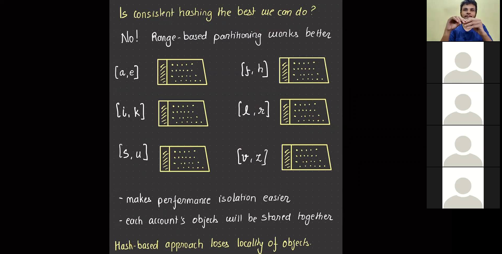
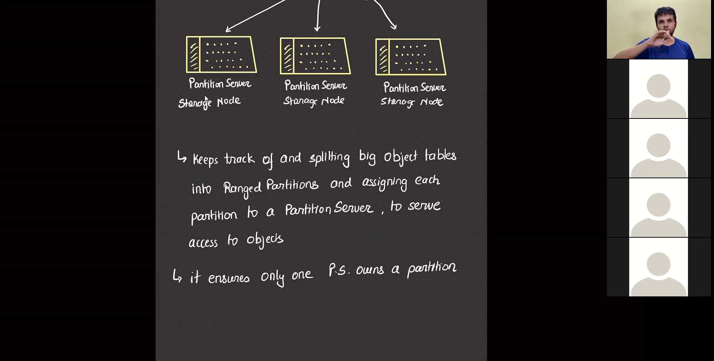
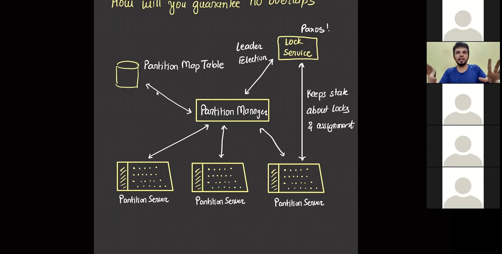
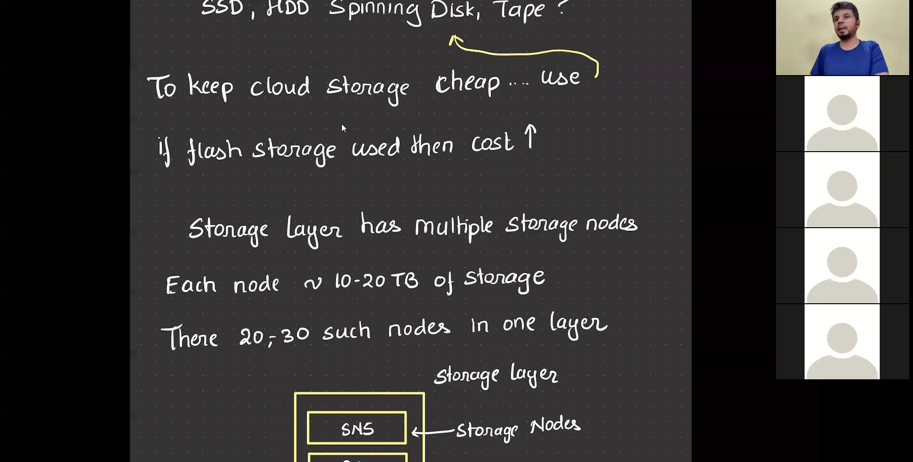
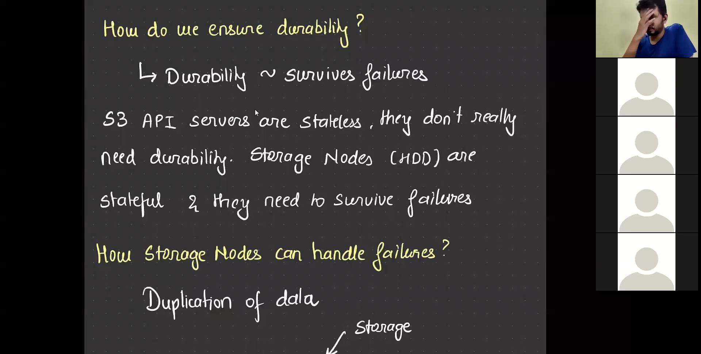
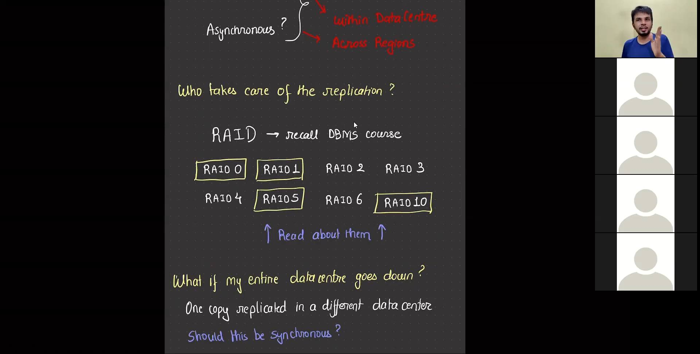
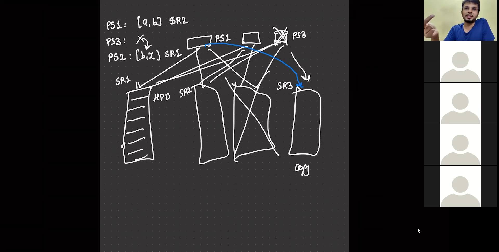

## 1. 这一节做什么

这一节对应 P011 的后半段，时间从 70:03 到 142:39。前半段还在讨论分区方案，后半段把 S3 类对象存储的核心组件逐个落地：分区管理器、分区映射表、锁服务、配置服务、分区服务器与存储层拆分、存储管理器、元数据数据库、耐久性复制、数据完整性校验、权限策略管理，最后讨论了 chunking 为什么没有纳入本节设计，以及讲师对 Azure 论文和 S3 论文的评价。

需要先说明：这是一节**系统设计讲解课**，逐字稿里没有给出可直接运行的代码仓库、依赖版本、环境变量或启动命令。本文按纯讲解课的复现方式写：第 3 节把讲师的推导过程按“需求→约束→估算→方案→取舍”复现；第 4 节把方案落成设计决策表、组件职责表、接口草案、数据模型草案和容量估算表。**课里没有代码，我不会伪造可运行项目**。如果你要把这套设计做成自己的练习项目，可以按第 4 节的产物先写设计文档，再自行选技术栈实现。

这一节的主线不是“S3 有哪些功能”，而是：当一个对象存储系统把大对象表按范围分区后，如何知道谁拥有哪个分区、分区服务器挂了怎么办、数据写到哪里、如何保证不丢数据、如何保证写进去的数据没有被损坏、以及权限规则如何避免每个对象一条规则导致元数据爆炸。

## 2. 讲师原话（带「—— pNNN [MM:SS]」）

下面引用的是本节最关键的几句原话。英文保留原话，中文是解释。

> “So the job of partition manager would be to keep track of splitting big object tables into range partitions and assigning each partition to a partition server to serve and access those objects.”
>
> —— p011 [80:54]

这句话定义了分区管理器的职责：记录大对象表如何被拆成范围分区，并把每个分区分配给分区服务器。它不是数据存储节点，而是映射和分配层。

> “It stores the split details of en-ranged partitions and assignment to partition servers into partition tables.”
>
> —— p011 [83:42]

这里说的是 partition map table 的职责：只存范围分区分裂详情和到分区服务器的分配关系。讲师后面也强调，这张表“只有这些信息，没有别的东西”。

> “So your partition server would now have to split into two components where one is just lean and fast normal TCP based server and another is storage node.”
>
> —— p011 [96:54]

这是本节的转折点：如果分区服务器自己带硬盘，机器挂了数据就可能丢，迁移也做不了。所以要把“瘦快的分区服务器”和“抽象存储层”拆开。

> “Since we are using spinning disk storages, we would not want to spend time doing disk seeks during writes... every single operation... has to be an append only operation.”
>
> —— p011 [100:41]

低成本机械盘不能做随机写，否则磁盘寻道会把吞吐吃掉。因此文件创建、更新、删除都要转成 append-only 操作，删除用软删除，再靠 merge/compaction 回收。

> “You can use MySQL, DynamoDB, any database but it has to be sharded because... you can shard it by bucket.”
>
> —— p011 [105:30]

元数据数据库是单独的一层。它不是存文件内容的，而是存文件大小、最后修改时间、权限、过期/生命周期、访问控制等信息；并且要按 bucket 分片，因为一个 bucket 下的文件列表要能线性访问。

> “Whenever a write happens, they do one synchronous write within that rack... And then it would do an asynchronous write across region.”
>
> —— p011 [116:15]

耐久性靠复制：至少三份。主存储节点之外，同一机架/数据中心内做一份同步复制，跨区域/跨数据中心做异步复制。不是所有复制都同步，否则写延迟会很高。

> “At every step, we are always checking the checksums... ensure that corrupted data is not committed in the file system.”
>
> —— p011 [121:48]

数据完整性靠端到端 checksum。写入、处理、读取、复制每一层都要校验，不能让“写成功但数据错了”的情况发生。

> “Instead of having one copy of rule per object... you would have just rules that are configured and when you get read or write access, you would go through that rules one by one and see which one fits in.”
>
> —— p011 [122:47]

权限策略不要每个对象一条规则。默认规则加例外规则，按顺序匹配，第一个满足的规则生效。否则对象一多，规则表会爆炸。

## 3. 从零复现

这一节按讲师的设计推导复现。注意：这不是照抄 S3 真实实现，而是按讲师在课里给出的 Azure 论文思路走一遍。课里明确说，这个设计大量取自 Windows Azure Storage 的论文，并做了简化讲解。

### 3.1 需求：先把要解决的问题写清楚

第一，系统要提供 bucket/object 风格的对象存储。用户可以把文件放到 bucket 里，可以读文件、写文件、列 bucket、查文件信息、设置文件权限、设置过期或生命周期规则。课里没有展开完整 API 列表，但明确提到 read、write、list、get file info、get permissions、digital signatures 等语义。

第二，大对象表不能放在一张表里。讲师反复讲 partition：把大对象表按范围拆成多个分区，例如 L2R、M2N 这种范围。每个分区交给一个 partition server 服务。

第三，分区服务器不能自己带数据盘。如果 partition server 和硬盘绑死，partition server 挂了就可能丢数据，也无法迁移。所以要把 partition server 做成瘦快的 TCP 服务，把存储抽象成独立的 storage layer。

第四，数据必须耐久。S3 类系统不能让客户数据丢。课里说至少三份：主存储节点一份，同机架/同数据中心同步一份，跨区域/跨数据中心异步一份。还可以在磁盘层用 RAID。

第五，数据必须完整。讲师举了非常具体的例子：写入 `arpit`，到 API server 是 `arpit`，到 partition server 是 `arpit`，写主存储也是 `arpit`，但复制过程中 bit 翻转，另一份变成 `arpiz`，这就不能接受。所以每一层都要 checksum。

第六，权限要能细粒度控制，但不能每个对象一条规则。默认 private，对某个路径做 public 例外，规则按顺序匹配。

第七，成本要低。存储层使用便宜的机械盘/磁带这类介质，不能全用 flash。课里说存储层每个节点 10 到 20 TB，一个存储层 20 到 30 个节点。

### 3.2 约束：哪些东西限制了方案

第一个约束是机械盘不能随机写。讲师的原话是：使用 spinning disk 时，写入不想花时间做磁盘寻道，所以不能随机写，必须 append-only。文件创建、更新、删除都要变成 append-only。删除做软删除，再 merge/compaction。

第二个约束是一个分区只能有一个 partition server 拥有。讲师说得很清楚：一个 partition server 可以拥有多个分区，但一个分区不能同时被两个 partition server 拥有，因为读写都去这一个地方，没有 master-replica 那套读扩展。这个约束让锁服务和分区映射表变得关键。

第三个约束是 partition manager 自己也不是单机。讲师说 partition manager 是一组机器，其中一个是 master，其他是 replica，谁当 master 由 lock service 做 leader election。

第四个约束是配置服务是成员信息的 source of truth。课里有人问：增加 partition server 是否只能走 configuration service？讲师回答：是的，要走 configuration service，因为它是知道一切的源。有人提到 gossip 成员协议，讲师说 gossip 在大规模下会 flooding，共识时间也可能很长，课里提到“1000 个节点大概 10 分钟”这种量级，不适合高可用系统等待。

第五个约束是 API server 每次请求都要查分区映射。讲师说 Azure 论文选择让 API server 直接读 partition map table，而不是每次都经过 partition manager 多一跳，因为 schema 不常变，而每个 API 请求都要查，省一跳很值。

第六个约束是强租户隔离场景不能简单套这个共享分区方案。讲师在 70:03 附近说，如果系统跨组织、需要纯互斥租户架构，就不能用这种方案。这句话是重要的适用边界：本节设计不是所有多租户场景的万能答案。



上图对应讲师讨论范围分区、hot filter 和本地性取舍的位置。讲师说 range-based partitioning 看起来不错，但 hybrid 方案会丢掉文件局部性：一个目录下 10 个文件如果分散在三四块磁盘上，和都在一块磁盘上，局部性不一样。不过如果按 account 做 consistent hash，同一 account 还是会打到同一分区。课里的结论是：没有一种方案全是优点，要看 Feature A 和 Feature B 谁优先。

### 3.3 估算：把课里给出的数字算出来

课里没有给完整容量规划，但给了存储节点的数量级，可以写出保守算式。

存储层每个节点 10 到 20 TB，一个存储层 20 到 30 个节点。所以一个存储层的原始容量范围是：

- 最小：10 TB × 20 = 200 TB
- 最大：20 TB × 30 = 600 TB

每个节点到 70% 就变成 immutable，并在逻辑头部加一个新节点。所以单节点可写阈值是：

- 10 TB × 70% = 7 TB
- 20 TB × 70% = 14 TB

如果按“至少三份数据”做粗略可用容量上限，不考虑 RAID、压缩、跨区域额外开销：

- 200 TB ÷ 3 ≈ 66.7 TB
- 600 TB ÷ 3 = 200 TB

这只是量级估算，不是精确容量规划。课里没有给对象平均大小、元数据记录大小、分区数量、请求 QPS，所以不能算 metadata DB 的具体容量和 partition map table 的行数。第 4 节会把“能算的”和“课里没给、不能算的”分开列。

### 3.4 方案：组件一步步长出来

第一步，定义范围分区。大对象表按 key range 拆成多个分区。讲师用 L2R、M2N 这种示意。范围分区的好处是局部性：相邻 key 在同一个分区，读的时候可能更集中。缺点是可能热点。课里也讨论了 hash 和 hybrid，但最后没有宣布一个绝对正确方案，而是说要看取舍。

第二步，引入 partition manager。它负责记录大对象表如何分裂、每个范围分区分配给哪个 partition server。partition manager 可以是普通 HTTP 服务器，把信息存到分布式存储里，比如 ZooKeeper 或 DynamoDB。讲师说“任何能提供分布式原子操作的存储都行”，重点是分布式和原子操作，不是必须某个产品。



第三步，建立 partition map table。它只存两件事：范围分区分裂详情、分区到 partition server 的分配关系。不要往里面塞文件内容，也不要塞完整元数据。API server 可以直接读这张表，拿到“这个 key 属于哪个分区、这个分区在哪个 partition server”，然后直接请求 partition server。这样省掉每次请求都经过 partition manager 的一跳。

第四步，引入 lock service。partition manager 本身需要选主；partition server 需要知道自己拥有哪些分区；一个分区不能同时被两个 partition server 拥有。这些都需要锁/租约。讲师说 Azure 的实现让 partition server 识别空分区并触发选举，但后来 Azure 把决策放到 partition manager 上，由 partition manager 决定谁拥有。课里也明确说“没有唯一正确设计”，可以让 partition server 直接读 partition map table，也可以经由 partition manager 通知。关键不是照抄某一种，而是保证同一分区只有一个 owner。



第五步，拆分 partition server 和 storage layer。partition server 变成瘦快的 TCP 服务器，只负责 API 层、分区路由、和存储层通信。storage layer 暴露文件系统风格接口：open、read、append、update、close、delete、rename、concatenate large files。讲师特别说这不是 HTTP，是 TCP 上暴露的文件系统式接口。这样 partition server 挂了，只需要改 partition map table 的映射，数据还在 storage layer。

第六步，设计 storage layer 的写入模型。因为机械盘不能随机写，所有写入都 append-only。partition server 往一个逻辑头节点写，逻辑头通过类似 symlink 的方式指向当前可写节点。节点写到 70% 就变 immutable，逻辑上在头部加一个新节点，后续写去新头。storage manager 负责盯容量，到 70% 就加节点。旧数据通过 merge/compaction 回收，删除是软删除。



第七步，加 metadata DB。partition server 能通过 storage layer 读原始数据，但列 bucket、查文件信息、查权限、查过期规则不能靠扫存储层，太贵。所以要有独立元数据数据库，存文件大小、最后修改时间、是否 public、谁能访问、过期/生命周期、数字签名等。这个数据库要按 bucket 分片，因为一个 bucket 下的文件列表要能线性访问。



第八步，做耐久性。至少三份：主存储节点、同机架/同数据中心同步复制、跨区域/跨数据中心异步复制。课里还提到 RAID 0、1、5、10，磁盘层也可以做冗余。同步复制保证同数据中心内强一点，异步复制控制跨区域写延迟。



第九步，做数据完整性。每一层都算 checksum，写入、处理、读取、复制都校验。讲师说 checksum 和 CRC 是 error detecting code，还有 error correcting code 可以在少量 bit 翻转时纠正。课里没有指定具体校验算法，不能替他编一个。

第十步，做权限策略。不要每个对象一条规则。默认 bucket 内对象 private，对某个路径如 `/A/B/C/D` 做 public 例外。请求进来后按规则顺序匹配，第一个满足的规则生效。课里说 AWS access policies 也是类似思路，可以配置多条策略，按顺序判断。

### 3.5 取舍：讲师没有回避的取舍

取舍一：range partition vs hash vs hybrid。range 保留局部性，但可能热点；hash 分布均匀，但可能丢局部性；hybrid 看起来折中，但讲师说会丢掉“一个目录 10 个文件在同一块盘”的局部性。课里没有说哪个绝对赢，只说看 Feature A 和 Feature B 谁优先。

取舍二：partition server 自己选举 vs partition manager 决策。课里说最早尝试让 partition server 变聪明，发现空分区就选举；后来 Azure 把决策放到 partition manager 上，由 partition manager 判断谁健康、谁负载低，再决定分配。课里没有说前者完全不可用，只说 Azure 后来选了后者。

取舍三：API server 直接读 partition map table vs 经过 partition manager。直接读省一跳，但 API server 要能访问这张表；经过 manager 多一层抽象，但每次请求多一跳。Azure 论文选直接读，因为 schema 不常变，而每个 API 请求都要查。

取舍四：append-only vs 随机写。append-only 保护机械盘吞吐，但更新和删除变复杂，需要软删除、merge、compaction。随机写实现简单，但机械盘寻道成本高。课里明确选 append-only。

取舍五：同步复制 vs 异步复制。全同步写延迟高；全异步可能在故障时丢最新数据。课里的方案是混合：同机架同步，跨区域异步。

取舍六：元数据数据库 vs 扫存储层。扫存储层省一个数据库，但 list 和权限查询太贵；独立元数据 DB 查询快，但多一层要维护一致性。课里选独立 DB，并按 bucket 分片。

取舍七：chunking。课里有人问为什么不用 chunk，讲师说 chunking 能带来效率、并行、可重复，但处理乱序 chunk 有挑战；他在 Azure 论文里没有找到 chunking，所以为了忠于论文没有加。Dropbox 的 chunking 会在后面讲。这个取舍很重要：不是 chunking 不好，而是本节不把它塞进论文复现里。



## 4. 完整代码

**本节是纯讲解课，课里没有给任何可运行代码，也没有给依赖版本、环境变量名、启动命令。** 因此这里不伪造项目。下面是把讲师方案落成可复现产物的草案。表格里的字段名和接口名是“设计草案”，不是课程原始字段；课里只给了语义，没有给正式 schema 的地方，我会明确标注。

### 4.1 建议的复现资料目录

这不是课程原始目录，只是你把这节内容整理成设计文档时可以直接使用的目录结构。没有依赖安装，也没有启动命令。

```text
s3-design-notes/
  README.md
  01-requirements.md
  02-components.md
  03-partition-map.md
  04-metadata-model.md
  05-capacity-estimate.md
  06-durability-integrity.md
  07-policy-management.md
  08-tradeoffs.md
  09-open-questions.md
```

### 4.2 设计决策表

| 决策点 | 课里选择 | 理由 | 代价/边界 |
|---|---|---|---|
| 分区方式 | 范围分区为主，讨论 hash/hybrid | 保留 key 局部性；同 account 做 consistent hash 也能落到同一分区 | hybrid 可能丢文件局部性；热点问题课里没展开 |
| 分区所有权 | 一个分区只归一个 partition server；一个 server 可拥有多个分区 | 读写都去一个 owner，避免 master-replica 复杂度 | 需要锁/租约和映射表保证唯一 owner |
| 分区管理 | partition manager + partition map table | manager 记录分裂和分配；map table 只存映射 | manager 自身要高可用，课里说靠 lock service 选主 |
| API 查映射 | API server 直接读 partition map table | 每个请求都要查，省掉经过 manager 的一跳；schema 不常变 | API server 要能访问映射表；缓存失效策略课里没讲 |
| 分区服务器 | 瘦快 TCP server，不带持久数据 | partition server 挂了只改映射，不丢数据 | 需要 storage layer 抽象和网络连接 |
| 存储层接口 | 文件系统式接口：open/read/append/update/close/delete/rename/concatenate | partition server 像操作文件一样操作大对象 | 不是 HTTP；具体协议课里没给 |
| 写入模型 | append-only | 机械盘避免随机写寻道 | 更新/删除需要软删除和 merge/compaction |
| 容量切换 | 节点 70% 变 immutable，头部加新节点 | 留空间给 compaction/回收；storage manager 监控 | 为什么是 70% 不是 100%，课里没推导 |
| 元数据 | 独立 metadata DB，按 bucket 分片 | list、权限、过期、生命周期不能扫存储层 | 元数据与存储的一致性课里没展开 |
| 耐久性 | 至少三份：主、同机架同步、跨区域异步 | 兼顾耐久和写延迟 | 具体一致性级别、失败回滚课里没讲 |
| 完整性 | 每层 checksum/CRC | 防止写成功但数据损坏 | 具体算法、校验频率课里没指定 |
| 权限 | 默认规则 + 有序例外规则，不按对象存规则 | 避免规则表爆炸；第一个匹配生效 | 策略语法、冲突解决课里没给 |
| chunking | 本节不纳入 | 讲师在 Azure 论文里没找到 chunking，保持忠于材料 | 大文件、断点续传、并行上传会需要，后面 Dropbox 再讲 |

### 4.3 组件职责表

| 组件 | 职责 | 不该做什么 |
|---|---|---|
| API Server | 接收用户请求；读 partition map table 找分区；转发到 partition server；元数据请求走 metadata DB | 不直接扫描 storage layer 做 list |
| Partition Manager | 跟踪大对象表分裂；分配分区给 partition server；处理 partition server 宕机后的重新分配 | 不存文件内容；不替每次读请求做转发 |
| Partition Map Table | 存范围分区分裂详情和分区到 partition server 的映射 | 不存完整文件元数据；不存权限规则 |
| Lock Service | partition manager 选主；partition server 获取分区所有权/租约；文件更新时的互斥 | 不存业务数据 |
| Configuration Service | 成员信息 source of truth；新增 partition server 要经过它 | 不负责数据复制 |
| Partition Server | 瘦快 TCP 服务；按映射服务分区；通过文件系统式接口访问 storage layer | 不持久化数据到本地盘 |
| Storage Layer / Storage Rack | 暴露 open/read/append/update/close/delete/rename/concatenate；append-only 写；多节点组成存储层 | 不理解为 HTTP API；不负责权限策略 |
| Storage Manager | 监控存储节点容量；节点到 70% 时在逻辑头部加新节点；配合 compaction | 不处理用户请求 |
| Metadata DB | 存文件大小、最后修改、public/private、权限、过期/生命周期、数字签名等；按 bucket 分片 | 不存文件内容 |

### 4.4 接口草案

以下是草案，不是课程原文接口。课里只给了语义，没有给 HTTP path 和请求体。

```text
PartitionManager:
  GET /partition?key=<object-key>
    返回：该 key 所属 range、partition id、partition server 地址、storage rack id（若需要）

PartitionMapTable:
  lookup(key) -> { range, partitionId, partitionServerId, storageRackId }
  说明：课里说 API server 可直接读；是否缓存、缓存多久，课里没讲。

StorageLayer:
  open(path, mode) -> handle
  read(handle, offset, length) -> bytes
  append(handle, bytes) -> offset
  update(handle, bytes) -> new offset   // 课里说 update 也走 append-only
  close(handle)
  delete(path)                          // 软删除
  rename(oldPath, newPath)
  concatenate(paths) -> path

MetadataDB:
  listBucket(bucket) -> object summaries
  getObjectInfo(bucket, key) -> { size, lastModified, visibility, permissions, expiry, checksum }
  getPermissions(bucket, key)
  createDigitalSignature(...)
  说明：字段为草案，课里只给语义，没有给正式字段名。

Policy:
  evaluate(bucket, key, action) -> allow/deny
  规则按顺序匹配，第一个满足的规则生效。
```

### 4.5 数据模型草案

**Partition Map Table 草案**。课里明确说它只存 split details 和 assignment，不要塞别的。下面字段是草案，不是课程原文。

| 草案字段 | 含义 | 备注 |
|---|---|---|
| range_start | 范围起始 key | 课里用 L2R 这种示意，具体编码课里没讲 |
| range_end | 范围结束 key | 同上 |
| partition_id | 分区标识 | 草案 |
| partition_server_id | 当前 owner | 一个分区只能有一个 owner |
| storage_rack_id | 数据所在存储架/存储层标识 | 讲师在回答问题时提到 partition map table 可能需要记录 storage rack 信息 |
| lease_or_lock_ref | 租约/锁引用 | 课里说 partition server 按 lock server 的 lease 服务；具体字段课里没给 |

**Metadata DB 草案**。课里明确说需要独立数据库，按 bucket 分片。字段是语义草案。

| 草案字段 | 含义 | 备注 |
|---|---|---|
| bucket | 桶名 | 分片键 |
| object_key | 对象 key | 与 bucket 组成对象标识 |
| size | 文件大小 | 课里提到 file size |
| last_modified | 最后修改时间 | 课里提到 last modified |
| visibility | public/private | 课里提到 public |
| permissions | 细粒度访问控制 | 课里提到谁有访问权限 |
| expiry_lifecycle | 过期/生命周期钩子 | 课里提到 expiry、life cycle hooks |
| checksum | 完整性校验值 | 课里强调 checksum |
| storage_location | 存储层/节点/offset 等定位信息 | 课里提到 offset in SN5，但具体字段名没给 |
| digital_signature | 数字签名 | 课里提到 create digital signatures |

**Policy 草案**。课里说不要每个对象一条规则，而是配置规则按顺序匹配。

```text
PolicyRule:
  priority: number
  bucket: string
  pathPrefix: string        // 例如 /A/B/C/D
  action: read | write | list | admin
  effect: allow | deny
  principal: string         // 账号/用户/角色，课里只说 account/user，没有给语法

评估顺序：
  1. 取 bucket 默认规则（课里例子：默认 private）
  2. 按 priority 从小到大匹配路径和 principal
  3. 第一个满足的规则生效
  4. 没有规则命中时使用默认规则
```

### 4.6 容量估算表

| 项目 | 算式 | 结果 | 说明 |
|---|---|---|---|
| 单存储层最小原始容量 | 10 TB × 20 节点 | 200 TB | 课里给的量级 |
| 单存储层最大原始容量 | 20 TB × 30 节点 | 600 TB | 课里给的量级 |
| 单节点 70% 阈值下限 | 10 TB × 70% | 7 TB | 到阈值变 immutable |
| 单节点 70% 阈值上限 | 20 TB × 70% | 14 TB | 同上 |
| 三副本粗略可用上限下限 | 200 TB ÷ 3 | ≈66.7 TB | 未计 RAID、压缩、跨区额外开销 |
| 三副本粗略可用上限上限 | 600 TB ÷ 3 | 200 TB | 同上 |
| 分区数量 | 课里没给 | 不能算 | 没有 key 数量、分区大小 |
| Metadata DB 容量 | 课里没给对象平均大小/元数据记录大小 | 不能算 | 只能确定按 bucket 分片 |
| Partition Map Table 行数 | 课里没给分区数量 | 不能算 | 只确定字段语义 |

### 4.7 故障处理流程草案

```text
正常读：
用户请求 -> API Server
API Server -> Partition Map Table 查 key 所属 partition 和 partition server
API Server -> Partition Server 请求对象
Partition Server -> Storage Layer 用文件系统式接口读数据
Partition Server -> 返回数据给 API Server

列 bucket / 查权限：
用户请求 -> API Server
API Server -> Metadata DB 查询（按 bucket 分片）
Metadata DB -> 返回列表/权限/过期信息

partition server 宕机：
Partition Manager 发现某 partition server 不健康
Partition Manager 找到它拥有的分区
Partition Manager 修改 Partition Map Table，把分区分配给其他 partition server
新 owner 按 lock service 的 lease 接管
请求按新映射打到新 owner

存储节点到 70%：
Storage Manager 监控到节点容量到 70%
该节点变 immutable
逻辑头部加入新存储节点
后续 append 写新头
旧数据 merge/compaction 回收
```

## 5. 逐行解释

这一节逐条解释第 4 节的设计决策和估算。重点不是“背结论”，而是“为什么这样定，不这样会怎样”。

第一，为什么 partition map table 只存映射，不存文件元数据。因为这张表在每个 API 请求的读路径上，越轻越好。如果把它做成大宽表，塞文件大小、权限、生命周期、签名，那么每次查分区都要拖着一堆无关字段，读写放大，缓存也不好做。课里说它“只有这些信息，没有别的东西”，这是为了把“路由”和“元数据”分开。元数据查询走 metadata DB，路由查询走 partition map table。两者混在一起，后面权限规则一多，路由表会被撑爆。

第二，为什么 API server 直接读 partition map table，而不是每次经过 partition manager。因为每个请求都要查分区，多一跳就多一次网络往返和排队。Azure 论文的取舍是：schema 不常变，API server 直接读表，省一跳。代价是 API server 要能访问这张表，表结构变更要兼容多个 API server 版本；课里没有讲版本兼容和缓存失效，这是实际落地会撞上的问题。作为前端/Node 类比：这就像你的 BFF 每次请求都查一次 Redis 路由表，而不是再经过一个网关服务；省一跳，但你要自己处理缓存和失效。

第三，为什么一个分区只能有一个 owner，但一个 server 可以拥有多个分区。因为课里明确说读写都去一个 owner，没有 master-replica 读扩展。如果两个 server 同时拥有一个分区，写会冲突，读可能读到旧数据。一个 server 拥有多个分区是为了资源利用率：小分区不用独占一台机器，可以多路复用。这个模型在 Node 里对应“一个进程可以处理多个队列的分片，但一个分片只能有一个消费者组 leader”；课里只讲 lock service，没有指定 Redis 或 ZooKeeper 的具体 API，不要替讲师编。

第四，为什么 lock service 是中心。partition manager 选主需要它；partition server 获取分区所有权需要它；两个进程更新同一个文件也需要锁。课里说 lock service 还负责 assignments、文件对象锁、条件 put。没有锁服务，partition manager 可能脑裂，两个 master 同时改映射；partition server 可能同时认为自己拥有 L2M，写冲突。这里补一句前端/Node 对应：如果你在 Node 里做互斥，常见做法是分布式 KV 的 `SET NX PX` 租约锁，或者数据库行锁；但课里没有提 Redis，也没有给锁 API，所以这里只是类比，不是课程内容。

第五，为什么要把 partition server 和 storage layer 拆开。如果不拆，partition server 带本地盘，机器挂了数据就丢，迁移也做不了。拆开后，partition server 只是瘦快的 TCP 路由层，storage layer 是抽象存储层。partition server 挂了，partition manager 改映射，新 server 连到对应 storage rack 继续服务。课里说这是“defer crisis”：partition server 挂了不是危机，数据层挂了、数据丢了、数据坏了才是危机。所以架构一直在把危机往后推。

第六，为什么 storage layer 暴露文件系统式接口，而不是 HTTP。课里说 partition server 通过 TCP 调 open、read、append、update、close、delete、rename、concatenate large files。这不是 REST，也不是对象 API。这样做是为了让 partition server 像操作本地文件一样操作远端大文件。具体协议课里没给，不能编成 HTTP/JSON。实际落地时你要自己定义帧格式、超时、重试、幂等，这些课里没讲。

第七，为什么 append-only。机械盘随机写要寻道，吞吐会掉。append-only 把写变成顺序写，吞吐高。代价是更新和删除不能原地改。课里的办法是：更新也写新位置，删除做软删除，然后 merge/compaction 回收旧数据。这和 LSM tree 的思路一致，课里也提到 LSM。作为前端/Node 类比：类似日志追加，而不是改数据库行；读的时候要按 offset 找最新版本。课里说 partition server 知道“在 SN5 的某个 offset 去读”，但具体索引结构课里没展开。

第八，为什么节点到 70% 就变 immutable。课里只给了这个阈值，没有解释为什么不是 80% 或 100%。可以确定的是：留空间给 compaction、避免写满、让新节点接管后续 append。实际落地时 70% 是否合适要看 compaction 速度和写入速率；课里没给公式，不能擅自算。复现时应该保留“70% 是课程给定参数”，不要改成 100% 还声称是课里的。

第九，为什么 metadata DB 要按 bucket 分片。因为 list bucket 是高频操作，一个 bucket 下的文件列表要能线性访问。如果按 object key 随机分片，列一个 bucket 可能要跨很多分片聚合，延迟高。按 bucket 分片，同一个 bucket 的元数据在一个分片，list 快。代价是大 bucket 可能热点；课里没有讲大 bucket 拆分，这是实际会撞上的问题。

第十，为什么耐久性要三份，且同步/异步混合。全同步跨区域会让写延迟很高，因为要等远端确认。全异步又可能在区域故障时丢最新写入。课里的方案是同机架/同数据中心同步一份，跨区域异步一份。这样单机架故障还有同数据中心副本，整个数据中心故障还有跨区域副本。课里还提到 RAID 0/1/5/10，磁盘层再做冗余。注意：课里没有给具体的 quorum 数、超时、回滚策略，实际实现要自己定。

第十一，为什么 checksum 要每层都做。因为数据经过 API server、partition server、storage layer、复制链路，任何一段都可能 bit 翻转。如果只在最外层做，内部复制坏了发现不了；如果只在存储层做，网络传输坏了发现不了。课里说写入、处理、读取、复制每一步都校验。checksum 是 error detecting code，CRC 可以检测；error correcting code 可以纠正少量 bit。具体算法课里没指定。

第十二，为什么权限规则不按对象存。100 万个对象就 100 万条规则，元数据表会爆炸，权限判断也慢。课里的方案是默认规则加例外规则，按顺序匹配，第一个满足的生效。比如 bucket 默认 private，`/A/B/C/D` 配 public。这样规则数量跟“策略数”相关，不跟“对象数”相关。代价是规则匹配要按顺序，最坏要扫很多规则；课里没有讲规则索引和冲突检测，实际落地要自己补。

第十三，容量估算为什么只算到三副本。因为课里给了节点容量和节点数量，给了至少三份复制，所以能算原始容量和三副本粗略上限。但课里没给对象数量、平均对象大小、元数据记录大小、分区数量，所以 metadata DB 和 partition map table 的容量不能算。文档里写“不能算”比编一个数字更可靠。

第十四，range partition 的取舍。range 保留局部性：一个目录下 10 个文件如果 key 相邻，可能在同一分区、同一块盘，读的时候局部性好。hash 分布均匀，但可能把同一目录文件打散。hybrid 看起来两全，但讲师说会丢掉局部性。课里的结论是：没有唯一正确方案，要看 Feature A 和 Feature B 谁优先。这个结论要保留，不要写成“range 一定优于 hash”。

## 6. 复现检查清单

下面是你按本节做设计复现时的检查清单。勾选完，才算把课里的方案走通。

- [ ] 写清楚需求：bucket/object、read/write/list、metadata、permissions、durability、integrity、低成本。
- [ ] 写清楚适用边界：跨组织纯租户隔离场景不套这个共享分区方案；课里明确说需要纯互斥租户架构。
- [ ] 画出 partition manager、partition map table、lock service、configuration service 的关系。
- [ ] 确认 partition map table 只存范围分裂和分配映射，不塞文件元数据和权限规则。
- [ ] 确认一个分区只有一个 owner，一个 partition server 可以拥有多个分区。
- [ ] 确认 API server 的读路径：先查 partition map table，再请求 partition server；元数据请求走 metadata DB。
- [ ] 确认 partition server 不带持久数据，storage layer 暴露文件系统式接口。
- [ ] 确认 storage layer 写入是 append-only，删除是软删除，更新也走新位置。
- [ ] 确认 storage manager 监控 70% 阈值，节点变 immutable 后在逻辑头部加新节点。
- [ ] 确认 metadata DB 按 bucket 分片，存文件大小、最后修改、权限、过期/生命周期、checksum、签名等。
- [ ] 确认耐久性至少三份：主、同机架/同数据中心同步、跨区域/跨数据中心异步。
- [ ] 确认 RAID 只在磁盘层做冗余，课里列了 RAID 0/1/5/10，但没有指定生产配置。
- [ ] 确认 checksum 在写入、处理、读取、复制每一步都校验。
- [ ] 确认权限策略是默认规则加有序例外规则，不是每个对象一条规则。
- [ ] 确认 capacity 估算写出算式：10×20=200 TB，20×30=600 TB，70% 得 7–14 TB，三副本得约 66.7–200 TB。
- [ ] 确认不能算的部分明确写“课里没给”：分区数量、metadata DB 容量、partition map table 行数。
- [ ] 确认取舍记录：range vs hash/hybrid、直接读 map table vs 经 manager、partition server 选举 vs manager 决策、append-only vs 随机写、同步 vs 异步复制、chunking 是否纳入。
- [ ] 确认没有把课里没提的工具名安到讲师头上；锁服务、配置服务、存储引擎的具体产品选型标为“课里没讲”。
- [ ] 确认 chunking 按课里说法处理：讲师在 Azure 论文里没找到 chunking，所以本节不纳入；Dropbox chunking 后面讲。
- [ ] 确认故障流程：partition server 宕机只改映射；storage rack 宕机靠副本；数据损坏靠 checksum 拦截。

## 7. 课里没讲但你会撞上的

这一节列的是实际落地时一定会遇到、但逐字稿没有展开的问题。写“课里没讲”不是挑刺，而是避免你把设计草案当成完整实现。

第一，lock service 的具体选型、租约时长、续约、 fencing token。课里只说了 lock service 负责选主、分区所有权、文件更新互斥，没有说用 ZooKeeper 还是 etcd，也没有说租约多久、网络分区时怎么防止旧 owner 继续写。实际做的时候，你需要 fencing token 或版本号，否则旧 owner 在 GC 停顿后恢复，可能继续写已经不属于它的分区。课里没有这些细节。

第二，partition manager 自身的高可用细节。课里说 partition manager 是一组机器，一个 master 多个 replica，谁当 master 由 lock service 选。但 master 切换时，未完成的分区分配怎么处理、客户端怎么重试、映射表更新是否原子，课里没讲。

第三，configuration service 具体是什么。课里说新增 partition server 必须经过 configuration service，它是 source of truth；gossip 不适合大规模。但 configuration service 是自研还是用现成协调服务，课里没指定。你不能因为课里提到 ZooKeeper/DynamoDB 就认为 configuration service 一定是它们。

第四，partition map table 的 schema 版本和缓存失效。课里说 API server 直接读表，因为 schema 不常变。但实际 API server 可能有本地缓存，分区迁移后缓存多久失效、怎么通知、读旧映射怎么办，课里没讲。这是读路径最容易被忽略的坑。

第五，partition server 的健康度量。课里说 partition manager 要判断 partition server 健康不健康、负载高不高，再决定分配；但没有给心跳间隔、失败阈值、负载指标。实际会撞上“假死”和“脑裂”判断。

第六，数据迁移和重建。课里说 partition server 和 storage layer 拆开后，partition server 挂了只改映射。但如果 storage rack 挂了，副本怎么切换、切换后映射表怎么改、旧数据怎么重建，课里只讲了副本存在，没有讲完整恢复流程。

第七，一致性和读写语义。课里提到 Azure 论文标题里有 strong consistency，也讲了同步/异步复制，但没有给读-after-write、列表一致性、跨区域读的语义。实际做对象存储，你必须定义“写完立刻读能不能读到”“list 是否强一致”。课里没讲。

第八，merge/compaction 的调度和 GC。课里说 append-only 后用 merge/compaction 回收，删除是软删除。但什么时候 compaction、会不会影响前台写、旧文件什么时候真正删、磁盘碎片怎么处理，课里没给策略。

第九，权限策略的语法和冲突解决。课里说默认 private，路径例外 public，规则按顺序第一个匹配生效。但 principal 怎么写、deny 和 allow 谁优先、继承怎么处理、规则太多怎么索引，课里没讲。实际做的时候，策略引擎会成为单独的大模块。

第十，大文件 chunking。课里明确说本节没有把 chunking 加进去，因为讲师在 Azure 论文里没找到；他也说 chunking 能带来效率、并行、可重复，但乱序 chunk 处理有挑战。实际做对象存储，大文件上传、断点续传、并行上传几乎一定会遇到 chunk。这里课里没讲，后面 Dropbox 会讲，但本节不要假装已经解决。

第十一，RAID 的具体配置。课里列了 RAID 0、1、5、10，说磁盘层可以做冗余，但没有说生产用哪个、RAID 5 的 parity 怎么算、重建窗口多长。你如果写容量规划，不能把 RAID 开销忽略掉还声称精确。

第十二，监控和告警。讲师在最后有人问日志监控时提到 Graylog、Zipkin、ELK、EFK、Prometheus、Grafana、Kibana 等工具，但那是经验分享，不是本节对象存储设计的一部分。课里没有讲这个系统应该监控哪些指标、阈值多少。实际落地要补：分区映射延迟、partition server 心跳、存储节点 70% 水位、复制延迟、checksum 失败率、compaction 积压。

第十三，多租户隔离。课里在 70:03 附近明确说，跨组织、需要纯互斥租户架构时，不能简单套这个共享分区方案。但课里没有给纯租户隔离的完整设计。实际做企业版时，这是必须单独设计的部分。

第十四，测试和压测。课里没有讲怎么验证分区迁移、怎么模拟 storage rack 故障、怎么压测 append-only 写吞吐。你复现设计文档后，下一步应该补故障注入测试和容量压测，但那些不属于本节内容。

总结一下：这一节最值得复现的不是某个具体产品配置，而是讲师不断“拆危机”的思路——partition server 挂了不是危机，改映射；storage rack 挂了靠