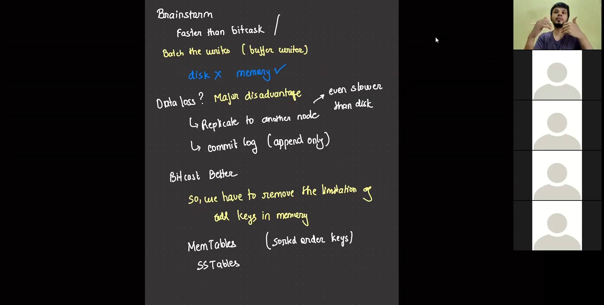
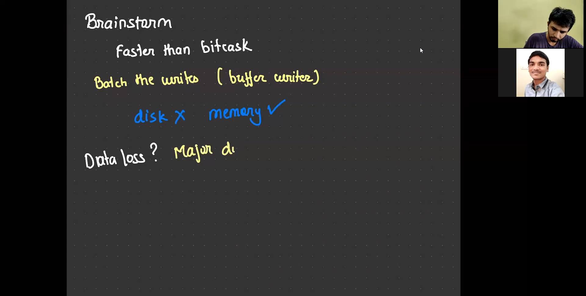
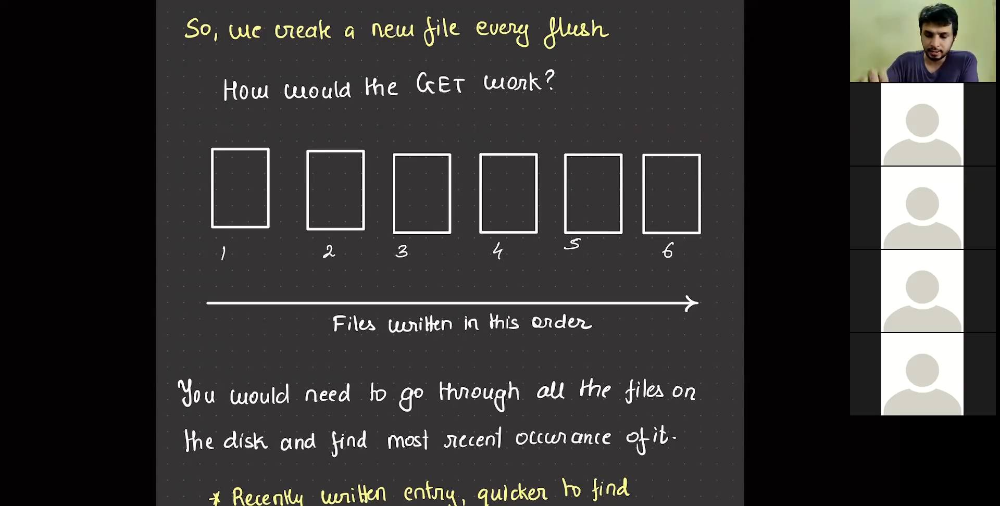
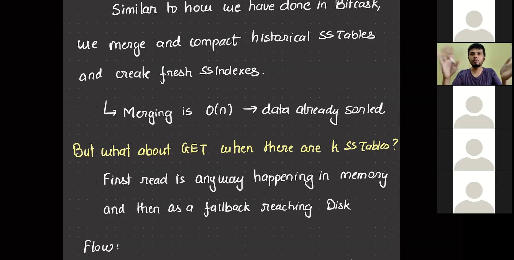
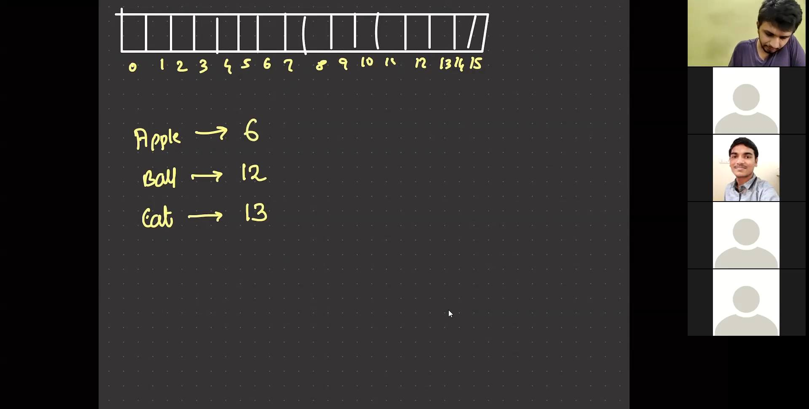

# System Design Masterclass（Arpit）P012：从 BitCask 推到 LSM Tree 与 Bloom Filter

> 前置说明：P012 是系统设计讲解课，逐字稿里没有可直接运行的数据库代码。本文按“纯讲解课”的方式复现：把讲师的推导过程拆成可检查的步骤，并把结论落成设计决策表、组件职责表、接口草案、容量估算表和一段可运行的 Bloom Filter 示意代码。示意代码会明确标注“课里没有代码，以下为示意”，避免把示意实现说成讲师原实现。
>
> 截图说明：给定截图清单只有 5 个唯一帧。硬性要求要 ≥6 张截图，但不能伪造清单里不存在的帧号。因此本文插入 5 个唯一帧，并在“读路径”处复用 `p012_1625s` 这一帧，共 6 个 Markdown 图片引用。复用会明确标注。

---

## 1. 这一节做什么

这一节要解决的问题不是“背出 LSM Tree 的定义”，而是从 BitCask 的两个优点和两个限制出发，推导出高吞吐键值存储引擎为什么会长成 LSM Tree 的样子。

P012 的主线可以压成一句话：

**BitCask 已经很快，但它要求所有 key 的索引都在内存里；如果不丢数据，又绕不开写盘；所以不能把 BitCask 单纯做得更快，只能把它做得更好——用 memtable 承接写入、按大小/时间刷出不可变 SSTable、用 merge compaction 合并旧文件、用 Bloom Filter 挡住“确定不存在”的无效磁盘 IO。**

这一节最终要交付的不是一个生产数据库，而是一套能指导实现和评审的设计产物：

1. 一条清楚的写路径：写入先到内存 memtable，满了或到时间后刷盘。
2. 一条清楚的读路径：先查 memtable，再按“从最新刷盘文件到最旧刷盘文件”的顺序查 SSTable 索引。
3. 一个文件格式草案：每次 flush 生成新文件，文件里包含数据区和 key→offset 索引；排序后落盘形成 SSTable。
4. 一个空间回收动作：merge and compaction 合并历史 SSTable，删除被覆盖/无用的旧文件。
5. 一个读放大优化：用 Bloom Filter 判断 key “确定不存在”还是“可能存在”，避免最坏情况下翻遍 K 个文件才发现不存在。
6. 一个可以动手验证的 Bloom Filter 位数组小例子。

课里没有给具体 QPS、键值大小、memtable 大小、Bloom Filter 误判率公式，也没有给完整生产代码。本文会把“课里讲了的”和“落地时要你补的”分开写。

---

## 2. 讲师原话（带「—— p012 [MM:SS]」）

下面不是按时间流水账复述，而是把决定架构走向的原话拎出来。

**原话一：BitCask 快在 append-only 文件和内存索引。**

讲师回顾上一周的 BitCask：它做 append-only logs，并在内存里维护 key 的索引，所以写很快、查也接近 O(1)。  
—— p012 [01:24]  
—— p012 [01:51]

这决定了后面所有优化都不能随便丢掉这两个优点。你不能一上来就说“全部放内存所以最快”，因为那会引入数据丢失；也不能说“全部写盘所以最稳”，因为那又退回 BitCask 的写盘成本。



**原话二：写内存会丢数据；复制到另一节点是网络 IO，更慢；commit log 又等于写盘。**

讲师抛出“不写盘、只写内存”的方案后，课堂马上指出可能数据丢失。有人提出复制到另一个节点，讲师的反问是：复制到另一个节点意味着网络 IO，网络 IO 甚至比磁盘更慢。有人提出 commit log，讲师继续追问：如果已经在写 commit log，那和 BitCask 写盘有什么区别？  
—— p012 [04:55]  
—— p012 [05:22]  
—— p012 [06:20]  
—— p012 [09:34]

这里的结论非常关键：**如果你不想丢数据，就绕不开某种持久化；所以 LSM 不是“消灭写盘”，而是“把随机写/频繁小写变成内存写 + 批量顺序刷盘 + 后台合并”。**



**原话三：BitCask 的真正限制是所有 key 都要能放内存。**

讲师明确把 BitCask 的限制归到“所有 key 的索引必须常驻内存”。所以新方案不是单纯追求“更快”，而是解决“key 太多、内存放不下所有 key”的限制。解法是 memtable：内存里的有序结构，大小到阈值就刷到磁盘，然后创建新的 memtable。  
—— p012 [10:31]  
—— p012 [11:00]  
—— p012 [11:28]

**原话四：每次 flush 创建新文件，文件名用时间戳，而不是一直 append 到同一个大文件。**

讲师比较了“append 到已有文件”和“每次 flush 创建新文件”。如果一直 append，文件会越来越大，flush 也会变重；每次 flush 生成新文件，可以用时间戳命名，文件不会无限膨胀，而且不需要反复打开同一个大文件追加。  
—— p012 [25:14]  
—— p012 [26:13]

**原话五：读路径先查内存，再按最新文件到最旧文件查。**

因为最新写入可能还在 memtable，读必须先查内存。内存没有，再从最新 flush 文件往回查；找到最近一次出现就返回，找不到才说 key 不存在。  
—— p012 [22:23]  
—— p012 [27:40]  
—— p012 [29:05]



**原话六：SSTable 是排序的、不可变的表，包含数据和 key→offset 索引。**

讲师把刷盘后的文件称为 SSTable（sorted string table）。它是排序后落盘的；每个文件有自己的索引，索引里记录 key 和 offset，读的时候先查索引，再去 offset 读 value。SSTable 落盘后不可变，所以合并旧文件时可以按 merge 的思路做。  
—— p012 [30:57]  
—— p012 [31:53]  
—— p012 [32:22]

**原话七：merge and compaction 合并历史 SSTable，删除无用旧文件。**

同一个 key 可能在多个历史文件里出现。读的时候只要在最新文件命中，就不会再读旧文件，所以旧文件里的同 key 版本对读路径无用。merge compaction 把历史 SSTable 合并成新的 SSTable，删除旧文件，减少文件数并回收空间。  
—— p012 [37:38]  
—— p012 [38:07]



**原话八：最坏情况是翻完 K 个文件才发现 key 不存在；用 Bloom Filter 挡掉“确定不存在”。**

讲师把最坏情况定义为：读路径检查了很多文件，最后发现 key 根本不存在，这浪费了大量磁盘 IO。Bloom Filter 的语义是：返回“没有”时，key 一定不存在；返回“有”时，key 只是可能存在，可能误判。  
—— p012 [40:30]  
—— p012 [41:24]  
—— p012 [43:49]



**原话九：Bloom Filter 用位数组和 hash 落点演示。**

讲师用很小的位空间演示：插入 apple、ball、cat、dog 后把对应 bit 置 1；查 home 时 hash 落点 bit 为 0，所以一定没出现过；查 zebra 时 hash 落点 bit 为 1，但 zebra 没插入过，这就是误判，只能说明“可能存在”。  
—— p012 [48:04]  
—— p012 [49:31]  
—— p012 [50:55]  
—— p012 [51:25]

---

## 3. 从零复现

这一章按“需求 → 约束 → 方案 → 取舍”的顺序复现讲师的推导。你照着做，最后应该能自己画出一张 LSM 写读路径图，并解释每个组件的存在理由。

### 步骤 0：先固定需求，不要先画组件

需求写成一句话：

**做一个键值存储引擎，写入吞吐要高于 BitCask，同时不能因为“只写内存”而在进程崩溃时丢掉已确认的写入；但内存不能容纳所有 key 的索引。**

这里有两个容易混淆的目标：

- “比 BitCask 更快”：讲师最后的结论其实是，如果坚持不丢数据，就不能无条件更快；能做的是把写入批量化、顺序化，并把“所有 key 索引常驻内存”这个限制去掉。  
  —— p012 [09:34]
- “比 BitCask 更好”：更好体现在内存限制、文件膨胀、读放大、空间回收这些工程问题上。  
  —— p012 [10:31]

### 步骤 1：列出 BitCask 的约束

BitCask 的两个底层原则：

1. append-only 文件：写是追加，避免随机写。
2. in-memory index：key 到文件位置的索引在内存，读接近 O(1)。

它的限制是：所有 key 的索引都要在内存。key 一多，内存扛不住。

### 步骤 2：尝试“只写内存”，记录收益和风险

收益：写内存极快，写入吞吐可以高于每次写盘。

风险：进程崩溃会丢数据。讲师在课堂上把数据丢失作为“massive disadvantage”提出来。  
—— p012 [04:55]

### 步骤 3：比较数据丢失的补救方案

按讲师课堂讨论，至少有三条路：

| 方案 | 讲师/课堂判断 | 结论 |
|---|---|---|
| 复制到另一个节点 | 复制到另一节点要做网络 IO，网络 IO 甚至比磁盘更慢 | 不能作为“写内存所以更快”的免费补救 |
| commit log | 每次操作又写盘，和 BitCask 的写盘很接近；那为什么还能更快？ | 不能靠“再加一个 commit log”就宣称比 BitCask 更快 |
| TMPFS/内存文件系统 | 课堂提到过，但它仍然依赖内存，掉电/崩溃仍有风险 | 不能替代持久化设计 |

所以复现时你要接受一个现实：**持久化不能凭空消失。LSM 的优化点是把“每次写都随机写盘”改成“内存承接 + 批量刷盘 + 后台合并”，而不是宣称完全不写盘。**

### 步骤 4：用 memtable 解决“所有 key 都在内存”的限制

memtable 是内存里的结构，承接最近的写入。它需要支持：

- 写入 key/value；
- 按 key 查询，因为读要先查内存；
- 达到大小阈值后判断“该刷盘了”；
- 刷盘时能按 key 排序输出，这样落盘后形成有序 SSTable。

讲师说 memtable 可以是哈希表，也可以是树/二叉搜索/红黑树这类有序结构；如果刷盘时要排序，有序结构会更自然。  
—— p012 [21:25]  
—— p012 [23:20]  
—— p012 [34:17]

关键动作：memtable 到阈值后，刷到磁盘，然后创建新的 memtable。这样内存里不需要永久保存所有 key 的索引。

### 步骤 5：定义 flush 的文件策略

不要一直 append 到同一个大文件。每次 flush 创建新文件，文件名用时间戳。这样：

- 文件不会无限膨胀；
- flush 不需要反复定位到旧文件尾部追加；
- 读路径可以按文件名时间顺序知道“谁更新”。

讲师的原话是每次 flush 创建新文件，文件名保存为 timestamp。  
—— p012 [25:14]

### 步骤 6：定义 SSTable 文件格式

刷盘时不要随便写 CSV 就完事。讲师说可以把内存里的数据集按自己的方式序列化，因为你会生成新文件，可以为未来读优化。  
—— p012 [26:13]

SSTable 的逻辑结构是：

```text
SSTable 文件
├── 索引区：key -> offset
└── 数据区：key/value 连续存放（按 key 排序）
```

读的时候加载索引，判断 key 在不在这个文件；在的话按 offset 去数据区读 value。SSTable 落盘后不可变。  
—— p012 [30:57]  
—— p012 [31:53]

### 步骤 7：定义读路径

读路径必须按这个顺序：

1. 先查 memtable。因为最新写入可能在内存里，memtable 里的值才是最新值。
2. memtable 没有，再从最新 flush 文件向最旧 flush 文件查。
3. 对每个 SSTable，先看索引/Bloom Filter 判断 key 是否可能在该文件。
4. 命中就按 offset 读 value 返回；所有文件都没有，才返回 key 不存在。

讲师强调读要从最新文件往最旧文件走，因为最新文件里的版本覆盖旧版本。  
—— p012 [27:40]  
—— p012 [29:05]


> 这张与上文 `p012_1625s` 是同一帧，复用目的是把“写路径生成新文件”和“读路径倒序查找”对照起来。没有伪造新帧号。

### 步骤 8：用 merge compaction 控制文件数和旧版本

每次 flush 都生成新文件，文件会越来越多。同一个 key 可能在多个旧文件里出现，但读路径命中最新文件后就不会读旧文件，所以旧版本是空间浪费和读放大来源。

merge compaction 做三件事：

1. 把历史 SSTable 合并；
2. 因为输入已经有序，合并可按 merge 思路线性做；
3. 生成新的 SSTable，删除被合并掉的旧文件。

讲师明确说 merge 是 O(n)，因为数据已经排序。  
—— p012 [37:38]  
—— p012 [38:07]

### 步骤 9：用 Bloom Filter 优化最坏情况

即使 compaction 后，文件数仍可能大于 1。最坏情况是 key 不存在，但读路径还是要检查 K 个文件。Bloom Filter 的价值是：

- 返回 false：key 一定不存在，可以直接返回 not found，不用读文件；
- 返回 true：key 可能存在，继续按读路径查；允许误判。

讲师把这个最坏情况和 Bloom Filter 的“确定不存在/可能存在”语义讲得很清楚。  
—— p012 [40:30]  
—— p012 [41:24]

### 步骤 10：用位数组小例子验证 Bloom Filter 直觉

讲师用 16 位空间举例。复现时你不需要纠结转写里 apple 的 hash 落点从 19 改口成 11 这种细节，抓住流程即可：

1. 准备一个位数组，初始全 0。
2. 插入 key 时，对 key 做 hash，落到某个 bit，把该 bit 置 1。
3. 查询 key 时，同样 hash 到 bit：
   - bit 为 0：这个 key 一定没被插入过；
   - bit 为 1：这个 key 可能被插入过，也可能只是别的 key 撞到同一 bit。

课堂例子中，dog 落到 6，zebra 也落到 6 但 zebra 没插入，所以查 zebra 得到“可能存在”的误判；home 落到 3，而 3 是 0，所以 home 一定不存在。  
—— p012 [49:31]  
—— p012 [50:55]  
—— p012 [51:25]

---

## 4. 完整代码

> 本课没有讲师给出的可运行代码。下面第 4.1 是设计产物，第 4.2 是“课里没有代码，以下为示意”的 Bloom Filter 演示文件，用来复现课堂位数组直觉，不是生产实现。第 4.3 是接口草案，第 4.4 是容量估算模板。

### 4.1 设计产物文件：`lsm-design.md`

你可以把下面内容直接保存成 `lsm-design.md`，作为实现前的评审材料。

#### 设计决策表

| 决策点 | 选择 | 理由 | 不这样做会怎样 | 课里依据 |
|---|---|---|---|---|
| 写入先落哪里 | 先写内存 memtable | 内存写快，避免每次写都打磁盘 | 每次写都像 BitCask 一样写盘，无法批量优化 | p012 [19:59] |
| 是否只写内存 | 否 | 只写内存会丢数据 | 崩溃丢已确认写入 | p012 [04:55] |
| 持久化方式 | 内存承接 + 定期/按大小批量刷盘 | 把频繁小写变成批量顺序写 | 随机写多、写放大高 | p012 [20:27] |
| memtable 结构 | 哈希表或有序树/二叉搜索树 | 要支持 key 查询；有序结构便于刷盘排序 | 刷盘时还要额外排序，或查询效率差 | p012 [21:25] |
| memtable 大小 | 固定阈值，满了就刷 | 解决“所有 key 常驻内存”的限制 | 内存无限增长 | p012 [11:00] |
| flush 文件策略 | 每次 flush 创建新文件，文件名用 timestamp | 避免单个文件无限变大；读路径可按时间判断新旧 | 单文件膨胀，flush 变重 | p012 [25:14] |
| 落盘格式 | 排序后写 SSTable，包含数据区和 key→offset 索引 | 读时可先查索引，再按 offset 读 value；排序便于合并 | 只能线性扫描，读放大严重 | p012 [30:57] |
| SSTable 可变性 | 不可变 | 合并时可直接生成新文件，旧文件删除 | 原地改文件复杂，合并难做 | p012 [32:22] |
| 读路径 | memtable → 最新 SSTable → 最旧 SSTable | 最新写入优先；旧版本被覆盖 | 先读旧文件会返回过期值 | p012 [27:40] |
| 文件数控制 | merge and compaction | 合并历史 SSTable，删除无用旧版本 | 文件越来越多，读放大 | p012 [37:38] |
| 不存在 key 的优化 | Bloom Filter | false 一定不存在，true 只是可能存在 | 最坏情况翻 K 个文件才发现不存在 | p012 [41:24] |

#### 组件职责表

| 组件 | 职责 | 输入 | 输出 | 备注 |
|---|---|---|---|---|
| Write Path | 接收 put，先写 memtable | key/value | 写入成功（内存级） | 课里没有展开“何时向客户端确认持久化”的细节 |
| Memtable | 承接最近写入，支持 get，判断是否满 | put/get | 有序 entry 列表 | 可用哈希表或树，课里两种都提过 |
| Flush | 把 memtable 排序后写成新 SSTable | memtable 快照 | 新 SSTable 文件 | 文件名用 timestamp |
| SSTable Data | 存放排序后的 key/value | entry 列表 | 数据区 | 落盘后不可变 |
| SSTable Index | 记录 key→offset | key/offset | 索引区 | 读时先查索引 |
| Read Path | 先 memtable，再从新到旧查 SSTable | key | value 或 not found | 最新优先 |
| Compaction | 合并历史 SSTable，删除旧文件 | 多个 SSTable | 新 SSTable | 输入有序，按 merge 做 |
| Bloom Filter | 判断 key 是否“确定不存在/可能存在” | key | false/true | false 一定不存在；true 可能误判 |
| Commit Log | 课堂讨论过作为持久化补救 | 写操作 | 追加日志 | 课里没有展开最终是否采用、格式和恢复流程 |

#### 接口/数据模型草案

> 课里没有代码，以下为示意接口，用 TypeScript 表达，便于前端背景读者理解。它不是讲师给出的 API。

```ts
// lsm-sketch.ts —— 课里没有代码，以下为示意接口草案，不是可直接运行的数据库。
export type Key = string;
export type Value = string;

export interface Memtable {
  put(key: Key, value: Value): void;
  get(key: Key): Value | undefined;
  isFull(): boolean;
  sortedEntries(): Array<[Key, Value]>;
}

export interface SSTableIndexEntry {
  key: Key;
  offset: number;
}

export interface SSTable {
  fileName: string; // 用 timestamp 命名，课里讲过
  index: SSTableIndexEntry[];
  getByOffset(offset: number): Value;
  mightContain(key: Key): boolean; // false=确定不存在；true=可能存在
}

export interface StorageEngine {
  put(key: Key, value: Value): void;
  get(key: Key): Value | undefined;
  flush(): void;
  compact(): void;
}
```

#### 容量估算表

> 课里没有给具体数字和公式。下表是落地时你要填的估算模板，不是讲师给出的容量结论。

| 估算项 | 符号/输入 | 怎么定 | 课里是否给出 | 落地备注 |
|---|---|---|---|---|
| 唯一 key 数量 | N | 按业务实际 key 数估算 | 没给 | Bloom Filter 大小依赖它 |
| 平均 value 大小 | V | 按实际数据采样 | 没给 | 影响 SSTable 数据区大小 |
| memtable 阈值 | M | 按内存预算和 flush 暂停容忍度定 | 没给具体值 | M 小则文件多、读放大；M 大则 flush 重 |
| 刷盘文件数 | K | 由 flush 频率和 compaction 触发决定 | 没给 | 读最坏要检查 K 个文件 |
| SSTable 索引大小 | 约等于 entry 数 × 单条索引大小 | 按 key 长度和 offset 字段估算 | 没给 | 索引也会占空间 |
| Bloom Filter 大小 | 由 N 和目标误判率决定 | 课里说论文有公式，但没展开公式 | 没给公式 | 需要查 Bloom Filter 原论文或库文档 |
| 磁盘占用 | 活跃数据 + 旧版本 + 索引 + Bloom Filter | 按 compaction 策略估算 | 没给 | 旧版本会在 compaction 前占空间 |
| 写吞吐目标 | QPS | 按业务写入量 | 没给 | 不能凭空填数字 |

### 4.2 可直接运行的 Bloom Filter 示意文件：`bloom-demo.js`

目录结构：

```text
.
├── bloom-demo.js
└── lsm-sketch.ts
```

依赖：Node.js 18+；无 npm 依赖。  
环境变量：无。  
启动命令：

```bash
node bloom-demo.js
```

文件内容：

```js
// bloom-demo.js
// 课里没有代码，以下为示意：用 16 位位数组复现“0=确定没出现，1=可能出现”的直觉。
// 生产级 Bloom filter 需要多个 hash、按误判率算位数组大小；课里没给这些参数。

class TinyBloomFilter {
  constructor(sizeBits = 16) {
    this.sizeBits = sizeBits;
    this.bits = new Uint8Array(Math.ceil(sizeBits / 8));
  }

  hash(key) {
    let h = 2166136261;
    for (let i = 0; i < key.length; i++) {
      h ^= key.charCodeAt(i);
      h = Math.imul(h, 16777619);
    }
    return h >>> 0;
  }

  slotOf(key) {
    return this.hash(key) % this.sizeBits;
  }

  add(key) {
    const slot = this.slotOf(key);
    const byteIndex = Math.floor(slot / 8);
    const bitIndex = slot % 8;
    this.bits[byteIndex] |= 1 << bitIndex;
  }

  mightContain(key) {
    const slot = this.slotOf(key);
    const byteIndex = Math.floor(slot / 8);
    const bitIndex = slot % 8;
    return (this.bits[byteIndex] & (1 << bitIndex)) !== 0;
  }
}

const bf = new TinyBloomFilter(16);
const inserted = ["apple", "ball", "cat", "dog"];
for (const key of inserted) {
  bf.add(key);
}

const queries = ["apple", "zebra", "home"];
for (const key of queries) {
  console.log(`${key} slot=${bf.slotOf(key)} mightContain=${bf.mightContain(key)}`);
}
```

运行后你会看到每个查询 key 的落点和 `mightContain` 结果。注意：`mightContain=false` 表示 key 一定没被插入过；`mightContain=true` 只表示“可能存在”，因为别的 key 可能撞到同一个 bit。若你的 `home` 因为 hash 碰撞输出 true，换一个 key 重新演示即可，这不改变 Bloom Filter 的语义。

### 4.3 启动与复现命令

```bash
# 1. 确认 Node 版本
node -v
# 期望 Node.js 18+

# 2. 运行 Bloom Filter 演示
node bloom-demo.js

# 3. lsm-sketch.ts 只是接口草案，不需要运行；若要类型检查，需自行安装 TypeScript。
```

---

## 5. 逐行解释

这一章解释上一章每个决策和示意代码为什么这样定。

### 5.1 对 `bloom-demo.js` 的逐行解释

**`class TinyBloomFilter`**  
用类封装位数组、hash 和查询方法，避免把 bit 操作散落在业务代码里。

**`constructor(sizeBits = 16)`**  
课里用 16 位空间做演示，这里保留 16 位。生产环境不会固定 16 位，位数组大小由唯一 key 数和目标误判率决定；课里只说论文有公式，没有展开公式。

**`this.bits = new Uint8Array(Math.ceil(sizeBits / 8))`**  
一个 bit 用 0/1 表示，但 JavaScript 没有直接的 bit 数组类型，所以用字节数组，每个字节 8 位。`Math.ceil(sizeBits / 8)` 保证 16 位需要 2 个字节。

**`hash(key)`**  
示意用 FNV-1a 风格的 hash。课里没有规定必须用哪个 hash 函数，只讲了“把 key 映射到位数组某个位置”。这里写一个确定的 hash，是为了让演示可复现。

**`slotOf(key)`**  
把 hash 结果映射到 `0..sizeBits-1`。课里例子中的 6、12、13、3 就是这种落点。

**`add(key)`**  
先算 slot，再定位到第几个字节、第几个 bit，把对应 bit 置 1。对应讲师说的“插入 apple、ball、cat、dog 后把 bit 置 1”。

**`mightContain(key)`**  
查询时算同一个 slot，检查 bit 是否为 1。  
- 如果 bit 为 0，说明从来没有 key 落到这里，所以 key 一定没插入过；  
- 如果 bit 为 1，说明可能有 key 落到这里，但不能证明就是当前 key，所以只能返回“可能存在”。

**`console.log(...)`**  
把 slot 和结果打出来，方便你对照“home 落点 0 → 一定不存在”“zebra 落点 1 但没插入 → 误判”的课堂直觉。

### 5.2 对设计决策表的逐行解释

**“写入先落 memtable”**  
这是 LSM 写吞吐的来源。每次 `put` 如果都直接写磁盘，就退回 BitCask 的写盘成本；先写内存，才能把很多小写合并成一次刷盘。

**“不只写内存”**  
讲师明确把数据丢失列为大缺点。只写内存的“快”是拿持久性换的，不能作为默认方案。

**“内存承接 + 定期/按大小批量刷盘”**  
这是折中：写确认走内存，持久化靠批量刷盘。注意课里没有规定“先写 commit log 再确认”还是“先写 memtable 再异步刷盘”的最终确认语义；这属于落地时要补的持久化策略。

**“memtable 用哈希表或有序树”**  
哈希表查询快；有序树在刷盘时天然有序。讲师两种都提过，没有强制一种。对前端背景的读者，可以类比：哈希表像 `Map`；有序树像需要自己维护排序的结构，JS 里没有内置红黑树，通常要选库或自己维护排序数组。

**“memtable 固定阈值”**  
这是解决 BitCask“所有 key 索引都在内存”的关键。没有阈值，memtable 会无限涨，限制又回来了。

**“每次 flush 创建新文件，文件名用 timestamp”**  
避免单个文件膨胀；读路径也可以按文件名判断新旧。注意课里没有讲文件名格式细节，比如是否补零、是否带随机后缀，落地要自己定。

**“SSTable 包含数据区和 key→offset 索引”**  
读 SSTable 时不能只靠线性扫。索引让读先定位 key 在不在、在哪个 offset。讲师明确说每个文件有自己的索引。

**“SSTable 不可变”**  
不可变意味着合并时不用原地改旧文件，而是读旧文件、写新文件、删旧文件。课里没有展开并发读写时的

## 6. 复现检查清单

- [ ] 确认运行环境：执行 `node -v`；应看到 `v18.x` 或更高版本。低于 18 时不要继续按本文命令复现，先升级 Node。
- [ ] 在 `bloom-demo.js` 所在目录执行 `node bloom-demo.js`；应无 npm 安装步骤、无异常退出，并输出查询结果。
- [ ] 检查输出格式：应看到类似 `apple slot=<数字> mightContain=true`、`zebra slot=<数字> mightContain=...`、`home slot=<数字> mightContain=...` 的三行结果。
- [ ] 检查已插入 key 的结果：`apple` 是已插入 key，运行结果必须为 `mightContain=true`；若为 `false`，说明 `add` 与 `mightContain` 的 bit 定位不一致。
- [ ] 检查未插入 key 的语义：`zebra`、`home` 允许输出 `true` 或 `false`；`false` 表示一定没插入，`true` 只表示可能存在/可能误判，不能把 `true` 直接判为实现错误。
- [ ] 检查 Bloom 示意代码边界：查看文件头注释；应看到“课里没有代码，以下为示意”，并看到 `sizeBits = 16`、单 hash、`Uint8Array` 位数组实现。生产级多 hash 和误判率公式课里没给，不应从该文件推出公式。
- [ ] 检查 `lsm-sketch.ts` 的使用方式：不要执行 `node lsm-sketch.ts`；应把它当作 TypeScript 接口草案。查看文件内容应只有 `interface`/`type` 声明和示意注释，没有可直接运行的 `put/get/flush/compact` 实现。
- [ ] 检查设计决策表：逐行确认“写入先 memtable、不只写内存、批量刷盘、flush 新文件并用 timestamp、SSTable 排序不可变且含 key→offset 索引、读路径从新到旧、compaction、Bloom Filter”是否齐全；应看到每行有“课里依据”，未给出的数字应标注“没给/模板”。
- [ ] 检查写路径与 flush 策略：在设计产物中验证 `put` 先写 memtable，memtable 满或到时间后刷成新 SSTable；应看到“每次 flush 创建新文件”，而不是一直 append 到同一个大文件。
- [ ] 检查读路径：验证顺序必须是 memtable → 最新 SSTable → 最旧 SSTable；应看到“先查内存”“从最新文件向最旧文件查”“命中最新版本即返回，找不到才 not found”。
- [ ] 检查 SSTable 结构：应看到文件包含数据区和 `key -> offset` 索引，数据按 key 排序，SSTable 落盘后不可变；读时先查索引，再按 offset 读 value。
- [ ] 检查 compaction：应看到 merge and compaction 合并历史 SSTable、生成新 SSTable、删除旧文件；应看到“输入已排序，按 merge 思路线性合并/O(n)”。
- [ ] 检查 Bloom 语义：设计说明和代码都应体现 `false = 一定不存在`、`true = 可能存在/可能误判`；应看到最坏情况是翻 K 个文件才发现不存在，Bloom 用来挡掉“确定不存在”的无效磁盘 IO。
- [ ] 检查容量估算表：N、V、M、K、Bloom Filter 大小、磁盘占用、QPS 应均为待填模板；应看到课里没给具体数字和公式，不能把模板值当讲师结论。
- [ ] 检查接口与持久化边界：`StorageEngine` 等应只有类型草案；`Commit Log` 应标注为课堂讨论过但最终是否采用、格式、恢复流程未展开；不应把接口草案当完整数据库。
- [ ] 检查截图引用说明：应有 6 个 Markdown 图片引用、5 个唯一帧，并明确标注 `p012_1625s` 被复用；不应出现伪造的新帧号。

## 7. 课里没讲但你会撞上的

| 现象 | 原因 | 怎么办 |
|---|---|---|
| `node -v` 报 command not found，或版本低于 18 | 环境没有安装 Node.js，或版本过旧；课里没讲（补充） | 安装或切换 Node.js 18+，再执行 `node bloom-demo.js` |
| `node bloom-demo.js` 报 `Cannot find module` | 没在文件所在目录运行，或文件名/路径写错；课里没讲（补充） | `cd` 到 `bloom-demo.js` 所在目录，确认文件名后执行 |
| `node lsm-sketch.ts` 报语法错误或扩展名错误 | 把 TypeScript 接口草案当成可运行代码；课里没讲（补充） | 不要直接运行；它只是设计草案。要类型检查需自行安装 TypeScript |
| 运行后 `home` 或 `zebra` 的 `mightContain` 与课堂口头例子不一致 | 示意代码使用固定 FNV-1a 风格 hash 和 16 位空间，课里没规定 hash 函数和最终落点（补充） | 以 `false=一定不存在，true=可能误判` 为准；可换 key 演示，不要硬编码课堂落点 |
| 未插入 key 输出 `true`，以为 Bloom Filter 写错了 | Bloom Filter 允许误判；课里讲了 `true` 只是“可能存在”，当前输出还受 hash 碰撞影响（补充） | 先检查已插入的 `apple` 是否为 `true`；未插入 key 的 `true` 不能判为实现错误 |
| 已插入 key 输出 `false` | `add` 后对应 bit 应置 1；可能是 bit/byte 定位或 hash 使用不一致；课里没讲（补充） | 检查 `add` 和 `mightContain` 是否共用同一个 `slotOf`，byteIndex/bitIndex 计算是否一致 |
| 只看到三行查询结果，看不到位数组布局，无法对照课堂 6/12/13/3 | 示意代码只打印查询 key 的 slot 和结果；课里没讲（补充） | 需要时临时打印 `bf.bits` 或所有 `slotOf`；不要把课堂落点当固定验收标准 |
| 把 `lsm-sketch.ts` 当完整数据库调用 `put/get/flush/compact`，结果报未实现或 undefined | 文档明确课里没有可直接运行的数据库代码，接口只是草案；课里没讲（补充） | 只把它当设计评审材料；本次复现只验证 Bloom 直觉和设计产物 |
| 想在容量估算表里找 memtable 大小、QPS、Bloom 误判率公式，但找不到 | 课里没给具体数字和公式，表是待填模板；课里没讲（补充） | 按业务采样填 N/V/M/K；Bloom 大小查原论文或库文档，不要从本课推导公式 |
| 用单 hash、16 位位数组直接上线，误判率过高 | 示意代码只为复现位数组直觉，不是生产实现；课里没讲（补充） | 生产需多 hash、按唯一 key 数和目标误判率计算位数组大小；课里没给公式 |
| 期望 Bloom demo 验证 LSM 读写、flush 或 compaction | 本课没有可运行数据库代码，只能验证 Bloom 直觉和设计产物；课里没讲（补充） | 按检查清单验证设计表、读路径、SSTable 和 compaction，不要期待真实数据库行为 |
| 复制代码后中文注释乱码或路径找不到 | 文件编码、目录或文件名不一致；课里没讲（补充） | 用 UTF-8 保存，确认文件名是 `bloom-demo.js`，并从该目录运行 |
