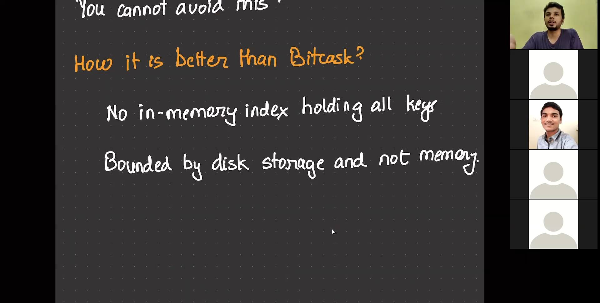
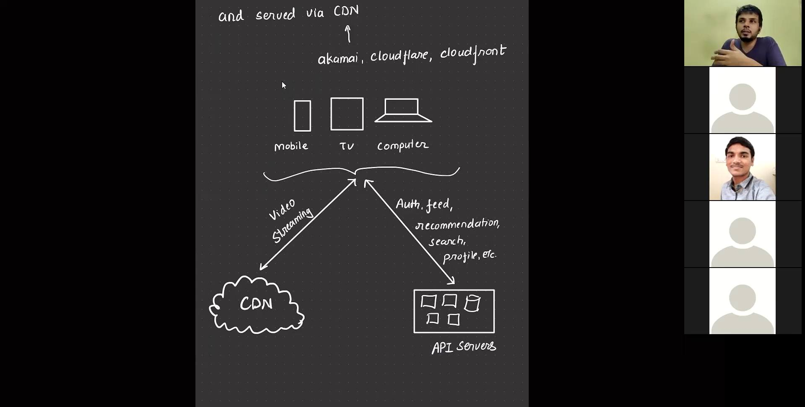
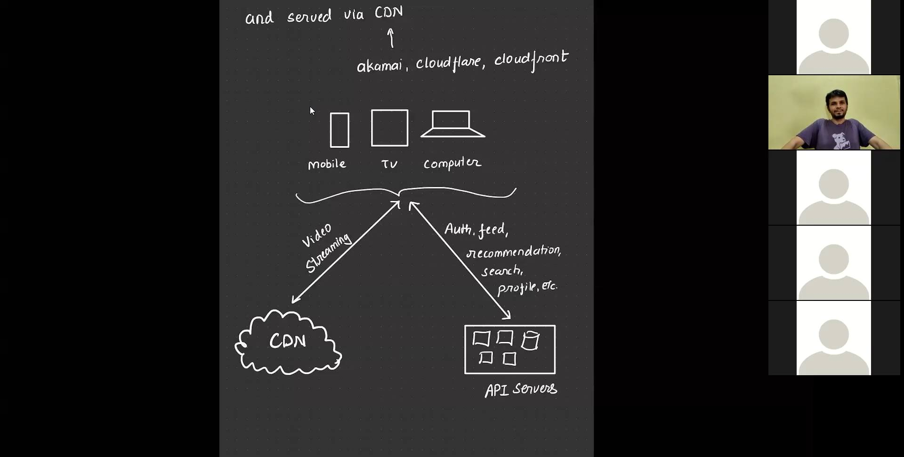
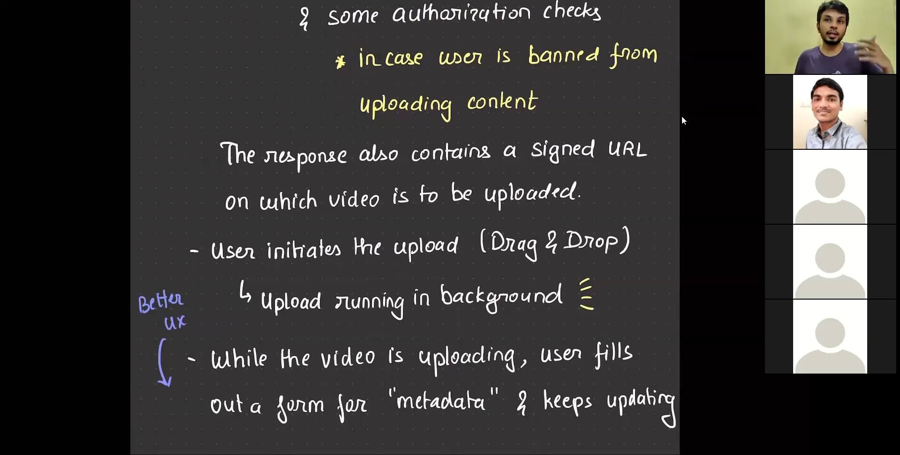
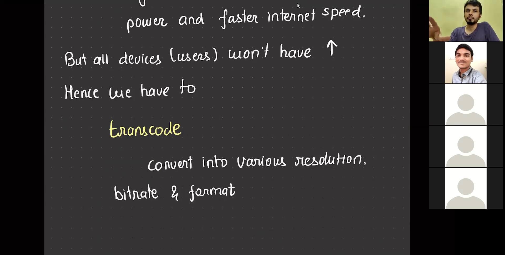

# System Design Masterclass (Arpit) P12 复现文档：LSM 写入可靠性与 YouTube 视频系统设计

> 说明：P12 是系统设计讲解课，逐字稿里没有给出可运行的课程项目仓库，也没有完整业务代码。因此本文的“复现”指：按讲师推导，产出可评审的设计决策、数据模型、接口草案、容量估算表，以及一个本地可执行的 FFMPEG 转码示意脚本。凡逐字稿没讲的内容，本文会明确写“课里没讲”。  
> 另外，截图清单只提供了 5 个不同帧；为满足“≥6 个图片引用”的格式要求，第 6 个引用复用 `p012 [92:06]` 这一帧，并在 alt 中注明“复用”，不伪造清单外的帧。

---

## 1. 这一节做什么

P12 覆盖两个主题，前半段收尾 LSM Tree 的可靠性设计，后半段进入 YouTube 类视频系统的系统设计。

前半段要解决的问题是：数据先写内存，内存里的结构能加速读写，但进程崩溃时内存数据会丢；于是需要 on-disk、append-only 的 commit log，在重启时重放，重建内存索引。讲师同时讨论了 Bloom filter 的空间效率、扩容时必须 rehash、以及 LSM Tree 相比 BTree 的优势不是“写得更快”，而是“不再要求所有 key 都能放进内存”。

后半段要解决的问题是：YouTube 不是单一服务。视频流和核心 API 是两类负载；上传不能阻塞用户体验；元数据适合 NoSQL；视频属于 channel 而不是 user；播放要通过 CDN，并用短时 signed URL 做访问控制；上传完成后要触发转码，用 FFMPEG 生成多分辨率版本；播放端根据网络和电池做 adaptive bitrate；全量转码之外还要有 on-demand transcoding 兜底；失败上传要有 draft 状态、timeout 和 cleanup job。

这一节的复现产物不是“部署一个 YouTube”，而是一套能照着画出来、写出来、评审起来的设计包：

1. LSM 写入可靠性链路：memtable → flush → commit log → 重启重放 → flush 后截断 → Bloom filter 前置过滤。
2. YouTube 上传链路：创建 draft → 返回 signed URL → 客户端直传 block storage → 前台填元数据 → 上传完成事件 → 标记 raw upload 完成 → 触发转码。
3. YouTube 播放链路：播放 API 鉴权 → 生成短时 signed URL → CDN 验证签名 → 回源/缓存 → 自适应码率。
4. 数据模型与接口草案：Video、Channel、转码版本、上传完成回调。
5. 容量估算表：只给公式和假设，不把假设冒充讲师结论。

---

## 2. 讲师原话（带「—— pNNN [MM:SS]」）

以下为中文译述，保留逐字稿中的关键词，便于对照原视频。

- Bloom filter 只加载很小的位图，16 bit 只是两个字节，却能承载大量 key 的存在性信息，所以它非常空间高效。—— p012 [53:49]
- 如果 Instagram 的 post 增加，Bloom filter 要扩容，就只能加空间并 rehash 所有 key，没有别的办法；所以通常要 overprovision，并准备好 rehash 已见过的 key。—— p012 [54:18]
- Bloom filter 不是数据的最终来源；你仍然要有真实数据库存 key 和 value，扩容时从数据库迭代重建 Bloom filter。—— p012 [55:17]
- 写入先发生在内存；如果 flush 之前进程崩溃，这段时间的数据会丢。所以需要 on-disk、append-only 的 commit log，重启后用它重建内存结构。—— p012 [56:37]
- commit log 里记录的是 put、delete 这类实际写操作；读操作不记。flush 成功后，commit log 会被 truncate 到零，而不是每次新建文件。—— p012 [57:33] [58:02] [58:31]
- commit log 不会让写入比 BTree 更快；它的价值是让你不必把所有 key 都放在内存里，key 数量受磁盘限制，而不是受内存限制。—— p012 [58:59] [59:29]
- LSM Tree 在生产里不 obscure，LevelDB、RocksDB 这类嵌入式数据库大量使用；LevelDB 的内部实现很值得看。—— p012 [59:58] [60:22]
- YouTube 有两部分：视频流和核心 API。核心 API 负责认证、feed、推荐、搜索；视频流是另一套负载，通常不由 API server 直接扛。—— p012 [69:46] [70:13]
- Netflix、Dropbox 这类需要鉴权的场景，请求先到 API server 检查用户是否有权限；有权限才生成 signed URL，CDN 验证签名后提供数据。—— p012 [70:42] [71:10] [73:58]
- signed URL 是短时有效的，比如 5 分钟；过期后客户端再向 API server 要新的 signed URL，再拿它去 CDN 取流。—— p012 [73:30] [74:56]
- 上传时，用户点击上传，API 返回 video ID 和 signed URL；客户端把视频直接上传到 block storage，前台同时让用户填写标题、描述、标签、语言、字幕等元数据。—— p012 [91:08] [91:37]
- 视频不属于 user，而属于 channel；讲师特别说他在面试里因为一直说 user 而不是 channel 被挑战过。—— p012 [85:27] [86:23]
- 元数据数据库可以选 NoSQL，因为不需要严格外键和跨表 join；视频元数据主要围绕 channel，约束不需要很严格。—— p012 [83:36] [84:04]
- 上传完成通过 JavaScript event 再发一次 API 调用，把 raw upload 标记为 true；视频记录有 status，默认 draft，发布后变 published。—— p012 [93:01] [93:30] [96:24]
- 上传要有 timeout，比如 2 小时或 3 小时；超时后可以认为失败，并让 cleanup job 清理未上传视频和 S3 里的失败分片。—— p012 [97:52] [98:51] [99:17]
- 转码用 FFMPEG：把视频下载到机器本地，跑 FFMPEG 命令，指定分辨率和参数，输出另一个文件，再上传回 S3。—— p012 [108:15] [108:42] [109:11]
- 转码有两条路：全量转码并保存所有可能分辨率；以及 on-demand transcoding，在请求某个未就绪分辨率时临时转码。后者不是最优，但必须存在。—— p012 [101:44] [102:11]
- 自适应码率会根据用户网络、电池等条件切换分辨率；网络波动时在分辨率和 bitrate 之间切换。—— p012 [107:17]
- 上传完成后触发转码是 event-driven architecture；API 知道 raw video 上传完成，再触发后续转码流程。—— p012 [110:07]



---

## 3. 从零复现

### 3.1 先定需求与约束

LSM 部分的需求不是“做一个数据库”，而是复现一个写入可靠性推导：

- 写入先进入内存结构，内存结构负责快速索引。
- 内存不能无限大，所以要 flush 到磁盘文件。
- 内存写入和 flush 之间存在崩溃窗口，必须有一个磁盘上的 append-only 日志。
- 重启后要能重放日志，恢复内存结构。
- flush 成功后日志要截断，否则日志无限增长。
- 查询一个不存在的 key 时，不能每次都扫磁盘文件，所以需要 Bloom filter 前置过滤。
- Bloom filter 扩容时需要 rehash，因此必须保留真实 key/value 存储，作为重建来源。

YouTube 部分的需求是：

- 上传不能阻塞用户填写元数据。
- 视频文件不能经过 API server 中转，应该客户端直传 block storage。
- API server 只负责鉴权、发 signed URL、维护元数据、触发后续任务。
- 播放流量走 CDN，不走 API server 的普通请求链路。
- 视频要转成多分辨率，播放端根据网络自适应。
- 失败上传、超时、草稿状态、清理任务都要考虑。

### 3.2 推导 LSM 的写入可靠性

**步骤 1：写入先落内存。**  
讲师从“flush 发生在哪里”讲起：写入先写在内存，内存里的表到一定条件后 flush 到磁盘。内存写入快，但进程崩溃会丢。

**步骤 2：找出崩溃窗口。**  
如果 flush 刚发生，下一次 flush 之前进程崩溃，那么这段时间写入的数据就丢了。讲师原话是“just before the next plus there is a crash happening so the data which was written during this time is lost”。

**步骤 3：加 on-disk append-only commit log。**  
所有写操作先追加到磁盘日志。日志记录的是 `put k1 v1`、`put k2 v2`、`delete k2` 这类操作，不记录读操作。这样进程崩溃后，重启时可以重放日志，重建内存索引。

**步骤 4：flush 成功后截断日志。**  
一旦内存表成功 flush 到磁盘文件，日志里的操作已经被持久化，就不需要再保留。讲师说“every time the flush happens you would also truncate the commit log”，并且是 truncate 而不是新建文件。

**步骤 5：用 Bloom filter 减少无效磁盘查找。**  
查询一个 key 时，先查 Bloom filter。如果 Bloom filter 说“不存在”，就不必继续查磁盘文件。Bloom filter 只保存很小的位图，空间效率高，但会有误判，所以它是一个前置过滤器，不是最终数据源。

**步骤 6：扩容 Bloom filter 必须 rehash。**  
当 key 数量增长，Bloom filter 需要更大空间，就要重新把所有 key 哈希进去。因此系统里必须保留真实 key/value 存储，扩容时从数据库迭代重建。

**步骤 7：对比 BTree 得出取舍。**  
讲师明确说 commit log 不会让写入比 BTree 更快；LSM 的优势是 key 数量不再受内存限制，而受磁盘限制。代价是读路径更复杂，需要 Bloom filter、多个磁盘文件、日志重放等机制。

### 3.3 推导 YouTube 上传与播放

**步骤 1：用户点上传，API 创建草稿记录。**  
客户端调用 API，API 在数据库创建一条视频记录，状态默认 `draft`，返回 video ID 和 signed URL。课里说返回的是“ID 和 signed URL”，让客户端直接上传到 block storage。

**步骤 2：客户端直传 block storage。**  
视频文件不经过 API server，而是用 signed URL 直接上传到 S3 这类 block storage。这样 API server 不承担大文件流量。

**步骤 3：前台让用户填元数据。**  
上传在后台进行，前台让用户填写标题、描述、标签、语言、字幕等。讲师强调“更好的用户体验永远赢”，技术不能挡住 UX。

**步骤 4：上传完成事件通知后端。**  
文件上传完成后，浏览器会收到 JavaScript event，客户端再发一次 API 调用，告诉后端“这个 video ID 上传完成了”，并把 `raw upload` 标记为 true。课里说这可以是普通 HTTP/REST 调用，不一定是 server-sent event；如果已有 open socket 连接，也可以用 server-side event。

**步骤 5：发布后触发转码。**  
用户点发布后，状态从 `draft` 变为 `published`，后端触发转码任务。转码 worker 下载 raw 视频到本地磁盘，跑 FFMPEG，生成多个分辨率，再上传回 S3。

**步骤 6：播放 API 鉴权并生成短时 signed URL。**  
播放请求先到 API server，API 检查用户是否有权限看这个内容，然后生成短时 signed URL，比如 5 分钟有效。客户端拿这个 URL 去 CDN 取流；CDN 验证签名是否有效，有效就返回数据。

**步骤 7：CDN 缓存与回源。**  
视频数据存在 block storage，CDN 作为缓存层。CDN 命中就直接返回；不命中就回源。API server 只生成 URL，不直接扛视频流。

**步骤 8：自适应码率与按需转码兜底。**  
播放端根据网络、电池等条件选择分辨率；网络波动时在分辨率和 bitrate 之间切换。如果请求的分辨率还没转码好，就触发 on-demand transcoding，先转一个切片再返回，而不是等整个视频转完。

**步骤 9：失败与超时清理。**  
上传失败时，记录可能仍然是 `draft`。系统可以保留草稿让用户重试，也可以跑 cleanup job 删除。还要有 timeout，比如 2 小时或 3 小时；超时后认为失败，清理数据库记录和 S3 里的失败分片。



### 3.4 估算：写出算式，但标明假设

课里没有给出完整容量数字，只给了少量量级，例如 240p 的一分钟切片大约 2–5MB、原始一分钟切片可能到 50MB 量级；这些是粗略讨论，不是精确容量结论。下面用“复现假设”做估算，方便你改参数。

**假设 A：元数据量。**  
假设平均每条视频元数据 1KB，100 万条视频：  
`1,000,000 × 1KB = 1GB`。  
1000 万条：`10,000,000 × 1KB = 10GB`。  
这说明元数据本身不大，选择 NoSQL 更多是因为访问模式和 schema 灵活性，而不是因为单条记录巨大。

**假设 B：播放签名 URL 的 API QPS。**  
如果 signed URL 5 分钟过期，每个播放会话每 5 分钟刷新一次：  
`QPS = 并发播放会话数 / 300 秒`。  
100 万并发会话：`1,000,000 / 300 ≈ 3,333 QPS`。  
这要求签名 API 很轻、可水平扩展，不能在里面做重查询。

**假设 C：CDN 出流带宽。**  
假设 240p 一分钟切片 3MB，1 万并发观看：  
`3MB × 10,000 = 30,000MB/分钟 = 30GB/分钟 = 0.5GB/秒 ≈ 4Gbps`。  
这是量级估算，实际取决于码率、切片长度、并发和缓存命中率。

**假设 D：转码 CPU 时间。**  
假设 1 小时视频转 5 个分辨率，每个分辨率平均 0.5 倍实时：  
`1小时 × 5 × 0.5 = 2.5 CPU小时/视频`。  
如果每天上传 1 万个 1 小时视频：`10,000 × 2.5 = 25,000 CPU小时/天`。  
按 24 小时摊：`25,000 / 24 ≈ 1,042 核`，还不含重试、峰值和余量。  
这个算式说明转码是计算密集型，需要任务队列和水平扩展；具体系数必须实测。

**假设 E：清理任务扫描量。**  
如果每天创建 10 万条 draft，超时率 1%：每天约 1,000 条待清理。  
`待清理数 = 创建数 × 超时率`。  
这不是讲师给出的数字，只是复现时应该替换成你自己的监控值。

### 3.5 方案取舍

- 元数据数据库：选 NoSQL，因为视频元数据不需要严格外键和跨表 join；但如果你要做复杂报表，仍然可能要同步到分析型存储。课里只讨论了 NoSQL 的合理性，没有展开具体产品。
- channel 还是 user：视频属于 channel。用 channel ID 更准确，也避免面试里被追问“user 和 channel 的关系”。
- 反规范化还是引用：可以把 channel 名称冗余到视频记录里，省一次 get；但 channel 改名时要更新所有视频。讲师说 YouTube 单 channel 视频量通常不大，可以接受；Twitter 这种量级就不一定。
- 约定优于配置：频道头像可以用约定路径，例如用 user ID 命名；也可以走单独图片上传服务再更新配置。课里说两种都可以，取决于系统。
- 全量转码还是按需：全量转码保证播放时随时有文件，但计算成本高；按需转码省存储和计算，但首次播放有延迟。讲师说两条路都要考虑。
- CDN 公开还是签名：公开视频可以简单 CDN；付费/会员内容要 API 鉴权后发短时 signed URL。课里明确说 CDN 不是“什么都不管”，它可以校验签名。



---

## 4. 完整代码

> 本节按纯讲解课调整：讲师没有给出课程项目代码。下面给出的是“复现产物”：目录结构、设计决策表、组件职责表、数据模型草案、接口草案、容量估算表，以及一个完整的本地 FFMPEG 示意脚本。示意脚本不是逐字稿原文，但按讲师描述的“下载视频、跑 FFMPEG、输出多分辨率、再上传”流程编写。

### 4.1 复现目录结构

```text
youtube-design-repro/
├── README.md
├── docs/
│   ├── design-decisions.md
│   ├── data-model.md
│   └── api-draft.md
├── scripts/
│   └── transcode.sh
└── raw/
    └── demo.mp4          # 你自己放一个测试视频
```

依赖说明：

- `bash`：运行 `transcode.sh`。
- `ffmpeg`：课里明确说用 FFMPEG 做转码；课里没有给版本号。运行前用 `ffmpeg -version` 确认本机可用。
- 本示意脚本不依赖环境变量；课里也没有给出环境变量名。如果你接入 S3，需要自己补上传逻辑，课里没有展开 SDK 和凭证配置。

启动/运行命令：

```bash
cd youtube-design-repro
mkdir -p raw out
# 把一个测试视频放到 raw/demo.mp4
bash scripts/transcode.sh raw/demo.mp4 out 720
```

### 4.2 设计决策表

| 决策点 | 选择 | 理由 | 不这样会怎样 | 来源 |
|---|---|---|---|---|
| LSM 写入可靠性 | 内存表 + on-disk append-only commit log | 崩溃后能重放日志重建内存结构 | 只靠 RAM，flush 前崩溃会丢数据 | p012 [56:37] |
| commit log 生命周期 | flush 成功后 truncate 到零 | 数据已经持久化，日志不必无限增长 | 日志膨胀，重启重放变慢 | p012 [58:02] [58:31] |
| Bloom filter 定位 | 前置过滤，不是最终数据源 | 空间效率高，能快速判断 key 不存在 | 每次不存在查询都扫磁盘文件 | p012 [55:17] |
| Bloom filter 扩容 | 加空间并 rehash，从真实 DB 重建 | Bloom filter 本身不能直接扩容 | 无法扩容或重建成本失控 | p012 [54:18] |
| YouTube 负载拆分 | 视频流与核心 API 分开 | 两类负载特征不同，API 不该扛视频流 | API server 被大文件流量拖垮 | p012 [69:46] [70:13] |
| 播放鉴权 | API 鉴权后发短时 signed URL | CDN 可校验签名，短时 URL 降低泄露风险 | 付费内容被直接盗链 | p012 [71:10] [73:30] |
| 上传路径 | 客户端拿 signed URL 直传 block storage | API server 不中转大文件 | API 带宽和内存被打满 | p012 [91:08] |
| 元数据数据库 | NoSQL 草案 | 不需要严格外键和跨表 join | 用重关系模型会增加不必要约束 | p012 [83:36] [84:04] |
| 视频归属 | channel，不是 user | 视频属于频道，术语更准确 | 面试/评审被追问，模型语义错误 | p012 [85:27] [86:23] |
| 上传状态 | draft / published | 支持失败重试、草稿、发布控制 | 失败上传无法区分，用户体验差 | p012 [96:24] |
| 上传完成通知 | JavaScript event 后发 API 调用 | 浏览器知道上传完成，后端据此触发转码 | 后端不知道何时可以转码 | p012 [93:01] |
| 超时清理 | timeout + cleanup job | 清理未完成上传和失败分片 | 垃圾数据长期占用存储 | p012 [97:52] [99:17] |
| 转码 | FFMPEG 多分辨率 | 兼容设备、降低码率、支持自适应 | 高码率视频在弱网/低电量设备体验差 | p012 [108:15] |
| 按需转码 | 全量转码之外的兜底 | 不能预先转所有可能版本 | 用户请求未就绪分辨率时无法播放 | p012 [102:11] |

### 4.3 组件职责表

| 组件 | 职责 | 不负责 |
|---|---|---|
| API server | 鉴权、创建视频草稿、发 signed URL、更新元数据、触发转码 | 不直接传输大视频文件 |
| Block storage | 存 raw 视频、转码后的多分辨率文件 | 不做权限判断 |
| CDN | 缓存和分发视频流，校验 signed URL 签名 | 不承担核心业务 API |
| 元数据库 | 存 video、channel、状态、转码版本等元数据 | 不存大视频文件 |
| 转码 worker | 下载 raw 视频，跑 FFMPEG，上传多分辨率结果 | 不直接面对用户播放请求 |
| Cleanup job | 清理超时 draft、失败上传、S3 失败分片 | 不处理正常发布视频 |
| 播放器客户端 | 根据网络/电池选择分辨率，请求 signed URL | 不持有长期密钥 |

### 4.4 数据模型草案

> 课里没有给出完整 schema；以下是按逐字稿整理出的复现草案，字段名可替换成你的实际命名。

```json
{
  "Video": {
    "videoId": "string",
    "channelId": "string",
    "title": "string",
    "description": "string",
    "tags": ["string"],
    "language": "string",
    "subtitles": ["string"],
    "status": "draft | published",
    "rawUpload": false,
    "rawVideoUrl": "string",
    "createdAt": "timestamp",
    "publishedAt": "timestamp | null",
    "availableResolutions": ["240p", "360p", "720p"]
  },
  "Channel": {
    "channelId": "string",
    "channelName": "string",
    "profileImageUrl": "string"
  }
}
```

说明：

- `status`、`rawUpload` 来自讲师的 draft/published 和 raw upload 讨论。
- `availableResolutions` 是复现草案，用来表示 FFMPEG 转码后的版本；课里只说“多分辨率”，没有给具体字段名。
- `views` 在讨论里被提到过，但讲师没有展开计数方案；这里不放进核心 schema，避免编造。

### 4.5 接口草案

> 课里没有给具体 URL 路径；以下是复现草案，不是逐字稿原文。

| 方法 | 路径 | 作用 | 关键返回 |
|---|---|---|---|
| POST | `/videos` | 创建视频草稿，申请上传 | `videoId`、`signedUploadUrl`、`status=draft` |
| POST | `/videos/{videoId}/upload-complete` | 客户端上传完成后通知后端 | 更新 `rawUpload=true` |
| POST | `/videos/{videoId}/publish` | 发布视频，触发转码 | `status=published` |
| GET | `/videos/{videoId}/playback` | 鉴权后获取播放地址 | 短时 `signedPlaybackUrl` |
| GET | `/videos/{videoId}` | 获取视频元数据 | 标题、描述、频道、可用分辨率 |

### 4.6 容量估算表

| 指标 | 公式 | 示例假设 | 结果 | 备注 |
|---|---|---|---|---|
| 元数据容量 | 视频数 × 单条大小 | 1000 万 × 1KB | 10GB | 只是量级 |
| 签名 API QPS | 并发播放数 / TTL 秒 | 100 万 / 300 | 约 3333 QPS | TTL 5 分钟来自讨论 |
| CDN 出流 | 切片大小 × 并发 / 时间 | 3MB × 1 万 / 分钟 | 约 4Gbps | 取决于码率和缓存 |
| 转码 CPU | 视频时长 × 分辨率数 × 系数 | 1h × 5 × 0.5 | 2.5 CPU小时/视频 | 系数必须实测 |
| 每日转码核数 | 每日视频数 × 单视频 CPU小时 / 24 | 1 万 × 2.5 / 24 | 约 1042 核 | 不含峰值和重试 |
| 清理量 | 创建数 × 超时率 | 10 万 × 1% | 1000 条/天 | 用监控值替换 |

### 4.7 完整示意脚本：`scripts/transcode.sh`

> 课里没有给出完整脚本；以下为示意，按“FFMPEG 指定分辨率输出文件”的课堂描述编写。

```bash
#!/usr/bin/env bash
set -euo pipefail

if [ "$#" -lt 3 ]; then
  echo "usage: $0 <input-video> <output-dir> <height>"
  echo "example: $0 raw/demo.mp4 out 720"
  exit 1
fi

INPUT="$1"
OUTDIR="$2"
HEIGHT="$3"

if [ ! -f "$INPUT" ]; then
  echo "input not found: $INPUT"
  exit 1
fi

mkdir -p "$OUTDIR"

BASE="$(basename "$INPUT")"
NAME="${BASE%.*}"

OUTPUT="$OUTDIR/${NAME}_${HEIGHT}p.mp4"

ffmpeg -y -i "$INPUT" -vf "scale=-2:${HEIGHT}" "$OUTPUT"

echo "done: $OUTPUT"
```

运行：

```bash
bash scripts/transcode.sh raw/demo.mp4 out 720
bash scripts/transcode.sh raw/demo.mp4 out 240
```



---

## 5. 逐行解释

### 5.1 解释 LSM 相关决策

**为什么 commit log 不是“让写入变快”？**  
讲师明确说它不会比 BTree 快。BTree 的问题不是写日志慢，而是它通常要求索引结构能放进内存或受内存约束。LSM 用 append-only 日志和磁盘文件，把 key 数量从内存约束里解放出来。代价是读路径要处理 Bloom filter、多个文件、日志重放。这个取舍要写进设计文档，不能把 commit log 说成“性能优化”。

**为什么 flush 后要 truncate 日志？**  
如果 flush 已经成功，日志里的操作已经反映在持久化文件里；再保留日志只会让重启重放越来越慢。truncate 到零而不是新建文件，是讲师明确说过的实现选择。

**为什么 Bloom filter 扩容必须 rehash？**  
Bloom filter 是一组哈希位，扩容后位图大小变化，旧 key 的哈希位置不再有效，所以只能把所有 key 重新哈希进去。因此系统必须保留真实 key/value 存储，不能把 Bloom filter 当唯一数据源。

**在 Node/JS 里对应什么？**  
Node 里可以用 `fs.appendFile` 或可写流做 append-only 日志；但 JS 单线程只保证单进程内简单，多个 Node 进程或多个实例同时写同一日志仍然需要单写者、文件锁或队列。课里没有讲 Node 实现，这里只是前端转 Node 时的对应提醒。

### 5.2 解释 YouTube 决策

**为什么视频流和核心 API 要分开？**  
视频流是带宽密集型，核心 API 是请求/鉴权/元数据型。API server 如果直接扛视频字节，会被大文件传输拖垮。讲师说 API server 只生成 URL，重活交给 block storage 和 CDN。

**为什么 signed URL 要短时有效？**  
如果 URL 长期有效，一旦泄露就可以长期盗链。短时 URL 比如 5 分钟，过期后客户端再向 API 要新的。讲师也讨论了 CDN 验证签名：CDN 不需要知道业务权限，只需要验证签名和过期时间没有被篡改。

**为什么视频属于 channel 而不是 user？**  
这是领域建模问题。视频上传到频道，频道才是视频的归属。用 user 会让模型语义混乱，也会在面试或评审中被追问。讲师特别强调他因为这个术语被挑战过。

**为什么元数据用 NoSQL？**  
因为视频元数据不需要严格外键和跨表 join，主要围绕 channel 查询。NoSQL 更适合这种 schema 相对灵活、访问模式明确的场景。课里没有指定具体 NoSQL 产品。

**为什么先创建 draft？**  
上传可能失败，用户可能关闭浏览器，转码可能还没开始。draft 状态让系统能区分“已创建但未完成”和“已发布”。失败时可以重试，也可以被 cleanup job 清理。

**为什么要有 timeout？**  
如果客户端关闭浏览器，后端可能永远等不到 upload-complete。超时后系统可以认为上传失败，进入清理流程。课里提到 2 小时或 3 小时是示例，实际值要按业务定。

**为什么全量转码之外还要按需转码？**  
全量转码不可能覆盖所有可能分辨率，而且成本高。按需转码在用户请求未就绪分辨率时临时转一个切片，先保证能播。讲师说这不是最优，但必须有兜底。

### 5.3 解释 `transcode.sh` 每一行

```bash
#!/usr/bin/env bash
```
指定用 bash 执行。课里没有规定 shell 类型，这里只是为了脚本可运行。

```bash
set -euo pipefail
```
遇到错误退出、未定义变量报错、管道错误不被吞掉。属于工程脚本的防御性写法，不是课程知识点。

```bash
if [ "$#" -lt 3 ]; then
```
检查参数个数。脚本需要输入文件、输出目录、目标高度三个参数。

```bash
INPUT="$1"
OUTDIR="$2"
HEIGHT="$3"
```
把参数落到变量。目标高度例如 720、240，对应讲师说的多分辨率。

```bash
if [ ! -f "$INPUT" ]; then
```
检查输入文件是否存在。避免 FFMPEG 报难懂的错。

```bash
mkdir -p "$OUTDIR"
```
创建输出目录。`-p` 允许目录已存在。

```bash
BASE="$(basename "$INPUT")"
NAME="${BASE%.*}"
```
取文件名并去掉扩展名，用来拼输出文件名。

```bash
OUTPUT="$OUTDIR/${NAME}_${HEIGHT}p.mp4"
```
输出文件名带分辨率后缀，例如 `demo_720p.mp4`。这是示意命名，课里没有规定命名格式。

```bash
ffmpeg -y -i "$INPUT" -vf "scale=-2:${HEIGHT}" "$OUTPUT"
```
调用 FFMPEG：`-i` 输入，`-vf scale=-2:${HEIGHT}` 按高度缩放并保持宽高比，`-y` 覆盖输出。课里只说“用 FFMPEG 指定分辨率生成输出”，没有给完整参数；这里是示意。

```bash
echo "done: $OUTPUT"
```
输出完成路径，方便检查。

### 5.4 解释估算表

**签名 API QPS = 并发播放数 / TTL 秒。**  
因为每个会话每 TTL 秒刷新一次 URL。TTL 越短，QPS 越高；TTL 越长，泄露风险越大。这个公式帮助你决定签名服务要不要独立扩容。

**CDN 出流 = 切片大小 × 并发 / 时间。**  
这是量级估算，不是精确带宽规划。实际还要考虑缓存命中率、切片长度、码率变化。

**转码 CPU = 视频时长 × 分辨率数 × 系数。**  
系数是“转码耗时相对于视频时长的倍数”，必须用实际机器实测。讲师没有给系数，所以这里只给公式。



---

## 6. 复现检查清单

| 检查项 | 验收标准 | 对应来源 |
|---|---|---|
| LSM 写入链路图 | 能画出内存表、flush、磁盘文件、commit log、重启重放 | p012 [56:37] |
| commit log 内容 | 只记录 put/delete 等写操作，不记录读 | p012 [57:33] |
| flush 后日志 | 明确写“truncate 到零”，不是新建文件 | p012 [58:02] [58:31] |
| Bloom filter 定位 | 明确写“前置过滤，不是最终数据源” | p012 [55:17] |
| Bloom filter 扩容 | 写明加空间 + rehash + 从真实 DB 重建 | p012 [54:18] |
| LSM 对比 BTree | 写明优势是磁盘约束而非内存约束，不是“写更快” | p012 [58:59] [59:29] |
| YouTube 负载拆分 | 视频流和核心 API 分开画 | p012 [69:46] [70:13] |
| signed URL | 播放 API 鉴权后发短时 URL，CDN 校验签名 | p012 [71:10] [73:30] |
| 上传流程 | API 返回 video ID + signed URL，客户端直传 block storage | p012 [91:08] |
| 元数据模型 | 视频属于 channel；status 有 draft/published | p012 [85:27] [96:24] |
| 上传完成通知 | JavaScript event 后发 API 调用，标记 raw upload | p012 [93:01] [93:30] |
| 超时清理 | 有 timeout 和 cleanup job，清理失败分片 | p012 [97:52] [99:17] |
| 转码 | 用 FFMPEG 生成多分辨率，上传回 S3 | p012 [108:15] [109:11] |
| 按需转码 | 全量转码之外有 on-demand 兜底 | p012 [102:11] |
| 自适应码率 | 根据网络/电池切换分辨率 | p012 [107:17] |


---

## 7. 课里没讲但你会撞上的

1. **signed URL 的具体签名算法课里没讲。**  
   讲师用 JWT 做类比，说 CDN 验证签名是否被篡改、是否过期；但 HMAC、公私钥、CDN 厂商的签名参数名、URL 查询参数格式都没有展开。实际接 CDN 时要看厂商文档。

2. **S3/block storage 的分片上传、断点续传、CORS、预签名 URL 的 method/expiry 字段课里没讲。**  
   课里只说客户端直传 block storage，并提到 multi-part upload 失败后 S3 不自动删除，需要自己清理。具体 SDK 和字段要按你用的对象存储文档来。

3. **转码任务队列、重试、幂等、并发控制课里没讲。**  
   课里说上传完成触发转码，也说 event-driven architecture；但任务怎么排队、失败怎么重试、同一个视频重复触发怎么幂等，都没有展开。实际实现需要任务 ID、状态机、重试上限和去重。

4. **播放器协议课里没展开。**  
   课里讲 adaptive bitrate 和分辨率切换，但没有讲 HLS/DASH 等具体流媒体协议。实际做播放器时你会遇到切片、manifest、CDN 缓存键等问题。

5. **元数据库的索引、分片、一致性课里没讲。**  
   课里只讨论 NoSQL 适合元数据，因为不需要严格外键和 join。实际设计时还要考虑按 channel 查询、按时间排序、热门视频缓存等索引。

6. **DRM、水印、防录屏课里只讨论了“无法 100% 防”。**  
   讲师和嘉宾讨论了 Hotstar 的 access revocation、水印追踪、屏幕录制无法彻底防；具体 DRM 方案没有讲。不要把这部分写成课程已经给了完整实现。

7. **前端上传进度和取消课里没给代码。**  
   课里说上传在后台进行、前台填表单，也提到 JavaScript event；但没有给 `XMLHttpRequest`、`fetch`、Web Worker 的具体代码。前端实现时要自己处理进度、取消、重试和页面关闭。

8. **并发写在 Node 里要注意多实例。**  
   课里讨论 commit log 是 append-only，但没有讲 Node 多进程。JS 单线程不等于多实例安全；多个 Node 进程写同一日志需要单写者、锁或队列。课里没讲锁和事务，这里只作为工程提醒。

9. **课程没有给出完整环境变量和依赖版本。**  
   本文的示意脚本不需要环境变量；FFMPEG 版本课里也没给。你接入真实云存储时，需要自己定义 `S3_BUCKET`、`CDN_SIGNING_KEY` 这类变量，但那不是逐字稿内容，不能冒充课程原文。

10. **容量数字必须替换成实测值。**  
   课里只给了 240p 一分钟切片大约 2–5MB、原始切片可能 50MB 量级的粗略讨论。本文的 QPS、CPU 核数、CDN 带宽都是带假设的算式，不能当成讲师结论。