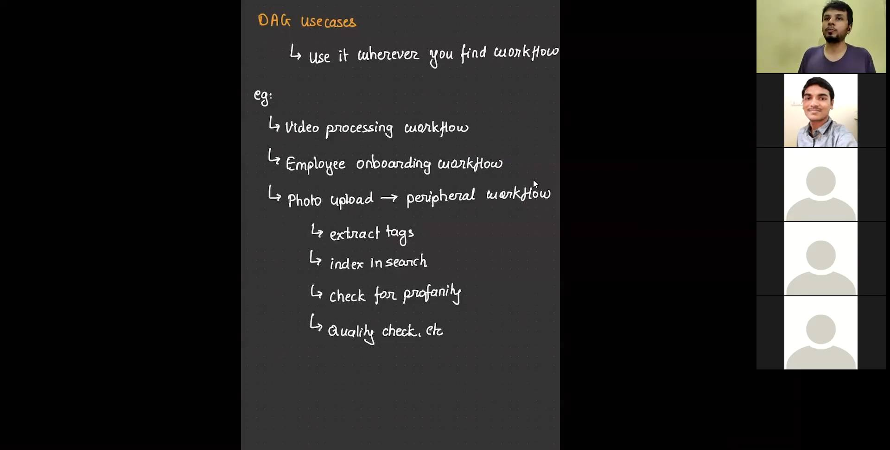
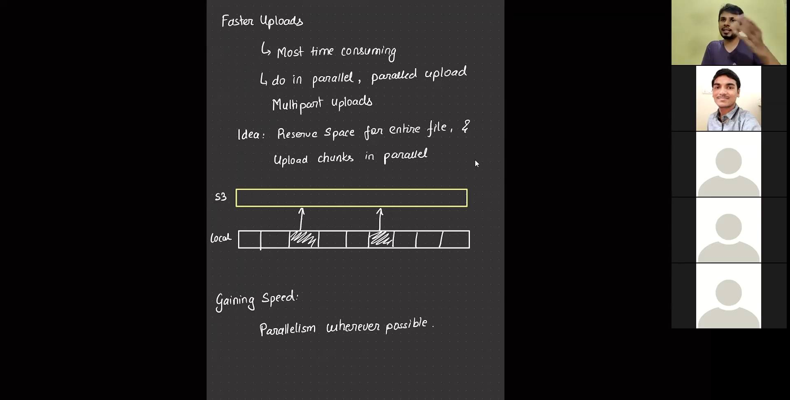
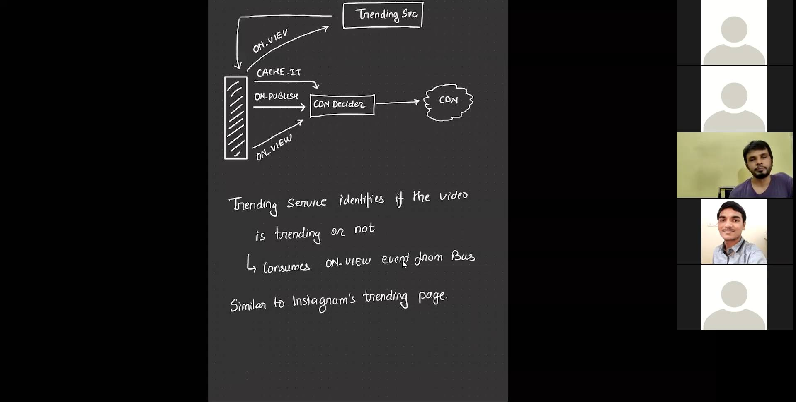
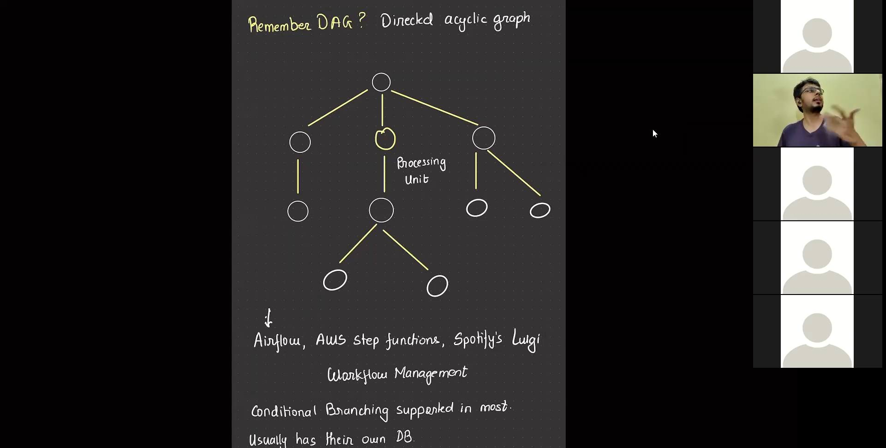
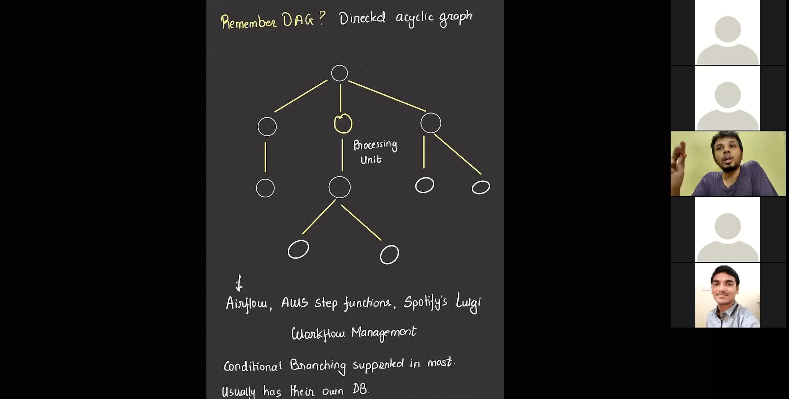

# System Design Masterclass（Arpit）· P12 复现文档
## 视频上传之后：转码 DAG、分片上传、CDN 缓存决策与观看埋点

> **文档说明（先读这段）**
> 1. 本节（P12，第 3/3 段，110:34–162:30）是**纯架构讨论 + 课堂问答**，逐字稿里**没有可运行源码**。因此本文按「纯讲解课」规则组织：第 3 节把讲师的推导过程还原成可执行的步骤（需求→约束→估算→方案→取舍），第 4 节把结论落成**设计决策表 / 组件职责表 / 接口草案 / 容量估算表**，其中出现的代码与字段一律标注「课里没有代码，以下为示意」。
> 2. 本文档**不补造**讲师没讲过的工具与字段。凡是「我补的」都会显式写明来源。
> 3. 本节截图清单**只提供了 5 个可选帧**（p012 的 113:46 / 124:37 / 135:27 / 146:17 / 157:07），因此按硬性要求「不许编造帧号」的原则，本文**插入了全部 5 张**，不做第 6 张的虚构。

---

## 1. 这一节做什么

P12 是 YouTube 系统设计的收尾段。它不再讲「视频怎么存、怎么切成 360p/720p」这种上一节已经讲过的内容，而是回答一个更工程化的问题：

**一个 1GB 的视频被用户点下「上传」之后，从「原始文件落在对象存储」到「全球用户能秒开播放」，中间到底有哪些系统在动？**

这一节主要围绕下面四件事展开：

1. **转码不是一段代码，而是一张图（DAG）**。上传完成会发一个事件，触发一个 workflow；workflow 的每个节点是一个处理单元（下载、转码某一档、加水印、生成缩略图、鉴权检查……），节点之间只有单向依赖，彼此独立的节点并行跑。讲师点名了三个实现：Apache Airflow、AWS Step Functions、Spotify Luigi。
2. **上传本身要分片**。1GB 文件传到 99% 断网，不能重传。方案是客户端切片、多线程按偏移量并发上传、服务端（对象存储）先预留整块空间。
3. **转码和 CDN 缓存都要「决策器」**。转码极贵、CDN 也贵（按流量和存储计费），所以不是每个视频都值得全量转码、都值得主动缓存。需要转码决策和 CDN 决策器，用观看行为（尤其是长尾曲线）来判断。
4. **播放量到底怎么算**。CDN 命中数不等于观看数，所以统计要靠「服务端事件 + 客户端播放器事件」的混合埋点，讲师给了他们每 15 秒上报一次的做法。

同时这一节后半段是问答，聊到了 Airflow 的内部调度（master / worker / 队列 / 数据库）、用 Kubernetes + Docker 做动态 worker、用 S3 生命周期钩子 + Lambda 触发 workflow 而不是轮询，最后落到直播：直播只能是「分片 + 按需转码」，以及 TCP→UDP、Janus、VP9、TURN、为什么视频会议 App 要引导你装客户端。

**这一节的产出物**：一份能照着搭的视频处理流水线设计（含事件契约、DAG 节点清单、分片上传流程、CDN/转码决策规则、埋点方案、容量估算）。



---

## 2. 讲师原话（带时间戳）

> "所以 APSR 会向 Kafka 发送一个事件，说明这个视频 ID 的原始上传已经完成，触发转码。"
> —— p012 [110:34]
> （中文：上传完成后，服务端往 Kafka 发一个事件：这个 video ID 的原始文件传完了，去触发转码。逐字稿把发送方记作 “APSR”，属转写噪声，按上下文应理解为上传完成后负责发事件的服务端。）

> "如果你听说过 Airflow 或 AWS Step Functions，这里做的正是同样的事情。基于有向无环图，图中的每个节点都是一个处理单元。一旦该单元处理完成，就会进入下一步。"
> —— p012 [111:01]

> "假设这一步是下载视频，视频下载完成后会触发三个任务……这三个任务会并行运行。"
> —— p012 [111:29]

> "首先，这方面有三个不错的实现：Apache Airflow、AWS Step Functions 和 Spotify 的 Luigi。Apache Airflow 是目前最流行的。"
> —— p012 [112:26]

> "每个节点都在并行运行。我们由此获得非常高的并行计算能力，让系统具备高吞吐量。"
> —— p012 [115:14]

> "转码在计算上非常非常昂贵……我们有大约三百台机器，都是大型机器，专门用于转码之类的工作。"
> —— p012 [116:40] / [117:08]

> "所有这些视频生成之后，会通过 S3 上传回去，因为只有从那里，我们的 CDN 才会取到它并流式传输视频。"
> —— p012 [121:28]

> "你会在 S3 或 blob 存储上为那个文件预留 1 GB 空间，然后在本地机器上分块并上传这些块。"
> —— p012 [122:54]

> "我们过去把它配置为 16 个线程并行，因为当时机器大约有 8 个核心……每个线程负责从其偏移量开始的第 16 个分块。"
> —— p012 [123:53]

> "如果 PewDiePie 上传一个视频，那肯定需要转码，因为它会被数百万人观看。但如果 Arpit 上传一个视频，YouTube 不会在意。我不会浪费超级昂贵的 CPU 去转码 Arpit 的视频。"
> —— p012 [125:46]
> （中文：大频道上传一定要转码，小创作者先按需转码。逐字稿把频道名转写成 “VBK Vines”，原意是头部大频道。）

> "必须有一个决策器……每当有视频发布时，由它来决定：我要不要把它缓存到 CDN 上？"
> —— p012 [127:40]

> "我添加的内容是，又加了一个叫 cachehit 的事件……CDN 决策器会使用那个视频 ID，并立即把它放到 CDN 上。"
> —— p012 [130:00]
> （中文：趋势服务一旦认定某视频值得上 trending，就再发一个「要求立刻缓存」的事件给 CDN 决策器，让它直接返回 true。）

> "请求仍然会发到 API 服务器，API 服务器仍然会生成签名 URL，再由这个 URL 去 CDN 获取视频。"
> —— p012 [131:50]

> "每隔 15 秒，我们会再向后端服务器发送一个事件，内容是：好，这个人正在看这个视频，已经看了 15 秒、30 秒、45 秒。"
> —— p012 [132:49]

> "只要打开网络面板，打开 YouTube，播放一个视频，看看它会流式发送哪些类型的事件。"
> —— p012 [136:33]

> "我有一套 Airflow 部署，包含一个主节点和 200 个工作节点。"
> —— p012 [138:29]

> "始终是按块处理的……最初的实现方式是下载整个视频文件，在其上运行 ffmpeg 来处理。否则，你可以把它拆成块，再分别运行。"
> —— p012 [148:23]

> "我们一开始用 TCP，后来改用 UDP。"
> —— p012 [150:17]

> "去搜一下。J-A-N-U-S……第二，搜一下 VP9……第三，搜一下 TURN 服务器。"
> —— p012 [157:14]

---

## 3. 从零复现

这一节不是「复现命令」，而是**复现讲师的推导顺序**。你照着走一遍，最后能画出自己的架构图，并且知道每一个框为什么必须存在。

### 3.1 步骤 0：先把需求和约束钉死

先把 P12 里默认成立的前提列出来，这些前提决定了后面所有取舍：

| 维度 | 本节的设定（来自逐字稿） | 来源 |
|---|---|---|
| 单个原始视频大小 | YouTube 场景假设**平均 1GB**；讲师在 Amazon 做数据库项目时是**单文件 15GB** | p012 [115:14]、[123:24] |
| 上传频率 | YouTube 假设**每分钟 1 个视频**；Unacademy 是**每分钟平均 1.5 节课** | p012 [115:14]、[116:40] |
| 转码产物 | 360p / 480p / 720p / 1080p × 多种 codec × 多种 container | p012 [121:01] |
| 转码成本 | 「非常非常贵」，Unacademy 为此常驻约 **300 台大机器** | p012 [116:40]、[117:08] |
| 分发 | 转码产物回传 **S3**，CDN 从 S3 回源 | p012 [121:28] |
| CDN 计费 | 两个指标：**访问量**和**存储量** | p012 [127:12] |
| 观看分布 | 绝大多数视频是**长尾**：发布瞬间有尖峰，之后长期低流量 | p012 [126:14] |

**约束推论**（这三条是后面所有设计的根）：

- 约束 A：转码是 CPU 密集型且数量随分辨率/编码组合**乘法增长** → 不可能对每个视频全量转码，必须有「转不转」的决策器。
- 约束 B：CDN 按流量 + 存储双计费 → 不可能全量主动缓存，必须有「缓不缓」的决策器。
- 约束 C：一次上传涉及十几个互相独立的计算任务 → 用「一条大函数」写会不可维护，必须用 DAG 编排。

### 3.2 步骤 1：把「上传完成」变成事件，而不是函数调用

讲师给的第一句话就是事件驱动：

```
上传服务（逐字稿记作 APSR）──publish──> Kafka topic: video.raw.uploaded
                                              │
                                              └──consume──> 转码调度器（触发一个 workflow）
```

**为什么必须是事件而不是直接调用转码接口？**
因为转码是一个可能跑几十分钟的长时间任务，如果上传服务同步调用它，上传接口会被拖死；如果用事件，上传服务只负责「喊一声」，谁消费、消费几次、什么时候消费，都与上传服务无关。

**这一步的验收标准**：上传服务在原始文件落盘（落对象存储）成功之后，能发出且只发出一个事件，事件里带得走 `video_id` 和原始对象的定位信息（逐字稿只明确了「video ID」和「raw upload is done」这两项语义，具体字段课里没定义，见第 4.3 节我拟的草案）。



### 3.3 步骤 2：把「转码」展开成一张 DAG

讲师现场口述的那张图，还原成节点清单是这样：

```
[download raw video]
        │
        ├──────────────┬──────────────┬─────────────┐
        ▼              ▼              ▼             ▼
  [transcode 360p] [transcode 480p] [transcode 720p] [transcode 1080p]
        │              │              │             │
        └──────────────┴──────┬───────┴─────────────┘
                              ▼
                    [upload outputs to S3]
                              │
                              ▼
                    [notify CDN decider / 更新元数据]
```

讲师在 Facebook 的例子（p012 [119:34]–[120:32]）里给了更完整的一版节点序列，按他讲的顺序是：

1. **基础校验**（validation check）—— 通过了才继续；
2. **音频处理**（让声音更清晰）；
3. **视频处理 / 转码** —— 这里再展开成多分辨率、多格式的子节点，每个子节点是独立的 child；
4. **版权检查**（copyright check）—— 有版权问题的片段自动静音；
5. **缩略图生成**（thumbnail generation）；
6. **自动字幕**（auto captioning，语音识别）。

> 讲师强调的关键点：**每个节点是独立计算，谁也不依赖谁，所以可以并行**（p012 [111:29]）；DAG 之所以叫「有向无环」，是因为「It can only flow in one direction」，不允许回边（p012 [111:57]）。

**这一步的验收标准**：你能画出一张图，图里每个节点都是一个**可独立重试、可独立换机器执行**的单元，并且任意两个没有依赖边的节点可以同时跑。

### 3.4 步骤 3：算一遍账（这是本节最有说服力的部分）

讲师没有给完整算式，但给了足够的数字。下面所有算式**都是我用他给的数字做的算术推演**，不是他念出来的结论：

**（1）Unacademy 的直播/录制规模**
- 每分钟 1.5 节课 → 每天 `1.5 × 60 × 24 = 2160` 节课。
- 如果按 YouTube 场景那个「平均 1GB」的量级类比，每天原始素材约 `2160 × 1GB ≈ 2.1TB/天`。
- 常驻 300 台转码机器 → 平均每台机器每天承担 `2160 ÷ 300 ≈ 7.2` 节课的转码。
  → **结论**：这不是「一台机器跑个脚本」的量级，是一整个机群。讲师原话就是「300 odd machines, massive machines just for transcoding」。

**（2）转码产物的数量是乘法**
- 4 档分辨率（360/480/720/1080）× N 种 codec × M 种 container。
- 讲师明确说「not just 360p, but 360p in a certain format, 480p in a certain format... with a certain codec because some devices might support that, some devices might not」（p012 [121:01]）。
- 也就是说：**一个视频进来，DAG 里会膨胀出几十个子节点**。这就是为什么必须有编排系统——不是因为它算得快，而是因为**人脑管不过来**。

**（3）分片上传的并行度**
- 讲师在 Amazon 的项目：单文件 **15GB**，机器 **8 核**，开 **16 个线程**并发上传（p012 [123:53]）。
- 线程数与核数的关系是 `16 ÷ 8 = 2`，即每核约 2 个上传线程——他给的理由是「we had other process running as well」，也就是**上传不能把机器的 CPU 吃干**，因为机器上还有别的活。
- 每个线程负责「从自己偏移量开始的那一片」，讲师描述的是偏移量按固定步长递增（逐字稿里那串「0, 16, 32, 48, 64」是口语描述偏移推进，**具体步长等于你的 chunk size，不要照抄数字**）。

**（4）埋点流量**
- 播放中每 **15 秒**上报一次（p012 [132:49]）。
- 一个 10 分钟的视频，单个用户会产生 `600 ÷ 15 = 40` 个事件。
- 这个数字决定了埋点通道必须是**高吞吐、可丢失一部分、可异步**的，绝不能和「下单」这种强一致链路共用一个通道。

> 说明：以上第（1）（2）（4）里的乘除法是我按讲师给的数字算的，讲师本人只给了原始数字和定性判断（「很贵」「量很大」）。

### 3.5 步骤 4：分片上传（multipart upload）的完整流程

讲师把流程讲得很具体，我按顺序还原成可执行步骤：

**服务端侧：**
1. 客户端告诉服务端「我要传一个 1GB 的文件」。
2. 服务端在对象存储上**先预留这 1GB 的空间**（讲师原话：reserve the one GB space for that file on S3 or your blob storage），创建出一个 1GB 的占位文件。
3. 服务端把「怎么传」的信息交给客户端（每一片的定位方式）。**逐字稿没有讲这里用什么协议下发（预签名 URL 还是别的），课里没讲。**

**客户端侧：**
4. 把本地文件切成 chunk（切片在客户端完成）。
5. 开多个线程/并发任务，每个任务负责一个偏移区间的 chunk。
6. 每个 chunk 的语义是：**「把这个偏移到那个偏移的区间，替换成这份内容」**——讲师原话：「Upload in a chunk is implying that from this offset to this offset, replace it with this content」（p012 [124:49]）。
7. 所有 chunk 传完后，通知服务端「拼起来」。

**为什么这样就快？**
因为带宽和 CPU 都被并行用起来了；更重要的是**断点续传**：99% 断网时，只需要重传丢失的那几片，而不是 1GB 重来。讲师给的用户体验理由就是这个（p012 [121:55]）。

**课里提到的本地文件系统等价做法**（p012 [124:20]）：
先创建一个 1GB 大小、内容全是 0 的文件，然后上传某一片时，直接定位到对应偏移写入。这就是「sparse file + 定点写」的思路，不依赖 S3 也成立。

**前端读者的对应关系（我补的，课里没讲）**：浏览器里切片就是 `File.slice(start, end)`，并发控制对应 `Promise` 池或 `p-limit` 这类限流；Node 侧并发写文件是 `fs.createWriteStream(path, { start })`。这些 API 名**讲师没有提过**，属于你落地时会用到的工具。



### 3.6 步骤 5：两个决策器 —— 转码决策 & CDN 缓存决策

这是 P12 最「产品化」的一段，也是最容易被忽略的一段。

**（a）转码决策器（要不要花大钱转）**

讲师的原话逻辑（p012 [125:46]）：

- 头部大频道发视频 → **一定要转**，因为会被几百万人看，不转就是让几百万人卡。
- 小创作者发视频 → 先**按需转码**（on-demand transcoding）：有人看、并且看得够多，再做完整转码并预先生成好。
- 依据是**长尾分布**：视频发布瞬间有尖峰，然后长期低流量。对绝大多数视频来说，为那个尖峰付全量转码的钱是亏的。

**（b）CDN 缓存决策器（要不要花大钱存）**

讲师把触发条件说得很清楚（p012 [127:40]、[128:06]）：

- 输入：视频发布事件、以及每一次 `on view` 事件。
- 输出：这个视频要不要**主动**缓存到 CDN。
- 典型场景：一个平时从不超过 1 万播放的创作者，某条视频突然爆了 → 决策器看到观看速率异常 → 立刻开始缓存 → 后面的人点开就能秒播。

**（c）两个决策器怎么和 trending 服务联动**

讲师在这里加了一个很漂亮的细节（p012 [130:00]）：他新增了一个事件 **cachehit**（逐字稿也写作 “cachehit / casheet”）：

```
trending service  ──publish──> cachehit(video_id)
                                      │
                                      ▼
                            CDN decider 看到 cachehit
                                      │
                                      └──> 直接 return true（立刻缓存）
```

理由是：**一旦一个视频被判定为要上 trending 页，它一定会被大量访问，那就没有理由再让决策器去「猜」了**——直接短路返回 true。讲师把这个称作「两个服务通过事件总线通信」的范例。

**（d）CDN 前面的那道门不能省**

这一点非常重要，讲师在回答提问时专门澄清（p012 [131:50]）：

> 视频不是「公开挂 CDN 上谁都能拿」。请求**仍然要经过 API server**，API server 生成 **signed URL**，客户端拿着这个 URL 去 CDN 取。

这也顺带回答了「CDN 缓存了还怎么算播放量」——播放量不走 CDN 日志，走埋点（见下一步）。

### 3.7 步骤 6：观看量怎么统计（服务端事件 + 客户端事件）

讲师给的是一套**混合埋点**方案（p012 [131:50]–[133:18]）：

**服务端事件（可信、但不精确）**
- 用户打开课程详情页/播放页时，会有一次 API 调用（讲师举例：「get lesson」这类详情接口）。
- 这个调用说明「这个用户**有可能**要播这个视频」，是概率信号，不是播放事实。

**客户端事件（精确、但可被伪造/丢失）**
- 播放器上捕获「按下播放」这个动作，发一个事件；
- 之后**每 15 秒**发一次心跳事件，携带「已经播到 15 秒 / 30 秒 / 45 秒……」；
- 所有这些事件汇入数据仓库。

**为什么两者都要**：讲师的原话结论是——后端事件对用户行为的刻画不够细，客户端事件才能反映「用户实际怎么用这个系统」；但纯客户端又不可全信。所以是「amalgamation（混合）」。

**讲师给的可行性前提**：Unacademy 有自己的播放器，所以能拿到播放器事件。如果没有自研播放器，就用现成播放器暴露的 JS 事件（讲师说好的播放器实现会有「按钮被按下」这类事件，并带上按钮名）。他甚至给了一个验收方法：**打开 YouTube，开 Network 面板，播一个视频，看它往外发什么**（p012 [136:33]）。

**关于「为什么是 Kafka 而不是 SQS」**，讲师在问答里给了明确答案（p012 [135:07]）：`on view` 这个事件**同时被 trending service 和 CDN decider 消费**，而 SQS 这类消息队列**不能把同一条消息复制给多个消费者**（他说的「replicated message is not possible」），所以必须用 Kafka。这是本节唯一一处把「消息队列 vs 事件总线」讲透的地方。

**（我补的，课里没讲）**：在 Node 里对应的是消费组（consumer group）概念——同一个 group 内是分摊，不同 group 各自收到完整消息。讲师讲的是「同一事件多消费者」这个语义，具体配置他没展开。

### 3.8 步骤 7：编排系统内部到底怎么跑（master / worker / queue / DB）

讲师被追问「Airflow 到底怎么调度」时，给了一个相当完整的内部模型（p012 [137:03]–[140:54]），我按顺序还原：

1. **每次 workflow 启动 = 数据库里的一条新记录**，会分配一个 **workflow ID**（讲师举例 「workflow ID W1」）。
2. 数据库里记录「**当前这个实例走到了哪个节点**」（讲师表述为 node N1 在跑）。
3. 一个节点执行完 → **更新数据库**（N1 done）→ 然后**往队列里放三条消息**，对应三个下游节点。
4. **有一批 worker 在不停从队列里拉任务**。讲师举的配置是「one master and 200 workers」（p012 [138:29]）。
5. 默认情况下**所有 worker 是对等的**——「all the nodes are equal, any node can pick up any job to execute」（p012 [139:55]）。如果你的三个下游任务是单线程的，它们很可能落在三台不同机器上并行跑。
6. **终止条件**由编排系统自己维护：所有节点状态都完成，这个 workflow 实例结束。

讲师对此的定性总结很值得记住：**「它本质上只是个调度器，给你一个好看的可视化外观（aesthetic）」**，底层就是「往队列发消息 + 有人消费」，但这一层被抽象掉了，所以开发者**只需要写每个节点的代码，不用关心节点之间的通信怎么发生**（p012 [139:25]）。

**（b）动态 worker（问答里最干货的一段）**

讲师承认自己原来的描述隐含了一个错误假设：所有 worker 机器是同构的。有学员指出可以用 Kubernetes + Docker 做**动态 worker**，讲师立刻接过来展开（p012 [142:14]–[144:37]）：

- 在容器化环境里，你可以指定「这个节点用这个 base image + 这段执行代码」；
- 于是可以**按需拉起容器**，而不是预先养一堆静态 worker；
- 典型场景是他举的 **BrowserStack**：你要在 Windows / macOS / 不同 OS 上跑测试，静态的 Linux 机群根本做不到，必须动态起不同 base image 的环境。

**（c）触发方式：轮询 vs 钩子**

学员问「怎么让 workflow 在 S3 有新文件时自动跑」，讲师给了两种做法并明确推荐后者（p012 [145:05]–[146:04]）：

- **做法一（不推荐）**：在 DAG 里放一个 sensor（传感器）节点，一直轮询 S3 看有没有新对象；
- **做法二（讲师推荐）**：配 **S3 lifecycle hook**，新对象一落地就触发一个 **Lambda**，Lambda 里只做一件事——**触发 airflow job**。理由是「less resource consuming」，不用一直轮询。

讲师顺手把这个模式推广到了 CI/CD（p012 [146:04]–[147:01]）：DAG 本身就是一张部署流程图（跑数据库迁移 → 并行准备基础设施 → 拉最新代码），触发方式同理——不要轮询 master 分支的 commit ID，而是配 **GitHub webhook**，合并时让 GitHub 回调你的 URL，由那个 URL 去触发 airflow 的部署 DAG。



### 3.9 步骤 8：直播（live）为什么是另一套东西

最后 15 分钟几乎全在聊直播，这部分是把前面的方案「推到极限」后的必然结果：

**（1）直播也只能分片，而且必须是「按需 + 实时」**
讲师回答「直播是不是也分片」时给了非常干脆的答案：「It's always chunkwise.」（p012 [148:23]）。原因是只有分片才有并行、才能快。但他同时给了**day-zero（第一版）实现**的诚实版本：直接下载整个文件、跑一遍 ffmpeg。而直播做不到这一点——**你根本没有完整的视频文件**，只能边来边处理。

**（2）延迟是从哪来的**
讲师用 Hotstar 举例：早期看板球直播有大约 **5 分钟**延迟，这个延迟的来源就是「比赛实时发生 → 需要实时转码处理 → 再推给用户」这条链路（p012 [148:51]）。

**（3）传输层：从 TCP 换到 UDP**
讲师自曝了踩坑史（p012 [150:17]–[151:14]）：一开始用 TCP，后来换 UDP。原因是「网上搜到的教程都用 WebSocket，而 WebSocket 是 TCP，我们就照做了」。换 UDP 的理由是丢一个包影响不大（`even if there is a packet loss, it won't make a lot of difference`）。

**（4）视频会议为什么拼命让你装 App**
讲师给的理由非常工程化（p012 [152:10]–[153:04]）：浏览器里你不知道对方设备支持什么编码、什么浏览器支持什么；而装了 App，**你能精确控制 codec 和传输方式**。他甚至点出了产品设计上的小心机：页面上「在浏览器中播放」是一行很小的超链接文字，目的就是让你找不到、从而去下载客户端。

**（5）为什么 480p 在教程视频里很清晰，在人脸直播里很糊**
讲师用压缩原理解释了（p012 [153:55]–[155:22]）：视频压缩对**帧间变化小**的内容效率极高。屏幕录制（screencast）是最容易压的，所以 480p 都很清楚；真人讲课帧间变化大，480p 就糊。他还反问「你读过 run-length encoding 吗」来引导理解。

**（6）音频和视频是分开编码的**
问答里明确：音视频**分别编码**，播放时再叠在一起（overlay）。

**（7）讲师点名要你自己去搜的三样东西**
p012 [157:14] 给了三个关键词：**Janus**（J-A-N-U-S）、**VP9**、**TURN server**（T-U-R-N）。他明确说自己不展开，让你 Google。以及他们的实时方案只保证在 Chrome 上跑，Firefox 会卡一点，非 Chromium 内核的三星机直接提示「请用 Chrome 打开」——理由是这类用户只占 0.001%，「我们不是 YouTube，不为这个优化」（p012 [158:39]–[159:05]）。

**（8）最后一个反直觉的数据**
他们发现 **98% 的直播课是在桌面端看的**，移动端主要消费录播。所以「要不要为移动端弱网做差异化码率」这个问题，答案直接变成了「不需要，因为移动端不看直播」（p012 [159:30]–[160:26]）。



---

## 4. 完整代码（本节为纯讲解课 → 交付物）

> **重要声明**：本节课程**没有任何可运行源码**。下面给出的是把讲师口述内容落成可执行规格的产物。第 4.5 节的代码块**全部是示意**，只为帮助理解结构，不是讲师写的，也不能直接拿去生产。

### 4.1 设计决策表

| # | 决策 | 讲师给的依据 | 不这样做会怎样 |
|---|---|---|---|
| D1 | 上传完成用**事件**通知转码，不同步调用 | p012 [110:34] | 上传接口被几十分钟的转码拖死 |
| D2 | 转码用 **DAG 编排**（Airflow / Step Functions / Luigi） | p012 [111:01]、[112:26] | 几十个并行子任务靠手写脚本无法维护、无法重试、无法可视化 |
| D3 | 无依赖的节点**并行**执行 | p012 [111:29]、[115:14] | 串行跑，吞吐直接掉一个数量级 |
| D4 | 转码产物**回传 S3**，CDN 从 S3 回源 | p012 [121:28] | CDN 没有稳定源站 |
| D5 | 上传必须**分片 + 多线程 + 预留空间** | p012 [122:54]、[124:49] | 1GB 文件断在 99% 就要重传，用户体验崩 |
| D6 | 有**转码决策器**，小创作者按需转码 | p012 [125:46] | 为长尾视频付全量转码的 CPU 账单 |
| D7 | 有 **CDN 决策器**，按观看行为决定是否主动缓存 | p012 [127:40] | 全量缓存，CDN 流量+存储双账单爆炸 |
| D8 | trending 服务发 **cachehit** 事件短路决策器 | p012 [130:00] | 上了热榜的视频还在「等决策器判断」，错过尖峰 |
| D9 | 取流仍走 **API server 签发 signed URL** | p012 [131:50] | 视频裸奔，无法鉴权、无法统计 |
| D10 | 播放量 = **服务端事件 + 客户端每 15 秒心跳** | p012 [132:49] | 只用 CDN 命中数会把「同一个人反复拖动进度条」算成多次观看 |
| D11 | 事件总线用 **Kafka**（同一事件多消费者） | p012 [135:07] | 用 SQS 时 trending 和 CDN decider 只能有一个拿到消息 |
| D12 | 默认 **worker 同构对等**，按需改**动态容器 worker** | p012 [139:55]、[142:14] | 遇到需要不同 OS/镜像的任务（如 BrowserStack）就跑不了 |
| D13 | 触发用**钩子**（S3 lifecycle → Lambda；GitHub webhook）而非轮询 | p012 [145:34]、[147:01] | sensor 长期空转，浪费资源 |

### 4.2 组件职责表

| 组件 | 职责 | 输入 | 输出 | 来源 |
|---|---|---|---|---|
| 上传服务 | 接收原始文件、写对象存储、发「上传完成」事件 | 客户端文件 | `video.raw.uploaded` 事件 | p012 [110:34] |
| 对象存储（S3） | 存原始文件 + 存所有转码产物 | 上传 / 转码结果 | 可被 CDN 回源的对象 | p012 [121:28] |
| Workflow 编排器 | 维护 DAG、分配节点到 worker、记录每个实例/节点状态 | 事件触发 | 节点任务入队 | p012 [137:03] |
| Worker 池 | 执行单个节点的处理代码 | 队列中的任务 | 节点结果 + 状态更新 | p012 [138:29] |
| 转码决策器 | 判断该视频是否需要（全量/主动）转码 | 发布事件、观看行为 | 转码指令 / 按需转码标记 | p012 [125:46] |
| CDN 决策器 | 判断是否主动缓存到 CDN | 发布事件、`on view`、`cachehit` | 缓存指令 | p012 [127:40]、[130:00] |
| Trending 服务 | 从 `on view` 流中识别热点，产出热榜，并请求缓存 | `on view` 事件 | 热榜条目 + `cachehit` 事件 | p012 [129:31] |
| API server | 鉴权、签发 signed URL | 播放请求 | signed URL | p012 [131:50] |
| CDN | 就近分发视频分片 | signed URL 请求 | 视频流 | p012 [125:17] |
| 埋点管道 | 收集客户端/服务端观看事件，入数据仓库 | 播放器事件、详情页事件 | 观看统计 | p012 [132:19] |

### 4.3 事件与接口草案

> **课里没有给出任何字段定义。** 以下 JSON 是我按讲师描述的事件**语义**拟的草案，字段名请以你自己团队/所用 SDK 的实际约定为准。

```json
// 示意：上传完成事件（对应 p012 [110:34] 讲师描述的那条 Kafka 消息）
{
  "event_type": "video.raw.uploaded",
  "video_id": "vid_123",
  "raw_object_key": "raw/vid_123/source.mp4",
  "size_bytes": 1073741824,
  "uploaded_at": "2025-01-01T00:00:00Z"
}
```

```json
// 示意：一次观看事件（对应 p012 [132:49] 每 15 秒一次的心跳）
{
  "event_type": "video.view.heartbeat",
  "video_id": "vid_123",
  "session_id": "sess_abc",
  "position_seconds": 45,
  "client_type": "web",
  "emitted_at": "2025-01-01T00:00:45Z"
}
```

```json
// 示意：trending → CDN decider 的短路事件（对应 p012 [130:00] 的 cachehit）
{
  "event_type": "cdn.cache.requested",
  "video_id": "vid_123",
  "reason": "trending"
}
```

**signed URL 接口草案（语义来自 p012 [131:50]）**

```
GET /api/videos/{video_id}/playback-url
  -> 200 { "url": "<指向 CDN 的带签名地址>", "expires_at": "..." }
```
（路径形状、参数名、过期字段课里都没讲，以上为示意。）

**编排器数据库要记的东西（语义来自 p012 [138:01]）**

| 概念 | 讲师的原话描述 | 字段草案（示意） |
|---|---|---|
| workflow 实例 | 「create a new instance, give it an ID」 | `workflow_run_id` |
| 当前节点 | 「workflow ID W1 is right now executing this」 | `current_node_id` |
| 节点完成 | 「workflow ID node N1 is done processing」 | `node_status`（取值如 pending / running / done / failed —— **课里没给具体取值，以你用的编排器实际状态名为准**） |

### 4.4 容量估算表

| 指标 | 算式 | 结果 | 数字来源 |
|---|---|---|---|
| Unacademy 每天课程数 | `1.5 节/分 × 60 × 24` | 2160 节/天 | 1.5 来自 p012 [116:40] |
| 假设每节 1GB 原始素材 | `2160 × 1GB` | ≈2.1 TB/天 | 1GB 来自 p012 [115:14]（YouTube 场景），此处为跨场景类比 |
| 每台转码机日均承担课程数 | `2160 ÷ 300` | ≈7.2 节/台/天 | 300 台来自 p012 [117:08] |
| 单个视频的转码子任务数 | `4 档分辨率 × N codec × M container` | **取决于组合数，课里未给具体值** | p012 [121:01] |
| 分片上传并发度 | `16 线程 ÷ 8 核` | 2 线程/核 | p012 [123:53] |
| 单用户 10 分钟视频的心跳事件数 | `600 秒 ÷ 15 秒` | 40 条 | 15 秒来自 p012 [132:49] |
| Airflow 集群规模示例 | — | 1 master + 200 workers | p012 [138:29] |

### 4.5 示意代码（**课里没有代码，以下为示意**）

下面这段只为帮你建立「DAG 节点长什么样」的直觉。讲师明确说过节点代码是用装饰器把函数挂到节点上的（p012 [112:54]：「you would use decorators to map and point key, this function should be used as part of this decorator」），语言绑定有 Java、Python 等。

```python
# 示意代码，非课程源码。目的：演示「一个节点 = 一个可独立执行、可独立重试的函数」。
from datetime import timedelta


def download_raw(video_id: str) -> dict:
    """节点 1：把原始文件拉到本地/工作目录。"""
    path = f"/work/{video_id}/source.mp4"
    # 真实实现：从对象存储下载。API 名课里没讲，以你用的 SDK 为准。
    return {"video_id": video_id, "local_path": path}


def transcode(video_id: str, local_path: str, resolution: str, codec: str) -> dict:
    """节点 2..N：转某一档。每档是独立节点，可以并行。"""
    out = f"/work/{video_id}/{resolution}_{codec}.mp4"
    # 真实实现：调用 ffmpeg。讲师只在 p012 [148:23] 提过 "run ffmpeg"，
    # 具体命令行参数课里没讲。
    return {"video_id": video_id, "output_path": out, "resolution": resolution}


def upload_outputs(video_id: str, outputs: list) -> dict:
    """汇合节点：所有产物回传对象存储，供 CDN 回源。"""
    return {"video_id": video_id, "uploaded": len(outputs)}


# ---- 图结构（示意，不是 Airflow 真实 API）----
#   download_raw
#       ├── transcode(360p)
#       ├── transcode(480p)
#       ├── transcode(720p)
#       └── transcode(1080p)
#              └────────────> upload_outputs
#
# 说明：真实 Airflow 的算子/装饰器名称课里没有出现，请查阅 Airflow 官方文档。
RETRY_POLICY = {"max_retries": 3, "delay": timedelta(minutes=1)}  # 示意：节点级重试
```

**前端读者对照（我补的，课里没讲）**：上面这种「一个节点一个函数 + 队列派发 + 状态落库」的结构，在 Node 里最接近的形态是任务队列（如 BullMQ）配 worker 进程；「并发上限」对应 `p-limit`，CPU 密集型转码对应 `worker_threads` 或干脆起独立进程/容器。讲师强调的「节点之间通信被抽象掉」，在 Node 里就对应「你只写 `process(job)`，队列负责派发」。

---

## 5. 逐行解释

这一节逐条解释第 4 节里每个决策「为什么必须这样定」，以及「改了会怎样」。

**D1 为什么必须异步事件？**
转码一个视频可能几十分钟。如果上传接口同步等待，HTTP 连接会超时，上传服务的线程/连接池会被占满，一个热门时段就能把整个上传入口打挂。改成事件后，上传服务的责任边界非常干净：**文件落盘成功 + 事件发出成功 = 我的活干完了**。

**D2 为什么必须是 DAG 而不是一段脚本？**
因为节点数量会随「分辨率 × codec × container」乘法膨胀（p012 [121:01]）。脚本写法下，你要自己处理：哪个子任务失败了、失败了重试哪一段、重试几次、哪些已经成功不用重跑。这些正是编排器免费给你的东西。讲师自己也说，底层其实就是「发消息 + 消费」，但那层抽象省掉了你大量代码（p012 [139:25]）。

**D3 并行为什么能提升吞吐？**
因为转码是 CPU 密集型（p012 [115:14]），单机核数有物理上限，所以只能靠「多机器 + 多节点并行」。讲师的原话是「one machine or a small bunch of machines won't be able to sustain it」。

**D4 为什么产物必须回 S3？**
因为 CDN 需要一个**稳定、可回源、可长期存在**的地址。如果转码结果只留在临时机器上，机器一下线，视频就 404 了。讲师原话：「from there only, our CDN would pick it」。

**D5 分片为什么必须先「预留空间」？**
因为分片是并发写的，多个线程同时往一个还没确定大小的文件里写，会互相踩。先把 1GB 的空间占住（哪怕内容全是 0），每个线程就只是「往自己那段偏移写」，互不干扰。讲师在 p012 [124:20] 明确描述了这个「先造全 0 大文件再定点覆盖」的做法，并说这在本地文件系统/NAS 上也一样成立。

**D5 补充：为什么线程数大于核数？**
讲师给的是 16 线程 / 8 核。上传是 **I/O 密集型**，线程大部分时间在等网络，不是在算，所以线程数超过核数是合理的；但不能无限加，因为机器上还有别的进程（他的原话就是「we had other process running as well」）。

**D6 转码决策器为什么能省钱？**
因为视频观看是长尾分布（p012 [126:14]）。如果对每个视频都做全量多档转码，你付出的是「峰值成本」，但绝大多数视频只吃到「长尾收益」。按需转码把成本推给了「真的有人看」的那部分视频。

**D7 CDN 决策器为什么能省钱？**
CDN 按**流量 + 存储**双计费（p012 [127:12]）。全量主动缓存意味着你为一个可能只有 200 次播放的视频，长期占着 CDN 的存储位，还付了搬运流量。决策器的价值就是**把 CDN 空间留给真正热的视频**。

**D8 为什么 cachehit 要短路？**
因为 trending 服务已经用「更贵、更准」的方式（消费全量 `on view` 流）判断过了。如果 CDN 决策器还要再判断一次，等于重复劳动，而且会慢一拍。**上游已经确定的事实，下游不要再猜。**

**D9 为什么不能把 CDN 地址直接公开？**
公开 = 无鉴权 = 任何人拿到链接就能白嫖，也无法区分「付费用户」和「路人」。走 API server 签发 signed URL，等于每次播放都要过一次权限校验。讲师在回答「CDN 缓存了怎么算播放量」时顺带把这件事讲清楚了。

**D10 为什么必须双端埋点？**
只用服务端：详情页打开 ≠ 真的播放了，会**高估**。
只用客户端：可伪造、可被广告拦截、弱网会丢，会**低估且不可信**。
两者混合，才能既拿到「播放事实」（客户端），又拿到「可信基线」（服务端）。

**D11 为什么是 Kafka？**
讲师给的判据非常具体：`on view` 这个事件**同时**要喂给 trending service 和 CDN decider。SQS 这类队列的语义是「一条消息被一个消费者拿走」，做不到「一条消息被两个独立消费者各拿一份」。所以必须用支持多订阅者的事件总线。

**D12 为什么默认 worker 同构就够，但又要能动态？**
默认同构（all nodes are equal）让调度最简单：任何 worker 都能接任何任务，队列不用做匹配。但一旦遇到「必须在 Windows 上跑」「必须在特定 base image 上跑」的任务（讲师举的 BrowserStack），静态机群就废了，此时需要按需拉起指定镜像的容器。

**D13 为什么钩子优于轮询？**
轮询的代价是**持续的空转成本**：sensor 节点每隔几秒查一次 S3，绝大多数时候都是「没有新文件」。钩子是事件驱动的，只在真的发生时消耗资源。讲师原话就是「less resource consuming」。CI/CD 场景同理：轮询 master 的 commit ID 不如配 webhook。

**关于直播那部分的解释**：
- 「always chunkwise」（p012 [148:23]）的必然性在于：直播没有完整文件，只有不断到来的数据流，所以只能按片处理、按片推。
- 「day zero 实现是全文件跑 ffmpeg」→ 这是录播的**第一版**，不是终态。讲师明确把「分片」定位为优化，不是起点。
- TCP→UDP 的取舍：TCP 保证有序可靠，但丢包会引发重传阻塞后续数据，直播场景下「卡住」比「糊一下」更糟；UDP 丢一个包只是画面花一下。
- 480p 在 screencast 里清晰、在人脸直播里糊：压缩算法吃的是**帧间冗余**，屏幕录制相邻帧几乎一样，压缩率极高；人脸有微表情和噪声，压缩率低，同样码率下质量就差。
- 为什么视频会议要你装 App：浏览器是「未知设备 + 未知编码支持」的黑盒，原生 App 是「已知编码 + 已知传输」的白盒，能做的优化多得多。

---

## 6. 复现检查清单

照着打勾，全打上说明你把 P12 的架构落地了。

**事件与编排**
- [ ] 上传完成后能发出一个带 `video_id` 的事件（对应 D1）
- [ ] 有一个消费者能收到这个事件并启动一个 workflow 实例
- [ ] workflow 实例有唯一 ID，且能在数据库里查到「当前在哪个节点」
- [ ] 每个节点执行完成后，状态能落库，并能触发下游节点入队
- [ ] 下游多个节点能**并行**执行（不是串行 for 循环）
- [ ] 单个节点失败后能**只重试该节点**，不需要整条 workflow 重跑
- [ ] 能在可视化界面里看到这张 DAG（讲师反复强调的 aesthetic，p012 [118:34]）

**分片上传**
- [ ] 服务端能先为文件预留整块空间
- [ ] 客户端能把文件切成 chunk
- [ ] 多个 chunk 能并发上传（线程/并发数可配置）
- [ ] 每个 chunk 带明确的偏移区间语义
- [ ] 中断后能只补传缺失的 chunk（断点续传验证）
- [ ] 所有 chunk 完成后能正确拼成一个完整、可播放的文件

**决策器**
- [ ] 有转码决策逻辑：头部/高热视频全量转，其余按需转
- [ ] 有 CDN 缓存决策逻辑：按观看速率决定是否主动缓存
- [ ] 收到 `cachehit`（trending 触发）时，缓存决策**直接返回 true**
- [ ] 决策器能消费 `on view` 事件流

**分发与鉴权**
- [ ] 播放请求先经过 API server
- [ ] API server 返回 signed URL，而不是裸的 CDN 地址
- [ ] CDN 从对象存储回源，而不是从转码机器回源
- [ ] 转码产物全部回传对象存储

**埋点**
- [ ] 播放页有服务端事件（详情/取播放地址）
- [ ] 播放器有客户端「播放」事件
- [ ] 播放中有每 15 秒一次的心跳事件
- [ ] 客户端事件和服务端事件能按 `video_id` + `session_id` 关联
- [ ] 事件进得了数据仓库

**触发方式**
- [ ] 新文件落地用**钩子**触发，不用轮询（或至少证明轮询成本可接受）
- [ ] CI/CD 场景用 webhook 触发部署 DAG
- [ ] 若需要异构环境，验证过「按 base image 动态起 worker」这条路

**直播（如果要做）**
- [ ] 明确直播是「分片 + 按需转码」，不是等完整文件
- [ ] 明确传输层选 TCP 还是 UDP，并写下理由
- [ ] 明确支持哪些浏览器/设备，不支持的给什么降级提示

---

## 7. 课里没讲但你会撞上的

这一节全是「讲师没提，但你真动手一定会卡住」的地方。**以下内容都不是讲师的观点**，是我按工程常识列的，请自行验证。

**（1）对象存储多段上传的具体约束**
讲师讲了「预留空间 + 分片 + 偏移写入」的思想，但**课里没有讲任何 S3 API 名称，也没讲最小分片大小、最大分片数、分片必须等长（最后一片除外）这类硬约束**。你实际接 SDK 时，接口名和限制请以你所用对象存储的官方文档为准。特别注意：小于某个阈值的文件通常不该走多段上传。

**（2）signed URL 与分片的关系**
讲师说「API server 生成 signed URL，客户端拿去 CDN 取」（p012 [131:50]），但**课里没讲**：播放时的 signed URL 是一次签一个视频，还是按分片签？URL 过期时间怎么定？CDN 回源时怎么鉴权？这些都要你自己定。

**（3）事件的幂等与去重**
`video.raw.uploaded` 如果重复投递，会触发两次转码，白烧两份 CPU。**课里没讲幂等键设计**。你需要自己决定用 `video_id` 还是 `event_id` 做去重，并在节点入口做幂等检查。

**（4）事件顺序**
`cachehit` 可能在 `video.raw.uploaded` 之前到达决策器（比如重放、并发）。**课里没讲**怎么处理乱序。常见做法是决策器维护「视频状态表」，收到未知 `video_id` 的事件先落库等后续。

**（5）编排器的重试语义与长任务的超时**
一个 1080p 转码可能跑几十分钟。**课里没讲**：worker 心跳超时多久算失败？失败后是重跑整个节点还是从断点续？这些在 Airflow 这类系统里都是配置项，配错了会出现「任务明明在跑却被判失败并重复启动」的灾难。

**（6）多消费者组的具体配置**
讲师说了 Kafka 能让同一事件被多个消费者消费（p012 [135:07]），但**没讲**消费者组怎么划分、分区数怎么定、key 用什么。这直接决定「同一个 video 的事件是否有序」。

**（7）埋点的采样与隐私**
每 15 秒一个事件（p012 [132:49]）在高并发下量非常大。**课里没讲**采样策略，也没讲用户