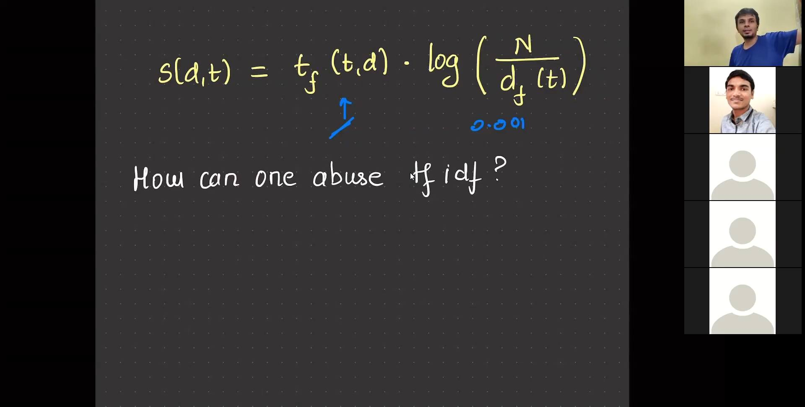
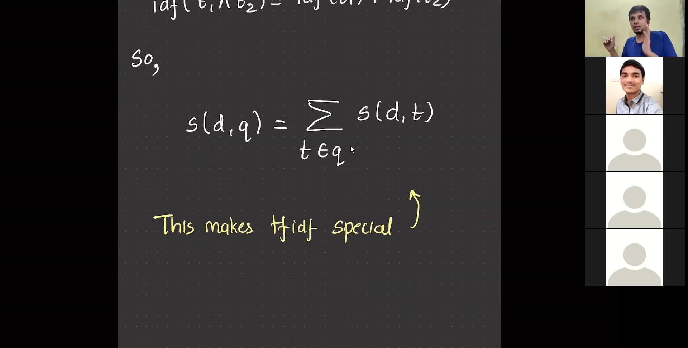
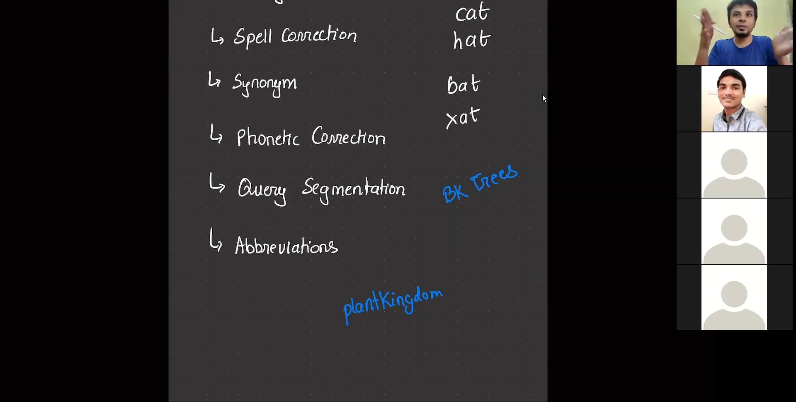
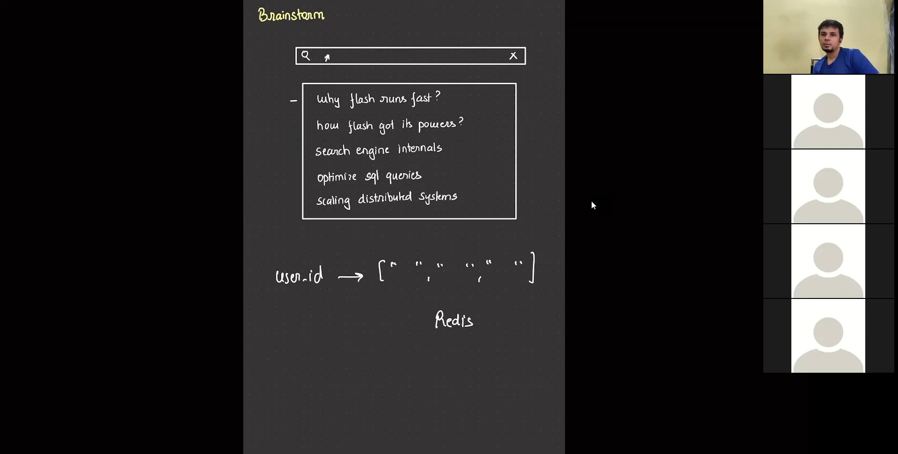
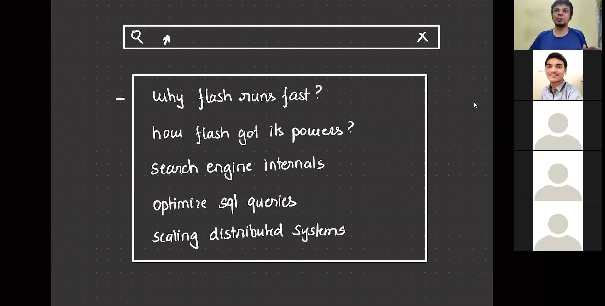

# System Design Masterclass (Arpit) P013 复现文档：TF-IDF 搜索排序与“最近搜索”系统设计

> 适用范围：p013 第 2/3 段，53:16–115:14。  
> 说明：这一节是系统设计讲解课，讲师没有给出可运行的项目代码。因此本文第 4 节的 Node.js/Cassandra/Redis 代码是**复现用示意脚手架**，不是讲师原文代码；所有课里没讲的工程细节，我会明确标注“课里没讲”。  
> 截图说明：给定截图清单只有 5 帧。为满足 6 个图片位，本文第 6 节复用 `p013 106:52` 同一帧作为“重复项检查”对照，并明确标注复用；没有使用清单外帧号。

---

## 1. 这一节做什么

这一节表面上看是在讲搜索，实际上是在把一个搜索框拆成两条链路：

1. **搜索质量链路**：用户输入一个或多个词后，系统如何判断哪些文档更相关。讲师从 TF-IDF 讲起，延伸到停用词识别、TF-IDF 被滥用、IDF 函数可替换、多词查询为什么可以直接求和、标题字段加权、模糊搜索、同义词、语音纠错、查询分词。
2. **最近搜索链路**：用户点击搜索框时，如何“闪电般”展示最近 5 条搜索。讲师把它落成一个典型缓存 + 持久化设计：Redis 做最近 5 条缓存，Cassandra 做历史搜索的 source of truth，触发时机不是“点击搜索框”，而可能是“打开 App / 登录”，并且要处理重复搜索、跨设备、历史数据分析等问题。

本文要复现的产物不是“完整搜索引擎”，而是一个能跑起来的最小“最近搜索”服务，外加一张能指导后续扩展的设计表。读者照着本文可以完成：

- 用 Docker 启动 Redis + Cassandra + Node.js 服务；
- 调用 `POST /v1/search` 写入搜索历史并更新最近 5 条；
- 调用 `GET /v1/users/:userId/recent-searches` 读取最近搜索；
- 验证重复搜索不会在最近搜索里出现两次；
- 验证 Redis 缓存丢失后可以从 Cassandra 回填；
- 理解 TF-IDF 排序、停用词、字段权重、模糊/同义/分词这些策略在整体搜索链路里的位置。

课里没有给 DAU、QPS、Redis 内存、Cassandra 表结构、Node 代码，也没有给 Elasticsearch 查询 DSL。所以下面的容量估算和代码都是“复现脚手架”，用于把讲师的设计讨论变成可操作的东西。

需要特别强调：**TF-IDF 排序链路和最近搜索链路不是同一个问题**。TF-IDF 解决“哪些文档更相关”，最近搜索解决“这个用户刚刚搜过什么”。复现时不要把最近搜索的 Redis List 当成全文检索索引，也不要把 TF-IDF 分数写进最近搜索列表。最近搜索列表只关心“最近、去重、跨设备、快”，不关心 query 与文档的相关性。前端的搜索框通常同时承担两个动作：聚焦时展示最近搜索，提交时调用搜索接口；这两个动作在后端也应该是两个接口，便于分别做缓存、降级和埋点。复现验收时，先保证最近搜索链路可运行，再把 TF-IDF 公式和查询理解策略作为设计表补充，不要一开始就把 Elasticsearch、分词、纠错全部堆进最小项目里。

---

## 2. 讲师原话

讲师在讲停用词时，先给了一个反直觉问题：只给你一个数据集，没有 query，怎么找停用词？他说不能只看“是否出现在所有文档里”，因为可能没有任何词出现在全部文档中。

> "一个词在 1000 篇文档中出现在 940 篇里，超过 75%……你会把它标为停用词吗？"
> —— p013 [55:08]

接着他给出判断方向：不要只看 document frequency，要看 term frequency 和 document frequency 的组合。

> "按降序排序输出……词频和文档频率……不能只根据文档频率来判断。"
> —— p013 [57:03]

> "当平均词频很高、文档频率也很高时，这就会让一个词成为停用词。"
> —— p013 [58:28]

然后他讲 TF-IDF 的一个经典漏洞：term frequency 是文档作者可以控制的，所以可以堆词作弊。

> "如果词频非常高，我就很容易滥用词频-逆文档频率权重。"
> —— p013 [61:49]



他提到 Google 早期的做法：对新文档做词频直方图分析，发现异常分布就降权。

> "常规直方图分析……如果发现它异常，他们过去会降低结果的权重。"
> —— p013 [65:08]

讲师还强调 IDF 不必死记 `log(N/df)`，只要函数是负增长即可。

> "任何增长率为负的函数都可以。"
> —— p013 [66:28]

多词查询是这一段的重点：因为用户输入多个词时，IDF 可以拆开相加，所以总分直接求和，不需要复杂数学。

> "T1 和 T2 的逆文档频率等于 T1 的逆文档频率与 T2 的逆文档频率之和。"
> —— p013 [71:42]

> "我们只是把它们简单粗暴地相加。"
> —— p013 [73:07]



讲 relevance 提升时，他给了几个策略：标题字段加权、BK trees 做模糊匹配、分层搜索、同义词、语音纠错、query segmentation。

> "如果某个词出现在文档标题中，这篇文档的相关性就会更高……标题会被赋予 10 倍权重。"
> —— p013 [75:26]

> "有一种称为 BK 树的结构。"
> —— p013 [76:21]

> "分级方法，也就是分级搜索：第一轮搜索会假设完全没有拼写错误。"
> —— p013 [77:19]

> "同义词扩展，比如“美国”和“美利坚合众国”。"
> —— p013 [77:48]

> "语音纠正……如果两个词听起来相似，就把它们视为相同。"
> —— p013 [81:25]

> "查询分词……人们会忘记输入空格。"
> —— p013 [83:49]



后半段进入“最近搜索”系统设计。讲师先定需求：点击搜索框，展示最近 5 条，必须快。

> "最近五次查询……它必须快如闪电。"
> —— p013 [93:12]

数据结构上，他接受“user ID 映射到一个列表”的方向，并把它放到 Redis。

> "一个哈希表，键是用户标识，值是那五条查询的列表……我们把它存到 Redis 上。"
> —— p013 [95:06]



但他马上指出 browser cache 只是优化，不跨设备；要持久化需要 source of truth。

> "浏览器缓存是在此基础上的优化，因为你会希望这套机制能跨设备使用。"
> —— p013 [95:35]

> "我们可以把 Cassandra 作为事实来源，并把它用在中间层。"
> —— p013 [98:56]

触发时机是这一段很关键的工程判断：不要等用户点击搜索框才查库，而可以在 App 打开或登录时预热缓存。

> "不要把触发条件设成用户点按搜索栏，而要把触发条件设成用户打开应用。"
> —— p013 [100:48]

写路径上，讲师讨论过写 Redis、写 Cassandra、队列异步等方案，并担心异步队列的 lag。

> "每当用户执行搜索时，也会在 Redis 中写入一条记录。"
> —— p013 [102:43]

他还指出一个产品级 edge case：用户点击最近搜索里的某条 query，会再次触发搜索，如果不去重，最近搜索会出现重复项。

> "最近搜索里就会出现重复条目。"
> —— p013 [105:56]



解决方案是“存在就先删，再放到最前”。

> "先移除那条查询，再把它重新放进去。"
> —— p013 [107:16]

最后他反对只存 `user_id -> list`，因为会丢失历史搜索这个金矿。应该存 `user_id + query + timestamp`。

> "存储所有查询……包括查询内容、用户标识和时间戳。"
> —— p013 [110:34]

历史搜索能用来发现 bad query、常见 typo、搜索趋势。

> "人们通常会先搜某个东西，然后马上又搜另一个东西……这说明上一次查询是个糟糕的查询。"
> —— p013 [113:48]

---

## 3. 从零复现

这一节按“需求 → 约束 → 估算 → 数据结构 → 读写路径 → 查询理解 → 降级”的顺序复现讲师的推导。注意：课里没有给出具体 DAU 和 QPS，下面容量数字是复现用假设，不是讲师数据。

### 3.1 需求拆解

最近搜索功能的核心需求：

1. 用户点击搜索框时，展示最近 5 条搜索。
2. 读取必须快，讲师用的词是 “lightning fast”。
3. 要跨设备：手机上搜过，电脑上打开也能看到，所以不能只依赖 browser cache。
4. 要有 source of truth：Redis 可以丢，历史不能丢。
5. 最近搜索里同一 query 不能重复。
6. 缓存要有触发时机，不能等用户点击才查 Cassandra。
7. 历史搜索要保留，供后续分析 bad query、typo、趋势。

非功能约束：

- 读多写也多：每次搜索都写一条历史，但打开 App 时可能只读一次最近搜索。
- Redis 内存不能无限增长。
- Cassandra 写入量会随时间累积，需要保留策略。
- 课里没有给具体延迟目标。本文按“Redis 读 p99 < 50ms”作为复现假设，不是讲师承诺。

验收时建议再加一条：最近搜索接口返回的数组顺序必须是“最新在前”，重复 query 只保留一次，且历史表仍保留重复记录。验证时不要只看接口返回，还要用 `redis-cli LRANGE` 和 `cqlsh SELECT` 分别检查缓存与 source of truth。前端的对照是：搜索框聚焦时只负责展示，不在前端做去重排序；前端可以本地缓存一份用于首屏优化，但必须能被服务端返回覆盖，否则跨设备场景会出现旧列表。常见错误是把“最近 5 条”做成前端 `localStorage` 里追加去重，短期能跑，但换设备就丢，和讲师强调的 cross devices 冲突。

### 3.2 容量估算

假设：

- DAU = 10,000,000（一千万）；
- 每人每天搜索 10 次；
- 最近搜索缓存 5 条；
- 平均 query 64 bytes；
- Redis 每个 list entry overhead 按 50 bytes 估；
- Redis key overhead 按 100 bytes 估；
- Cassandra 每行按 user_id 36 bytes + timeuuid 16 bytes + query 64 bytes + normalized_query 64 bytes + overhead 100 bytes ≈ 280 bytes；
- Cassandra replication factor = 3；
- 历史保留 365 天。

Redis 内存：

```text
每用户 ≈ 100 + 5 × (64 + 50) = 670 bytes
一千万用户 ≈ 10,000,000 × 670 bytes ≈ 6.7 GB
三副本/多集群备份按 2 倍估 ≈ 13.4 GB
如果只有 30% 用户当天活跃 ≈ 2.0 GB
```

Cassandra 写入：

```text
每天搜索行数 = 10,000,000 × 10 = 100,000,000 行
每天原始大小 ≈ 100,000,000 × 280 bytes ≈ 28 GB
RF=3 后 ≈ 84 GB/天
一年 ≈ 84 GB × 365 ≈ 30.7 TB
```

结论：Redis 只存 5 条是轻量的；真正重的是 Cassandra 历史表。所以历史表必须有 TTL 或冷热分层。课里没有讲 TTL 和冷热分层，这是复现时必须补的运维决策。

常见错误是把 Redis 当唯一存储，容量估算只算 Redis，结果发现历史分析没数据；或者只算 Cassandra 原始大小，忽略 RF=3 和 compaction 开销。排查时先看 `INFO memory` 的 `used_memory` 和 `dbsize`，再看 Cassandra `nodetool tablestats` 的 live data 大小。前端对照：前端不要拉取全量历史，只拉最近 5 条；历史分析走离线链路，不给搜索框增加延迟。检查清单里会用“删除 Redis key 后仍能从 Cassandra 回填”来验证 source of truth 是否真的存在。

### 3.3 数据结构选择

Redis 用 List：

```text
key: recent:{userId}
value: [query5, query4, query3, query2, query1]  // 最新的在左边
```

为什么用 List 而不是只存一个 JSON 字符串？

- `LPUSH` 把新 query 放到最前；
- `LTRIM 0 4` 只保留 5 条；
- `LREM key 0 query` 先去重；
- 读取 `LRANGE 0 4` 就是最近 5 条。

讲师讨论过 queue/array，也提到 sorted set 会涉及时间排序和去重成本。复现时选择 List，因为需求就是“最近 5 条”，不需要按分数范围查询。

Cassandra 用“一行一次搜索”，不是“一行一个用户列表”：

```text
partition key: user_id
clustering key: searched_at timeuuid desc
columns: query, normalized_query
```

这样同一用户的搜索历史落在同一个 partition 内，按时间倒序读最近 5 条很快；同时保留全部历史，供分析。

这里要强调去重的边界：Redis 的 `LREM key 0 query` 是删除**所有**等于该 query 的元素，然后 `LPUSH` 一次，所以最近列表不会重复；Cassandra 不做删除，每次搜索插入新行，因此历史分析可以看到“同一 query 搜了多次”。常见错误是 Cassandra 也做成 `user_id -> list` 覆盖写，结果 bad query 分析没有时间序列。前端对照：前端点击最近搜索项时，应该像普通提交搜索一样调用 `POST /v1/search`，这样后端会重新去重并置顶，而不是只在前端把该项移到最前。检查时用 `redis-cli LRANGE recent:u1 0 -1` 看缓存，用 `cqlsh` 看同一用户是否有多行历史。

### 3.4 写路径

用户每发起一次搜索：

1. 校验 `userId` 和 `query`；
2. 规范化 query：`trim` + 合并连续空格；
3. 写 Cassandra：新增一行 `user_id + searched_at + query + normalized_query`；
4. 更新 Redis：Lua 脚本内完成“删除旧值 → LPUSH → LTRIM → EXPIRE”；
5. 返回最近 5 条。

这里有一个关键点：Cassandra 保留重复搜索历史，Redis 的最近搜索去重。也就是说：

- 历史表里 `iron man` 可能出现多次，因为每次搜索都是一条新日志；
- 最近搜索列表里 `iron man` 只出现一次，并且被移到最前。

这正好对应讲师说的“历史是金矿”和“最近搜索要去重”两个不同目标。

命令的完整解释：`LREM key 0 query` 中 `0` 表示删除所有等值元素；`LPUSH key query` 从左侧插入，保证最新在前；`LTRIM key 0 4` 只保留下标 0 到 4 共 5 条；`EXPIRE key 2592000` 设置 30 天 TTL（示例值，课里没给具体 TTL）。这四个命令必须原子执行，否则并发搜索时可能出现“先 LPUSH 后 LREM 把刚插入的也删掉”或两个请求交错导致列表超过 5 条。常见错误是写成两个 `await`，没有用 Lua/事务包起来；排查时并发压测同一用户同一 query，观察 `LLEN` 是否稳定为 5、是否出现重复。前端对照：前端搜索提交按钮要防抖，但后端仍必须做幂等去重，不能依赖前端。

### 3.5 读路径与缓存预热

读路径：

1. 用户打开 App / 登录：触发 `POST /v1/users/:userId/recent-searches/warm-cache`，从 Cassandra 读最近 5 条，写入 Redis；
2. 用户点击搜索框：`GET /v1/users/:userId/recent-searches`，直接读 Redis；
3. 如果 Redis miss：查 Cassandra，回填 Redis，再返回。

为什么触发时机不是“点击搜索框”？讲师给了一个统计判断：如果 90% 的用户打开 App 后会点搜索框，那么在 App open 时预热是值得的；如果只有 10% 会点，预热会浪费 CPU 和内存。这个 90/10 是讲师举例，不是固定阈值。实际要用埋点数据决定。

常见错误是把预热放在每次点击搜索框时同步查 Cassandra，结果 P99 被 Cassandra 抖动拖慢；或者预热时覆盖了 Redis 里更新的数据，导致旧列表回退。复现时 warm-cache 只从 Cassandra 读最近若干行，去重后取 5 条再写 Redis；如果 Redis 已有数据，可以选择不覆盖或合并，具体策略课里没讲。前端对照：App open 时异步调用 warm-cache，不阻塞首屏；搜索框聚焦时只 GET 缓存，若 miss 再显示 loading 并回源。

### 3.6 搜索排序与查询理解链路

如果要做完整搜索，而不只是最近搜索，复现顺序是：

1. **查询理解**：先做 query segmentation，处理用户漏打空格；再做拼写纠错/模糊匹配；再做同义词扩展；再做语音纠错。
2. **构造检索请求**：把处理后的词交给搜索引擎。课里提到 Elasticsearch，但没有给 DSL。
3. **排序**：对每个候选文档计算 TF-IDF 分数。多词查询直接求和：
   ```text
   score(doc, query) = Σ tf(term, doc) × idf(term)
   idf(term) = log(N / df(term))  // 或任意负增长函数
   ```
4. **字段加权**：title 命中给更高权重，讲师举例 title 10x；body 权重较低。
5. **停用词**：不要只看 DF，用平均 TF + DF 排序，高的判为 stop word。
6. **作弊检测**：对文档做词频直方图，异常高频词降权。
7. **分层搜索**：先严格匹配，没有结果再放宽到 fuzzy，避免 3 字符词允许 1 个 typo 时把 cat 匹配成 hat/bat。

课里没有讲 Elasticsearch 具体查询、BK tree 实现、语音算法实现、中文分词。这些在复现时属于“后续扩展”，不要误以为讲师给了完整实现。常见错误是把多词 TF-IDF 直接求和后不比较字段权重，长文档可能因为词多而占优；排查时用同一 query 对比 title 命中和 body 命中的文档分数。前端对照：查询清洗可以在前端做轻量 trim，但分词、纠错、同义词必须以后端为准，否则不同客户端行为不一致。

### 3.7 失败与降级

- Redis 挂了：读路径应降级到 Cassandra，写路径继续写 Cassandra，缓存更新失败只记日志。本文示意代码只做了基本错误返回，没有做完整降级；生产要补。
- Cassandra 挂了：最近搜索还能从 Redis 读，但历史写入丢失。讲师讨论过队列异步，但担心 consumer 挂掉后 lag 到小时级，所以实时最近搜索不建议纯异步。
- 重复项：Redis Lua 里先 `LREM` 再 `LPUSH`。
- 缓存过期：设置 TTL，避免 Redis 永久增长。
- 跨设备：服务端 Redis + Cassandra，browser cache 只做前端优化。

在 JS/Node 里，Redis Lua 相当于把“去重 + 插入 + 截断”做成一个原子操作。不要写成两个 `await`：

```js
await redis.lrem(key, 0, query);
await redis.lpush(key, query);
```

并发请求下两个用户操作可能交错，列表会出现重复或顺序错乱。用 Lua 或 Redis 事务把这段包起来。

排查降级时先看日志里 Redis 错误是否被吞掉，再看 Cassandra 写入是否成功；不要因为 Redis 失败就返回 500。前端对照：接口降级时前端仍应能展示最近搜索（可能稍慢），不要因为缓存 miss 就清空搜索框建议。

---

## 4. 完整代码

> 课里没有代码。以下为复现示意，不是讲师原文。目录结构：
>
> ```text
> recent-searches-demo/
> ├── package.json
> ├── Dockerfile
> ├── docker-compose.yml
> └── server.js
> ```

### 4.1 设计决策表

| 问题 | 复现决策 | 理由 | 课里依据/备注 |
|---|---|---|---|
| 最近搜索存哪里 | Redis List | 读取快，天然适合最近 5 条 | 讲师说放 Redis，user ID 映射 list |
| 历史搜索存哪里 | Cassandra | 可持久化、按用户分区、按时间排序 | 讲师说 Cassandra 可做 source of truth |
| 是否只用 browser cache | 否 | 不跨设备 | 讲师明确说 browser cache 只是优化 |
| 缓存触发时机 | App open / 登录时预热 | 点击时查库太慢 | 讲师说 trigger 不一定是 tap |
| 重复 query | 最近列表去重，历史保留 | 最近搜索体验好，历史可分析 | 讲师说 remove then put |
| 历史表结构 | 一行一次搜索 | 保留 timestamp，可做 bad query 分析 | 讲师说存 query、user ID、timestamp |
| 排序 | 多词 TF-IDF 求和 | IDF 可加，计算便宜 | 讲师说 blunt sum |
| 停用词 | 平均 TF + DF 排序 | 只看 DF 会误杀 Harry 这类词 | 讲师用 Harry 940/1000 举例 |
| IDF 函数 | 可用任意负增长函数 | 直觉是高频低区分度 | 讲师说 negative growth 即可 |
| 字段权重 | title 高于 body | 标题命中更相关 | 讲师举例 title 10x |
| 模糊搜索 | 分层搜索，先严格后 fuzzy | 避免 typo 容忍误匹配 | 讲师说 tiered search |
| 同义词/语音/分词 | 查询理解层插件 | 提升召回和相关性 | 讲师讲了策略，没给实现 |

### 4.2 组件职责表

| 组件 | 职责 | 复现时是否实现 |
|---|---|---|
| 搜索框前端 | 展示最近 5 条，点击后发搜索 | 否，本文只做 API |
| Search API | 接收搜索、写历史、更新缓存、读最近搜索 | 是 |
| Query Understanding | 分词、纠错、同义词、语音 | 否，课里没给代码 |
| Ranking | TF-IDF、字段权重、作弊降权 | 否，本文给规则表 |
| Redis | 最近 5 条缓存 | 是 |
| Cassandra | 历史搜索 source of truth | 是 |
| Elasticsearch | 全文检索 | 否，课里提到但没给 DSL |
| 离线分析 | bad query、typo、趋势 | 否，课里讲价值，没给实现 |

### 4.3 数据模型草案

Redis：

```text
key: recent:{userId}
type: list
value: 最新 query 在左，最多 5 条
TTL: 30 天（复现假设，课里没给具体值）
```

Cassandra CQL（课里没有 CQL，以下为示意）：

```sql
CREATE KEYSPACE IF NOT EXISTS search
WITH replication = {'class': 'SimpleStrategy', 'replication_factor': 1};

CREATE TABLE IF NOT EXISTS search.search_history (
  user_id text,
  searched_at timeuuid,
  query text,
  normalized_query text,
  PRIMARY KEY ((user_id), searched_at)
) WITH CLUSTERING ORDER BY (searched_at DESC);
```

API：

```http
GET /v1/users/:userId/recent-searches?limit=5
POST /v1/users/:userId/recent-searches/warm-cache
POST /v1/search
```

`POST /v1/search` 请求：

```json
{
  "userId": "u1",
  "query": "iron man"
}
```

响应：

```json
{
  "userId": "u1",
  "query": "iron man",
  "recent": ["iron man", "thor", "hulk"]
}
```

### 4.4 容量估算表

| 指标 | 假设 | 估算 |
|---|---|---|
| DAU | 1000 万 | 复现假设，课里没给 |
| 每人每天搜索 | 10 次 | 复现假设 |
| Redis 每用户 | 5 条 × 114B + key 100B ≈ 670B | 约 6.7 GB / 千万用户 |
| 三副本/多集群备份 | 按 2 倍估 | 约 13.4 GB |
| 30% 当天活跃 | 0.3 × 6.7 GB | 约 2.0 GB |
| Cassandra 每天行数 | 1000 万 × 10 | 1 亿行/天 |
| Cassandra 每天原始大小 | 1 亿 × 280B | 约 28 GB/天 |
| RF=3 后 | 28 GB × 3 | 约 84 GB/天 |
| 历史保留 365 天 | 84 GB × 365 | 约 30.7 TB/年 |

结论：Redis 侧不是瓶颈，Cassandra 历史表才是主要存储成本。复现时用 `SimpleStrategy RF=1` 本地跑通即可，生产按集群配置；课里没讲 TTL、冷热分层和压缩策略，这些要在运维层补。

### 4.5 完整示意代码

`package.json`：

```json
{
  "name": "recent-searches-demo",
  "version": "1.0.0",
  "private": true,
  "type": "commonjs",
  "scripts": {
    "start": "node server.js"
  },
  "dependencies": {
    "cassandra-driver": "^4.7.2",
    "express": "^4.19.2",
    "ioredis": "^5.4.1"
  }
}
```

`Dockerfile`：

```dockerfile
FROM node:20-alpine
WORKDIR /app
COPY package*.json ./
RUN npm install --omit=dev
COPY server.js ./
EXPOSE 3000
CMD ["npm", "start"]
```

`docker-compose.yml`：

```yaml
services:
  redis:
    image: redis:7-alpine
    ports:
      - "6379:6379"
  cassandra:
    image: cassandra:4.1
    ports:
      - "9042:9042"
    environment:
      - CASSANDRA_CLUSTER_NAME=search-demo
  api:
    build: .
    ports:
      - "3000:3000"
    environment:
      - REDIS_URL=redis://redis:6379
      - CASSANDRA_CONTACT_POINTS=cassandra
      - CASSANDRA_KEYSPACE=search
    depends_on:
      - redis
      - cassandra
```

`server.js`：

```js
const express = require("express");
const Redis = require("ioredis");
const cassandra = require("cassandra-driver");

const app = express();
app.use(express.json());

const redis = new Redis(process.env.REDIS_URL || "redis://127.0.0.1:6379");
const client = new cassandra.Client({
  contactPoints: [(process.env.CASSANDRA_CONTACT_POINTS || "127.0.0.1")],
  localDataCenter: "datacenter1",
});

const RECENT_LIMIT = 5;
const CACHE_TTL_SECONDS = 30 * 24 * 60 * 60;

const UPSERT_RECENT_LUA = `
local key = KEYS[1]
local query = ARGV[1]
local ttl = tonumber(ARGV[2])
redis.call('LREM', key, 0, query)
redis.call('LPUSH', key, query)
redis.call('LTRIM', key, 0, 4)
redis.call('EXPIRE', key, ttl)
return redis.call('LRANGE', key, 0, 4)
`;

function keyOf(userId) {
  return `recent:${userId}`;
}

function normalizeQuery(query) {
  return String(query || "").trim().replace(/\s+/g, " ");
}

async function insertHistory(userId, query, normalized) {
  const cql = `
    INSERT INTO search.search_history
      (user_id, searched_at, query, normalized_query)
    VALUES (?, ?, ?, ?)
  `;
  const params = [userId, cassandra.types.TimeUuid.now(), query, normalized];
  await client.execute(cql, params, { prepare: true });
}

async function readRecentFromCassandra(userId) {
  const cql = `
    SELECT query FROM search.search_history
    WHERE user_id = ?
    LIMIT 20
  `;
  const result = await client.execute(cql, [userId], { prepare: true });
  const seen = new Set();
  const recent = [];
  for (const row of result.rows) {
    if (!seen.has(row.query)) {
      seen.add(row.query);
      recent.push(row.query);
    }
    if (recent.length === RECENT_LIMIT) break;
  }
  return recent;
}

async function warmCache(userId) {
  const recent = await readRecentFromCassandra(userId);
  const key = keyOf(userId);
  await redis.del(key);
  if (recent.length > 0) {
    await redis.rpush(key, ...recent.slice().reverse());
    await redis.expire(key, CACHE_TTL_SECONDS);
  }
  return recent;
}

app.post("/v1/search", async (req, res) => {
  const { userId } = req.body;
  const query = normalizeQuery(req.body.query);
  if (!userId || !query) {
    return res.status(400).json({ error: "userId and query are required" });
  }
  try {
    await insertHistory(userId, query, query);
    const recent = await redis.eval(
      UPSERT_RECENT_LUA,
      1,
      keyOf(userId),
      query,
      CACHE_TTL_SECONDS
    );
    return res.json({ userId, query, recent });
  } catch (err) {
    console.error("search failed", err);
    return res.status(500).json({ error: "search_failed" });
  }
});

app.get("/v1/users/:userId/recent-searches", async (req, res) => {
  const { userId } = req.params;
  try {
    let recent = await redis.lrange(keyOf(userId), 0, RECENT_LIMIT - 1);
    if (recent.length === 0) {
      recent = await warmCache(userId);
    }
    return res.json({ userId, recent });
  } catch (err) {
    console.error("read recent failed", err);
    return res.status(500).json({ error: "read_recent_failed" });
  }
});

app.post("/v1/users/:userId/recent-searches/warm-cache", async (req, res) => {
  try {
    const recent = await warmCache(req.params.userId);
    return res.json({ userId: req.params.userId, recent });
  } catch (err) {
    console.error("warm cache failed", err);
    return res.status(500).json({ error: "warm_cache_failed" });
  }
});

async function bootstrap() {
  await client.connect();
  await client.execute(`
    CREATE KEYSPACE IF NOT EXISTS search
    WITH replication = {'class': 'SimpleStrategy', 'replication_factor': 1}
  `);
  await client.execute(`
    CREATE TABLE IF NOT EXISTS search.search_history (
      user_id text,
      searched_at timeuuid,
      query text,
      normalized_query text,
      PRIMARY KEY ((user_id), searched_at)
    ) WITH CLUSTERING ORDER BY (searched_at DESC)
  `);
  app.listen(3000, () => console.log("api listening on 3000"));
}

bootstrap().catch((err) => {
  console.error("bootstrap failed", err);
  process.exit(1);
});
```

### 4.6 启动与调用命令

完整启动命令：

```bash
docker compose up -d --build
```

解释：`up` 创建并启动服务，`-d` 后台运行，`--build` 强制重建 api 镜像。排查：如果 3000 端口被占用，改 `docker-compose.yml` 的宿主机端口；如果 Cassandra 还没 ready，api 可能启动失败，先看日志。

写入一次搜索：

```bash
curl -s -X POST http://localhost:3000/v1/search \
  -H 'Content-Type: application/json' \
  -d '{"userId":"u1","query":"iron man"}'
```

读取最近搜索：

```bash
curl -s http://localhost:3000/v1/users/u1/recent-searches
```

预热缓存：

```bash
curl -s -X POST http://localhost:3000/v1/users/u1/recent-searches/warm-cache
```

查看 Redis：

```bash
docker compose exec redis redis-cli LRANGE recent:u1 0 -1
```

查看 Cassandra：

```bash
docker compose exec cassandra cqlsh -e \
  "SELECT user_id, query, searched_at FROM search.search_history WHERE user_id='u1';"
```

常见错误：`ECONNREFUSED redis:6379` 说明 api 与 redis 不在同一网络或 redis 没起；`NoHostAvailableError` 通常是 Cassandra 还在启动，等 30–60 秒重试；`Undefined column name` 是表结构与 CQL 不一致，重建容器卷或手动改表。前端对照：App open 时调 warm-cache，搜索框聚焦只调 GET；提交搜索后可以用响应里的 `recent` 乐观更新，但下一次打开仍以服务端为准。

---

## 5. 逐行解释

1. `express.json()`：让 `POST /v1/search` 能解析 JSON body；如果前端发 `text/plain`，这里会拿不到 `req.body`，属于常见错误。
2. `new Redis(...)`：建立 Redis 连接；容器内主机名是 `redis`，本地跑是 `127.0.0.1`，不要混用。
3. `new cassandra.Client(...)`：`localDataCenter` 必须与 Cassandra 实际数据中心匹配，单机镜像通常是 `datacenter1`；写错会报 no host available。
4. `UPSERT_RECENT_LUA`：Lua 内 `LREM` 删除所有等值旧项，`LPUSH` 插入最前，`LTRIM 0 4` 截断到 5 条，`EXPIRE` 设置 TTL，最后返回列表。`KEYS[1]` 是 key，`ARGV[1]` 是 query，`ARGV[2]` 是 TTL 秒数。
5. `normalizeQuery`：只做 trim 和合并空白，不改变 query 语义；课里没讲大小写、全半角、Unicode 归一化，生产要按业务补。
6. `insertHistory`：每次搜索插入新行，`TimeUuid.now()` 保证时间有序；`PRIMARY KEY ((user_id), searched_at)` 让同一用户落在同一 partition，按时间倒序聚类。
7. `readRecentFromCassandra`：先多取 20 行，再在应用层按 query 去重取前 5；这样避免在 Cassandra 里做复杂去重。常见错误是直接 `LIMIT 5`，如果最近 5 行有重复，返回会少于 5 条。
8. `warmCache`：先 `DEL` 再 `RPUSH` 反转后的列表，因为 Redis List 左边是最新；这里用 `slice().reverse()` 保证顺序。生产可以考虑原子替换，课里没讲。
9. `POST /v1/search`：先写 Cassandra 再更新 Redis。顺序理由是 source of truth 先落库；如果 Redis 失败，历史还在，后续可回填。常见错误是先写 Redis 后写 Cassandra，Cassandra 失败会丢历史。
10. `GET recent-searches`：先读 Redis，空则 `warmCache` 回源；这里把空列表也当成 miss，如果用户真的没有历史会多查一次 Cassandra，可接受。
11. `warm-cache`：供 App open 调用；它不写历史，只读历史并刷新缓存。
12. `bootstrap`：创建 keyspace 和表后再监听端口；生产不建议应用启动时建表，课里没讲，复现这样写是为了少一步初始化。

---

## 6. 复现检查清单

- [ ] **服务能启动**：`docker compose up -d --build` 后 `docker compose ps` 三个服务均为 running；验证 `curl http://localhost:3000/v1/users/u1/recent-searches` 返回 JSON 而不是连接失败。失败先看 `docker compose logs -f api`。
- [ ] **写入搜索成功**：执行 `POST /v1/search`，返回 `recent` 包含 `iron man`；用 `redis-cli LRANGE recent:u1 0 -1` 确认缓存第一条是 `iron man`。
- [ ] **最近 5 条截断**：连续写入 6 个不同 query，`GET recent-searches` 只返回 5 条，且最新在前；用 `LLEN recent:u1` 验证长度为 5。
- [ ] **重复 query 去重并置顶**：写入 `iron man`、`thor`、`iron man`，最近列表里 `iron man` 只出现一次且在最前；用 `LRANGE` 和 `GET` 双重确认。
- [ ] **历史保留重复**：用 `cqlsh` 查询 `search_history`，同一 `user_id` 下 `iron man` 应有多行、`searched_at` 不同；这验证 Redis 去重没有影响 source of truth。
- [ ] **缓存丢失可回填**：`docker compose exec redis redis-cli DEL recent:u1` 后调用 `GET recent-searches`，应自动从 Cassandra 回填并返回最近 5 条；再 `LRANGE` 确认缓存恢复。
- [ ] **重复项检查对照**：复用 `p013 106:52` 同一帧作为对照，确认“点击最近搜索项再次搜索”不会产生重复项。验证方法：先写入 `iron man`，再模拟点击最近项再次 `POST /v1/search`，`GET` 中 `iron man` 仍只出现一次且置顶。  
  
- [ ] **跨设备语义**：清空浏览器本地存储后，直接调 `GET` 仍能拿到最近搜索；说明数据来自服务端而不是 browser cache。
- [ ] **TTL 生效**：`redis-cli TTL recent:u1` 返回正数；如果返回 `-1`，说明 `EXPIRE` 没执行或 key 被重建时漏设 TTL。
- [ ] **错误输入**：`POST /v1/search` 缺 `userId` 或 `query` 返回 400；空字符串 trim 后也应 400。
- [ ] **降级可观察**：手动停掉 Redis 后，`POST /v1/search` 不应丢 Cassandra 历史；恢复 Redis 后可回填。当前示意代码会返回 500，生产要按第 7 节补降级。

---

## 7. 课里没讲但你会撞上的（表格：现象 / 原因 / 怎么办）

| 现象 | 原因 | 怎么办 |
|---|---|---|
| api 启动报 `NoHostAvailableError` | Cassandra 还没完成启动，或 `localDataCenter` 配错 | 等 30–60 秒重试；确认 `CASSANDRA_CONTACT_POINTS` 和 `localDataCenter=datacenter1` |
| `ECONNREFUSED 127.0.0.1:6379` | 容器内仍连本机地址 | 容器环境变量设为 `redis://redis:6379`；本地跑才用 127.0.0.1 |
| 最近列表出现重复项 | 先 `LPUSH` 后 `LREM`，或两个 `await` 非原子 | 用 Lua 固定顺序 `LREM → LPUSH → LTRIM → EXPIRE` |
| 最近列表超过 5 条 | 漏 `LTRIM`，或并发交错 | 原子脚本内截断；压测同一用户并发搜索 |
| Redis 重启后最近搜索为空且不回填 | `GET` 只读 Redis，没有 miss 回源 | 读路径加 `warmCache`/回源；验证时手动 `DEL` key |
| 历史表越来越大 | 没有 TTL / 冷热分层 | 按业务设 TTL、归档到冷存储；课里没讲，需运维决策 |
| 跨设备看不到最近搜索 | 只存了 localStorage/browser cache | 服务端 Redis + Cassandra 为准，前端缓存只做优化 |
| 多词搜索长文档总占优 | TF 随文档长度增长，直接求和偏置长文 | 做长度归一化或字段权重；课里没讲归一化细节 |
| 停用词误杀 “Harry” | 只看 DF，没看平均 TF | 按“平均 TF 高 + DF 高”排序判断；人工抽查 |
| fuzzy 把 cat 匹配成 hat/bat | 短词允许 1 个 typo 太激进 | 分层搜索：先严格，无结果再 fuzzy；限制短词 typo 数 |
| 同义词扩展过度导致不相关 | 同义词表过宽 | 控制扩展词权重，记录点击反馈；课里没讲 |
| 前端搜索框每次输入都请求 | 没有防抖，且把最近搜索与联想搜索混在一起 | 输入防抖；聚焦只取最近 5 条，提交才写历史 |
| 预热覆盖了新数据 | App open 的 warm-cache 与用户刚写入并发 | 预热前比较时间戳或版本号；课里没讲，需业务取舍 |
| 队列异步写历史 lag 到小时级 | consumer 挂掉或积压 | 实时最近搜索同步写 Cassandra；异步只做分析；课里提到 lag 担心 |
| 删除用户后历史仍在 | 没有隐私删除链路 | 按 user_id 删除 Cassandra 分区并清 Redis key；课里没讲 |