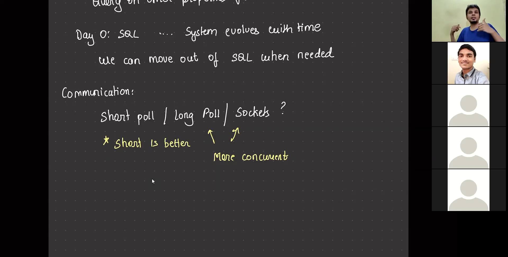
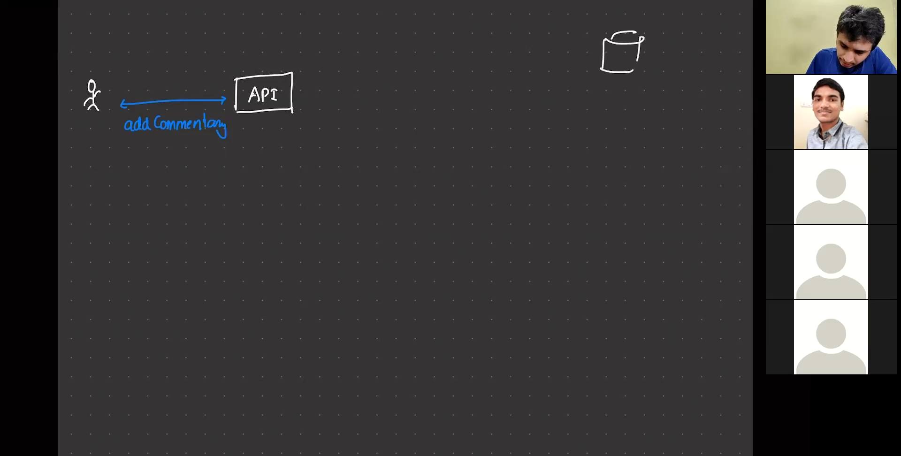
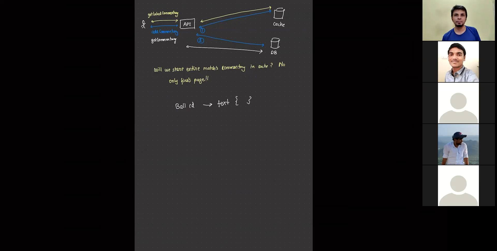
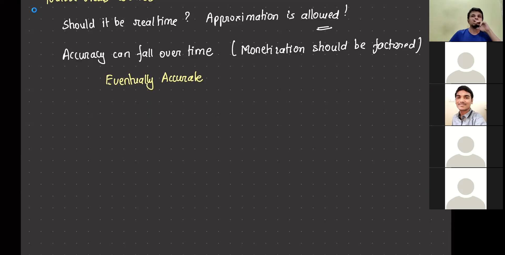

# System Design Masterclass 第14讲：Cricbuzz 直播评论与 YouTube 视频计数设计复现

> 说明：本讲是纯白板讨论课，没有可运行代码。本文按“推导过程 + 设计决策 + 示意代码”的方式组织，帮助你从零把讲师的设计思路复现成一份可评审的架构方案。截图清单仅提供 5 张，因此下文实际插入 5 张；若需要第 6 张，请补充素材。

---

## 1. 这一节做什么

这一节是 Arpit 的 System Design Masterclass 第 14 讲（P14），全程没有幻灯片，以讨论方式完成两个经典系统设计题：

1. **Cricbuzz 直播评论系统**：如何设计板球比赛的实时文字直播评论？核心矛盾是“写少读多、最新数据要高时效、历史数据要可翻页、通信方式要省资源”。
2. **YouTube 视频浏览量计数**：100M 日活用户产生的观看事件，如何计数？核心矛盾是“海量写入不能直接打数据库、计数不要求强实时但最终要准、还要防刷去重”。

作为前端转 AI 应用工程师，你不需要记住 SQL 调优或 Kafka 参数，但需要理解每个决策背后的“成本”：
- 为什么用短轮询而不是 WebSocket？
- 为什么先写缓存再写数据库？
- 为什么 YouTube 计数要走事件总线而不是直接 `UPDATE videos SET views = views + 1`？

这些决策会直接影响你与后端联调时的接口语义和数据一致性预期。

---

## 2. 讲师原话

> “Short polling is better considering the fact that the request effort is low and with every new request you just check in the cache and kill it and ask the customer to come back after 10 seconds.” —— p014 [15:21]

> “So that's why I always say that recent searches architecture is very similar to Cricbuzz architecture. It's all about understanding the building blocks that we have, it's all about lego blocks.” —— p014 [33:18]

> “So if you do like a little bit of back of the back of the envelope calculation, you'll find like 50 rights per minute at peak time, which is nothing for this.” —— p014 [39:23]

> “It's just about making those choices. If you would want to over engineer, you can do that.” —— p014 [45:58]

---

## 3. 从零复现

本讲没有代码，复现的是“推导过程”。下面按 **需求 → 约束 → 估算 → 方案 → 取舍** 五步复现讲师思路。

### 3.1 Cricbuzz 直播评论系统


#### 需求

- 评论必须按时间有序展示，和板球比赛的“每个球”绑定。
- 存在 **持续写入**：每个球都会有新评论；高峰期可能达到平时流量的 10x、1000x。
- 存储内容是 **文本**，每条评论有大小限制。
- 大部分数据是 **不可变** 的，但评论员可能打错字，所以要支持修改。
- 用户主要看 **最新评论**；历史评论很少看，但要能翻页。
- 需要支持分析类查询，例如“某击球手在最近 10 场比赛中打出边界的次数”。

#### 约束

- 服务器并发连接数有限，不能同时保持大量空闲 TCP 连接。
- 直播比赛期间，数据更新频率并不高：平均每个球间隔几十秒到几分钟。
- 如果用户打开页面后一直等新数据，等待期间连接是浪费的。

#### 估算

讲师给出的关键数字（p014 [36:06] 附近）：

| 指标 | 数值 | 来源 |
|---|---|---|
| 同时进行的比赛数（国际赛） | 1–2 场 | 讲师口述 |
| 同时进行的比赛数（全球最坏情况） | 50 场 | 讲师口述 |
| 每场比赛写入速率（极端假设） | 50 次/秒？ | 讲师口述“50 writes per second” |
| 实际平均写入速率 | 约 50 次/分钟（所有比赛合计） | 讲师口述 |
| 热门比赛观众数 | 约 10 万+ | 讲师口述“1 lakh people” |

这里注意：讲师的原话有点绕——他先说“50 matches all over the globe. 50 writes per second”，然后说“Let's say someone is writing 50 times in 1 second for each match. That would be 50 writes in 1 second.” 结合上下文，他的意思应该是“最坏情况下 50 场比赛同时写，每秒总共 50 次写入”，而不是每场每秒 50 次。随后他立刻补充“in reality ... one right per minute on an average”，说明真实写压力很小。**我们的容量估算以“峰值 50 writes/s，常态 50 writes/min”为准**。

读流量没有直接给数据，但提到“1 lakh people watching live commentary”。如果每 15 秒轮询一次，粗略估算读 QPS：

```
读 QPS ≈ 100,000 人 / 15 秒 ≈ 6,700 QPS
```

这是基于讲师讨论的示意计算，不是他算的。

#### 方案

**数据库选型**：讲师对比了 SQL、DynamoDB、MongoDB、Cassandra、列式数据库。

- 不选列式数据库：因为查询只按 `matchId` 分区，不需要列存；列式适合“几百列但只查几列”的分析场景。
- 不把 Redis 当作主存储：因为需要对历史数据跑聚合查询（如平均得分），Redis 是 KV，不适合。
- 最终倾向：**MySQL 这类传统关系型数据库**，因为分页、索引、聚合都方便；即使未来量大也可以分库分表。DynamoDB/MongoDB 也可以，但要看团队熟练度。
- 缓存层：**Redis**，只缓存每个 match 的“最新一页”评论。

**API 设计**：

- `addCommentary`：先更新 Redis，再更新 MySQL。
- `getLatestCommentary`：只读 Redis，返回当前 match 最新的一页（最近 N 条）。
- `getCommentary`：读 MySQL，分页返回历史评论。

**通信方式**：**短轮询（short polling）**，客户端每 15 秒请求一次 `getLatestCommentary`。



为什么不用长轮询和 WebSocket？

- 长轮询：客户端发出请求后，服务器一直挂着连接，直到有新数据才返回。如果比赛 2 分钟没有新球，这 2 分钟内所有连接都占着服务器资源，而且 TCP 连接数会非常高。
- WebSocket：虽然能做到真正的双向实时，但同样是**持久连接**，在“数据更新不频繁”的场景下，大多数时间连接是空闲的。比赛中断、下雨暂停时，大量连接空等，浪费严重。
- 短轮询：每次请求快速返回，即使没新数据也会立即返回“没有更新”，连接立刻释放。15 秒的延迟对板球文字直播完全可接受。

**一致性方案**：不用两阶段提交（2PC）。写缓存成功、写 MySQL 失败时，评论员会在后台看到错误，手动重试保存。Redis 的 key 设计为 `matchId_inningsId_ballId`，重试时是**整条覆盖写**，不是追加，所以能修正之前的错字。

**架构图**（根据讲师白板讨论整理）：

```text
                ┌─────────────────┐
                │   API Server    │
                └────────┬────────┘
                         │
               ┌─────────┴─────────┐
               │                   │
        addCommentary        getLatestCommentary
               │                   │
         ┌─────▼─────┐       ┌─────▼─────┐
         │  Redis    │       │  Redis    │
         │ (最新页)   │       │ (快速读)  │
         └─────┬─────┘       └───────────┘
               │
         ┌─────▼─────┐
         │  MySQL    │
         │ (全量历史) │
         └───────────┘

        getCommentary（历史分页）→ 只读 MySQL
```



**缓存淘汰**：每次写入新评论时，把 Redis 中该 match 的“最新一页”里的旧条目删掉，只保留最近 50 条或最近 5 个 over 的内容。这样 `getLatestCommentary` 一次返回完整的一页。



#### 取舍

- **短轮询 vs WebSocket**：短轮询牺牲最多 15 秒的实时性，换来极低的服务器资源占用。对“看文字直播”这种不需要毫秒级反馈的场景，这是正确的取舍。
- **整页返回 vs 增量返回**：客户端只请求“最新一页”，服务器把整页都发回去。即使评论员把 5 个球之前的文字改了，客户端刷新后也能看到修正。如果只推增量，客户端会漏掉修改，还要做乱序合并，增加大量 corner case。
- **MySQL vs Redis 主存储**：MySQL 支持复杂查询和分页，Redis 只能按 key 查。把全量历史放 MySQL，即使以后做“所有打破纪录的球”这种查询也能做。

### 3.2 YouTube 视频浏览量计数



#### 需求

- 日活 100M 用户，视频播放量巨大。
- 页面上的计数可以“先涨、后修正”，即允许近似的实时值。
- 但最终计数要准确，因为涉及创作者收益（讲师提到 YouTube 按观看时长给创作者分成）。
- 同一个用户反复刷新同一视频，不应造成 10 次播放；后台需要归一化/过滤异常点击。

#### 约束

- 不能每个观看事件都直接写数据库，否则热门视频会打爆单行锁。
- 同一个视频的观看事件必须汇总到同一个地方，才能统计总数。

#### 方案

1. 定义输入：`view API`，参数包含 `videoId`、`userId`、`timestamp`。
2. 请求进来后，把事件写入 **Event Bus（事件总线）**，按 `videoId` 分区，保证同一视频的事件到同一分区。
3. 消费者批量读取事件，先做 **去重**（按用户去重），然后聚合计数。
4. 聚合结果写入持久化存储（如 MySQL/数仓），同时更新 Redis 缓存，让页面计数快速变化。
5. 后台还会做“归一化”：过滤异常/虚假点击，更新最终计数。讲师用自己经历说明：视频先显示 5000 播放，第二天变 120，因为系统把刷出来的无效播放过滤掉了。

#### 取舍

- **实时性 vs 吞吐量**：计数不要求强实时，所以用事件总线异步处理，而不是同步更新数据库。
- **最终一致 vs 强一致**：页面显示的值是缓存中的近似值，后台任务最终会修正。

---

## 4. 完整代码（本讲无代码，以下为设计产物与示意）

本讲是纯讲解，课里没有任何代码。以下表格和示意代码是根据讲师讨论整理成的“可落地产物”。

### 4.1 接口草案（来自讲师描述）

**Cricbuzz**

| 接口 | 行为 | 数据源 |
|---|---|---|
| `POST /commentary` | 添加/修改一条评论 | 先 Redis，后 MySQL |
| `GET /commentary/latest?matchId=xxx` | 获取最新一页评论 | 只读 Redis |
| `GET /commentary?matchId=xxx&page=2` | 获取历史评论（分页） | 只读 MySQL |

**YouTube**

| 接口 | 行为 | 数据去向 |
|---|---|---|
| `POST /view` | 上报一次观看事件 | Event Bus（按 videoId 分区） |

### 4.2 数据模型草案

```sql
-- 课里没有建表语句，以下为根据讨论整理的示意
CREATE TABLE commentary (
  match_id   VARCHAR(64),
  innings_id INT,
  ball_id    VARCHAR(64),
  text       TEXT,
  meta       JSON,
  created_at TIMESTAMP DEFAULT CURRENT_TIMESTAMP,
  PRIMARY KEY (match_id, innings_id, ball_id)
);
```

Redis key 设计（课里明确提到）：

```text
cricbuzz:comment:{matchId}:{inningsId}:{ballId}
```

例如：`cricbuzz:comment:172:1:19.6`

### 4.3 容量估算表

| 指标 | Cricbuzz（讲师数据） | YouTube（课里未给具体估算） |
|---|---|---|
| 并发比赛数 | 峰值 50 场 | — |
| 实际写入速率 | 峰值 50 次/秒，常态约 50 次/分钟 | 100M DAU 产生的观看事件量级远高于此 |
| 热门比赛观众 | 约 10 万人 | — |
| 轮询间隔 | 15 秒（讲师建议） | — |

### 4.4 示意代码：Cricbuzz 写入链路（课里没有代码，以下为示意）

为了帮助你理解“先缓存后 DB”和“整条覆盖写”，我用 Node.js 写一段假想实现。这不是课程内容，仅作示意。

```js
// 示意：Cricbuzz 添加/修改评论（Node.js 风格）
import { redis } from './redis-client.js';
import { mysql } from './mysql-client.js';

async function addCommentary({ matchId, inningsId, ballId, text, meta }) {
  const key = `cricbuzz:comment:${matchId}:${inningsId}:${ballId}`;
  const value = JSON.stringify({ text, meta });

  // 1. 先写缓存，保证最新数据立即可读
  await redis.set(key, value, { EX: 24 * 60 * 60 }); // 1天过期

  // 2. 维护该 match 的最新页列表（只保留最近50条）
  await redis.lpush(`cricbuzz:latest:${matchId}`, value);
  await redis.ltrim(`cricbuzz:latest:${matchId}`, 0, 49);

  // 3. 再写 MySQL；失败则向上抛错，评论员会看到并重试
  try {
    await mysql.execute(
      `INSERT INTO commentary (match_id, innings_id, ball_id, text, meta)
       VALUES (?, ?, ?, ?, ?)`,
      [matchId, inningsId, ballId, text, JSON.stringify(meta)]
    );
  } catch (err) {
    // 讲师说：这里会报错，评论员看到后重新保存
    throw err;
  }
}
```

---

## 5. 逐行解释

这一节逐条解释上一段中的每个设计决策“为什么这样定、不这样会怎样”。

### 5.1 Cricbuzz 数据库选择

- **为什么不用列式数据库？** 列式数据库适合“有几百列，但每次只查固定几列”的分析场景。Cricbuzz 的查询都是按 `matchId` 过滤，行存数据库加索引就能解决，不需要列存。如果强行用列存，写入和查询反而更复杂。
- **为什么 MySQL 而不是 DynamoDB/MongoDB？** 讲师原话：“If you are like very good at SQL, it's nothing wrong in using it.” 选择数据库的关键是团队熟悉度和查询灵活性。MySQL 支持分页、聚合、索引，对“分析某个场地平均得分”这类需求最顺手。如果你在前端项目里只做 KV 查询，MongoDB 也可以，但需要额外处理聚合。
- **为什么不用 Redis 做主存储？** Redis 是 KV 结构，无法高效支持“平均得分”“最近 10 场边界统计”这类聚合。把全量历史放 Redis，内存成本高，且数据持久性不如 MySQL。讲师明确说：“Storing entire history of cricket in your cache... would you do that?” 答案是否定的。

### 5.2 先写缓存再写数据库

- **为什么顺序不能反？** 因为 `getLatestCommentary` 只读缓存。如果先写 DB、再写缓存，那么在 DB 写成功、缓存还没更新的间隙，用户会看到旧数据。先写缓存，虽然 DB 可能失败，但只要评论员收到失败提示并重试，最终缓存和 DB 都会一致。
- **在 JS/Node 中对应什么？** 这相当于 `await redis.set(...)` 之后再做 `await db.insert(...)`。如果后者 reject，你可以在前端弹错误提示，让用户重试。这个模式比引入分布式事务简单得多，也不需要两阶段提交。

### 5.3 为什么用“整页返回”而不是“增量返回”

- 讲师原话：“If you open Cricbuzz, you would get the entire response... the commentator might have made a typo mistake like 4 or 5 balls earlier. So after changing it, the last page is always written.”
- 如果只返回新的一球，客户端需要自己合并；一旦评论员修改了之前的球，客户端无法感知，用户就会看到错误信息。
- 整页返回多传 5KB 数据，但缓存读取只要几毫秒，换来了“永远一致的最新页”，避免了大量 corner case。这个取舍在工程上叫“不做无谓的优化”。

### 5.4 短轮询 vs 长轮询 vs WebSocket

- **为什么短轮询更好？** 短轮询每次请求都立即返回，服务器可以立刻释放连接。假设 10 万人每 15 秒轮询一次，每秒约 6,700 个请求，负载均衡和普通 Web 服务器完全能扛住。
- **长轮询**：服务器挂着请求不返回，10 万个连接同时等待，每个连接都占用内存和文件描述符；如果两个球间隔 2 分钟，这 2 分钟内所有连接都是空的，纯浪费。
- **WebSocket**：连接是持久的，同样存在空闲占用问题。而且 WebSocket 需要额外的协议处理、心跳、断开重连，复杂度更高。只有像股票行情、实时比分、弹幕这类数据每秒都在变的场景，才值得用 WebSocket。
- **在 Node.js 中对应什么？** 如果做短轮询，你只需要普通的 Express 接口；如果做 WebSocket，你需要 `socket.io` 或 `ws` 库，还要处理 sticky session，因为 WebSocket 连接必须固定在某个 Node 进程上。短轮询没有这个问题。

### 5.5 YouTube 计数为什么要事件总线

- **直接写数据库的坏处**：每个观看事件都 `UPDATE videos SET views = views + 1` 会锁行，热门视频每秒可能有几万次更新，数据库根本扛不住。
- **事件总线 + 分区**：按 `videoId` 分区，意思是同一个视频的所有观看事件都发到同一个消息分区，后续消费者可以批量聚合，再写入数据库。在 Node.js 里，你可以理解为用 `videoId` 做哈希，把事件路由到不同的 worker。
- **去重**：同一用户反复刷新只算一次。讲师只提了“dedupe the views based on user”，没有讲具体用什么数据结构。常见方案是 Redis Set 或布隆过滤器，但这是课外的内容。

### 5.6 缓存“即时反馈”与后台“归一化”

- 前端需要立刻显示播放量变化，所以先更新 Redis，让页面上的数字先涨。
- 后台的归一化任务会过滤掉虚假/异常点击，再把修正后的值写回数据库。这个过程是**最终一致**的。
- 这解释了讲师那个“5000 变 120”的故事：直播间的假播放先被计入缓存，第二天归一化后变成真实播放数。

---

## 6. 复现检查清单

读完本文后，你应该能独立完成以下任务：

- [ ] 画出 Cricbuzz 架构图，包含 API Server、Redis、MySQL 和三条路径（addCommentary、getLatestCommentary、getCommentary）。
- [ ] 说清楚为什么 `addCommentary` 先写 Redis 再写 MySQL。
- [ ] 说出短轮询、长轮询、WebSocket 的适用场景，并说明 Cricbuzz 为什么用短轮询。
- [ ] 说出为什么 Redis 不能作为 Cricbuzz 的唯一存储。
- [ ] 画出 YouTube 计数流程图：`view API` → Event Bus（按 `videoId` 分区）→ 去重/聚合 → 持久化 + Redis。
- [ ] 解释为什么 YouTube 计数不需要强实时，但需要最终准确。
- [ ] 用 Node.js 伪代码表达“先写缓存再写数据库”的流程。

---

## 7. 课里没讲但你会撞上的

下面是课程没有展开、但实际落地时一定会遇到的问题。刻意不把它们安在讲师头上。

### 7.1 Redis 缓存窗口与淘汰策略

课里只说了“保留最近 5 个 over 或最新 50 条”。实际你需要决定：
- 每条评论在 Redis 的过期时间（TTL）是多长？
- 如果比赛暂停 2 小时，缓存里的旧数据要不要清掉？
- Redis 内存不足时，用 LRU 淘汰还是直接设为内存上限后报错？

### 7.2 MySQL 索引与分页性能

课里说“历史评论走 MySQL 分页”，但没讲索引设计。实际中你需要：
- 在 `(match_id, innings_id, ball_id)` 上建复合主键或唯一索引。
- 如果用 `created_at` 分页，需要 `(match_id, created_at)` 索引。
- 超过几千条评论后，`OFFSET` 分页会变慢，可能需要改用“翻页游标”。

### 7.3 事件总线的选型与消费者幂等

课里提到 Event Bus，但没讲选型。实际开发中你会面对：
- Kafka / RabbitMQ / AWS Kinesis 选哪个？
- 分区数设置多少？
- 消费者重复消费事件时，如何保证幂等？（比如用 Redis 记录已处理的 videoId+userId）

### 7.4 去重的具体实现

课里只说“dedupe based on user”。实际去重需要决定：
- 同一个用户多次观看，时间间隔多久算一次有效播放？
- 是每次请求都精确去重，还是用概率型数据结构？
- 这会影响计数准确度和成本。

### 7.5 WebSocket/长轮询的负载均衡问题

课里对比了短轮询和 WebSocket，但没讲 WebSocket 落地时的额外成本：
- WebSocket 连接需要粘滞会话（sticky session），因为连接一旦建立，后续消息必须由同一个 Node 进程推送。
- 需要心跳机制检测死连接。
- 如果服务重启，所有 WebSocket 连接都会断开，客户端要自动重连。

### 7.6 数据一致性监控与补偿

课里接受了“先写缓存再写 DB，失败就重试”的简单方案。实际生产环境需要：
- 定期比对 Redis 和 MySQL 中的数据，发现不一致。
- 增加补偿任务，把 Redis 里有但 MySQL 没有的数据补写进去。
- 否则一旦评论员没有重试，数据就会永久缺失。

---

以上即为本讲完整复现文档。按这份文档，你可以画架构图、写出接口草案、构造容量估算，并向面试官或团队复述这门课的设计推导过程。