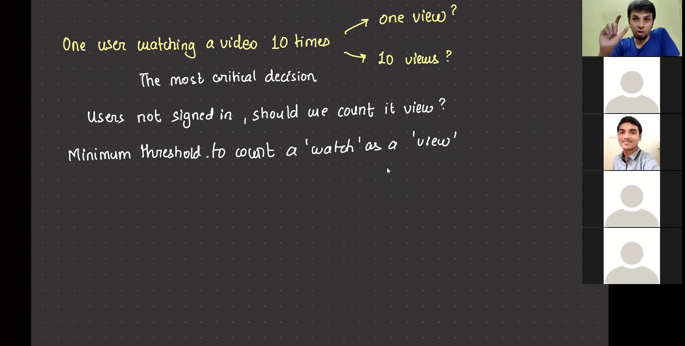
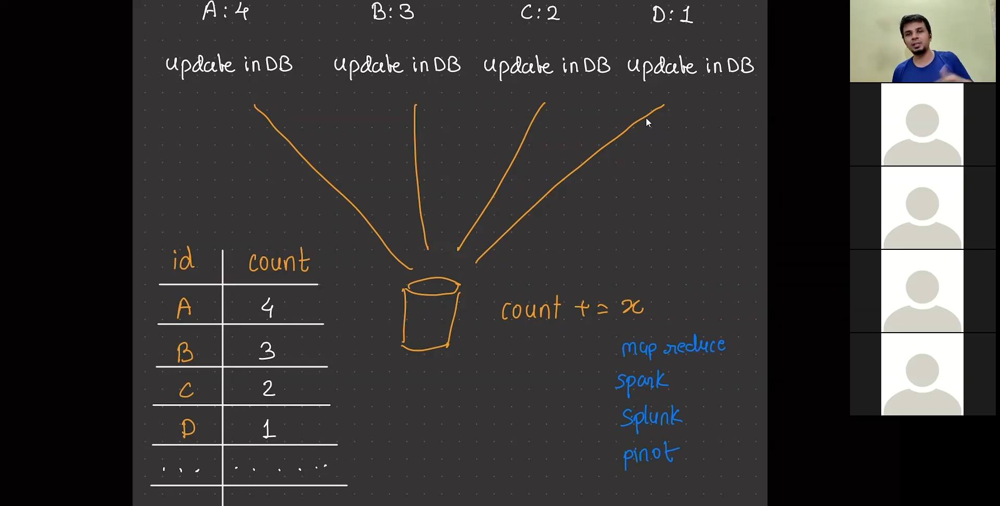
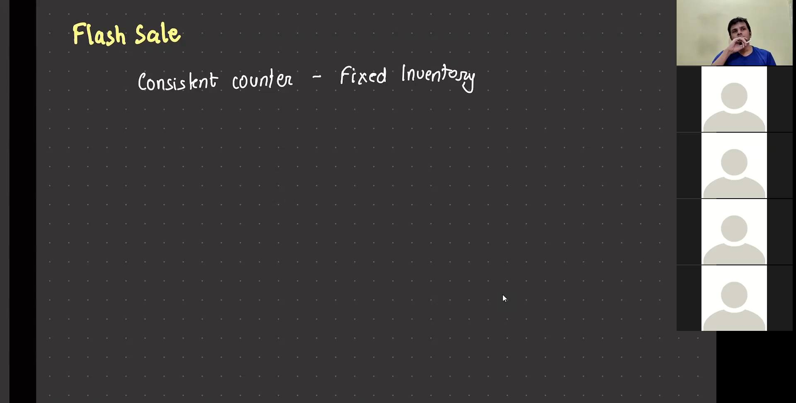
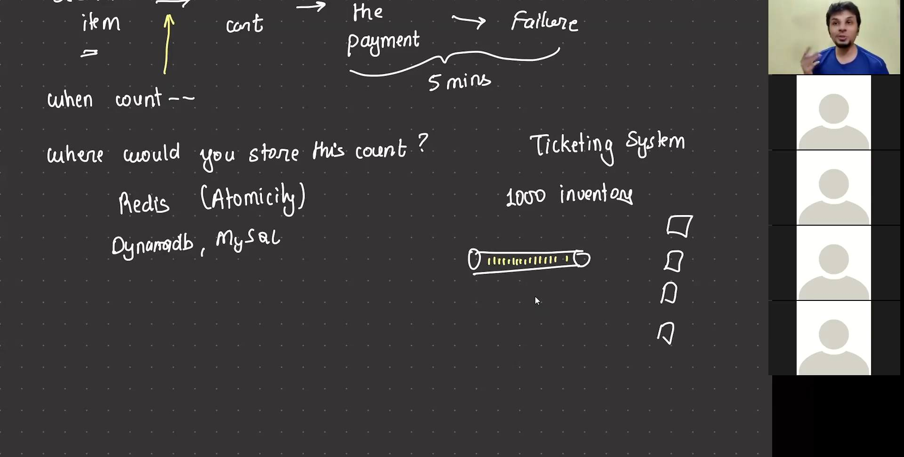
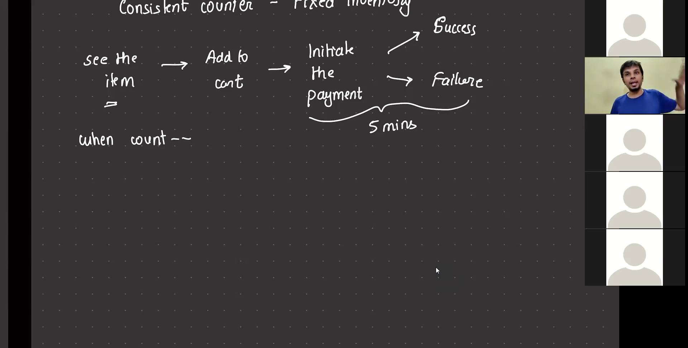

# P14 课程文档：事件驱动观看计数与闪购库存锁定（可复现设计稿）

> 复现边界说明：P014 是纯讲解/系统设计讨论课，逐字稿覆盖 56:51–116:41，没有给出可运行代码、依赖版本、环境变量或启动命令。因此本文的“复现”指按讲师推导重建两条设计链路：**视频观看计数链路**与**闪购加购库存锁定链路**。第 4 章按纯讲解课要求落成设计决策表、组件职责表、接口/数据模型草案、容量估算表，并补一段明确标注的示意伪代码；不把讲师没讲过的实现冒充成课程代码。
>
> 截图数量说明：清单只有 5 个可用帧，而硬性要求 ≥6 张；为不编造清单外帧，第 6 张重复引用 p014 [96:57] 作为“锁 TTL 与超时释放”的核对图，未使用清单外路径。

## 1. 这一节做什么

这一节做两件事：

1. **视频观看计数**：前端在播放过程中周期性上报观看事件，后端 API 只做“接收并确认”，把事件写入事件总线；事件按 `videoId` 分区，消费者在内存中按时间窗口聚合，再批量把 `count += x` 写回数据库。核心目的是用分布式分区、内存聚合、批量写来解决高吞吐计数。
2. **闪购库存锁定**：固定库存下，用户在“加入购物车”时就必须原子递减库存并拿到一个限时锁；支付超时后释放库存。讲师反复强调不是“支付成功后再扣库存”，因为那会给大量用户虚假希望，也会造成退款麻烦。替代方案是用消息队列预填充与库存等量的消息，谁原子领取到消息谁获得购买资格。

读者照着本文应能画出两条链路、写出接口与数据模型草案、做出一张容量估算表，并能用伪代码复现“加购扣库存 + 限时锁 + 超时回补”的关键判断。真正的代码、框架版本、部署脚本课里没讲。

## 2. 讲师原话

下面是本段讨论中支撑复现的关键原话，按时间标注；引用保留英文原句，后文再用中文解释。

> “One person viewing a video 10 times, does it mean one view or 10 views? It should be one view... Based on time granularity, how spaced across those views are... all the views should be just count one view.” —— p014 [57:21]

讲师先抛出观看去重问题：同一个人看 10 次不一定算 10 次，取决于时间粒度和业务定义；这也解释了为什么后面要“简化”。

> “every 10 seconds, your client fires the event... 10 seconds elapsed... 20 seconds elapsed... 50 seconds elapsed... compute... the average time that people are watching the video.” —— p014 [62:00]



这里给出观看计数的前端事件模型：客户端周期性上报，后端用这些事件计算平均观看时长；观看时长又是推荐和变现的重要指标。

> “We'll keep our things simple... If someone watched the video... for one minute, this event would be triggered just once... no matter if user was it hundred times you would register it hundred views.” —— p014 [63:29]

课程为了讲分布式计算，把业务简化成“看满一分钟触发一次观看事件”；不展开防刷、去重、Bot 等复杂规则。

> “API once it gets triggered... publish the message in the event bus and it would return... immediately acknowledge... it just stores it in Kafka... partition it by the entity ID... in YouTube's case, it would be partitioned by video ID.” —— p014 [66:14] / [67:13]

API 服务器不直接做重计算，而是发布事件并快速返回；事件总线按视频 ID 分区，为后续并行消费做基础。

> “consumers running whose job would be to... read everything that is coming in... aggregate in memory for some time and then write it to this database... batch write it... count plus equal to x.” —— p014 [67:42] / [69:38] / [73:26]

消费者在内存里聚合一段时间，再批量写数据库，写入形式是 `count += x`，而不是每条事件立刻打一次数据库。



讲师在这一段提到 Spark、Splunk、Apache Pino（逐字稿如此，可能指 Pinot，但课里未展开）、Monte Carlo、Segment、Snowflake、Databricks 等工具/公司，说明这类事件聚合系统在业界很常见。本文只按逐字稿保留名字，不替讲师扩展未讲内容。

> “When we add to cart, it will be a lock and the lock would be held for next time, 5-10 minutes to the payment. If the user is not able to... the item would be unlocked and back to the flash sale.” —— p014 [89:19]

闪购的第一个关键决策：**加购时加锁**，锁持有到支付完成；超时释放。

> “You would do a count minus minus when you add to cart... if a million people are trying to buy 1000 inventory... if you add it to million people's cart... you would be giving a false hope to a lot of users.” —— p014 [90:46] / [91:14]

为什么不是支付成功后再扣：百万用户抢 1000 库存时，让大量用户加购成功再在支付时失败，是在制造虚假希望；应该在加购入口就过滤掉绝大多数失败请求。



> “We need atomicity... any database that would give you atomicity would do the job... Redis... DynamoDB... MySQL... Postgres... it should give high write throughput at atomicity guarantee.” —— p014 [100:54] / [101:23] / [103:45]

讲师强调选 Redis 不是因为“内存”这个标签，而是因为需要**原子递减**；任何提供原子递减且高写吞吐的存储都可以。持久化更好，但核心属性是原子性。

> “What if I add 1000 messages in my SQS queue... SQS gives atomic reads exactly once delivery... whoever gets the message can proceed... only 1000 will succeed because only there are only 1000 messages.” —— p014 [108:09] / [109:05]

替代实现：库存 1000 就预填充 1000 条队列消息；谁能原子领取到消息，谁获得购买资格。讲师把它类比为线下售票窗口发实体票。



> “Now that we have the lock... we'll have a timer... let's say of 10 minutes... if 10 minutes the payment is not done then it has to be released... Redis TTL... callback... or Airflow DAG... or repeat check.” —— p014 [113:22] / [114:48] / [116:13]

锁必须有 TTL 和释放机制。讲师说 Redis 是否给回调他不确定，自己用过 Airflow DAG 模拟这类工作流；如果没有回调，就做重复检查/后续检查。

## 3. 从零复现

这一章按“需求 → 约束 → 估算 → 方案 → 取舍”复现讲师的推导，不按页号流水账。

### 3.1 链路 A：视频观看计数

**需求。** 前端在视频播放时周期性上报观看进度；当用户看满课程设定的阈值（课里简化为 1 分钟）时，触发一次观看计数事件。后端要能承受大量事件，不能每条事件都同步写数据库。

**约束。**
- 事件量高，API 必须快速确认，不能把聚合计算放在请求线程里。
- 计数要按视频聚合，后续要给创作者/推荐/计费使用。
- 单机内存放不下全量 `videoId -> count` 字典，必须水平分区。
- 数据库不能被高频小写打垮，要批写。
- 观看定义有业务歧义：同一用户多次观看、未登录用户、观看阈值、防刷等，课里明确说“我们保持简单”，不展开全部边缘情况。

**估算（以下数字是复现假设，不是讲师给出的容量承诺）。**
假设峰值有 100 万用户同时观看，客户端每 10 秒发一次进度事件：
- 进度事件率 = 1,000,000 / 10 = 100,000 事件/秒。
- 若消费者按 5 分钟一批聚合，则一批约 100,000 × 300 = 30,000,000 条事件。
- 若按 `videoId` 分成 4,000 个分区，平均每分区一批约 30,000,000 / 4,000 = 7,500 条事件；单消费者内存只需维护该分区内视频 ID 的计数，而不是全站字典。
- 观看计数事件被简化为“看满 1 分钟发一次”，它的量级低于 10 秒进度事件；但设计上仍走同一套事件总线。

**方案。**
1. 前端负责判断是否看满 1 分钟；满足后调用后端观看接口。
2. 后端 API 收到请求后，把事件发布到事件总线（课里以 Kafka 类系统举例），立即返回确认。
3. 事件按 `videoId` 分区，保证同一视频的观看事件进入同一分区。
4. 每个消费者只读一个分区，在内存哈希表中维护 `videoId -> count`。
5. 消费者按时间窗口（课里说“for some time”“five minute batch”）把增量批量写数据库，写入语义是 `count += x`。
6. 分区增多时增加消费者/机器，横向扩展。


这张图放在这里，是为了对应“聚合框架/数据工程工具”的讨论：课里说这类系统可以用 Spark、Splunk、Pino 等框架做，但本段没有展开具体 API 和配置。复现时你要把“事件总线 + 分区消费者 + 内存聚合 + 批写”作为最小骨架，工具选择是第二层。

### 3.2 链路 B：闪购库存锁定

**需求。** 固定库存（例如 1000 件）在短时间内面对海量用户（课里举例 100 万）时，要做到：
- 不超卖；
- 不让大量用户走到支付后才发现没货；
- 加购成功后给用户一个限时锁，超时释放；
- 支付失败或超时能把库存加回去；
- 高并发下扣减操作必须是原子的。

**约束。**
- 库存是固定值，所有请求竞争同一个计数器。
- 支付流程耗时且不可控：跳支付网关、等 OTP、填卡信息，可能几分钟。
- 加购入口流量可能是突发峰值。
- 锁需要 TTL；释放机制要可靠。
- 如果先让用户加购成功、支付时再失败，用户体验差且退款成本高。

**估算（复现假设）。**
- 库存 = 1,000；突发请求 = 1,000,000。
- 只有 1,000 个请求能成功递减库存；约 999,000 个请求应立即失败。
- 若每个失败请求都打数据库，数据库会被打垮；所以扣减要走内存型原子存储或队列原子领取。
- 锁数量最多 1,000 个；锁 TTL 取 5–10 分钟（课里两个数字都出现，最后偏向 10 分钟）。
- 回补量最多 1,000 次，远小于请求量；回补应由超时任务/延迟任务处理，而不是靠用户手动重试。

**方案 A：计数器 + 锁（讲师主要讨论的方案）。**
1. 加购 API 先对库存 key 做原子递减。
2. 递减结果小于 0，说明无库存，立即返回失败，不进入后续流程。
3. 递减成功，设置锁：`itemId -> userId`，TTL 5–10 分钟。
4. 用户在 TTL 内完成支付，锁对应的库存归该用户。
5. 超时未支付，释放锁并把库存加回。
6. 支付失败也走回补。

**方案 B：队列消息即库存（讲师在后半段提出的替代方案）。**
1. 库存 1,000，就预先向 SQS 类队列放入 1,000 条消息。
2. 每个加购请求尝试原子领取一条消息。
3. 领到消息的人获得购买资格；没领到的人立即返回“无库存”。
4. 课里把 SQS 的“原子读、exactly once delivery”作为领取依据；实际使用前要核对队列类型和可见性超时，课里没展开。

**关键取舍。**
- **加购扣减 vs 支付成功扣减**：讲师明确选加购扣减。支付成功后再扣会导致大量用户已经进入支付流程却最终失败，制造虚假希望，还要退款。
- **Redis 计数器 vs 持久化数据库**：讲师说核心不是 Redis 品牌，而是原子性；DynamoDB、MySQL、Postgres 只要能提供原子递减和高写吞吐都可以。Redis 是内存型、常见的做法，但要注意持久化配置。
- **计数器 vs 队列消息**：计数器轻，适合只关心数量；队列消息更接近“发票”，谁领到谁有资格。若还要绑定座位号、设备 ARN 等元信息，队列方案需要额外处理；课里提到电影票座位号场景时要能定位到具体座位。
- **TTL 回调 vs 定时任务/工作流**：课里说 Redis 是否给回调他不确定；可以用 Airflow DAG 模拟工作流，也可以做重复检查。复现时不要把某一种释放机制当成唯一答案。



这张图对应“加购后锁一段时间、超时释放”的核心决策。注意课里 5 分钟和 10 分钟都出现过：讨论支付窗口时提到 5 分钟，后文锁 TTL 又说 10 分钟；复现时把它做成可配置参数，不要写死。

## 4. 完整代码

本课是纯讲解课，逐字稿没有代码。以下不是讲师代码，而是把讲师方案落成可复现产物：设计决策表、组件职责表、接口/数据模型草案、容量估算表。最后附一段明确标注的示意伪代码，帮助理解“加购扣库存 + 限时锁 + 超时回补”的判断顺序。

### 4.1 设计决策表

| 决策点 | 讲师倾向 | 理由 | 不这样会怎样 | 课里是否明确 |
|---|---|---|---|---|
| 观看事件何时上报 | 前端每 10 秒上报进度；简化版看满 1 分钟触发一次观看 | 能算平均观看时长；简化分布式计数 | 无法算观看时长；或事件量不可控 | 明确 |
| 观看 API 是否同步写库 | 否，发布事件到事件总线并立即确认 | 高吞吐、解耦 | API 被数据库写拖垮 | 明确 |
| 事件如何分区 | 按 `videoId` 分区 | 同一视频的观看事件进入同一消费者，便于聚合 | 同一视频计数分散，聚合复杂 | 明确 |
| 消费者如何写库 | 内存聚合一段时间，批量 `count += x` | 避免高频小写 | 数据库写放大 | 明确 |
| 闪购何时扣库存 | 加购时原子递减 | 过滤绝大多数失败请求，减少虚假希望 | 大量用户支付时失败、退款麻烦 | 明确 |
| 库存存储选型 | 任何提供原子递减且高写吞吐的存储；Redis 是常见选择 | 核心属性是原子性 | 普通读改写会超卖 | 明确 |
| 锁的形态 | `itemId -> userId`，带 TTL 5–10 分钟 | 谁持有谁有资格；超时释放 | 库存被永久占住 | 明确 |
| 超时释放实现 | Redis TTL/callback、Airflow DAG、重复检查都可讨论 | 没有唯一答案 | 只依赖一种机制可能不可靠 | 讲师说多种方式 |
| 队列替代方案 | 预填充与库存等量消息，原子领取 | 队列消息本身就是“票” | 需要额外处理座位号等元信息 | 明确 |

### 4.2 组件职责表

| 组件 | 职责 | 输入/输出 | 课里是否明确 |
|---|---|---|---|
| 前端播放器 | 每 10 秒上报进度；看满阈值后触发观看事件 | 上报 `videoId`、用户标识、观看时长 | 明确 |
| 观看 API | 接收事件，发布到事件总线，立即确认 | 入：观看事件；出：ack | 明确 |
| 事件总线（Kafka 类） | 按 `videoId` 分区持久化事件 | 入：观看事件；出：分区事件流 | 明确 |
| 聚合消费者 | 读一个分区，内存哈希表累计，批量写库 | 入：分区事件；出：`count += x` | 明确 |
| 计数数据库 | 保存视频观看计数 | 入：批量增量；出：查询计数 | 明确 |
| 闪购 API | 加购时原子递减库存，成功则加锁 | 入：`userId`、`itemId`；出：成功/无库存 | 明确 |
| 原子存储（Redis 类） | 保存库存计数和锁，提供原子递减/TTL | 入：递减、加锁；出：剩余量、锁状态 | 明确 |
| 队列（SQS 类，替代方案） | 预填充库存等量消息，提供原子领取 | 入：消息；出：领取结果 | 明确 |
| 超时释放任务 | 扫描/接收过期锁，回补库存 | 入：过期锁；出：`count++` | 讲师说有多种实现 |

### 4.3 接口/数据模型草案

以下路径、字段名、key 命名均为复现草案，课里没有给具体 API 规范和表结构。

| 接口 | 方法 | 请求草案 | 响应草案 | 说明 |
|---|---|---|---|---|
| `/api/video/view` | POST | `{ userId, videoId, watchedSeconds }` | `{ accepted: true }` | API 只发布事件并 ack，不等待聚合 |
| `/api/video/progress` | POST | `{ userId, videoId, elapsedSeconds }` | `{ accepted: true }` | 课里说每 10 秒上报，可用于平均观看时长 |
| `/api/flash-sale/add-to-cart` | POST | `{ userId, itemId }` | `{ ok: true, lockTtlSeconds }` 或 `{ ok: false, reason: "缺货" }` | 加购时原子递减并加锁 |
| `/api/flash-sale/pay-callback` | POST | `{ userId, itemId, paymentResult }` | `{ ok: true }` | 支付结果处理；课里没给具体字段 |
| `/api/flash-sale/release-expired` | POST/内部任务 | `{ itemId, userId }` | `{ released: true }` | 超时释放；也可由定时任务触发 |

数据模型草案：

| 数据 | key/表草案 | 值/字段 | 说明 |
|---|---|---|---|
| 视频计数 | `video:{videoId}:view_count` 或数据库计数表 | 整数计数 | 消费者批量 `count += x` |
| 库存计数 | `flash:item:{itemId}:stock` | 整数 | 加购时原子递减 |
| 库存锁 | `flash:item:{itemId}:owner` | `userId`，TTL 600 秒 | 课里说锁 TTL 5–10 分钟；命名示意 |
| 队列消息 | SQS 队列 | 每条消息代表一个购买资格 | 预填充数量等于库存 |

### 4.4 容量估算表

| 项目 | 假设 | 算式 | 结果 | 备注 |
|---|---|---|---|---|
| 观看进度事件率 | 100 万并发观看，10 秒一次 | 1,000,000 / 10 | 100,000 事件/秒 | 复现假设，非讲师承诺 |
| 5 分钟批事件量 | 同上 | 100,000 × 300 | 30,000,000 条/批 | 用于估算消费者内存和批写 |
| 分区后单分区批事件量 | 4,000 分区 | 30,000,000 / 4,000 | 7,500 条/批 | 说明分区降低单机字典压力 |
| 闪购请求量 | 100 万请求抢 1000 库存 | 1,000,000 总请求 | 1,000 成功，约 999,000 失败 | 课里举例 |
| 成功扣减次数 | 库存 1000 | 最多 1,000 | 1,000 次 | 失败请求应快速失败 |
| 锁数量 | 库存 1000 | 最多 1,000 个锁 | 1,000 个 | 锁 TTL 5–10 分钟 |
| 回补次数 | 超时/支付失败 | 最多 1,000 次 | ≤1,000 次 | 远小于请求量 |

### 4.5 示意伪代码（课里没有代码，以下为示意）

文件组织建议（不是讲师给的目录，只是复现时便于对照）：

```text
p14-flash-sale/
  design.md
  flash-sale-add-to-cart.pseudo.js
```

`flash-sale-add-to-cart.pseudo.js` 完整示意内容：

```js
// 课里没有代码，以下为示意伪代码，不可直接运行。
// key 命名、函数签名均为示意，课里未给具体键名和 API 规范。
// 真实实现要把“递减 + 判断 + 回补/加锁”做成原子操作；
// 课里只强调需要原子性，没有展开 Lua/事务写法。

async function addToCartWithCounter({ userId, itemId, redis, lockTtlSeconds }) {
  const stockKey = `flash:item:${itemId}:stock`;
  const lockKey = `flash:item:${itemId}:owner`;

  // 1. 先原子递减库存，目标是过滤掉绝大多数无库存请求
  const remaining = await redis.decr(stockKey);

  // 2. 小于 0 说明没抢到，立即回补并快速失败
  if (remaining < 0) {
    await redis.incr(stockKey);
    return { ok: false, reason: "out_of_inventory" };
  }

  // 3. 尝试设置锁：itemId 的持有者是 userId，TTL 到期自动释放
  const locked = await redis.set(lockKey, userId, {
    NX: true,
    EX: lockTtlSeconds
  });

  // 4. 如果锁冲突，说明该商品已有资格持有者，回补库存
  if (!locked) {
    await redis.incr(stockKey);
    return { ok: false, reason: "lock_conflict" };
  }

  // 5. 加购成功，用户获得 lockTtlSeconds 的支付窗口
  return { ok: true, lockKey, lockTtlSeconds };
}

async function releaseExpiredLock({ userId, itemId, redis }) {
  const stockKey = `flash:item:${itemId}:stock`;
  const lockKey = `flash:item:${itemId}:owner`;

  // 课里说超时释放可用 TTL 回调、Airflow DAG 或重复检查；
  // 这里是“重复检查/到期任务”的示意。
  const owner = await redis.get(lockKey);
  if (owner !== userId) {
    return { released: false, reason: "lock_not_owned" };
  }

  await redis.del(lockKey);
  await redis.incr(stockKey);
  return { released: true };
}

async function claimTicketFromQueue({ queue }) {
  // 替代方案示意：库存 1000 就预填充 1000 条消息；
  // 谁能原子领取到消息，谁获得购买资格。
  const message = await queue.receiveOne();
  if (!message) {
    return { ok: false, reason: "out_of_inventory" };
  }
  return { ok: true, ticket: message };
}
```

> 再次强调：上面是示意伪代码，不是讲师给出的可运行实现。课里没有依赖版本、环境变量、启动命令。若你要把它落成真实服务，需要自己补 Redis/SQS 客户端、原子脚本、支付回调、超时任务和监控；这些在第 7 章列出。

## 5. 逐行解释

这一章逐条解释上一章的决策、估算和示意伪代码，重点回答“为什么这样定、不这样会怎样”。

1. **观看 API 只发布事件并立即确认**。因为事件量高，API 线程不能等聚合结果。课里说 API “immediately acknowledge”，把重计算下推给消费者。若同步写库，数据库会被高频小写打垮。  
   在 JS/Node 里对应：HTTP handler 里只 `await producer.send(...)` 后返回 202/200；不要在这个 handler 里跑全量计数聚合。Node 单进程内存变量不能当跨实例计数器，必须落 Redis/数据库等共享存储。

2. **按 `videoId` 分区**。同一个视频的观看事件必须进入同一个消费者，消费者才能在本地哈希表里累计该视频的计数。若随机分区，同一视频的计数会散到多个消费者，最后还要二次合并，复杂且容易重复。  
   在 JS/Node 里对应：消息 key 用 `videoId`，不要用随机数；消费者进程数不要超过分区数，否则空闲消费者拿不到分区。

3. **消费者内存聚合 5 分钟再批写**。课里说 “aggregate in memory for some time... batch write... count plus equal to x”。这是用少量内存换数据库写吞吐。若每条事件写一次数据库，写放大不可接受。  
   Node 里可以用 `Map` 做窗口累计，定时 `flush`；但进程重启会丢窗口内未写数据，课里没讲崩溃恢复和 exactly-once，需要你在工程上补。

4. **估算 100,000 事件/秒、30,000,000 条/批**。这是复现假设，不是讲师给的数。它说明为什么必须分区：单机不可能维护全站 `videoId -> count` 字典，4,000 分区后单分区批事件约 7,500 条，内存压力才可控。  
   如果分区太少，单消费者内存和批写都会成为瓶颈；如果分区太多，小文件/小批写和消费者管理成本上升。课里只说“可以加分区、加消费者”，没有给调参公式。

5. **闪购在加购时扣库存，而不是支付成功后扣**。课里用“百万人抢 1000 库存”举例：如果让百万人都加购成功，再在支付时告诉大多数人没货，就是给大量用户虚假希望，还会产生退款。加购时扣减等于在入口处过滤垃圾请求。  
   JS/Node 里对应：加购 API 的第一行就做原子递减，失败直接返回；不要等前端跳到支付页再检查。

6. **`remaining < 0` 立即回补并快速失败**。示意伪代码里先 `decr` 再判断，若小于 0 用 `incr` 回补。真实高并发下，“先减后补”本身可能产生竞争窗口；课里只强调需要原子性，没有讲 Lua/事务。工程实现应把“判断 >=0 才递减”做成原子脚本或数据库条件更新。  
   这也是第 7 章会撞上的问题：示意代码不能直接当生产代码。

7. **锁的 key 是 `itemId`，value 是 `userId`，带 TTL**。课里说锁要回答“谁持有这个 item”，BookMyShow 场景则是“谁持有这个座位”。TTL 给用户 5–10 分钟支付窗口，超时释放，避免库存被永久占住。  
   JS/Node 里对应：`set NX EX` 是常见的 Redis 锁写法；但 Node 进程内 `setTimeout` 不可靠，进程重启就丢，必须用 Redis TTL + 后台任务/延迟队列做释放。

8. **支付失败或超时回补库存**。课里说“If the payment fails, you can always plus plus the count”。回补必须幂等：同一笔超时不能加两次，否则库存会多出来。  
   JS/Node 里对应：回补前先核对锁是否仍属于该用户；用唯一事件 ID 做幂等键；课里没讲幂等键设计。

9. **队列替代方案：预填充 1000 条消息**。课里说库存 1000 就放 1000 条消息，谁领到谁有资格。它的好处是把“库存数量”变成“可原子领取的票据”，和线下发实体票很像。  
   代价是：每卖一次要预填充/维护消息；如果还要绑定座位号，消息里要带座位信息；消息被领走后超时未支付，要能回到队列。课里提到这些扩展，但没有给完整实现。

10. **为什么讲师说“任何给原子性的数据库都行”**。因为闪购的核心是并发递减不能超卖，不是非 Redis 不可。DynamoDB、MySQL、Postgres 只要能做条件更新/原子操作，也可以。Redis 的优点是内存型、高写吞吐，但要注意持久化配置；课里专门讨论了 Redis 挂掉和持久化的问题。

11. **容量估算表里的 999,000 失败请求**。这不是说每个失败请求都要打一次数据库；恰恰相反，设计目标是把失败挡在原子计数器/队列入口。若失败请求也走重逻辑，系统会被无库存请求拖垮。  
   工程上还要限流、排队、快速失败；课里没有展开限流算法。

12. **截图 p014 [96:57] 的锁 TTL 要可配置**。课里 5 分钟和 10 分钟都出现，说明这是业务参数，不是架构常量。复现时写成 `lockTtlSeconds`，不要写死；支付窗口长短会影响库存周转和用户体验。

## 6. 复现检查清单


- [ ] 能画出观看链路：前端上报 → 观看 API → 事件总线 → 按 `videoId` 分区 → 消费者内存聚合 → 批量 `count += x`。
- [ ] 能解释为什么观看 API 只 ack、不等待聚合：高吞吐、解耦、保护数据库。
- [ ] 能写出观看接口草案：`POST /api/video/view`，请求含 `userId`、`videoId`、`watchedSeconds`，响应只表示 accepted。
- [ ] 能说明“看满 1 分钟触发一次”是课程简化，不是完整防刷/去重方案。
- [ ] 能画出闪购链路：加购 API → 原子递减库存 → 成功加锁 `itemId -> userId` → TTL → 支付/超时释放。
- [ ] 能解释为什么加购时扣库存，而不是支付成功后扣：避免大量虚假希望和退款。
- [ ] 能写出闪购接口草案：`POST /api/flash-sale/add-to-cart`，成功返回锁 TTL，失败返回无库存。
- [ ] 能说明库存存储的核心要求是原子递减和高写吞吐，不是“必须 Redis”。
- [ ] 能说明锁 TTL 5–10 分钟是业务参数，复现时应可配置。
- [ ] 能给出超时释放的至少两种实现：Redis TTL + 回调/重复检查；Airflow DAG 类工作流。
- [ ] 能说明队列替代方案：预填充 1000 条消息，原子领取，只有 1000 个请求成功。
- [ ] 能指出示意伪代码里“先 DECR 再判断回补”在高并发下需要原子脚本/事务加固，不能直接生产使用。
- [ ] 能列出课里没讲、但复现必须补的工程项：限流、幂等、支付回调验签、消息可见性超时、库存对账、监控告警。

## 7. 课里没讲但你会撞上

这一章只列复现时会遇到的缺口，不把这些工具或方案安到讲师头上。

1. **观看事件的防刷与去重**。课里开头讨论“同一人看 10 次算 1 次还是 10 次”，但明确说后面保持简单。真实系统要处理未登录用户、Bot、时间窗口去重、阈值判定。课里没给规则。
2. **事件总线的 exactly-once 与消费者 offset**。课里说消费者读分区、内存聚合、批写，但没讲消费者崩溃后 offset 怎么提交、窗口内数据会不会丢、重复消费怎么幂等。工程上要补。
3. **Kafka 分区数、消费者数、批大小的调参**。课里只说“可以加分区、加消费者”，没有给容量规划公式。第 4 章估算是复现假设，不是讲师承诺。
4. **Redis 持久化配置**。课里讨论了 Redis 挂掉、持久化、AOF/序列化等方向，但没有给具体配置。复现时若把库存放 Redis，必须自己决定持久化策略和故障恢复；否则 Redis 重启可能丢计数。
5. **原子递减的真实写法**。课里强调“需要原子性”，但没给 Lua 脚本、数据库条件更新语句或事务隔离级别。示意伪代码的 `DECR` 后判断再 `INCR` 不是生产级原子扣减。
6. **锁的续期与误删**。课里说 TTL 5–10 分钟，但没讲支付流程超过 TTL 怎么办、锁被过期后又被别人拿走怎么处理、删除锁时如何避免删错。工程上要做锁归属校验和续期策略。
7. **超时释放的可靠性**。课里说 Redis callback、Airflow DAG、重复检查都可用，但没给完整工作流。真实系统要考虑任务重复执行、漏执行、补偿扫描、死信队列。
8. **SQS 的语义细节**。课里把 SQS 的“原子读、exactly once delivery”作为方案依据；实际使用前要核对队列类型、可见性超时、消息删除时机、重复投递。课里没有展开这些参数。
9. **支付回调与退款**。课里说支付失败可以 `count++`，但没讲支付网关回调验签、乱序回调、重复回调、退款状态同步。复现时要补。
10. **限流与排队**。100 万请求打加购 API 时，即使大多数会快速失败，连接数、带宽、API 线程也会先被打满。课里没讲限流、排队、熔断、降级。
11. **库存对账**。计数器、锁、支付记录、退款记录可能不一致；课里没讲离线对账和补偿任务。复现时应加每日/每小时对账。
12. **在 JS/Node 里的对应**。Node 单进程的 `Map`、`setTimeout` 不能当跨实例锁和可靠定时器；要用共享存储的原子操作和后台 worker。课里没有针对 Node 讲，这一段是给前端转 AI 应用工程师的对照，不是讲师原话。

**最小复现结论**：先把两条链路画出来，再用第 4 章的表和伪代码做一次桌面演练；重点验证三件事——观看事件是否按 `videoId` 分区并批写，闪购是否在加购时原子扣减并加 TTL 锁，超时/支付失败是否能幂等回补。课里没有可运行仓库，所以不要假装有启动命令；把缺口按第 7 章逐项补上，才算从设计稿走到可运行系统。