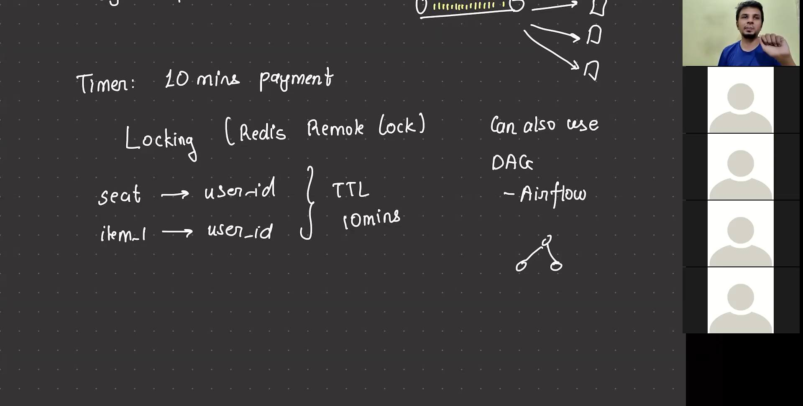
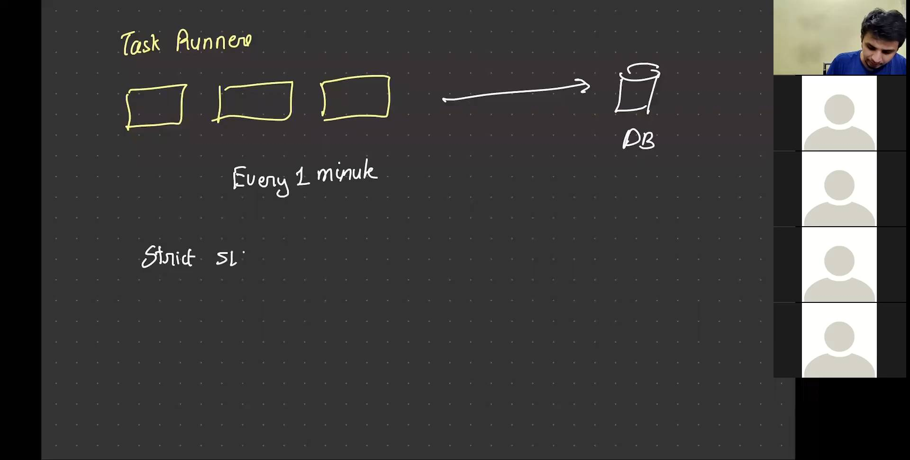
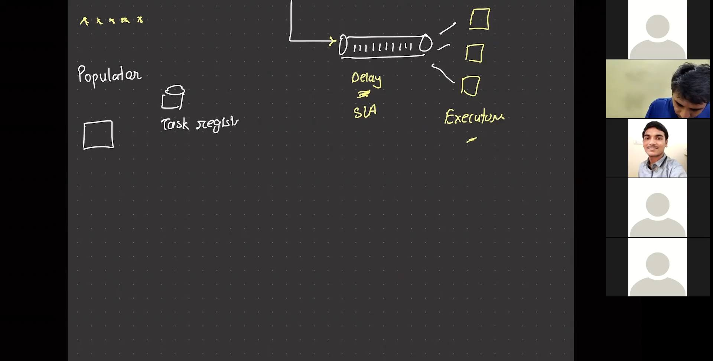
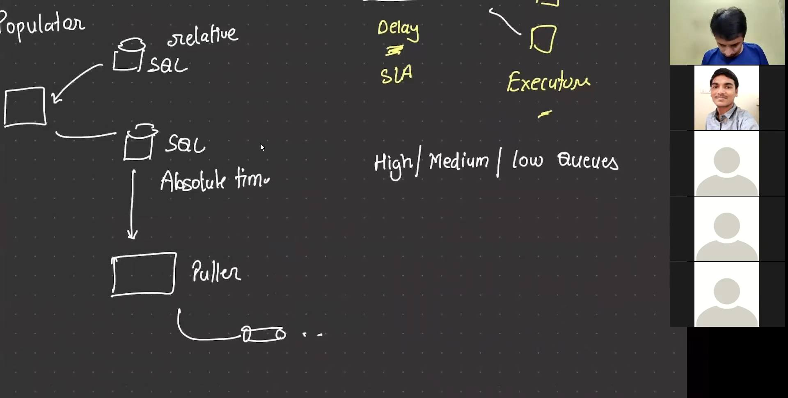
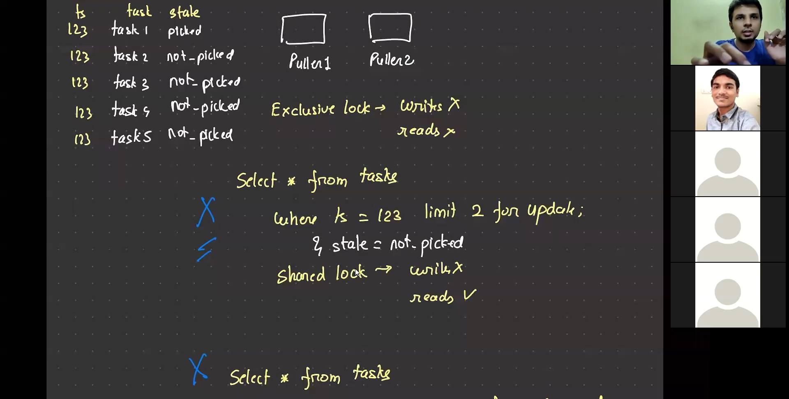

# System Design Masterclass (Arpit) P14 复现文档：Flash Sale 锁与分布式 Cron 调度器

> 说明：本课 P14 是纯系统设计讲解，逐字稿里没有可直接运行的工程代码。因此本文按「纯讲解课」写法：第 3 节复现讲师的推导过程，第 4 节把方案落成设计决策表、组件职责表、接口/数据模型草案、容量估算表和示意 SQL。凡是我补充的示意实现，都会明确标注「课里没有代码，以下为示意」。
>
> 截图清单共 5 个唯一帧；为满足「≥6 处截图引用」的格式要求，本文共引用 6 次图片，其中 `p014_9924s.jpg` 在第 2、5 节各引用一次，没有新增清单外的帧号。

## 1. 这一节做什么

P14 这一节把两个高并发系统设计问题放在一起讲：前半段是 **Flash Sale 的库存锁定、支付窗口、失败/过期释放**，后半段是 **分布式任务调度器 / 全局 Cron**。讲师不是让读者背概念，而是在白板上反复推演：什么时候用 Redis TTL，支付成功后怎么更新数据库，支付失败怎么释放，用户不支付让 key 过期后谁来补偿；任务调度器为什么要拆成 task register、task puller、task executor，为什么多台 puller 直接查同一张表会互相阻塞，最后怎么用 SQL 的 `FOR UPDATE SKIP LOCKED` 做出「消息代理」的一投一消费语义。

读者学完这一节，应该能产出一套可落地的设计草稿：Flash Sale 的 Redis key 生命周期和数据库补偿任务；分布式 Cron 的任务注册表、绝对时间表、puller 查询、executor 消费、队列拆分和扩容判断。它不是让你复制某个开源框架，而是让你能照着设计表把系统搭出来，并知道每个组件的职责和失败点。

## 2. 讲师原话（带「—— pNNN [MM:SS]」）

Flash Sale 的核心生命周期，讲师先讲支付窗口：

> “So here you have 10 minutes to make the payment. If you make the payment, even if the payment is successful, then the entry would be removed from the cache and you would update the database... If the payment fail... just remove this thing from the lock and update the count to count plus plus... if user did not make the payment and let it expire... do that otherwise i typically did it with airflow and a cron job.”
>
> —— p014 [117:08]



讲师还讲了他们早期 Flash Sale 的 hacky 做法：每个 flash sale 一个 Redis DB，用 `keys *` 找出已占用的 key，再和 master 数据库做 set difference：

> “So we used to have like for each item, so for each flash sale, we used to have just one Redis DB dedicated to it. We used to do a key star and we used to get all the keys that are there in that particular Redis database... And we used to do a set difference of it.”
>
> —— p014 [119:26]

任务调度器部分，讲师先定义目标：

> “We would want to... build a system which would act as a global crown for us, which is a distributed crown... I want to run this task at this particular time. That's it. And it should execute at that time.”
>
> —— p014 [124:06]

数据库选型上，讲师没有直接上 Cassandra，而是强调先看查询模式：

> “We need to use a back-end DB as a source of truth... Let's start with my SQL because I believe Cassandra might be overkill... the query will always be by time... you can just have one index on schedule.”
>
> —— p014 [125:02]

任务执行器最初的设计是固定间隔轮询：

> “As at every fixed interval, one minute or five minutes, it will do a read on this table and get all the tasks that needs to be run... And then once we have that list, it will trigger them on individuals... and then once this is triggered they'll mark as executed.”
>
> —— p014 [126:28]

但讲师马上指出问题：如果 task runner 既拉任务又执行任务，一个长任务会拖累同一时刻的其他任务：

> “if my task learner is not only pulling the task from the database, but also executing it, other tasks which are queued up to be executed at the same time might be starving.”
>
> —— p014 [131:16]



于是拆成三个角色：

> “task register... task puller... task executor... task puller has put it into this and now from this task puller queue, I have my task executors.”
>
> —— p014 [132:12]

Cron 表达式怎么处理？讲师给出 populator 方案：

> “you need to have a machine, which is a populator. So the job of the populator would be to go through all the crown syntaxes... make the corresponding entries in the SQL table... from a generic looking syntax of a repeatable task, we will create or we will basically span it out into those many entries into my database for each of the corresponding time interval.”
>
> —— p014 [140:51]



扩容部分，讲师用「一分钟内一百万任务」说明单 puller 会成瓶颈：

> “Let's say you have 1 million entries in your table for the time that needs to be executed the next minute... if puller is just one machine that would become the bottle like because it cannot guarantee you that SLA.”
>
> —— p014 [153:14]



最终解法落在 SQL 锁语义：

> “exclusive lock with skip lock rows... if these rows are locked, skip them and just continue to search in the database for other rows that match this where constraint... this is exactly what a message broker is. Exactly one's delivery.”
>
> —— p014 [162:39] / [166:26]



## 3. 从零复现：按讲师推导步骤重做一遍

### 3.1 需求：Flash Sale 要保证什么

Flash Sale 的需求可以拆成四个状态：

1. 用户下单，系统从可售库存中占住一个名额；
2. 用户有 10 分钟支付窗口；
3. 支付成功：把 Redis 里的占位 entry 删除，同时更新数据库库存/订单；
4. 支付失败：释放占位，库存计数加回；
5. 用户不支付：10 分钟后 Redis key 过期，系统要有一个异步补偿任务把过期的占位识别出来并释放。

讲师原话里最关键的是「10 minutes」和「remove this thing from the lock and update the count」。也就是说 Redis 在这里承担的是短生命周期的占位锁，数据库是最终事实来源。用户在 10 分钟内支付成功，Redis 占位删除、数据库更新；支付失败，删除占位并 `count++`；不支付，让 TTL 过期，再由 cron 或 Airflow 做补偿。

### 3.2 约束：为什么不能只靠 TTL

讲师明确说过 TTL 不是 100% 精确：

> “one limitation of this TTL thing is it's not 100% sure sort the time at which you want TTL to be done in Redis.”
>
> —— p014 [120:54]

所以方案必须是「Redis TTL 负责正常过期 + 异步任务负责兜底」。课里提到的补偿方式有两种：Redis 过期回调，或者 Airflow / cron job 定期扫描。讲师还讲过他们早期生产做法：每个 flash sale 一个 Redis DB，用 `keys *` 把已占用的 key 拉出来，再和 master 数据库里的 item ID 做 set difference，找出哪些还可售、哪些已被占。这个做法讲师自己称为 hacky，但在他描述的 50,000 用户峰值、只跑两个月的场景里能工作：

> “We supported about with 50,000 user trying to simultaneously buy a certain course is what the peak that we saw.”
>
> —— p014 [118:30]

### 3.3 估算：先算下限，不要假装精确

课里没有给 Flash Sale 的精确 QPS，只给了 50,000 同时购买和 10 分钟支付窗口。按最粗的下限估算：

- 支付窗口 = 10 分钟 = 600 秒；
- 如果 50,000 个占位在 600 秒内均匀发生，平均占位速率 ≈ 50,000 / 600 ≈ 83.3 次/秒；
- 但 Flash Sale 是突发流量，不能用平均值当容量结论，必须用峰值压测。

任务调度器部分，讲师给了更强的假设：1,000,000 个任务在下一分钟到期。按这个假设：

- 到期任务速率 = 1,000,000 / 60 ≈ 16,666.7 任务/秒；
- 如果 puller 每批 `LIMIT 100`，则批次数 ≈ 166.7 批/秒；
- 单台 puller 能否做到，取决于一次「查询 + 更新状态 + 入队」的耗时，课里没有给这个耗时，所以不能凭公式直接定机器数，必须测端到端延迟。

讲师反复强调的关键指标不是「平均处理量」，而是任务从进入队列到被 executor 取走的延迟：

> “how long it took for the task to be first put into this... how long it took to be dequeued from it? This is a very key metric.”
>
> —— p014 [136:16]

### 3.4 方案：Flash Sale 的复现步骤

按讲师思路，Flash Sale 可以按下面步骤复现：

1. 准备 master 数据：所有可售 item ID、每个 item 的初始库存。
2. 为每个 flash sale 分配一个 Redis DB 或至少一个独立 namespace；课里讲师说他们当时是「每个 flash sale 一个 Redis DB」。
3. 用户下单时，在 Redis 中写入占位 key，并设置 10 分钟 TTL；同时在数据库侧保留订单/库存事实。
4. 支付成功：删除 Redis 占位 key，更新数据库订单状态和库存。
5. 支付失败：删除 Redis 占位 key，把库存计数加回。
6. 用户不支付：等 TTL 过期；由 Redis 过期回调或 cron/Airflow 扫描补偿。
7. 补偿任务：读取该 flash sale 的 Redis DB，拿到已占用 key 集合，与 master 可售 item 集合做 set difference，找出已过期/可释放的占位并释放。
8. 监控：占位数量、支付成功率、过期未释放数量、补偿任务延迟。

这里要注意：讲师讲的 `keys *` 是生产中的 hacky 方案。第 7 节会写「课里没讲但你会撞上」的替代方案和风险。

### 3.5 方案：分布式 Cron 的复现步骤

讲师把任务调度器拆成四个逻辑角色：task register、task puller、task executor、populator。复现顺序如下：

1. **Task register**：提供 API，接收一次性任务或重复任务。重复任务保存 cron 表达式，不直接保存无限个未来时间点。
2. **SQL 作为 source of truth**：任务注册表存规则；绝对执行时间表存「这个任务在某个具体时刻要跑」。讲师明确说查询模式是按时间查，所以给 `scheduled_at` / `ts` 建索引。
3. **Populator**：扫描重复任务，把 cron 表达式展开成未来一段时间的绝对时间记录。讲师说可以每天跑一次，也可以执行完一个再补下一个；AWS 的 cron 调度会展示 next 10 invocations，他做的系统也类似。
4. **Task puller**：固定间隔轮询绝对时间表，找出 `scheduled_at <= now` 且未被 picked 的任务。关键 SQL 语义是 `FOR UPDATE SKIP LOCKED`，让多个 puller 不互相等待，也不会读到同一批行。
5. **更新状态**：puller 在同一个 SQL 事务里把取到的任务标记为 picked，防止下一个 puller 重复取。
6. **入队**：puller 把任务投递到 SQS 或类似队列；executor 从队列消费。
7. **Task executor**：executor 是独立进程，持续 poll 队列，执行任务。任务可能是发邮件、跑 Docker、触发 Lambda、执行代码判题等。讲师提到 Lambda 可以由 SQS 触发，也提到容器化环境和 Docker。
8. **SLA 监控**：记录任务进入队列时间和被 executor 取走时间，计算延迟；延迟决定扩容。

### 3.6 取舍：为什么最后是 `FOR UPDATE SKIP LOCKED`

讲师在课堂上比较了三种锁：

- **Exclusive lock**：`FOR UPDATE`。第一个 puller 锁住前两行，第二个 puller 只能等，吞吐被串行化。
- **Shared lock**：`FOR SHARE`。读可以并发，但两个 puller 会读到同一批任务，产生重复投递。
- **No wait**：不等锁，直接失败/退出事务，容易丢任务。
- **Skip locked**：`FOR UPDATE SKIP LOCKED`。第一个 puller 锁住前两行，第二个 puller 跳过已锁行，继续找后面的行。既保持独占读取，又避免互相等待。

讲师把它总结成「在 SQL 上实现消息代理」：

> “So if you see, this is exactly what a message broker is. Exactly one's delivery.”
>
> —— p014 [166:26]

在 JS/Node 里对应什么：这不是 JS 的 `Promise` 锁，也不是 `async/await` 能解决的锁。它必须落到数据库事务和原生 SQL。Node 服务里即使用 ORM，也要确认 ORM 是否支持 `FOR UPDATE SKIP LOCKED`；普通 `find()` 不会自动带这种行锁。事务提交前不要做长时间网络调用，否则锁持有时间会被拉长。

## 4. 完整代码

> **课里没有代码，以下为示意。** 下面不是讲师逐字稿里的原始工程，而是把讲师的设计落成可复现的设计资产。字段名、接口名、表名都是示意；实际项目请按你的命名调整。MySQL 版本课里没讲，使用 `SKIP LOCKED` 前请确认你的数据库版本支持该语法。

### 4.1 设计决策表

| 决策点 | 讲师方案 | 为什么这样定 | 不这样会怎样 |
|---|---|---|---|
| Flash Sale 占位 | Redis key + 10 分钟 TTL | 短生命周期、快速失败、天然过期 | 只靠数据库行锁，长事务会拖垮连接池 |
| 支付成功 | 删除 Redis entry，更新数据库 | Redis 释放占位，数据库保留事实 | 只删 Redis 不更新数据库，库存对不上 |
| 支付失败 | 删除 Redis entry，`count++` | 立即释放可售名额 | 用户失败后名额仍被占，少卖 |
| 用户不支付 | TTL 过期 + cron/Airflow 补偿 | TTL 不精确，需要兜底 | 过期 key 残留，库存永久少卖 |
| 补偿扫描 | 每个 flash sale 一个 Redis DB，`keys *` + set difference | 讲师早期生产 hack，简单可跑 | 大 key 空间下 `keys *` 可能阻塞，见第 7 节 |
| 任务事实源 | MySQL，按时间索引 | 查询模式是按时间找到期任务 | 用不匹配的 DB，查询和索引复杂 |
| 重复任务 | populator 展开成绝对时间 | 调度器只查绝对时间，逻辑简单 | 每次 pull 都解析 cron，复杂且慢 |
| 拉取任务 | 多 puller + `FOR UPDATE SKIP LOCKED` | 独占读取且不互相等待 | `FOR UPDATE` 串行化；`FOR SHARE` 重复投递 |
| 执行任务 | 独立 executor 从队列消费 | 长任务不阻塞 puller | puller 既拉又跑，短任务被长任务饿死 |
| 扩容 | puller 瓶颈拆队列/分片；executor 瓶颈加队列和 worker | 先定位瓶颈再拆 | 盲目加机器，数据库锁竞争更严重 |

### 4.2 组件职责表

| 组件 | 输入 | 输出 | 关键状态 | 扩容方式 |
|---|---|---|---|---|
| Task Register API | 任务名、cron 或一次性时间、payload | 注册成功、task_id | 规则是否存在、是否启用 | 无状态，横向加实例 |
| Task Registry DB | 重复规则 | 供 populator 读取 | cron 表达式、enabled | 按租户/业务分库 |
| Populator | 重复规则 | 绝对时间记录 | 已展开到哪一天 | 多实例需避免重复展开 |
| Task Schedule DB | 绝对时间、state | 到期任务行 | `state=0/1` | 按时间或租户分片 |
| Task Puller | 到期且未 picked 的行 | 队列消息 + `state=1` | 行锁、事务 | 多 puller + `SKIP LOCKED` |
| Queue | 任务消息 | 被 executor 消费 | 可见性/重试由队列负责 | 多队列、优先级队列 |
| Task Executor | 队列消息 | 执行结果、标记完成 | 执行中、成功、失败 | 按队列绑定 worker 数量 |
| Delay Metric | 入队时间、出队时间 | p50/p95/p99 延迟 | SLA 是否达标 | 用延迟驱动扩容 |

### 4.3 接口草案（课里未命名接口，以下为示意）

| 接口 | 方法 | 请求 | 响应 | 说明 |
|---|---|---|---|---|
| `/tasks` | POST | `{ "name": "send_email", "cron": "* * * * *", "payload": {...} }` | `{ "taskId": 123 }` | 注册重复任务 |
| `/tasks/once` | POST | `{ "name": "run_once", "scheduledAt": "2025-01-01T10:05:00Z", "payload": {...} }` | `{ "scheduleId": 456 }` | 注册一次性任务 |
| `/flash-sale/orders` | POST | `{ "userId": "...", "itemId": "..." }` | `{ "orderId": "...", "expireAt": "..." }` | 示意：占位并返回 10 分钟窗口 |
| `/flash-sale/payment/callback` | POST | `{ "orderId": "...", "status": "success" }` | `{ "ok": true }` | 示意：支付成功/失败回调 |

### 4.4 数据模型草案

| 表 | 关键字段 | 用途 |
|---|---|---|
| `task_registry` | `id`, `name`, `cron_expr`, `payload`, `enabled` | 存重复任务规则 |
| `task_schedule` | `id`, `task_id`, `scheduled_at`, `state` | 存绝对执行时间和 picked 状态 |
| `flash_sale_inventory` | `item_id`, `total_count`, `sold_count` | 示意：库存事实 |
| `flash_sale_order` | `order_id`, `user_id`, `item_id`, `status`, `expire_at` | 示意：订单和支付窗口 |

### 4.5 完整示意文件：`schema.sql`

```sql
-- 课里没有代码，以下为示意。
-- 目的：复现 P14 的 task registry / absolute schedule / picked 状态设计。
-- 注意：MySQL 版本课里没讲；SKIP LOCKED 是否可用请以实际数据库为准。

CREATE TABLE task_registry (
  id BIGINT PRIMARY KEY AUTO_INCREMENT,
  name VARCHAR(255) NOT NULL,
  cron_expr VARCHAR(128) NULL,
  payload JSON NULL,
  enabled TINYINT NOT NULL DEFAULT 1,
  created_at DATETIME NOT NULL DEFAULT CURRENT_TIMESTAMP,
  updated_at DATETIME NOT NULL DEFAULT CURRENT_TIMESTAMP ON UPDATE CURRENT_TIMESTAMP
);

CREATE TABLE task_schedule (
  id BIGINT PRIMARY KEY AUTO_INCREMENT,
  task_id BIGINT NOT NULL,
  scheduled_at DATETIME NOT NULL,
  state TINYINT NOT NULL DEFAULT 0,
  created_at DATETIME NOT NULL DEFAULT CURRENT_TIMESTAMP,
  updated_at DATETIME NOT NULL DEFAULT CURRENT_TIMESTAMP ON UPDATE CURRENT_TIMESTAMP,
  INDEX idx_task_schedule_due (scheduled_at, state),
  CONSTRAINT fk_task_schedule_task
    FOREIGN KEY (task_id) REFERENCES task_registry(id)
);
```

### 4.6 Puller 的核心事务（示意 SQL）

```sql
-- 课里没有代码，以下为示意。
-- 语义：多个 puller 同时执行，不互相等待；取到行后标记 state=1。
-- 应用层需要在同一个事务内执行 SELECT 和 UPDATE。

START TRANSACTION;

SELECT id, task_id, scheduled_at
FROM task_schedule
WHERE scheduled_at <= NOW()
  AND state = 0
ORDER BY scheduled_at
LIMIT 100
FOR UPDATE SKIP LOCKED;

-- 应用层拿到上一条 SELECT 返回的 id 列表后，执行 UPDATE。
-- 下面用 :ids 表示参数化绑定，不是逐字稿里的字段名。
UPDATE task_schedule
SET state = 1
WHERE id IN (:ids);

COMMIT;
```

### 4.7 容量估算表

| 场景 | 输入 | 算式 | 结果 | 备注 |
|---|---|---|---|---|
| Flash Sale 平均占位速率 | 50,000 用户、600 秒窗口 | 50,000 / 600 | ≈83.3 次/秒 | 只是均匀分布下限，不能当峰值容量 |
| 任务到期速率 | 1,000,000 任务 / 60 秒 | 1,000,000 / 60 | ≈16,666.7 任务/秒 | 讲师课堂假设 |
| Puller 批次速率 | 每批 100 条 | 16,666.7 / 100 | ≈166.7 批/秒 | 单机能否做到取决于查询+更新+入队耗时 |
| 所需 puller 数 | 单机压测批次吞吐 = X | `ceil(166.7 / X)` | 以压测为准 | 课里没给 X，不能编造机器数 |
| 队列延迟 SLA | 入队时间 T1、出队时间 T2 | `T2 - T1` | p99 延迟 | 讲师说这是关键指标 |
| SQS 并发 worker | 讲师说接近 200 或 1000 量级 | 以实际账号配额为准 | 不是无限 fan out | 原话不确定，按实际输出为准 |

## 5. 逐行解释：每个决策为什么这样定

**第 1 步：为什么 Flash Sale 用 Redis TTL，而不是只靠数据库事务。**  
因为支付窗口是 10 分钟，如果用户下单就开数据库事务并等 10 分钟，数据库连接和行锁会被长期占用。Redis 的 TTL 把「占位」变成短生命周期对象，10 分钟后自动消失，系统再用异步任务兜底。讲师原话是「10 minutes to make the payment」，支付成功删缓存并更新数据库，失败删缓存并 `count++`。在 Node 里，这对应的是「不要用 `await sleep(10分钟)` 占着事务」，而是把过期交给 Redis 和后台任务。

**第 2 步：为什么支付成功要「删 Redis + 更新数据库」两步。**  
Redis 是占位层，数据库是事实层。只删 Redis，数据库不知道订单成功；只更新数据库，Redis 占位还在，别人以为不可买。讲师说「the entry would be removed from the cache and you would update the database」，顺序上先释放占位再更新事实，实际生产要保证幂等：同一个支付回调重复到达时，不能把库存重复加回或重复扣减。

**第 3 步：为什么支付失败要 `count++`。**  
占位时库存被扣掉或名额被占住，失败后必须把可售数量加回。讲师原话是「remove this thing from the lock and update the count to count plus plus」。这一步如果不做，失败用户会永久吃掉库存。JS/Node 里对应的是「失败回调里做补偿更新」，同样要幂等。

**第 4 步：为什么用户不支付要靠 cron/Airflow 兜底。**  
Redis TTL 过期是「key 消失」，但系统还需要知道「这个 key 曾经存在、现在过期了、应该释放库存」。讲师说他们用 Airflow 或 cron job，也提到「continuously running process」可以每隔一段时间迭代检查。复现时，补偿任务要能拿到 master item 列表和 Redis 中已占用的 key 列表，做 set difference。讲师原话是「we used to do a set difference of it」。

**第 5 步：为什么任务调度器先选 MySQL，而不是直接上 Cassandra。**  
讲师的核心判断是「先看查询模式」：调度器总是按时间找下一批到期任务，所以一张普通表加时间索引就够。原话是「the query will always be by time... one index on schedule」。Cassandra 不是不能用，而是当时场景下 overkill。这个决策对前端转 AI 应用工程师的启示是：不要先选最时髦的存储，先把查询写出来。

**第 6 步：为什么 task register、puller、executor 要拆开。**  
如果 puller 既查数据库又执行任务，一个 15 分钟的长任务会让同一时刻到期的其他任务一直等。讲师用「starving」描述这个问题，并说「because executors is different and puller is different」。拆分后，puller 只负责「找到期任务并投递」，executor 负责「慢慢执行」，两者独立扩容。

**第 7 步：为什么 cron 表达式要先 populator 展开成绝对时间。**  
调度器如果每次 pull 都解析 cron，查询会变复杂，而且「下一次什么时候跑」不好算。populator 把重复规则展开成未来一段时间的绝对时间记录，puller 只查 `scheduled_at <= now()`。讲师说这像 recurring meetings，也提到 AWS cron 会展示 next 10 invocations。复现时可以先实现「每天展开当天任务」的 day-zero 版本。

**第 8 步：为什么 `FOR UPDATE` 不够。**  
两个 puller 同时执行 `SELECT ... FOR UPDATE LIMIT 2`，第一个锁住前两行，第二个只能等。等第一个提交后，第二个才继续，吞吐被串行化。讲师说「exclusive lock is not an option」的原因就在这里。

**第 9 步：为什么 `FOR SHARE` 更差。**  
共享锁允许并发读，两个 puller 会读到同一批任务，然后都投递，造成重复执行。讲师说「shared log is even worse because it is allowing read to happen」。所以共享锁不适合「一条任务只能被一个消费者拿走」的场景。

**第 10 步：为什么 `FOR UPDATE SKIP LOCKED` 是关键。**  
它保留独占锁，但遇到已锁行就跳过，继续找后面的行。第一个 puller 锁 1、2 行，第二个 puller 跳过 1、2 行，锁 3、4 行。这样多个 puller 可以并行拉不同任务，不会互相等待。讲师把它称为「exclusive lock with skip lock rows」，并说这正是 message broker 的 exactly-one delivery 语义。


**第 11 步：为什么还要 `state=0/1`。**  
只靠行锁不够，因为事务提交后锁释放，下一轮 puller 还可能再读到同一行。讲师在讨论中明确说要有 `state` 或类似字段表示 picked/not picked，并说「0 1 is the better way」。所以 puller 在同一个事务里先 `SELECT ... FOR UPDATE SKIP LOCKED`，再 `UPDATE state=1`，提交后再入队。这样下一轮查询会跳过已 picked 的行。

**第 12 步：为什么扩容先看瓶颈在哪。**  
如果数据库查询/入队是瓶颈，就拆 puller、分片数据库、加队列；如果 executor 执行是瓶颈，就加队列和 worker。讲师说「if the data puller is the bottleneck... partition it」，又说 executor 不够时「add one more queue」。不要一上来就盲目加机器，否则可能把压力转移到数据库锁竞争上。

## 6. 复现检查清单

- [ ] Flash Sale 是否有明确的 10 分钟支付窗口字段 `expire_at`？
- [ ] 下单时是否在 Redis 写入占位 key，并设置 TTL？
- [ ] 支付成功回调是否删除 Redis 占位并更新数据库订单状态？
- [ ] 支付失败回调是否删除 Redis 占位并把库存计数加回？
- [ ] 是否有 cron/Airflow 或常驻进程补偿「TTL 过期但未释放」的占位？
- [ ] 补偿任务是否能拿到 master item 列表和 Redis 已占用 key 列表，并做 set difference？
- [ ] 是否明确每个 flash sale 的 Redis DB/namespace 隔离策略？
- [ ] `task_registry` 是否保存 cron 表达式和 payload？
- [ ] `task_schedule` 是否有 `scheduled_at` 和 `state`，并建立按时间+状态的索引？
- [ ] populator 是否能将 cron 展开成未来一段时间的绝对时间记录？
- [ ] puller 是否使用 `FOR UPDATE SKIP LOCKED`，并在同一事务里更新 `state=1`？
- [ ] puller 投递到队列后，executor 是否能独立消费并执行？
- [ ] 是否记录任务入队时间和出队时间，计算 p99 延迟？
- [ ] 是否根据延迟压测决定 puller 数量和 executor 数量，而不是拍脑袋？
- [ ] 如果 puller 是瓶颈，是否考虑分片数据库、多 puller、多队列？
- [ ] 如果 executor 是瓶颈，是否考虑多队列、worker 亲和性、优先级队列？
- [ ] 是否确认数据库版本支持 `SKIP LOCKED`？课里没讲版本，必须实测。
- [ ] 是否处理了「更新 state 成功但入队失败」的双写问题？课里没讲，生产必须补。

## 7. 课里没讲但你会撞上的

1. **MySQL 版本和 `SKIP LOCKED` 支持**：课里没讲 MySQL 版本。`FOR UPDATE SKIP LOCKED` 在不同数据库/版本上的行为要实际验证；如果不支持，不能硬抄。
2. **`keys *` 的生产风险**：讲师自己说早期方案 hacky。`keys *` 在大 key 空间可能阻塞 Redis；生产要评估是否用扫描类命令或维护显式索引。课里没讲替代实现。
3. **状态更新与入队的双写一致性**：puller 先 `UPDATE state=1` 再入队，如果入队失败，任务会卡在 picked 状态。课里讨论过「先更新状态防止重复」，但没有展开 outbox/补偿表。生产要加对账任务。
4. **TTL 不精确**：讲师明确说 TTL 不是 100% 准确。补偿任务要能容忍延迟，不能假设 10 分钟一到 key 立刻消失。
5. **时区和时钟**：`scheduled_at <= NOW()` 依赖数据库和应用时钟一致。课里没讲时区处理，生产要统一 UTC 并监控时钟漂移。
6. **任务幂等**：executor 可能因队列重试重复执行。课里没讲幂等键设计，生产要给任务加 `task_id + scheduled_at` 之类的幂等标识。
7. **优先级队列的饿死问题**：讲师提到高/中/低优先级队列。低优先级队列在持续高优先级流量下可能长期得不到执行，课里没讲配额和老化策略。
8. **多租户隔离**：课堂有人问多租户是否复制整套队列和 executor。讲师说数据要完全隔离。课里没讲租户配额、跨租户限流和成本分摊。
9. **SQS 并发上限**：讲师说并发 worker 数量接近 200 或 1000 量级，原话不确定。实际配额以你的云账号输出为准，不要写死。
10. **Airflow 的运维成本**：讲师提到 Airflow 和 cron job，但课里没讲 Airflow 部署、依赖、告警和权限。小团队先用 cron + 补偿表更轻。
11. **Node/前端背景的映射**：数据库行锁不是 Node 的 `Promise` 锁；`async/await` 不会自动释放数据库事务。用 ORM 时要确认事务隔离和原生 SQL 支持。executor 更适合独立 worker 进程，而不是塞在 API 服务的请求生命周期里。
12. **可观测性**：课里强调 delay 指标，但没展开指标系统。生产至少要记录任务创建、入队、出队、开始执行、执行结束五个时间点，才能定位是 puller 慢还是 executor 慢。

这份文档不能给你一个「一键启动」的仓库，因为 P14 本身是设计课；但它给了你按讲师思路复现所需的数据模型、SQL 语义、组件职责、容量算式和检查清单。先按第 3 节把 Flash Sale 和调度器的状态跑通，再用第 6 节逐项验收，最后用第 7 节补生产坑。