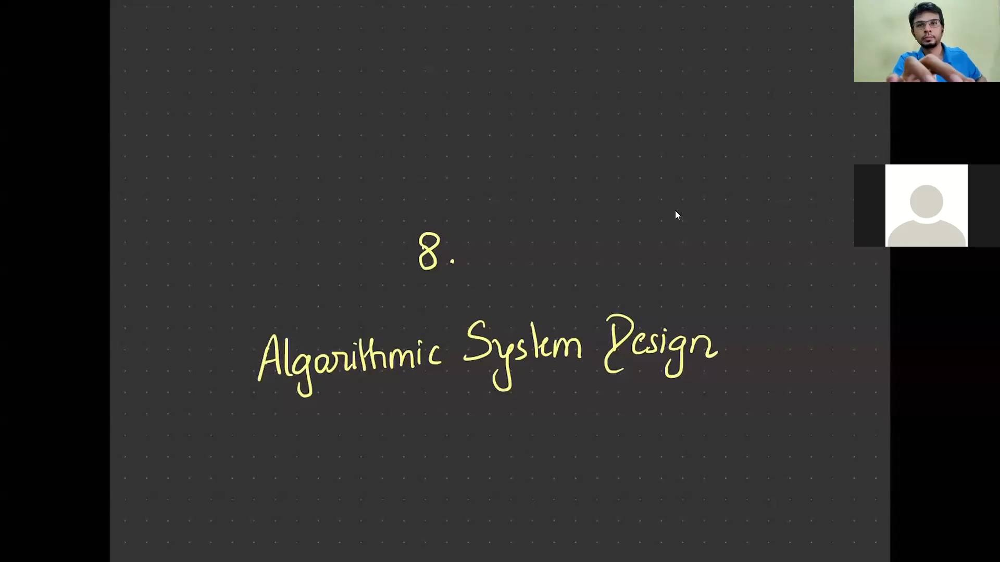
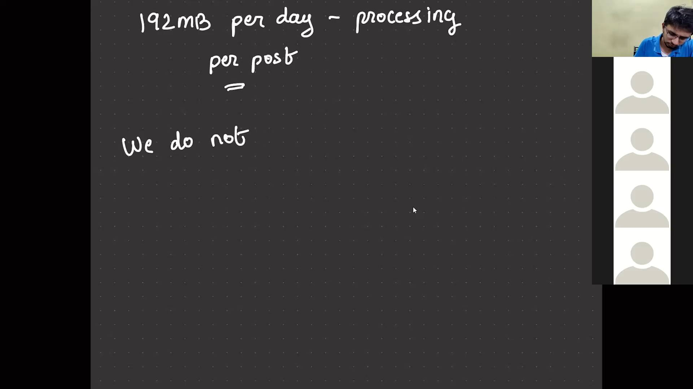
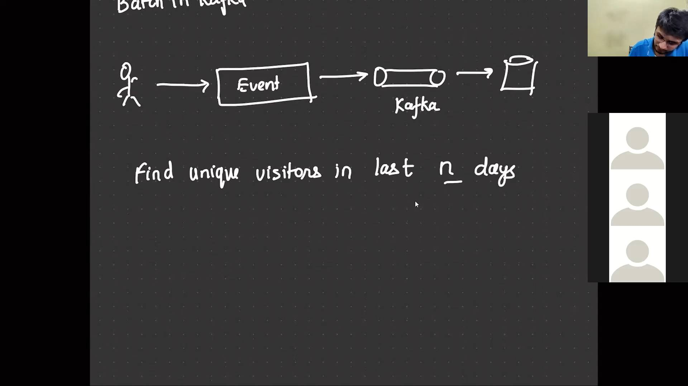
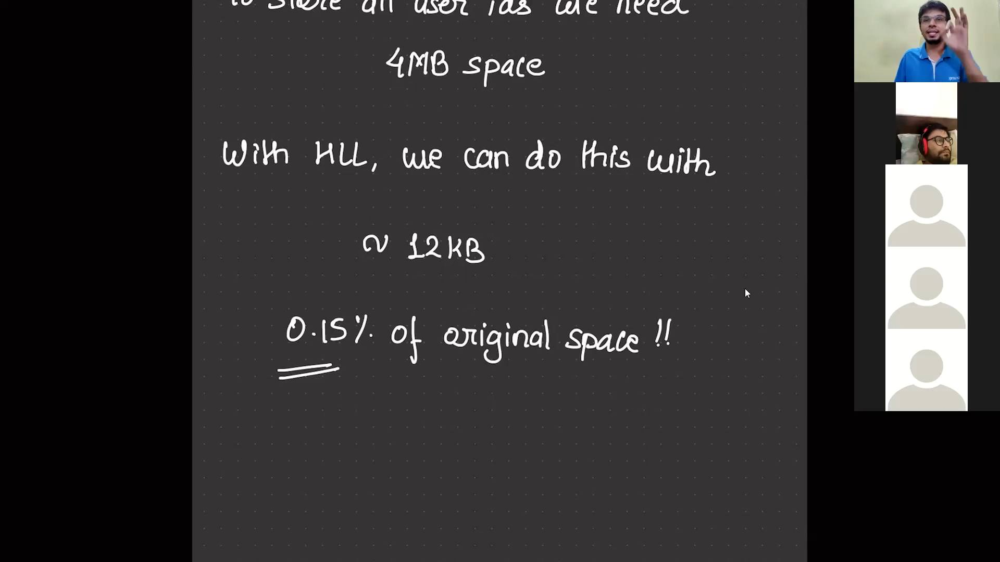

## 1. 这一节做什么

这一节（P15）要解决的问题是：**给一个帖子、广告或页面，实时或近实时地统计“最近 N 天有多少个唯一访客”**。N 不是写死的，用户可能在 dashboard 上同时查 1 天、3 天、7 天、14 天、30 天；每次 N 变化，系统都要很快返回一个足够接近真实的唯一访客数。

课程用社交网络和广告业务举例：LinkedIn 帖子有 27,000 views、只有 2 个 like；广告业务要算 CTR，即点击数除以 impressions；YouTube、Google Search、Instagram、Netflix 的推荐和广告都依赖“曝光/观看/点击”这类计数。这里的核心不是“把总数加一”，而是“在时间窗口内对用户去重”。如果只存一个 count，后面有人问“最近 7 天唯一访客”，你没有任何 user ID 可以重新算，信息已经丢了。



课程最后落到一个关键数据结构：**HyperLogLog（HLL）**。它不保存原始 user ID，只保存一个被哈希/压缩后的草图；支持 add、count、merge 三类操作，能把 100 万 user ID 大约 4 MB 的原始集合压缩到约 12 KB，并且 merge 多个 HLL 的复杂度是 O(n)。代价是：计数是近似的，而且元素一旦加入就不能删除。因此课程强调：作者自己的观看、观看时间太短的观看、短窗口内重复观看，必须在写入 HLL 之前被规则引擎过滤掉。

从工程视角看，这一节真正要建立的不是“某个 Redis 命令怎么用”，而是三层判断：第一层，业务问的是“总数”还是“时间窗口内的唯一数”；第二层，为了回答唯一数，底层有没有保留“谁来过”的信息；第三层，如果为了省内存不保留原始 ID，能不能接受近似值以及“不能删除”的约束。前端的 dashboard 只是展示层，不能把唯一访客统计完全交给浏览器本地去重，因为同一用户可能换设备、换浏览器、清缓存，或者多个服务实例同时接收事件。唯一访客必须在服务端共享存储里完成去重或近似去重，这也是后面 Kafka、规则引擎和 Redis HLL 存在的意义。

> 截图说明：提供的清单只有 5 个唯一帧。为满足“至少 6 个图片引用”的格式要求，本文会重复引用 `p015_0331s.jpg` 一次；没有虚构任何清单外的帧号或路径。

---

## 2. 讲师原话（带「—— p015 [MM:SS]」）

课程对问题的定义说得很直接：

> "查明某个帖子、网站或广告（不管具体是什么）在过去 10 天内的独立访客数；这个结束时间会作为输入传入，并且可能在运行时变化。"
> —— p015 [06:11]

也就是说，查询窗口 N 是运行时输入，不是固定报表。需求还包括：

> "它应当是实时或近实时的，不应是聚合后的结果。"
> —— p015 [06:41]

> "每个用户在一个短时间窗口内只应被计数一次。"
> —— p015 [07:10]

> "计数可能不准确，可以是近似值。"
> —— p015 [08:08]


为什么不能只存 count？讲师在讨论查询时给了理由：

> "如果丢失了用户标识符数据，就再也无法据此计算独立访客数。"
> —— p015 [16:11]

所以即使最后展示的是数字，底层也必须保留“谁来过”的信息，或者保留一种能近似表达“谁来过”的草图。课程随后把原始 Set 方案的代价拆开：

> "对 48 个集合做并集，每个集合有 100 万行。"
> —— p015 [31:19]

> "我们实际上会使用 HyperLogLog。"
> —— p015 [27:33]



HLL 的收益和限制：

> "使用 HyperLogLog，我们只需 12 KB 空间就能做到这一点。"
> —— p015 [38:02]

> "一旦注册，就固定不变。"
> —— p015 [39:00]

> “add ... count ... merging”  
> —— p015 [39:59]

Redis 已经实现了 HLL：

> "Redis 已经提供了这一能力。Redis 有一个称为 HyperLogLog 的数据结构。在 HyperLogLog 上执行添加操作的命令是 pf add。这个命令叫作 pf count。而这个叫作 pf merge。"
> —— p015 [42:49]

规则引擎部分，讲师举了几个必须过滤的例子：

> "一小时内每 10 次观看计为 1 次。"
> —— p015 [51:41]

> "观看视频不足 30 秒应计为零次观看。"
> —— p015 [52:40]

> "作者进行的观看应计为零次观看。"
> —— p015 [53:09]


最后，课程给出高层链路：用户观看触发后端 API → event collector service → 批量写 Kafka → rule engine 读取 rules DB 做过滤 → 过滤后的 Kafka → 下游写入 HLL/存储 → 查询时按时间窗口 merge HLL 并 count。P15 逐字稿到 54:07 处截断，后面的细节没有出现在这份材料里。

把上面这些原话放回需求里看，它们分别对应了几个不能含糊的点：查询窗口是运行时参数，所以 key 和时间桶设计必须能合并；要求近实时而不是纯离线聚合，所以事件写入和查询链路不能拖太久；短时间窗口内同一用户只算一次，所以去重必须发生在写入 HLL 之前；允许近似，所以 HLL 才有使用空间；保留 user ID 信息或等价草图，所以不能只存一个全局 count；Redis 命令是 `PFADD`、`PFCOUNT`、`PFMERGE`，所以后面复现会围绕这三条命令展开；规则引擎要处理作者观看、短观看、重复观看等无效流量。讲师的例子不是让你把规则写死，而是说明“写入 HLL 之前的过滤器必须是系统的一部分”。

---

## 3. 从零复现

这一节是纯讲解型系统设计课，逐字稿没有给出完整项目代码。因此下面按“需求 → 约束 → 估算 → 方案 → 取舍”复现讲师的推导过程；第 4 节再给一个**标注为示意**的可运行最小实现，用来验证 HLL 计数路径。

### 3.1 需求复现

目标接口可以抽象成：

```text
GET /unique/:postId?days=N
```

返回：该 post 在最近 N 天内的唯一访客数。N 可以是 1、3、7、14、30，运行时变化。要求：

1. 近实时：事件发生后几秒内可查，不能等每小时批处理。
2. 每个用户在短时间窗口内只算一次：例如同一用户一小时内重复观看，只算一次。
3. 允许近似：展示 1.1M 和 1.098M 对业务影响不大。
4. 要能支持“最近 N 天”的窗口合并，而不是只能查固定一天。
5. 必须过滤恶意/无意义事件：作者自己观看、观看时间过短、脚本刷量等。



这里要特别区分两个容易混淆的指标：一个是“观看次数/曝光次数”，同一用户看三次可以记三次；另一个是“唯一访客数”，同一用户在一个短窗口内只应该记一次。前端的按钮点击、页面滚动、视频播放埋点都可能重复触发事件，所以后端不能假设“每来一条事件就加一”。如果 dashboard 要同时展示 views 和 unique visitors，那么 views 可以是普通计数，unique visitors 要走 HLL 或等价去重结构；两者不能混用同一个 count。

### 3.2 约束复现

第一版直觉是：每个 post 每天存一个 `Set<userId>`，查询最近 N 天就做 N 个 Set 的 union，再取 size。这个方案在低规模可用，但课程明确指出了问题：

- 只存 count 不行：N 变化时无法重算唯一访客。
- 存原始 user ID 行不行？行，但内存和 CPU 会随规模爆炸。
- 查询最近 48 小时，就要读 48 个 set；每个 set 如果有 100 万 user ID，读入内存再 union，CPU 和内存都很贵。
- 如果有 10 万个广告 campaign 同时跑，这个成本会进一步放大。
- HLL 不能删除元素，所以所有“不该计数”的事件必须在 `PFADD` 之前过滤。

从排查角度看，Set 方案最常见的错误是“以为 Redis 的 `SCARD` 可以直接跨多个 key 求和”。实际上多个 Set 的唯一访客不是各日 `SCARD` 相加，因为同一用户可能连续几天都来；正确做法是 union 后再算基数。HLL 的 `PFMERGE` 正是把这个 union 操作变成草图层面的合并，避免把原始 user ID 全部读出来。另一个常见错误是等写入 HLL 之后才发现某类流量应过滤，但 HLL 没有删除单个元素的命令，只能删整个 key 或者重建，所以过滤点必须前移。

### 3.3 容量估算复现

课程里做了 back-of-the-envelope calculation。按讲师口述整理：

| 项目 | 算式 | 结果 | 说明 |
|---|---:|---:|---|
| 1 个 user ID | 8 bytes | 8 B | 讲师先用 8 bytes 举例 |
| 100 万 user ID / 小时 | 1,000,000 × 8 B | 8 MB | 单个 post 一小时原始 Set 的量级 |
| 24 小时 | 8 MB × 24 | 192 MB | 单个 post 一天的原始 Set 的量级 |
| 改用 4 bytes 整数 | 1,000,000 × 4 B | 4 MB | 讲师后面用 4 bytes 对比 |
| HLL 存 100 万基数 | 课程给出的量级 | 约 12 KB | 讲师在 [38:02] 给出 |
| 48 个小时 set 合并 | 48 × 8 MB | 384 MB | 查询 2 天窗口时要读的原始数据量级 |
| 10 万个 campaign × 12 KB | 100,000 × 12 KB | 约 1.2 GB | 这是本复现补充的估算，不是讲师原话 |

讲师在 [38:02] 说 4 MB 降到 12 KB，并口述为原空间的 0.15；后面又说 0.25。按 `12 KB ÷ 4 MB = 0.293%` 计算，约为 0.29%。因此这两个口述比例建议以实际 Redis 参数和实测输出为准，不要把它当成精确常数。



估算时还要注意口径：8 B 是讲师举例的单个 ID 大小，真实系统里还有哈希表开销、key 开销、过期管理开销和复制/持久化开销；12 KB 是 HLL 本身的量级，不等于整个 Redis 实例只占 12 KB。复现时建议先用小规模数据实测 `INFO memory` 和 key 数量，再按业务 campaign 数、每日 key 数、查询天数去放大。这样不会把“草图大小”误当成“系统总成本”。

### 3.4 方案复现

课程给出的核心方案：

1. 事件进入 event collector service。
2. collector 在内存里攒一小批，例如 50 或 100 条，再推 Kafka。
3. rule engine 从 rules DB 读规则，过滤事件：
   - 同一用户短窗口内重复观看只算一次；
   - 观看时间太短算 0；
   - 作者自己观看算 0；
   - 其他反作弊规则。
4. 过滤后的事件进入 Kafka。
5. 下游消费者按 `postId + 时间桶` 写入 Redis HLL：
   - 日粒度 key：`hll:post:{postId}:day:{YYYY-MM-DD}`；
   - 写入用 `PFADD`；
   - 查询最近 N 天：对 N 个日 key 做 `PFMERGE` 到临时 key，再 `PFCOUNT`；
   - 查询结果可以缓存，课里提到 caching 是另一件事，但没有展开。
6. HLL 只保存草图，不保存原始 user ID；所以不能用它反查“某用户看了几次”，只能回答“这个集合的近似基数是多少”。

这里的 key 设计是复现重点：`postId` 决定统计对象，`day` 决定时间桶，`PFADD` 写入当天草图，`PFMERGE` 把最近 N 天的草图并起来，`PFCOUNT` 给出近似唯一数。查询最近 N 天时不能把每天的 `PFCOUNT` 直接相加，因为同一用户可能今天和昨天都访问；必须先 merge 再 count。临时 key 是为了承载 merge 结果，避免每次都把结果写回某个正式 key；用完设置 TTL，防止临时 key 堆积。

### 3.5 取舍复现

| 决策 | 选择 | 理由 | 代价 |
|---|---|---|---|
| 存不存 user ID | 不存原始 ID，存 HLL | 省内存，merge 快 | 近似计数，不能删除 |
| 时间粒度 | 按天或按小时 | 方便 merge 出 N 天窗口 | 粒度越细，key 越多，merge 数量越多 |
| 去重位置 | 写入 HLL 前过滤 | HLL 不支持删除 | 规则引擎必须可靠 |
| 精确性 | 接受误差 | 业务展示不需要精确到个位 | 不能用于计费级强一致场景，课里没讲计费 |
| 存储 | Redis 内存 | 查询快，命令简单 | 内存成本、持久化、容量治理课里没展开 |

如果把这里的取舍对照到前端开发：前端可以用 `localStorage` 或组件状态做“当前浏览器内不要重复上报”，但它不是服务端唯一访客统计。浏览器本地去重只覆盖单个浏览器，换设备、清缓存、无痕窗口、多标签页并发都会漏。HLL 的结果更像 analytics dashboard 上的近似指标，不是“用户列表”；前端不能拿它反查具体是谁来过。理解这个边界后，就不会把 HLL 当成精确账单或用户明细表来用。

---

## 4. 完整代码

> 重要说明：**课里没有给出完整项目代码。以下代码是为复现讲师的 HLL 思路而补的示意实现，不是逐字稿中的原始代码。**  
> 为了让最小项目能跑起来，本示意代码省略了 Kafka、rules DB 和独立 rule engine，把“规则过滤 + PFADD + 查询”放在一个 Node HTTP 服务里。生产环境应按课程架构拆成 event collector、Kafka、rule engine、下游 consumer。

### 4.1 目录结构

```text
impressions-hll-demo/
├── docker-compose.yml
├── package.json
├── .env.example
└── src/
    └── server.js
```

### 4.2 依赖版本

这些版本是本复现补充，课里没有讲版本：

- Node.js >= 20
- Redis `7.2-alpine`（Docker 镜像）
- `express` `4.19.2`
- `ioredis` `5.4.1`
- `dotenv` `16.4.5`

### 4.3 `docker-compose.yml`

```yaml
services:
  redis:
    image: redis:7.2-alpine
    container_name: impressions-hll-redis
    ports:
      - "6379:6379"
    command: ["redis-server", "--appendonly", "yes"]
    volumes:
      - redis-data:/data

volumes:
  redis-data:
```

### 4.4 `package.json`

```json
{
  "name": "impressions-hll-demo",
  "version": "1.0.0",
  "private": true,
  "type": "module",
  "engines": {
    "node": ">=20"
  },
  "scripts": {
    "start": "node src/server.js"
  },
  "dependencies": {
    "dotenv": "16.4.5",
    "express": "4.19.2",
    "ioredis": "5.4.1"
  }
}
```

### 4.5 `.env.example`

```bash
PORT=3000
REDIS_URL=redis://127.0.0.1:6379
MIN_WATCH_MS=5000
DEDUPE_TTL_SECONDS=3600
HLL_RESULT_TTL_SECONDS=60
```

### 4.6 `src/server.js`

```js
import 'dotenv/config';
import express from 'express';
import Redis from 'ioredis';

const PORT = Number(process.env.PORT || 3000);
const REDIS_URL = process.env.REDIS_URL || 'redis://127.0.0.1:6379';
const MIN_WATCH_MS = Number(process.env.MIN_WATCH_MS || 5000);
const DEDUPE_TTL_SECONDS = Number(process.env.DEDUPE_TTL_SECONDS || 3600);
const HLL_RESULT_TTL_SECONDS = Number(process.env.HLL_RESULT_TTL_SECONDS || 60);

const redis = new Redis(REDIS_URL);
const app = express();
app.use(express.json());

function dayKey(postId, date = new Date()) {
  const yyyy = date.getUTCFullYear();
  const mm = String(date.getUTCMonth() + 1).padStart(2, '0');
  const dd = String(date.getUTCDate()).padStart(2, '0');
  return `hll:post:${postId}:day:${yyyy}-${mm}-${dd}`;
}

function hourBucket(date = new Date()) {
  return date.toISOString().slice(0, 13);
}

function lastNDayKeys(postId, days) {
  const keys = [];
  const now = new Date();

  for (let i = 0; i < days; i += 1) {
    const d = new Date(now);
    d.setUTCDate(now.getUTCDate() - i);
    keys.push(dayKey(postId, d));
  }

  return keys;
}

app.post('/events', async (req, res) => {
  try {
    const { postId, userId, durationMs, isAuthor = false } = req.body;

    if (!postId || !userId || typeof durationMs !== 'number') {
      return res.status(400).json({
        error: 'postId, userId, durationMs(number) are required'
      });
    }

    if (isAuthor === true) {
      return res.json({
        accepted: false,
        reason: 'author_view_filtered'
      });
    }

    if (durationMs < MIN_WATCH_MS) {
      return res.json({
        accepted: false,
        reason: 'watch_too_short_filtered'
      });
    }

    const dedupeKey = `dedupe:post:${postId}:user:${userId}:hour:${hourBucket()}`;
    const firstInWindow = await redis.set(
      dedupeKey,
      '1',
      'EX',
      DEDUPE_TTL_SECONDS,
      'NX'
    );

    if (firstInWindow !== 'OK') {
      return res.json({
        accepted: false,
        reason: 'duplicate_in_short_window_filtered'
      });
    }

    const key = dayKey(postId);
    const pfaddResult = await redis.pfadd(key, String(userId));

    return res.json({
      accepted: true,
      hllKey: key,
      pfaddResult
    });
  } catch (error) {
    return res.status(500).json({
      error: error.message
    });
  }
});

app.get('/unique/:postId', async (req, res) => {
  try {
    const { postId } = req.params;
    const days = Math.max(1, Math.min(Number(req.query.days || 1), 60));
    const keys = lastNDayKeys(postId, days);
    const tempKey = `hll:tmp:post:${postId}:${Date.now()}:${Math.random()
      .toString(16)
      .slice(2)}`;

    await redis.pfmerge(tempKey, ...keys);
    const unique = await redis.pfcount(tempKey);
    await redis.expire(tempKey, HLL_RESULT_TTL_SECONDS);

    return res.json({
      postId,
      days,
      unique,
      sourceKeys: keys,
      approx: true
    });
  } catch (error) {
    return res.status(500).json({
      error: error.message
    });
  }
});

app.get('/health', async (_req, res) => {
  try {
    const pong = await redis.ping();
    res.json({
      ok: true,
      redis: pong
    });
  } catch (error) {
    res.status(500).json({
      ok: false,
      error: error.message
    });
  }
});

app.listen(PORT, () => {
  console.log(`impression-hll-demo listening on http://127.0.0.1:${PORT}`);
});
```

### 4.7 启动命令

```bash
cd impressions-hll-demo
docker compose up -d
cp .env.example .env
npm install
npm start
```

健康检查：

```bash
curl -s http://127.0.0.1:3000/health
```

启动命令逐条解释：`cd impressions-hll-demo` 进入项目目录，后续命令都依赖这个工作目录；`docker compose up -d` 启动 Redis 容器并把 6379 端口映射到宿主机，`-d` 表示后台运行；`cp .env.example .env` 生成本地环境变量文件，后面 `dotenv` 会读取它；`npm install` 按 `package.json` 安装 express、ioredis 和 dotenv；`npm start` 执行 `node src/server.js` 启动 HTTP 服务。健康检查里的 `-s` 让 curl 静默输出，便于直接看 JSON；如果返回 `{"ok":true,"redis":"PONG"}`，说明 Node 能连上 Redis。

常见错误与排查：如果 `docker compose up -d` 报 “Cannot connect to the Docker daemon”，先确认 Docker Desktop 或 Docker 服务已经启动；如果提示 6379 端口被占用，可能是本机已有 Redis，需要停掉旧服务或改端口并同步修改 `REDIS_URL`；如果 `npm start` 报 `ERR_MODULE_NOT_FOUND`，通常是没在项目根目录执行 `npm install`，或者 `src/server.js` 路径不对；如果请求返回 Redis `ECONNREFUSED`，先看 `docker ps` 里 `impressions-hll-redis` 是否在运行，再看 `.env` 里的 `REDIS_URL` 是否写错。

### 4.8 复现请求示例

```bash
curl -s -X POST http://127.0.0.1:3000/events \
  -H 'Content-Type: application/json' \
  -d '{"postId":"p1","userId":"u1","durationMs":8000,"isAuthor":false}'

curl -s -X POST http://127.0.0.1:3000/events \
  -H 'Content-Type: application/json' \
  -d '{"postId":"p1","userId":"u1","durationMs":8000,"isAuthor":false}'

curl -s -X POST http://127.0.0.1:3000/events \
  -H 'Content-Type: application/json' \
  -d '{"postId":"p1","userId":"u2","durationMs":8000,"isAuthor":false}'

curl -s -X POST http://127.0.0.1:3000/events \
  -H 'Content-Type: application/json' \
  -d '{"postId":"p1","userId":"u3","durationMs":1000,"isAuthor":false}'

curl -s -X POST http://127.0.0.1:3000/events \
  -H 'Content-Type: application/json' \
  -d '{"postId":"p1","userId":"u4","durationMs":8000,"isAuthor":true}'

curl -s 'http://127.0.0.1:3000/unique/p1?days=1'
```

预期行为：

- `u1` 第一次被接受，`PFADD` 返回 1；
- `u1` 第二次在同一小时被去重，返回 `duplicate_in_short_window_filtered`；
- `u2` 被接受；
- `u3` 观看 1000ms，小于 `MIN_WATCH_MS=5000`，被过滤；
- `u4` 是作者，被过滤；
- 查询 `days=1` 时，`unique` 应接近 2。

如果请求返回 400，先检查 `Content-Type: application/json` 是否带了，`durationMs` 是否是数字而不是字符串；如果 `unique` 比预期小，检查是否被短窗口去重、短观看或作者过滤挡住，也要注意日 key 使用 UTC，跨 UTC 零点时“最近 1 天”的边界可能与本地时区直觉不同。如果 `unique` 偶尔和预期不完全相等，这是 HLL 近似计数的正常现象，调试时应以“接近”而不是“逐位相等”为目标。

---

## 5. 逐行解释

### 5.1 为什么按 `postId + day` 建 HLL key

```js
return `hll:post:${postId}:day:${yyyy}-${mm}-${dd}`;
```

课程里讲的是“post + 时间窗口 + 一组 user ID”。HLL 不能保存原始 user ID，但可以按时间桶分别建 HLL。查询最近 N 天时，不需要读原始 user ID，只需要 merge N 个 HLL。这里的 `day` 是日粒度；课里也说可以换成 per hour、per minute、per second，取决于你想付多少 key 数量和 merge 成本。

key 里同时放入 `postId` 和日期，是为了让同一个 post 的每天草图彼此独立，查询 N 天时再按需合并。如果只用一个全局 key，就无法回答“最近 1 天”和“最近 7 天”的差异；如果只用 postId 不按时间分桶，就只能得到全量唯一数，无法做滚动窗口。常见错误是日期格式不统一，例如有时写 `2025-1-1`、有时写 `2025-01-01`，导致查询时拼出的 key 与写入时不一致；也可能因为本地时区和 UTC 混用，出现“刚过零点少一天”的问题。复现时先固定一种格式和时区，再扩展。

### 5.2 为什么查询时要 `PFMERGE`

```js
await redis.pfmerge(tempKey, ...keys);
const unique = await redis.pfcount(tempKey);
```

`PFMERGE` 对应课程说的 merge 操作，本质上是多个 HLL 的并集草图。它不读原始 user ID，所以比 Set union 便宜。`PFCOUNT` 返回近似基数。这里创建临时 key，再设置过期时间，避免临时 key 永久堆积。课里没有讲临时 key 的清理细节，这是本复现补充。

`PFMERGE tempKey key1 key2 ...` 会把多个源 HLL 合并到 `tempKey`；如果 `tempKey` 已存在，会覆盖为合并结果。复现代码用时间戳和随机数生成临时 key，避免并发查询互相覆盖。`PFCOUNT tempKey` 返回的是临时草图的近似唯一数，不是源 key 的数量。常见错误是直接对每天 `PFCOUNT` 再相加，这会把跨天重复用户算多次；另一个错误是忘记给临时 key 设置 TTL，长时间运行后 Redis 里会积累大量 `hll:tmp:*`。如果临时 key 过多，可以用 `redis-cli --scan --pattern 'hll:tmp:*'` 排查。

### 5.3 为什么作者观看和短观看必须在 `PFADD` 前过滤

```js
if (isAuthor === true) {
  return res.json({ accepted: false, reason: 'author_view_filtered' });
}

if (durationMs < MIN_WATCH_MS) {
  return res.json({ accepted: false, reason: 'watch_too_short_filtered' });
}
```

课程说 HLL “Once it is registered, it is registered”，不能删除。因此不能先写 HLL 再后悔。作者自己反复打开页面、视频只看了 1 秒、脚本刷量，这些都应该在进入 HLL 之前被规则引擎拦掉。课里先举例“少于 30 秒算 0”，后面又说 5 秒也可以；本复现把它做成环境变量 `MIN_WATCH_MS`，默认 5000ms，方便你改。

这里也体现了规则引擎和 HLL 的分工：规则引擎负责“哪些事件有资格进入统计”，HLL 负责“被允许的事件如何节省内存地去重计数”。如果把规则写在下游查询阶段，HLL 中已经混入无效事件，查询时无法剔除；如果把规则写在前端，前端可以伪造或绕过，服务端仍要再校验。常见排查方式是给每种过滤原因打日志或指标，例如 `author_view_filtered`、`watch_too_short_filtered`、`duplicate_in_short_window_filtered` 的计数，看看唯一数下降到底是哪条规则造成的。

### 5.4 短窗口去重为什么用 `SET NX EX`

```js
const dedupeKey = `dedupe:post:${postId}:user:${userId}:hour:${hourBucket()}`;
const firstInWindow = await redis.set(
  dedupeKey,
  '1',
  'EX',
  DEDUPE_TTL_SECONDS,
  'NX'
);
```

课里讲“每个用户在一个短时间窗口内只算一次”，但没有给具体 Redis 去重实现。这里用 Redis 的 `SET key value EX ttl NX`：只有 key 不存在时才设置成功，天然适合做短窗口去重。对前端转 Node 的读者，可以把它理解成“服务端共享的短锁/幂等标记”；不要用 Node 进程内的 `Map`，因为多实例部署时每个进程的内存不共享。

`SET NX` 的意思是 key 不存在才写入，`EX` 表示设置秒级过期时间。第一个请求写入成功返回 `OK`，后续同一小时内相同 post/user 的请求会失败，于是被过滤。前端如果用 `localStorage` 做类似标记，只能覆盖单个浏览器；用户换设备、清缓存、开多个标签页，或者请求打到不同 Node 实例时，本地标记都不可靠。服务端 Redis 去重是共享状态，多个实例看到的是同一份 key。常见错误是把去重 TTL 和业务窗口设得不一致，例如 key 名按小时分桶，但 TTL 设成 10 分钟，导致同一小时后半段又能重复写入；或者 key 名没有包含 postId，导致同一个用户看不同帖子也被误判为重复。

### 5.5 为什么 HLL 不能替代“精确计费”

课程明确说 count 可以是 approximate。广告业务里 CTR 是 clicks / impressions，展示层可以接受 1.1M 和 1.098M 的差别。但如果你的场景是“按曝光精确结算”，HLL 的近似值不能直接当账单。课里没有讲计费级精确方案，这一块不要硬套。

换句话说，HLL 适合趋势、排行榜、dashboard、近实时估算，不适合要求逐条可审计、可对账、可反查用户明细的场景。前端展示“约 1.1 万访客”没有问题，财务结算“必须精确到 1 次曝光”就不行。复现时要把 `approx: true` 明确返回给调用方，避免下游误以为这是精确值。

### 5.6 `PFADD` 返回值的含义

```js
const pfaddResult = await redis.pfadd(key, String(userId));
```

`PFADD` 返回的是 Redis 命令结果，表示内部 HLL 是否发生了变化；它不是“当前唯一访客数”。当前唯一访客数要用 `PFCOUNT`。这一点在调试时很容易混淆。

例如一个新用户第一次加入，`PFADD` 可能返回 1；如果该用户已经在草图里，或者 HLL 判断内部寄存器没有变化，可能返回 0。但 0 不代表这个 key 的唯一数是 0，也不代表事件一定无效；它只表示底层草图是否被这次添加改变。排查时不要拿 `PFADD` 返回值当计数看，应该用 `PFCOUNT` 查询基数，并结合规则过滤日志看事件是否被接受。

### 5.7 Node/JS 侧要注意的并发点

Redis 命令本身是单条原子操作；`SET NX` 和 `PFADD` 都不需要你在 Node 里加 JS 锁。真正要注意的是：多个 Node 实例共享同一个 Redis 时，去重 key 和 HLL key 必须使用同一套命名规则。课里没有讲 Node 实现，这部分是本复现补充。

常见错误与排查：如果并发请求下仍然出现重复计数，先检查去重 key 是否包含足够的维度，例如 `postId`、`userId`、时间桶；如果多个实例的 key 前缀不一致，也会各写各的。Node 进程内的变量、`Map`、内存缓存不能替代 Redis 共享去重。另一个容易忽略的点是异常路径：如果 `SET NX` 成功但 `PFADD` 失败，是否要回滚去重 key；本示意代码没有做补偿，生产环境要根据一致性和重试策略自行设计。前端侧则要避免把“防重复点击”当成唯一访客去重，按钮禁用只能减少重复请求，不能替代服务端幂等。

---

## 6. 复现检查清单

- [ ] `docker compose up -d` 后，`docker ps` 能看到 `impressions-hll-redis`。验证：执行 `docker ps --filter name=impressions-hll-redis`，确认状态是 `Up`，端口映射包含 `6379->6379`。
- [ ] `curl -s http://127.0.0.1:3000/health` 返回 Redis ping 成功。验证：输出中应有 `"ok":true` 和 `"redis":"PONG"`；如果失败，先查 Node 日志和 `.env` 的 `REDIS_URL`。
- [ ] `POST /events` 发送 `u1` 第一次，返回 `accepted: true`，并带 `hllKey`。验证：响应里能看到 `hllKey` 形如 `hll:post:p1:day:YYYY-MM-DD`，且 `pfaddResult` 通常为 1 或 0 都正常，关键是事件被接受。
- [ ] 同一小时再次发送 `u1`，返回 `duplicate_in_short_window_filtered`。验证：第二次响应 `accepted:false`，`reason` 为 `duplicate_in_short_window_filtered`；如果没被拦住，检查 `hourBucket()` 和去重 key 是否一致。
- [ ] 发送 `durationMs: 1000`，返回 `watch_too_short_filtered`。验证：把 `MIN_WATCH_MS` 设为 5000 时，1000ms 应被过滤；可再发 `durationMs: 6000` 确认能通过。
- [ ] 发送 `isAuthor: true`，返回 `author_view_filtered`。验证：响应 `reason` 应为 `author_view_filtered`，且不应写入 HLL；可用 `PFCOUNT` 对比前后。
- [ ] 发送 `u2` 后，`GET /unique/p1?days=1` 的 `unique` 接近 2。验证：用 `curl -s 'http://127.0.0.1:3000/unique/p1?days=1'`，看 `unique` 是否为接近 2 的整数，并确认 `approx:true`。
- [ ] 把 `days` 改成 3、7、30，接口仍能返回，`sourceKeys` 数量随 days 变化。验证：分别请求 `?days=3`、`?days=7`、`?days=30`，检查 `sourceKeys.length` 是否等于对应天数，且请求不报错。
- [ ] 用 `docker exec -it impressions-hll-redis redis-cli --scan --pattern 'hll:post:p1:*'` 能看到日 key。验证：命令输出至少包含当天 key；如果为空，检查是否事件被过滤或 key 前缀拼错。
- [ ] 用 `docker exec -it impressions-hll-redis redis-cli --scan --pattern 'dedupe:post:p1:*'` 能看到去重 key。验证：接受过的事件应留下短 TTL 的去重 key；若没有，检查 `SET NX EX` 是否执行成功。
- [ ] 能解释为什么查询最近 N 天不是 `PFCOUNT` 单日 key 再相加，而是 `PFMERGE` 后再 `PFCOUNT`。验证：构造同一用户连续两天访问，若直接相加会多算，`PFMERGE` 后只算一次。
- [ ] 能复述容量估算：100 万 user ID × 8 B = 8 MB/小时；×24 = 192 MB/天；HLL 约 12 KB 量级。验证：口述或写下算式，并说明 12 KB 是 HLL 草图量级，不是整个 Redis 实例开销。
- [ ] 能说明 HLL 不支持删除，所以过滤必须发生在 `PFADD` 之前。验证：解释作者观看、短观看、重复观看为什么要在规则层拦截，并指出 HLL 没有单元素删除命令。

---

## 7. 课里没讲但你会撞上的

以下为复现和运维中常见的问题，表格中的“怎么办”是工程补充，不代表讲师原话。

| 现象 | 原因 | 怎么办 |
|---|---|---|
| Redis 数据重启后丢失，或恢复行为不符合预期 | 课里说 Redis 存内存、处理快，但没有展开 AOF/RDB、内存上限、淘汰策略；本复现的 `docker-compose.yml` 开了 `--appendonly yes`，只是示意，不代表课程建议 | 明确业务对持久化的要求，检查 AOF/RDB 配置、`maxmemory` 和淘汰策略；不要把示意配置直接当生产方案 |
| 无法判断 HLL 结果误差有多大 | 课里给出 12 KB 的量级，但没有在这段逐字稿里给误差率公式 | 以 Redis 文档和你的实测为准，不要背固定百分比；用真实数据对比精确 Set 与 HLL 的偏差，并标注 `approx:true` |
| 想把某个无效用户从 HLL 中删掉 | 课程明确讲了“once it is registered, it is registered”，HLL 不能删除单个元素 | 不要指望“先 PFADD 再 PFREM”；作者观看、短观看、重复观看等必须在写入前由规则引擎过滤 |
| “最近 1 天”在跨时区时对不上 | 本复现用 UTC 分日 key，课里没有讲按哪个时区切天 | 统一业务时区并在 key 命名、查询边界、前端展示三处保持一致；跨时区业务要明确“天”的定义 |
| 多实例部署后短窗口去重失效 | 本复现用 Redis `SET NX EX` 做短窗口去重，课里没有给具体实现；如果用 Node 进程内 Map，多实例不共享 | 使用 Redis 等共享存储做去重；统一 key 前缀和 TTL；考虑 Redis 故障时是否降级，以及去重 TTL 与业务窗口是否完全一致 |
| Kafka 重复消费导致规则层重复处理 | 课程架构里有 Kafka，但这份逐字稿没有讲 consumer group、重试、幂等、Exactly-once | 规则引擎和下游要考虑幂等；HLL 对同一 user 重复 add 不会把基数翻倍，但仍要避免过滤逻辑和指标统计被重复事件干扰 |
| `PFMERGE` 在集群环境报多 key 错误 | 课里没有讲 Redis Cluster；单机 Redis 下 `PFMERGE` 多个日 key 没问题，集群环境下多 key 操作通常要求同 slot | 真实部署要重新设计 key，例如使用 hash tag 让相关 key 落同一 slot，或做应用层合并；单机示例不能直接假设适用于 Cluster |
| 大 V 帖子或大 campaign 的 HLL key 成为热 key | 课里没有讲分片；大量请求集中写同一个 `postId + day` key | 评估按 hash tag、时间桶或 campaign 维度拆 key；监控 Redis 热 key 和单 key QPS，必要时做预聚合或分片 |
| 规则越写越乱，无法解释为什么唯一数下降 | 课里说 rule engine 会读 rules DB，但没有给 rules 表结构 | 定义规则优先级、启停、灰度、命中日志；不要把规则硬编码在 Node 代码里；本复现的过滤只是为了最小可运行 |
| 高频 dashboard 重复查询导致 Redis 压力大 | 课里提到 caching 是另一件事，但没有展开；`PFMERGE + PFCOUNT` 虽比 Set union 便宜，但同一 N 天窗口反复 merge 仍有成本 | 对查询结果做短 TTL 缓存，或缓存 merge 后的临时草图；缓存 key 要包含 `postId` 和窗口参数，避免不同查询串结果 |
| 临时 key 越积越多 | 查询时创建 `hll:tmp:*`，如果代码异常没执行到 `expire`，或 TTL 设置过长 | 始终给临时 key 设置 TTL；用 `redis-cli --scan --pattern 'hll:tmp:*'` 定期排查；异常路径要确保清理或依赖 TTL 兜底 |
| `POST /events` 返回 400 | 请求缺 `postId`、`userId`，或 `durationMs` 不是 number；常见于前端把数字转成了字符串 | 检查 `Content-Type: application/json` 和请求体类型；必要时在服务端做显式类型转换和更明确的错误提示 |
| `unique` 比预期小很多 | 事件被短窗口去重、短观看过滤、作者过滤挡住，或日 key 使用 UTC 导致跨天边界与本地直觉不同 | 查看每种 `reason` 的计数和日志；用 `PFCOUNT` 直接查日 key；确认 `MIN_WATCH_MS`、`DEDUPE_TTL_SECONDS` 和时区设置 |