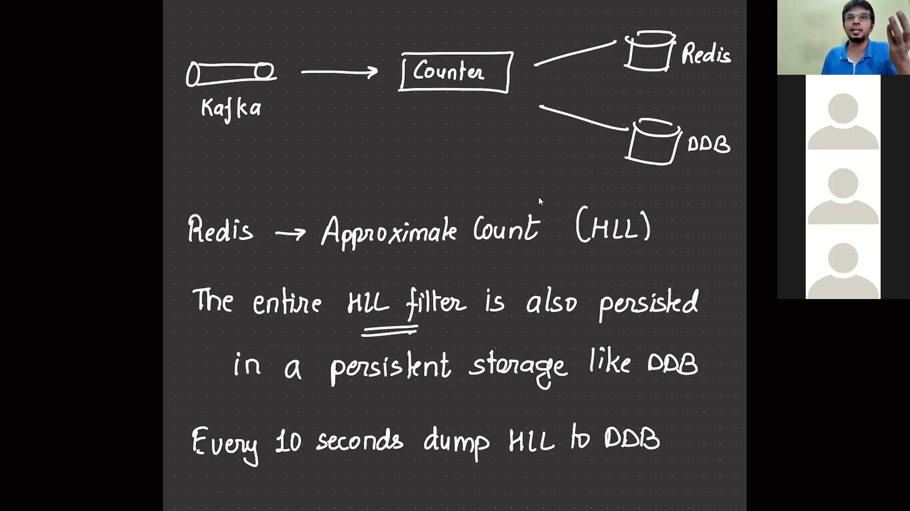
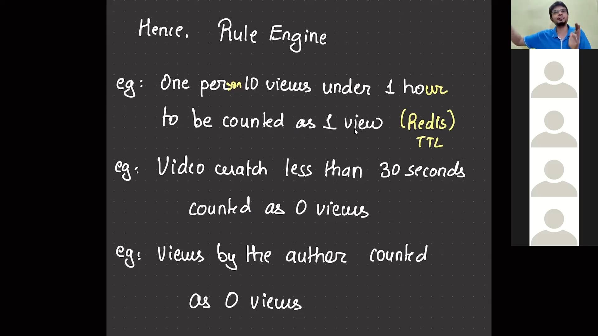
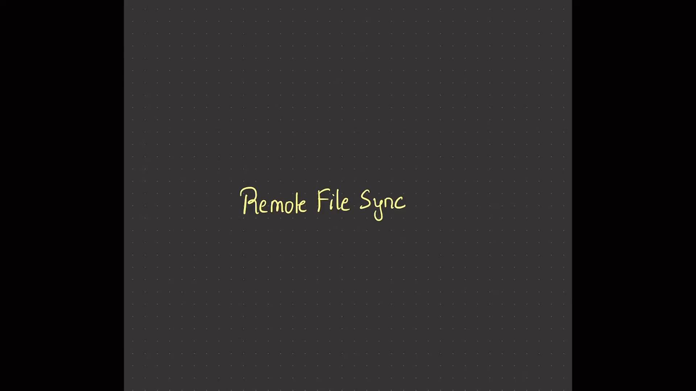
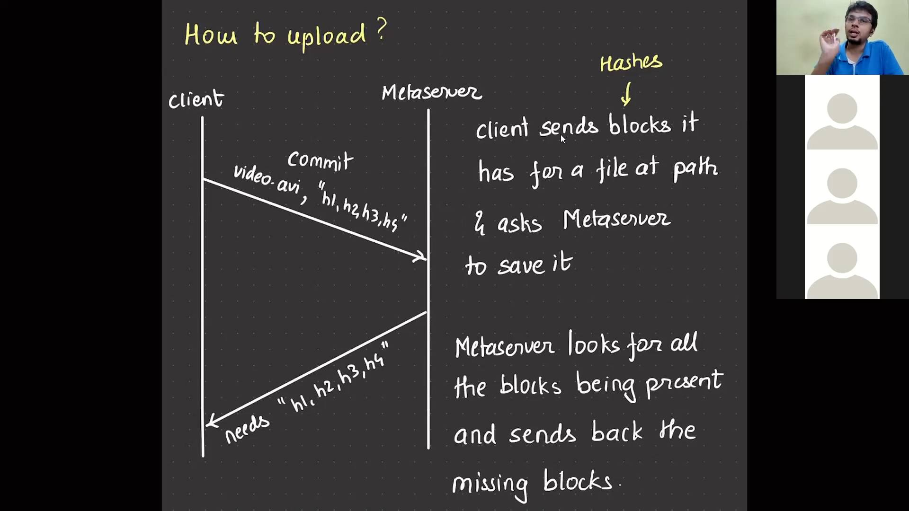
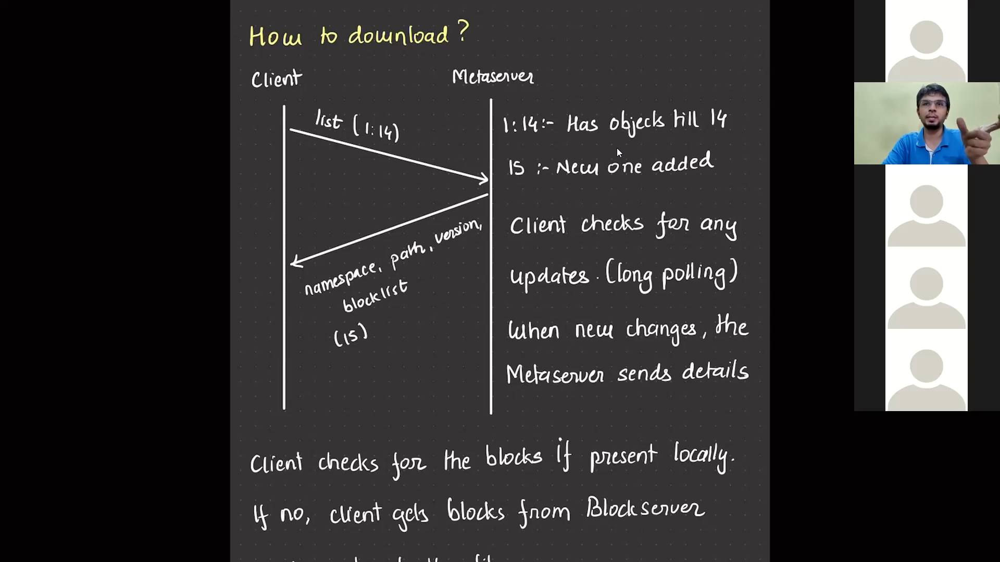

# System Design Masterclass (Arpit) · P015：用 HyperLogLog 做去重计数 + Dropbox 的块级文件同步

> 本文覆盖 P015 这一段（54:36–112:29）。这一段其实是两个主题接在一起讲的：前半段把上一节的「唯一访客计数」落成一套可运行的高吞吐架构（规则引擎 → 两个 Kafka → counter service → Redis HyperLogLog → DynamoDB 快照）；后半段（课间休息后）换成 Dropbox 的远程文件同步：4MB 分块、SHA-256 块哈希、append-only 元数据表、单调递增 version id、客户端 long polling 拉增量。
>
> **截图说明**：截图清单只提供了本段的 5 帧可选画面（60:44 / 71:47 / 82:50 / 93:52 / 104:55），本文全部用上，其中 60:44 一帧在正文与检查清单中各引用一次，共 6 处插图。清单之外的帧号不存在，因此不插图。
>
> **重要前提**：这一段是白板/口述型讲解，**讲师没有给出可运行的项目代码**。所以第 3、4、5 章按「纯讲解课」的方式组织：把讲师的推导按步骤复现（需求 → 约束 → 估算 → 方案 → 取舍），把方案落成设计决策表、组件职责表、数据模型草案、容量估算表；文中的命令与脚本凡是我补的，一律标注「课里没有代码，以下为示意」，并区分「讲师明确说过的」与「工程常识补充」。

---

## 1. 这一节做什么

这一节要产出两样东西，都是「能照着搭出来」的：

**产物 A：一条唯一访客（unique visitor / impressions）计数链路。**

- 事件从客户端进入第一个 Kafka；
- 一个 filter/rule service 从 rule DB 读出规则，判断这条事件是否命中规则，命中的转发到第二个 Kafka，不命中的直接丢弃（讲师原话：`otherwise it would be skipped`），目的是「只让有意义的 view 过去」；
- 第二个 Kafka 的消息由 counter service 消费，counter service 把 userID `PFADD` 进 Redis 里的一个 HyperLogLog（下称 HLL）key；
- 查询时用 `PFCOUNT` 取单 key 基数，跨时间段用 `PFMERGE` 合并成一个新 key 再 `PFCOUNT`；
- 每 10 秒把每个 HLL 的序列化字节 dump 到 DynamoDB；Redis 里 key 被淘汰后，从 DynamoDB 读回来再更新。

**产物 B：一份 Dropbox 式的块级同步设计。**

- 文件按 4MB 切块，尾块可小于 4MB，每块算 SHA-256，得到块哈希列表 block list；
- 两张表：file metadata DB（namespace id / relative path / block list / version id，**append-only**）和 blocks DB（按 account + hash 存真实块，落在 S3 一类块存储上）；
- 上传是「先 commit（报 block list）→ meta server 回缺失块 → 客户端只传缺失块（一次两块 4MB）→ 再 commit → 拿到 version id」；
- 下载/更新靠客户端记住自己同步到的 version id，long polling 问 meta server 有没有更新的行，只拉本地缺的那几个块，本地顺序拼装。

两个产物共用同一个思想（讲师在结尾点明）：**用 append-only 表 + 单调递增版本号来表达「有什么变了」**。

---

## 2. 讲师原话

以下为逐字稿原话（口语重复处略有删节，语义不动）：

> "规则数据库的任务是存储我们拥有的所有规则。我的过滤服务或规则服务会从 Kafka 读取输入，并判断哪些规则适用于该事件。如果事件通过所有规则，就会转发到下一个 Kafka；否则会被跳过。"
> —— p015 [54:36]

> "于是两个 Kafka 通过一个服务连接起来，再从规则流中读取数据。与其只有一个数据库，不如有很多个……这种情况通常会使用 Spark 来做，因为 MapReduce 可能太慢，Spark 会比它更接近实时一些。"
> —— p015 [55:05]

> "计数器服务的任务是……更新事件或用户 ID，对吧？就是把这个用户 ID 注册到 Redis……你只需要对这个键执行 PFADD，而这个键就是你的 HyperLogLog。"
> —— p015 [56:02]

> "可以在三种操作中任选其一，比如想添加就执行 PFADD，如果只想要最近一小时的计数就执行 PFCOUNT……你会做一次合并，创建一个单独的键，然后使用那个键，并在这个键上求基数。"
> —— p015 [57:28]

> "每隔几秒，比如每 10 秒，你会对那个 Redis 做一次完整转储……所以当我执行 GET HLL 1 时，它会返回一个很长的字符串，也就是我的 HyperLogLog 的字节序列化版本……我可以直接把它存到 DynamoDB。"
> —— p015 [59:48] / [60:16]

> "如果它已经在 Redis 里，我就更新它；如果不在 Redis 里，我就去 DynamoDB 把它取出来，加载到 Redis，然后再更新。流程就是这样。这样一来，所有的 count++ 或 set.add 都会始终发生在 Redis 上。"
> —— p015 [61:15]

> "为什么必须发送 1 呢？……我也有这个疑问，但 Dropbox 的博客文章里就是这么写的……你看，我这里其实真的不需要 1，我只需要 14。"
> —— p015 [105:17]

> "每当你想要判断某些内容是否发生变化时……你其实可以利用仅追加格式：在任何数据库中都不更新已有条目，而是始终创建新条目，并利用这一点来判断是否发生了新的变更。"
> —— p015 [112:01]

---

## 3. 从零复现

这一章按「你先想一遍，讲师怎么想」的顺序走。每个小节末尾标「讲师原话依据」，凡是讲师没交代、需要你自己拍板的，都单独写出来。

### 3.1 起点：需求与约束

**HLL 线的需求**（讲师上一节已经定义，这一节直接沿用）：

- 要回答的问题是「**多少个**唯一访客」，不是「**谁**来过」。讲师在讨论地理分布时把这句话讲得很直白：`So it's more about how many versus who. Google knows that.`（[72:21]）
- 查询要「sub-second，最多几毫秒」，并且 N 天是可变的（`Now N could be variable in real-time in a sub-second query result`，[76:38]）。
- 写入量非常大：每次 view 都要登记一次 userID。

**HLL 线的约束：**

1. Redis 是内存数据库，容量有限，key 会被淘汰（`the post is old key would have been evicted from Redis`，[60:45]）；
2. 数据不能丢，所以必须有持久层；
3. 事件处理链路要能先过滤噪音，否则 counter service 会被无意义的 view 灌满。

**Dropbox 线的需求：**

- 一个本地文件夹与云端双向同步，多设备；
- 文件可能到 5GB、10GB；
- 带宽要省：讲师的原话是「假设你下 1GB 的文件，在最后一个 MB 失败了，你会重下整个文件吗？那会是工程上非常糟糕的决定」（[86:59]）；
- 中途改一个字节，不能重传整个文件。

**关键约束（决定了后面的所有设计）：** 不能用 signed URL 直传 S3。讲师明确反对这条路：

> "如果你采用签名 API 流程，却完全直接访问 S3，这可能是个不太好的选择，因为你可能会错过你自己的服务能做的许多优化……你会希望把优化留在自己这一端，而把 S3 当作原始存储。"
> —— p015 [87:24]

这条约束很值钱：它意味着**所有块级去重、缺失块判断、版本管理都必须发生在你自己的 meta server 上，S3 只当哑存储**。如果你图省事让前端拿预签名 URL 直传，你就失去了「这个块我已经有了，不用再传」的能力。

### 3.2 第一步：先把规则过滤层立起来

顺序是：客户端事件 → Kafka#1 → filter/rule service → Kafka#2 → counter service。

filter service 的输入有两路：一路是 Kafka#1 的事件流，一路是 rule DB 的规则。它的输出只有一个动作：**通过 / 丢弃**（`if my event passes all the rules, it would be forwarded to the next Kafka, otherwise it would be skipped`）。

讲师对这一层给了两个明确的实现取向：

1. **不是一台机器**：`this would be not just one DABA, but a lot of them… Not just one machine, but multiple machines`（[55:05]）。也就是 filter service 和 rule DB 都要横向扩。
2. **用 Spark 而不是 MapReduce**：理由是 MapReduce 太慢，Spark 更接近实时。

**这一步你要自己拍的板（课里没讲）**：Kafka 的 partition key 用什么、规则多久热更新一次、规则匹配失败时是丢弃还是进死信。课里都没讲。

### 3.3 第二步：counter service 只做一件事——把 userID 塞进 HLL

`PFADD` 的语义就是「把元素加进这个 HLL」，讲师把它描述成「注册这个 userID」：

```text
PFADD  hll:post:2024-06-20:14   u_1001
```

这里 `hll:post:2024-06-20:14` 是「某帖子 / 某天 / 某小时」的 HLL key。讲师说 `you're storing it on a per hour basis`（[57:28]），也就是**按小时切 key**，这样任意时间粒度都能靠合并拼出来。

为什么必须按时间切开存？因为 HLL 只能回答「这个 key 里有多少个不同元素」，它**不能做减法、不能切片**。你想查「最近一小时」，就必须有「小时」这个粒度的独立 key；你想查「最近三天」，就把三个天的 key 合并。这是整个方案能支持「N 天可变」的根本原因。

### 3.4 第三步：查询——PFCOUNT 与 PFMERGE

- 单 key 查询：`PFCOUNT hll:...`
- 跨 key 查询：先 `PFMERGE` 到一个新的临时 key，再 `PFCOUNT` 这个新 key。

讲师给的例子是「三天的数据 `20,21,0,0,0,0,2,1,0,8,1,9`」，对这批 key 做 PF merge，生成一个新 key，再对新 key 做 PF count 拿基数（[58:23]）。注意他补了一句限制：

> 「PF merge 仍然是 order of time complexity 的」（[72:46] 附近）

也就是说合并不是免费的，而且**当数据已经没有你要的粒度时，你只能现场合并**（`If the data is already not available in the granularity, you would have to do something like this`，[58:51]）。

代价换来的是精度：`you would be basically having an approximate count, which is near equal to the actual count with some error rate here and there`（[58:51]）——**是近似值，带误差**。误差率具体多少，课里没讲。

### 3.5 第四步：持久化——每 10 秒 dump 一次到 DynamoDB

这是本节最具体的工程细节，也是最能直接照抄的部分：

1. Redis 的 HLL 可以被 `GET` 出来，返回的是「一个大的字符串，是这个 HLL 的字节序列化版本」（`a byte serialized version of my hyper log log`，[59:48]）；
2. 把这个串写进 DynamoDB；
3. 恢复时 `SET <key> <那个串>`，Redis 里就还原出同样的数据结构（`it would create the same data structure in memory in Redis`，[62:33]）。

讲师把这条链路总结成一句话，可以直接当验收标准：

> "键只在 Redis 中添加。如果 HLL 在 Redis 中过期，就从 DynamoDB 取回它并加载到 Redis。"
> —— p015 [61:42]

以及失败代价：「even if my Redis goes down, I would just be losing data worth of 10 seconds」（[61:15]）。



**注意一个很容易踩空的地方**：`GET` 出来的东西**不是 UTF-8 文本**，是二进制。你在 Node 里如果用默认字符串编码去读，再写回去，`SET` 回去的数据可能已经不是原来那个 HLL 了。要么全程用 Buffer（见第 4 章示意脚本），要么至少别做任何编码转换。这一点课里没讲，但它是这条链路能不能真正恢复的前提。

### 3.6 第五步：地理分片与跨地域合并

有学员问「客户端地理分布怎么办」，讲师给了三层答案：

1. **能不分就不分**：事件不是用户面接口，不需要低延迟，可以让全世界的上报都飞到一个中心区域（`this event is not user facing so it doesn't really have to be very fast`，[68:31]）。
2. **要分就按地域分 Redis**，各自 `PFADD` 到本地 HLL。
3. **合并的时候必须收到一处**：`whenever you are finding unique visitors across the entire geography, you would have to get the data and then merge it at one place`（[67:33]）。

他用一个很清楚的例子说明了为什么 HLL 这种「只关心多少、不关心谁」的结构在这里特别合适：同一个人早上在印度、中午在新加坡、晚上在中国各访问一次，如果用普通 Set，三个地域各存一个 `{此人}`，做并集后基数还是 1——**Set 也能算对，但要把三个完整集合搬过来**；HLL 只要 `PFMERGE` 三个 12KB 结构，就得到同样的 1。

> 讲师原话：`I can just do a PF merge of the three HLL present on three different Redis… And then eventually end up with the fourth Hyperloglog with one cardinality.`（[71:24] / [71:54]）



他还顺带解释了 Google Analytics 那种「每晚 12 点才出昨天数据」的形态：夜里把所有地域、当天的 HLL 拉齐、合并，再算总数（[69:31]）。

**这一步的取舍**：分片越多，合并窗口内的一致性越难保证；集中在单区域，延迟高但口径最简单。课里没有给「怎么选」的判据。

### 3.7 第六步：原始事件另走一路（不要用 HLL 做重分析）

有人问「那我想拿到具体是哪些用户来过呢」。讲师的回答是把两条链路拆开：

- HLL 那条路只解决「多少」和「实时」；
- 另起一个 consumer 从 Kafka 读同一批事件，**verbatim 存进数仓**（`post P1 was viewed by user U1 at timestamp and this was the OS, this was the browser`，[74:43]），用于用户旅程、频次分析、异地登录告警这类「重」分析。

> "但这真的是我们应该用来在其上做分析、找出跨月和跨年独立用户的方法吗？它能完成这项工作，只是速度太慢了。"
> —— p015 [75:11]

### 3.8 第七步（换主题）：Dropbox 的分块与哈希

课间休息后进入第二部分。开场的画面是休息界面，之后直接进 Dropbox：



**推理链**：要省带宽 → 就不能整文件传 → 必须切块 → 切完必须有办法「认出这是哪一块」→ 用哈希当块的身份。

讲师给的数字很具体：

- 例子文件：`14MB` 的 `video.avi`；
- 块大小：`4MB`，**4MB 是块的上限**；
- 切完：`4MB + 4MB + 4MB + 2MB`，共 4 块；
- 每块过 SHA-256，得到 `h1, h2, h3, h4`；
- 这串哈希叫 **block list**（讲师特别强调了名字的迷惑性：`This is called a block, even though it's just hashes, but it's called as a block list`，[89:46]）。

**估算（我按讲师给的数字算的，课里没算这一步）：**

| 量 | 算式 | 结果 |
|---|---|---|
| 14MB 文件块数 | ⌈14 / 4⌉ | 4 块（3×4MB + 1×2MB） |
| 单块哈希大小 | 讲师说「16 或 32 byte、32 字符长的 SHA-256 串」 | 按 32 字节算 |
| 上述文件的 block list 大小 | 4 × 32B | 128 字节（HEX 表示则 256 字符） |
| 5GB 文件的块数 | 5 × 1024 / 4 | 1280 块 |
| 5GB 文件的 block list 大小 | 1280 × 32B | 约 40KB |
| 一次上传的块数上限 | 讲师：限制 8MB，块 4MB | 一次 2 块 |
| 5GB 文件传完需要几轮 | 1280 / 2 | 640 轮 |

最后两行就是为什么 5GB 文件同步慢——不是带宽问题，是**轮次**问题。课里没讨论这个优化。

### 3.9 第八步：两张表 + append-only

**file metadata DB** 的字段，讲师逐个念过：

- `namespace id`：就是账号 / user id（`which is your account, let's say your user id`）；
- `relative path`：文件在哪条路径上，例子里是 `/video.avi`；
- `block list`：这个文件各块的哈希列表 `h1, h2, h3, h4`；
- `version id`：**单调递增**，而且**是按账号递增，不是按文件递增**（`it's for an account that's the best one. It's for an account, not for a specific file`，[102:28]）。

最关键的属性：

> "这是这个数据库的关键部分……它是仅追加数据库……不会发生修改……明天我再上传 video.avi 时，它会更新这个块列表。不过它实际上永远不会直接更新这个块列表，而是会用新的块列表集合创建一个新条目。"
> —— p015 [91:05]

**blocks DB**：存真正的块数据，索引是 account + hash（`for this account, for this hash, this is the block`），物理存储是 S3 一类的块存储。

**为什么必须 append-only**：因为「检测变化」这件事变成了**一次整数比较**——客户端说「我同步到 14」，服务端说「我最新是 15」，一句话就知道有没有变化，而且知道去哪里取差量。如果你改成原地 UPDATE，你就失去了「14 和 15 之间发生了什么」的信息，也就没法做增量。

### 3.10 第九步：上传时序

按讲师的叙述还原成六个动作：

1. 客户端（常驻守护进程）发现 Dropbox 文件夹里出现新文件；
2. 客户端算好 block list，向 **meta server** 发起 **commit**：`我要提交 video.avi，块列表是 h1,h2,h3,h4`；
3. meta server 去 **block server** 查这四块在不在 → 新文件当然一个都没有 → commit **失败**，回包告诉客户端「我要 h1,h2,h3,h4」；
4. 客户端把缺失块**传到 block server**（不是 meta server），Dropbox 限制一次 8MB，所以是 `b1,b2(h1,h2)` 一轮、`b3,b4(h3,h4)` 一轮；
5. block server 逐块回 ack；
6. 四块都 ack 之后，客户端**重试 commit**；这次 meta server 确认块齐了，写入 metadata 新行，回一个 **version id**。



断点续传就自然成立了：如果只有 h4 没传成，重试时 meta server 只回 `I need H4`，客户端只补 4MB 那一块（[97:40]）。

### 3.11 第十步：下载与增量更新

1. 客户端本地记着自己同步到的 version id（例子里是 14）；
2. 通过 **long polling** 问 meta server：「我有到 14，有变化吗？」
3. meta server 查这个账号最新一行是 15 → 回第 15 行的 namespace / path / version / block list；
4. 客户端拿 block list 跟自己本地块比对：`h1, h2, h4` 我有，`h5` 没有；
5. 只去 block server 取 h5；
6. 本地按 block list 的**顺序**拼装成文件（讲师确认过块是连续存放的，直接 file merge：`they just put it into a file… these are actually contiguous blocks`，[98:36]）。

改一个文件里的字节会怎样？重新切块后 block list 变成 `h1, h2, h5, h4`（第三块变了），meta server **不更新旧行**，而是新增一行、version 变成 2。老客户端手里还是 version 1，一比对就知道要拉新行，而新行里它只缺 h5。



这一帧正好对应课上那段很诚实的争论：Dropbox 博客原文画的是「客户端上报 1 到 14」，讲师自己说：

> "我也有过这个疑问……我这里其实真的不需要 1，我只需要 14……但他们在数据范围里写的是从 1 到 14。不确定为什么，但这正是他们使用的图。所以我就严格忠于原始材料了。"
> —— p015 [105:17]

课堂上给出的可能解释是：如果中间某些块在客户端缺失，或者 13、14 两版之间有累积差异，那么只报 14 不足以表达「我到底有哪些」，所以要报一个区间。**这个解释是课堂讨论，不是结论**，讲师自己也没确认。

### 3.12 第十一步：目录怎么办（讲师给的三种做法）

1. 不处理——目录不做版本；
2. 像 S3 那样，路径不存在就按 commit 的 path 自动创建（`In S3, you can give any random path even if the nested directory does not exist, it would create those directories for you`，[110:35]）；
3. 单独一张表存目录信息，跟文件表分开。

课里没选哪一种。

---

## 4. 完整代码

> **再次声明：这一段课里没有可运行的项目代码。** 下面 4.1–4.4 是把讲师口述的方案落成可执行的产物（决策表 / 职责表 / 数据模型 / 估算表）；4.5 是**我补的示意命令与脚本**，用来把讲师讲的 Redis 操作真跑一遍，**不是讲师给的代码**。

### 4.1 设计决策表（HLL 线）

| # | 决策 | 讲师给的理由（时间戳） | 不这么做会怎样 |
|---|---|---|---|
| 1 | 规则过滤放在两个 Kafka 之间 | 只让有意义的 view 通过（[54:36]） | counter service 被噪音灌满，Redis 写入放大 |
| 2 | 用 Spark 而非 MapReduce 做规则计算 | MapReduce 太慢（[55:34]） | 过滤环节成为延迟瓶颈 |
| 3 | 计数用 Redis HLL 而非 Set | 4MB 的数据只用约 12KB（[73:44]） | 内存爆掉，查询变慢 |
| 4 | HLL key 按小时切 | 需要任意 N 天粒度的查询（[57:28]） | 只能查全量，无法切片 |
| 5 | 跨时段用 PFMERGE + PFCOUNT | 没有现成粒度只能现场合并（[58:51]） | 返回不了跨天结果 |
| 6 | 每 10 秒 dump 到 DynamoDB | Redis 会淘汰 key、可能宕机（[59:20]） | 最多丢全部历史 |
| 7 | dump 用 GET/SET 序列化字节 | HLL 可字节序列化（[59:48]/[62:33]） | 无法低成本备份与回填 |
| 8 | 写路径永远先打 Redis | `count++` / `set.add` 全在 Redis（[61:15]） | 每次写都打持久层，吞吐崩 |
| 9 | 原始事件另走一条 consumer 进数仓 | HLL 只答「多少」不答「谁」（[74:14]） | 「谁来过」这类问题永远答不了 |
| 10 | 匿名用户用 cookie 里的随机 ID | IP 变化太频繁（[78:01]） | Unacademy 实测掉 20 倍（[78:28]） |

### 4.2 组件职责表

| 组件 | 输入 | 输出 | 职责 | 备注 |
|---|---|---|---|---|
| rule DB | 规则配置 | 规则集 | 存所有规则 | 讲师说实际是多个实例 |
| Kafka#1 | 客户端事件 | 事件流 | 缓冲原始事件 | — |
| filter / rule service | Kafka#1 + rule DB | Kafka#2 | 通过/丢弃 | 多机、可用 Spark |
| Kafka#2 | 通过规则的事件 | 事件流 | 供 counter 消费 | — |
| counter service | Kafka#2 | Redis 写入 | `PFADD` userID | 冷 key 先从 DynamoDB 载入 |
| Redis | counter 写入 | HLL 结构 | 承载实时计数 | key 会被淘汰 |
| DynamoDB | 每 10 秒 dump | 持久 HLL 字节 | 持久化 / 回填源 | 讲师未提表设计 |
| 事件归档 consumer（讲师提的旁路） | Kafka | 数仓 | verbatim 存原始事件 | 用于重分析 |

| 组件（Dropbox 线） | 职责 | 存储什么 |
|---|---|---|
| 桌面客户端（守护进程） | 监听本地文件夹、切块、算哈希、commit、传块、拼装 | 本地块 + 本地已同步 version id |
| meta server | 校验块是否齐全、写 metadata、返回缺失块 / 新行 | file metadata DB |
| block server | 接收并保存块、按 hash 返回块 | blocks DB（物理上是 S3 类块存储） |

### 4.3 数据模型草案

**file metadata DB（append-only，只 INSERT）**

| 字段 | 示例 | 说明 |
|---|---|---|
| namespace_id | `acct_8891` | 账号 / user id |
| relative_path | `/video.avi` | 文件路径 |
| block_list | `h1,h2,h3,h4` | 有序，**顺序不能乱** |
| version_id | `2` | 单调递增，**按账号递增** |

示例数据（就是课上讲的「改一块」场景）：

```text
namespace_id | relative_path | block_list      | version_id
acct_8891    | /video.avi    | h1,h2,h3,h4     | 1
acct_8891    | /video.avi    | h1,h2,h5,h4     | 2
```

**blocks DB（真实块）**

| 字段 | 示例 | 说明 |
|---|---|---|
| namespace_id | `acct_8891` | 按账号隔离 |
| block_hash | `h5`（SHA-256） | 块的身份 |
| block_data | 4MB 二进制 | 实际存放于 S3 类块存储 |

> 课里只说了「blocks DB 按 account + hash 存块，物理在 S3 一类块存储」，**没有给字段名**。上表的字段名是我为了能落地起的名字，不是讲师原话。

### 4.4 容量与估算表

| 项 | 算式 | 值 | 来源 |
|---|---|---|---|
| 14MB 文件块数 | ⌈14/4⌉ | 4 | 讲师给的例子（[88:51]） |
| 5GB 文件块数 | 5×1024/4 | 1280 | 我按 4MB 块算 |
| 5GB 文件 block list | 1280×32B | ≈40KB | 我按 SHA-256 32B 算 |
| 单次上传块数上限 | 8MB / 4MB | 2 | 讲师（[95:46]） |
| 5GB 上传轮次 | 1280/2 | 640 | 我算的 |
| HLL 相对原始集合的体积 | 4MB → 12KB | 约 1/340 | 讲师（[73:44]） |
| 每天 dump 次数（每 key） | 86400/10 | 8640 | 我按 10 秒周期算 |
| Redis 宕机数据损失 | — | ≤10 秒 | 讲师（[61:15]） |

### 4.5 可执行命令与示意脚本

**（a）讲师明确讲过的 Redis 操作**（这些命令名和语义都出自逐字稿）：

```bash
# 1) 把 userID 加进某个 HLL（讲师原话：pf add 到这个 key，值就是 userID）
PFADD hll:day:20240620:hr14 u1001 u1002 u1003

# 2) 取单个 key 的基数
PFCOUNT hll:day:20240620:hr14

# 3) 跨 key 合并到一个新 key，再取基数（讲师讲的三天数据那种场景）
PFMERGE hll:tmp:20240618_20240620 \
         hll:day:20240618 hll:day:20240619 hll:day:20240620
PFCOUNT hll:tmp:20240618_20240620

# 4) 取出 HLL 的字节序列化串（讲师：GET 会给你一个 big string）
GET hll:day:20240620:hr14

# 5) 用这个串在别处还原出同样的结构
SET hll:day:20240620:hr14 "<上一步 GET 到的二进制串>"
```

**（b）课里没有代码，以下为示意**：一个把「写入 + 冷 key 回填 + 定时 dump」串起来的 Node 脚本。它只是为了让上面的命令能真跑，**不是讲师给的实现**，DynamoDB 的具体调用方式请以你实际的 SDK 文档为准。

```javascript
// file: hll-demo.mjs
// 课里没有代码，以下为示意
import { createClient } from 'redis';          // 写作时常用 4.x，课里没讲版本
import { DynamoDBClient, PutItemCommand, GetItemCommand }
  from '@aws-sdk/client-dynamodb';             // 课里没讲 SDK 版本

const redis = createClient({ url: process.env.REDIS_URL ?? 'redis://127.0.0.1:6379' });
const ddb   = new DynamoDBClient({ region: process.env.AWS_REGION ?? 'ap-south-1' });
const TABLE = process.env.HLL_TABLE ?? 'hll_snapshots';

// 1) 登记一次 view：冷 key 先从持久层回填，再 PFADD
export async function registerView(key, userId) {
  const exists = await redis.exists(key);
  if (!exists) {
    // 讲师：key 被淘汰了，就从 DynamoDB 把它 load 回 Redis
    const row = await ddb.send(new GetItemCommand({
      TableName: TABLE,
      Key: { hll_key: { S: key } },
    }));
    const blob = row.Item?.payload?.B;          // 二进制，绝不能当 utf8 字符串处理
    if (blob) await redis.set(key, blob);
  }
  await redis.pfAdd(key, userId);
}

// 2) 每 10 秒把每个 HLL dump 进 DynamoDB
export async function dumpAll(keys) {
  for (const key of keys) {
    const buf = await redis.get(redis.commandOptions({ returnBuffers: true }), key);
    if (!buf) continue;
    await ddb.send(new PutItemCommand({
      TableName: TABLE,
      Item: { hll_key: { S: key }, payload: { B: buf } },
    }));
  }
}
```

**（c）课里没有代码，以下为示意**：Dropbox 线上传时序的伪代码（只保留课上讲的六个动作）：

```text
# 课里没有代码，以下为示意
client:
  blocks   = split(file, 4MB)              # 4,4,4,2
  hashes   = [sha256(b) for b in blocks]   # h1..h4
  res      = meta.commit(path, hashes)     # 第一次一定失败（新文件）
  missing  = res.missing                   # == hashes
  for pair in chunks(missing, size=2):     # 一次最多 8MB / 2 块
      block_server.put(pair)               # 等每块 ack
  version  = meta.commit(path, hashes)     # 重试 commit，拿到 version_id
```

---

## 5. 逐行解释

**`PFADD hll:day:20240620:hr14 u1001 …`**
为什么 key 要长成这样？因为讲师选的粒度是「按小时」。之所以不用一个全局 key，是因为 HLL 不支持减法、不支持时间切片——你必须先按时间把 key 切开，才能在查询时按需 `PFMERGE`。key 里的日期和小时就是「可合并的最小单元」。

**`PFCOUNT <单 key>`**
讲师原话是「如果你按小时存，你 `pf count` 那个 key 就拿到那一小时的基数」。它只返回数值，不返回成员，这正是我们需要的（`how many versus who`）。

**`PFMERGE ... hll:day:...` + `PFCOUNT 新key`**
为什么要建「新 key」而不是在原 key 上合并？因为原 key 是「那一天」的事实，合并结果是一个**派生视图**，随时会按不同时间窗重算。把派生结果单独放一个 key（甚至用完就删），可以避免污染事实数据。讲师说的「取两天的所有 key、做一个 merge、创建一个单独的 key，再对它 count」，就是这个意思。

**`GET hll:...`**
这一行的本质是「导出状态」。讲师形容它返回「一个大的字符串，是这个 HLL 的字节序列化版本」。它是整个持久化方案的地基——不用遍历 userID，直接搬这 12KB 结构。

**`SET hll:... <串>`**
这一行是「导入状态」，讲师说 `it would create the same data structure in memory in Redis`。注意这里的自变量是字节串而不是文本，所以工程上一定要按 Buffer 处理（4.5 的示意脚本里用了 `returnBuffers: true`）。**这条注意事项课里没讲，但它是「能不能恢复」的分水岭。**

**每 10 秒 dump**
为什么是 10 秒而不是 1 秒？讲师给的是代价视角：**丢失窗口 = dump 周期**。10 秒意味着 Redis 挂了最多丢 10 秒的数据；周期再短，dump 的频率就会逼近写入频率，Redis 的主要工作会变成导出。课里没有给「怎么选这个周期」的推导，只给了结论。

**冷 key 回填（先 `EXISTS` 再 `GET/SET`）**
为什么写路径要先查存在性？因为绝大多数写都是热 key，加一次 `EXISTS` 的代价远小于每次都读 DynamoDB；只有冷 key（老帖子、老广告）才会走到回填分支。讲师把这条总结成「Redis 里有就更，没有就去 DynamoDB 拿进来再更」。

**Dropbox 的 4MB 块**
为什么是 4MB？讲师没解释这个数字怎么来的，只说了「4MB 是块的最大大小」以及「Dropbox 把一次上传限制在 8MB，所以一次两块」。从工程上看，块越小 → 改一处传得越少，但 block list 越长、commit 次数越多；块越大则反。**这个权衡课里没展开**。

**`sha256(block)` 当块身份**
为什么用哈希而不是自增 ID？因为哈希是**内容决定**的：两台设备各自切同一个文件，会得到同一组哈希，因此服务端可以直接说「这块我有」。这也是为什么讲师说「两个块有相同哈希」在 Git 里是同一个思路，而 SHA-256 碰撞极罕见（`hash collision is very rare when you use a good algorithm like sha256`，[111:33]）。

**metadata 表 append-only**
这一行是整个 Dropbox 设计的支点。如果原地 UPDATE，服务端就只能回答「现在是什么样」，回答不了「14 到 15 之间变了什么」；append-only 让「变化」本身变成了一行新记录，增量同步退化成一次整数比较。

**version id 按账号递增（不是按文件）**
讲师特意强调这一点（`it's for an account, not for a specific file`）。因为客户端要问的问题是「我这个账号下的东西有没有变」，而不是「video.avi 有没有变」——按账号递增，一次 long polling 就能覆盖所有文件。

**先 commit 再传块**
为什么不是「先传块再 commit」？因为只有 meta server 知道**哪些块已经存在**。先 commit 才能拿到「缺失清单」，才能做到断点续传。这也是讲师反对预签名直传 S3 的原因：直传路径上没有一个知道你有哪些块的中间人。

**本地拼装**
block list 有序，块是连续存放的，所以拼装就是按顺序把字节接起来（讲师：`they just put it into a file`）。**顺序不能丢**——如果 blocks DB 只按 hash 存、metadata 里 block list 无序，就拼不回原文件。

---

## 6. 复现检查清单

**HLL 线**

- [ ] Redis 起来了，`PFADD` / `PFCOUNT` / `PFMERGE` 三条命令都能跑通（Redis 从 2.8.9 起就有 HyperLogLog，版本课里没讲）。
- [ ] 你能用一个小脚本灌 10000 个 userID 进 HLL，再用等量 userID 灌一个普通 Set，对比 `PFCOUNT` 与 `SCARD`，亲眼看到「近似但不相等」。
- [ ] `GET` 出来的 HLL 字节串，`SET` 到另一个 key 后 `PFCOUNT` 结果一致——**证明序列化往返没坏**。
- [ ] dump 周期定为 10 秒，并且你能说清「Redis 挂掉会丢多少数据」。
- [ ] 冷 key 分支被验证过：手动 `DEL` 一个 key，再从持久层回填，`PFADD` 不报错。
- [ ] 跨天查询是用 `PFMERGE` + `PFCOUNT` 拼出来的，不是拿多个单日结果相加（相加会把重复访客算两遍）。
- [ ] 你明确了「谁来过」这类问题不走 HLL，另有一条原始事件归档路径。


**Dropbox 线**

- [ ] 14MB 文件切出的块是 `4/4/4/2` 四块，尾块允许小于 4MB。
- [ ] 每块 SHA-256 后得到一个短哈希，四块组成有序 block list。
- [ ] metadata 表**只 INSERT 不 UPDATE**；同名文件再提交会新增一行、version_id +1。
- [ ] version_id 是**按账号**递增。
- [ ] commit → 返回缺失块 → 客户端只传缺失块（每轮 ≤8MB）→ 再 commit 拿到 version_id，这条闭环走通一次。
- [ ] 人为让最后一块上传失败，重试时服务端只要求这一块。
- [ ] 客户端的 long polling 只上报「我同步到的 version_id」，服务端回一行新记录。
- [ ] 客户端按 block list 顺序拼装文件，拼出来的文件和源文件字节一致。
- [ ] 复现了「改一个块」：block list 从 `h1,h2,h3,h4` 变成 `h1,h2,h5,h4`，旧行仍在。

---

## 7. 课里没讲但你会撞上的

这一节全部是**补充**，不是讲师原话，请和对上面的引用严格区分。

1. **HLL 的误差率到底多少？** 课里只说「有误差」（`with some error rate here and there`），没给数字。Redis 的 HyperLogLog 用 16384 个 register、标准误差约 0.81%，但**这个数字课里没讲**，你上线前要自己按实际业务验证：UV 1 万和 UV 1 亿时，同样的相对误差对应的绝对偏差差别很大。

2. **`GET` 出来的是二进制。** 这是最容易翻车的一处。在 Node 里如果用默认编码把它当字符串打印或存进 JSON、日志，再 `SET` 回去，HLL 就毁了。务必用 Buffer（4.5 脚本里的 `returnBuffers: true`）。

3. **`PFMERGE` 的复杂度跟「天数」有关。** 讲师说它「仍是 order of time complexity 的」，但没说 N 指什么。实际上合并的成本取决于 register 数量而不是元素数量，所以合并 30 个 HLL 不等于合并 30 天的原始数据——但**查 90 天就要合并 90 个 key**，这个成本是真的。常见做法是预先滚出「天 / 周 / 月」三级 HLL，避免每次现场合并。课里没讲这个优化。

4. **持久化不是只有 dump 一条路。** 课里给的是「应用层每 10 秒 GET/SET 到 DynamoDB」。Redis 自身也有 RDB/AOF（课里没提），两者可以叠加，但要注意别让 RDB 的 fork 抖动影响 `PFADD` 的延迟。

5. **`npm i redis` 和 `npm i ioredis` 是两套 API。** 上面示意脚本用的是官方 `redis` 包；如果你团队用 `ioredis`，`pfadd` / `pfcount` / `pfmerge` 方法名一致但调用签名不同。课里没讲客户端选型。

6. **DynamoDB 单条记录有大小上限。** 你 dump 的是整个 HLL 的字节串（讲师说的 12KB 量级，很安全），但如果你哪天把「整个账号的所有 HLL」打包成一条记录，就可能撞限制。具体限制值请查你所用服务的官方文档，**课里没讲**。

7. **Dropbox「客户端上报 1 到 14 还是只报 14」这个问题，课里没结论。** 讲师自己说「我会只报 14」，但又说他照抄了博客原文。你实现时选哪个，取决于你允不允许客户端出现「版本号连续但块缺失」的状态；如果不允许，只报 version_id 就够。

8. **块哈希跨账号去重是隐私问题。** 课里把 `account + hash` 当成索引，这意味着同一份文件在两个账号下会存两份块；如果改成全局按 hash 去重（像 Git 那样），就能省存储，但会引入「我能探测到别人是否存过这个文件」的旁路。课里没讨论。

9. **对前端同学来说，long polling 只是选项之一。** 课里只说了 `client checks for any updates through long polling`。在你的技术栈里，浏览器侧还有 SSE、WebSocket 等方式（**这些课里都没提**），但桌面守护进程用 long polling 确实最省事：一条 HTTP 长连接挂着，服务端有新 version 就回，客户端处理完立刻再挂一条。注意设好超时重连和退避，不然服务端会被空转的连接拖垮。

10. **append-only 表会长得很快。** 每次保存文件都新增一行，一年下来 metadata 表行数是「保存次数」而不是「文件数」。课里没讲清理策略（快照 + 截断、或按版本保留 N 天），但你上线三个月就会遇到。

11. **`exit code` 类的运行时字段，本文一个都没编。** 这一段没有任何容器/进程运行输出，所以文档里不出现任何没被逐字稿或上面代码块证实过的字段名。凡是你在自己环境里看到的输出字段，以你实际输出为准。