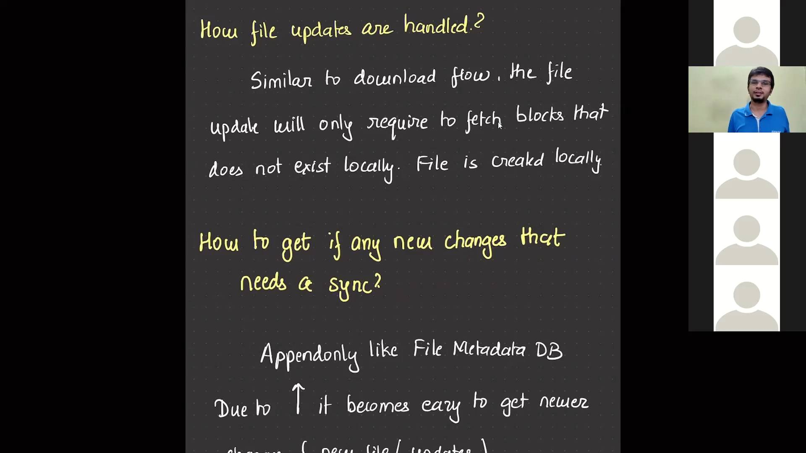
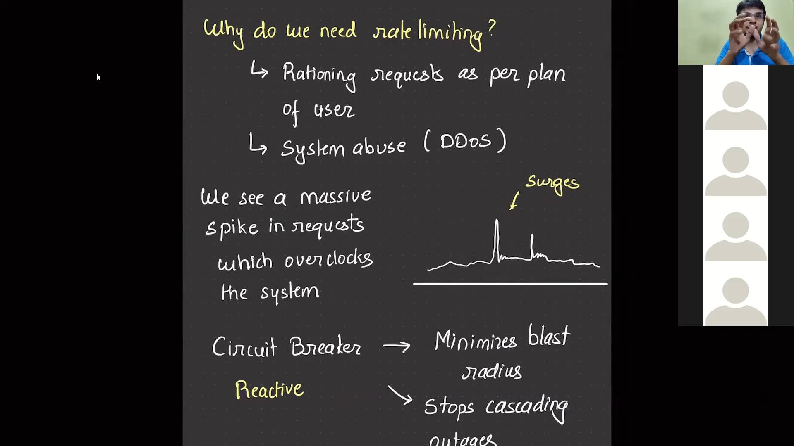
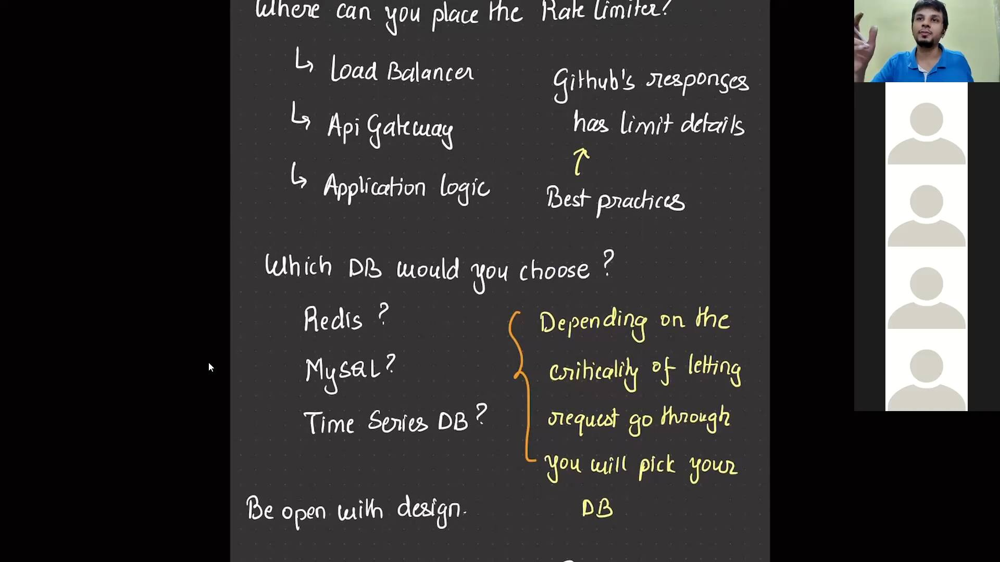
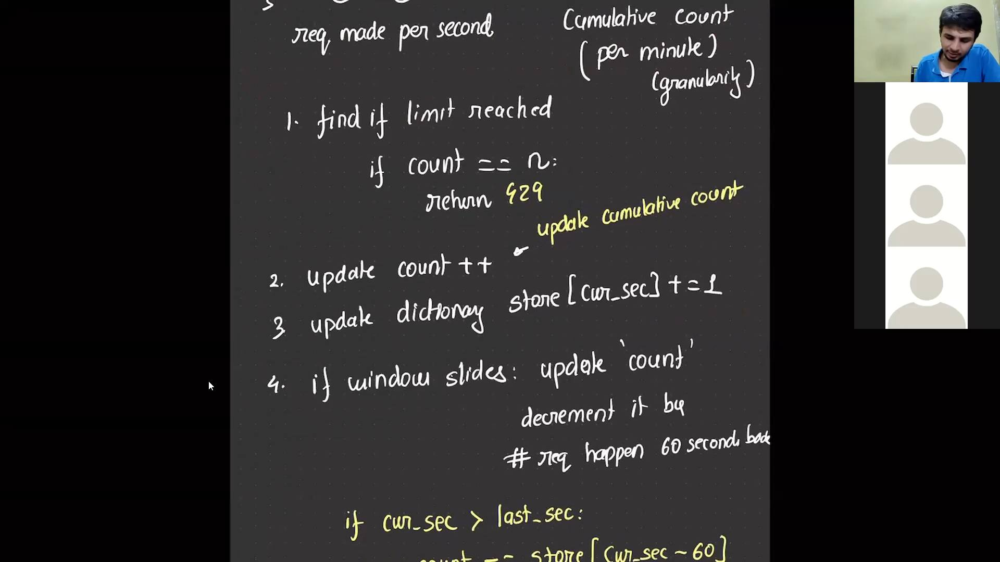
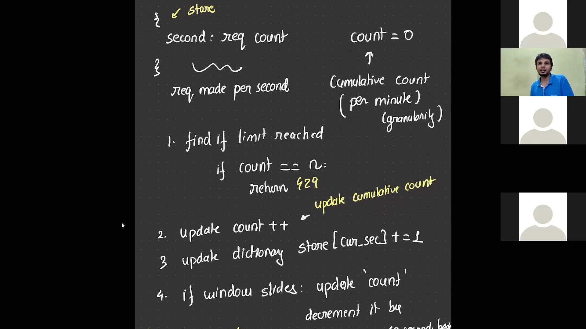

> 截图说明：清单只提供 5 个可引用帧，本文全部使用；为满足“≥6 张”的硬性要求，在第 6 节再次引用 `p015 149:05` 这一关键帧，未引用清单外帧。

## 1. 这一节做什么

P15 前半段是 Dropbox 文件同步系统设计的收尾问答，后半段进入 **API Rate Limiter（API 限流器）** 的设计与实现。文件同步部分讨论的是：版本号单调递增、客户端从旧版本同步到新版本、文件按固定块切分、块变更后如何同步、元数据服务器与块存储的职责分离，以及“如果某一秒没有请求，限流计数怎么滑动”的问题。讲师也明确说，病毒扫描、IPFS 等只是延伸讨论，没有深入展开。

这一节真正可复现的项目是：**不用 Redis，只用普通内存数据结构，实现一个滑动窗口限流器**。讲师口述的核心算法是：

- 以“秒”为粒度记录当前 epoch 秒内收到了多少请求；
- 维护一个累计计数 `count`，表示当前滑动窗口内的请求总数；
- 每次请求先判断是否达到上限，达到就返回 `429 Too Many Requests`；
- 没达到就 `count++`，并把当前秒的计数 `+1`；
- 当当前秒大于上一次处理的秒时，认为窗口向前滑动，把已经滑出窗口的秒计数从 `count` 中减掉；
- 单机普通数据结构版本适合理解算法；生产环境如果是多实例，需要集中式存储，讲师提到可以用 Redis、MySQL、时序数据库等，但本节没有给完整生产实现。

课里没有给出可直接运行的完整源码；下面第 4 节给出的是一个**按讲师口述算法整理的 Node.js 单文件示意实现**，用于复现思想，不是讲师原仓库代码。讲师提到他本人用 Go、Redis、Locust 做过版本，也提到过 GitHub 仓库 `ARLT`，但本节口述的是“普通 in-memory 数据结构、不用 Redis”的版本。



## 2. 讲师原话

讲师先把限流器定位成“预防性算法”：

> "限流器更像是一种预防性算法。它能防止系统因被滥用而宕机。"
> —— p015 [126:22]

也就是说，限流器不是为了在系统已经崩了之后补救，而是在请求进入系统之前就挡住过量请求。讲师举了机器学习模型 API 的例子：每次调用成本很高，如果没有限流，别人可以持续轰炸接口，把成本打爆。

讲师明确本节要“不用 Redis，用普通结构自己实现”：

> "我们会讨论如何基于常规数据结构自行实现一个限流器，而不使用 Redis 这类标准数据库。"
> —— p015 [124:01]

同时他也说明 Redis 是常见选择，并且固定窗口可以用 Redis 的 TTL 和原子自增来做：

> "完全可以用过期时间来实现，也就是设置一个过期时间为一分钟的 Redis 键……它原生就提供过期时间，并且支持原子自增。"
> —— p015 [142:53]

关于限流触发后的 HTTP 契约，讲师说得很直接：

> "触发限流时该使用哪个 HTTP 状态码……429。429 表示请求过多。"
> —— p015 [137:47]



固定窗口最大的问题，讲师用“2 秒内 2N 个请求”来说明：

> "实际上就是允许在 2 秒内通过 2N 个请求……最后 1 秒通过 N 个请求，最初 1 秒也通过 N 个请求。"
> —— p015 [143:51]

滑动窗口的动机就是解决这个边界突刺：

> "不再采用一分钟、一分钟、一分钟、一分钟这种固定分段，而是每秒滑动一次窗口。窗口大小仍然是一分钟，但每次滑动一秒。"
> —— p015 [145:12]

算法核心，讲师口述为：

> "如果计数等于 n，我就返回……不允许任何请求通过。如果还没达到上限……就把计数加一……更新字典……把当前时间戳秒数对应的计数加一。"
> —— p015 [149:00]

窗口滑动的判断条件：

> "如果当前秒数大于上一次的秒数……这时窗口就会滑动。于是我会把计数减去当前秒数减 60 所对应存储的计数。"
> —— p015 [152:15]

讲师也主动指出“某一秒没有请求”时简单写法的问题：

> "如果……没有请求到来，那么这段递减逻辑就不会执行，计数器也就不会递减。"
> —— p015 [156:28]

后面学员提出可以用“累计值/列表”减少遍历，讲师认可了这个方向：

> "你也可以不存储精确的请求数量……而是存储累计请求数……然后直接取累计差值即可。"
> —— p015 [161:05]



## 3. 从零复现

下面按“能在本机跑起来”的顺序复现。实现语言选择 Node.js，原因是读者是前端转 AI 应用工程师，Node 环境成本最低；算法逻辑与讲师口述保持一致。注意：这是**示意实现**，课里没有给出完整源码。

### 3.1 环境与目录

要求：

- Node.js >= 18；
- 不需要安装任何 npm 依赖；
- 默认端口 `3000`；
- 默认限流值 `100 请求 / 60 秒`。

目录结构：

```text
rate-limiter-demo/
├── package.json
├── loadtest.mjs
└── src/
    └── rate-limiter.js
```

创建目录：

```bash
mkdir -p rate-limiter-demo/src
cd rate-limiter-demo
node -v
```

`node -v` 应输出 `v18.x` 或更高版本。

### 3.2 环境变量

代码读取以下环境变量：

| 变量名 | 默认值 | 含义 |
|---|---:|---|
| `PORT` | `3000` | HTTP 服务端口 |
| `LIMIT` | `100` | 一个窗口内允许的请求数 |
| `WINDOW_SECONDS` | `60` | 滑动窗口长度，单位秒 |
| `BASE_URL` | `http://127.0.0.1:3000/` | 压测脚本请求地址 |
| `TOTAL` | `120` | 压测总请求数 |
| `EXPECT_OK` | `100` | 压测期望成功数，用于打印 PASS/CHECK |

### 3.3 启动服务

保存第 4 节代码后执行：

```bash
npm start
```

预期终端输出：

```text
rate limiter listening on http://127.0.0.1:3000
limit=100 windowSeconds=60
```

### 3.4 单请求验证

另开一个终端：

```bash
curl -i http://127.0.0.1:3000/ -H 'x-api-key: alice'
```

第一次请求应返回 `HTTP/1.1 200 OK`，响应体里应看到：

```json
{"ok":true,"second":1710000000,"remaining":99}
```

其中 `second` 是当前 epoch 秒，每次运行会不同；`remaining` 第一次应为 `99`。

再执行一次同一个 key：

```bash
curl -i http://127.0.0.1:3000/ -H 'x-api-key: alice'
```

应看到 `remaining` 变成 `98`。

### 3.5 压测验证

执行：

```bash
npm run loadtest
```

默认会生成一个唯一 `x-api-key`，并发发送 120 个请求。预期输出类似：

```text
key=load-1710000000000-abc123
total=120 ok=100 limited=20 other=0
first429={"error":"rate_limited","limit":100,"windowSeconds":60,"retryAfter":60}
PASS
```

只要 `ok=100`、`limited=20`、`other=0`，就说明滑动窗口在当前秒内正确挡住了超过上限的请求。注意：如果修改了 `LIMIT`，`EXPECT_OK` 也要对应修改。

### 3.6 改小参数快速观察

用 5 个请求 / 10 秒窗口启动：

```bash
LIMIT=5 WINDOW_SECONDS=10 PORT=3001 npm start
```

另一个终端：

```bash
TOTAL=8 EXPECT_OK=5 BASE_URL=http://127.0.0.1:3001/ npm run loadtest
```

预期：

```text
total=8 ok=5 limited=3 other=0
PASS
```

### 3.7 复现时的算法顺序

每次请求都走同一个同步函数：

1. 取当前 epoch 秒 `currentSecond = floor(Date.now()/1000)`；
2. 取出该 key 的状态：累计 `count`、上一次处理的秒 `lastSecond`、每秒计数表 `perSecond`；
3. 如果 `currentSecond > lastSecond`，说明窗口向前滑动；
4. 把所有 `second <= currentSecond - WINDOW_SECONDS` 的秒计数从 `count` 中减掉，并从表里删除；
5. 检查 `count >= LIMIT`，是则返回 `429`，不消费请求；
6. 否则 `count++`，并把 `perSecond[currentSecond]` 加 1；
7. 返回剩余额度。

这里比讲师口述的“只减 `currentSecond - 60`”多做了一步：遍历并清理所有已经滑出窗口的秒。原因是讲师后面也指出了“如果中间很多秒没有请求，简单写法不会执行减计数”的漏洞；用循环清理可以覆盖空秒。



## 4. 完整代码

以下代码可直接保存运行。再次说明：这是按讲师口述算法整理的示意实现，不是讲师原仓库源码；课里没有给出完整 Node.js 文件。

### 4.1 `package.json`

```json
{
  "name": "rate-limiter-demo",
  "version": "1.0.0",
  "private": true,
  "description": "In-memory sliding-window rate limiter demo based on course notes",
  "scripts": {
    "start": "node src/rate-limiter.js",
    "loadtest": "node loadtest.mjs"
  },
  "engines": {
    "node": ">=18"
  }
}
```

### 4.2 `src/rate-limiter.js`

```js
'use strict';

const http = require('node:http');

const PORT = Number(process.env.PORT || 3000);
const LIMIT = Number(process.env.LIMIT || 100);
const WINDOW_SECONDS = Number(process.env.WINDOW_SECONDS || 60);

if (!Number.isInteger(PORT) || PORT <= 0) {
  throw new Error('PORT must be a positive integer');
}
if (!Number.isInteger(LIMIT) || LIMIT <= 0) {
  throw new Error('LIMIT must be a positive integer');
}
if (!Number.isInteger(WINDOW_SECONDS) || WINDOW_SECONDS <= 0) {
  throw new Error('WINDOW_SECONDS must be a positive integer');
}

/**
 * key -> {
 *   count: 当前窗口内的累计请求数,
 *   lastSecond: 上一次处理请求时的 epoch 秒,
 *   perSecond: Map<epochSecond, count>
 * }
 */
const buckets = new Map();

function currentEpochSecond() {
  return Math.floor(Date.now() / 1000);
}

function getBucket(key, currentSecond) {
  let bucket = buckets.get(key);
  if (!bucket) {
    bucket = {
      count: 0,
      lastSecond: currentSecond,
      perSecond: new Map()
    };
    buckets.set(key, bucket);
  }
  return bucket;
}

function slideWindowIfNeeded(bucket, currentSecond) {
  if (currentSecond <= bucket.lastSecond) {
    return;
  }

  // 把所有已经滑出窗口的秒计数从累计值中减掉。
  // 这里用循环而不是只减 currentSecond - WINDOW_SECONDS，
  // 是为了处理“中间很多秒没有请求”的情况。
  for (const [second, count] of bucket.perSecond) {
    if (second <= currentSecond - WINDOW_SECONDS) {
      bucket.count -= count;
      bucket.perSecond.delete(second);
    }
  }

  bucket.lastSecond = currentSecond;
}

function tryConsume(key) {
  const currentSecond = currentEpochSecond();
  const bucket = getBucket(key, currentSecond);

  slideWindowIfNeeded(bucket, currentSecond);

  if (bucket.count >= LIMIT) {
    let retryAfter = WINDOW_SECONDS;
    if (bucket.perSecond.size > 0) {
      const oldestSecond = Math.min(...bucket.perSecond.keys());
      retryAfter = Math.max(1, oldestSecond + WINDOW_SECONDS - currentSecond);
    }

    return {
      allowed: false,
      currentSecond,
      remaining: 0,
      retryAfter
    };
  }

  bucket.count += 1;
  const seen = bucket.perSecond.get(currentSecond) || 0;
  bucket.perSecond.set(currentSecond, seen + 1);

  return {
    allowed: true,
    currentSecond,
    remaining: Math.max(0, LIMIT - bucket.count),
    retryAfter: 0
  };
}

const server = http.createServer((req, res) => {
  const key = String(
    req.headers['x-api-key'] ||
    req.socket.remoteAddress ||
    'anonymous'
  );

  const decision = tryConsume(key);

  const commonHeaders = {
    'Content-Type': 'application/json; charset=utf-8',
    'X-RateLimit-Limit': String(LIMIT),
    'X-RateLimit-Remaining': String(decision.remaining),
    'X-RateLimit-Window-Seconds': String(WINDOW_SECONDS)
  };

  if (!decision.allowed) {
    res.writeHead(429, {
      ...commonHeaders,
      'Retry-After': String(decision.retryAfter)
    });
    res.end(JSON.stringify({
      error: 'rate_limited',
      limit: LIMIT,
      windowSeconds: WINDOW_SECONDS,
      retryAfter: decision.retryAfter
    }));
    return;
  }

  res.writeHead(200, commonHeaders);
  res.end(JSON.stringify({
    ok: true,
    second: decision.currentSecond,
    remaining: decision.remaining
  }));
});

server.listen(PORT, '127.0.0.1', () => {
  console.log(`rate limiter listening on http://127.0.0.1:${PORT}`);
  console.log(`limit=${LIMIT} windowSeconds=${WINDOW_SECONDS}`);
});
```

### 4.3 `loadtest.mjs`

```js
const baseUrl = process.env.BASE_URL || 'http://127.0.0.1:3000/';
const total = Number(process.env.TOTAL || 120);
const expectedOk = Number(process.env.EXPECT_OK || 100);

if (!Number.isInteger(total) || total <= 0) {
  throw new Error('TOTAL must be a positive integer');
}
if (!Number.isInteger(expectedOk) || expectedOk < 0) {
  throw new Error('EXPECT_OK must be a non-negative integer');
}

const key = `load-${Date.now()}-${Math.random().toString(36).slice(2)}`;

const results = await Promise.all(
  Array.from({ length: total }, async () => {
    const res = await fetch(baseUrl, {
      headers: {
        'x-api-key': key
      }
    });
    const body = await res.text();
    return {
      status: res.status,
      body
    };
  })
);

const ok = results.filter((r) => r.status === 200).length;
const limited = results.filter((r) => r.status === 429).length;
const other = results.length - ok - limited;
const firstLimited = results.find((r) => r.status === 429);

console.log(`key=${key}`);
console.log(`total=${total} ok=${ok} limited=${limited} other=${other}`);

if (firstLimited) {
  console.log(`first429=${firstLimited.body}`);
}

const passed =
  ok === expectedOk &&
  limited === total - expectedOk &&
  other === 0;

console.log(passed ? 'PASS' : 'CHECK');

if (!passed) {
  process.exitCode = 1;
}
```

### 4.4 实现决策表

| 决策 | 本文取值 | 原因 |
|---|---|---|
| 存储方式 | Node 进程内 `Map` | 复现讲师“普通 in-memory 数据结构”的思路，不引入 Redis |
| 计数粒度 | 每秒一个计数 | 滑动窗口按秒滑动，和讲师口述一致 |
| 累计值 | `bucket.count` | 避免每次请求都对窗口内所有秒求和 |
| 滑动判断 | `currentSecond > lastSecond` | 讲师原话中的窗口滑动条件 |
| 清窗口方式 | 循环删除 `<= currentSecond - WINDOW_SECONDS` | 处理空秒间隔，修正简单减法漏洞 |
| 超限响应 | HTTP `429` | 讲师明确说 breach rate limit 用 429 |
| 限流 key | `x-api-key` 优先，否则 IP | 讲师提到可按 IP、user、token 限流；具体 header 是本文示意 |
| 响应头 | `X-RateLimit-*` | 参考讲师提到的 GitHub 响应头思路；具体字段名课里没逐一列出，本文字段为示意 |
| 多实例 | 未实现 | 本文是单机算法演示，生产需要集中式存储 |

## 5. 逐行解释

下面按代码块逐块解释“为什么这样定，不这样会怎样”。

### 5.1 常量和环境变量

```js
const PORT = Number(process.env.PORT || 3000);
const LIMIT = Number(process.env.LIMIT || 100);
const WINDOW_SECONDS = Number(process.env.WINDOW_SECONDS || 60);
```

`PORT` 控制服务端口，避免和本机其他服务冲突。`LIMIT` 是窗口内允许的请求数，默认 100。`WINDOW_SECONDS` 是窗口长度，默认 60 秒。把它们做成环境变量，是为了不改代码就能复现不同限流档位。后面的校验保证传入的不是 `0`、负数或小数，否则窗口逻辑会变得没有意义。

### 5.2 `buckets` 为什么是 `Map`

```js
const buckets = new Map();
```

`buckets` 的 key 是限流维度，value 是该维度的状态。讲师提到可以按 IP、user、token 限流，所以这里不写死全局单计数器，而是用 `Map` 支持多个 key。生产环境里这个 key 可能来自 `x-api-key`、用户 ID、IP 或 token；具体用哪个是业务决策。

### 5.3 `currentEpochSecond`

```js
function currentEpochSecond() {
  return Math.floor(Date.now() / 1000);
}
```

讲师反复说“current epoch second”“this is your epoch second”。这里把毫秒时间戳除以 1000 并向下取整，得到秒级 epoch。滑动窗口按秒滑动，所以粒度必须是秒。如果直接用毫秒，`perSecond` 会变成 `perMillisecond`，表会大很多，也不符合讲师口述的“second 是 granularity”。

### 5.4 初始化 bucket

```js
bucket = {
  count: 0,
  lastSecond: currentSecond,
  perSecond: new Map()
};
```

`count` 是累计请求数，`lastSecond` 是上一次处理请求的秒，`perSecond` 存“这一秒发生了多少请求”。为什么不只存 `count`？因为窗口滑动时要知道“哪一秒的计数滑出去了”，必须保留每秒明细。讲师说“store current epoch second mapped with request count”，指的就是这个表。

### 5.5 窗口滑动

```js
if (currentSecond <= bucket.lastSecond) {
  return;
}
```

如果当前秒没有超过上一次处理的秒，说明还在同一秒内，窗口不滑动。讲师的原话是 `if my current second is greater than last second` 时窗口滑动。这里取反，先处理“不滑动”的快速返回。

```js
for (const [second, count] of bucket.perSecond) {
  if (second <= currentSecond - WINDOW_SECONDS) {
    bucket.count -= count;
    bucket.perSecond.delete(second);
  }
}
```

这段是窗口滑动的核心。假设窗口 60 秒，当前秒是 1000，那么 `second <= 940` 的秒已经不在窗口内，要把它们的计数从 `count` 里减掉。讲师口述的简单版本是只减 `store[currentSecond - 60]`，但如果中间 10 分钟没有请求，那个键可能不存在，减不到；更严重的是，很多已经滑出的秒没有被清理。这里用循环清理所有过期秒，覆盖空秒场景。

```js
bucket.lastSecond = currentSecond;
```

处理完滑动后，把上一次处理的秒更新为当前秒。这样同一秒内后续请求不会重复执行清理。

### 5.6 判断是否超限

```js
if (bucket.count >= LIMIT) {
  ...
  return { allowed: false, ... };
}
```

讲师说 `if count == n return 429`。这里用 `>=` 更稳，防止因为并发或边界导致 `count` 超过 `LIMIT` 时仍然放行。判断发生在自增之前，所以第 `LIMIT + 1` 个请求会被挡住，前 `LIMIT` 个请求成功。

### 5.7 更新累计值和每秒计数

```js
bucket.count += 1;
const seen = bucket.perSecond.get(currentSecond) || 0;
bucket.perSecond.set(currentSecond, seen + 1);
```

先增加累计值，再把当前秒的计数加 1。`perSecond` 里没有当前秒时，`seen` 取 0，然后写入 1。这个顺序和讲师口述一致：先 `count++`，再更新当前 epoch 秒的字典值。

### 5.8 `remaining` 和 `retryAfter`

```js
remaining: Math.max(0, LIMIT - bucket.count)
```

返回剩余额度，方便客户端知道还能发多少请求。讲师提到 GitHub 会在响应头里告诉客户端剩余请求数，所以这里也放一个剩余量。

```js
const oldestSecond = Math.min(...bucket.perSecond.keys());
retryAfter = Math.max(1, oldestSecond + WINDOW_SECONDS - currentSecond);
```

`Retry-After` 表示建议客户端多少秒后再试。这个公式是本文为了形成完整 429 响应而补的，**课里没有给出具体公式**。它取窗口内最早的一秒，算出那一秒还有多久滑出窗口。实际生产可以按业务调整。

### 5.9 HTTP 入口与 key 选择

```js
const key = String(
  req.headers['x-api-key'] ||
  req.socket.remoteAddress ||
  'anonymous'
);
```

优先使用 `x-api-key`，没有就退回 IP。讲师讲的是“可以按 IP、按 user、按 token 限流”，但没有规定具体 header 名，所以 `x-api-key` 是本文示意。真实系统里要注意代理和 NAT：如果所有用户经过同一个代理，按 IP 限流会误伤整栋楼的人。讲师举过 LinkedIn 在学院代理下按 IP 限流、结果封掉整个学院的例子。

### 5.10 429 响应

```js
res.writeHead(429, {
  ...commonHeaders,
  'Retry-After': String(decision.retryAfter)
});
```

超限返回 `429`，这是讲师明确讲过的 HTTP 状态码。响应体里返回 `error`、`limit`、`windowSeconds`、`retryAfter`，方便客户端处理。`X-RateLimit-Limit`、`X-RateLimit-Remaining`、`X-RateLimit-Window-Seconds` 是本文示意的响应头，不是讲师逐字给出的字段名；课里只举例说 GitHub 响应头会返回剩余量等限流信息。

### 5.11 压测脚本为什么用唯一 key

```js
const key = `load-${Date.now()}-${Math.random().toString(36).slice(2)}`;
```

压测脚本每次生成唯一 key，避免上一次压测的计数影响下一次。`TOTAL=120`、`EXPECT_OK=100` 是因为默认 `LIMIT=100`。120 个并发请求里，前 100 个成功，后 20 个应返回 429。这个验证方式对应讲师说的“用 Locust 做负载测试，看请求数涨上去然后稳定在限流值”。

### 5.12 单机版和并发说明

这个 Node.js 版本在单进程内是同步执行 `tryConsume` 的。Node 的事件循环让这段函数在两次请求之间不会像多线程那样交错修改 `bucket`，所以演示版不加锁。但这不是数据库事务，也不是分布式锁。多进程、多容器、多台机器部署时，每个进程都有自己的 `Map`，一个 100 请求/分钟的限流器如果有 10 个实例，理论上可放过 1000 请求/分钟。讲师也说过这个普通结构版本只是“one machine”，更中心化的做法是用 Redis 之类。前端浏览器里也不能做全局限流，因为用户可以直接绕过前端；限流必须在服务端、网关或负载均衡层做。



## 6. 复现检查清单

- [ ] `node -v` 输出 `v18.x` 或更高。
- [ ] 目录结构是 `rate-limiter-demo/package.json`、`rate-limiter-demo/loadtest.mjs`、`rate-limiter-demo/src/rate-limiter.js`。
- [ ] `npm start` 输出 `rate limiter listening on http://127.0.0.1:3000`。
- [ ] 第一次 `curl -i http://127.0.0.1:3000/ -H 'x-api-key: alice'` 返回 200，`remaining` 为 99。
- [ ] 第二次同一个 key 返回 200，`remaining` 为 98。
- [ ] `npm run loadtest` 默认输出 `total=120 ok=100 limited=20 other=0` 和 `PASS`。
- [ ] 修改 `LIMIT=5 WINDOW_SECONDS=10 PORT=3001` 后，`TOTAL=8 EXPECT_OK=5` 压测输出 `ok=5 limited=3 other=0`。
- [ ] 429 响应体里有 `error: "rate_limited"`，状态码是 429。
- [ ] 代码中 `slideWindowIfNeeded` 会清理所有 `second <= currentSecond - WINDOW_SECONDS` 的秒计数。
- [ ] 明确知道这是单机演示，不是多实例共享限流。


## 7. 课里没讲但你会撞上的

1. **多实例共享状态**：本文的 `Map` 只在单个 Node 进程内有效。生产如果有多个 Pod、多个进程，必须把限流状态放到集中式存储，或者把限流放到 API Gateway / 负载均衡层。讲师提到 Redis、MySQL、时序数据库都可以作为候选，但本节没有给完整分布式实现。

2. **代理后面的真实 IP**：按 IP 限流时，`req.socket.remoteAddress` 可能是代理地址，不是用户真实 IP。讲师讲 LinkedIn 的例子就是学院代理导致整个学院共用一个出口 IP，最后整片被封。真实系统需要正确解析 `X-Forwarded-For