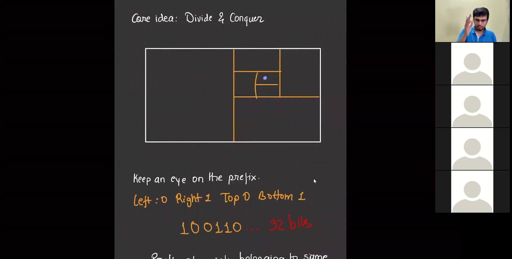
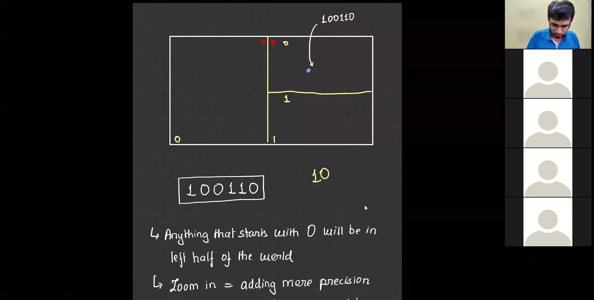
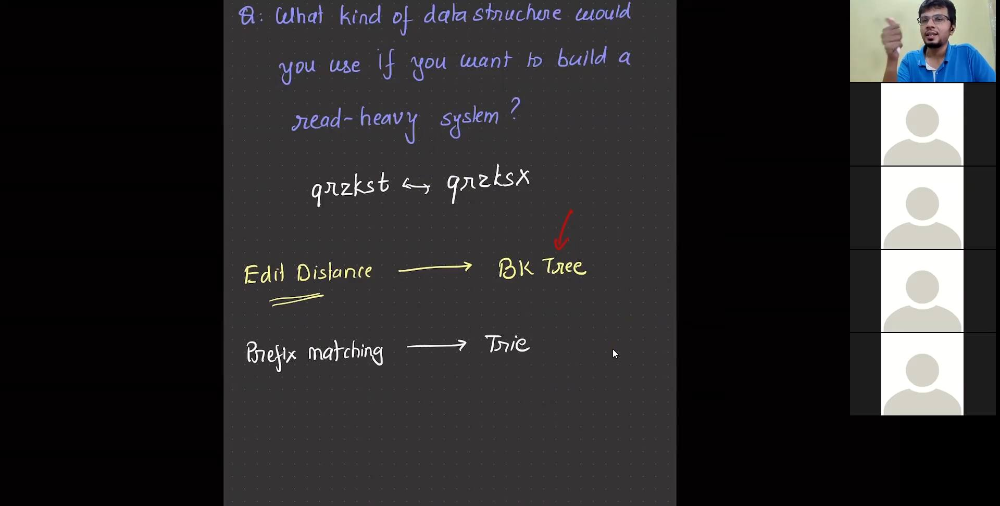
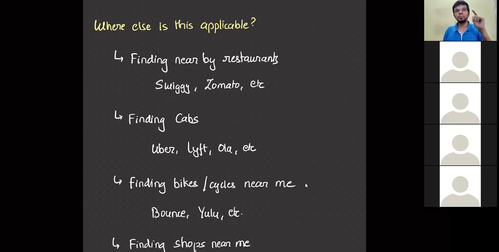

# P16 GeoHash、附近的人与点在多边形内：可复现设计文档

> 说明：本文只依据给定的 p016 逐字稿（标注为“第 1/2 段，0:00–67:46”）与 7 张截图清单写作。p016 的后半段没有提供，本文不推断后半段内容。  
> 这节是**纯讲解课**：逐字稿里没有给出项目仓库、依赖版本、环境变量、启动命令或完整业务代码。因此本文的“复现”是复现讲师的**推导过程与设计产物**，不是伪造一个“课程项目”并声称它能启动。文中所有数值算例都明确标注为“算术示例”，不是讲师给出的生产容量数据。

## 1. 这一节做什么

P16 的主题是“地理位置系统怎么设计”。讲师没有从某个框架或某段代码开始，而是从几个真实产品问题切入，最后落到两个核心算法/数据结构：

1. **附近的人 / 附近的门店**：Tinder、Uber、Ola、Swiggy、Zomato、Google Maps 这类系统，核心问题不是“数据库怎么分库分表”，而是“给定我的经纬度，怎样在 k 公里内快速找到其他人或店”。讲师明确说，Tinder 最核心的挑战是找附近的人，第二个挑战是“我已经左滑/右滑过的人不要再次出现”。附近的人用 GeoHash 的“分治 + 前缀相似”思路；已滑过的人用 Bloom Filter 过滤。  
2. **位置更新与附近查询的工程形态**：客户端周期性上报经纬度，API 服务器写入 Redis 这样的地理查询存储；查询时按半径找候选。讲师多次提到 Redis 的 Geo 查询、`Geo Add`、`Geo Radius`，并说 Zomato 一类系统会把“附近门店”的候选列表交给广告/排序系统继续处理。  
3. **点是否在多边形内**：当用户进入机场、商场、小区某栋楼、某个地理围栏时，系统要判断“这个经纬度点是否落在多边形边界内”。讲师用“从点向右发射线，数与多边形边的交点个数”的 ray casting 思路讲清楚：奇数在内部，偶数在外部；再用 bounding box 和斜率比较处理中间难以判断的情况。

这一节最终应该产出的不是“一个能启动的 Web 项目”，而是一套可评审的设计材料：需求、约束、估算、方案、取舍、数据模型、接口草案、验证用例和风险清单。下面按这个目标写。

## 2. 讲师原话（带「—— p016 [MM:SS]」）

讲师先把 Tinder 的问题拆成两个：

> "Tinder 的第二大问题是什么？你是否已经滑过……布隆过滤器是解决这个问题的最佳方式。"
> —— p016 [04:38] / [05:36]

然后给出第一个问题的核心定义：

> "距离你最近的、半径 k 公里以内的人，这就是核心问题陈述。"
> —— p016 [06:05]

为什么不能直接暴力算？讲师说：

> "复杂度是 n 的平方，那会非常慢。"
> —— p016 [07:30]

GeoHash 的核心是分治：

> "Geohash 的核心思想是分而治之。"
> —— p016 [14:06]

前缀为什么能代表“近”：

> "如果前缀相似，这些点就彼此接近。"
> —— p016 [19:24]

但讲师也主动指出边界反例：

> "现实世界中实际上更近的两个点，可能看起来相距太远。"
> —— p016 [29:11]

为了让人可读，实际 geohash 使用 Base32 字符：

> "进制被改变了，把它转换成 32 进制数。"
> —— p016 [30:04]

低规模时可以先在 SQL 里做前缀匹配：

> "geohash 的子串取前五个字符，基本上前五个字符应该匹配。"
> —— p016 [38:33]

讲师在这里同时说了 `TDR1V` 和 `PDR1` 两个写法，逐字稿本身并不完全一致，所以本文不把某个具体字符串当成 Bangalore 的权威 geohash；只保留“前缀匹配”的设计思想。

Redis 提供现成地理查询：

> "Redis 开箱即支持地理查询，Geo radius 就是那个查询。"
> —— p016 [39:02] / [43:44]

地理围栏的问题定义：

> "给定一个点和一个多边形，判断这个点是否位于多边形内部。"
> —— p016 [52:14]

点是否在多边形内，用射线交点奇偶判断：

> "如果这个点与多边形相交奇数次，就在内部。"
> —— p016 [55:01]

多边形如何表示：

> "表示多边形的典型方式是使用一个点数组，这些点构成有序的边。"
> —— p016 [56:27]

边界情况再用斜率判断：

> "比较 AB 和 AP 的斜率。"
> —— p016 [67:16]

## 3. 从零复现

这一章按“需求 → 约束 → 估算 → 方案 → 取舍”的顺序复现讲师的推导。注意：这是设计复现，不是启动服务。

### 3.1 需求

先把需求写成可以实现和验收的形式：

| 编号 | 需求 | 输入 | 输出 | 讲师依据 |
|---|---|---|---|---|
| R1 | 查找附近的人/店 | 我的经纬度 `lat, long`、半径 `k km` | 半径内候选用户/门店列表 | p016 [06:05] |
| R2 | 过滤已经滑过的人 | 当前用户 key、候选 key 集合 | 去掉已滑过用户的候选 | p016 [04:38]–[05:36] |
| R3 | 判断点是否落在多边形内 | 点 `P(x,y)`、有序多边形点数组 | 在内部 / 在外部 | p016 [52:14] |
| R4 | 支持位置动态更新 | 用户 key、最新经纬度 | 覆盖旧位置或写入新位置 | p016 [40:57] |
| R5 | 支持按半径查询 | 查询点、半径、单位 | 半径内结果 | p016 [39:31] |

R2 在讲师口中是 Tinder 的“第二个最大问题”：已经左滑/右滑过的人，即便坐在隔壁桌，也不应该再次出现在自己的候选里。R3 的应用是机场欢迎语、商场微定位、地理围栏提醒、外卖/快递导航到具体楼栋或大门。

### 3.2 约束

1. **二维空间最近邻不是天然可索引的简单问题**。讲师用“K-means 也要扫所有数据点”的类比说明：在二维平面上，如果不做空间划分，很难直接知道谁离你近。  
2. **暴力两两比较是 `O(n²)` 或至少是“对每个查询者扫描所有候选”**。讲师说 `n squared` 会非常慢。  
3. **用户会移动**。不能只在城市、街区这种层级给用户打静态标签，因为用户会从 A 街区移动到 B 街区。经纬度表示本身相对稳定，适合作为统一表示。  
4. **32 bit 精度、Base32 可读性、边界误差**是 GeoHash 方案自带的约束。  
5. **多边形边界有特殊情况**：射线穿过顶点、射线与边平行、点在边上。讲师说这些是 edge case，但逐字稿没有给出最终 tie-break 规则。  
6. **p016 没有给出实际 QPS、数据量、Redis 版本和部署拓扑**。所以下文的估算只能作为“设计算例”。

### 3.3 估算：把算式写出来

以下是算术示例，不是讲师给出的生产数字。

#### 3.3.1 位置写入 QPS

设城市内活跃用户数为 `N_active`，客户端每 `T_update` 秒上报一次位置：

`写入 QPS = N_active / T_update`

| 算例 | 算式 | 结果 |
|---|---|---|
| 10 万活跃用户，5 秒一次 | `100000 / 5` | `20000` 次/秒 |
| 100 万活跃用户，5 秒一次 | `1000000 / 5` | `200000` 次/秒 |

讲师在 [41:24] 用过“every five seconds”这个例子，但没有说真实系统一定用 5 秒。这个值必须根据产品、耗电、网络、精度要求重新定。

#### 3.3.2 附近查询 QPS

设每个活跃用户平均每 `T_query` 秒发起一次附近查询：

`查询 QPS = N_active / T_query`

例如 `N_active = 1000000`、`T_query = 10`，则：

`1000000 / 10 = 100000` 次/秒。

查询间隔是本文为了展示算式而设的假设，逐字稿没有给这个数。

#### 3.3.3 前缀位数与候选数量

若使用 `b` 个二进制位做前缀，空间被分成 `2^b` 个格子；在“均匀分布”的假设下，每个格子的平均候选数为：

`C_avg ≈ N / 2^b`

| 前缀位数 `b` | `2^b` | 100 万用户时平均候选 `C_avg` | 说明 |
|---|---:|---:|---|
| 10 | 1024 | ≈ 977 | 格子大、候选多、精确半径验证压力大 |
| 15 | 32768 | ≈ 31 | 候选明显减少 |
| 20 | 1048576 | ≈ 0.95 | 格子很细，可能一个格子只有很少人，但需要处理边界和邻格 |

这个公式只说明趋势。真实城市人口密度不均匀，不能拿平均值直接当生产容量。

#### 3.3.4 Base32 字符数与位数

GeoHash 常见做法是把二进制位转成 Base32 字符。若字符数为 `L`，则大致承载：

`bits = 5 × L`

| 字符数 `L` | 承载位数 `5L` | 说明 |
|---:|---:|---|
| 5 | 25 bit | 适合较粗范围，讲师 SQL 示例里用过 5 个字符的思路 |
| 6 | 30 bit | 比 5 字符更细 |
| 7 | 35 bit | 足以覆盖 32 bit 的整数精度 |

32 bit 整数若用 Base32 表示，向上取整约需要 `ceil(32/5)=7` 个字符。讲师在 [28:13] 提到“32 bit precision 可以到平方毫米级”，这是课堂上的说法；实际精度必须按具体经纬度范围和编码实现实测，逐字稿没有给出精度公式。

#### 3.3.5 存储条目的最低估算

存储条目数至少与需要被查询的位置对象数量同阶：

`entries ≈ N_active + N_places`

如果只做“人找附近的人”，就是活跃用户数；如果做“人找附近门店”，还要加上门店/多边形对象。Redis 内部对象开销、过期策略、副本数逐字稿没有讲，不能凭这个算式直接报内存。

### 3.4 方案

#### 步骤 1：把经纬度转成可比较的二进制前缀

讲师用“世界矩形”解释：

- 先竖着切一刀，左边记 `0`，右边记 `1`；
- 再横着切，上边记 `0`，下边记 `1`；
- 然后在选中的半区里继续竖切、横切；
- 点落在哪边，就追加对应的 bit；
- 不断二分，直到达到需要的精度。

逐字稿中的示例位串是 `1 0 0 1 1 0`。它表示对某个紫色点连续做垂直/水平划分后得到的路径。

关键结论：**前缀相同或相似的点，在空间上更接近**。所有在世界右半边的点都以 `1` 开头；所有在某个右半区再上半区的点都以 `10` 开头。这样“远近”就变成了“前缀匹配”。

#### 步骤 2：选择精度

精度越高，前缀越长，候选越少，但查询边界越难处理；精度越低，候选越多，半径过滤越重。选择方式：

- 先确定业务半径 `k`；
- 用估算表选择初始 `b` 或字符数 `L`；
- 用真实城市数据压测候选数量；
- 如果候选太多，增加前缀位数；如果边界漏召回明显，减少前缀位数或补查邻格；
- 不要直接照搬 `32 bit = 平方毫米` 的说法到业务表，必须实测。

#### 步骤 3：用前缀匹配找候选

讲师给出两条路线：

1. **纯前缀匹配**：所有候选的 geohash 前缀与查询前缀相同。数据结构可用 Trie（前缀树）。  
2. **允许少量编辑距离的模糊前缀匹配**：如果两个点实际很近，但 geohash 前缀中间有个别字符不同，可以找“最长公共前缀 + 最小编辑距离”的字符串。讲师提到 BK-tree，并说 Elasticsearch 的 fuzzy search 也会用类似 BK-tree 的思路。  
3. **低规模直接用 SQL**：用 geohash 前 5 个字符的子串匹配，找到同粗粒度区域的人。  
4. **生产便利路线用 Redis**：把 key 和经纬度写入 Redis Geo 结构，查询时用半径查询。讲师说 Redis 支持 geo query out of the box，使用的是整数表示。

#### 步骤 4：过滤已滑过的人

Tinder 的第二个问题：候选里不能出现我已经左滑/右滑过的人。讲师明确说 Bloom Filter 是最好的方式。设计上应把“当前用户已滑过的 key 集合”作为过滤条件，在返回候选前查一次 Bloom Filter。

逐字稿没有给出 Bloom Filter 的容量、误判率、哈希函数数量，也没有讲删除已滑记录怎么做。本文只复现“用 Bloom Filter 过滤已滑用户”这一决策，不编造参数。

#### 步骤 5：精确半径仍要验证

GeoHash 前缀匹配的是格子，不是完美圆形。一个点可能在同一个前缀格子里，但实际距离超过 `k km`；也可能在相邻格子里但实际距离很近。讲师自己说过边界反例：两个实际很近的点，可能因为一个在左半边、一个在右半边，前缀看起来差很远。

因此工程上应把“前缀/Redis 半径查询”当作候选召回，再用实际距离验证。逐字稿没有给距离公式，本文不把 Haversine 等公式冒充成讲师内容；如果实现，需要单独补距离计算和边界邻格查询。

#### 步骤 6：点在多边形内

1. 用**有序点数组**表示多边形。例如多边形顶点顺序为 `A, B, D, C`，相邻点对 `A-B`、`B-D`、`D-C`、`C-A` 就是有序边。每个点是 `x, y` 坐标。  
2. 从待判断点 `P` 向右发一条水平射线，射到无穷远。  
3. 统计射线与多边形边的交点个数：  
   - 奇数：`P` 在内部；  
   - 偶数：`P` 在外部。  
4. 先做 bounding box 快速排除：  
   - `P` 在边 `AB` 的上方 `B` 之上，射线不会相交；  
   - `P` 在 `A` 的下方，不会相交；  
   - `P` 在边的最右点右侧，不会相交；  
   - `P` 在边的最左点左侧，且处在 `A/B` 的 y 范围内，则一定相交。  
5. 对落在中间、无法用 bounding box 直接判断的情况，比较斜率：  
   - 边 `AB` 的斜率 `m_AB = (y2-y1)/(x2-x1)`；  
   - 从下端点 `A` 到点 `P` 的假想线 `AP` 的斜率 `m_AP`；  
   - 根据 `m_AP` 与 `m_AB` 的大小关系判断射线是否穿过该边。  
6. 顶点、平行边、点在边上的情况，讲师说是 edge case，但没有给出最终规则。

#### 步骤 7：数据流

1. 客户端拿到 GPS 经纬度。  
2. 客户端按产品策略周期性上报位置，讲师举例“比如每 5 秒”。  
3. API 服务器把 `key -> (lat, long)` 写入 Redis 集群。  
4. 用户打开“附近的人”或“附近门店”时，客户端带当前位置和半径发起查询。  
5. API 服务器调用 Redis 的 Geo Radius 类查询，拿到半径内候选。  
6. 如果是 Tinder，候选再经过 Bloom Filter，去掉已滑过的人。  
7. 如果是机场/商场，候选点再经过多边形判断，决定是否触发“欢迎来到某机场”或“你已进入某小区 E 栋”。  
8. 返回结果前可以按业务规则排序。讲师提到 Zomato 会把附近门店候选交给广告/排序系统继续处理，但排序公式不是本节内容。

#### 步骤 8：取舍

| 方案 | 优点 | 代价 | 适用 |
|---|---|---|---|
| 对每个查询者暴力扫描所有候选 | 简单、精确、无边界遗漏 | `O(n²)` 或每次全扫，规模一大就慢 | 小数据集、验证基线 |
| GeoHash 前缀 + Trie/Redis | 把二维邻近转成前缀/范围问题，查询快 | 有格子边界问题，需要邻格/精确距离补查 | 附近的人、附近门店 |
| SQL 前缀匹配 | 低规模实现简单，无需新组件 | 规模大时数据库压力大，模糊/邻格支持弱 | 早期版本、低规模 |
| Redis Geo | 开箱即用，API 简单，适合快速上线 | 依赖 Redis 集群运维；版本/命令细节课里没讲 | 位置频繁更新 + 半径查询 |
| BK-tree 编辑距离 | 能处理 geohash 字符串局部差异 | 需要维护树，阈值要调 | 模糊前缀匹配 |
| 多边形射线法 | 几何意义清楚，适合地理围栏 | 顶点、平行边、边界点要额外规则 | 机场/商场/小区围栏 |

## 4. 完整代码

### 4.1 先说清楚：本节没有课程代码

逐字稿没有给出可运行代码、仓库、依赖、环境变量或启动命令。因此本章不伪造“完整项目”。按纯讲解课的要求，本章交付的是可以直接用于评审和后续实现的设计产物。

### 4.2 设计决策表

| 决策 | 选择 | 原因 | 讲师依据 |
|---|---|---|---|
| 附近的人如何表示 | 经纬度转 GeoHash 二进制前缀 | 二维邻近问题转成前缀相似问题 | p016 [14:06] |
| 前缀如何匹配 | Trie 做纯前缀；BK-tree 做编辑距离模糊匹配 | 纯前缀快；允许少量字符差异可减少边界漏召回 | p016 [33:16]–[34:44] |
| 人可读编码 | Base32 字符 | 32 bit 二进制不可记忆，Base32 便于展示和输入 | p016 [30:04] |
| 低规模实现 | SQL 子串前缀匹配 | 不需要引入额外组件，先跑通业务 | p016 [38:03] |
| 生产便利实现 | Redis Geo 查询 | 开箱即用，支持按半径找点 | p016 [39:02] |
| 已滑用户过滤 | Bloom Filter | 讲师明确说这是 Tinder 第二个问题的好办法 | p016 [05:36] |
| 多边形表示 | 有序点数组，每点 `x,y` | 有序才能从相邻点得到边 | p016 [56:27] |
| 点在多边形内 | 向右射线，交点奇偶判断 | 奇数在内部，偶数在外部 | p016 [55:01] |
| 快速排除 | bounding box 检查 | 上方、下方、右侧可以直接判定不相交 | p016 [63:07] |
| 中间情况 | 比较边 `AB` 与 `AP` 的斜率 | bounding box 无法区分时用斜率判断射线是否穿过 | p016 [67:16] |

### 4.3 组件职责表

| 组件 | 职责 | 明确来自课程 | 课里没讲、需要补齐 |
|---|---|---|---|
| 客户端 App | 获取 GPS 经纬度、周期性上报、发起附近查询 | 是 | 上报失败重试、省电策略、权限 |
| API 服务器 | 接收位置写入、

## 5. 逐行解释

### 5.1 对「4.1 先说清楚：本节没有课程代码」的解释

- 这一段必须保留“没有课程代码、仓库、依赖、环境变量、启动命令”的声明，因为逐字稿是纯讲解课，没有给出可运行工程。  
  - 不这么写会怎样：读者会把本文误当成可启动项目，去找入口文件、安装依赖、执行服务，最后得到“跑不起来”的伪问题。
- 这里不伪造“完整项目”是正确取舍。  
  - 不这么写会怎样：一旦编造仓库结构、依赖版本和启动命令，就违反“只依据逐字稿”的要求，也会把设计复现和代码复现混为一谈。
- 因此第 5 章不能对不存在的文件做“逐行代码解释”，只能对第 4 章实际交付的**设计决策**逐条解释。

### 5.2 对「4.2 设计决策表」的逐条解释

1. **附近的人如何表示：经纬度转 GeoHash 二进制前缀**
   - 为什么这么写：逐字稿的核心是从“二维最近邻”退到“前缀相似”。经纬度是统一表示，GeoHash 通过不断二分把二维位置变成可比较的前缀。
   - 不这么写会怎样：如果直接两两算距离，就是讲师说的 `n squared` 暴力扫描，规模一大不可用。
   - 注意：文档没有把“32 bit 到平方毫米”写成生产精度结论，这是课堂说法，课里没给精度公式。

2. **前缀如何匹配：Trie 做纯前缀；BK-tree 做编辑距离模糊匹配**
   - 为什么这么写：纯前缀匹配适合“同格子”召回；但讲师明确说边界上两个实际很近的点可能前缀差很远，所以需要“最长公共前缀 + 最小编辑距离”的补充思路。
   - 不这么写会怎样：只用纯前缀会漏掉跨格但实际很近的点；只用编辑距离则需要阈值和树维护，课里没有给参数。
   - 课里没讲：BK-tree 的具体构建、阈值选择、召回率评估。

3. **人可读编码：Base32 字符**
   - 为什么这么写：32 bit 二进制不可读，Base32 字符便于展示、输入和人工识别。
   - 不这么写会怎样：接口和日志里全是二进制串，不可运维、不可人工核对。
   - 课里没讲：完整 Base32 字符集顺序、排除字符的完整规则、不同实现差异。文档只保留“Base32 可读编码”这一决策，不把手抄字符集当权威。

4. **低规模实现：SQL 子串前缀匹配**
   - 为什么这么写：低规模时不需要引入新组件，用 `geohash` 前几个字符匹配即可先跑通“同粗粒度区域”的候选召回。
   - 不这么写会怎样：一上来就上复杂空间索引，会增加运维和实现成本；但反过来，规模大时继续用 SQL 前缀匹配会压数据库。
   - 注意：逐字稿里 `TDR1V` 和 `PDR1` 写法不完全一致，文档已声明不把某个具体字符串当 Bangalore 权威 geohash。

5. **生产便利实现：Redis Geo 查询**
   - 为什么这么写：讲师明确说 Redis 支持 Geo 查询，`Geo Add` 写位置，`Geo Radius` 按半径查，适合位置频繁更新 + 附近查询。
   - 不这么写会怎样：需要自建 GeoHash 索引、邻格补查、过期和集群运维，工程量更大。
   - 课里没讲：Redis 版本、完整命令语法、集群拓扑、精度和边界行为。

6. **已滑用户过滤：Bloom Filter**
   - 为什么这么写：讲师把“已经左滑/右滑过的人不要再出现”定义为 Tinder 第二个大问题，并明确说 Bloom Filter 是合适方式。
   - 不这么写会怎样：如果每次返回候选前都精确查一个大集合，成本和延迟会更高；但 Bloom Filter 有误判，不能当成精确集合。
   - 课里没讲：容量、误判率、哈希函数数量、删除已滑记录、重建策略。文档不编这些参数。

7. **多边形表示：有序点数组，每点 `x,y`**
   - 为什么这么写：讲师说多边形通常用点数组表示，并且边是 ordered edges。只有点有序，相邻点对才能构成边。
   - 不这么写会怎样：点无序时，`A-B`、`B-D` 这些边可能连错，射线交点统计就会错。

8. **点在多边形内：向右射线，交点奇偶判断**
   - 为什么这么写：讲师给出奇数在内部、偶数在外部的判定。这个规则几何意义清楚，适合地理围栏。
   - 不这么写会怎样：需要换用其他几何算法；如果交点统计错，机场/商场/小区围栏会误触发。
   - 课里没讲：射线穿过顶点、射线与边平行、点在边上的最终 tie-break 规则。

9. **快速排除：bounding box 检查**
   - 为什么这么写：先看点在边 `AB` 的上方、下方、右侧、左侧等直接可排除的情况，可以减少后续斜率判断。
   - 不这么写会怎样：每条边都进入复杂判断，代码更慢、更容易在边界条件上出错。
   - 注意：bounding box 只是快速排除，不能替代奇偶统计。

10. **中间情况：比较边 `AB` 与 `AP` 的斜率**
    - 为什么这么写：bounding box 无法直接判断时，讲师用 `AB` 与 `AP` 的斜率比较来判断射线是否穿过该边。
    - 不这么写会怎样：中间区域的边无法可靠判断，交点个数会错。
    - 课里没讲：完整符号规则、除零/竖直边处理、顶点重合处理。

### 5.3 对「4.3 组件职责表」中可见部分的解释

> 提供的文档在 4.3 表格中只显示到“API 服务器 | 接收位置写入、”就被截断，因此这里只解释可见行，不补全被截断内容。

- **客户端 App：获取 GPS 经纬度、周期性上报、发起附近查询**
  - 为什么这么写：附近查询的前提是有位置输入和更新来源。逐字稿提到客户端周期性上报位置，讲师举例“比如每 5 秒”。
  - 不这么写会怎样：没有位置写入，Redis/GeoHash 索引里没有新鲜数据，附近查询无法成立。
  - 课里没讲：上报失败重试、省电策略、权限、5 秒是否适用于生产。

- **API 服务器：接收位置写入**
  - 为什么这么写：逐字稿的数据流是客户端上报到 API 服务器，再由 API 服务器写入 Redis 这类地理查询存储。
  - 不这么写会怎样：客户端直接写存储会绕过服务端校验、限流和业务逻辑。
  - 文档此处被截断，后续职责不补写，避免编造。

## 6. 复现检查清单

- [ ] 检查文档是否明确声明“本节没有课程代码/仓库/依赖/启动命令”。验证方式：搜索第 4 章；应该看到“不伪造完整项目”的说明，而不是伪造的 `package.json`、`pom.xml` 或启动命令。
- [ ] 检查需求 R1–R5 是否都能在文档中找到输入、输出和讲师依据。验证方式：逐条对照 3.1 表；应该看到 R1 附近查询、R2 已滑过滤、R3 点在多边形、R4 位置更新、R5 半径查询。
- [ ] 检查约束是否没有写成生产事实。验证方式：看 3.2；应该看到“p016 没有给出实际 QPS、数据量、Redis 版本和部署拓扑”。
- [ ] 手算一个写入 QPS 算例：10 万活跃用户、5 秒一次。验证方式：`100000 / 5`；应该得到 `20000` 次/秒，并且文档标注为“算术示例”。
- [ ] 手算一个前缀候选算例：`b=15`、100 万用户。验证方式：`2^15=32768`，`1000000/32768≈31`；应该与 3.3.3 表一致。
- [ ] 检查 Base32 字符数换算：5 字符承载 25 bit，7 字符承载 35 bit。验证方式：`5×L`；应该与 3.3.4 表一致，且不把“32 bit 平方毫米”当生产精度结论。
- [ ] 复现位串 `100110` 的二分过程。验证方式：按“右=1、左=0；上=0、下=1”手画世界矩形并逐步二分；应该能得到讲师示例的路径。若顺序相反，说明 0/1 约定没有固定。
- [ ] 检查边界反例是否被保留。验证方式：查找“两个实际很近的点可能前缀差很远”；应该看到讲师 [29:11] 的边界反例声明，而不是宣称前缀匹配等于精确距离。
- [ ] 检查 SQL 前缀匹配是否只作为低规模路线。验证方式：看 3.4 和 4.2；应该看到“前 5 个字符/子串匹配”的设计思想，同时不把 `TDR1V` 或 `PDR1` 中某一个当权威 Bangalore geohash。
- [ ] 检查 Redis 路线是否只写到讲师讲过的范围。验证方式：查找 `Geo Add`、`Geo Radius`、整数表示；应该看到这些来自逐字稿，但不应出现编造的 Redis 版本号和完整命令语法。
- [ ] 检查 Bloom Filter 是否只复现“过滤已滑用户”这一决策。验证方式：搜索 Bloom Filter；应该看到“课里没讲容量、误判率、哈希函数数量、删除策略”，不应出现编造参数。
- [ ] 检查多边形表示是否为有序点数组。验证方式：看 3.4 步骤 6；应该看到相邻点对构成边，例如 `A-B`、`B-D`、`D-C`、`C-A`。
- [ ] 检查射线奇偶规则是否写清：奇数在内部，偶数在外部。验证方式：看 3.4 步骤 6；应该能看到该判定，并且顶点、平行边、点在边上的最终规则标注为课里没讲。
- [ ] 检查 bounding box 快速排除是否覆盖四类直接判断：上方、下方、右侧、左侧。验证方式：逐条对照 3.4 步骤 6 第 4 点；应该看到这四类，而不是只写“先做个框”。
- [ ] 检查斜率比较是否只写到 `m_AB` 与 `m_AP` 的比较。验证方式：看 3.4 步骤 6 第 5 点和 4.2；应该看到 `AB` 与 `AP` 斜率比较，同时不补写讲师没给的完整符号规则。
- [ ] 检查文档是否没有把 Zomato 的排序/广告逻辑写成本节内容。验证方式：搜索 Zomato；应该只看到“候选交给广告/排序系统继续处理”，排序公式标注为不是本节内容。
- [ ] 检查 4.3 组件职责表是否与提供的文档一致。验证方式：对照原文；应该看到表格在“API 服务器 | 接收位置写入、”处截断，复现时不应擅自补全后续组件职责。
- [ ] 检查所有截图引用是否只作为讲稿对应证据，而不是运行依赖。验证方式：看图片路径和说明；应该看到 `p016_0287s.jpg`、`p016_0861s.jpg`、`p016_1435s.jpg`、`p016_2009s.jpg`、`p016_2583s.jpg` 等对应时间点说明。若本地没有这些图片，应视为素材缺失，不是代码错误。

## 7. 课里没讲但你会撞上的

| 现象 | 原因 | 怎么办 |
|---|---|---|
| 找不到代码仓库、入口文件、依赖清单和启动命令 | 4.1 已明确：本节是纯讲解课，逐字稿没有给出这些内容；课里没讲 | 把本文当设计评审材料，不当作可启动项目；若要实现，另建工程并自行确定依赖版本。补充：课里没讲工程化落地。 |
| 把 `TDR1V` 和 `PDR1` 混用后，不知道哪个是 Bangalore 的 geohash | 逐字稿本身同时出现两个写法，文档已声明不把某个字符串当权威；课里没讲具体字符串的权威性 | 只保留“前缀匹配”的设计思想；具体 geohash 用标准库或实测生成。补充：课里没讲标准字符集和字符串校验。 |
| 手抄 Base32 字符集后结果与标准 GeoHash 不一致 | 逐字稿口述了排除字符和顺序片段，但没有给完整字符表；课里没讲完整实现细节 | 不要手抄字符表；用成熟 GeoHash 库或标准实现核对。补充：课里没讲 Base32 完整映射规则。 |
| 用前缀匹配召回后，边界附近的近点漏掉了 | 讲师已讲边界反例：实际很近的点可能分在左右两边，前缀看起来很远；课里没讲邻格补查的完整规则 | 把前缀/Redis 半径查询当候选召回，补查邻格或扩大候选后再做精确距离验证。补充：课里没讲距离公式和邻格枚举算法。 |
| 把 Redis Geo Radius 的返回直接当最终结果 | 讲师说的是按半径查候选，文档也要求精确半径验证；课里没讲最终距离公式和边界行为 | 候选召回后再按业务距离公式验证；查对应 Redis 版本的文档。补充：课里没讲 Redis 版本、命令细节和精度。 |
| 把“32 bit 到平方毫米”直接写进生产容量或精度承诺 | 这是课堂上的说法，逐字稿没有给精度公式；课里没讲生产精度实测 | 用真实经纬度数据实测编码精度和召回效果，不把课堂说法当 SLA。补充：课里没讲精度换算。 |
| 不知道 Redis 的完整命令、版本差异和集群行为 | 讲师只提到 `Geo Add`、`Geo Radius`、整数表示和 Redis 集群思路；课里没讲版本和语法 | 查目标 Redis 版本文档，先做最小验证；不要把本文当命令手册。补充：课里没讲部署拓扑。 |
| Bloom Filter 参数不知道怎么定，已滑记录删除也不会做 | 课里只讲“用 Bloom Filter 过滤已滑用户”，没讲容量、误判率、哈希函数数量、删除和重建 | 单独设计 Bloom Filter 参数和重建策略；若需要删除，评估其他结构或定期重建。补充：课里没讲这些工程细节。 |
| 多边形射线法在顶点、平行边、点在边上时结果不稳定 | 讲师明确说这些是 edge case，但逐字稿没有给最终 tie-break 规则；课里没讲 | 明确采用半开区间、顶点只计一次、平行边跳过等规则，并用测试用例固定行为。补充：具体规则课里没讲。 |
| 不知道经纬度顺序、单位和坐标系怎么统一 | 逐字稿只讲 `lat, long` 和公里级半径，没有讲坐标系和单位转换；课里没讲 | 在实现前统一 `lat/long` 顺序、WGS84 等坐标系和 `km` 单位，并写测试。补充：课里没讲坐标系细节。 |
| 4.3 组件职责表读不完整，不知道 API 服务器后续职责 | 提供的文档在“API 服务器 \| 接收位置写入、”处截断 | 不擅自补全；以完整原文档为准。补充：这是文档截断问题，不是课程内容。 |
| 本地打不开截图路径，误以为代码或素材坏了 | 截图是讲稿证据，路径依赖原始素材目录；课里没讲素材分发方式 | 把缺图视为素材缺失，不影响设计复现；需要时按时间戳回看原视频。补充：课里没讲素材管理。 |
