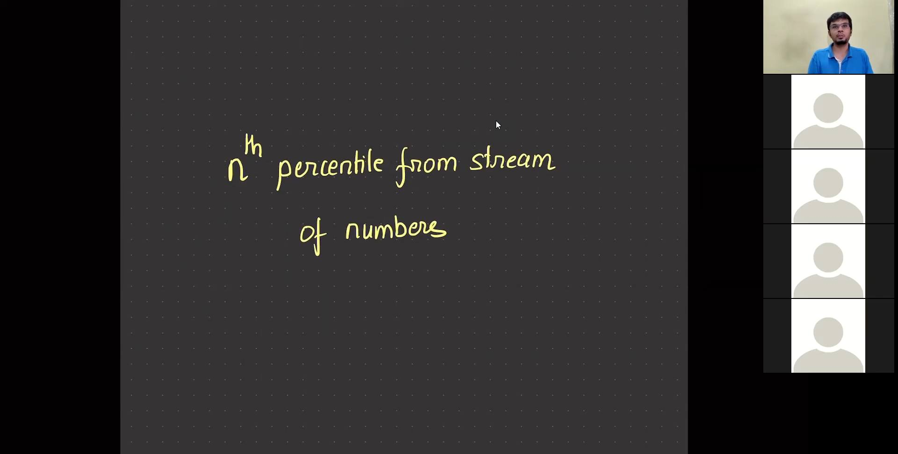
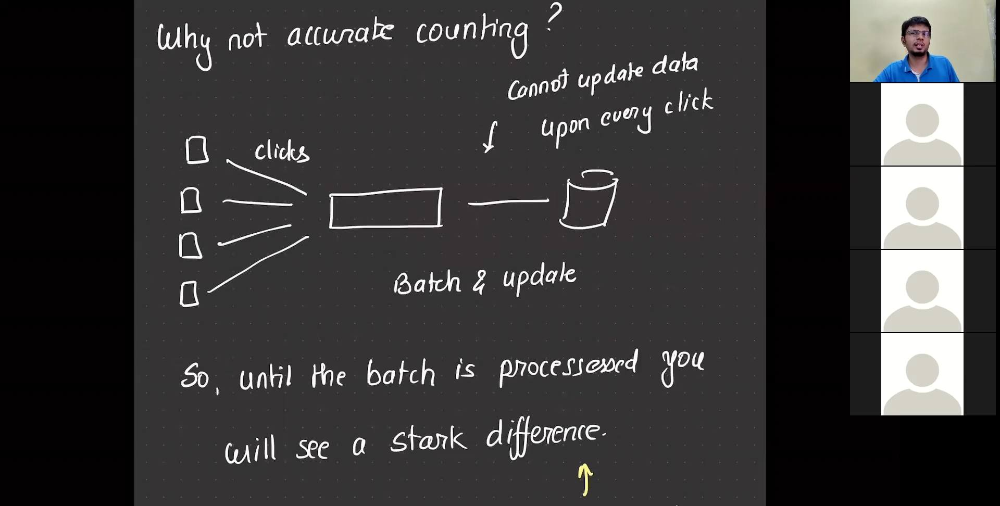
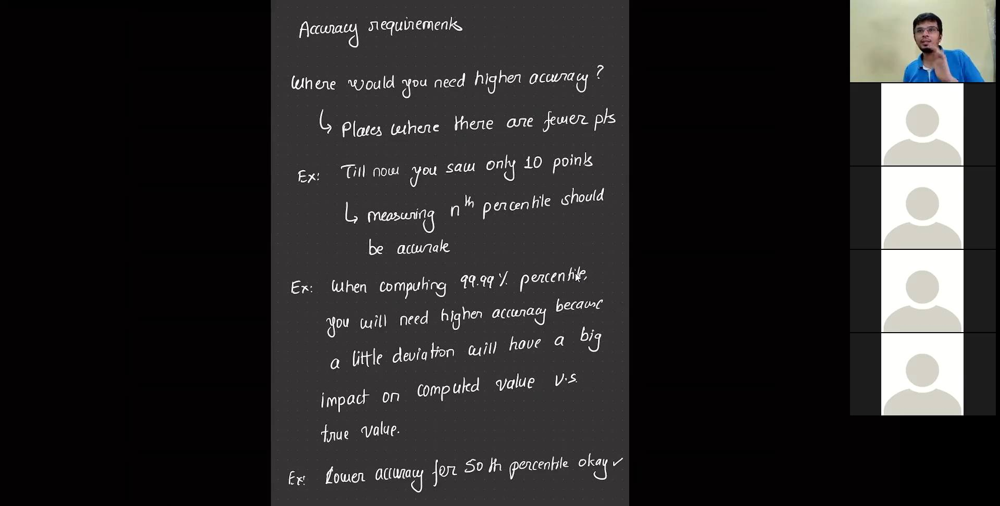
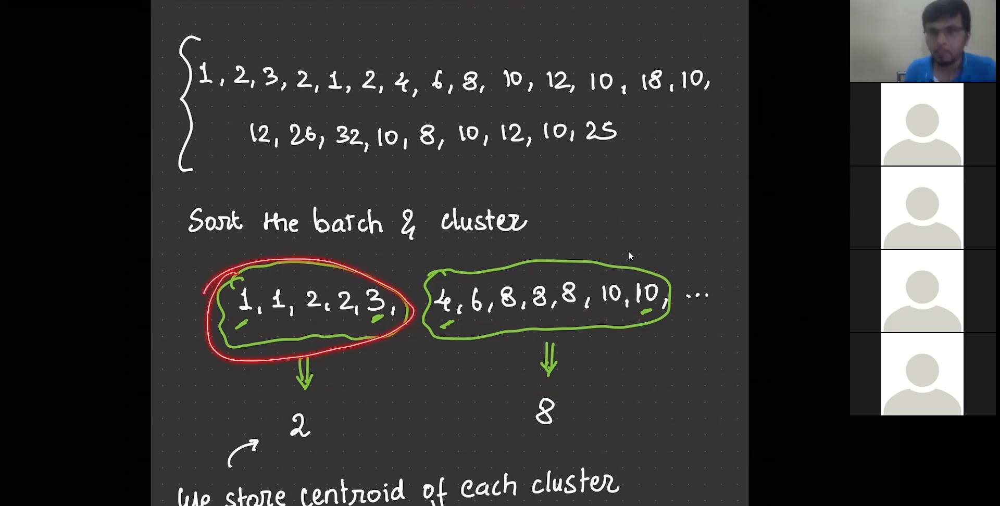
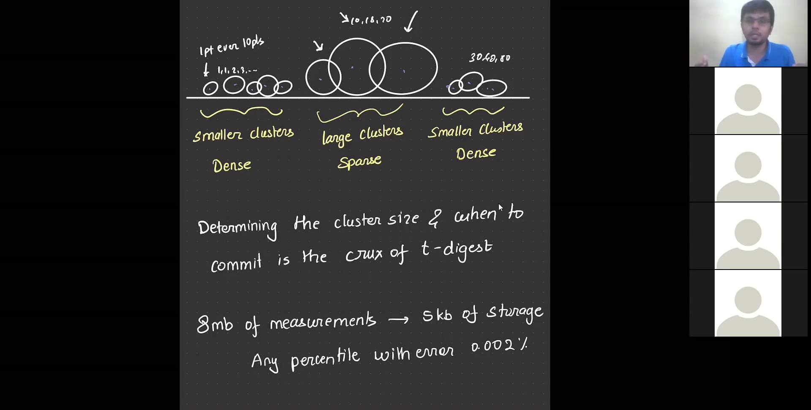
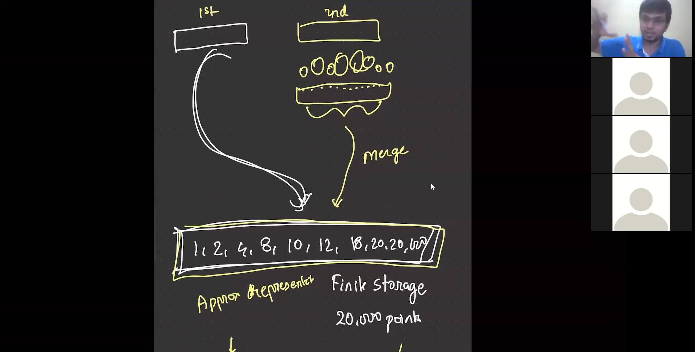
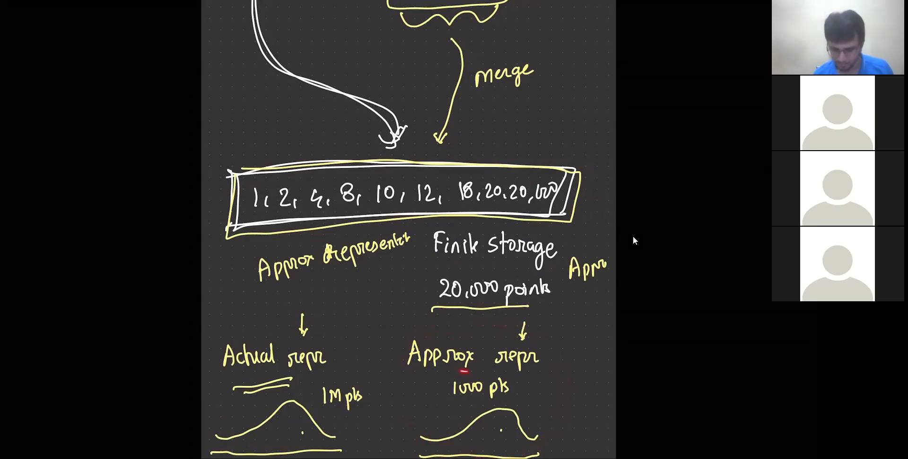
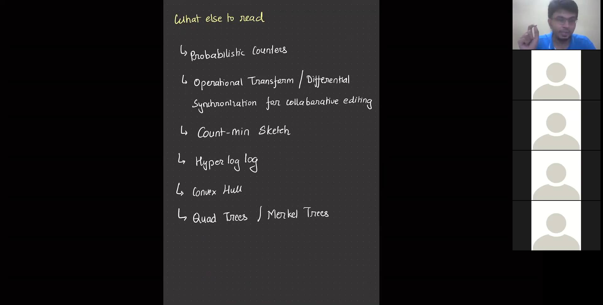

# 第十六讲：用 T-digest 从流式数据里估算百分位数

## 一、这一节做什么

这一讲（P016 后半段，从 68:13 到 143:28）把整门课最后一个、也是工程落地感最强的算法讲完：**如何从一条高速率的数值流里，用很小的内存、近乎实时地算出 P50 / P90 / P99 / P99.99 这类分位数**。

场景很具体：你有一个 API 服务，每来一个请求就产生一条「响应时间」的数值。请求量是百万/分钟级别，你想在监控面板上显示「过去 30 天里 P99 响应时间是多少」。精确做法是把 30 天的所有点都存下来、排序、再取位置——按讲师的估算，`1,000,000 × 60 × 24 × 30 ≈ 432 亿`个点，这条路走不通。于是讲师引出 **T-digest**：在可以接受 2%～5% 误差的前提下，把亿级原始点压缩成一个几百到几千个「质心」的近似分布，并保证这个近似分布的形状和真实分布非常接近，从而让分位数的计算既快又省内存。

这一讲还顺带收尾了上一段讲的**射线法（ray casting）判断点是否在多边形内**，以及最后 10 分钟关于新闻流（news feed）推拉模式的问答。由于本段逐字稿几乎没有可运行代码，本文按「纯讲解课」的写法组织：先把讲师的推导链一步步复现，再把方案落成可以直接拿去实现的数据结构、合并公式和示意代码。



## 二、讲师原话

讲师在这一段里反复强调的核心判断，按时间顺序摘几条（保留原话里的中英混排和口语）：

> "我们直接跳到这个内容的最后一个、最后一个、最后一个问题。接下来要做的是，从一串数字流中求出第 n 百分位数。"
> —— p016 [79:30]

> "精确计数的代价很高。……假设每分钟有 100 万个请求，而时间过滤范围假设是 30 天，那会有多少数据？……你想求百分位数，为了求百分位数，就必须先排序，再找出它落在哪里。这是一个非常、非常、非常麻烦的问题。"
> —— p016 [83:13]

> "所以我们的做法是放弃精确性……于是涌现出一大类新算法，也就是所谓的在线算法。这类在线算法基本上会给出接近准确的结果，其准确度大约是与真实准确结果相比有 2% 到 5% 的误差率。"
> —— p016 [83:38]

> "我们需要的是，在数据点较少时获得更高的准确度。……当数据量增长时，准确度低一些也没关系。"
> —— p016 [86:24]

> "当讨论的是极端百分位数时，你会希望它非常准确，因为即便是一个很小的偏差，哪怕只是很小的出入，也可能让数值产生非常大的差异，因为那个范围内可供选取的数据点太少。"
> —— p016 [89:08]

> "我们实际要讲的是一个叫作……T digest 的算法。……T digest 的思路，本质上是在一维上做 K 均值聚类，并让簇大小可变。"
> —— p016 [90:53] / [91:03]

> "我们的做法是先把它缓冲一段时间……然后排序。排序之后再进行聚类，然后存储它的质心。"
> —— p016 [95:50]

> "8 MB 的测量数据只占用了 5 KB 存储空间，百分位数误差为 0.002，这个误差小得惊人。"
> —— p016 [109:01]

> "我们存储质心和权重。权重是一个簇中数据点的数量。……那代价是什么？代价是簇内各成员点到质心的距离之和。"
> —— p016 [122:56]

> "新的质心是这些质心的加权平均值……这个新簇的总权重将等于各权重的总和……新簇的总代价将等于权重乘以从质心到新质心的距离。"
> —— p016 [125:21]

## 三、从零复现

这一节不复现代码，而是把讲师的推导链按「需求 → 约束 → 估算 → 方案 → 取舍」重走一遍。把这条链写清楚，后面看示意代码时才知道每一行在解决哪个约束。

### 3.1 需求

给定一条「响应时间（毫秒）」的数值流，要能随时回答：

- `P50`（中位数）
- `P90`、`P99`
- `P99.99`（极端尾部分位）
- 并且要能按时间窗口（最近 1 分钟 / 7 天 / 30 天 / 全生命周期）过滤

这就对应讲师提到的 New Relic、Datadog、AWS CloudWatch 面板上那几个数字。

### 3.2 约束

1. **数据量**：百万请求/分钟 × 60 × 24 × 30 ≈ **432 亿条/月**。精确做法要全部落盘再排序，存储和计算都不可接受。
2. **实时性**：产品要的是「面板刷新就能看到」的近似实时，New Relic / Datadog 大致是 5 分钟延迟级别。
3. **内存有限**：即使你愿意存原始数据，近似计算这条链也只能用一个固定大小的内存预算，不能随批次数量线性增长。
4. **精度可牺牲，但要在某些区间更准**：这是讲师反复强调的重点。

### 3.3 精度在哪里必须高

讲师给了两个硬约束，它们决定了算法长什么样：

**约束 A：点少的时候精度必须高。**
新用户只有 10 个赞，他点开列表应该真的看到 10 个人；粉丝百万的账号有 5 万个赞，没人会去核对。所以 **低数据量 → 高精度，高数据量 → 可以放松**。

**约束 B：算极端分位时精度必须高。**
讲师举的例子值得原样记下来：

> 有 10,000 个点，前 9,999 个点的值都在 1～10 之间，第 10,000 个点的值是 2000。真实 P99.99 应该是那个 2000。但如果你近似时把这个尾部点丢了或合并掉了，你算出来的 P99.99 会变成 10——**差了两个数量级，会让告警完全失真**。

所以在尾部区间，**一个点的偏差都会造成巨大误差**。算法必须把尾部区间切得很细。

### 3.4 推导：T-digest = 一维 K-means + 可变簇大小

讲师的路线可以拆成 4 步：

**步骤 1：把「存点」改成「存簇」。**
如果 50 个点的值都是 10，没必要存 50 行 `10`，存一行「值 10、计数 50」就够了。这一步把「原始点」压缩成「质心 + 权重」。

**步骤 2：一维上做 K-means。**
流是数值，天然有序。于是可以：**排序 → 把相邻的点聚成簇 → 用簇的中位数（质心）代表这个簇**。
讲师的原话是：一批 1000 个点进来，先排序，再按「簇内最大值 − 簇内最小值」不超过一个阈值来断簇。

**步骤 3：簇大小随分位数变化。**
这是 T-digest 区别于普通 K-means 的关键：

- 分位数在 **两端（很低或很高）**：簇要**小**（1～2 个点一个簇都可以），因为尾部一个点就能改变结论；
- 分位数在 **中间（接近 P50）**：簇要**大**（几百上千个点一个簇都没问题），因为中间点很密，合并了也看不出来。

讲师画的那条「簇大小先小、中间大、再小」的曲线，就是这条约束的几何表达。真实实现里这个阈值由论文里的公式给出，讲师特别提示：**「这个公式在实际论文里，我这里只讲直觉」**——也就是阈值不是固定常数，而是随分位 `q` 变化的函数。

**步骤 4：固定内存 + 合并。**
只存每一批的质心也还不够：每批 1000 点存 10 个质心，批数一多，质心数量照样线性增长。所以必须**预留一块固定大小的内存**（讲师举例 2 万个点），每批的质心**合并进这块固定内存**，超了就再合并，总占用永远不涨。

### 3.5 合并的三个量：centroid / weight / cost

这是这一讲最容易被忽略、但实现时绕不开的部分。讲师的原话是：合并时每个簇只保留三个量：

| 字段 | 含义 | 讲师原话 |
|---|---|---|
| **centroid** | 簇的质心（mean / median 都可以，看实现） | “the actual centroid of the cluster” |
| **weight** | 簇里原始点的个数 | “the total number of points in the cluster” |
| **cost** | 簇内每个原始点到质心的距离之和 | “the sum of the distances from the member points to the centroid” |

合并两个簇 `(c1, w1, co1)` 和 `(c2, w2, co2)` 时：

- **新质心** = 加权平均：`c = (c1·w1 + c2·w2) / (w1 + w2)`
- **新权重** = `w1 + w2`
- **新 cost** = 旧 cost 相加，**再加**「两个旧质心到新质心的位移 × 各自权重」这一项（因为旧质心移动了，原来成员到新质心的距离也变了）。

这就是讲师说的「weighted average / summation of weights / weight multiplied by distance」三句话。

### 3.6 取舍

- **精度 vs 内存**：内存越大，批越大、簇越多、误差越小；内存越小反之。这是一个可以调的旋钮，不是固定值。
- **近似 vs 原始**：讲师明确说，你可以**同时**保留原始数据（供用户查历史明细），但面板上展示 P99 时**用近似数据算**。这两条链不冲突。
- **代价**：近似带来的误差在「数据分布很尖（spiky）」时会放大。课程 Q&A 里 Vishal 提的场景——「应用尖峰一两分钟，其他 10 分钟没负载，但长得像 CPU 长期偏低，基建同事一直抱怨资源浪费」——讲师承认这就是 T-digest 的局限：**尾部被平均值抹平了**。讲师没有给解法，只说「存全部原始点太贵」。



## 四、完整代码

> **课里没有代码**。讲师原话是「write this in Python, hardly takes a day for you to implement this」。下面先给三张可以直接拿去开会/写设计文档用的表，再给一段**示意实现**（明确标注「不是课里代码」），只用来把讲师描述的「排序 → 按变化阈值断簇 → 合并三量」跑通。

### 4.1 设计决策表

| 决策点 | 选择 | 理由（对应讲师哪段） |
|---|---|---|
| 数据结构 | 有序的质心数组 | 一维，天然有序；不需要树 |
| 每个簇存什么 | centroid / weight / cost | p016 [122:56] |
| 入流处理 | 缓冲一批，满则 flush | p016 [95:50] |
| flush 内 | 排序 → 按阈值断簇 → 存质心 | p016 [100:02] |
| 簇大小规则 | 中间大、两头小，随分位变化 | p016 [91:29]、[101:28] |
| 内存上限 | 固定大小（如 2 万个点） | p016 [112:15] |
| 上限溢出 | 与已有质心合并，按三量公式 | p016 [125:21] |
| 分位计算 | 在质心数组上按累计 weight 定位 | p016 [107:09] |
| 精度旋钮 | compression（压缩率）/ batch size | p016 [84:32]、[110:25] |

### 4.2 组件职责表

| 组件 | 职责 | 输入 | 输出 |
|---|---|---|---|
| `add(value)` | 累积原始点，满批触发 `_flush` | 一个数值 | 无 |
| `_cluster(sorted_values)` | 把一批有序点切成若干簇，产出质心 | 有序数组 | `Centroid[]` |
| `_merge(incoming)` | 把新质心与全局质心融合，保证总长度 ≤ 上限 | `Centroid[]` | 更新后的全局数组 |
| `percentile(q)` | 按 `q∈[0,1]` 在质心上估算分位 | q | 近似值 |
| `Centroid` | 携带 `mean / weight / cost` | — | — |

### 4.3 容量估算表

| 量 | 数值 | 来源 |
|---|---|---|
| 原始点/月 | ~432 亿 | 1M/min × 60 × 24 × 30（讲师估算） |
| 每批 | 1000 点 | 讲师举例 p016 [95:50] |
| 每批产出质心 | 约 10~13 个 | 讲师举例 p016 [107:09] |
| 固定内存预算 | 2 万个点级别 | 讲师举例 p016 [113:41] |
| 讲师给的落地数据 | 8 MB → 5 KB，误差 0.002% | p016 [109:01] |

> 注意：上面「8 MB / 5 KB / 0.002%」是讲师引用的一段外部数据，**具体场景、metrics 名字课里没讲**，复现时请以自己压测得到的数字为准。

### 4.4 示意代码（课里没有代码，以下为示意）

> 下面这段是为了让「排序 → 断簇 → 合并三量 → 求分位」这条链**能在本机直接跑起来**而写的示意实现，**不是讲师的代码**，也没有用论文里的精确公式。阈值函数、合并上限都是简化版，目的是观察「压缩比」和「误差」这两个数字随 compression 变化的关系。

```python
# tdigest_demo.py
# 课里没有代码，以下为示意实现
# 仅用于理解 T-digest 的聚类 / 合并 / 分位估算三段逻辑，不是生产实现

import math
import random
from dataclasses import dataclass


@dataclass
class Centroid:
    mean: float     # 簇的质心
    weight: int     # 簇内原始点个数
    cost: float     # 成员到质心的距离之和

    def __repr__(self) -> str:
        return f"Centroid(mean={self.mean:.2f}, weight={self.weight}, cost={self.cost:.2f})"


class TDigest:
    def __init__(self, compression: int = 100, buffer_size: int = 1000):
        self.compression = compression      # 越大越精确，也越占内存
        self.buffer_size = buffer_size      # 一批多少个点
        self.buffer: list[float] = []
        self.centroids: list[Centroid] = []

    # ---------- 入流 ----------
    def add(self, value: float) -> None:
        self.buffer.append(value)
        if len(self.buffer) >= self.buffer_size:
            self._flush()

    # ---------- flush：排序 + 断簇 ----------
    def _flush(self) -> None:
        self.buffer.sort()
        incoming = self._cluster(self.buffer)
        self.buffer.clear()
        self._merge(incoming)

    def _cluster(self, sorted_values: list[float]) -> list[Centroid]:
        n = len(sorted_values)
        result: list[Centroid] = []
        i = 0
        while i < n:
            q = i / n                                   # 用左端近似分位位置
            # 阈值随 q 变化：中间大、两头小
            max_weight = max(1.0, 4.0 * n * q * (1.0 - q) / self.compression)
            j = i
            total = sorted_values[i]
            while j + 1 < n and (j - i + 2) <= max_weight:
                j += 1
                total += sorted_values[j]
            count = j - i + 1
            mean = total / count
            cost = sum(abs(x - mean) for x in sorted_values[i:j + 1])
            result.append(Centroid(mean, count, cost))
            i = j + 1
        return result

    # ---------- 合并三量 ----------
    def _merge(self, incoming: list[Centroid]) -> None:
        merged = sorted(self.centroids + incoming, key=lambda c: c.mean)
        limit = self.compression * 10                   # 简化上限，真实值取决于公式
        acc: Centroid | None = None
        out: list[Centroid] = []
        for c in merged:
            if acc is None:
                acc = Centroid(c.mean, c.weight, c.cost)
                continue
            new_weight = acc.weight + c.weight
            if new_weight > limit:
                out.append(acc)
                acc = Centroid(c.mean, c.weight, c.cost)
                continue
            new_mean = (acc.mean * acc.weight + c.mean * c.weight) / new_weight
            new_cost = (
                acc.cost
                + c.cost
                + acc.weight * abs(acc.mean - new_mean)
                + c.weight * abs(c.mean - new_mean)
            )
            acc = Centroid(new_mean, new_weight, new_cost)
        if acc is not None:
            out.append(acc)
        self.centroids = out

    # ---------- 分位估算 ----------
    def percentile(self, q: float) -> float:
        if not self.centroids:
            raise ValueError("no data")
        ordered = sorted(self.centroids, key=lambda c: c.mean)
        total_weight = sum(c.weight for c in ordered)
        target = q * total_weight
        acc = 0
        for c in ordered:
            acc += c.weight
            if acc >= target:
                return c.mean
        return ordered[-1].mean


# ---------- 自测 ----------
if __name__ == "__main__":
    random.seed(42)

    # 造一段偏态分布：多数点集中在 1~20，尾部少数点拉到 2000
    stream = [random.uniform(1, 20) for _ in range(100_000)]
    stream += [2000.0 + random.random() for _ in range(10)]
    random.shuffle(stream)

    td = TDigest(compression=100, buffer_size=1000)
    for v in stream:
        td.add(v)
    if td.buffer:                 # 冲掉最后一批
        td._flush()

    print("质心个数:", len(td.centroids))
    for q in (0.5, 0.9, 0.99, 0.9999):
        print(f"P{int(q * 100)} ≈ {td.percentile(q):.2f}")
```

**运行方式**（Python 3.10+，`list[float]` 和 `Centroid | None` 需要 3.10 才有原生支持；如果是 3.8/3.9，把两处类型注解改成 `List[float]` / `Optional[Centroid]` 并 `from typing import List, Optional` 即可）：

```bash
python tdigest_demo.py
```

**预期行为**（具体数字会随 `random.seed` 和机器浮点运算略有差异，**字段/数字请以实际输出为准**）：

- `质心个数` 远小于 101（10 万点 → 100 批 → 如果每批 10 质心应该 ~1000 个，但被 `_merge` 压到 1000 左右，具体取决于 `limit`）；
- `P50` / `P90` 落在几到几十之间；
- `P99.99` 应该能碰到 2000 附近——这正是讲师讲的那个尾部保真的例子。



## 五、逐行解释

下面按 4.4 的示意代码从上往下解释，每一条都对应讲师某一句话或某一个约束。

**`@dataclass class Centroid`**
这是讲师说的「每个簇存三个量」的落点：`mean`/`weight`/`cost`。用 dataclass 而不是 dict，是为了让「合并时少写错字段」这件事变成类型层面的问题——合并时只要拿错字段，IDE 就报错。

**`compression` 与 `buffer_size`**
- `buffer_size` 对应讲师说的「我们 buffer 一批，满了再 flush」（p016 [95:50]）。
- `compression` 对应讲师说的「精度误差 2~5%，且可通过内存预算调」（p016 [84:04]、[84:32]）。compression 越大，阈值越松→簇越少→越省内存，但误差越大。在 JS/Node 里，这两个就是构造参数，思路一样。

**`add(value)`**
只做一件事：攒批。它不排序、不合并，保证入流路径足够快。这是「在线算法」的含义——**每次调用 O(1) 摊销**。

**`_flush()`**
先 `sort()`，再 `_cluster()`。讲师强调「**先排序，再聚类**」的顺序（p016 [100:02]），因为一维 K-means 的核心就是「相邻点才有资格聚到一起」。如果顺序反了，「距离相近」就没有定义了。

**`_cluster()` 里的 `q = i / n` 与 `max_weight`**
这是整段代码里**唯一直接对应 T-digest 精髓的地方**：
- `q` 是当前点在全批中的分位位置；
- `max_weight` 是 `4 * n * q * (1-q) / compression`，在 `q≈0` 和 `q≈1` 时趋于 0，在 `q≈0.5` 时最大；
- 这正是讲师画的那条「簇大小先小、中间大、再小」的曲线（p016 [91:29]、[101:28]）。
- **注意**：真实 T-digest 的阈值来自论文里的归一化公式，我这里用的是一个显式的**抛物线形状**做近似，只是为了让代码可以跑、行为符合直觉。**复现时请以论文公式为准**——这一点讲师也说了（p016 [128:08]「go through T-digest paper to find out that formula」）。

**`j + 1 < n and (j - i + 2) <= max_weight`**
这是「断簇条件」的示意。真实实现一般写成「若再合并一个点，簇内最大值 − 簇内最小值 > 阈值，就断」。我这里用「簇内点数上限」来近似，效果上等价于「不让簇长得太大」，但**数值行为会和论文版不同**。

**`cost = sum(abs(x - mean) ...)`**
讲师原话：「cost is the sum of the distances from the member points to the centroid」（p016 [122:56]）。绝对距离是最容易想到的度量；生产实现里有的用平方距离，有的用别的，**这个细节课里没讲**，我按讲师的直觉用绝对距离。

**`_merge()` 的开头 `sorted(...)`**
把新的质心和旧的质心**按 mean 合并成一个有序数组**。讲师强调：「**不能简单地把两批的质心拼起来，那样会破坏分布**」（p016 [116:01]）——所以要先合到一起按大小排，再走一遍「有上限的合并」。

**`new_weight = acc.weight + c.weight`**
对应「total weight = w1 + w2」（p016 [125:47]）。

**`new_mean = (acc.mean * acc.weight + c.mean * c.weight) / new_weight`**
对应「new centroid = weighted average of centroids」（p016 [125:47]）。

**`new_cost = acc.cost + c.cost + acc.weight*|Δ1| + c.weight*|Δ2|`**
这一项在代码里最长，但逻辑最干净：
- 前两项把两个旧簇的 cost 加起来；
- 后两项是「**质心移动了，所以成员到新质心的距离变了**」的修正；
- 讲师的原话是「weight multiplied by the distance from the centroid to the new centroid」（p016 [126:13]），意思就是这两项。
- **代码里我省略了「成员原始值到旧质心」与「成员原始值到新质心」的精确差值**（那需要成员明细，而我们早就把成员丢了）。这里的近似在压缩率高的时候误差会积累，这也是为什么真实实现要小心处理 cost——**这一点课里没展开**，属于复现时容易撞的坑，见第七节。

**`if new_weight > limit` 然后 `out.append(acc); acc = 新簇`**
这是「固定内存」的闸门：一旦合并后的簇超过上限，就切出去，开新簇。对应讲师说的「预留固定大小的空间，超了就再合并」（p016 [112:15]、[113:41]）。

**`percentile(q)`**
按质心的 `weight` 做累加，找到第一个累计 `weight >= q * total_weight` 的质心，返回它的均值。讲师原话是「we compute the percentiles on the centroid of this cluster」（p016 [107:09]）——因为质心就代表了它那个区间里的分布。

**在 JS/Node 里对应什么**：`sort()` 就是 `Array.prototype.sort((a,b)=>a-b)`；`weight` 就是 `count`；合并逻辑没有语言差异，只是 `Number` 是双精度、`BigInt` 不适合求平均，所以 mean 一定用 `Number`。**没有锁、没有事务、没有并发问题**——这是单机数据结构，多个 API 实例各跑各的 T-digest，查询时再按 weight 加权合并多实例结果（**这个跨实例合并的策略课里没讲**，只讲了单机内合并）。



## 六、复现检查清单

按顺序打勾，全部打勾说明你已经把这一讲的核心跑通了：

- [ ] 能用自己的话讲清「为什么精确排序 432 亿个点不可行」，并能写出 `1e6 * 60 * 24 * 30` 这个估算。
- [ ] 能画出「簇大小随分位先小、中间大、再小」这条曲线，并解释**为什么**尾部要小。
- [ ] 能口述讲师那个「10,000 个点里 1 个是 2000 ms」的例子，并说明为什么近似算法会在尾部把 P99.99 算成 10。
- [ ] `tdigest_demo.py` 能在本机跑出 4 行输出，且 P99.99 落在 2000 附近（而不是 20 左右）。
- [ ] 把 `compression` 从 100 调到 10、1000 各跑一次，观察「质心个数」和「P99.99 误差」如何此消彼长——能观察到就说明压缩率和误差的取舍关系跑通了。
- [ ] 能说清 `centroid` / `weight` / `cost` 三个量各自的作用，并能手推一次两个簇合并后的三个新值。
- [ ] 能口述「固定内存 + 合并旧批次质心」和「每批都存、质心线性增长」两种做法在长期运行下的内存曲线差异。
- [ ] 能在面试里用 30 秒讲完「T-digest 是什么、为什么监控系统用它、它牺牲了什么」。

## 七、课里没讲但你会撞上的

这一节列的是「照着上面代码去落地时会遇到、但讲师这一段没展开」的点。**这些都不是讲师的原话**，标出来是为了让你别把不确定当成确定。

1. **论文里的阈值公式具体长什么样，这一讲没讲。** 讲师原话是「there is this formula which they have used … read the research paper」（p016 [102:49]、[128:08]），只讲了形状（先小、中间大、再小），没写公式。示意代码里用的是 `4 * n * q * (1-q) / compression`，**只是形状对，数值不对**。生产实现请直接对照 T-digest 原论文或成熟库（如 `tdigest` Python 包）。

2. **cost 的精确合并公式课里没讲全。** 讲师讲了「新 cost = Σ weight × 到新质心的距离」，但没讲**旧成员到旧质心的距离如何映射到新质心**这一层修正。如果这一项不做，反复合并会让 cost 偏小，进而让后续合并更激进、尾部失真。**这是真实实现里最容易踩的坑**。

3. **多实例/分片下如何合并多个 T-digest，课里没讲。** 生产上监控数据是分机器、分 AZ 采的，每个实例各有一个 T-digest，查询时要合并。讲师只说了「单机内合并」，分布式合并的策略（按 weight 加权、按 cost 修正）属于同类问题但**课里没有覆盖**。

4. **时间窗口（1 分钟 / 7 天 / 30 天）怎么实现，课里没讲。** 讲师在讲 New Relic 面板时提到「你可以选 last 10 days, 30 days, 7 days, minutes, hours, weeks, lifetime」（p016 [82:44]），但**没说窗口内旧数据如何衰减**。常见做法是按时间桶（1 分钟/5 分钟一桶）分别保留 T-digest，查询时把桶里的质心再合并——**这是社区常用做法，不是讲师讲的**。

5. **新闻流的推拉模式，课里只给了 3 分钟、没有代码。** 在最后 Q&A（p016 [137:04]～[139:51]）里讲师顺带讲了「名人账号不能 fan-out，所以要 push + pull 混合」：普通朋友的动态**推**进你的 feed 数组，名人账号在**你刷新 feed 时拉**。这跟 T-digest 没关系，是另一套问题；列出是为了提醒你——**这一段只有口头描述，没有数据结构、没有接口、没有代码，不要据此写成「讲师实现了一套 feed 系统」**。

6. **射线法（ray casting）的判断条件，课里只给了思路。** 讲师在 [69:36] 收尾时说「把点跟每条边求交，计数奇偶决定内外」，但**没有给退化情况（点在边上、射线穿过顶点）的处理**。前端同学如果按这个直接写地理围栏，会遇到「点恰好在边界上被算成外部」的 bug，需要自己补边界包含逻辑。

7. **「数据分布很尖时 T-digest 会失真」这个局限，讲师承认了但没给解法。** Q&A 里 Vishal 举了「应用是尖峰型、CPU 平时低、尖峰高」的例子，讲师回应是「outliers is good … if you are having a spiky sort of behaviour, then this should not be」（p016 [105:15] 附近）。**如果要解决，需要存原始点或至少存一个不压缩的尾部样本**——但那就回到了内存成本问题。**这个取舍课里没有给出方案**。







