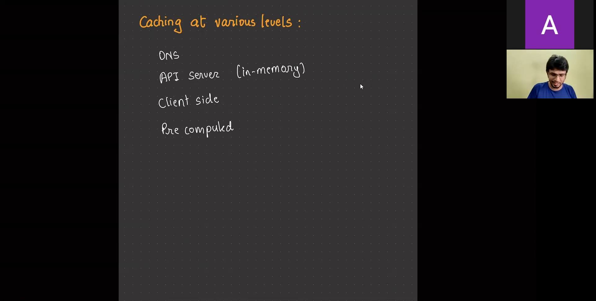
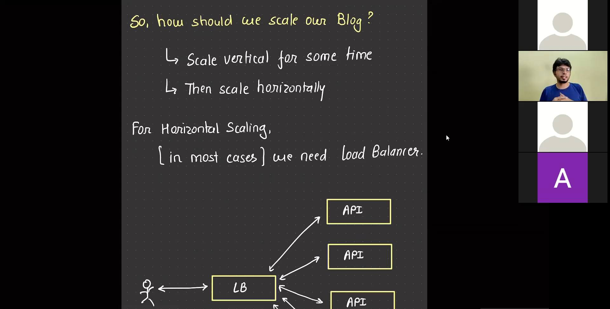
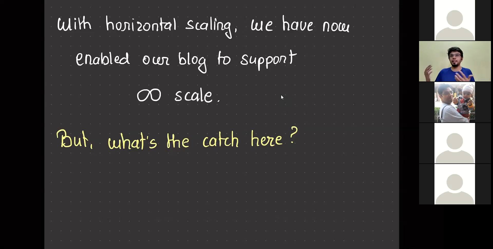
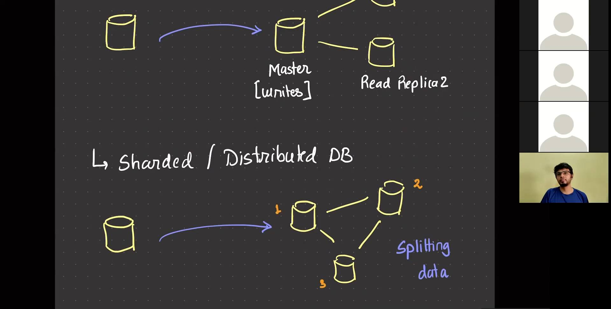

# System Design Masterclass (Arpit) P002 复现文档：缓存分层、水平扩展、部署翻倍与数据库读写分离

> **截图说明**：本课截图清单只有 5 个唯一帧。硬性要求写“≥6 张截图”，但清单里没有的帧一律不存在。为不编造素材，下面把 5 张唯一截图全部用上，并在容量估算处复用一次 `p002_1746s.jpg`，形成 6 个 Markdown 图片引用位。若要求 6 张互不相同的截图，现有素材不足。  
> **课程性质说明**：P002 是系统设计讲解课，逐字稿里没有业务代码、没有命令输出、没有配置文件。因此第 3 章复现的是讲师的推导过程，第 4 章把方案落成设计产物，并补一个**容量估算示意脚本**；脚本会明确标注“课里没有代码，以下为示意”。  
> **读者背景**：你从 前端转 AI 应用工程师。下面涉及连接池、事务、锁时，会补一句 Node/前端对应关系；这些是工程类比，不是讲师原话。

---

## 1. 这一节做什么

这一节要解决的是一个很具体的系统设计问题：**一个读多写少的博客系统，如何从单机起步，逐步加上缓存、负载均衡、水平扩展、部署翻倍、数据库读副本和分片，并且知道每一步的代价。**

讲师不是让你背“缓存有哪几层”“水平扩展比垂直扩展好”，而是让你能回答：

1. 什么时候该垂直扩，什么时候该水平扩？
2. 负载均衡器加在哪里，它为什么不是单点？
3. API 服务器从 100 台翻到 200 台时，数据库连接为什么会被打爆？
4. 读副本解决什么问题，会引入什么新问题？
5. 分片解决了什么，又让什么变贵？
6. 缓存可以放在 DNS、客户端、API 服务器内存、API 服务器磁盘、Redis、物化视图、负载均衡器、API 网关、数据库 buffer pool，各自省掉的是什么“昂贵操作”？

**本节最终产物**：一份可照着填的设计决策表、组件职责表、接口/数据模型草案、容量估算表、检查清单，以及一个可运行的容量估算脚本。你不需要先有后端经验，先把这个博客系统的读写路径画出来，再逐项填表。

---

## 2. 讲师原话（带「—— pNNN [MM:SS]」）

以下按主题摘录，不按页码流水账。引用保留讲师原意，中文解释放在引用后。

> "缓存的定义是什么？说白了，缓存就是用来省掉某项高开销操作的东西。"
> —— p002 [05:34]

讲师把缓存定义成“省掉一个昂贵操作”，不是只省磁盘 IO；省网络 IO、省数据库查询、省 join，都算缓存。

> "你其实可以先做一些连接，然后把结果存成视图……物化视图。"
> —— p002 [05:34]

这里讲的是物化视图：把预先 join 好的结果存成表，读的时候直接查它。

> "在读请求较多的系统里，这是一种非常好的优化手段。"
> —— p002 [06:27]

读多写少的系统，物化视图和预计算特别值钱。

> "负载均衡器……Nginx……HAProxy……你可以在这些地方做缓存。"
> —— p002 [06:54]

讲师提醒不要只想到 AWS 托管负载均衡；自建的 Nginx / HAProxy 反向代理也可以做缓存。

> "cacheops……Redis……会透明地部署在数据库前面。"
> —— p002 [08:23]

Django ORM 的 cacheops 是例子：它透明地挡在数据库前，决定 SQL 是走 Redis 还是走数据库。这里不要误以为所有语言都有同名库，讲师说的是 Django 生态的例子。

> "数据库本身有缓存池……也就是缓冲池。"
> —— p002 [10:46]

数据库自己也有 buffer pool，缓存最近读过的磁盘页块。这是数据库内部缓存，不是应用层缓存。

> "真正的扩展总是发生在你做水平扩展的时候。"
> —— p002 [20:12]

讲师认为真正的无限扩展来自水平扩展；垂直扩展有物理上限。

> "一开始不要过度设计……先采用垂直扩展。"
> —— p002 [25:16]

创业初期没用户，不要第一天就上复杂水平架构；先垂直扩，验证产品。

> "我一开始只会先上一台配置很强的机器……32 GB 内存。"
> —— p002 [29:06]

讲师用 Medium 举例：先一台 32GB 大机器，达到 product-market fit 后再考虑水平扩展。

> "负载均衡器从来不是一台机器。它内部……至少有三台机器。"
> —— p002 [37:06]

负载均衡器看起来是一个入口，但内部不是一台机器，否则它自己就是单点。

> "如果你加了一百万台机器……数据库就得有一百万个连接。"
> —— p002 [42:32]

水平扩展 API 机器时，每台机器可能持有一个到数据库的连接；机器越多，数据库连接越可能成为瓶颈。

> "把我的基础设施翻倍，再减半。"
> —— p002 [44:26]

讲师描述一种常见部署策略：先扩到 2 倍，新机器跑新代码，再逐步删旧机器，最后回到原数量。部署期间数据库要扛 2 倍连接。

> "读写比……99 比 1。"
> —— p002 [47:39]

讲师给出典型 SQL 系统读写比：99 次读对 1 次写。

> "只读副本……只处理读查询。"
> —— p002 [48:07]

读副本只服务 select 读请求；写、更新、删除、改表走主库。

> “replication lag.”  
> —— p002 [49:34]

主库写完同步到副本有延迟，这是读副本架构的代价。

> "分片分布式数据库……每个数据库负责自己的那部分数据。"
> —— p002 [51:03]

分片是每个库负责一部分数据，比如 user1 的博客去 db1，user2 的去 db2。

> "跨库查询……代价非常、非常高。"
> —— p002 [54:12]

跨分片查询/聚合可以做到，但非常贵；跨库 join 通常不可行。

---

## 3. 从零复现

这一章按“需求→约束→估算→方案→取舍”复现讲师推导。你照着填，就能得到一个可评审的博客系统设计。

### 3.1 需求卡：先明确读写路径

以 Medium 类博客为例，最小功能：

| 功能 | 请求 | 读/写 | 说明 |
|---|---|---|---|
| 看单篇博客 | `GET /blogs/:id` | 读 | 最高频，适合缓存 |
| 按标签看列表 | `GET /blogs?tag=xxx` | 读 | 涉及 join，适合物化视图 |
| 发博客 | `POST /blogs` | 写 | 走主库 |
| 改博客 | `PUT /blogs/:id` | 写 | 走主库 |
| 删博客 | `DELETE /blogs/:id` | 写 | 走主库 |
| 最近搜索 | 客户端本地 | 读 | 讲师举例：客户端存最近 500 次搜索，不发生后端调用 |

讲师在 [13:40] 附近说客户端缓存可以存最近 500 个搜索请求，避免后端 API 调用。这个功能不是博客核心，但很适合前端实现：浏览器 `localStorage` / IndexedDB / Service Worker 都能做；课里没讲具体实现。

### 3.2 约束：先把瓶颈列出来

1. 单机 CPU、内存、磁盘有限，垂直扩展有上限。  
2. API 服务器和数据库之间的连接数有限。  
3. 部署新版本时，实例可能临时翻倍。  
4. 缓存会变旧；讲师在 [17:50] 提到，如果 100 台 VM 的本地缓存同时变旧，100 个请求会同时打到后端。  
5. 读副本有 replication lag。  
6. 分片后跨库 join 很贵，热分区会让某个库特别忙。  
7. 水平扩展会增加部署、日志、监控、许可费的复杂度。

### 3.3 估算：写出算式，不要凭感觉

讲师没有给具体业务 QPS，所以下面数字是**复现用示例假设**，不是课程原文。你要用真实监控替换。

假设：

- 总请求：`1000 QPS`
- 读写比：`99:1`（讲师给的典型值）
- 缓存命中率：`80%`（示例假设，课里没给）
- API 实例：`100` 台
- 每台 API 连接池上限：`10`
- 部署时实例翻倍：`2x`
- 主库最大连接：`1000`
- 读副本：`2` 个
- 分片：`3` 个

算式：

```text
写 QPS = 1000 / (99 + 1) = 10
读 QPS = 1000 - 10 = 990
缓存后数据库读 QPS = 990 × (1 - 0.8) = 198
正常数据库连接 = 100 × 10 = 1000
部署时数据库连接 = 1000 × 2 = 2000
每个读副本承担读 QPS = 990 / 2 = 495
每个分片承担写 QPS = 10 / 3 ≈ 3.33
```

结论：正常时连接刚好到 1000；部署翻倍到 2000，超过示例主库上限 1000。这就是讲师说的“API 扩了，数据库没扩”会出事。读副本把 990 读分到两个副本；分片把 10 写分到三个库。注意：分片后读请求要落到对应用户所在库，不能随便打到任意库。

### 3.4 方案顺序：先垂直，再水平

1. **第一天**：一台大机器，比如 32GB RAM，单库单 API。  
2. **看监控**：CPU、内存、磁盘到瓶颈再扩；讲师说没有 textbook metrics，要持续监控。  
3. **到 PMF 后水平扩**：负载均衡器后面至少 3 台 API。  
4. **加缓存**：客户端最近搜索、API 内存、API 磁盘、Redis、物化视图、负载均衡器缓存、API 网关缓存。  
5. **处理部署**：先扩 2 倍，新机器跑新代码，再删旧机器；数据库连接要按 2 倍准备。  
6. **数据库读副本**：主库只写，两个副本读；接受 replication lag。  
7. **分片**：按 user_id 分 3 库；接受跨库 join 贵和热分区风险。  
8. **记录取舍**：每一步写“为什么现在做、不做什么、代价是什么”。






### 3.5 取舍：每一步的“不这样会怎样”

- **只垂直不水平**：机器会到上限；一台机器挂掉就是单点；夜间低峰闲置也烧钱。  
- **第一天就水平**：没用户时过度工程，部署、监控、许可费都变复杂。  
- **加 API 不加数据库**：部署翻倍时连接打爆主库。  
- **读副本不加读己之写策略**：写完立刻读可能读到旧副本。  
- **分片前不设计分片键**：某个用户写入特别多，形成热分区。  
- **缓存不设失效**：本地缓存变旧后同时回源，后端被打穿。



---

## 4. 完整代码

> 课里没有代码。以下不是讲师给出的业务实现，而是把 P002 的方案落成可评审产物：设计决策表、组件职责表、接口/数据模型草案、容量估算表，以及一个可运行的容量估算示意脚本。

### 4.1 设计决策表

| 决策项 | 选择 | 依据（讲师时间点） | 不这样会怎样 |
|---|---|---|---|
| 起步架构 | 单台大机器，先垂直扩 | p002 [25:16] 不要 day one 过度工程 | 没用户时复杂架构浪费钱 |
| 何时水平扩 | 监控到 CPU/内存/磁盘瓶颈，或到 PMF | p002 [30:57] 讲师说要监控 | 盲目扩机器，成本高且复杂度上升 |
| API 入口 | 负载均衡器，后面至少 3 台 API | p002 [29:33]、[37:06] | 单 API 是单点 |
| 负载均衡器本身 | 内部至少 3 台，不是单机 | p002 [37:06] | LB 自己成为单点 |
| CPU/内存混合负载 | 按 URL 路由到不同 target group | p002 [33:47] | 所有机器按最高配置买，浪费钱 |
| 客户端缓存 | 最近 500 次搜索 | p002 [13:40] | 每次搜索都打后端 |
| API 内存缓存 | 热博客 ID 响应 | p002 [03:39] | 重复查库/查 Redis |
| API 磁盘缓存 | 热响应写成本地 JSON | p002 [11:15] | 多一次到 Redis 的网络 IO |
| 集中缓存 | Redis 类内存缓存 | p002 [08:23] | 数据库读压力大 |
| 数据库预计算 | 物化视图存 join 结果 | p002 [05:34] | 每次读都做昂贵 join |
| 部署策略 | 扩 2 倍、删旧、回到原数量 | p002 [44:26] | 新旧代码混跑时不可控 |
| 部署前准备 | 数据库连接按 2 倍准备 | p002 [45:47] | 部署时数据库连接被打爆 |
| 数据库扩展 | 先读副本，再考虑分片 | p002 [47:39]、[51:03] | 直接分片导致跨库查询复杂 |
| 分片键 | 按 user_id 分片 | p002 [51:03] | 随机分片导致读请求找不到库 |
| 跨库查询 | 尽量避免，接受昂贵 | p002 [54:12] | 跨库 join 性能差 |

### 4.2 组件职责表

| 组件 | 职责 | 省掉的昂贵操作 | 课里依据 |
|---|---|---|---|
| DNS | 域名解析；极端例子可用 TXT 记录做缓存 | 解析/网络跳转 | p002 [09:46] |
| CDN | 边缘缓存静态/可缓存内容 | 回源网络 IO | p002 [09:46] |
| 客户端缓存 | 浏览器/App 存最近搜索、最近响应 | 后端 API 调用 | p002 [13:40] |
| 负载均衡器 | 入口、分发、可配置缓存 | 单点连接、重复响应 | p002 [06:54] |
| API 服务器内存 | 本地 Map/LRU 缓存热数据 | 数据库调用、Redis 网络 IO | p002 [03:39] |
| API 服务器磁盘 | 本地 SSD 存序列化响应 | 到 Redis/DB 的网络 IO | p002 [11:15] |
| Redis/集中缓存 | 跨 API 共享缓存 | 数据库查询 | p002 [08:23] |
| API 网关 | 请求级缓存 | 后端重复处理 | p002 [09:20] |
| 物化视图 | 预 join 结果表 | join 计算 | p002 [05:34] |
| 数据库 buffer pool | 缓存磁盘页块 | 磁盘 IO | p002 [10:46] |
| 主库 | 接收写、更新、删除 | 无 | p002 [48:07] |
| 读副本 | 只服务 select | 主库读压力 | p002 [48:07] |
| 分片路由 | 按用户/键找库 | 单库写压力 | p002 [51:03] |

### 4.3 接口与数据模型草案

> 以下字段是复现用草案，课里没有给表结构。

接口草案：

```http
GET    /blogs/:id
GET    /blogs?tag=:tag&limit=20
POST   /blogs
PUT    /blogs/:id
DELETE /blogs/:id
```

数据模型草案：

| 表 | 关键字段 | 说明 |
|---|---|---|
| users | id, name, created_at | 用户 |
| blogs | id, user_id, title, content, created_at, updated_at | 博客；分片键可用 user_id |
| tags | id, name | 标签 |
| blog_tags | blog_id, tag_id | 多对多；物化视图可预 join |

在 Node 里，连接池对应 `pg.Pool({ max: 10 })` 这类配置；事务对应 `BEGIN / COMMIT / ROLLBACK`；行锁对应 `SELECT ... FOR UPDATE`。这些是前端转后端会遇到的对应关系，**不是讲师在本节讲的实现**。

### 4.4 容量估算表

| 指标 | 算式 | 结果 |
|---|---|---|
| 总 QPS（示例） | 输入 | 1000 |
| 写 QPS | 1000 / (99+1) | 10 |
| 读 QPS | 1000 - 10 | 990 |
| 缓存后 DB 读 QPS | 990 × (1-0.8) | 198 |
| 正常 DB 连接 | 100 × 10 | 1000 |
| 部署时 DB 连接 | 1000 × 2 | 2000 |
| 每读副本读 QPS | 990 / 2 | 495 |
| 每分片写 QPS | 10 / 3 | 3.33 |


### 4.5 可运行示意脚本 `capacity-estimate.js`

> 课里没有代码，以下为示意，不是讲师给出的实现。无依赖，Node 18+ 可直接运行。

```js
// capacity-estimate.js
// 课里没有代码；这是把 P002 的容量推导落成可运行检查脚本。
// 运行: node capacity-estimate.js

const input = {
  totalQps: 1000,                 // 示例：总请求/秒，实际用监控数据替换
  readWriteRatio: 99,             // 讲师给的读写比 99:1
  cacheHitRate: 0.80,             // 示例假设，课里没给业务数字
  apiInstances: 100,              // 示例 API 实例数
  maxConnPerInstance: 10,         // 每个 API 实例连接池上限
  deployMultiplier: 2,            // 讲师描述的“扩到2倍再减半”部署
  primaryMaxConnections: 1000,    // 示例主库最大连接，讲师用“1000连接”举例
  replicaCount: 2,                // 示例读副本数
  shardCount: 3                   // 讲师例子 user1/user2/user3 对应 3 库
};

function safeDivide(a, b) {
  return b === 0 ? 0 : a / b;
}

const writes = input.totalQps / (input.readWriteRatio + 1);
const reads = input.totalQps - writes;
const dbReadsAfterCache = reads * (1 - input.cacheHitRate);
const normalConnections = input.apiInstances * input.maxConnPerInstance;
const deployConnections = normalConnections * input.deployMultiplier;
const readsPerReplica = safeDivide(reads, input.replicaCount);
const writesPerShard = safeDivide(writes, input.shardCount);
const connectionsPerShardIfEven = safeDivide(deployConnections, input.shardCount);

console.log(JSON.stringify({
  inputs: input,
  traffic: {
    writesPerSecond: Number(writes.toFixed(2)),
    readsPerSecond: Number(reads.toFixed(2)),
    dbReadsPerSecondAfterCache: Number(dbReadsAfterCache.toFixed(2))
  },
  connections: {
    normalConnections,
    deployConnections,
    deployExceedsPrimary: deployConnections > input.primaryMaxConnections,
    primaryMaxConnections: input.primaryMaxConnections
  },
  readReplicas: {
    replicaCount: input.replicaCount,
    readsPerReplica: Number(readsPerReplica.toFixed(2))
  },
  shards: {
    shardCount: input.shardCount,
    writesPerShard: Number(writesPerShard.toFixed(2)),
    connectionsPerShardIfEven: Number(connectionsPerShardIfEven.toFixed(2))
  }
}, null, 2));
```

运行命令：

```bash
node capacity-estimate.js
```

示例输出（字段名来自上面脚本，可对照）：

```json
{
  "traffic": {
    "writesPerSecond": 10,
    "readsPerSecond": 990,
    "dbReadsPerSecondAfterCache": 198
  },
  "connections": {
    "normalConnections": 1000,
    "deployConnections": 2000,
    "deployExceedsPrimary": true,
    "primaryMaxConnections": 1000
  },
  "readReplicas": {
    "replicaCount": 2,
    "readsPerReplica": 495
  },
  "shards": {
    "shardCount": 3,
    "writesPerShard": 3.33,
    "connectionsPerShardIfEven": 666.67
  }
}
```



---

## 5. 逐行解释

这一章解释上一章每个决策和脚本参数为什么这样定，不这样会怎样。

### 5.1 缓存层为什么这样排

讲师把缓存定义为“省掉昂贵操作”，所以每一层都要问：它省掉的是什么？

1. **DNS 缓存**：省域名解析。课里提到有人用 DNS TXT 记录维护博客，这是极端实验，不是常规方案。  
2. **客户端缓存**：省后端 API 调用。讲师举例最近 500 次搜索存在客户端。前端对应 `localStorage` / IndexedDB / Service Worker，课里没讲具体 API。  
3. **API 服务器内存缓存**：省数据库调用或 Redis 网络 IO。Node 里可以用 `Map` + TTL 做最简 LRU；课里没给库名。  
4. **API 服务器磁盘缓存**：省到 Redis/DB 的网络 IO。讲师强调内存只有 2GB、磁盘有 8GB 时，SSD 随机读和 RAM 有一定竞争力。Node 对应 `fs.promises.writeFile` / `readFile`；课里没讲。  
5. **Redis 集中缓存**：跨 API 实例共享。Django 的 cacheops 是讲师例子，它透明挡在 ORM 前；不是所有语言都有同名工具。  
6. **物化视图**：省 join。读多写少时，把 join 结果预存成表。  
7. **负载均衡器缓存**：Nginx / HAProxy 反向代理缓存整个响应；省回源。  
8. **API 网关缓存**：托管 API 网关的请求缓存；省后端处理。  
9. **数据库 buffer pool**：数据库内部缓存磁盘页块；应用层通常不直接控制。

**不这样会怎样**：所有层都回源到数据库，读 QPS 990 全打 DB；加 80% 缓存后示例降到 198。注意 80% 是假设，课里没给，必须用真实命中率替换。

### 5.2 为什么先垂直后水平

讲师在 [25:16] 说不要 day one 过度工程。原因：

- 没用户时，水平扩展的部署、日志、监控、许可费都是浪费。  
- 垂直扩展简单：一台机器加 CPU/RAM/磁盘，部署只有一台。  
- 到 PMF 后再水平扩，因为这时你知道产品会被使用，值得投入复杂架构。

**不这样会怎样**：第一天就上 100 台机器，结果没流量，钱花在闲置资源上；或者部署链路没做好，旧代码新代码混跑。

### 5.3 负载均衡器与 target group

讲师在 [29:33] 说负载均衡器是入口，内部转发到多台 API；在 [37:06] 说 LB 内部至少 3 台，不是单点。

在 [33:47] 讲师给了一个很实用的做法：同一个系统里 CPU 密集 API 和内存密集 API 分开，LB 按 URL 路由到不同 target group。AWS 的例子是一个 LB 配多个 target group；其他云有类似概念，但名字可能不同。

**不这样会怎样**：所有机器都按最高 CPU/内存配置买，过度预留；或者 CPU 密集请求把内存型机器打满。

### 5.4 部署翻倍为什么打爆数据库

讲师在 [44:26] 描述：先扩到 2 倍，新机器跑新代码，再删旧机器，最后回到原数量。部署期间实例数 2x。

脚本里：

```js
const normalConnections = input.apiInstances * input.maxConnPerInstance;
const deployConnections = normalConnections * input.deployMultiplier;
```

100 台 × 10 连接 = 1000；部署 2x = 2000。如果主库最大连接 1000，就超了。

**不这样会怎样**：API 扩了，数据库没扩；部署时连接耗尽，API 连不上库，服务雪崩。讲师在 [45:47] 说，这种部署策略下数据库通常要 over-provisioned。

### 5.5 读副本与 99:1

脚本：

```js
const writes = input.totalQps / (input.readWriteRatio + 1);
const reads = input.totalQps - writes;
```

99:1 表示每 100 个请求里 99 读 1 写。所以写 = 总 QPS / 100，读 = 总 QPS - 写。

讲师在 [48:07] 说读副本只服务 select；写、更新、删除、改表走主库。代价是 [49:34] 的 replication lag。

**不这样会怎样**：所有读都打主库，主库 CPU/连接先满；或者写完立刻读副本，读到旧数据。

### 5.6 分片为什么贵

讲师在 [51:03] 说每个库负责自己的数据；[54:12] 说跨库查询非常贵。脚本：

```js
const writesPerShard = safeDivide(writes, input.shardCount);
```

3 个分片，每片写 3.33 QPS。连接如果平均分，每片 666.67。但真实分片可能不均匀：某个用户写特别多，形成热分区。讲师在 [52:50] 提到这个问题，并说会在 S3 设计时展开。

**不这样会怎样**：按随机键分片，读请求不知道去哪个库；跨库 join 性能差；热分区让一个库先挂。

### 5.7 脚本逐参数解释

- `totalQps: 1000`：示例总 QPS。实际要从监控取，讲师说没有 textbook metrics，要 monitor。  
- `readWriteRatio: 99`：讲师给的 99:1。  
- `cacheHitRate: 0.80`：示例假设，**课里没给**。不设这个值，`dbReadsAfterCache` 会等于 990，高估 DB 读。  
- `apiInstances: 100`、`maxConnPerInstance: 10`：示例连接池。Node 对应 `pg.Pool({ max: 10 })`，但课里没讲 Node。  
- `deployMultiplier: 2`：讲师部署策略。  
- `primaryMaxConnections: 1000`：讲师用“1000 连接”举例；真实值看数据库配置。  
- `replicaCount: 2`：讲师例子里有两个读副本。  
- `shardCount: 3`：讲师用 user1/user2/user3 对应 3 库举例。  
- `safeDivide`：防止除零。  
- `console.log(JSON.stringify(...))`：输出可复制到设计文档的 JSON。

---

## 6. 复现检查清单

照着勾，勾不满就别上线。

- [ ] 已写出读写路径：哪些请求读、哪些写、哪些可缓存。  
- [ ] 已用监控确认 CPU/内存/磁盘瓶颈，而不是凭感觉扩机器。  
- [ ] 已决定当前阶段用垂直还是水平；创业初期是否先一台大机器。  
- [ ] 水平扩展时，LB 后面至少 3 台 API。  
- [ ] 确认 LB 本身不是单点（内部至少 3 台或托管多可用区）。  
- [ ] CPU 密集和内存密集 API 是否需要按 URL 分 target group。  
- [ ] 客户端缓存是否存最近搜索；是否设上限。  
- [ ] API 内存缓存是否有 TTL/容量上限。  
- [ ] API 磁盘缓存是否只存可重新生成的数据；磁盘满怎么办。  
- [ ] Redis/集中缓存是否配置；缓存 key 是否有版本/失效策略。  
- [ ] 物化视图是否覆盖最贵的 join；刷新策略是什么。  
- [ ] 负载均衡器/反向代理缓存是否只缓存可缓存响应。  
- [ ] API 网关缓存是否开启；缓存 key 是否包含用户/租户。  
- [ ] 数据库连接池上限是否按“部署 2x”计算。  
- [ ] 部署策略扩 2 倍时，主库最大连接是否够。  
- [ ] 读副本数量是否按读 QPS 分配；是否接受 replication lag。  
- [ ] 写后立刻读是否要求读主库或 sticky session。  
- [ ] 分片键是否按 user_id 等业务键；是否评估热分区。  
- [ ] 跨分片查询/聚合是否尽量避免；是否接受昂贵。  
- [ ] 许可费是否随水平实例数上涨（讲师提 Oracle/New Relic 类例子）。  
- [ ] 日志/指标是否能从多实例聚合。  
- [ ] 失败重试、超时、健康检查、failover 是否有策略。  
- [ ] 缓存变旧时，是否会 100 台实例同时回源；是否有保护。  

---

## 7. 课里没讲但你会撞上的

以下不是讲师在本节给出的方案，而是你照这个架构落地时大概率会遇到的问题。标“课里没讲”的内容，需要你另行设计。

1. **缓存一致性/TTL/主动失效**  
   课里讲了缓存会变旧，讲师说他们的数据几周不变所以能利用；但没给通用失效方案。你需要 TTL、版本号、写后删缓存、发布订阅等。Node 里对应 Redis key 过期、`DEL`、版本前缀；课里没讲。

2. **读己之写**  
   读副本有 replication lag。用户写完立刻读，可能读到旧副本。需要写后读主库、会话粘滞、或等待副本位点。课里没讲具体策略。

3. **连接池耗尽**  
   讲师讲了数据库连接会被 2x 部署打爆，但没讲连接池中间件。Node 里 `pg.Pool` 的 `max` 要按实例数和部署倍数算；连接池满时请求排队或超时。课里没讲。

4. **事务与锁**  
   讲师提到数据库要维护连接、锁定行，但没展开。Node 里事务是 `BEGIN/COMMIT/ROLLBACK`；行锁是 `SELECT ... FOR UPDATE`。前端转后端要记住：不要在事务里做慢网络调用。课里没讲。

5. **跨分片查询/聚合**  
   课里说很贵，但没给替代方案。常见做法是避免跨分片 join、做冗余表、离线聚合。课里没讲。

6. **热分区**  
   课里提到某个用户写特别多会让一个库变热，说 S3 设计时会展开。你需要加盐、拆分、迁移热 key。课里没讲。

7. **缓存穿透/雪崩/击穿**  
   课里没讲。空值缓存、布隆过滤器、互斥重建、随机 TTL 都是常见手段；不要把它们说成讲师方案。

8. **监控与日志聚合**  
   课里学生提过日志/指标聚合，讲师说 New Relic 类系统能接很多服务器。具体怎么聚合、采样、告警，课里没讲。

9. **许可费