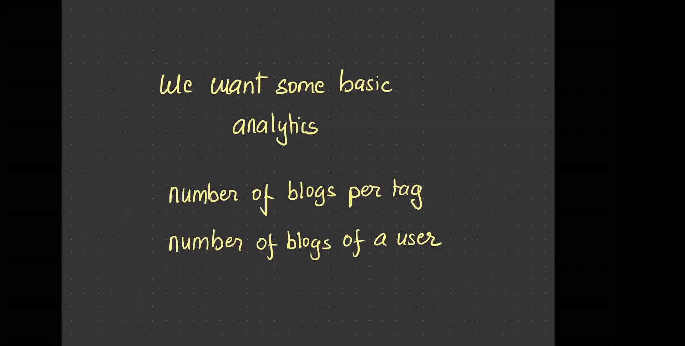
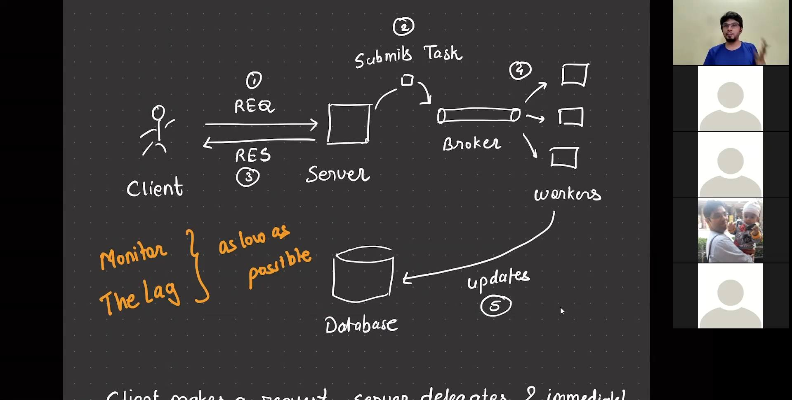
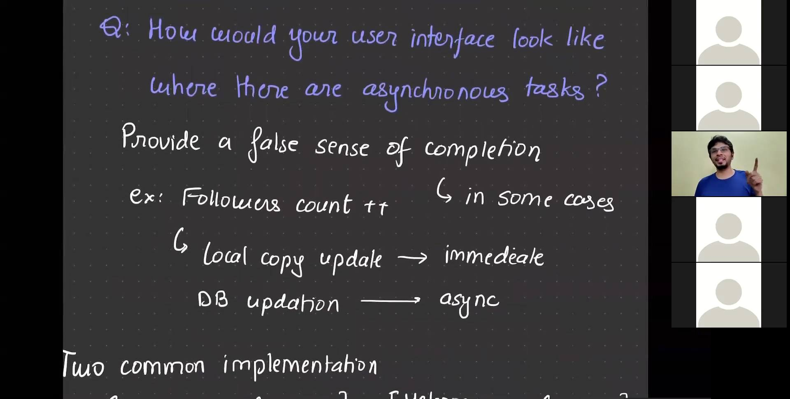
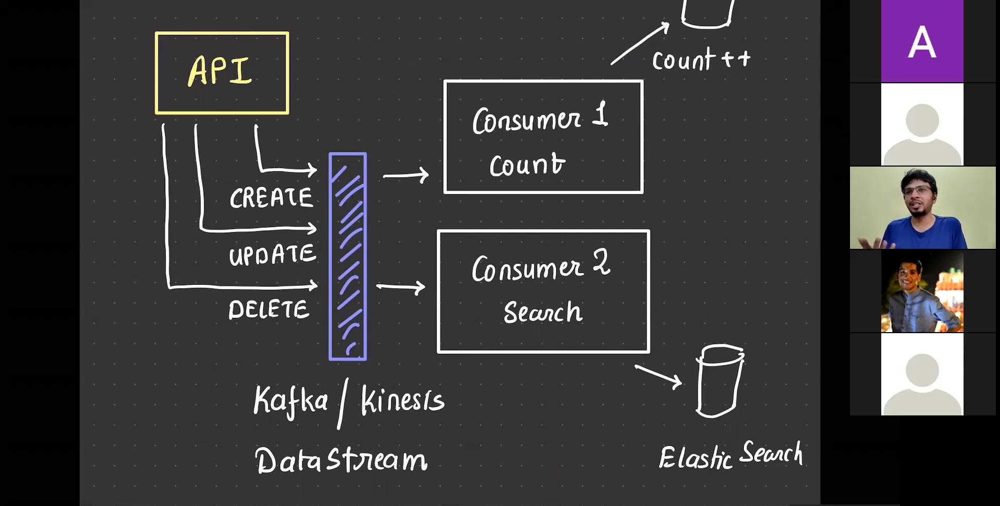
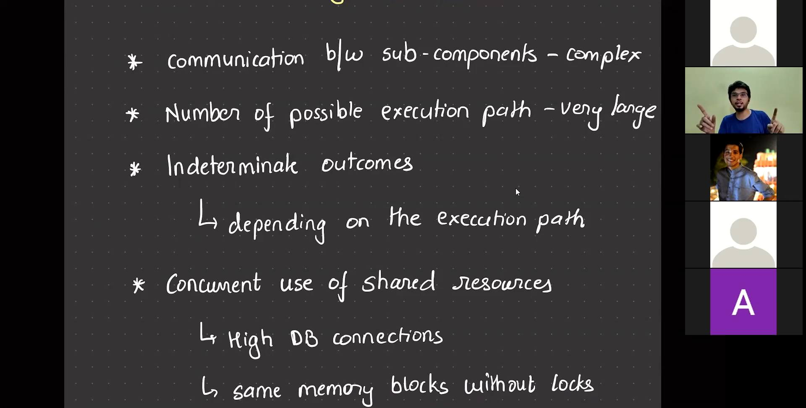

# System Design Masterclass（P2 56:04–116:38）复现文档：数据库扩展、委派与并发

> 插图说明：提供的截图清单只有 5 个唯一帧。为满足“至少 6 个插图位”的数量要求，本文在“事件总线”处复用了合法帧 `p002_5238s`，没有修改帧号，也没有伪造清单外文件。
>
> 本节是系统设计讲解课，**课里没有项目代码**。第 4 节的 SQL/API/表结构是“把讲师的设计推演落成可检查产物”的示意文件，不是讲师原课代码；示意内容会明确标注。

## 1. 这一节做什么

本节对应 p002 的 56:04–116:38，主题可以拆成三块：

1. **数据库怎么继续扩展**：单主、主从、多主、分片、跨库 join、反规范化、不要过度预留资源。讲师给的顺序是：先少量垂直扩展，再加读副本，再分片；多主/多 master 能配但很难管，尤其自增 ID 和写冲突。
2. **把不必实时完成的工作委派出去**：API 请求里只做最必要的事，其他交给消息代理和 worker。重点区分**任务队列**（同构消费者，一条消息被一个消费者处理）和**数据流/PubSub/事件总线**（同一事件被多类消费者各读一次）。
3. **并发与并行**：并发是“看起来同时推进/时间重叠”，并行是“多核上真正同时执行”。Python 受 GIL 限制、Node.js 靠事件循环做 I/O 并发；CPU 密集计算要用多进程/多核方案；进程间通信可用文件、socket 文件、共享内存等；并发写共享资源要处理锁、线程安全、死锁/饥饿。

本节最后要复现的不是一个可启动的 Web 服务，而是一份**博客系统的可落地设计包**。建议落盘为：

```text
course-p2-blog-design/
├─ README.md
├─ decisions.md
├─ schema.sql
├─ api-contract.md
└─ capacity.md
```

运行时依赖：无。若执行第 4 节 `schema.sql`，示意使用 PostgreSQL 15+；课里没有指定数据库，换 MySQL 需要调整 `UUID/JSONB` 等类型。环境变量：无。启动命令：无，本节是设计复现，不是服务复现。



## 2. 讲师原话（带「—— pNNN [MM:SS]」）

> "所以这里一开始主节点只会有一个或少数几个……如果有多个主节点，这就变成了你的分片数据库……双活配置……问题在于你必须管理它们之间的写入。"
> —— p002 [56:04]

> "不要从第一天起就过度优化，也不要过度预配资源。"
> —— p002 [58:46]

> "不需要实时完成的事情，就不应该用实时方式去做。"
> —— p002 [68:16]

> "你必须监控延迟……也就是消息提交到消息代理的时间与它被处理的时间之间的间隔。这个延迟应该尽可能小。"
> —— p002 [74:23]

> "AWS SQS 在这种情况下就派上用场了：你可以使用 FIFO 队列，也可以使用普通队列。"
> —— p002 [76:19]

> "所以，如果同一个事件需要两个消费者，我们会选择数据流……如果一条消息需要由一组同类消费者来消费，基本上就是某种任务队列……那就会使用 SQS、RabbitMQ、Redis 这类东西。"
> —— p002 [97:01]

> "并发是指你能够执行两个任务……看起来在时间上有重叠。而并行则是指你实际上在同一时刻执行这两个任务并推进它们。"
> —— p002 [103:19]

> "Golang 有一个非常出色的实现，叫作 goroutine。"
> —— p002 [106:12]

## 3. 从零复现

这一节按“需求 → 约束 → 估算 → 方案 → 取舍”复现讲师的推导。注意：**课里没有给出具体容量数字**，下面的数字是为了让你能检查设计而设的示例，不是讲师原话。

### 步骤 0：建目录，先写“需求-非实时”清单

```bash
mkdir -p course-p2-blog-design
cd course-p2-blog-design
touch README.md decisions.md schema.sql api-contract.md capacity.md
```

在 `README.md` 里先写清楚：哪些必须同步完成，哪些可以最终完成。

| 需求 | 是否必须在同一请求里完成 | 处理方式 |
|---|---|---|
| 用户发布博客 | 写博客记录必须完成 | API 同步写 `blogs` |
| 用户博客总数 `total_blogs` | 可略延迟，但读时要快 | 预计算字段，发布/取消发布时增减 |
| 博客点赞数 `like_count` | 普通用户可同步，名人可异步 | 同步原子加一；名人走异步/独立基础设施 |
| 按标签统计、搜索索引 | 不要求实时 | 事件总线 + 搜索消费者异步更新 |
| 给关注者发 newsletter | 不要求实时 | 任务队列 + worker |
| 异步任务状态查询 | 不要求服务端推送 | 返回 `task_id`，客户端轮询状态 API |

### 步骤 1：明确数据库扩展约束

按讲师顺序做，不要一上来分片：

1. 先少量垂直扩展。
2. 再加读副本，读多写少先扛读。
3. 再分片。分片后跨库 join 很贵，尽量避免。
4. 多主/多 master 可以配 active-active，但写冲突和唯一 ID 难管；公司到一定规模更倾向分片库或 DynamoDB/MongoDB 这类默认带分片能力的系统。

分片键选择：博客系统用 `user_id` 作为主要分片键，让“某用户的博客/计数”落在同一分片；跨用户聚合不要实时查，走预计算或单独反规范化读库。

### 步骤 2：做示例估算，决定队列和监控阈值

示例假设（**课里没有这些数字，仅用于复现计算过程**）：

- 日活 1,000,000。
- 每日新增博客 50,000。
- 每日点赞 5,000,000。
- 每条点赞事件消息 1 KB。
- 峰值系数按 5 倍平均 QPS 估。
- 讲师举例的 lag 监控线是 5 分钟；这里也先用 5 分钟做示例。

计算：

```text
平均点赞写入 QPS = 5,000,000 / 86,400 ≈ 58 条/秒
峰值点赞写入 QPS ≈ 58 × 5 ≈ 290 条/秒
5 分钟峰值积压消息数 ≈ 290 × 300 ≈ 87,000 条
5 分钟积压消息体积 ≈ 87,000 × 1 KB ≈ 87 MB

平均博客发布 QPS = 50,000 / 86,400 ≈ 0.58 条/秒
峰值博客发布 QPS ≈ 0.58 × 5 ≈ 2.9 条/秒，向上取 3 条/秒
每日博客事件量 = 50,000 条；搜索消费者也读同一批事件
```

结论：点赞事件是主要队列流量；如果 lag 超过 5 分钟，积压约 8.7 万条、87 MB 量级。这个量级下必须监控“入队时间到处理完成时间”的延迟，而不是只看队列长度。



### 步骤 3：选择委派载体

按讲师区分：

- 同一事件要被**多类消费者**各消费一次：用数据流/PubSub，课里点名 Kafka、Kinesis。
- 一条任务只需要被**同构消费者中的一个**处理：用任务队列，课里点名 SQS、RabbitMQ、Redis。
- 如果非要用 SQS 实现“同一事件给两类消费者”，讲师说要把同一消息放进两个队列：一个给 count，一个给 search。

本设计采用：

- `blog-events`：博客发布/取消发布事件。消费者组：计数消费者、搜索消费者、分析消费者。
- `newsletter-jobs`：发 newsletter 的任务队列。消费者：newsletter worker。
- `like-events`：点赞事件。普通用户可同步更新计数；名人点赞事件异步进入队列，减少热点写对主库的冲击。

### 步骤 4：定队列配置和过期策略

在 `decisions.md` 写清楚：

- 任务队列是否 FIFO：按业务决定。SQS 有 FIFO 和普通队列；普通队列可能少量乱序。
- 消息过期：通知类必须有。讲师举例：预约 4 点，消息 4:15 才被处理，就不该再发“预约开始了”。
- 投递语义：至少一次、至多一次、恰好一次按业务配置；SQS 常见配置要消费者处理完后删除消息，否则消息可能重新出现。
- 消费者挂了：消息是否重回队列取决于队列配置；课里明确说这是 queue-by-queue 的配置。
- lag 告警：示例阈值 5 分钟；不同业务可秒级、小时级甚至天级。



### 步骤 5：处理并发与语言/进程模型

- 同步代码是一个任务接一个任务；Node.js/Python async IO 把 I/O 交给事件循环，从而获得并发。
- Python 有 GIL，同一时刻通常只有一个线程执行 Python 字节码；CPU 密集任务不能靠加线程解决。
- Node.js 单线程执行 JS，但 I/O 可并发；CPU 密集任务要开子进程/多进程。课里提到 Node.js 的 `child-process`；`worker_threads` 课里没讲，属于你会撞上的补充。
- Java/Golang/C 更能利用多核；Golang 的 goroutine 比线程更轻。
- 多进程通信：共享文件、`.sock` 文件、共享内存、队列/邮箱等。Nginx 与 Python/Node 进程之间就常用 socket 文件通信。
- 共享计数并发写要加锁或使用原子操作；否则两个请求都读到旧值再加一，会少算。

### 步骤 6：写取舍

- 多主 vs 分片：多主写冲突难管，默认不选；分片更简单，但跨库 join 贵。
- 跨库 join：优先建模避免；必须做时单独建反规范化读库，接受少量延迟。
- 预计算计数：读快，但写时要维护；取消发布要减一。
- 同步点赞 vs 异步点赞：普通用户同步保证体验；名人独立基础设施异步处理。
- SQS vs Kafka/Kinesis：同构任务用 SQS 省钱简单；同一事件多消费者用 Kafka/Kinesis，吞吐高但成本也高。

## 4. 完整代码

> **课里没有代码，以下为示意。** 目的是把本节的设计决策落成可检查的文件；不是讲师原课实现。

### 4.1 `decisions.md`：设计决策表

| 决策 | 选择 | 理由 | 课里依据 |
|---|---|---|---|
| 数据库扩展顺序 | 垂直 → 读副本 → 分片 | 不提前过度预留；数据库降配很慢 | p002 [58:46]–[59:14] |
| 多主 | 默认不选 | 写冲突、唯一 ID 难管 | p002 [56:04]–[57:00] |
| 跨库 join | 尽量避免；必要时反规范化读库 | 跨库 join 贵，可接受延迟 | p002 [57:24]–[58:20] |
| 用户博客总数 | `users.total_blogs` 预计算 | 避免每次加载资料都聚合 | p002 [71:30]–[72:27] |
| 博客点赞数 | `blogs.like_count`；普通用户同步，名人异步 | 体验与热点写取舍 | p002 [80:00]–[82:46] |
| 同一事件多消费者 | Kafka/Kinesis 数据流 | 一条事件被计数、搜索、分析各读一次 | p002 [91:02]–[93:18] |
| 单一同构任务 | SQS/RabbitMQ/Redis 任务队列 | 任一 worker 处理即可 | p002 [90:35]–[91:02] |
| newsletter | 任务队列 | 发信是典型异步任务 | p002 [98:27] |
| 消息过期 | 通知类必须设置 | 过期通知是坏体验 | p002 [76:45]–[78:36] |
| lag 监控 | 示例 5 分钟告警 | 讲师用它举例；按业务调整 | p002 [74:52]–[75:20] |
| Node CPU 密集 | 多进程/子进程，不靠单线程硬扛 | 单线程 JS 适合 I/O 并发 | p002 [106:41]–[107:37]、[114:44] |

### 4.2 `schema.sql`：示意 DDL（PostgreSQL 15+）

```sql
-- 课里没有代码，以下为示意 DDL，仅用于承载本节设计字段。
-- 课里未指定数据库；PostgreSQL 15+ 可直接参考，MySQL 需调整 UUID/JSONB。

CREATE TABLE users (
    user_id       BIGINT PRIMARY KEY,
    handle        VARCHAR(64) NOT NULL,
    total_blogs   BIGINT NOT NULL DEFAULT 0,
    is_celebrity  BOOLEAN NOT NULL DEFAULT FALSE
);

CREATE TABLE blogs (
    blog_id       BIGINT PRIMARY KEY,
    user_id       BIGINT NOT NULL,
    title         VARCHAR(200) NOT NULL,
    body          TEXT NOT NULL,
    status        VARCHAR(16) NOT NULL,
    like_count    BIGINT NOT NULL DEFAULT 0,
    published_at  TIMESTAMP NULL
);

CREATE TABLE async_tasks (
    task_id       UUID PRIMARY KEY,
    task_type     VARCHAR(32) NOT NULL,
    status        VARCHAR(16) NOT NULL,
    payload       JSONB NOT NULL,
    created_at    TIMESTAMP NOT NULL DEFAULT NOW(),
    updated_at    TIMESTAMP NOT NULL DEFAULT NOW()
);

CREATE INDEX idx_blogs_user_id ON blogs (user_id);
CREATE INDEX idx_blogs_status ON blogs (status);
```

### 4.3 `api-contract.md`：轮询式任务接口草案

```markdown
# 课里没有代码，以下为接口草案示意。

POST /blogs
- 作用：创建博客，并投递 blog.published 事件
- 返回：202
- Body: { "task_id": "uuid", "status": "submitted" }

GET /tasks/{task_id}
- 作用：客户端轮询异步任务状态
- 返回：
  { "task_id": "uuid", "status": "in_progress" }
  或
  { "task_id": "uuid", "status": "completed" }
```

> 课里只明确讲了“API 轮询、task ID、in progress/completed 这种感觉”；`failed` 状态、鉴权、分页等课里没讲。

### 4.4 事件与任务载体表

| 消息 | 载体 | 消费者 | 为什么 |
|---|---|---|---|
| `blog.published` | Kafka/Kinesis 的 `blog-events` | 计数消费者、搜索消费者、分析消费者 | 同一事件多类消费者各读一次 |
| `blog.unpublished` | 同上 | 计数消费者减一、搜索消费者删索引 | 取消发布也要维护计数 |
| `like.cast`（普通用户） | API 内同步更新 | 无 | 体验优先 |
| `like.cast`（名人） | 任务队列/事件流异步 | like worker | 热点账号隔离 |
| `newsletter.send` | SQS/RabbitMQ/Redis 任务队列 | newsletter worker | 同构任务，任一 worker 处理 |



### 4.5 `capacity.md`：容量估算表

> 课里未给数字；以下是复现用示例，用来检查公式和监控阈值。

| 指标 | 公式 | 结果 |
|---|---|---|
| 平均点赞事件 QPS | 5,000,000 / 86,400 | ≈ 58/s |
| 峰值点赞事件 QPS | 58 × 5 | ≈ 290/s |
| 5 分钟峰值积压消息数 | 290 × 300 | ≈ 87,000 |
| 5 分钟峰值积压体积 | 87,000 × 1 KB | ≈ 87 MB |
| 平均博客发布 QPS | 50,000 / 86,400 | ≈ 0.58/s |
| 峰值博客发布 QPS | 0.58 × 5 | ≈ 2.9/s，取 3/s |
| 每日博客事件量 | 50,000 发布 + 取消发布另计 | ≥ 50,000 条/天 |


## 5. 逐行解释

1. **为什么先垂直再读副本再分片**：讲师说不要 over-provision，数据库不像 API server，降配也慢。先小规模垂直扩，成本最低；读多时加副本；写/容量顶不住再分片。反过来先上多主，会先撞写冲突和 ID 冲突。
2. **为什么 `total_blogs` 放 `users` 表**：如果每次加载用户资料都 `COUNT` 该用户所有博客，博客多时聚合很贵。发布时加一、取消发布时减一，把聚合成本摊到写路径。代价是计数可能短暂不准，要接受“最终一致”。
3. **为什么 `like_count` 放 `blogs` 表**：同理，点赞数每次实时聚合会在热点博客上打爆数据库。普通用户可同步 `+1` 保证点击后立刻看到；名人账号用独立基础设施异步处理，波动几十个赞对名人和粉丝都不敏感。
4. **为什么 `is_celebrity` 是布尔标志**：讲师说蓝 tick 本质就是 flag，不需要维护两套代码库；同一套代码里按 flag 分流到不同基础设施。
5. **为什么同一事件多消费者选 Kafka/Kinesis**：SQS 普通队列默认把一条消息交给一个同构消费者；如果计数和搜索都要读 `blog.published`，SQS 里要么随机被其中一个拿走，要么你得建两个队列各放一份。数据流让同一事件被多个消费者组各读一次，适合事件驱动架构。
6. **为什么 newsletter 用任务队列**：发信是“一个任务被一个 worker 完成即可”，不需要同一消息给多类消费者；任务队列更简单、按消息计费通常更便宜。
7. **为什么消息要过期**：讲师举例预约 4:00，消息 4:15 才处理，就不该再发通知。过期策略可以在入队时设过期时间，也可以消费时检查时间后丢弃。
8. **为什么监控 lag**：队列积压不直接等于用户受损；真正要看“消息入队到处理完成”的时间。示例 5 分钟告警，超过就积压约 8.7 万条、87 MB，需要扩容 worker 或降级。
9. **为什么消费者挂了要考虑重投**：SQS 这类队列如果消费者没删除消息，消息可能重新出现在队列；是否重投、重投几次是队列配置，不是业务代码随便假设。
10. **`schema.sql` 逐行**：`users.total_blogs` 对应预计算；`is_celebrity` 对应分流标志；`blogs.like_count` 对应点赞预计算；`async_tasks` 对应“提交任务后返回 task_id，客户端轮询状态”；`payload JSONB` 是示意存任务参数，课里没规定格式。
11. **Node/JS 对应**：Node 单线程执行 JS，不等于数据库写安全。两个请求同时做 `like_count = like_count + 1` 时，应用层“先读再写”会丢更新；应让数据库执行原子自增，或用锁/乐观锁。课里说锁、线程安全、死锁会在后续展开。
12. **并发 vs 并行**：Node 的 event loop 让 I/O 看起来同时推进，这是并发；CPU 密集计算要真正用多核，需要多进程/子进程。课里说 Python 受 GIL 限制、Node 适合 I/O 密集；Java/Golang 更能吃满多核。选语言还要看团队熟悉度，不能只看 benchmark。



## 6. 复现检查清单

- [ ] 已建立 `course-p2-blog-design/` 目录和 5 个文件。
- [ ] 需求表里区分了“同一请求必须完成”和“可最终完成”。
- [ ] 数据库扩展顺序写成：垂直 → 读副本 → 分片；没有默认选多主。
- [ ] 分片键写明，并写了跨库 join 的规避方案。
- [ ] `total_blogs` 在发布/取消发布时分别 `+1/-1`。
- [ ] `like_count` 区分普通用户同步、名人异步。
- [ ] 同一事件多消费者用 Kafka/Kinesis；单一同构任务用 SQS/RabbitMQ/Redis。
- [ ] 如果坚持用 SQS 实现多消费者，已拆成多个队列，每类消费者一个队列。
- [ ] 通知类消息设置了过期策略。
- [ ] 投递语义（至少一次/至多一次/恰好一次）已选择并记录。
- [ ] 消费者失败后的重投行为按队列配置确认过。
- [ ] lag 监控阈值写清楚，示例 5 分钟，并写公式说明积压量级。
- [ ] API 返回 `task_id`，客户端用轮询查 `in_progress/completed`。
- [ ] Node CPU 密集任务没有靠单线程硬扛，已规划子进程/多进程。
- [ ] 并发写计数使用数据库原子更新或锁，没有应用层“读-改-写”。
- [ ] 已记录成本取舍：Kafka/Kinesis 吞吐高但固定成本/保留成本高；SQS 按消息计费更简单。

## 7. 课里没讲但你会撞上的

1. **幂等/去重**：课里讲了至少一次、至多一次、恰好一次，但没展开“重复消息怎么防止计数加两次”。至少一次投递下，worker 要用消息唯一键或业务版本号做幂等；否则点赞数会多算。  
2. **数据库写与投递消息的原子性**：课里说 API 里做核心事、其他投递队列，但没讲“数据库提交成功、消息投递失败”怎么办。工程上常需要 outbox/事务消息/补偿扫描；课里没讲 outbox，这是补充提醒。  
3. **重试、死信、背压**：worker 失败后重试几次、重试间隔、死信队列、队列满时 API 是否拒绝，课里没展开。没有这些，线上会出现无限重试或消息丢失。  
4. **分区键与热点**：Kafka/Kinesis 多消费者模型下，名人账号的点赞事件可能集中到一个分区。课里提到名人独立基础设施，但没讲具体分区键设计。  
5. **跨分片聚合的精度和延迟**：课里说可以反规范化、单独读库，但没给同步方案。实际要定义可接受延迟、对账任务、修正脚本。  
6. **Node 的 CPU 密集方案细节**：课里提到 Node `child-process` 和多进程思路；`worker_threads`、`cluster` 的具体用法课里没讲。前端转 Node 时要注意：`async/await` 只解决 I/O 等待，不解决 CPU 计算。  
7. **数据库锁的具体语法**：课里说锁、线程安全、死锁/饥饿，并说后续会讲乐观锁/悲观锁；本节没给 SQL 锁写法。实际在 PostgreSQL/MySQL 里可用原子 `UPDATE ... SET c = c + 1`、`SELECT ... FOR UPDATE` 或乐观版本号，但要以你们数据库为准。  
8. **可观测性字段**：课里只说监控 lag，没有规定埋点字段。你至少需要记录 `enqueued_at`、`started_at`、`finished_at`、消费者类型、重试次数；字段名请以实际队列/日志系统输出为准。  
9. **搜索索引一致性**：课里说用事件同步 Elasticsearch，但没讲全量重建、删除索引、版本冲突。上线前要准备重建索引和补偿流程。  
10. **分布式事务**：课里明确说会在下一视频讲 distributed transactions；本节不要假装已经解决跨库事务。  
11. **成本**：课里说 Kinesis/事件总线固定成本高、SQS 按消息计费。真实选型还要算保留期、跨区复制、worker 机器成本；课里没给报价。