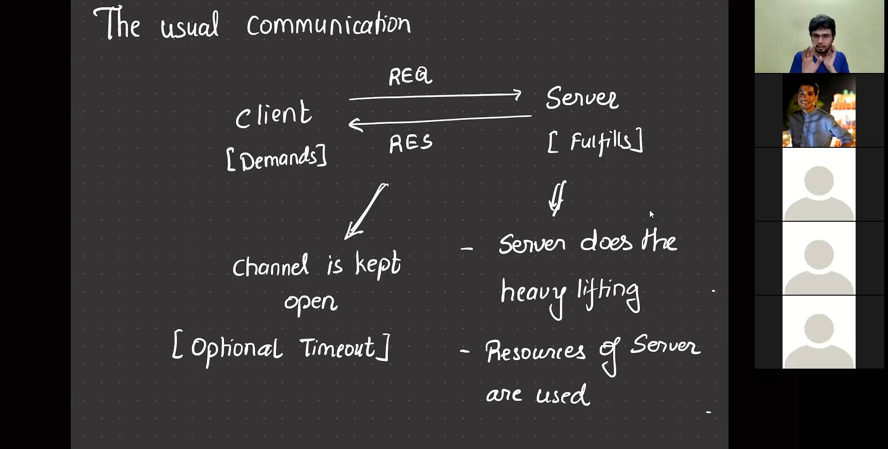
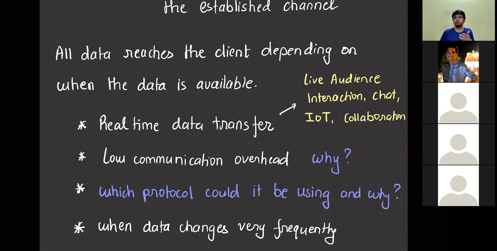
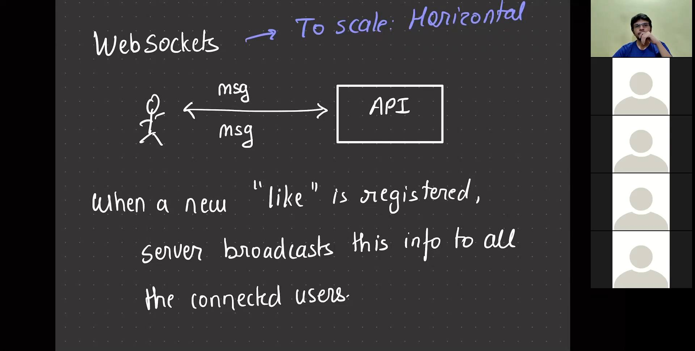
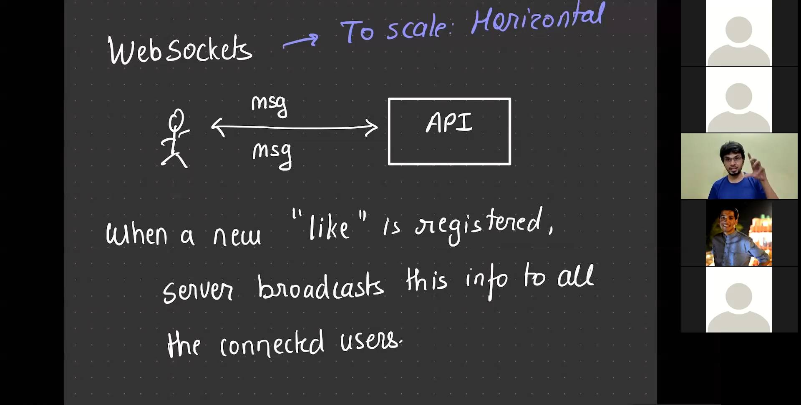
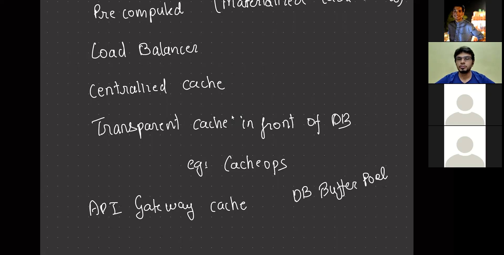

# 1. 这一节做什么

本节对应 `p002` 的后半段（117:06–174:34），不是在讲某个框架的安装，而是在讲**系统组件之间如何通信**，以及这些通信方式如何影响一个可落地的业务功能。核心对象是：HTTP 请求/响应、短轮询（short polling）、长轮询（long polling）、WebSocket、Pub/Sub 式消息消费、连接数上限、同步/异步取舍，以及缓存 TTL 与轮询的关系。

这一节最后留下了一个很适合复现的练习：**做一个 Medium 风格的“点赞/Clap 数实时更新”功能**。两个读者看同一篇文章，A 点赞后，B 不刷新页面也能看到计数变化。讲师明确提过可以用 `socket.io` 做这个练习，并说下一周会讨论 WebSocket 如何扩展。因此本文的复现目标不是“复述概念”，而是产出一套能跑起来的最小通信方案：

1. 一个 Node.js + `socket.io` 的最小实时点赞 demo；
2. 一张“什么场景选短轮询/长轮询/WebSocket”的设计决策表；
3. 一份按讲师给出的时间例子算出来的容量估算表；
4. 一套用两个浏览器窗口验证“另一端实时看到计数”的检查清单。

需要先说明：**这一节基本没有讲师逐行写代码**。下面的完整代码是为了让读者能复现“实时点赞”这个课堂练习而补的示意实现，不是讲师原课代码；课里没讲到的数据库表、鉴权、多实例广播等，我会在第 7 节明确标成“课里没讲”。

---

# 2. 讲师原话

这一节的原话主要围绕“连接何时关闭、服务端何时返回、什么时候该用 WebSocket”。下面摘录关键句，并标出它们在复现中的作用。

| 讲师原话 | 时间 | 对复现的含义 |
|---|---|---|
| “This communication comes from HTTP API, REST endpoint... TCP connection is formed. And this TCP connection is open until the request is sent and the response is opted.”（原文如此） | —— p002 [120:52] | 普通 HTTP 请求是“请求发出、响应返回”期间保持连接；它不是服务端主动推送。 |
| “Your client keeps polling the server, keeps bucking the server every x seconds for any new data.” | —— p002 [122:44] | 短轮询就是客户端定时问服务端“有没有新数据”，服务端立即返回当前已有内容。 |
| “Short polling would immediately respond.” | —— p002 [123:13] | 短轮询不会等数据变化，它拿到什么就返回什么，可能是空数据，也可能是旧数据。 |
| “Your server, your connection is kept open until server has the data.” | —— p002 [126:30] | 长轮询把连接挂住，直到服务端有数据才返回；返回后客户端通常还要再发起下一次长轮询。 |
| “Your client and server has a bidirectional channel open. And this channel is kept open.” | —— p002 [131:11] | WebSocket 是双向持久通道，服务端可以主动发给客户端。 |
| “You have one time three way handshake done and then your connection is persistent.” | —— p002 [132:05] | WebSocket 的优势之一是握手一次后复用连接，不必每次请求都重新建连。 |
| “If it doesn't support it, it falls back to HTTP long polling.” | —— p002 [143:29] | 讲师提到 `socket.io` 在不支持 WebSocket 时会回退到 HTTP 长轮询；这给复现提供了降级思路。 |
| “We actually iterate through all the open connections and then send, send, send...” | —— p002 [150:50] | 所谓“广播”在实现上通常是对房间/连接集合逐个发送；不是魔法。 |
| “A typical hard limit on a number of TCP connections... is close to 65,000... on a single port.” | —— p002 [151:45] | 课堂讨论了单机连接上限；复现时要把“并发连接数”和“每秒请求数”分开估算。 |
| “It is very hard to catch bugs with Async code.” | —— p002 [161:13] | 异步不是免费午餐；团队没有能力审查异步代码时，生产事故风险很高。 |
| “Every cache item will have a TTL attached to it.” | —— p002 [148:27] | 缓存过期靠 TTL，不等于“缓存必须主动轮询数据库”。 |
| “Partitioning gives you 100% exclusiveness.” | —— p002 [170:08] | 分片后同一分区键上的 ID 冲突问题与多主架构不同；具体方案课里没展开。 |



讲师对短轮询的态度很明确：它“almost always bad idea”，但很多公司仍在用。原因不是短轮询优雅，而是它实现简单、服务端无状态、排障容易。复现时我们要保留这个取舍，而不是一上来就把所有接口都改成 WebSocket。



关于 WebSocket 的适用场景，讲师举了实时监控、Twitter 点赞数、实时测验、Messenger、IoT、直播课等例子；同时也强调板球比分这类“两球之间可能间隔一两分钟”的场景，长期挂着 WebSocket 连接可能很浪费，所以 Cricbuzz/CricInfo 这类站点仍可能用短轮询或长轮询。这个判断直接影响我们后面的方案选择：**点赞是高频互动，适合 WebSocket；低频比分可以先轮询。**

---

# 3. 从零复现

本节是纯讲解课，所以“从零复现”不是照着敲某个框架，而是把讲师的推导过程复现成一套可执行的设计步骤：需求 → 约束 → 估算 → 方案 → 取舍 → 验证。

## 3.1 需求

做一个博客文章点赞实时更新功能：

- 页面地址形如 `/article?article=42`；
- 同一篇文章的多个读者加入同一个“文章房间”；
- 任意读者点击“Clap”后，服务端把该文章计数加一；
- 同房间其他读者不刷新页面，计数在 1 秒内更新；
- 若 WebSocket 不可用，仍能用 HTTP 短轮询读到当前计数；
- 先单机跑通，不引入数据库、不引入 Redis。

## 3.2 约束

- 读者是前端转 AI 应用工程师，不假设熟悉后端部署；
- 最小 demo 用 Node.js，因为前端已有 JS 基础；
- 课里没有指定数据库 schema、鉴权、多实例方案，所以这些不能假装是讲师实现；
- 需要能解释“为什么点赞用 WebSocket，而比分可以用轮询”；
- 需要把课堂讨论的连接数限制写进容量估算，而不是只写“WebSocket 很快”。

## 3.3 估算：先把课堂例子算成数

讲师在长轮询部分给了一个很具体的例子：假设一个机器 provisioning 需要 5 分钟；长轮询超时配置为 1 分钟；短轮询每 5 秒一次。

- 长轮询：5 分钟 ÷ 1 分钟 = **5 次请求**；
- 短轮询：5 分钟 = 300 秒，300 ÷ 5 = **60 次请求**；
- 如果 1,000 个用户同时等这个状态：
  - 长轮询请求速率约为 `1000 × 5 / 300 ≈ 16.7 req/s`，但同时有大量连接被挂住；
  - 短轮询请求速率约为 `1000 × 60 / 300 = 200 req/s`，连接短、请求多；
- 如果 10,000 个用户：
  - 短轮询约 `10,000 × 60 / 300 = 2,000 req/s`；
  - 长轮询约 `10,000 × 5 / 300 ≈ 166.7 req/s`，但常驻连接数接近 10,000。

再看 WebSocket：1 个用户 1 条持久连接，10,000 个在线用户就是约 10,000 条并发连接；一次点赞广播给同文章房间的 N 个连接，就产生 N 次发送。讲师说“iterate through all the open connections and then send”，所以广播不是零成本。

连接上限方面，课堂讨论到“单端口约 65,000 条连接”的经验值，后面又澄清这更接近“同一对 IP/端口 tuple”的限制；不同客户端连接同一服务端时，服务端还要受文件描述符、内核参数、内存等影响。课里没有给出权威压测结论，所以工程上应保守写：**单机先按远低于 65k 的并发连接做容量规划，并用实际压测校准**。



## 3.4 方案对比与选择

| 方案 | 服务端行为 | 优点 | 代价 | 适合本练习吗 |
|---|---|---|---|---|
| HTTP 普通请求 | 每次请求立即返回 | 最简单、易缓存、易排障 | 不能主动推送 | 适合作为首次加载和降级读取 |
| 短轮询 | 客户端每 x 秒问一次，服务端立即返回当前值 | 实现简单、无状态 | 请求多、空响应多、浪费带宽；浏览器并发请求有限 | 作为降级方案可以 |
| 长轮询 | 连接挂住直到有数据或超时 | 比短轮询少很多空请求 | 常驻连接多、超时后要重连、服务端资源占用高 | 课里用于消息代理/等待型任务更合适 |
| WebSocket | 一次握手，双向持久连接 | 实时性最好，服务端可主动推 | 连接常驻、扩展难、需要心跳/重连/多实例广播 | **点赞实时更新选它** |

讲师在课堂里明确说：实时消息、点赞数变化、实时测验、监控图表适合 WebSocket；低频比分可以用短/长轮询。复现时我们照这个取舍做：**主通道 WebSocket，保留 HTTP 短轮询接口用于降级和对比实验。**



这张截图对应课堂里关于直播/UDP/TCP 的讨论。它提醒我们：通信选型不是“哪个协议先进”，而是“数据丢失能不能接受、实时性要求多高、连接成本多大”。点赞计数可以最终一致，但用户体验要求快；直播音频可以容忍少量丢包但不能长期卡顿。复现时不要把“WebSocket”当成万能答案。

## 3.5 复现步骤

1. 建目录 `system-design-comm-demo`；
2. 写 `package.json`，安装 `express` 和 `socket.io`；
3. 写 `server.js`：静态文件、HTTP 点赞读取接口、Socket 连接、加入文章房间、点赞广播；
4. 写 `public/index.html`：连接 Socket、显示计数、点击 Clap、可选启动短轮询；
5. 启动 `npm start`；
6. 开两个浏览器窗口访问同一 `article` 参数；
7. 在窗口 A 点赞，观察窗口 B 计数更新；
8. 在 DevTools 的 Network 面板确认 WebSocket 连接；
9. 停掉服务端，观察断线；重启后观察重连；
10. 打开短轮询开关，对比 Network 里的定时 HTTP 请求。

---

# 4. 完整代码

这一节先给出纯讲解课应落成的设计产物，再给出可运行示意代码。再次强调：**课里没有给出这段代码，以下为示意实现；技术栈选择（Express、Node.js）是为了让前端背景读者能直接跑，不是讲师指定的生产架构。**

## 4.1 设计决策表

| 决策 | 选择 | 理由 | 不这样会怎样 |
|---|---|---|---|
| 实时主通道 | WebSocket（`socket.io`） | 点赞是高频互动，服务端需主动广播 | 只用短轮询会产生大量空请求 |
| 房间粒度 | `article:{articleId}` | 只广播给同一篇文章读者 | 全局广播会把无关文章计数推给所有人 |
| 首次计数 | Socket 加入房间时立即返回当前值 | 避免页面空白等下一次事件 | 用户要等别人点赞才看到初始值 |
| 降级读取 | `GET /api/articles/:id/likes` | 浏览器不支持 WebSocket 或调试时可短轮询 | 主通道失败时页面完全不可用 |
| 存储 | 进程内 `Map` | 最小 demo，不引入数据库 | 服务重启计数丢失；生产不可用 |
| 多实例 | 课里没讲；本文不实现 | 单机先跑通 | 多实例时房间广播不会跨进程 |
| 鉴权 | 课里没讲；本文不实现 | 避免把问题扩大 | 生产必须补，否则任何人都能刷赞 |

## 4.2 组件职责表

| 组件 | 职责 | 本 demo 对应 |
|---|---|---|
| 浏览器客户端 | 建立连接、加入文章房间、发送点赞、渲染计数 | `public/index.html` |
| HTTP 服务 | 提供静态页面和降级读取接口 | `server.js` 的 `express.static` 与 `/api/...` |
| Socket 网关 | 维护连接、房间、事件收发 | `server.js` 的 `io.on('connection')` |
| 计数存储 | 保存每篇文章当前计数 | `counts = new Map()` |
| 广播逻辑 | 点赞后向同房间连接发送新计数 | `io.to(roomOf(id)).emit(...)` |

## 4.3 接口与事件草案

课里没有定义这些字段，以下是复现草案：

| 类型 | 名称 | 方向 | 载荷 |
|---|---|---|---|
| Socket 事件 | `join_article` | 客户端 → 服务端 | `{ articleId: string }` |
| Socket 事件 | `clap` | 客户端 → 服务端 | `{ articleId: string }` |
| Socket 事件 | `like_count` | 服务端 → 客户端 | `{ articleId: string, count: number }` |
| HTTP | `GET /api/articles/:id/likes` | 客户端 → 服务端 | 返回 `{ articleId, count, source, ts }` |

## 4.4 目录结构

```text
system-design-comm-demo/
├── package.json
├── server.js
└── public/
    └── index.html
```

## 4.5 `package.json`

```json
{
  "name": "system-design-comm-demo",
  "version": "1.0.0",
  "private": true,
  "type": "commonjs",
  "scripts": {
    "start": "node server.js"
  },
  "dependencies": {
    "express": "4.19.2",
    "socket.io": "4.7.5"
  },
  "engines": {
    "node": ">=18"
  }
}
```

## 4.6 `server.js`

```js
const path = require('path');
const http = require('http');
const express = require('express');
const { Server } = require('socket.io');

const app = express();
const httpServer = http.createServer(app);
const io = new Server(httpServer);

const PORT = process.env.PORT || 3000;

// 最小 demo：进程内计数。生产环境需要持久化和原子自增。
const counts = new Map();

function readCount(articleId) {
  return counts.get(articleId) || 0;
}

function incrCount(articleId) {
  const next = readCount(articleId) + 1;
  counts.set(articleId, next);
  return next;
}

function roomOf(articleId) {
  return `article:${articleId}`;
}

app.use(express.static(path.join(__dirname, 'public')));

app.get('/api/articles/:id/likes', (req, res) => {
  const articleId = String(req.params.id);
  res.json({
    articleId,
    count: readCount(articleId),
    source: 'memory',
    ts: Date.now()
  });
});

io.on('connection', (socket) => {
  socket.on('join_article', (payload) => {
    const articleId = String(payload && payload.articleId ? payload.articleId : '').trim();
    if (!articleId) {
      return;
    }

    socket.join(roomOf(articleId));
    socket.emit('like_count', {
      articleId,
      count: readCount(articleId)
    });
  });

  socket.on('clap', (payload) => {
    const articleId = String(payload && payload.articleId ? payload.articleId : '').trim();
    if (!articleId) {
      return;
    }

    const count = incrCount(articleId);
    io.to(roomOf(articleId)).emit('like_count', {
      articleId,
      count
    });
  });
});

httpServer.listen(PORT, () => {
  console.log(`listening on http://localhost:${PORT}`);
});
```

## 4.7 `public/index.html`

```html
<!doctype html>
<html lang="zh-CN">
<head>
  <meta charset="utf-8" />
  <meta name="viewport" content="width=device-width, initial-scale=1" />
  <title>Real-time clap demo</title>
  <style>
    body {
      font-family: system-ui, -apple-system, "Segoe UI", sans-serif;
      max-width: 720px;
      margin: 48px auto;
      padding: 0 20px;
      line-height: 1.6;
    }
    .card {
      border: 1px solid #ddd;
      border-radius: 12px;
      padding: 24px;
    }
    .count {
      font-size: 56px;
      font-weight: 700;
      margin: 12px 0;
    }
    button {
      font-size: 16px;
      padding: 10px 16px;
      margin-right: 8px;
      cursor: pointer;
    }
    .muted {
      color: #666;
      font-size: 14px;
    }
  </style>
</head>
<body>
  <div class="card">
    <h1>文章点赞实时更新</h1>
    <p class="muted">
      当前文章 ID：<strong id="articleId"></strong>。
      打开两个同样 URL 的窗口，在一边点赞，另一边应实时更新。
    </p>

    <div class="count" id="count">0</div>

    <button id="clap">Clap / 点赞</button>
    <button id="togglePoll">启动短轮询</button>

    <p class="muted" id="status">connecting...</p>
  </div>

  <script src="/socket.io/socket.io.js"></script>
  <script>
    const articleId = new URLSearchParams(location.search).get('article') || '42';
    const countEl = document.getElementById('count');
    const statusEl = document.getElementById('status');
    const articleIdEl = document.getElementById('articleId');
    const clapBtn = document.getElementById('clap');
    const pollBtn = document.getElementById('togglePoll');

    articleIdEl.textContent = articleId;

    const socket = io();
    let pollTimer = null;

    function setCount(value) {
      countEl.textContent = String(value);
    }

    function setStatus(text) {
      statusEl.textContent = text;
    }

    socket.on('connect', () => {
      setStatus(`connected: ${socket.id}`);
      socket.emit('join_article', { articleId });
    });

    socket.on('disconnect', () => {
      setStatus('disconnected');
    });

    socket.on('like_count', (payload) => {
      if (String(payload.articleId) !== String(articleId)) {
        return;
      }
      setCount(payload.count);
    });

    clapBtn.addEventListener('click', () => {
      socket.emit('clap', { articleId });
    });

    pollBtn.addEventListener('click', () => {
      if (pollTimer) {
        clearInterval(pollTimer);
        pollTimer = null;
        pollBtn.textContent = '启动短轮询';
        return;
      }

      pollBtn.textContent = '停止短轮询';

      pollTimer = setInterval(async () => {
        try {
          const response = await fetch(`/api/articles/${encodeURIComponent(articleId)}/likes`);
          const data = await response.json();
          setCount(data.count);
        } catch (error) {
          setStatus('poll error');
        }
      }, 5000);
    });
  </script>
</body>
</html>
```

## 4.8 启动命令

```bash
cd system-design-comm-demo
npm install
npm start
```

然后打开两个窗口：

```text
http://localhost:3000/?article=42
http://localhost:3000/?article=42
```

---

# 5. 逐行解释

这一章按“为什么这样定、不这样会怎样”解释上一节的设计和代码。重点不是背 API，而是把讲师的通信取舍落到实现。

**`counts = new Map()`**：这是进程内存储，只适合课堂 demo。服务重启后计数会丢；多实例部署时每个实例各有一份 Map，A 实例点的赞 B 实例读不到。生产至少要换成数据库；如果并发点赞多，还要用数据库原子自增或事务，避免两个请求同时读到旧值再写回。课里没有讲具体数据库和事务实现，这里是工程补充。在 Node.js 里，如果用 SQL，应写成 `UPDATE articles SET likes = likes + 1 WHERE id = ?` 这类由数据库保证原子性的语句，而不是先查再写。

**`roomOf(articleId)`**：房间名是 `article:${articleId}`。这样一次点赞只广播给同一篇文章的读者。若不做房间，`io.emit` 会把计数推给所有文章的所有读者，既浪费带宽又会让前端收到无关数据。讲师说广播会遍历连接逐个发送，所以房间越小，广播成本越低。

**`socket.join(roomOf(articleId))`**：客户端加入房间后，后续 `io.to(room).emit` 才会送达它。加入房间后立即 `socket.emit('like_count', ...)`，是为了让新打开的页面马上拿到当前计数，而不是等下一次别人点赞。这个“首次快照 + 后续增量”是实时应用常见结构；课里没有明确讲这个模式，但对复现是必要的。

**`socket.on('clap')` 里先 `incrCount` 再 `io.to(...).emit`**：这是“先改状态，再广播”。如果先广播再改状态，其他客户端可能收到旧计数，随后又被下一次广播纠正，体验会闪。真实系统还要考虑写数据库失败时不要广播成功；本 demo 用内存所以不会失败。课里没有讲失败重试和事务，这里不扩展。

**`app.get('/api/articles/:id/likes')`**：这是短轮询降级接口。它的行为完全符合讲师对短轮询的描述：立即返回当前已有数据，不等待变化。前端每 5 秒调一次，就是课堂里“client keeps polling every x seconds”的最小复现。它也可以用来对比 Network 面板里的请求数量。

**前端 `socket.on('connect')` 里再次 `join_article`**：网络断开重连后，Socket 会重新建立连接，房间成员关系不一定还在，所以连接成功后要重新加入。课里没有讲重连细节，但这是 WebSocket 实战必踩的坑。`socket.io` 自带重连机制，但业务层仍要处理“重连后重新订阅”。

**短轮询按钮里 `setInterval(..., 5000)`**：5 秒对应讲师例子里的短轮询间隔。点击停止时 `clearInterval`，否则离开页面或重复点击会叠加多个定时器。浏览器后台标签页可能节流定时器，所以短轮询在后台不一定准时；这也是“短轮询看起来简单，实际行为不稳定”的一个来源。课里没讲这个细节，属于前端实现常识。

**为什么主通道选 WebSocket 而不是长轮询**：点赞事件发生频率不固定，但用户期望“我点完，别人马上看到”。长轮询也能做，但每次有数据返回后客户端要立刻再发下一次长轮询；连接超时、重连、服务端挂起连接都会增加复杂度。讲师说 WebSocket 的优势是“一次三次握手后连接持久”，并且服务端可以主动推。对这个练习，WebSocket 更贴合“实时互动”的定义。

**为什么还保留 HTTP 接口**：讲师提到 `socket.io` 在不支持 WebSocket 时会回退到 HTTP 长轮询。我们的 demo 没有手写长轮询，而是保留一个短轮询接口，让读者能在 Network 面板里直观看到“轮询请求长什么样”。这是教学降级，不是生产最优。



这张截图对应课堂末尾的缓存讨论。讲师在更早的 148:27 说“every cache item will have a TTL attached to it”。这句话要这样理解：缓存过期靠 TTL，缓存未命中时回源数据库；它不是“缓存必须自己轮询数据库”。复现点赞功能时，如果你把计数放进 Redis，常见做法是读缓存、未命中回源、写时更新或删除缓存，并给 key 设 TTL；而不是让缓存线程定时拉数据库。课里没有展开 Redis 具体命令，这里只保留设计原则。

**关于异步**：本 demo 的 `setInterval(async () => { ... })` 用了 `async/await`，因为 `fetch` 是异步的。讲师在 161:13 说异步代码的 bug 很难抓，并举了团队把 Python 代码改成 async 后变量共享、缓存值错乱的事故。对应到 Node.js：不要在多个异步回调里共享可变状态而不加约束；本 demo 的 `counts` 是单进程内存，单线程事件循环下自增暂时简单，但一旦换成异步数据库写，就要防止“读-改-写”交错。课里没有讲锁；在 Node 里对应的是用数据库原子操作、事务或串行化队列，而不是自己发明内存锁。

**容量估算的解释**：短轮询 5 秒一次，5 分钟 60 次，这是讲师在长轮询对比里亲自算的例子。它的意义不是“60 次一定崩”，而是让你在设计前知道请求量级。WebSocket 的估算则要看“并发连接数”和“广播扇出”：10,000 个连接不等于 10,000 req/s，但一次广播要发 10,000 次。课堂讨论的 65,000 是连接上限经验值，不是用户上限；同一服务端可以被不同客户端连接，但会受端口、文件描述符和内核限制。课里没有给出压测方法，所以第 6 节让你用本地实验观察，而不是把 65k 当承诺。

---

# 6. 复现检查清单


- [ ] Node.js 版本 ≥ 18，`node -v` 有输出。
- [ ] 目录结构包含 `package.json`、`server.js`、`public/index.html`。
- [ ] `npm install` 成功，`node_modules` 存在。
- [ ] `npm start` 输出 `listening on http://localhost:3000`。
- [ ] 浏览器打开 `http://localhost:3000/?article=42` 不报 404。
- [ ] 再开第二个窗口，URL 相同。
- [ ] 窗口 A 点击 Clap，窗口 B 的计数在 1 秒内变化。
- [ ] 窗口 B 点击 Clap，窗口 A 也变化。
- [ ] 把窗口 A 改成 `?article=43`，点 A 的 Clap，窗口 B（article=42）不应变化，验证房间隔离。
- [ ] DevTools → Network → WS，能看到 Socket 连接；连接状态显示 `connected: ...`。
- [ ] 停掉 `npm start`，页面状态变为 `disconnected`；重启后能重连并重新加入房间。
- [ ] 点击“启动短轮询”，Network 中每 5 秒出现一次 `/api/articles/42/likes` 请求。
- [ ] 点击“停止短轮询”，请求停止，不叠加定时器。
- [ ] 用第 3.3 节公式复算：5 分钟短轮询 60 次/用户；长轮询 1 分钟超时 5 次/用户。
- [ ] 记录本机两个窗口的广播扇出：1 次 Clap 应触发同房间连接各 1 次 `like_count`。
- [ ] 明确知道本 demo 的计数在重启后丢失，不能当生产实现。

---

# 7. 课里没讲但你会撞上的

以下不是讲师原话，而是把上面的 demo 往真实系统推时会遇到的问题。课里没有展开的，我明确标出来。

1. **多实例广播**：课里没有讲 `socket.io` 多实例如何共享房间。单机 `io.to(room).emit` 只广播本进程连接；部署两个 Node 实例后，A 实例的点赞广播不到 B 实例的客户端。生产通常要引入 Redis adapter 或消息总线，但这属于课里没讲的内容，本文不假装实现。

2. **持久化与原子自增**：课里没有给数据库表。真实点赞不能放 `Map`，否则重启丢失；并发点赞要用数据库原子自增或事务。Node 里对应的是数据库事务/原子 SQL，不是 JS 内存锁。

3. **鉴权与刷赞**：课里没有讲登录、文章权限、频率限制。真实系统必须限制谁能点赞、同一用户能否重复点赞、如何防刷。不要因为 demo 能跑就认为可以直接上线。

4. **WebSocket 的部署细节**：课里没有讲 Nginx/负载均衡的 `Upgrade` 头、心跳、断线重连、连接迁移。真实部署中，反向代理要正确转发 WebSocket；客户端要处理重连后的重新加入房间；服务端要设置心跳和超时。

5. **浏览器并发限制**：讲师提到浏览器同时只能发少量 HTTP 请求（课堂说约 6 个）。短轮询开太多会挤占其他 API 请求；这也是 WebSocket 复用一条连接的优势。课里没有给浏览器版本差异，实际以 DevTools 为准。

6. **后台标签页定时器节流**：短轮询用 `setInterval` 在后台标签页可能被浏览器节流，导致“看起来没按时请求”。课里没讲，前端实现要心里有数。

7. **连接数 65k 的真实含义**：课堂讨论到单端口约 65,000 条连接，后面又澄清与 IP/端口 tuple 有关；不同客户端连接同一服务端时，服务端还受文件描述符、内核参数、内存限制。课里没有给压测脚本，所以不要把 65k 当“单机可承载 65k 用户”的承诺。复现时请用本机实验和实际 `ulimit` 校准。

8. **缓存 TTL 与轮询不是一回事**：课里明确说 TTL 是缓存条目过期，不是让缓存主动轮询数据库。把点赞计数放 Redis 时，要设计未命中回源、更新/删除缓存、TTL 过期策略；课里没有给 Redis 命令和一致性方案，不要自行宣称讲师讲过。

9. **Query cache / 透明缓存**：课程末尾由提问引出 query cache 和 Postgres 的查询缓存讨论，但没有展开实现细节。若你要在数据库前加透明缓存，需要单独验证失效策略；这不属于本节已复现范围。

10. **分片后的 ID 冲突**：讲师在 170:08 说分区提供排他性，同一分区键的查询不会跨分区，所以分片场景的 ID 问题与多主架构不同；但具体分布式 ID 生成方案课里说后面再讲。本文不展开雪花算法等内容，避免把没讲的工具安到讲师头上。

到这里，你应该已经能按第 4 节代码把“实时点赞”跑起来，并能用第 3 节估算和第 6 节清单解释：为什么点赞选 WebSocket、为什么短轮询仍要保留、为什么 65k 不能直接当用户上限、为什么异步代码需要团队约束。