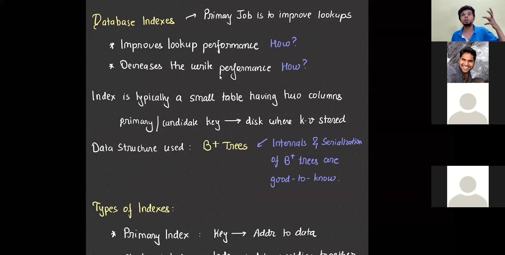
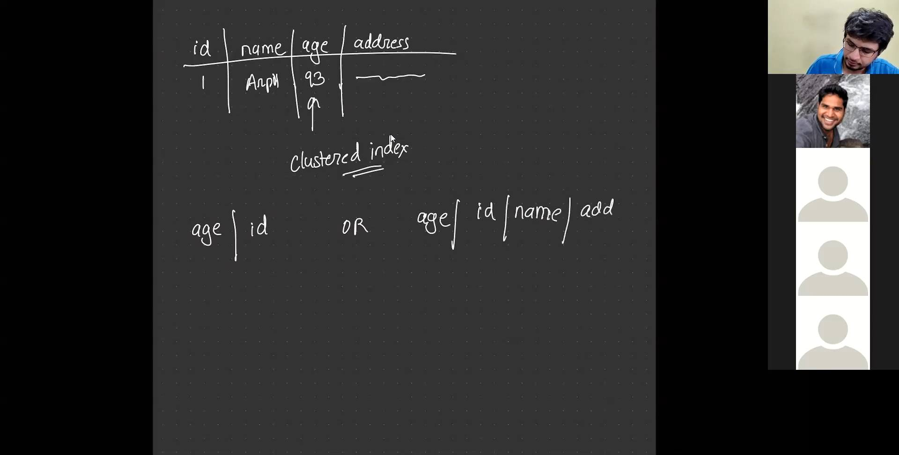
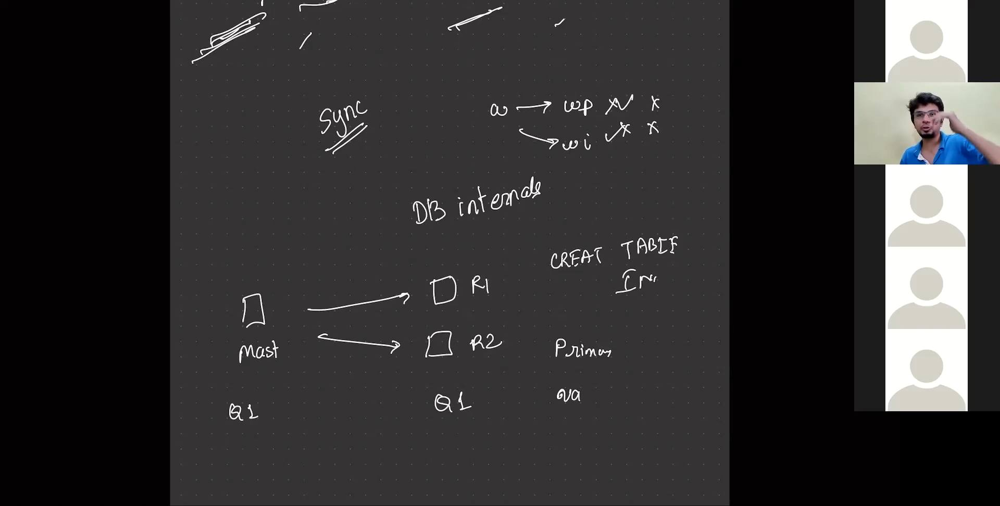
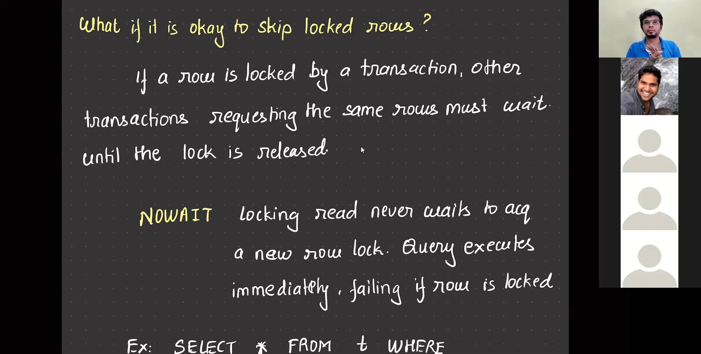

# System Design Masterclass (Arpit) P003 复现文档：关系数据库、索引、复制与锁

> **截图约束说明**：本题给出的截图清单只有 5 张可选帧（p003 的 5 个时间点），但硬性要求写“插入 ≥6 张截图”。为了不编造清单里不存在的帧，本文只能插入清单中的全部 5 张，并明确说明第 6 张无法从给定清单获得。  
> **课程性质说明**：P003 是纯讲解/设计课，不是完整 Web 项目课。逐字稿里没有完整工程代码，只有数据库概念、设计取舍和少量 SQL 语法片段。因此本文按“纯讲解课”的方式复现：需求→约束→估算→方案→取舍，并把讲师给出的方案落成可执行的 SQL 实验、设计决策表和检查清单。第 4 节中的 SQL 是**文档补充的复现实验脚本**，已标注“课里没有完整脚本，以下为示意”。

---

## 1. 这一节做什么

P003 的核心不是“写一个业务项目”，而是把关系数据库为什么这样设计讲清楚：范式、ACID、索引、聚簇索引、复制、锁、`FOR SHARE` / `FOR UPDATE` / `NOWAIT` / `SKIP LOCKED`。讲师的落点是：**你以后做票务、闪购、消息队列、订单系统时，如何用数据库本身的事务和锁把并发正确性做出来，而不是一上来就在应用层堆分布式锁。**

这一节可以复现出四个产物：

1. 一个符合 3NF 思路的博客标签 schema：标签名单独一张表，博客和标签用映射表，避免把 CSV 塞进一列。  
2. 一个带多个二级索引的 `tickets` 表：用来观察“一次写会放大成多次索引写”。  
3. 一个用普通表模拟聚簇索引的实验：主表写一次，索引表也要同步写；中途失败必须回滚。  
4. 一组双会话锁实验：读锁、写锁、`NOWAIT`、`SKIP LOCKED`，并把它映射到“座位预订/消息队列取任务”的场景。


对前端转 AI 应用工程师的读者，先把三个类比记住：

- **事务**：在 Node 里可以理解为“同一个数据库连接上的一串操作，要么一起成功，要么一起回滚”。不是 `Promise.all` 那种并发。  
- **行锁**：类似数据库层面给某一行加的互斥锁；但锁的生命周期跟事务绑定，不是 JS 的 `await` 结束就自动释放。  
- **连接池**：事务必须用**同一条连接**执行 `begin/commit/rollback`；从池里换一条连接，事务就断了。这一点课里没展开，但你会撞上。

---

## 2. 讲师原话（带「—— pNNN [MM:SS]」）

> “关系数据库本质上是一个中央账本，用行和列存数据；范式是为了决定数据怎么拆、怎么减少冗余。”  
> —— p003 [06:14]

> “1NF 要求列是原子的，不要把 CSV 值塞进一个列；3NF 是最常见的，核心是减少数据冗余。标签不要和博客写在一起，而是用 tag id 做映射，改名只改一处。”  
> —— p003 [07:41] / [08:34] / [09:04]

> “事务给你 ACID：原子性、一致性、持久性、隔离性。原子性是一组 SQL 要么全成要么全不成；一致性靠约束，比如 check constraint；持久性是 commit 后崩溃也能恢复；隔离性是多个事务并发时互不影响。”  
> —— p003 [10:31] / [11:00] / [12:53] / [13:22]

> “索引改善查询，但会拖慢写。一个表有五个索引，你一次写会放大成一次主表写加五次索引写，也就是六次写。”  
> —— p003 [19:56]

> “聚簇索引把整行数据放在索引里；普通主索引只存 key 和地址。聚簇索引读的时候不用再回主表，所以是一跳；普通索引要两跳，所以慢。”  
> —— p003 [22:17] / [22:47] / [23:12]



> “复制有两种常见思路：一种是把 SQL 查询也发到 replica 上重放；另一种只把变更流过去。大多数数据库默认是流查询，因为更一致、更容易恢复。”  
> —— p003 [38:12] / [40:07] / [40:33] / [41:02]

> “锁有读锁/共享锁和写锁/排他锁。读锁允许别人读但不允许改；写锁连读都不允许。锁的粒度可以是表、行、列，页级锁也存在。死锁发生时，数据库会杀掉检测到死锁的那个事务，而不是两个都杀。”  
> —— p003 [47:15] / [48:13] / [48:43] / [49:12] / [49:38]

> “做实验时把 autocommit 设成 false，用 begin transaction / end transaction 模拟。读锁用 `FOR SHARE`；写锁用 `FOR UPDATE`；如果不想等，用 `NOWAIT`；如果可以跳过被锁的行，用 `SKIP LOCKED`。座位预订、票务、消息队列都可以用这个思路。”  
> —— p003 [51:33] / [52:02] / [53:23] / [53:49] / [56:41] / [57:11] / [57:39]

> “SQL 是声明式语言，你只说要什么，不指定怎么读；真正选哪个索引由数据库优化器决定。你可以用 explain 看执行计划。”  
> —— p003 [36:21] / [43:19] / [43:47]

---

## 3. 从零复现

### 3.1 需求

我们要复现的不是一个完整网站，而是一个“数据库设计实验台”：

1. 博客系统里，标签要能改名，改名时不能把所有博客行都更新一遍。  
2. 票务系统里，同一座位不能被两个人同时买走。  
3. 查询要按 `status`、`owner_id` 等条件变快，所以需要索引。  
4. 要能观察“索引越多，写越贵”。  
5. 要能观察“读锁/写锁/跳过锁行”在一个事务未提交时对另一个事务的影响。  
6. 要能解释复制策略，但单机实验不强行搭主从，因为课里没给主从配置步骤。

### 3.2 约束

- 课里没有指定数据库版本。为了能跑 `FOR SHARE`、`NOWAIT`、`SKIP LOCKED`，本文用 **MySQL 8.0+** 做示意；如果你的数据库版本更低，语法可能不同，以实际为准。  
- 课里没有讲 Docker、云数据库、连接池、Node 客户端库安装。本文不把这些说成讲师内容；第 4 节只给 SQL 文件和连接命令。  
- 课里没有给完整应用代码，所以本文不编造“讲师写过的服务端工程”。  
- 所有容量数字都是**示意估算**，不是讲师给出的生产数据。

### 3.3 估算

讲师在索引部分给了一个关键算式：**一次写 = 1 次主表写 + N 次索引写**。如果表上有 5 个二级索引，那么一次逻辑写会放大成 6 次逻辑写。

假设：

- 写请求：100 次/秒；
- 二级索引：5 个；
- 写放大：`1 + 5 = 6`；
- 逻辑写吞吐：`100 × 6 = 600 次/秒`。

这不是精确 IOPS，只是让你在设计表时先算一笔账：**索引不是免费的，读多写少的表可以多加，写多的表要克制。**

锁的吞吐也可以粗算。假设一个热点行的事务持锁时间：

- 持锁 100ms：单行理论吞吐约 `1 / 0.1 = 10 事务/秒`；
- 持锁 50ms：单行理论吞吐约 `1 / 0.05 = 20 事务/秒`。

所以抢同一个座位时，持锁时间越长，排队越长。课里提到“1000 requests per minute”量级时数据库能处理，但这里不应把它当成精确结论；真正要看锁持有时长和热点行数量。

### 3.4 方案



方案分五步：

1. **3NF 博客标签**：`tags(tag_id, tag_name)`、`blogs(blog_id, title, body)`、`blog_tags(blog_id, tag_id)`。改标签名只改 `tags` 一行。  
2. **票务主表**：`tickets(id, seat_no, status, owner_id, updated_at)`，主键 `id`，`seat_no` 唯一，另外建 5 个二级索引做写放大实验。  
3. **聚簇索引模拟表**：`tickets_clustered_index_sim(seat_no, id, status, owner_id, updated_at)`，把整行复制到索引表。每次写主表，也要在同一个事务里写索引表；失败就 `ROLLBACK`。  
4. **锁实验**：两个 MySQL 会话。会话 A `SET autocommit=0; START TRANSACTION; SELECT ... FOR SHARE/FOR UPDATE;`，先不提交；会话 B 去 `UPDATE` 或锁定读，观察等待/立即失败/跳过。  
5. **复制与执行计划**：复制只做设计解释，不搭主从；执行计划用 `EXPLAIN` 观察优化器选不选索引。课里没讲 `EXPLAIN` 输出字段名，所以本文不编造字段名，统一写“以实际输出为准”。

### 3.5 取舍

- **3NF vs 反范式**：3NF 减少冗余，但复杂查询可能要 join。课里明确说“3NF 是 guideline，不是 mandate；上规模后可能为了查询性能引入冗余”。  
- **聚簇索引 vs 普通索引**：聚簇索引读快，因为数据跟索引在一起；但写更贵，因为整行都要跟着索引走。  
- **读锁 vs 写锁**：读锁宽松，允许别人读；写锁严格，连读都挡。写锁越多，系统越接近串行。  
- **`NOWAIT` vs `SKIP LOCKED`**：`NOWAIT` 是“遇到锁就失败”，适合快速失败重试；`SKIP LOCKED` 是“跳过被锁行，拿别的行”，适合票务选座和队列取任务。课里也提醒：跳过锁行会有公平性问题，本文在第 7 节写。

---

## 4. 完整代码

> **重要标注**：课里没有完整项目代码，也没有给完整 SQL 脚本。下面是为了“照着复现”而写的完整实验文件，属于文档补充示意。SQL 以 MySQL 8.0+ 为示意版本；课里没有指定版本。若你的数据库不支持 `FOR SHARE`、`NOWAIT`、`SKIP LOCKED`，请以实际数据库文档为准。

目录结构：

```text
sysdesign-p003/
├── schema.sql
├── seed.sql
├── session_a_read_lock.sql
├── session_b_write_wait.sql
├── session_a_for_update.sql
├── session_b_read_block.sql
├── session_a_skip_locked.sql
├── session_b_skip_locked.sql
├── session_b_nowait.sql
├── session_clustered_index_sim.sql
└── explain.sql
```

连接命令（环境变量是文档补充，不是课里内容）：

```bash
export MYSQL_HOST=127.0.0.1
export MYSQL_PORT=3306
export MYSQL_USER=root
export MYSQL_PASSWORD='your_password'
export MYSQL_DATABASE=sysdesign_p003

mysql -h "$MYSQL_HOST" -P "$MYSQL_PORT" -u "$MYSQL_USER" -p"$MYSQL_PASSWORD" < schema.sql
mysql -h "$MYSQL_HOST" -P "$MYSQL_PORT" -u "$MYSQL_USER" -p"$MYSQL_PASSWORD" "$MYSQL_DATABASE" < seed.sql
```

### 4.1 `schema.sql`

```sql
-- schema.sql
-- 课里没有完整脚本；以下为复现实验示意，MySQL 8.0+。
DROP DATABASE IF EXISTS sysdesign_p003;
CREATE DATABASE sysdesign_p003
  CHARACTER SET utf8mb4
  COLLATE utf8mb4_0900_ai_ci;
USE sysdesign_p003;

CREATE TABLE tags (
  tag_id BIGINT UNSIGNED NOT NULL AUTO_INCREMENT,
  tag_name VARCHAR(64) NOT NULL,
  PRIMARY KEY (tag_id),
  UNIQUE KEY uk_tag_name (tag_name)
) ENGINE=InnoDB;

CREATE TABLE blogs (
  blog_id BIGINT UNSIGNED NOT NULL AUTO_INCREMENT,
  title VARCHAR(200) NOT NULL,
  body TEXT NOT NULL,
  PRIMARY KEY (blog_id)
) ENGINE=InnoDB;

CREATE TABLE blog_tags (
  blog_id BIGINT UNSIGNED NOT NULL,
  tag_id BIGINT UNSIGNED NOT NULL,
  PRIMARY KEY (blog_id, tag_id),
  KEY idx_tag_id (tag_id),
  CONSTRAINT fk_blog_tags_blog
    FOREIGN KEY (blog_id) REFERENCES blogs(blog_id) ON DELETE CASCADE,
  CONSTRAINT fk_blog_tags_tag
    FOREIGN KEY (tag_id) REFERENCES tags(tag_id) ON DELETE CASCADE
) ENGINE=InnoDB;

CREATE TABLE tickets (
  id BIGINT UNSIGNED NOT NULL AUTO_INCREMENT,
  seat_no VARCHAR(16) NOT NULL,
  status ENUM('available','locked','sold') NOT NULL DEFAULT 'available',
  owner_id BIGINT UNSIGNED NULL,
  updated_at TIMESTAMP NOT NULL DEFAULT CURRENT_TIMESTAMP ON UPDATE CURRENT_TIMESTAMP,
  PRIMARY KEY (id),
  UNIQUE KEY uk_seat_no (seat_no),
  KEY idx_status (status),
  KEY idx_owner (owner_id),
  KEY idx_updated (updated_at),
  KEY idx_status_owner (status, owner_id)
) ENGINE=InnoDB;

CREATE TABLE tickets_clustered_index_sim (
  seat_no VARCHAR(16) NOT NULL,
  id BIGINT UNSIGNED NOT NULL,
  status ENUM('available','locked','sold') NOT NULL,
  owner_id BIGINT UNSIGNED NULL,
  updated_at TIMESTAMP NOT NULL,
  PRIMARY KEY (seat_no)
) ENGINE=InnoDB;
```

### 4.2 `seed.sql`

```sql
-- seed.sql
USE sysdesign_p003;

INSERT INTO tags (tag_name) VALUES
('database'),
('system-design'),
('sql');

INSERT INTO blogs (title, body) VALUES
('P003 database notes', 'relational database, index, transaction, lock');

INSERT INTO blog_tags (blog_id, tag_id) VALUES
(1, 1),
(1, 2),
(1, 3);

INSERT INTO tickets (seat_no, status, owner_id) VALUES
('A01', 'available', NULL),
('A02', 'available', NULL),
('A03', 'available', NULL),
('A04', 'available', NULL),
('A05', 'available', NULL),
('A06', 'available', NULL),
('A07', 'available', NULL),
('A08', 'available', NULL),
('A09', 'available', NULL),
('A10', 'available', NULL);
```

### 4.3 `session_a_read_lock.sql`

```sql
-- session_a_read_lock.sql
USE sysdesign_p003;
SET autocommit = 0;
START TRANSACTION;

SELECT id, seat_no, status, owner_id
FROM tickets
WHERE seat_no = 'A01'
FOR SHARE;

-- 先不要 COMMIT。保持这个会话不关，去另一个会话执行 session_b_write_wait.sql。
-- 观察完之后，回这个会话执行 COMMIT 或 ROLLBACK。
```

### 4.4 `session_b_write_wait.sql`

```sql
-- session_b_write_wait.sql
USE sysdesign_p003;
SET autocommit = 0;
START TRANSACTION;

UPDATE tickets
SET status = 'locked', owner_id = 1001
WHERE seat_no = 'A01';

COMMIT;
```

### 4.5 `session_a_for_update.sql`

```sql
-- session_a_for_update.sql
USE sysdesign_p003;
SET autocommit = 0;
START TRANSACTION;

SELECT id, seat_no, status, owner_id
FROM tickets
WHERE seat_no = 'A02'
FOR UPDATE;

-- 先不要 COMMIT。去另一个会话执行 session_b_read_block.sql。
-- 观察完之后回这里 COMMIT 或 ROLLBACK。
```

### 4.6 `session_b_read_block.sql`

```sql
-- session_b_read_block.sql
USE sysdesign_p003;
SET autocommit = 0;
START TRANSACTION;

SELECT id, seat_no, status, owner_id
FROM tickets
WHERE seat_no = 'A02'
FOR SHARE;

-- 如果 A02 已被 session_a_for_update.sql 排他锁住，这里会等待。
-- 注意：普通快照读在 MySQL 里可能不被阻塞，课里没展开这个差异；
-- 这里用锁定读来复现“排他锁阻挡其他锁定读”的效果。
COMMIT;
```

### 4.7 `session_a_skip_locked.sql`

```sql
-- session_a_skip_locked.sql
USE sysdesign_p003;
SET autocommit = 0;
START TRANSACTION;

SELECT id, seat_no, status
FROM tickets
WHERE status = 'available'
ORDER BY id
FOR UPDATE SKIP LOCKED
LIMIT 1;

-- 记下返回的 seat_no，先不要 COMMIT。
-- 去另一个会话执行 session_b_skip_locked.sql，观察它是否拿到下一行。
```

### 4.8 `session_b_skip_locked.sql`

```sql
-- session_b_skip_locked.sql
USE sysdesign_p003;
SET autocommit = 0;
START TRANSACTION;

SELECT id, seat_no, status
FROM tickets
WHERE status = 'available'
ORDER BY id
FOR UPDATE SKIP LOCKED
LIMIT 1;

COMMIT;
```

### 4.9 `session_b_nowait.sql`

```sql
-- session_b_nowait.sql
USE sysdesign_p003;
SET autocommit = 0;
START TRANSACTION;

SELECT id, seat_no, status
FROM tickets
WHERE seat_no = 'A01'
FOR UPDATE NOWAIT;

-- 如果 A01 已被锁，这里会立即失败，而不是等待。
-- 具体错误码和错误文案以你的数据库实际输出为准，课里没讲。
```

### 4.10 `session_clustered_index_sim.sql`

```sql
-- session_clustered_index_sim.sql
-- 用普通表模拟“聚簇索引把整行数据放在索引里”的写入成本。
-- 课里建议：主表一张表，索引表一张表，观察失败和回滚。
USE sysdesign_p003;
SET autocommit = 0;
START TRANSACTION;

INSERT INTO tickets (seat_no, status, owner_id)
VALUES ('A11', 'locked', 2001);

SET @new_ticket_id = LAST_INSERT_ID();

INSERT INTO tickets_clustered_index_sim
  (seat_no, id, status, owner_id, updated_at)
SELECT seat_no, id, status, owner_id, updated_at
FROM tickets
WHERE id = @new_ticket_id;

COMMIT;

-- 失败演示：把上面的 COMMIT 改成 ROLLBACK，
-- 然后重新执行，观察 tickets 和 tickets_clustered_index_sim 是否都不写入。
```

### 4.11 `explain.sql`

```sql
-- explain.sql
USE sysdesign_p003;

EXPLAIN
SELECT id, seat_no
FROM tickets
WHERE status = 'available'
  AND owner_id IS NULL;

-- 课里提到可以用 explain 看执行计划；
-- 课里没有讲输出字段名，本文不编造字段名，请以实际输出为准。
```

### 4.12 设计决策表

| 决策 | 选择 | 理由 | 不这样会怎样 |
|---|---|---|---|
| 标签存储 | `tags` 单独表 + `blog_tags` 映射 | 符合 3NF 思路，改标签名只改一行 | 把标签 CSV 塞进博客列，改名要扫全表 |
| 主键 | `tickets.id` 自增 | 简单、稳定 | 用业务字段做主键，业务变更会牵动索引 |
| 座位唯一 | `uk_seat_no` | 防止重复座位 | 同一座位可能被插入两次 |
| 索引数量 | 5 个二级索引 | 观察写放大 | 索引太少看不出写放大；太多则写更慢 |
| 聚簇索引 | 用 `tickets_clustered_index_sim` 模拟 | 复现“整行进索引”的同步成本 | 只在脑子里想，不会真正体会回滚 |
| 事务 | `autocommit=0` + `START TRANSACTION` | 让锁持续到 `COMMIT/ROLLBACK` | 每条语句自动提交，锁立刻释放，实验看不到等待 |
| 读锁 | `FOR SHARE` | 允许别人读，不允许改 | 用错成 `FOR UPDATE`，读也互相挡 |
| 写锁 | `FOR UPDATE` | 排他，锁行和索引项 | 不加锁，两个事务可能同时改同一行 |
| 快速失败 | `NOWAIT` | 不等锁，立即报错 | 请求一直挂起，占连接 |
| 跳过锁行 | `SKIP LOCKED` | 票务/队列拿下一行 | 所有 worker 抢同一行，吞吐下降 |

### 4.13 组件职责表

| 组件 | 职责 | 课里是否明确讲 |
|---|---|---|
| MySQL 数据库引擎 | 执行 SQL、维护表/索引、事务、锁、死锁检测 | 讲了概念，没讲安装 |
| `tags` / `blog_tags` | 3NF 标签建模 | 讲了标签 ID 映射思路 |
| `tickets` | 票务主表，承载状态和所有者 | 讲了票务/座位场景 |
| `tickets_clustered_index_sim` | 模拟聚簇索引整行复制 | 讲师建议用两张表模拟 |
| 应用事务 | 开始事务、提交、回滚 | 讲了 `autocommit=0` 和 begin/end |
| 执行计划 | 看优化器选哪个索引 | 讲了 `explain`，没讲输出字段 |

### 4.14 容量估算表

| 项目 | 公式/假设 | 结果 | 说明 |
|---|---|---|---|
| 写放大 | `1 + N_index` | 5 个二级索引 => 6 次逻辑写 | 课里举过“1 次写 + 5 次索引写” |
| 写吞吐 | `写QPS × 写放大` | 100 × 6 = 600 次/秒 | 仅为逻辑写，不是精确 IOPS |
| 单热点行锁吞吐 | `1 / 持锁秒数` | 100ms => 10 事务/秒 | 持锁越久，排队越长 |
| 单热点行锁吞吐 | `1 / 持锁秒数` | 50ms => 20 事务/秒 | 只是粗算 |
| 队列消费 | `worker数 × 单worker吞吐` | 10 worker × 10 = 100 任务/秒 | 假设每任务持锁 100ms，实际以实测为准 |

---

## 5. 逐行解释

### 5.1 `schema.sql` 的设计解释

- `DROP DATABASE IF EXISTS sysdesign_p003;`：让实验可重复。你每次重跑都从干净库开始，避免旧表旧索引干扰。  
- `tags` 单独建表：这是讲师讲的 3NF 思路。标签名只存一份，改 `ABC` 为 `PQR` 只改 `tags.tag_name` 一行。  
- `blog_tags` 用 `(blog_id, tag_id)` 复合主键：一条博客可以有多个标签，一个标签可以属于多篇博客；映射表把多对多关系拆成原子行。课里明确反对把 CSV 值塞进列里。  
- `tickets` 上 `uk_seat_no` 唯一索引：保证一个座位号只出现一次。  
- `idx_status`、`idx_owner`、`idx_updated`、`idx_status_owner` 加上 `uk_seat_no`，一共 5 个二级索引。这样你每次写 `tickets`，除了主表，还要同步维护这些索引，正好复现“写放大”。  
- `tickets_clustered_index_sim` 不是 MySQL 真实聚簇索引的替代品，而是讲师建议的“用普通表模拟”的实验：把整行复制到索引表。真实 InnoDB 的主键本身就是聚簇索引，课里没展开 InnoDB 内部页结构，所以本文不编造内部实现，只做同步写入和回滚实验。



### 5.2 锁实验逐条解释

- `SET autocommit = 0;`：讲师特别强调，做锁实验一定要关自动提交。否则每条 SQL 自己提交，锁立刻释放，你根本看不到另一个会话等待。  
- `START TRANSACTION;`：显式开启事务。锁会持续到 `COMMIT` 或 `ROLLBACK`。  
- `SELECT ... FOR SHARE;`：读锁/共享锁。其他会话可以读，但不能改；如果它要改，会等待。  
- `UPDATE ... WHERE seat_no = 'A01';`：在会话 B 里改同一行。如果会话 A 持有 `FOR SHARE`，这里会等待，直到 A 提交或回滚。  
- `SELECT ... FOR UPDATE;`：写锁/排他锁。它锁行，也锁相关索引项。课里说“连读都不允许”，这里用另一个 `FOR SHARE` 锁定读来复现等待。  
- `FOR UPDATE NOWAIT;`：不想等。行被锁时立即失败。具体错误码以实际输出为准，课里没讲。  
- `FOR UPDATE SKIP LOCKED;`：跳过被锁行，拿其他行。票务选座、队列取任务都能用。课里提醒：跳过锁行会带来公平性问题，本文在第 7 节写。  
- `COMMIT;` / `ROLLBACK;`：释放锁。回滚还会撤销本事务的写。做聚簇索引模拟时，主表和索引表必须在同一个事务里，失败就回滚，不能只写成功一张表。



### 5.3 估算表逐条解释

- 写放大 `1 + 5 = 6`：这是讲师原话里的核心账。不是说数据库一定做 6 次磁盘 IO，而是逻辑上要维护 1 个主表加 5 个索引。  
- `100 × 6 = 600`：假设写 QPS 是 100，那么逻辑写吞吐到 600。这个数用来提醒你：索引加多了，写会变贵。  
- 锁吞吐 `1 / 0.1 = 10`：如果热点行每次持锁 100ms，那么同一行每秒最多约 10 个事务排队通过。真实系统还有网络、CPU、连接池开销，所以只会更慢。  
- 队列吞吐 `10 worker × 10 = 100`：假设每个 worker 用 `SKIP LOCKED` 取一条任务并持锁 100ms，10 个 worker 粗算 100 任务/秒。这个数

## 6. 复现检查清单

- [ ] 数据库版本与锁语法可用。验证：用实际环境执行 `SELECT VERSION();`（补充验证命令），再跑 `session_b_nowait.sql` 或锁脚本；应该看到版本满足文档示意（MySQL 8.0+），且 `FOR SHARE`、`NOWAIT`、`SKIP LOCKED` 不被报语法错误。课里没讲数据库版本要求，低版本应以实际数据库文档为准。
- [ ] schema 与表齐全。验证：执行 `schema.sql` 后查看表清单/索引元数据（如 `SHOW TABLES;`、`SHOW INDEX FROM tickets;`，补充验证命令）；应该看到 `tags`、`blogs`、`blog_tags`、`tickets`、`tickets_clustered_index_sim`，且 `tickets` 除 `PRIMARY` 外有 5 个二级索引：`uk_seat_no`、`idx_status`、`idx_owner`、`idx_updated`、`idx_status_owner`。
- [ ] seed 数据数量正确。验证：执行 `seed.sql` 后查 `SELECT COUNT(*) FROM tags;`、`SELECT COUNT(*) FROM tickets;`、`SELECT COUNT(*) FROM blog_tags;`；应该看到分别为 3、10、3。若重复执行 seed 报唯一冲突，先重跑 schema 重置。
- [ ] 3NF 标签改名只改一处。验证：执行 `UPDATE tags SET tag_name='db' WHERE tag_id=1;`，再 join `tags`/`blog_tags`/`blogs` 查博客 1 的标签；应该看到 `blog_tags` 和 `blogs` 行数不变，只有 `tags.tag_name` 变化，博客 1 仍关联同一 `tag_id`。
- [ ] 读锁等待可复现。验证：会话 A 跑 `session_a_read_lock.sql` 锁 A01 且不提交，会话 B 跑 `session_b_write_wait.sql`；应该看到 B 的 `UPDATE` 在 A 提交/回滚前不返回，A 执行 `COMMIT`/`ROLLBACK` 后 B 才继续。
- [ ] 写锁等待可复现。验证：会话 A 跑 `session_a_for_update.sql` 锁 A02 且不提交，会话 B 跑 `session_b_read_block.sql` 的锁定读；应该看到 B 在 A 提交/回滚前等待，A 结束后 B 返回。若 B 是普通非锁定 `SELECT`，在 MySQL 可能不等待（课里没讲这个差异，见第 7 节）。
- [ ] NOWAIT 快速失败可复现。验证：会话 A 先锁 A01 且不提交，会话 B 跑 `session_b_nowait.sql`；应该看到 B 很快报错而不是挂起。错误码和文案以实际数据库输出为准，课里没讲错误码和文案。
- [ ] SKIP LOCKED 会跳过被锁行。验证：先重置 seed，让会话 A 跑 `session_a_skip_locked.sql` 锁住一行（当前 seed 下通常是 A01）且不提交，再跑会话 B 的 `session_b_skip_locked.sql`；应该看到 B 返回的 `seat_no` 不是 A 已锁住的那一行，通常应为下一行 A02。若 B 返回 A01，检查执行顺序和 A 是否未提交。
- [ ] 锁释放与回滚结果正确。验证：A 对锁实验执行 `ROLLBACK` 或 `COMMIT` 后，观察 B 的等待语句结束；应该看到 A 回滚的写不残留，B 不再被同一行锁阻塞。
- [ ] 聚簇索引模拟提交。验证：先确保 A11 不存在，执行 `session_clustered_index_sim.sql` 的 COMMIT 版本，再分别查 `tickets` 和 `tickets_clustered_index_sim` 的 `seat_no='A11'`；应该看到两张表都有 A11 且 `id/status/owner_id` 一致。若 A11 已存在会撞唯一键，需先清理或换 `seat_no`。
- [ ] 聚簇索引模拟回滚。验证：先清理 A11 或换新 `seat_no`，把脚本的 `COMMIT` 改成 `ROLLBACK` 后执行，回滚后查两张表；应该看到两张表都没有该 `seat_no`。若上一步已 COMMIT A11，直接重跑会先撞 `uk_seat_no`，必须先删除或重置 schema。
- [ ] EXPLAIN 能输出执行计划。验证：执行 `explain.sql`；应该看到查询成功返回执行计划，能看到优化器选择的访问路径/索引信息（字段名以实际输出为准）。不要断言一定选某个索引，数据量和统计信息会影响优化器。
- [ ] 每个锁会话的 autocommit 和事务状态正确。验证：在每个锁会话中查 `SELECT @@autocommit;`（补充验证命令）并确认 A 在观察期间未执行 COMMIT/ROLLBACK、未关闭连接；应该看到 `autocommit=0`，锁持续到显式结束。

## 7. 课里没讲但你会撞上的

| 现象 | 原因 | 怎么办 |
|---|---|---|
| `FOR SHARE`、`NOWAIT`、`SKIP LOCKED` 报语法错误/不支持 | 数据库版本不是文档示意的 MySQL 8.0+；课里没讲数据库版本要求（补充） | 按文档用 MySQL 8.0+ 复现；或改用实际数据库等价语法，以官方文档为准 |
| B 执行更新/锁定读立刻完成，看不到等待 | A 没有真正锁住目标行，或 A 已 COMMIT/ROLLBACK，或 A 会话已关闭；课里没讲排查顺序（补充） | 重置 seed，先让 A 执行锁定读并确认未提交，再跑 B；核对 A 和 B 的 WHERE 条件是否同一行 |
| A `FOR UPDATE` 锁 A02 后，B 普通 `SELECT` 仍读到旧值，误以为锁没生效 | MySQL 普通快照读可能不被排他锁阻塞，锁定读才等待；课里没讲快照读/锁定读差异（补充） | 按 4.6 用 `FOR SHARE`/`FOR UPDATE` 锁定读复现；以实际隔离级别和数据库行为为准 |
| `NOWAIT` 没有立即失败，而是等待或拿到行 | A01 没被 A 先锁住/已提交，或锁类型不冲突；课里没讲错误码和文案（补充） | 先跑 A 读锁并保持未提交，再跑 B `FOR UPDATE NOWAIT`；错误码/文案以实际输出为准 |
| `SKIP LOCKED` 返回 A 已锁的同一行或返回空 | A 没先锁住/已提交；或 A01 已被前面实验改成 `locked`，不再满足 `status='available'`；或 B 先执行。课里没讲实验顺序/数据状态（补充） | 先重置 seed，按 A 先、B 后执行；让 A 记录返回行且不提交，再跑 B；检查 `status='available'` 条件 |
| 被 `SKIP LOCKED` 跳过的行长期没人处理/部分请求饿死 | `SKIP LOCKED` 只拿当前未锁行，存在公平性问题；课里讲了公平性问题，但课里没讲具体调度（补充） | 限制重试、做公平调度/监控长期未处理行；具体策略需按业务补充 |
| 重复执行 `seed.sql` 或聚簇索引脚本报 `Duplicate entry` | `tags.tag_name`、`tickets.seat_no` 有唯一约束，上次提交的数据还在；课里没讲重复执行清理（补充） | 先重跑 `schema.sql` 重置，或删除冲突行/换 `seat_no` |
| 聚簇索引回滚演示中，重跑脚本直接撞唯一键，无法验证回滚 | 上一步 COMMIT 版本已提交 A11，`uk_seat_no` 阻止再次插入；课里没讲重复执行（补充） | 先删除 A11 或重置 schema，或换新 `seat_no`，再把 COMMIT 改 ROLLBACK，确认两张表都无该行 |
| 应用里 begin/commit/rollback 和锁定读不在
